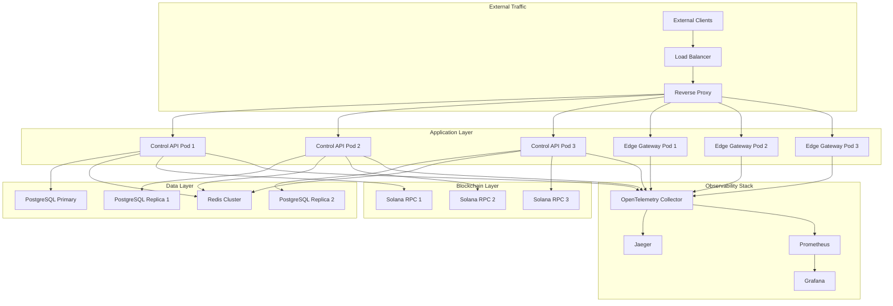
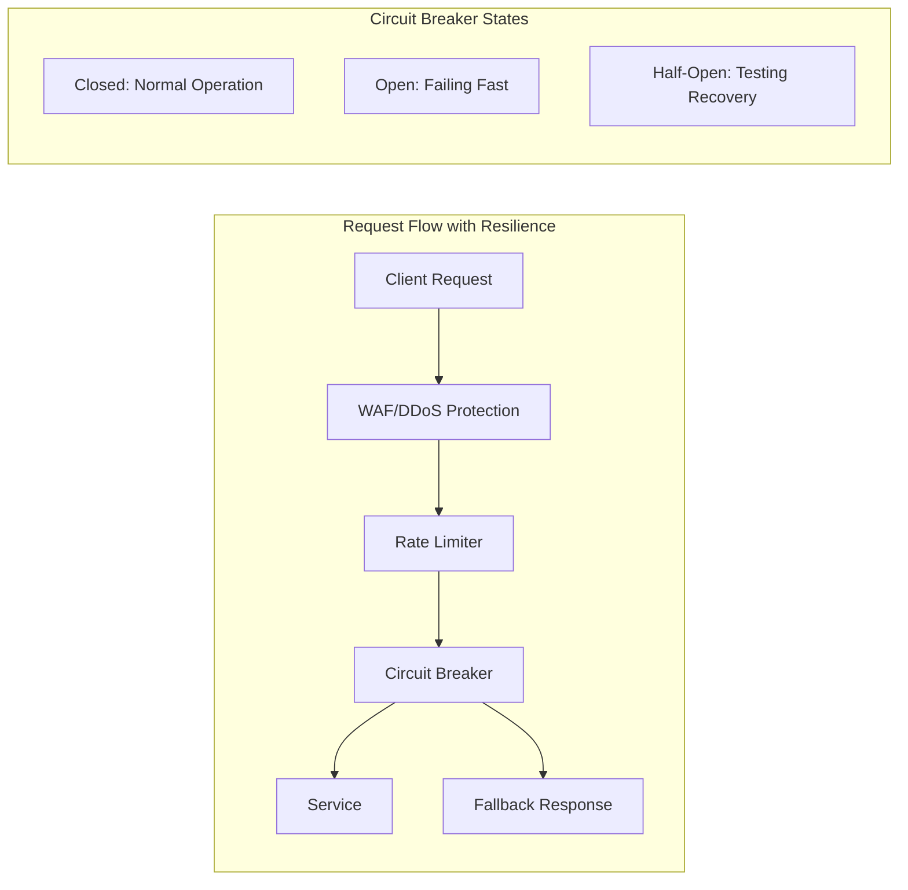

# Design Document: Production Reliability Enhancements

## Overview

This design enhances ProxySocialHub's production readiness by implementing high availability infrastructure, distributed systems resilience patterns, comprehensive observability, and robust API management. The system currently consists of a Go-based Control Plane (API service), Rust-based Data Plane (edge gateway), and Solana blockchain integration for escrow and agent verification.

The enhancements focus on eliminating single points of failure, implementing fault tolerance patterns, providing comprehensive observability through distributed tracing, and ensuring robust API documentation and error handling for the decentralized proxy network.

## Architecture

### High-Level Architecture



### Resilience Patterns Integration



## Components and Interfaces

### 1. High Availability Infrastructure

#### Redis Cluster Configuration
- **Cluster Mode**: 6-node cluster (3 masters, 3 replicas) with automatic failover
- **Data Sharding**: Hash slot distribution across master nodes
- **Persistence**: RDB snapshots + AOF for durability
- **Health Monitoring**: Redis Sentinel integration for automatic failover

```yaml
# Redis Cluster StatefulSet Configuration
apiVersion: apps/v1
kind: StatefulSet
metadata:
  name: redis-cluster
spec:
  serviceName: redis-cluster
  replicas: 6
  template:
    spec:
      containers:
      - name: redis
        image: redis:7-alpine
        command:
          - redis-server
          - /etc/redis/redis.conf
          - --cluster-enabled
          - yes
          - --cluster-config-file
          - nodes.conf
          - --cluster-node-timeout
          - "5000"
          - --appendonly
          - yes
```

#### PostgreSQL Streaming Replication
- **Primary-Replica Setup**: 1 primary + 2 replicas with streaming replication
- **Automatic Failover**: Patroni for leader election and failover management
- **Connection Pooling**: PgBouncer for connection management
- **Backup Strategy**: WAL-E for continuous archiving and point-in-time recovery

```yaml
# PostgreSQL Primary Configuration
apiVersion: postgresql.cnpg.io/v1
kind: Cluster
metadata:
  name: postgres-cluster
spec:
  instances: 3
  primaryUpdateStrategy: unsupervised
  postgresql:
    parameters:
      max_connections: "200"
      shared_buffers: "256MB"
      wal_level: "replica"
      max_wal_senders: "3"
      max_replication_slots: "3"
```

#### Kubernetes Auto-Scaling
- **HPA Configuration**: CPU (70%) and Memory (80%) thresholds
- **VPA Integration**: Vertical scaling for resource optimization
- **Pod Disruption Budgets**: Ensure minimum availability during updates
- **Node Auto-Scaling**: Cluster-level scaling based on resource demands

### 2. Distributed Systems Resilience

#### Circuit Breaker Implementation

**Go Control API Circuit Breaker**:
```go
type CircuitBreaker struct {
    maxFailures     int
    resetTimeout    time.Duration
    state          State
    failures       int
    lastFailTime   time.Time
    mutex          sync.RWMutex
}

func (cb *CircuitBreaker) Call(fn func() error) error {
    cb.mutex.Lock()
    defer cb.mutex.Unlock()
    
    if cb.state == Open {
        if time.Since(cb.lastFailTime) > cb.resetTimeout {
            cb.state = HalfOpen
            cb.failures = 0
        } else {
            return ErrCircuitOpen
        }
    }
    
    err := fn()
    if err != nil {
        cb.failures++
        cb.lastFailTime = time.Now()
        if cb.failures >= cb.maxFailures {
            cb.state = Open
        }
        return err
    }
    
    cb.failures = 0
    cb.state = Closed
    return nil
}
```

**Rust Edge Gateway Circuit Breaker**:
```rust
use std::sync::Arc;
use tokio::sync::RwLock;

pub struct CircuitBreaker {
    state: Arc<RwLock<CircuitState>>,
    config: CircuitConfig,
}

impl CircuitBreaker {
    pub async fn call<F, T, E>(&self, f: F) -> Result<T, CircuitError<E>>
    where
        F: FnOnce() -> Result<T, E>,
    {
        let state = self.state.read().await;
        match *state {
            CircuitState::Open { last_failure } => {
                if last_failure.elapsed() > self.config.timeout {
                    drop(state);
                    let mut state = self.state.write().await;
                    *state = CircuitState::HalfOpen;
                } else {
                    return Err(CircuitError::Open);
                }
            }
            _ => {}
        }
        drop(state);
        
        match f() {
            Ok(result) => {
                let mut state = self.state.write().await;
                *state = CircuitState::Closed { failures: 0 };
                Ok(result)
            }
            Err(e) => {
                let mut state = self.state.write().await;
                match *state {
                    CircuitState::Closed { failures } => {
                        if failures + 1 >= self.config.failure_threshold {
                            *state = CircuitState::Open {
                                last_failure: Instant::now(),
                            };
                        } else {
                            *state = CircuitState::Closed { failures: failures + 1 };
                        }
                    }
                    CircuitState::HalfOpen => {
                        *state = CircuitState::Open {
                            last_failure: Instant::now(),
                        };
                    }
                    _ => {}
                }
                Err(CircuitError::Failure(e))
            }
        }
    }
}
```

#### Advanced Rate Limiting
- **Token Bucket Algorithm**: Distributed rate limiting using Redis
- **Sliding Window**: Time-based rate limiting with Redis sorted sets
- **Progressive Penalties**: Escalating timeouts for repeat offenders
- **Geographic Rate Limiting**: Different limits based on client location

#### DDoS Protection and WAF
- **Layer 7 Protection**: Application-level attack detection
- **Rate-Based Rules**: Automatic blocking based on request patterns
- **Geo-Blocking**: Country-based access controls
- **Challenge-Response**: CAPTCHA integration for suspicious traffic

### 3. Blockchain Integration Resilience

#### Solana RPC Failover System
```go
type SolanaClient struct {
    endpoints    []string
    currentIndex int
    circuitBreakers map[string]*CircuitBreaker
    mutex        sync.RWMutex
}

func (s *SolanaClient) CallWithFailover(ctx context.Context, method string, params interface{}) (*rpc.Response, error) {
    for attempts := 0; attempts < len(s.endpoints); attempts++ {
        endpoint := s.getCurrentEndpoint()
        cb := s.circuitBreakers[endpoint]
        
        var response *rpc.Response
        err := cb.Call(func() error {
            var callErr error
            response, callErr = s.makeRPCCall(ctx, endpoint, method, params)
            return callErr
        })
        
        if err == nil {
            return response, nil
        }
        
        s.rotateEndpoint()
    }
    
    return nil, fmt.Errorf("all Solana RPC endpoints failed")
}
```

#### Transaction Queue Management
- **Persistent Queue**: Redis-based transaction queue with retry logic
- **Exponential Backoff**: Progressive retry delays for failed transactions
- **Transaction State Tracking**: Local state management for pending transactions
- **Atomic Operations**: Ensure consistency between database and blockchain state

### 4. Observability Implementation

#### OpenTelemetry Distributed Tracing

**Go Control API Tracing Setup**:
```go
func initTracer() (*sdktrace.TracerProvider, error) {
    exporter, err := jaeger.New(jaeger.WithCollectorEndpoint(
        jaeger.WithEndpoint(os.Getenv("JAEGER_ENDPOINT")),
    ))
    if err != nil {
        return nil, err
    }
    
    tp := sdktrace.NewTracerProvider(
        sdktrace.WithBatcher(exporter),
        sdktrace.WithResource(resource.NewWithAttributes(
            semconv.SchemaURL,
            semconv.ServiceNameKey.String("control-api"),
            semconv.ServiceVersionKey.String("1.0.0"),
        )),
    )
    
    otel.SetTracerProvider(tp)
    otel.SetTextMapPropagator(propagation.TraceContext{})
    
    return tp, nil
}

// Gin middleware for tracing
func TracingMiddleware() gin.HandlerFunc {
    return otelgin.Middleware("control-api")
}
```

**Rust Edge Gateway Tracing Setup**:
```rust
use opentelemetry::{global, sdk::trace as sdktrace, trace::TraceError};
use opentelemetry_jaeger as jaeger;
use tracing_opentelemetry::OpenTelemetryLayer;
use tracing_subscriber::{layer::SubscriberExt, Registry};

fn init_tracer() -> Result<sdktrace::Tracer, TraceError> {
    global::set_text_map_propagator(opentelemetry_jaeger::Propagator::new());
    
    jaeger::new_agent_pipeline()
        .with_service_name("edge-gateway")
        .with_auto_split_batch(true)
        .install_batch(opentelemetry::runtime::Tokio)
}

pub fn init_tracing() -> Result<(), Box<dyn std::error::Error>> {
    let tracer = init_tracer()?;
    let opentelemetry = OpenTelemetryLayer::new(tracer);
    
    let subscriber = Registry::default()
        .with(opentelemetry)
        .with(tracing_subscriber::fmt::layer());
    
    tracing::subscriber::set_global_default(subscriber)?;
    Ok(())
}
```

#### Custom Metrics and Monitoring
- **Business Metrics**: Proxy usage, AI compute jobs, payment processing rates
- **Performance Metrics**: Request latency, throughput, error rates
- **Infrastructure Metrics**: Resource utilization, network performance
- **Blockchain Metrics**: Transaction success rates, confirmation times, RPC health

### 5. API Management and Documentation

#### OpenAPI Specification Generation

**Swagger Integration for Go Control API**:
```go
// @title ProxySocialHub Control API
// @version 2.0
// @description Production-ready API for decentralized proxy network
// @termsOfService https://proxyhubb.com/terms
// @contact.name API Support
// @contact.url https://proxyhubb.com/support
// @contact.email support@proxyhubb.com
// @license.name MIT
// @license.url https://opensource.org/licenses/MIT
// @host api.proxyhubb.com
// @BasePath /v1
// @schemes https
func main() {
    r := gin.Default()
    
    // Swagger documentation endpoint
    r.GET("/swagger/*any", ginSwagger.WrapHandler(swaggerFiles.Handler))
    
    // API routes with Swagger annotations
    v1 := r.Group("/v1")
    {
        // @Summary Create new proxy session
        // @Description Creates a new proxy session with specified parameters
        // @Tags sessions
        // @Accept json
        // @Produce json
        // @Param session body CreateSessionRequest true "Session parameters"
        // @Success 201 {object} SessionResponse
        // @Failure 400 {object} ErrorResponse
        // @Failure 401 {object} ErrorResponse
        // @Router /sessions [post]
        v1.POST("/sessions", createSession)
    }
}
```

#### Request/Response Validation Middleware
```go
type ValidationMiddleware struct {
    schemas map[string]*jsonschema.Schema
}

func (v *ValidationMiddleware) ValidateRequest() gin.HandlerFunc {
    return func(c *gin.Context) {
        route := c.FullPath()
        schema, exists := v.schemas[route]
        if !exists {
            c.Next()
            return
        }
        
        var body interface{}
        if err := c.ShouldBindJSON(&body); err != nil {
            c.JSON(400, ErrorResponse{
                Error: "invalid_request",
                Message: "Request body is not valid JSON",
                Details: err.Error(),
            })
            c.Abort()
            return
        }
        
        if err := schema.Validate(body); err != nil {
            c.JSON(400, ErrorResponse{
                Error: "validation_failed",
                Message: "Request validation failed",
                Details: err.Error(),
            })
            c.Abort()
            return
        }
        
        c.Next()
    }
}
```

#### API Versioning Strategy
- **URL Versioning**: `/v1/`, `/v2/` path prefixes
- **Header Versioning**: `API-Version` header support
- **Backward Compatibility**: Maintain previous versions for 12 months
- **Deprecation Notices**: Clear communication of version lifecycle

## Data Models

### Enhanced Error Response Schema
```go
type ErrorResponse struct {
    Error     string                 `json:"error" example:"validation_failed"`
    Message   string                 `json:"message" example:"Request validation failed"`
    Details   interface{}            `json:"details,omitempty"`
    TraceID   string                 `json:"trace_id" example:"abc123def456"`
    Timestamp time.Time              `json:"timestamp" example:"2024-01-15T10:30:00Z"`
    Path      string                 `json:"path" example:"/v1/sessions"`
    Method    string                 `json:"method" example:"POST"`
}
```

### Circuit Breaker State Model
```go
type CircuitBreakerState struct {
    ServiceName    string        `json:"service_name"`
    State         string        `json:"state"` // "closed", "open", "half-open"
    FailureCount  int           `json:"failure_count"`
    LastFailure   *time.Time    `json:"last_failure,omitempty"`
    NextRetry     *time.Time    `json:"next_retry,omitempty"`
    SuccessRate   float64       `json:"success_rate"`
}
```

### Distributed Trace Context
```go
type TraceContext struct {
    TraceID    string            `json:"trace_id"`
    SpanID     string            `json:"span_id"`
    ParentID   string            `json:"parent_id,omitempty"`
    Baggage    map[string]string `json:"baggage,omitempty"`
    UserID     string            `json:"user_id,omitempty"`
    SessionID  string            `json:"session_id,omitempty"`
}
```

## Correctness Properties

*A property is a characteristic or behavior that should hold true across all valid executions of a system—essentially, a formal statement about what the system should do. Properties serve as the bridge between human-readable specifications and machine-verifiable correctness guarantees.*

### Property 1: High Availability Failover Timing
*For any* infrastructure component failure (Redis node, PostgreSQL primary, application pod), the system should restore service availability within the specified time limits (30-60 seconds) while maintaining data consistency.
**Validates: Requirements 1.1, 1.2, 1.3, 2.1**

### Property 2: Auto-Scaling Responsiveness  
*For any* traffic load pattern that exceeds current capacity, the HPA should scale resources automatically based on configured thresholds while maintaining service availability throughout the scaling process.
**Validates: Requirements 1.4**

### Property 3: Load Balancer Health Management
*For any* backend health state change, the load balancer should route traffic only to healthy backends and terminate SSL/TLS connections properly with optimized connection pooling.
**Validates: Requirements 1.5, 1.6, 1.7**

### Property 4: Blockchain Integration Resilience
*For any* Solana network issue (RPC failures, congestion, transaction failures), the system should maintain service availability through failover, queuing, exponential backoff, and local state management while preserving atomic operations.
**Validates: Requirements 2.1, 2.2, 2.3, 2.4, 2.7**

### Property 5: Blockchain Optimization and Monitoring
*For any* agent signature verification or network health monitoring operation, the system should cache results appropriately and alert operators of performance degradation.
**Validates: Requirements 2.5, 2.6**

### Property 6: Circuit Breaker Protection
*For any* downstream service failure or high latency condition, circuit breakers should prevent cascading failures by opening appropriately, providing graceful degradation, and returning cached responses when available.
**Validates: Requirements 3.1, 3.4, 3.6**

### Property 7: Distributed Rate Limiting
*For any* request rate pattern across multiple gateway instances, the rate limiter should enforce limits consistently using token bucket algorithm and implement progressive penalties for violations.
**Validates: Requirements 3.2, 3.7, 6.2**

### Property 8: DDoS and WAF Protection
*For any* malicious traffic pattern or attack, the WAF should filter threats effectively using challenge-response mechanisms, automatic IP blocking, geo-restrictions, and reputation scoring.
**Validates: Requirements 3.3, 6.1, 6.3, 6.5, 6.6**

### Property 9: Distributed Tracing Completeness
*For any* request flowing through the system, distributed tracing should capture complete timing information, errors, service dependencies, and correlation IDs with sub-millisecond precision across all microservices.
**Validates: Requirements 3.5, 4.1, 4.4**

### Property 10: Observability and Alerting
*For any* system metric threshold violation or performance degradation, the observability stack should trigger appropriate alerts, provide detailed performance breakdowns, and export custom business metrics while maintaining configured data retention policies.
**Validates: Requirements 4.2, 4.3, 4.5, 4.6, 4.7**

### Property 11: API Validation and Documentation
*For any* API request, the system should validate against OpenAPI specifications, enforce request/response schemas, return detailed validation errors for invalid requests, and generate accurate interactive documentation.
**Validates: Requirements 5.1, 5.4, 5.5, 5.6**

### Property 12: API Error Handling and Versioning
*For any* API error or version change, the system should return structured error responses with consistent schemas, appropriate HTTP status codes, and support multiple API versions simultaneously.
**Validates: Requirements 5.2, 5.3, 5.7**

### Property 13: Security Event Logging and SSL Enforcement
*For any* security event or SSL/TLS connection, the system should log detailed context for forensic analysis and enforce modern cipher suites and protocols.
**Validates: Requirements 6.4, 6.7**

### Property 14: Data Replication and Persistence
*For any* data write operation, the system should replicate changes to PostgreSQL replicas within 1 second and persist Redis changes to disk with cross-node replication.
**Validates: Requirements 7.1, 7.2**

### Property 15: Backup Management and Recovery
*For any* backup operation or disaster recovery scenario, the system should create consistent point-in-time snapshots without service interruption, maintain retention policies, verify backup integrity, and restore within 4 hours.
**Validates: Requirements 7.3, 7.4, 7.5, 7.6, 7.7**

### Property 16: Configuration Management and Validation
*For any* configuration change or secret management operation, the system should validate configurations before applying them and manage environment-specific configurations through secure secret management.
**Validates: Requirements 8.1, 8.5**

### Property 17: Safe Deployment Operations
*For any* deployment operation, the system should use rolling updates or blue-green deployments to maintain availability, validate service health before routing traffic, automatically rollback on issues, and preserve data consistency during rollbacks.
**Validates: Requirements 8.2, 8.3, 8.4, 8.6, 8.7**

## Error Handling

### Structured Error Response System

All services implement consistent error response formats with the following structure:

```go
type ErrorResponse struct {
    Error     string      `json:"error"`           // Machine-readable error code
    Message   string      `json:"message"`         // Human-readable description  
    Details   interface{} `json:"details,omitempty"` // Additional context
    TraceID   string      `json:"trace_id"`        // Distributed trace ID
    Timestamp time.Time   `json:"timestamp"`       // Error occurrence time
    Path      string      `json:"path"`            // Request path
    Method    string      `json:"method"`          // HTTP method
}
```

### Error Categories and Handling

1. **Infrastructure Errors**
   - Database connection failures → Circuit breaker activation + cached responses
   - Redis cluster failures → Failover to remaining nodes + degraded functionality
   - Blockchain RPC failures → Automatic endpoint rotation + transaction queuing

2. **Application Errors**
   - Validation failures → Detailed field-level error messages
   - Authentication failures → Structured error with retry guidance
   - Rate limiting → Progressive penalty information + retry-after headers

3. **Network Errors**
   - Timeout errors → Circuit breaker protection + exponential backoff
   - Connection errors → Automatic retry with jitter
   - SSL/TLS errors → Detailed certificate and protocol information

### Graceful Degradation Strategies

- **Read-Only Mode**: When primary database fails, serve cached data and disable writes
- **Cached Responses**: Return stale but valid data when services are unavailable
- **Feature Toggles**: Disable non-critical features during high load or failures
- **Queue Buffering**: Buffer requests during temporary service unavailability

## Testing Strategy

### Dual Testing Approach

The system requires both unit testing and property-based testing for comprehensive coverage:

**Unit Tests**: Focus on specific examples, edge cases, and integration points
- Circuit breaker state transitions with specific failure scenarios
- Rate limiter behavior with exact request patterns  
- API validation with known invalid inputs
- Error response formatting with specific error conditions

**Property-Based Tests**: Verify universal properties across all inputs
- Failover timing across random infrastructure failure scenarios
- Rate limiting consistency across random request patterns
- Tracing completeness across random service call flows
- Data consistency across random transaction patterns

### Property-Based Testing Configuration

- **Testing Framework**: Use Hypothesis (Python), QuickCheck (Haskell), or similar for Go/Rust
- **Test Iterations**: Minimum 100 iterations per property test
- **Test Tagging**: Each property test references its design document property
- **Tag Format**: `Feature: production-reliability-enhancements, Property {number}: {property_text}`

### Testing Infrastructure

1. **Chaos Engineering**: Automated failure injection to test resilience patterns
2. **Load Testing**: Verify auto-scaling and rate limiting under realistic traffic
3. **Security Testing**: Validate WAF protection against known attack patterns
4. **Performance Testing**: Ensure observability overhead remains under 5%
5. **Integration Testing**: End-to-end request flows across all services

### Monitoring and Observability Testing

- **Trace Completeness**: Verify all service calls generate proper trace spans
- **Metric Accuracy**: Validate custom business metrics against known values
- **Alert Reliability**: Test alert triggering with controlled threshold violations
- **Dashboard Accuracy**: Verify Grafana dashboards reflect actual system state

### Blockchain Integration Testing

- **RPC Failover**: Test automatic endpoint switching during simulated failures
- **Transaction Queuing**: Verify queue behavior during network congestion
- **State Consistency**: Test atomic operations between database and blockchain
- **Signature Caching**: Validate cache hit rates and correctness

This comprehensive testing strategy ensures that all reliability enhancements work correctly under both normal and failure conditions, providing confidence in the system's production readiness.