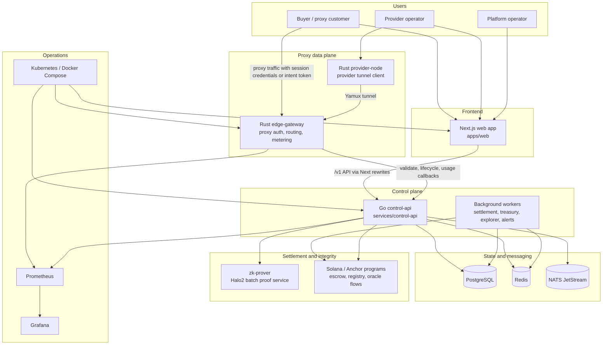
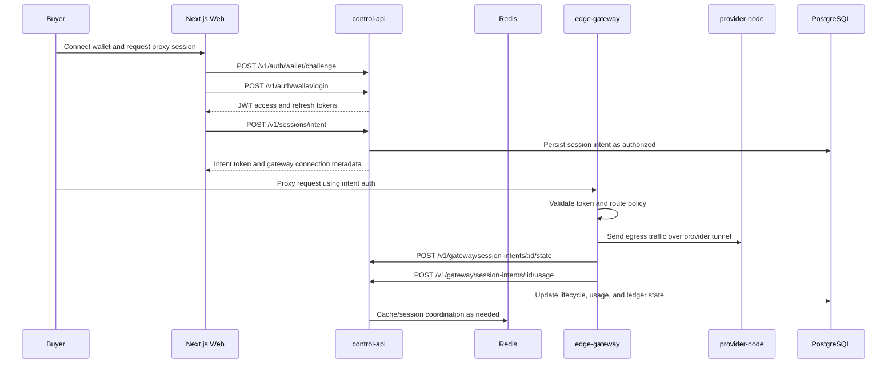
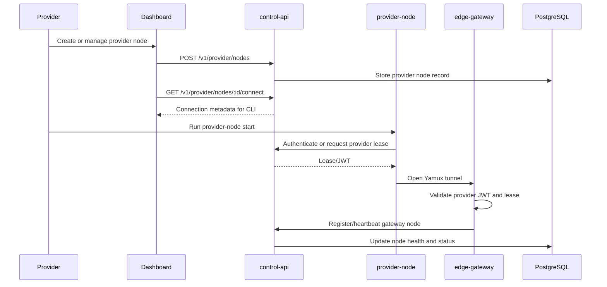
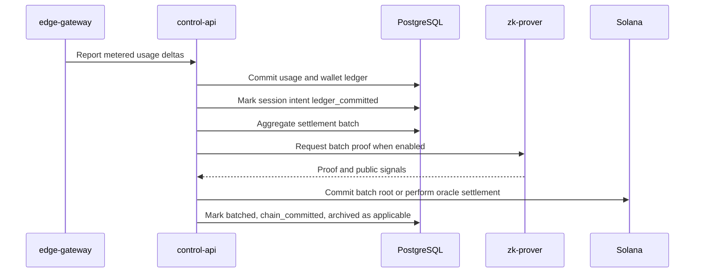

# ProxyHubb Project Review Report

Generated: 2026-06-01  
Repository: `F:\project\proxyhubb`  
Review type: static architecture, structure, workflow, quality, and risk assessment

## Executive Summary

ProxyHubb is an ambitious decentralized proxy marketplace implemented as a polyglot monorepo. The system has a real product shape: a Next.js web app, Go control plane, Rust edge gateway and provider node, Solana programs, a ZK proving service, SDKs, Docker/Kubernetes infrastructure, migrations, and operational documentation.

Overall rating: **7.0 / 10**

The project has strong architectural intent and a good amount of core implementation, but it is not yet production-clean. The biggest blockers are repository hygiene, tracked sensitive files, CI/workflow drift, and control-plane complexity concentrated in a very broad Go service. The codebase looks like a serious platform in active development, with multiple release-candidate artifacts and in-flight wallet/provider-node work.

## Rating Breakdown

| Area | Rating | Notes |
|---|---:|---|
| Product completeness | 8.0 / 10 | Marketplace, wallet, sessions, provider ops, explorer, governance, social features, SDKs, and settlement flows are represented. |
| Architecture | 7.5 / 10 | Clear control plane/data plane split with supporting infra. Some boundaries are blurred by a large control-api and hybrid DB/chain authority. |
| Code structure | 6.5 / 10 | Good top-level separation, but many artifacts, legacy folders, generated files, and broad route modules make navigation harder. |
| Security posture | 5.5 / 10 | Good security features exist, but tracked cert private keys and generated auth/session artifacts are a serious repo hygiene issue. |
| Testing and CI | 5.5 / 10 | Many tests and workflows exist, but CI references missing or mismatched project pieces. Some test scripts appear stale. |
| Documentation | 8.0 / 10 | Strong docs in `docs/`, including architecture, OpenAPI, provider, wallet, and Solana smoke docs. Missing root README hurts onboarding. |
| Operations readiness | 7.0 / 10 | Docker Compose, Kubernetes, Prometheus, Grafana, health checks, and release gates exist. Needs cleanup and deterministic secrets/config handling. |
| Maintainability | 6.5 / 10 | The system is feature-rich but has high cognitive load, many partially active subsystems, and mixed maturity across components. |

## Review Scope

Key areas inspected:

| Area | Path |
|---|---|
| Web app | `apps/web/` |
| Control API | `services/control-api/` |
| Edge gateway | `services/edge-gateway/` |
| Provider node | `services/provider-node/` |
| ZK prover | `services/zk-prover/` |
| Solana programs | `services/solana-programs/proxyhub/`, `programs/` |
| Database migrations | `migrations/` |
| Infrastructure | `docker-compose*.yml`, `infra/`, `.github/workflows/` |
| SDKs and examples | `sdks/`, `examples/`, `cli/` |
| Documentation | `docs/` |

Repository scale from file discovery:

| Metric | Count |
|---|---:|
| Total files found by `rg --files` | 1,152 |
| Main source/config/doc files | 992 |
| Migration files | 142 |
| Test/spec files found | 67 |
| Top-level `services/` files | 515 |
| Top-level `apps/` files | 336 |

Primary languages and formats:

| Extension | Count |
|---|---:|
| `.go` | 380 |
| `.tsx` | 194 |
| `.sql` | 151 |
| `.ts` | 111 |
| `.rs` | 76 |
| `.md` | 28 |
| `.ps1` | 27 |
| `.json` | 26 |
| `.jsonl` | 25 |
| `.yml` | 15 |

## System Architecture

ProxyHubb is best understood as a marketplace/control plane plus a proxy delivery/data plane.



### Component Responsibilities

| Component | Responsibility |
|---|---|
| `apps/web` | Dashboard, marketplace, wallet UI, explorer, provider flows, community/social pages, API client wrappers. |
| `services/control-api` | Business logic, auth, sessions, wallet ledger, marketplace, provider registry, gateway callbacks, settlement, Solana integration, workers, admin/security APIs. |
| `services/edge-gateway` | Proxy authentication, session validation, request routing, metering, provider tunnel coordination, security/rate-limit logic, Prometheus metrics. |
| `services/provider-node` | Provider-side CLI/daemon, node registration, tunnel connection, failover, metrics. |
| `services/zk-prover` | HTTP service for Halo2 batch proof generation. |
| `services/solana-programs/proxyhub` | Anchor programs for proxy marketplace/session/escrow behavior. |
| `migrations` | PostgreSQL schema source of truth for the control plane. |
| `infra` | Kubernetes, Prometheus, Grafana, HAProxy, and deployment support. |
| `sdks`, `cli`, `examples` | External developer and operator integrations. |

## Project Structure

High-level structure:

```text
proxyhubb/
  apps/
    web/                      Next.js 16 frontend
  services/
    control-api/              Go/Gin control plane
    edge-gateway/             Rust proxy gateway
    provider-node/            Rust provider daemon
    zk-prover/                Rust Halo2 proof service
    solana-programs/          Anchor/Solana programs
    admin-cli/                Rust admin tooling
    relayer/                  Decommissioned Ethereum relayer stub
  migrations/                 PostgreSQL migrations
  docs/                       Architecture, OpenAPI, wallet/provider reports
  infra/                      Docker/K8s/observability config
  scripts/                    Local dev, Solana, provider, release scripts
  sdks/                       Go, Node, Python SDKs
  cli/                        Rust CLI wrapper
  testing/                    Load, fuzz, release-gate artifacts
```

The top-level separation is good. The main structural concern is that the repository also contains generated artifacts, logs, videos, build outputs, and historical output files. That makes it harder to tell which files are source of truth.

## System Workflow

### Buyer Session Flow



### Provider Onboarding Flow



### Settlement Flow



## Architecture Assessment

### What Works Well

- The control plane/data plane split is sound. The Go service owns durable business state while the Rust gateway owns latency-sensitive proxy traffic.
- Session intents are a good abstraction. They allow the system to move from legacy username/password proxy sessions toward signed, policy-carrying access tokens.
- Provider leases are a strong model for provider capability admission and short-lived trust.
- Redis, PostgreSQL, NATS, Prometheus, Grafana, and Docker Compose/Kubernetes are conventional and appropriate infrastructure choices for this type of platform.
- The Solana-only direction is clearer than the previous hybrid EVM/Solana direction. `services/relayer/main.go` now clearly declares the Ethereum relayer decommissioned.
- The OpenAPI document in `docs/openapi.yaml` explicitly explains hybrid settlement semantics and authority headers, which is valuable for external builders and QA.

### Main Architectural Risks

- The control API is very broad. It registers many route groups and owns marketplace, wallet, social, governance, explorer, provider, admin, Solana, security, and background worker concerns. This increases regression risk.
- The authority model is hybrid. Some responses are DB-authoritative, some are chain-authoritative, and some are operationally hybrid. The docs acknowledge this, but the product should continue making authority mode visible in APIs and UI.
- There are multiple registry concepts: provider nodes, gateway nodes, explorer nodes, Solana registry, and dashboard provider records. These need a single documented source-of-truth matrix.
- The repo contains legacy and partially active surfaces, including a decommissioned relayer, legacy Swagger docs, empty/missing `packages/contracts`, and many release/test artifacts.
- The current Docker and CI workflows show signs of drift from the actual tree.

## Pros

- Strong product vision with many implemented subsystems.
- Clear service-level architecture for web, control plane, edge gateway, provider node, ZK, and Solana.
- Good use of typed ecosystems: Go for API/workers, Rust for gateway/provider performance paths, TypeScript for frontend.
- Solid operational primitives: health endpoints, metrics, Prometheus/Grafana config, Docker Compose, Kubernetes manifests, release-gate artifacts.
- Good security feature coverage inside the application: JWT auth, provider token hashing, credential encryption hooks, rate limiting, WAF middleware, DDoS middleware, audit/GDPR/security APIs, treasury velocity controls, multisig concepts.
- Good documentation density under `docs/`, especially architecture, wallet, provider, OpenAPI, and Solana smoke material.
- Migrations are explicit and extensive, which makes data evolution inspectable.
- The edge gateway has meaningful production-minded concerns: cache sizing, session cache TTL, circuit breakers, routing, QoS, geolocation, metering, and provider tunnel management.
- The provider-node CLI has useful operational behavior, including registration, config loading, metrics, and multi-gateway failover.

## Cons and Risks

### Critical

- **Tracked private key files are present.** `git ls-files` shows tracked certificate private keys under `certs/`, including `certs/ca.key`, `certs/client.key`, and `certs/server.key`. Even if they are local/dev certs, they should be removed from git and rotated.
- **Tracked runtime/auth artifacts are present.** Files such as `login_res.json`, `session_res.json`, `payload.json`, `scan_results.json`, and `system-health-report.json` are tracked. These are now ignored by `.gitignore`, but tracked files remain tracked until removed from git.

### High

- CI appears inconsistent with the current tree:
  - `.github/workflows/proxyhubb-ci.yml` runs `npm test` in `apps/web`, but `apps/web/package.json` does not define a `test` script.
  - `.github/workflows/security.yml` audits `packages/contracts`, but file discovery found no active `packages/contracts` contents.
  - Workflows include Solidity/EVM contract scanning even though the repo docs say Ethereum relayer/contracts are decommissioned.
- Rust application lockfiles are not present and `.gitignore` ignores `Cargo.lock`. For deployed Rust binaries, lockfiles should normally be tracked for reproducible builds and useful `cargo audit` results.
- The repository has many generated outputs and logs in source areas, including `.log`, `.out`, `.err`, `.jsonl`, coverage, Playwright videos, and release-gate artifacts.
- There is no root README, so a new contributor has to infer setup from many docs and compose files.

### Medium

- The root `package.json` contains only `@next/swc-linux-x64-gnu`, which looks like an accidental platform-specific dependency rather than useful root workspace tooling.
- The control API is large enough that ownership boundaries should be more explicit. A modular monolith can work, but the route count and feature breadth make regression isolation harder.
- Docker Compose files are numerous (`dev`, `full`, `prod`, `secure`, `minimal`, `test`, `mesh`, `web-dev`, `local-solana`), which is flexible but confusing without a clear environment matrix.
- The web app uses Next rewrites for `/v1/*`, which is good for browser simplicity, but the API URL behavior should be documented clearly because it affects local Docker, Vercel, and production deployments.
- Several docs are generated reports. They are useful, but the project needs a smaller canonical entrypoint that tells developers which report to read first.

## CI and Test Assessment

Existing quality signals:

- Go backend workflow includes `go vet`, `staticcheck`, build, race tests, coverage, wallet/billing targeted tests.
- Frontend workflow includes lint, typecheck, build, and an intended unit test step.
- Edge gateway workflow includes `cargo fmt`, `cargo clippy -D warnings`, and build.
- Security workflow includes `govulncheck`, `gosec`, `npm audit`, Trivy, GitLeaks, TruffleHog, cargo audit, and CodeQL.
- Playwright e2e tests exist under `apps/web/e2e`.
- Go tests exist across API, models, Redis, Solana, geo, provider lease, session intent, and other packages.

Concerns:

- The workflows look stronger than the current repository hygiene. They may fail or create noise because of stale paths and missing scripts.
- Security scanners are configured, but tracked secret-like files already exist, so scanner output must be treated as actionable.
- Full local verification was not run as part of this report. This assessment is based on static inspection of source, manifests, docs, workflows, and repository state.

## Security Assessment

Security strengths:

- Credential encryption hooks in `services/control-api/main.go`.
- HMAC provider token hashing.
- Gateway shared-secret auth for gateway callback routes.
- Rate limits on wallet-sensitive endpoints.
- WAF, DDoS protection, circuit breaker middleware, audit APIs, security APIs, and observability.
- Treasury controls including velocity guard and multisig-related code paths.
- Provider lease and session-intent signing abstractions.

Security weaknesses:

- Tracked certificate private keys must be treated as compromised.
- Tracked auth/session output files should be removed and any contained credentials/tokens rotated.
- Local `.env` exists in the workspace. It is ignored, which is correct, but the project should make sure no `.env` values have ever been committed.
- Docker Compose mounts keypair material. This can be acceptable for local dev, but production should use a real secrets manager or Kubernetes secrets with rotation.
- The broad control API increases blast radius. Authorization tests should cover every sensitive route group.

## Documentation Assessment

Strong docs:

- `docs/SYSTEM_ARCHITECTURE_AND_PRODUCT_DEEP_DIVE.md`
- `docs/SYSTEM_ANALYSIS_REPORT.md`
- `docs/WALLET_SYSTEM_DEEP_DIVE_REPORT.md`
- `docs/PROVIDER_SYSTEM_DEEP_DIVE.md`
- `docs/openapi.yaml`
- `docs/DEV_SOLANA_SMOKE.md`
- `docs/MANUAL_DEVNET_SESSION.md`

Missing or weak docs:

- No root README.
- No concise "which Docker Compose file should I use?" guide.
- No single source-of-truth lifecycle table for provider node state, gateway node state, explorer node state, and Solana registry state.
- Legacy `services/control-api/docs` Swagger artifacts are explicitly non-authoritative, but they still exist and may confuse tooling.

## Recommended Priorities

1. **Clean tracked secrets and rotate keys.** Remove tracked private keys and runtime auth artifacts from git, rotate anything that may have been real, and consider history cleanup if the repo is shared.
2. **Make CI match the current project.** Add the missing frontend `test` script or remove the step; remove or restore `packages/contracts`; align security scans with the Solana-only architecture.
3. **Add a root README.** Include quick start, service map, required env vars, recommended compose file, and links to canonical docs.
4. **Reduce repository noise.** Move release-gate logs, Playwright videos, coverage files, build outputs, and generated logs into ignored artifact directories.
5. **Track Rust lockfiles for deployed binaries.** Keep `Cargo.lock` for `edge-gateway`, `provider-node`, `zk-prover`, `cli`, and `admin-cli` unless there is a documented reason not to.
6. **Define source-of-truth ownership.** Document which system owns provider node identity, gateway health, explorer visibility, session state, settlement state, and on-chain authority.
7. **Split control-api boundaries internally.** Keep the deployable as one service if desired, but create clearer package boundaries around wallet, sessions, provider, explorer, social, settlement, and admin.
8. **Create end-to-end release checks.** One smoke command should validate wallet auth, session intent creation, gateway proxy auth, provider-node tunnel, usage reporting, and settlement state transition.
9. **Keep OpenAPI authoritative.** Add a check that detects route/OpenAPI drift for the most important `/v1` endpoints.
10. **Document environment modes.** Clarify `docker-compose.yml`, `docker-compose.dev.yml`, `docker-compose.prod.yml`, `docker-compose.secure.yml`, `docker-compose.minimal.yml`, and `docker-compose.local-solana.yml`.

## Final Verdict

ProxyHubb is not a small prototype. It has the architecture and code volume of a real marketplace and network platform. The core design is credible: a Go control plane, Rust data plane, provider daemon, Redis/Postgres/NATS backing services, Solana settlement, and a modern Next.js dashboard.

The project should be rated **7.0 / 10 today**. With secret cleanup, CI repair, artifact cleanup, a root README, and clearer ownership boundaries, it could move into the **8.0+** range. The highest priority is not adding more features; it is making the existing system safer, cleaner, and easier to verify.
