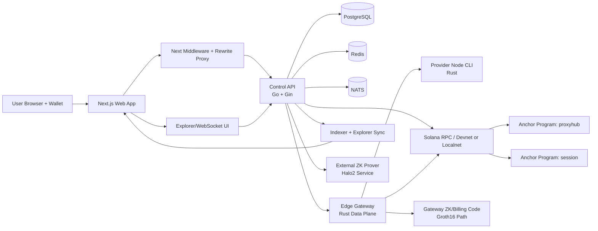

# ProxyHubb Technical Evaluation Report

Date: 2026-05-01

## Scope And Method

This report is based on a static code and artifact review of the current repository state. The review covered:

- Runtime topology and service wiring in [docker-compose.yml](docker-compose.yml)
- Backend entrypoint, middleware, and route registration in [services/control-api/main.go](services/control-api/main.go)
- Database architecture and active DB access path in [services/control-api/DATABASE_ARCHITECTURE.md](services/control-api/DATABASE_ARCHITECTURE.md), [services/control-api/internal/db/db.go](services/control-api/internal/db/db.go), and [services/control-api/internal/db/social.go](services/control-api/internal/db/social.go)
- Frontend auth, middleware, rewrites, and realtime hooks in [apps/web/src/lib/auth.tsx](apps/web/src/lib/auth.tsx), [apps/web/src/middleware.ts](apps/web/src/middleware.ts), [apps/web/next.config.ts](apps/web/next.config.ts), and [apps/web/src/lib/websocket.tsx](apps/web/src/lib/websocket.tsx)
- Solana programs and tests in [services/solana-programs/proxyhub](services/solana-programs/proxyhub)
- Off-chain blockchain integration in [services/control-api/internal/solana](services/control-api/internal/solana), [services/edge-gateway/src/billing/solana.rs](services/edge-gateway/src/billing/solana.rs), and [services/zk-prover/src/main.rs](services/zk-prover/src/main.rs)
- Existing health and security artifacts in [system-health-report.json](system-health-report.json), [scan_results.json](scan_results.json), and [SYSTEM_READINESS_REPORT_2026-04-15.md](SYSTEM_READINESS_REPORT_2026-04-15.md)

Validation note:

- Current editor diagnostics were clean for `apps/web`, `services/control-api`, and `services/solana-programs/proxyhub` during this review.
- This pass did not execute the full Docker stack, Go test suite, Playwright suite, or Anchor localnet suite end to end.

## Executive Summary

ProxyHubb is no longer a prototype. It is a real multi-service platform with a substantial Go control plane, a Next.js product surface, a Rust edge runtime, a provider CLI, a Solana Anchor workspace, and an evolving proof-and-settlement pipeline.

The architecture is best described as **hybrid decentralized** rather than fully decentralized. The system already pushes some economically sensitive and governance-critical logic toward Solana, but the operational source of truth for most user workflows still lives in the off-chain control plane and PostgreSQL. That is a reasonable intermediate architecture for testnet, but it means the strongest subsystem today is the backend, not the on-chain runtime.

The project is in good shape for internal engineering testing and credible for a guarded devnet or closed-alpha testnet. It is **not yet ready for an unrestricted public testnet with meaningful economic activity** unless the team first converges the proof stack, locks down a few remaining auth and documentation drifts, and proves the settlement path under failure.

### Readiness Score

| Scope | Score | Assessment |
| --- | ---: | --- |
| Internal engineering/devnet testing | 8.0/10 | Strong enough to iterate product and infrastructure together |
| Closed alpha on devnet | 7.4/10 | Reasonable with guardrails and monitored operator oversight |
| Public testnet release | 6.8/10 | Viable only after one focused stabilization sprint |
| Production/mainnet with real economic risk | 4.5/10 | Not ready |

## 1. System Architecture & Workflow

### High-Level Architecture

ProxyHubb is organized around a clear off-chain control plane with progressively on-chain enforcement:

- The **web app** is a Next.js 16 application that provides wallet login, marketplace, provider dashboards, governance UI, explorer views, and user settings.
- The **control-api** is the system brain. It handles auth, sessions, wallets, marketplace, provider onboarding, disputes, governance mirroring, explorer indexing, settlement coordination, and background workers.
- The **edge-gateway** is the runtime data plane. It is responsible for proxy traffic, routing, metering, node registration callbacks, session-intent lifecycle updates, and some billing/chain integration.
- The **provider-node** CLI is the provider-facing worker that authenticates with provider tokens or JWTs, registers nodes, connects to the gateway, and emits heartbeats.
- **PostgreSQL** is the active operational database for both core and social data in the current runtime path.
- **Redis** is used for cache, rate limiting, config sync, locking, and transient session/auth support.
- **NATS** is the asynchronous event bus.
- **Solana programs** implement escrow, staking, governance, KYC attestation, usage-proof commitment, state channels, and session/gateway primitives.
- The **zk-prover** service provides an external proof API, while other proof-related code also exists in the control-api and edge-gateway.

### Visual Diagram

### System Workflow

#### 1. Wallet authentication and session bootstrap

1. A user visits the web app.
2. [apps/web/src/middleware.ts](apps/web/src/middleware.ts) protects `/dashboard/*`, `/settings/*`, and `/governance/*` using cookies and JWT verification or a backend validation fallback.
3. The web client requests a wallet challenge from `POST /v1/auth/wallet/challenge`.
4. [services/control-api/internal/api/auth.go](services/control-api/internal/api/auth.go) generates a nonce, optionally mixes in a recent Solana blockhash, stores the challenge in Redis or in-memory fallback, and returns the signable message.
5. The wallet signs the message client-side.
6. `POST /v1/auth/wallet/login` verifies the Ed25519 signature, finds or creates the user/profile, ensures a wallet exists, and issues backend JWT credentials.

#### 2. Product interaction and API flow

1. The browser calls same-origin `/v1/*` routes through Next rewrites configured in [apps/web/next.config.ts](apps/web/next.config.ts).
2. The control-api attaches security middleware in [services/control-api/main.go](services/control-api/main.go): CORS filtering, emergency breaker, tracing, WAF, DDoS protection, security headers, metrics, and circuit breakers.
3. Optional auth is applied at `/v1`; authenticated business routes live under a protected sub-router with `RequireAuth()`.

#### 3. Session intent and traffic routing flow

1. An authenticated user requests a session intent via `POST /v1/sessions/intent`.
2. [services/control-api/internal/api/session.go](services/control-api/internal/api/session.go) resolves trust tier, applies routing defaults, enforces concurrency limits, issues an HS256 session-intent JWT, and persists a `session_intents` record.
3. The edge-gateway validates that token, accepts runtime traffic, and calls back to:
   - `POST /v1/gateway/session-intents/:id/state`
   - `POST /v1/gateway/session-intents/:id/usage`
4. Those callbacks update lifecycle and metering state in PostgreSQL via [services/control-api/internal/api/gateway.go](services/control-api/internal/api/gateway.go).

#### 4. Provider and gateway workflow

1. Providers obtain provider tokens through protected routes in [services/control-api/internal/api/provider_token.go](services/control-api/internal/api/provider_token.go).
2. The provider-node CLI authenticates and receives a JWT for subsequent operations.
3. The edge-gateway registers nodes and posts heartbeats through gateway-authenticated internal routes.
4. Provider node heartbeats can be mirrored on-chain from [services/control-api/internal/api/provider_nodes.go](services/control-api/internal/api/provider_nodes.go).

#### 5. Explorer, telemetry, and async processing

1. Background workers and indexers start from [services/control-api/main.go](services/control-api/main.go).
2. Explorer data, decentralization state, node updates, and blockchain activity are mirrored into DB-backed explorer tables.
3. Realtime updates are delivered to the frontend through websocket endpoints and custom hooks.

#### 6. Blockchain and settlement workflow

1. For governance, escrow, provider heartbeat, KYC, and other chain-sensitive flows, the control-api checks capability/readiness in [services/control-api/internal/solana/feature_guard.go](services/control-api/internal/solana/feature_guard.go).
2. The control-api or edge-gateway then builds transactions or submits commitments through Solana clients.
3. The current system still mixes:
   - DB mirrors
   - off-chain commitments
   - on-chain transactions
   - runtime capability guards

The result is a pragmatic hybrid system, but not yet a fully chain-authoritative one.

## 2. Backend & Database Deep Dive

### API Analysis

#### Structure

The backend route surface is wide and mature. [services/control-api/main.go](services/control-api/main.go) wires public, optional-auth, and protected routes across sessions, wallets, orders, escrow, governance, provider operations, social surfaces, analytics, explorer, trustless proofs, channels, and audit.

Key architectural strengths:

- Clear optional-auth versus protected route separation
- Good middleware ordering for tracing, security, and runtime safety
- Explicit admin fail-closed behavior for `/v1/admin/*`
- Capability-guard pattern for chain-authoritative features
- Authority headers that expose whether a route is DB-authoritative or chain-authoritative

#### Security posture

The API security baseline is better than average for a repo at this stage:

- Wallet-only auth path is active in [services/control-api/internal/api/auth.go](services/control-api/internal/api/auth.go)
- Gateway control-plane endpoints require `X-Gateway-Auth` backed by `GATEWAY_SHARED_SECRET`
- Provider tokens are HMAC-hashed before persistence in [services/control-api/internal/api/provider_token.go](services/control-api/internal/api/provider_token.go)
- Session credentials are encrypted and the service can block startup if unencrypted active credentials remain
- Financial mutation endpoints are explicitly rate limited in [services/control-api/internal/api/wallet.go](services/control-api/internal/api/wallet.go)
- WAF, DDoS protection, CSP, HSTS-style headers, tracing, and circuit breakers are active in the runtime entrypoint

Important concerns:

- The service is still a large monolith. Strong middleware does not change the fact that one binary currently owns auth, wallets, market logic, explorer, telemetry, settlement orchestration, and governance mirroring.
- Several global singletons in [services/control-api/internal/api/init.go](services/control-api/internal/api/init.go) make runtime composition convenient, but increase hidden coupling and reduce isolation.
- Session-intent signing has been separated from gateway route auth: [services/control-api/internal/sessionintent/token.go](services/control-api/internal/sessionintent/token.go) now uses `SESSION_SECRET`, while `GATEWAY_SHARED_SECRET` remains dedicated to edge-gateway control-plane authentication.

#### Efficiency and runtime behavior

The backend shows credible attention to efficiency:

- Connection pooling is configured in [services/control-api/internal/db/db.go](services/control-api/internal/db/db.go)
- Read-replica support exists
- Redis-backed rate limiting and config sync exist
- Materialized view refresh for provider leaderboard runs concurrently
- Background workers and NATS reduce some synchronous load
- Explorer and indexer workloads are segregated into dedicated flows

The main efficiency risk is not a single slow query. It is **concentration of responsibility**. The control-api is still the operational center of gravity for nearly every critical flow.

#### Contract drift

There is still meaningful API contract drift:

- [docs/openapi.yaml](docs/openapi.yaml) still documents `/v1/auth/register` and `/v1/auth/login` email-password flows, while the active backend route registration in [services/control-api/internal/api/auth.go](services/control-api/internal/api/auth.go) is wallet-first.
- The OpenAPI file still carries an `Admin` tag even though admin endpoints are hard-disabled at runtime.

That is not just documentation debt. It creates integration risk for SDKs, QA, and external testers.

### Database System

#### Current active topology

The checked-in database architecture document still describes a split strategy with optional Supabase for social data. The active code path does not.

- [services/control-api/internal/db/social.go](services/control-api/internal/db/social.go) returns the main DB handle for `Social()`
- `InitSocial()` is a no-op

In practice, the current runtime is a **single active PostgreSQL source of truth** for both core and social tables.

#### Schema depth

The schema is extensive and operationally serious:

- 124 SQL migration files exist under [migrations](migrations)
- 8 service-local SQL migration files exist under [services/control-api/migrations](services/control-api/migrations)
- 39 Go test files exist under [services/control-api](services/control-api)

Important domain areas include:

- Identity and auth
- Wallets and ledger entries
- Sessions and `session_intents`
- Marketplace listings, orders, escrow, and disputes
- Provider earnings, provider tokens, node registrations
- Explorer tables and blockchain state caches
- Governance and review attestations
- Usage receipts, settlement manifests, and ZK batch persistence

#### Data management and bootstrapping

Initialization is conservative, which is good:

- SQL migrations run only when `AUTO_MIGRATE=true`
- [services/control-api/internal/db/seeds.go](services/control-api/internal/db/seeds.go) performs lightweight system-config seeding rather than broad synthetic data loading
- The only checked seed in this path is the treasury wallet config

That means the system is not depending on brittle demo-data seeding to appear healthy.

#### Database strengths

- Strong migration volume indicates sustained schema work, not ad hoc table creation
- Soft-delete support is broadly applied
- Audit partitioning and RLS-related migration work show attention to durability and isolation
- Newer session-intent and settlement tables are aligned with the V2 workflow rather than the older session-only model

#### Database risks

- The repo still carries **two migration tracks**: a main migration tree and control-api-local migration patches. That is workable, but increases operator complexity.
- Documentation still describes a split social DB model that is no longer active.
- The breadth of the schema means performance regressions or inconsistent indexing can show up late and in multiple product areas.
- Social, marketplace, wallet, explorer, and governance mirrors now all share the same DB path, increasing contention risk as traffic grows.

## 3. Blockchain & Wallet System Integration

### Web3 Deep Dive

#### On-chain architecture

ProxyHubb uses an Anchor workspace with two deployed program identities configured in [services/solana-programs/proxyhub/Anchor.toml](services/solana-programs/proxyhub/Anchor.toml):

| Program | Purpose |
| --- | --- |
| `proxyhub` | Escrow, multisig oracle, disputes, governance, staking, KYC/admin attestations, ZK batch commitment, state-channel groundwork |
| `session` | Session lifecycle, gateway registration, heartbeat, usage reporting, completion, slashing hooks |

The instruction surface is broad. From [services/solana-programs/proxyhub/programs/proxyhub/src/lib.rs](services/solana-programs/proxyhub/programs/proxyhub/src/lib.rs) and [services/solana-programs/proxyhub/programs/session/src/lib.rs](services/solana-programs/proxyhub/programs/session/src/lib.rs), the programs cover:

- Program initialization and emergency pause/resume
- Multisig oracle configuration and threshold updates
- Legacy and multisig escrow initialization/settlement
- Usage-proof submission
- Provider registration, heartbeat, and staking
- Governance proposal creation, voting, finalization, and execution
- KYC attestation and admin attestation
- ZK batch commitment and state-channel groundwork
- Session creation, activation, usage reporting, completion, and gateway lifecycle

This is a meaningful on-chain footprint, not a thin placeholder contract.

#### Off-chain chain integration

The Solana integration layer in [services/control-api/internal/solana](services/control-api/internal/solana) is also substantive:

- Oracle client initialization and RPC endpoint handling
- Governance capability guards with Redis-IDL or compiled allowlist fallback
- Escrow readers and settlement telemetry
- Session commitment and attestation helpers
- Transaction verification helpers
- Watchers and chain indexer integration

The edge-gateway also contains direct Solana submission logic in [services/edge-gateway/src/billing/solana.rs](services/edge-gateway/src/billing/solana.rs). That means the system is not purely backend-relayed; the data plane is expected to participate in settlement and proof commitment.

#### ZK/proof architecture is not converged yet

This is the most important technical finding in the whole blockchain section.

There are **multiple proof paradigms** active in the repo at the same time:

- [services/zk-prover/src/main.rs](services/zk-prover/src/main.rs) exposes a **Halo2** external prover API
- [services/control-api/internal/billing/zk_aggregator.go](services/control-api/internal/billing/zk_aggregator.go) calls that Halo2 prover
- [services/edge-gateway/src/billing/zk.rs](services/edge-gateway/src/billing/zk.rs) implements a **Groth16** prover and verifier path
- [services/control-api/internal/zk/verifier.go](services/control-api/internal/zk/verifier.go) still carries a simplified Groth16-oriented verifier type
- [services/solana-programs/proxyhub/programs/proxyhub/src/lib.rs](services/solana-programs/proxyhub/programs/proxyhub/src/lib.rs) documents `submit_zk_batch` as a **Phase 4 commitment** path, with fuller proof verification deferred to later phases

This is not fatal for devnet, but it is a major architectural blocker for a public testnet. The team needs one authoritative answer to:

- What proof system is canonical?
- Who produces it?
- Who verifies it?
- What exactly is stored on-chain today versus promised later?

Right now the answer is transitional rather than final.

### Wallet Operations

#### Authentication

Wallet auth is one of the cleaner flows in the system:

- The frontend uses Solana wallet adapters in [apps/web/src/providers/SolanaWalletProvider.tsx](apps/web/src/providers/SolanaWalletProvider.tsx)
- The control-api challenge-response flow in [services/control-api/internal/api/auth.go](services/control-api/internal/api/auth.go) verifies wallet ownership using Ed25519
- The frontend auth layer in [apps/web/src/lib/auth.tsx](apps/web/src/lib/auth.tsx) refreshes tokens and keeps same-origin `/v1/*` requests rewrite-safe

This is a good fit for a web3-first product.

#### Linked wallets and chain-specific actions

[services/control-api/internal/api/linked_wallets.go](services/control-api/internal/api/linked_wallets.go) supports linked wallet verification for both Solana and Ethereum. That is useful for long-term product flexibility and for separating login identity from additional wallet attachments.

Governance voting also shows a good web3 pattern:

- `POST /governance/proposals/:id/vote/build`
- `POST /governance/proposals/:id/vote/relay`

Those routes allow transaction building and client-side signing instead of pretending all governance actions are backend-only.

#### Security observations

Strengths:

- Wallet challenge signatures are verified server-side
- Linked wallet ownership is cryptographically checked
- Provider tokens are HMAC-hashed
- Middleware can verify JWTs at the edge or via backend fallback

Weaknesses:

- The frontend stores access and refresh tokens in `localStorage` in [apps/web/src/lib/auth.tsx](apps/web/src/lib/auth.tsx)
- [apps/web/src/lib/websocket.tsx](apps/web/src/lib/websocket.tsx) passes the JWT in the websocket query string
- Session intents are backend-issued JWTs, not user wallet signatures, so the edge runtime ultimately trusts server-issued authorization for traffic admission

Those are acceptable tradeoffs for an early testnet, but not ideal for long-term security posture.

## 4. Web Application Evaluation

### Codebase Analysis

The frontend is a modern App Router Next.js application with a layered state and runtime model:

- Query caching and retries through [apps/web/src/providers/QueryProvider.tsx](apps/web/src/providers/QueryProvider.tsx)
- Solana wallet context through [apps/web/src/providers/SolanaWalletProvider.tsx](apps/web/src/providers/SolanaWalletProvider.tsx)
- Optional EVM wallet enablement through [apps/web/src/lib/optional-evm-wallet-provider.tsx](apps/web/src/lib/optional-evm-wallet-provider.tsx)
- Cookie and JWT route protection via [apps/web/src/middleware.ts](apps/web/src/middleware.ts)
- A broad feature surface across dashboard, explorer, governance, marketplace, community, provider, and wallet routes

Architecturally, the frontend is credible and product-oriented. It is not just a demo wrapper around a few routes.

The UI logic also shows recent stabilization work:

- Provider onboarding status handling is clean in [apps/web/src/app/dashboard/provider/page.tsx](apps/web/src/app/dashboard/provider/page.tsx)
- The legacy admin route has been reduced to an explicit disabled surface in [apps/web/src/app/dashboard/admin/page.tsx](apps/web/src/app/dashboard/admin/page.tsx)
- Rewrite-safe API usage is established in [apps/web/src/lib/auth.tsx](apps/web/src/lib/auth.tsx) and [apps/web/next.config.ts](apps/web/next.config.ts)

### Pros

- Strong product breadth with real user, provider, explorer, and governance surfaces
- Good wallet-first auth UX
- Same-origin rewrite strategy avoids leaking internal backend origins into the browser bundle
- Middleware-protected dashboard paths reduce accidental unauthenticated access
- Provider onboarding and dashboard state transitions are materially better than typical early-stage dapps
- Realtime support exists for explorer and notification flows
- Current editor diagnostics were clean during this review

### Cons

- Several heavy pages remain client-driven and polling-heavy rather than server-composed
- Access tokens remain in `localStorage`, which raises the cost of any future XSS defect
- Websocket auth is query-string based
- The UI still carries compatibility surfaces for features that are retired or only partially authoritative
- Frontend contract drift has not been fully burned down across tests and docs

### Vulnerability And Issue Flagging

| Severity | Finding | Why It Matters |
| --- | --- | --- |
| High | JWTs are stored in `localStorage` and also projected into cookies in [apps/web/src/lib/auth.tsx](apps/web/src/lib/auth.tsx) | Practical and common, but it increases exposure to XSS and token exfiltration |
| High | Websocket JWT is passed in the query string in [apps/web/src/lib/websocket.tsx](apps/web/src/lib/websocket.tsx) | Tokens can leak through logs, browser tooling, or upstream proxies |
| High | OpenAPI still documents deprecated email-auth flows in [docs/openapi.yaml](docs/openapi.yaml) | Breaks external integration expectations and increases QA confusion |
| Medium | The Next config adds `Access-Control-Allow-Origin: *` together with credentials for `/api/*` headers in [apps/web/next.config.ts](apps/web/next.config.ts) | Browsers will not honor wildcard-with-credentials; the setting is misleading and should be made explicit or removed |
| Medium | (Resolved) [apps/web/e2e/auth.spec.ts](apps/web/e2e/auth.spec.ts) now exercises wallet challenge/login and defaults to `18080` | Removes retired dev-login and stale port assumptions from E2E coverage |
| Medium | Explorer page in [apps/web/src/app/explorer/page.tsx](apps/web/src/app/explorer/page.tsx) performs multiple short-interval queries | Fine for local/devnet, but it will become expensive under real public traffic |
| Medium | Security scan artifact in [scan_results.json](scan_results.json) shows multiple critical secret-pattern hits | Some entries are likely false positives or example strings, but the repo still needs a real secret-triage pass |

Important nuance:

- The checked-in pattern scanner is noisy. For example, it flags safe `DB.Exec` usages as code-injection risks. That means the scanner configuration needs tuning.
- The secret-scan portion is more actionable than the generic pattern-scan portion.

## 5. Testnet Readiness & Project Rating

### Readiness Assessment

#### Automated coverage inventory

| Area | Current Evidence |
| --- | --- |
| Control API | 39 Go test files under [services/control-api](services/control-api) |
| Web | 9 Playwright spec files under [apps/web/e2e](apps/web/e2e) |
| Solana programs | 3 Anchor TS test suites under [services/solana-programs/proxyhub/tests](services/solana-programs/proxyhub/tests) |
| Editor diagnostics | Clean for web, control-api, and Anchor workspace during this review |

The test story is better than many early-stage web3 systems, but it is still uneven:

- The backend has the most operational coverage.
- The frontend has broad UI coverage, but some specs are stale.
- The Solana workspace has meaningful tests, but the chain runtime still depends on local toolchain and artifact generation, so test coverage is not yet the same thing as operational confidence.

#### Operational state

The latest checked-in health artifact in [system-health-report.json](system-health-report.json) reports an unhealthy overall state with a degraded edge-gateway at the time that artifact was recorded. That file is dated, so it should not be treated as present-runtime truth, but it is still a signal that the distributed stack has had operational fragility rather than only feature incompleteness.

#### Overall project rating

For a **public testnet release**, the current repository earns a score of **6.8/10**.

Reasoning:

- The backend and product surface are far enough along to onboard users and providers.
- The chain integration is real, not mocked at the repo level.
- The proof/settlement architecture is not yet coherent enough to present as a finished trustless story.
- Documentation and test drift would create avoidable confusion for external testers.

### Testnet Blockers

The following items should be treated as the current hard blockers before a broad public testnet push:

1. **Converge the ZK stack into one proof architecture.** The current Halo2, Groth16, and phase-based commitment mix is the single clearest architectural inconsistency in the repo.
2. **Prove the end-to-end settlement path under failure.** The team needs a validated path from gateway metering to DB ledger to batch/proof generation to on-chain commitment to mirrored final state.
3. **Update the external API contract.** [docs/openapi.yaml](docs/openapi.yaml) must reflect wallet-first auth and retired admin surfaces before public builders touch the platform.
4. **Burn down stale auth tests.** [apps/web/e2e/auth.spec.ts](apps/web/e2e/auth.spec.ts) still assumes dev login and a stale backend port.
5. **Tighten frontend token handling.** Query-string websocket auth and `localStorage` token storage are acceptable for private testing, but weak for a public environment.
6. **Run the real integration matrix in CI or release gating.** That should include control-api integration tests that need DB/prover dependencies, web E2E against the current rewrite topology, and the Anchor localnet suite.
7. **Perform a secret-hygiene pass.** The repo contains enough critical secret-scan hits that this should be resolved before broadening access.
8. **Decide and document the authority model for each economically sensitive flow.** Today the system is hybrid by design, but that boundary is not yet simple enough for public operators or testers.

## 6. Recommendations & Advanced Features

### Code Improvements

1. **Split the control-api along domain boundaries.** The natural slices are auth/identity, session-routing, provider operations, settlement/billing, and explorer/governance. Even if you keep one deployable binary, isolate those packages more aggressively.
2. **Adopt one migration strategy and document it clearly.** Keep the dual migration trees only if there is an explicit operator story for them.
3. **Generate contracts from one source of truth.** Either make OpenAPI authoritative and generate clients/tests from it, or generate OpenAPI from route definitions. The current manual drift is too expensive.
4. **Move websocket auth away from query strings.** Prefer a post-connect auth message or short-lived websocket token.
5. **Reduce secret blast radius.** Separate gateway route auth from session-intent signing material.
6. **Turn authority headers into an explicit platform matrix.** Publish which routes are DB-authoritative, mirror-only, or chain-required.
7. **Collapse the proof system story.** Pick one proof system, one verifier story, and one operator workflow.

### Feature Enhancements

1. **Operator-facing settlement dashboard.** Expose batch states, proof states, commitment status, replay protection, and reconciliation lag in one place.
2. **Public trust and finality explorer.** Let users inspect session commitments, usage proofs, ZK batches, governance proposal PDAs, and provider heartbeat attestations.
3. **Guided public testnet onboarding.** Add a testnet checklist, faucet UX, provider install wizard, and environment diagnostics page.
4. **Provider reliability SLOs.** Surface node uptime, last heartbeat, route success, and payout status as first-class provider metrics.
5. **Replay-safe economic receipts.** Give buyers and providers downloadable signed receipts for session usage and settlement events.
6. **SDK and API quickstarts that match reality.** This will matter immediately once outside testers or partners attempt integration.

### Recommended Next Sprint

If the goal is to prepare for a broad public testnet, the next sprint should be ruthlessly focused on convergence rather than new product breadth:

### Sprint Goal

Ship a **public-testnet release candidate** that has one authoritative settlement story, one accurate external contract story, and one repeatable release-validation path.

### Suggested Owners

These owner labels are role-based placeholders and should be mapped to the actual team roster during sprint planning.

| Owner Role | Primary Scope |
| --- | --- |
| Protocol Lead | Proof-system choice, on-chain batch semantics, authority model |
| Backend Lead | Control-api settlement path, session-intent signing, OpenAPI alignment |
| Frontend Lead | Browser token handling, websocket auth, E2E auth coverage |
| QA/Release Lead | Integration matrix, CI gating, release checklist |
| DevOps/SRE Lead | Environment orchestration, prover dependencies, secrets rotation support |
| Security Lead | Secret hygiene, auth hardening review, blast-radius reduction |
| Developer Experience Lead | Integration docs, operator docs, authority matrix publication |

### Sequencing Rules

1. Do not change browser auth, docs, or CI gating before the proof-and-settlement authority model is explicitly chosen.
2. Do not mark the sprint complete until one release-validation run covers backend, web, and Anchor flows together.
3. Treat stale docs and stale tests as release blockers, not cleanup.
4. Prefer deletion of deprecated auth assumptions over compatibility shims.

### Execution Plan

| Seq | Workstream | Owner | Dependencies | Deliverable | Acceptance Criteria |
| --- | ---: | --- | --- | --- | --- |
| 1 | Decide canonical proof path | Protocol Lead | None | Architecture decision note covering canonical proof system, prover owner, verifier owner, and on-chain commitment semantics | A written ADR or equivalent is merged; it names one canonical proof system; it states whether current public testnet verifies proofs or only commitments; Backend Lead and QA/Release Lead sign off |
| 2 | Align settlement pipeline to the decision | Protocol Lead + Backend Lead | 1 | Updated control-api, gateway, and prover integration plan | Code paths that contradict the chosen proof architecture are either removed, disabled, or explicitly marked non-authoritative; one end-to-end sequence diagram is added to the repo |
| 3 | Prove end-to-end settlement lifecycle | Backend Lead | 1, 2 | Runnable integration scenario from session metering through batch/commitment persistence | A reproducible test or scripted validation shows: session usage recorded, ledger or usage receipt persisted, batch/commitment created, chain submission attempted or simulated, final mirrored state updated |
| 4 | Separate auth and signing secret responsibilities | Security Lead + Backend Lead | 1 | Secret-boundary refactor plan and implementation | Session-intent signing no longer depends on the same shared secret used for gateway route authentication, or a documented exception with compensating controls is merged and approved |
| 5 | Fix browser token handling | Frontend Lead + Security Lead | 4 | Safer access-token and websocket-auth flow | Websocket auth no longer uses a long-lived JWT query string; browser auth storage is reduced in exposure relative to the current `localStorage` pattern; login, refresh, logout, and protected-route access still pass E2E coverage |
| 6 | Update OpenAPI and integration docs | Developer Experience Lead + Backend Lead | 1 | Current API contract and operator-facing auth docs | [docs/openapi.yaml](docs/openapi.yaml) no longer advertises email/password auth or active admin APIs; wallet-first login, refresh behavior, and session-intent/gateway flows are documented and reviewed |
| 7 | Rewrite stale web auth coverage | Frontend Lead + QA/Release Lead | 5, 6 | Current Playwright auth tests | [apps/web/e2e/auth.spec.ts](apps/web/e2e/auth.spec.ts) validates the wallet-oriented flow or an approved test-mode substitute; no references remain to `/v1/auth/dev/login` or the stale `8081` assumption |
| 8 | Publish authority matrix | Developer Experience Lead + Protocol Lead | 1, 2, 6 | Route-and-flow authority matrix | The repo includes a concise matrix stating for escrow, governance, provider heartbeat, settlement, and explorer writes whether each flow is DB-authoritative, mirror-only, or chain-required |
| 9 | Add release-gated integration matrix | QA/Release Lead + DevOps/SRE Lead | 2, 3, 5, 7 | CI or scripted release gate for backend, web, and Anchor suites | One documented command set or CI workflow runs the backend integration slice, the web E2E slice, and the Anchor test slice; release candidate status is blocked when any slice fails |
| 10 | Complete secret-hygiene pass | Security Lead + DevOps/SRE Lead | None | Secret inventory and remediation PR | High-confidence secrets from repo history, config, or artifacts are rotated, removed, or formally waived; scanner output is triaged into true positives and accepted false positives |

### Suggested Sprint Calendar

| Window | Focus | Primary Owners | Exit Condition |
| --- | --- | --- | --- |
| Days 1-2 | Decide canonical proof architecture and authority boundaries | Protocol Lead, Backend Lead, Security Lead | Task 1 complete and reviewed |
| Days 3-4 | Align settlement path and secret boundaries | Protocol Lead, Backend Lead, Security Lead | Tasks 2 and 4 merged or behind explicit release flags |
| Days 5-6 | Lock frontend auth flow and current docs/tests | Frontend Lead, Developer Experience Lead, QA/Release Lead | Tasks 5, 6, and 7 ready in one testable branch |
| Days 7-8 | Add authority matrix and end-to-end settlement validation | Backend Lead, Developer Experience Lead, QA/Release Lead | Tasks 3 and 8 complete |
| Days 9-10 | Run release gate and secret-hygiene closeout | QA/Release Lead, DevOps/SRE Lead, Security Lead | Tasks 9 and 10 complete; release candidate decision made |

### Sprint Exit Criteria

The sprint should be considered successful only if all of the following are true:

1. One canonical proof architecture is documented and reflected in active code paths.
2. The team can demonstrate the session-intent to settlement lifecycle with a repeatable validation artifact.
3. The web auth flow, API docs, and Playwright auth coverage all reflect the same wallet-first behavior.
4. Websocket auth no longer relies on long-lived JWT query strings.
5. A release gate exists for backend, web, and Anchor validation.
6. The authority matrix is published in-repo and can be used by QA, operators, and external testers.
7. High-confidence secret findings have owners, resolution state, and remediation evidence.

### Defer Until After This Sprint

The following items are valuable but should not displace convergence work in this sprint:

1. Operator-facing settlement dashboard
2. Public trust and finality explorer enhancements
3. Guided public testnet onboarding UX
4. Provider reliability SLO dashboards
5. Replay-safe downloadable economic receipts
6. Broader control-api modularization beyond what is needed to support the settlement convergence work

## Final Assessment

ProxyHubb has strong forward momentum. The product surface is broad, the backend is serious, the runtime topology is coherent, and the Solana footprint is more than aspirational.

The system's main limitation is not lack of features. It is **architectural convergence**. The team has built multiple valid parts of the future architecture at once: wallet-first auth, session-intent routing, on-chain governance, usage-proof commitments, a Halo2 prover service, and a separate Groth16 gateway path. The next sprint should not add more conceptual layers. It should make the existing ones agree with each other.

Once that convergence sprint is complete, ProxyHubb should be in a good position for a credible, externally visible public testnet.
