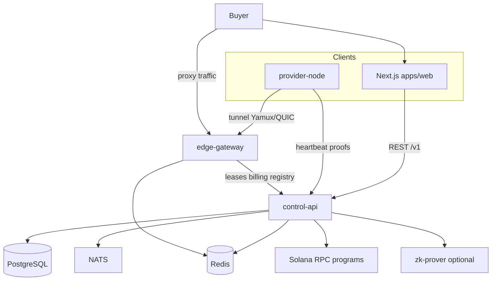

# ProxyHubb

ProxyHubb is a **decentralized proxy marketplace**: buyers pay for metered residential and datacenter bandwidth; providers run software on their own machines and tunnel traffic through a shared **edge gateway**; a **control API** holds business state, billing, and registry data; optional **Solana** programs and a **ZK prover** support escrow settlement and usage proofs.

This repository is a **monorepo**. The sections below describe how the pieces fit together and how to run the stack locally.

---

## How the system works

### Roles

| Role | What they do | Main software |
|------|----------------|---------------|
| **Buyer** | Funds a wallet, browses listings or the geo map, purchases a session, connects through the gateway | Web app (`apps/web`), Solana wallet |
| **Provider** | Registers a node, keeps a tunnel open to the edge, earns from metered usage | `provider-node` CLI, provider dashboard in web |
| **Operator** | Runs Postgres, Redis, control-api, edge-gateway, observability, oracle keys | Docker Compose / Kubernetes, `.env` secrets |

### Control plane vs data plane

- **Control plane** — `services/control-api` (Go): authentication, marketplace listings and orders, sessions, wallet ledger, provider registry (`provider_nodes`), explorer APIs, workers (settlement, indexer, geo backfill).
- **Data plane** — `services/edge-gateway` (Rust): terminates buyer proxy traffic (HTTP CONNECT, optional SOCKS5 / HTTP/3), selects a provider, meters bytes, talks to control-api for leases and billing.
- **Provider path** — `services/provider-node` (Rust): authenticates with the API, opens a **Yamux** (or QUIC) tunnel to the gateway, sends signed heartbeats and stats, executes proxied connections on the provider host.

Buyers do not connect to provider IPs directly. Traffic flows **buyer → edge-gateway → provider-node → internet**.

### Typical buyer journey

1. Sign in on the web app (wallet or email flow, depending on configuration).
2. Deposit SOL or use an existing wallet balance.
3. Discover proxies via **marketplace** listings or the **geo map** (`GET /v1/marketplace/map`).
4. Create an **order** / **session**; control-api returns gateway host, port, and credentials.
5. Configure a browser or tool to use the gateway; usage is metered and recorded.
6. On session end, usage may produce a **usage proof** and trigger **escrow settlement** on Solana when trustless mode is enabled.

### Typical provider journey

1. Create a provider account and obtain an **API token** (HMAC-backed provider token from the dashboard).
2. Register a **provider node**; download connect config or use bootstrap scripts.
3. Run `provider-node` with `control_api_url`, `api_key`, `node_id`, and gateway address.
4. Node maintains tunnel + signed heartbeats; registry state lands in **`provider_nodes`** (with a legacy mirror in `nodes` during transition).
5. Listings can include **signed offers** (`PROVIDER_SIGNATURE_MODE=observe|enforce`) so the control plane can verify Ed25519 proofs on heartbeats and listing payloads.

### Decentralization layers (conceptual)

Work is organized in layers that build on each other:

| Layer | Purpose |
|-------|---------|
| **D1 — Provider identity** | Ed25519 proof envelopes, signed heartbeats and listing offers |
| **D2 — Registry** | Canonical `provider_nodes` runtime registry; gateway and marketplace geo use it |
| **D3 — Edge enforcement** | Multipod gateway, transport soak, optional signed tunnel heartbeats, `FULL_DECENTRALIZATION` gates |
| **D4 — Settlement** | Usage proofs, ZK batching (optional), Solana escrow / oracle settlement |

Detailed status and file references: [`docs/PROJECT_STATE.md`](docs/PROJECT_STATE.md).

---

## Architecture



---

## Repository layout

```text
proxyhubb/
├── apps/web/                 # Next.js — marketplace, explorer, wallet, provider UI
├── services/
│   ├── control-api/          # Go/Gin — system of record, /v1 API, workers
│   ├── edge-gateway/         # Rust — buyer proxy ingress, provider tunnels
│   ├── provider-node/        # Rust CLI — runs on provider machines
│   ├── zk-prover/            # Rust — Halo2 batch proofs (optional)
│   └── solana-programs/      # Anchor programs (escrow, reputation, etc.)
├── packages/contracts/       # Shared contract artifacts / tooling
├── migrations/               # SQL migrations (applied by control-api)
├── infra/                    # Grafana, Prometheus, K8s samples, oracle keypair docs
├── config/docker/            # Compose env fragments (no live secrets in git)
├── scripts/                  # Bootstrap, provider proofs, compose helpers
└── docs/                     # Architecture, runbooks, OpenAPI, ADRs
```

**HTTP contract:** [`docs/openapi.yaml`](docs/openapi.yaml) is the authoritative `/v1` API description.

---

## Core services (default Docker stack)

| Service | Host port (typical) | Role |
|---------|---------------------|------|
| **web** | `3009` | Next.js UI |
| **control-api** | `18080` | REST + WebSocket control plane |
| **edge-gateway** | `8090` / `18090` (see `.env`) | Proxy and metrics |
| **postgres** | `5433` or mapped port | Primary database |
| **redis** | `6380` or mapped port | Cache, limits, gateway state |
| **zk-prover** | internal | ZK proof generation when enabled |
| **prometheus / grafana** | `9090` / `3001` | Metrics and dashboards (optional) |

Provider nodes are **not** started by the base compose file; use `docker-compose.provider.yml` and [`scripts/bootstrap-provider-docker.ps1`](scripts/bootstrap-provider-docker.ps1).

---

## Quick start (local Docker)

### Prerequisites

- Docker Desktop (or Docker Engine + Compose v2)
- PowerShell or Bash
- Copy secrets from template: `cp .env.example .env` (Windows: copy manually) and fill **all** required values (`JWT_SECRET`, `POSTGRES_PASSWORD`, `TOKEN_HMAC_SECRET`, etc.)

Generate random secrets (example):

```bash
openssl rand -hex 32
```

### Oracle keypair (required for compose mount)

Do **not** commit keypair files. Create a local file before `compose up`:

```powershell
.\scripts\ensure-oracle-keypair.ps1
```

For devnet signing, generate a dedicated key — see [`infra/README.md`](infra/README.md).

### Start the stack

```powershell
# Full dev stack including provider overlay (recommended)
.\scripts\compose-up-dev.ps1
```

Or manually:

```powershell
docker compose -f docker-compose.yml -f docker-compose.provider.yml --profile provider up -d
```

### Smoke checks

| Check | URL / command |
|-------|----------------|
| Web UI | http://localhost:3009 |
| Control API health | http://localhost:18080/health |
| Edge gateway health | see `EDGE_GATEWAY_PORT` in `.env` (often `18090`) |
| Provider proofs | `.\scripts\verify-provider-proofs-docker.ps1` |

### Web-only development

```powershell
cd apps/web
npm install
npm run dev
```

Dev server defaults to port **4011**; point `NEXT_PUBLIC_API_URL` at your running control-api. See [`apps/web/README.md`](apps/web/README.md).

---

## Security before you push

- Never commit `.env`, `config/docker/provider.compose.env`, or `*.keypair.json` (except `*.example`).
- Run `.\scripts\pre-commit-security.ps1` or install hooks: `.\scripts\install-git-hooks.ps1`
- Details: [`docs/SECURITY_GATES.md`](docs/SECURITY_GATES.md)

---

## Testing

| Area | Command |
|------|---------|
| Control API (Go) | `cd services/control-api && go test ./...` |
| Edge gateway (Rust) | `cd services/edge-gateway && cargo test` |
| Web typecheck | `cd apps/web && npm run typecheck` |
| Route policy | `cd apps/web && npm run validate:routes` |
| Playwright (map / proofs) | `cd apps/web && npm run test:e2e:map` |
| Live devnet map buy | `npm run test:e2e:map-buy:devnet` (requires env; see `apps/web/e2e/`) |

Staging checklist: [`docs/STAGING_ENFORCE_RUNBOOK.md`](docs/STAGING_ENFORCE_RUNBOOK.md).

---

## Documentation

| Document | Contents |
|----------|----------|
| [`docs/README.md`](docs/README.md) | Full documentation index |
| [`docs/PROJECT_STATE.md`](docs/PROJECT_STATE.md) | Current implementation status (D1–D4, web, wallet) |
| [`docs/SYSTEM_ARCHITECTURE_AND_PRODUCT_DEEP_DIVE.md`](docs/SYSTEM_ARCHITECTURE_AND_PRODUCT_DEEP_DIVE.md) | Deep architecture and product flows |
| [`docs/PROVIDER_PROOFS_DOCKER.md`](docs/PROVIDER_PROOFS_DOCKER.md) | Provider bootstrap, signed listings, enforce mode |
| [`docs/NODE_REGISTRY.md`](docs/NODE_REGISTRY.md) | `provider_nodes` vs legacy `nodes` |
| [`services/edge-gateway/README.md`](services/edge-gateway/README.md) | Gateway ports, env, phase sign-off |
| [`docs/reports/COMPREHENSIVE_SYSTEM_ANALYSIS_REPORT.md`](docs/reports/COMPREHENSIVE_SYSTEM_ANALYSIS_REPORT.md) | End-to-end system analysis |

---

## CI

GitHub Actions workflows under [`.github/workflows/`](.github/workflows/):

- **`proxyhubb-ci.yml`** — tests, route validation, **secrets-gate** (Gitleaks + blocked tracked keypaths)
- **`security.yml`** — dependency audits, CodeQL, container scans (scheduled and on PR)

---

## License

See repository license file if present. Provider CLI binaries and GeoIP databases may have separate distribution terms — see `cli-dist/` and `geoip/` notes in `.gitignore`.
