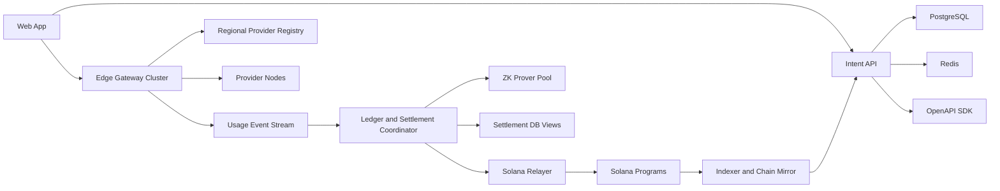

# ProxyHubb System Workflow V2 Blueprint

Date: April 13, 2026

## Intent

This document proposes a materially better workflow for ProxyHubb based on the current repository state, the current workflow analysis, and the bottlenecks visible in the live architecture.

The goal is not cosmetic improvement. The goal is a workflow that is:

- faster
- safer
- easier to reason about
- more decentralized where it matters
- easier to operate at scale
- more resilient under failure

This is the recommended target workflow if the objective is a system that performs roughly an order of magnitude better than the current design in latency, scalability, and operational clarity.

## Executive Summary

The current system has a coherent foundation, but the workflow is still too centralized around the control-api, too synchronous in key paths, and too batch-oriented in settlement.

The best upgrade is not one isolated fix. It is a workflow re-segmentation into four clear planes:

1. Intent plane.
2. Real-time traffic plane.
3. Ledger and settlement plane.
4. Chain finality plane.

The V2 workflow should make these changes:

- move session admission from a heavy control-api path to a signed intent token model
- move provider admission from ad hoc runtime state to lease-based provider capability attestation
- move usage recording to an append-only event ledger
- move settlement from hourly batch thinking to event-driven epoch settlement
- make Solana the final authority for value and governance, not the coordinator for every fast path
- make the gateway stateless enough to scale horizontally
- make frontend integration generated from the API contract instead of manually drifting

## What Is Wrong With The Current Workflow

These are the main workflow problems that limit scale and correctness.

### 1. The Control API Sits On Too Many Critical Paths

Today the control-api is simultaneously:

- auth issuer
- business orchestrator
- session authority
- registry mirror
- explorer backend
- settlement coordinator
- chain orchestration layer

That creates a central choke point. Even when components are technically separated, the workflow still converges on a single service.

### 2. Session Startup Is Too Expensive

The current session flow still leans on multiple state checks and synchronous orchestration steps before the traffic path is fully hot.

That produces avoidable latency and makes the system more fragile during peak periods.

### 3. Provider Registry Logic Is Better Than Before, But Still Operationally Heavy

The live registry is now significantly healthier than before because heartbeat telemetry and real capabilities are being consumed properly, but the workflow still depends on gateway-side in-memory routing as the primary fast-path authority.

That is workable for moderate scale, but not ideal for very high provider counts or multi-region growth.

### 4. Settlement Is Still Too Batch-Centric In Spirit

Even where proof and relayer code exists, the workflow is still conceptually tied to delayed, batch-style reconciliation rather than near-real-time ledger commitment.

That slows payout confidence and complicates operational reasoning.

### 5. Frontend And Backend Contract Risk Is Structural

Manual frontend API layers and backend route drift create avoidable operational noise and broken UX.

### 6. Secret Handling Needs A Full-System Model

Service-level secret cleanup has started, but the project still needs one coherent workflow for secret loading, rotation, and environment separation across the root workspace and deployment paths.

### 7. Governance Should Be Fully Chain-Authoritative

The workflow should treat governance as a chain-first state machine with off-chain indexing and UX assistance, not as a partially mirrored business process.

## Design Principles For The Better Workflow

The improved design should follow these principles.

### Principle 1: Fast Paths Must Be Off-Chain And Signed

Anything that must happen in milliseconds should be based on:

- signed intents
- bounded leases
- cached policy
- append-only receipts

The chain should finalize value, not block every fast interaction.

### Principle 2: Value State Must Be Chain-Authoritative

The system should be explicit about what is authoritative on-chain:

- buyer custody or pre-funded credit
- provider stake
- settlement commitments
- governance and voting finality

### Principle 3: Routing State Must Be Ephemeral And Disposable

Live provider routing state should be treated as operational data, not business truth.

That means:

- short TTL
- lease-based provider eligibility
- heartbeat-driven refresh
- region and capability partitioning

### Principle 4: All Financial Flows Need An Append-Only Ledger

Do not treat billing as a side effect of traffic. Treat billing as an append-only receipt and ledger workflow.

### Principle 5: Every Workflow Needs A Single Owner

For each major lifecycle, exactly one layer should be the owner of the workflow.

Examples:

- auth intent owner: control-api
- routing owner: edge-gateway
- usage receipt owner: gateway and provider dual-signing
- settlement epoch owner: settlement coordinator
- final value owner: Solana

## The Recommended V2 Architecture

The cleanest target model is this.



### Plane 1: Intent API

This replaces the current idea that control-api must actively sit in every runtime step.

The intent API is responsible for:

- wallet auth
- listing and session policy validation
- buyer authorization
- issuing signed session intent tokens
- issuing provider capability leases
- governance transaction preparation
- explorer and historical read models

### Plane 2: Real-Time Traffic

The edge-gateway cluster should be responsible for:

- validating signed session intents
- validating provider leases
- selecting providers from a regional and capability-aware registry
- executing traffic
- emitting append-only usage receipts

The gateway should not need to synchronously ask the control-api for every new hot path decision.

### Plane 3: Ledger And Settlement

This plane should become explicit.

It is responsible for:

- consuming usage receipts from the event stream
- committing usage to an append-only ledger
- building settlement epochs
- requesting proofs from a prover pool
- preparing batched on-chain commitments
- handling payout retry and reconciliation logic

### Plane 4: Chain Finality

This plane should be narrow and deterministic.

It is responsible for:

- transaction submission
- confirmation watching
- finality reporting
- writing settlement and governance truth back into indexed read models

## The Recommended V2 Workflow

## V2 Workflow A: Buyer Entry And Session Authorization

### V2-A1. Wallet Authentication

1. User connects wallet in the web app.
2. Intent API issues a challenge.
3. User signs the challenge.
4. Intent API returns an access token and refresh token.

This stays close to the current model because it is already strong.

### V2-A2. Session Intent Creation

Instead of making session startup depend on multiple live orchestration checks, the user requests a session intent.

The Intent API:

1. verifies the buyer
2. verifies listing eligibility
3. verifies available credit, funded vault balance, or escrow channel capacity
4. produces a signed session intent token with:
   - buyer id
   - listing id
   - provider selection constraints
   - max spend cap
   - expiry
   - nonce
   - session class

The web app then hands that signed intent token to the gateway.

### Why Session Intents Are Better

- the gateway can admit the session without waiting on multiple database round-trips
- policy remains centrally controlled because the intent is signed by the authority layer
- the token is bounded in time and spend, which limits abuse

## V2 Workflow B: Provider Admission And Eligibility

### V2-B1. Provider Registration

Provider registration should remain a control-api concern, but runtime eligibility should move to lease-based authorization.

### V2-B2. Provider Capability Lease

After registration, the Intent API issues a short-lived provider lease that contains:

- provider id
- allowed regions
- capability profile hash
- QoS tier
- risk status
- stake status
- expiry time
- signature

The provider presents this lease during gateway connection and refreshes it periodically.

### Why Provider Leases Are Better

- the gateway does not need to infer long-lived trust from stale mirrored state
- provider eligibility becomes explicit, bounded, and revocable
- stake or policy changes can invalidate future leases quickly

## V2 Workflow C: Real-Time Routing And Session Execution

### V2-C1. Sharded Registry

The gateway registry should evolve from a broad global candidate pool into a partitioned structure:

- region shard
- connection type shard
- capability shard
- quality bucket

That gives the gateway a much smaller candidate set before final scoring.

### V2-C2. Session Admission

The gateway receives the signed session intent and performs:

1. signature validation
2. expiry validation
3. nonce or replay validation
4. budget cap validation
5. route selection from the provider shard

Then it opens the session immediately.

### V2-C3. Runtime Traffic

During traffic execution:

- provider heartbeats update ephemeral health state
- traffic counters emit usage receipts
- session health is continuously observable

### Why Sharded Routing Is Better

- session startup latency falls sharply
- provider selection cost falls sharply
- the gateway becomes horizontally scalable because the fast path uses signed policy, not synchronous orchestration calls

## V2 Workflow D: Usage Ledger And Receipt Model

The current system should evolve from traffic observation into a dual-signed receipt workflow.

### V2-D1. Dual-Signed Usage Receipts

For each session slice or session close event:

1. gateway emits a usage receipt candidate
2. provider confirms the receipt or signs the slice state
3. the final receipt is written to an append-only event stream

Each receipt should contain:

- session id
- buyer id
- provider id
- bytes up
- bytes down
- duration
- route class
- timestamp window
- gateway signature
- provider signature

### Why Dual-Signed Receipts Are Better

- usage becomes auditable
- fraud and disagreement handling becomes easier
- ZK proof generation now has a deterministic source of truth

## V2 Workflow E: Settlement Epochs Instead Of Hourly Monoliths

Settlement should become event-driven with small epochs, not one large operational thought block.

### V2-E1. Ledger Commit

As soon as a session closes or a receipt window finalizes:

1. the ledger coordinator consumes the receipt
2. the receipt is normalized into the settlement ledger
3. provider balances and buyer spend totals are updated in derived views

This does not yet move value on-chain. It creates a deterministic off-chain settlement record.

### V2-E2. Settlement Epoch Builder

The epoch builder groups receipts by:

- provider
- time window
- token or currency domain
- chain settlement class

Then it generates:

- a batch root
- receipt manifest
- payout totals
- dispute window metadata

### V2-E3. Proof Generation

The prover pool should be stateless and horizontally scalable.

The workflow becomes:

1. settlement coordinator sends a proof job
2. prover worker loads cached proving material
3. proof is generated
4. proof artifact and batch manifest are stored
5. relayer receives a deterministic submission package

### V2-E4. On-Chain Commitment And Finality

The relayer submits the batch commitment.
The finality watcher confirms it.
The chain mirror updates explorer and payout views.

### Why Event-Driven Settlement Is Better

- payouts are no longer blocked by one giant settlement pass
- operational retries are per epoch, not all-or-nothing
- proof generation is parallelizable
- chain submission is explicit and auditable

## V2 Workflow F: Buyer Funding Model

If the goal is true 10x improvement, the funding workflow should evolve beyond one-off synchronous session escrow per transaction.

The better model is reusable session credit.

### Recommended Funding Model

1. Buyer funds a reusable on-chain vault or payment channel.
2. Intent API checks available credit and issues signed session intents against that budget.
3. Gateway meters usage against the budget off-chain.
4. Settlement epochs periodically anchor net usage on-chain.

### Why Reusable Buyer Credit Is Better

- new sessions start much faster
- chain load is reduced
- buyer UX improves because the user does not re-pay the setup cost every session
- settlement remains trust-minimized because final value is still anchored on-chain

### Important Note

This is the largest workflow upgrade in the document. It should be treated as the ideal V2 financial model, not the first migration step.

## V2 Workflow G: Governance

Governance should be fully chain-authoritative.

The better workflow is:

1. user drafts proposal in the app
2. Intent API validates policy and builds unsigned transaction data
3. wallet signs proposal or vote transaction
4. relayer or direct client submits it
5. chain finality watcher confirms it
6. control-api mirrors the resulting chain state for explorer and UX purposes only

This avoids governance logic drifting into a partially off-chain business workflow.

## V2 Workflow H: Frontend Integration

The frontend should stop manually tracking backend contract changes through parallel API layers.

### Recommended Flow

1. OpenAPI is the contract source.
2. A generated TypeScript SDK is built from that contract.
3. UI components consume the generated client.
4. Contract mismatches fail at compile time, not at runtime.

### Why Contract-Generated Frontend Integration Is Better

- stale endpoints disappear faster
- type drift is visible immediately
- the frontend becomes easier to evolve safely

## V2 Workflow I: Secrets And Runtime Configuration

The entire project should adopt one secret workflow.

### Recommended Secret Workflow

Development:

- checked-in `.env.example` only
- ignored `.env.local` for local overrides

Production:

- secret manager or orchestrator-managed environment injection
- no tracked runtime secrets
- dedicated secret domains by service

Rotation:

- rotate signing and auth secrets by version
- support overlap windows for JWT and gateway secret transitions

### Why Unified Secret Workflow Is Better

- reduced blast radius
- less accidental leakage
- clearer local versus production behavior

## Authority Model In The Better Workflow

The improved system should make authority unambiguous.

| Domain | Authority |
| --- | --- |
| wallet ownership | user wallet signature |
| buyer eligibility and session policy | intent API |
| provider runtime eligibility | signed provider lease |
| live route selection | edge-gateway |
| usage receipt truth | gateway plus provider signatures |
| settlement ledger | settlement coordinator |
| custody and final settlement | Solana |
| governance truth | Solana |
| explorer read model | indexed mirror |

## Recommended State Machines

### Session State Machine

```text
Draft
 -> Authorized
 -> Routed
 -> Active
 -> Closing
 -> LedgerCommitted
 -> Batched
 -> ChainCommitted
 -> Archived
```

### Provider State Machine

```text
Registered
 -> Leased
 -> Connected
 -> Healthy
 -> Degraded
 -> Suspended
 -> Disconnected
 -> Reclaimed
```

### Settlement State Machine

```text
ReceiptCaptured
 -> LedgerCommitted
 -> EpochBuilt
 -> ProofReady
 -> SubmittedOnChain
 -> Finalized
 -> PaidOut
```

These state machines matter because they eliminate vague transitions and make observability significantly stronger.

## Migration Strategy

The best version should be approached in phases.

## Phase 1: Clean Fast Paths Without Changing The Product Model

This is the shortest path to meaningful improvement.

1. Generate a frontend SDK from OpenAPI.
2. Introduce signed session intent tokens.
3. Introduce provider capability leases.
4. Partition the gateway registry by region and capability.
5. Move usage receipt publication to an append-only event stream.

Expected gain:

- faster session startup
- lower API coupling
- cleaner gateway scale-out

## Phase 2: Decouple Settlement Into Its Own Workflow

1. Add a settlement coordinator service or module boundary.
2. Move ledger commit to event-driven receipt consumption.
3. Batch by epoch instead of monolithic hourly logic.
4. Scale the prover as a worker pool.
5. Separate relayer submission from ledger construction.

Expected gain:

- better payout latency
- clearer operational retries
- better fault isolation

## Phase 3: Upgrade The Financial Workflow

1. Introduce reusable buyer credit vaults or payment channels.
2. Use intents against funded credit instead of session-by-session chain-heavy setup.
3. Anchor net settlement on-chain by epoch.

Expected gain:

- true step-function improvement in user experience and chain efficiency

## Phase 4: Governance And Authority Hardening

1. Ensure all governance writes are chain-authoritative.
2. Treat off-chain governance records as mirrors only.
3. Add chain finality watchers and readiness gates everywhere governance is surfaced.

## What Improves By Roughly 10x

If this blueprint is implemented in the right order, the expected workflow gains are:

| Dimension | Current Pattern | Better Workflow Target |
| --- | --- | --- |
| session startup latency | multiple orchestrated checks | signed intent admission |
| routing scale | broad in-memory candidate pool | sharded registry lookup |
| provider failover | heartbeat-cycle dependent | lease and event-driven health handling |
| settlement latency | large delayed batch mindset | event-driven small epochs |
| prover throughput | mostly sequential reasoning | worker pool parallelism |
| contract drift | manual frontend client maintenance | generated SDK |
| security hygiene | mixed secret practices | single secret workflow |
| governance clarity | mixed off-chain and on-chain reasoning | chain-authoritative writes |

## Recommended Final Workflow

If I had to choose the single best workflow for ProxyHubb, it would be this:

1. Buyer funds reusable on-chain credit.
2. Intent API issues a signed session intent against bounded credit.
3. Provider presents a signed capability lease to the gateway.
4. Gateway validates both signatures and starts the session immediately.
5. Gateway and provider emit dual-signed usage receipts.
6. Settlement coordinator commits receipts into an append-only ledger in near real time.
7. Small settlement epochs are proven and committed on-chain.
8. Finality watcher updates explorer and payout views.

That workflow is faster, cleaner, more scalable, and more aligned with what a blockchain-native proxy marketplace should actually optimize for.

## Bottom Line Recommendation

The best next-generation system workflow for ProxyHubb is not more logic inside the current orchestration path.

It is a cleaner separation of:

- signed intent authorization
- lease-based provider admission
- stateless real-time routing
- append-only usage receipts
- event-driven settlement epochs
- chain-authoritative final value and governance

That is the version of the system most likely to produce a substantial improvement in speed, safety, decentralization quality, and operator clarity while still remaining evolvable from the current codebase.
