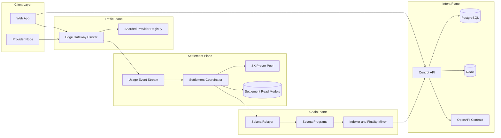
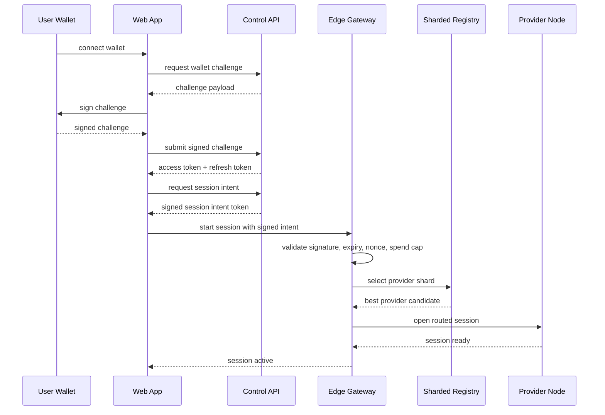
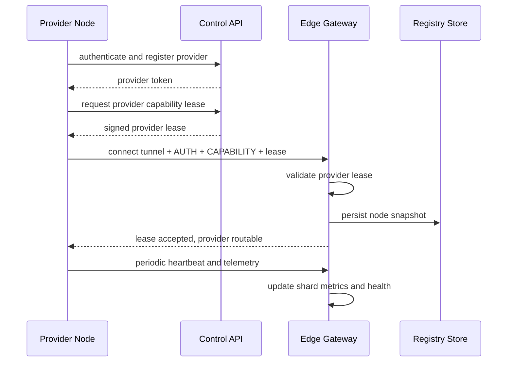
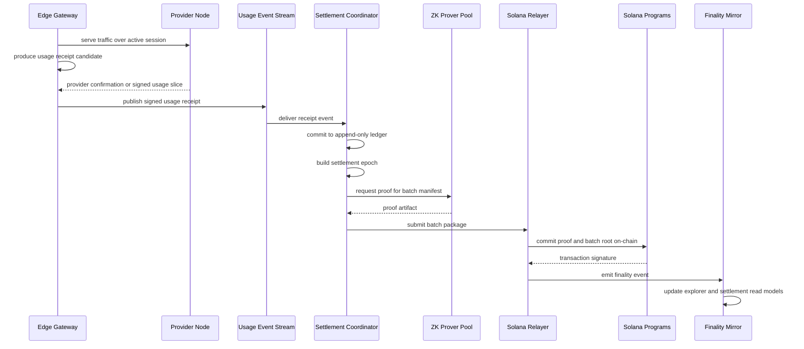
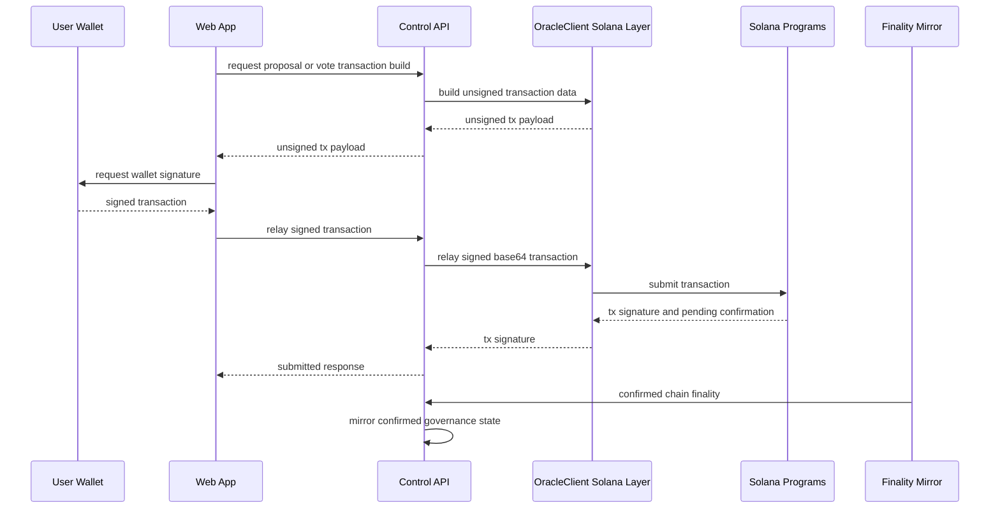
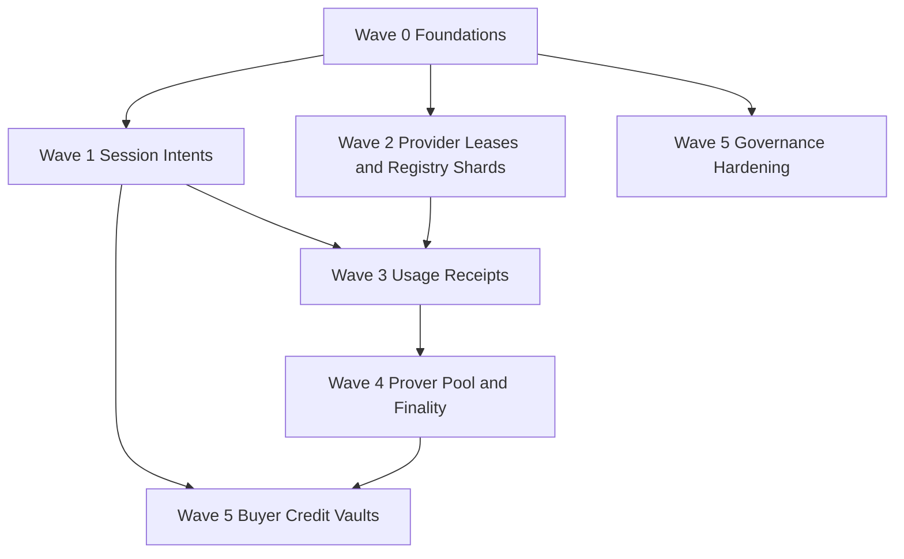

# ProxyHubb System Workflow V2 Implementation Roadmap

Date: April 14, 2026

## Purpose

This document converts the V2 workflow blueprint into an executable roadmap.

It is designed for engineering review, architecture review, and implementation planning. It answers four questions:

1. What should be built first.
2. Which services own each change.
3. Which exact files are most likely to be modified.
4. How the proposed workflows look in sequence and architecture diagrams.

## How To Read This Roadmap

The roadmap is organized in six delivery waves.

- Wave 0: contract, secret, and observability foundations.
- Wave 1: signed buyer session intent workflow.
- Wave 2: provider lease workflow and sharded routing.
- Wave 3: append-only usage receipts and event-driven settlement.
- Wave 4: prover pool, relayer finality, and read-model separation.
- Wave 5: reusable buyer credit and chain-authoritative governance hardening.

The roadmap is intentionally incremental. It avoids a destructive rewrite and instead restructures the system along the seams that already exist in the codebase.

## Target End-State Architecture

## Delivery Order Overview

| Wave | Goal | Primary Services | Expected Result |
| --- | --- | --- | --- |
| 0 | eliminate contract drift and unsafe config assumptions | control-api, web, root config | safer baseline and cleaner delivery pipeline |
| 1 | make session admission signed and fast | control-api, web, edge-gateway | lower session startup latency and less orchestration coupling |
| 2 | make provider admission lease-based and routing shard-aware | control-api, provider-node, edge-gateway | better runtime trust model and routing scalability |
| 3 | make usage append-only and settlement event-driven | edge-gateway, control-api or settlement coordinator, NATS | better payout latency and cleaner audit trail |
| 4 | scale proof generation and finality handling | zk-prover, relayer, indexer | better throughput and clearer chain state propagation |
| 5 | improve the economic and governance model | Solana programs, control-api, web | faster buyer UX and cleaner chain-authoritative governance |

## Confirmed Implementation Status

This section reflects code and docs that are actually present in the repository as of April 14, 2026.

Legend:

- Implemented: the roadmap step's core runtime path exists and is in active use.
- Partial: meaningful implementation exists, but the roadmap exit criteria are not fully met.
- Groundwork only: adjacent capabilities exist, but the roadmap-specific design is not yet in place.
- Not started: no confirmed roadmap implementation yet.

| Step | Status | Proof Files | Confirmed Implemented Work | Remaining To Reach Roadmap Intent |
| --- | --- | --- | --- | --- |
| 0.1 Lock API contract | Partial | `docs/openapi.yaml`, `apps/web/src/lib/api/sessions.ts`, `apps/web/src/lib/api/index.ts` | `docs/openapi.yaml` now tracks active V2 session intent, provider lease, and intent ledger routes; web session wrappers were updated to those contracts | generated SDK, build-time contract enforcement, broad wrapper removal |
| 0.2 Normalize secrets | Partial | `services/control-api/internal/config/config.go`, `docker-compose.yml`, `docker-compose.dev.yml` | some config hardening and env cleanups exist elsewhere in the repo | roadmap-specific secret workflow, `.env.local` conventions, and gateway/signing secret cleanup are still incomplete |
| 0.3 Correlation IDs and event envelopes | Not started | no confirmed implementation files | no confirmed shared workflow correlation layer across control-api, edge-gateway, and provider-node | add trace context propagation and explicit event envelopes |
| 1.1 Signed buyer session intents | Implemented | `services/control-api/internal/sessionintent/token.go`, `services/control-api/internal/api/session.go`, `services/edge-gateway/src/auth/session_intent.rs`, `apps/web/src/app/dashboard/proxy/page.tsx`, `apps/web/src/app/dashboard/sessions/page.tsx` | control-api issues signed intents; gateway validates signed intents; web proxy and sessions flows now request intents first; `/v1/sessions/intents` and `/v1/sessions/intents/:id` exist | replay-hardening and broader client generation can still improve this path |
| 1.2 Explicit session state machine | Partial | `services/control-api/internal/models/session_intent.go`, `services/control-api/internal/api/session_intent_state.go`, `services/edge-gateway/src/main.rs`, `apps/web/src/app/dashboard/sessions/page.tsx` | intent lifecycle is now persisted through `authorized`, `active`, and `expired`, and surfaced in the dashboard | the full target machine `Draft -> Authorized -> Routed -> Active -> Closing -> LedgerCommitted -> Batched -> ChainCommitted -> Archived` is not implemented yet |
| 2.1 Provider capability leases | Implemented | `services/control-api/internal/providerlease/token.go`, `services/control-api/internal/api/provider_lease.go`, `services/provider-node/src/tunnel/heartbeat.rs`, `services/edge-gateway/src/auth/provider_lease.rs`, `services/edge-gateway/src/tunnel.rs` | provider lease issue/renewal flow exists; provider-node renews leases over heartbeat; edge-gateway enforces valid leases outside development | broader operational coverage and documentation remain |
| 2.2 Sharded provider registry | Partial | `services/edge-gateway/src/registry/lockfree.rs`, `services/edge-gateway/src/main.rs`, `services/edge-gateway/src/proxy/websocket.rs` | edge-gateway now maintains shard-aware indexes and routes by geography/connection-type with lease-aware filtering | dedicated shard modules, shard-local update flow, and stronger cross-shard fallback handling are still open |
| 2.3 Stateless gateways | Not started | no confirmed implementation files | no confirmed replica-safe externalized metadata layer yet | externalize runtime metadata and make shard reconstruction replica-safe |
| 3.1 Append-only usage receipts | Partial | `services/control-api/internal/api/gateway.go`, `services/control-api/internal/api/session_intent_state.go`, `services/edge-gateway/src/proxy/zerocopy.rs`, `services/edge-gateway/src/main.rs`, `services/edge-gateway/src/proxy/websocket.rs` | session intents now persist live usage deltas and billing-facing snapshots for buyer accounting | append-only signed receipts, bounded usage windows, and JetStream/NATS publication are not implemented |
| 3.2 Settlement coordinator boundary | Not started | no confirmed implementation files | settlement-related billing pieces exist elsewhere, but not the roadmap coordinator boundary | add receipt consumer, append-only settlement ledger, and deterministic epoch manifests |
| 4.1 Prover worker pool | Groundwork only | `services/zk-prover/src/main.rs`, `docker-compose.yml`, `docker-compose.dev.yml` | `services/zk-prover` exists and real proof generation groundwork is present | job queue, cache, and independently scalable worker pool are still open |
| 4.2 Relaying and finality separation | Not started | no confirmed implementation files | no confirmed V2 settlement finality boundary from relay to read models | add deterministic batch relay boundary, finality watcher, and mirrored read models |
| 5.1 Buyer credit vaults or channels | Not started | no confirmed implementation files | no confirmed reusable buyer credit account path yet | add funded credit model and issue intents against remaining credit |
| 5.2 Chain-authoritative governance | Partial | `services/control-api/internal/api/governance.go`, `services/control-api/internal/solana/feature_guard.go`, `services/solana-programs/proxyhub/programs/proxyhub/src/lib.rs`, `apps/web/src/lib/api/governance.ts` | governance tx build/relay flows exist; readiness gates and chain verification were hardened; DB-first governance mutations were disabled or fail-closed | complete the full roadmap sweep so every governance write path is chain-truth only |

## Confirmed Work Already Landed

The following roadmap-aligned items are already implemented in the repository:

- Signed buyer session intent issuance in control-api and gateway-side validation.
- Persisted session intent ledger records with lifecycle fields and detail/list endpoints.
- Intent-native dashboard work in the web app: proxy page intent polling, sessions page intent-first create flow, intent history view, lifecycle filters, and single-intent drill-down.
- Provider capability lease issuance, renewal, and strict gateway enforcement outside development.
- First shard-aware registry cutover in edge-gateway routing.
- Intent usage ledger updates from live CONNECT and WebSocket traffic.
- Billing-facing intent ledger snapshots with persisted price source and estimated usage cost.
- Remaining web-side compatibility creation wrappers switched from legacy session creation to session intent issuance.

## Highest-Priority Remaining Work

Based on what is already implemented, the most important open items are now:

1. Expand the session state machine beyond `authorized`, `active`, and `expired` into the roadmap's full lifecycle.
2. Replace the current shard-aware registry increment with the dedicated sharded registry design described in Wave 2.2.
3. Move from intent usage deltas to append-only signed usage receipts and an event-driven settlement boundary.
4. Introduce buyer credit or reusable pre-funded session budgets so intent issuance no longer depends on per-session synchronous setup economics.
5. Finish the remaining governance cleanup so every governance write path is fully chain-authoritative.

## Strict Execution Checklist

The remaining roadmap work should now be executed in the following order.

| Order | Work Item | Owner | Target Milestone | Estimated Effort | Depends On | Definition Of Done |
| --- | --- | --- | --- | --- | --- | --- |
| 1 | Expand the session state machine beyond `authorized`, `active`, and `expired` | Control API + Edge Gateway + Web | Milestone A1: Admission Lifecycle Hardening | 2 to 3 engineer-weeks | current intent ledger baseline | session lifecycle includes routed, closing, ledger-committed, batched, chain-committed, and archived states across API, gateway, and UI |
| 2 | Replace the current shard-aware increment with the dedicated sharded registry design | Edge Gateway | Milestone A2: Registry Sharding | 2 engineer-weeks | provider lease enforcement already in place | dedicated shard modules exist, shard-local routing updates are in use, and cross-shard fallback is explicit |
| 3 | Externalize gateway runtime metadata for replica-safe stateless operation | Edge Gateway + Infra/Redis | Milestone A3: Gateway Statelessness | 1 to 2 engineer-weeks | item 2 | lease validation, shard reconstruction, and active metadata survive multi-replica gateway execution |
| 4 | Convert usage metering into append-only signed receipts | Edge Gateway + Provider Node | Milestone B1: Receipt Substrate | 2 to 3 engineer-weeks | items 1 to 3 | receipt schema exists, receipts emit on bounded windows and close, and receipts are durable beyond in-memory ledger state |
| 5 | Introduce the settlement coordinator boundary | Control API / Settlement Coordinator Owner | Milestone B2: Settlement Coordinator | 3 engineer-weeks | item 4 | receipt consumer, append-only settlement ledger, and deterministic epoch manifests exist behind a clean coordinator boundary |
| 6 | Turn proving into a queue-backed worker pool | ZK Prover + Infra | Milestone C1: Prover Pool | 2 engineer-weeks | item 5 | proof jobs are queued, cacheable, and horizontally scalable outside request-path coupling |
| 7 | Separate relay submission from confirmation and read-model mirroring | Settlement + Relayer + Indexer | Milestone C2: Finality Separation | 2 engineer-weeks | items 5 and 6 | batch relay, finality watch, and explorer/read-model projection are distinct stages |
| 8 | Introduce reusable buyer credit vaults or channels | Solana Programs + Control API + Web | Milestone D1: Buyer Credit | 3 to 4 engineer-weeks | items 1, 4, and 7 | buyers can issue multiple intents against a funded budget without per-session synchronous setup overhead |
| 9 | Finish the governance chain-authoritative sweep | Control API + Solana Programs + Web | Milestone D2: Governance Closeout | 1 to 2 engineer-weeks | independent, but should complete before V2 closeout | all governance writes are chain-truth only and the DB acts purely as a mirror |

Execution rules:

1. Do not start item 4 before items 1 to 3 are stable enough that receipt semantics will not churn.
2. Do not start item 8 before items 4 and 7 are in place, otherwise buyer credit accounting will be built on an unstable settlement substrate.
3. Item 9 can run in parallel with items 4 to 8 if it does not reintroduce DB-first authority assumptions.

### Sprint-Ready Breakdown

#### Item 1: Expand The Session State Machine

Owners: Control API, Edge Gateway, Web
Target milestone: Milestone A1: Admission Lifecycle Hardening
Estimated effort: 2 to 3 engineer-weeks

File group A: control-api lifecycle domain and APIs
Files: `services/control-api/internal/models/session*.go`, `services/control-api/internal/models/session_intent.go`, `services/control-api/internal/api/session.go`, `services/control-api/internal/api/session_intent_state.go`, `docs/adr/session-state-machine.md`
Tasks:

1. Add the full lifecycle enum and transition guards.
2. Persist timestamps and metadata for routed, closing, ledger-committed, batched, chain-committed, and archived states.
3. Expose the richer lifecycle through list and detail APIs.

File group B: edge-gateway lifecycle synchronization
Files: `services/edge-gateway/src/main.rs`, `services/edge-gateway/src/state.rs`, `services/edge-gateway/src/control_api.rs`, `services/edge-gateway/src/proxy/websocket.rs`
Tasks:

1. Emit routed and closing transitions from real traffic flow boundaries.
2. Keep disconnect, timeout, and limit-reached flows idempotent.
3. Ensure usage sync and lifecycle sync share a consistent transition contract.

File group C: web lifecycle rendering
Files: `apps/web/src/lib/api/sessions.ts`, `apps/web/src/app/dashboard/proxy/page.tsx`, `apps/web/src/app/dashboard/sessions/page.tsx`
Tasks:

1. Update frontend types for the extended lifecycle.
2. Render lifecycle progression consistently in proxy and sessions dashboards.
3. Remove any remaining UI assumptions that only three lifecycle states exist.

#### Item 2: Replace The Current Shard-Aware Increment With The Dedicated Sharded Registry Design

Owners: Edge Gateway
Target milestone: Milestone A2: Registry Sharding
Estimated effort: 2 engineer-weeks

File group A: new registry core
Files: `services/edge-gateway/src/registry/mod.rs`, `services/edge-gateway/src/registry/lockfree.rs`, `services/edge-gateway/src/registry/sharded.rs`, `services/edge-gateway/src/registry/index.rs`
Tasks:

1. Introduce dedicated shard and shard-index types.
2. Move candidate lookup out of the current flat increment into shard-local lookup.
3. Keep lease-aware filtering and health checks compatible with the new layout.

File group B: runtime integration
Files: `services/edge-gateway/src/state.rs`, `services/edge-gateway/src/heartbeat.rs`, `services/edge-gateway/src/routing/features.rs`, `services/edge-gateway/src/main.rs`
Tasks:

1. Route heartbeat and live metric updates to the correct shard.
2. Ensure routing feature extraction uses shard-local data first.
3. Add explicit cross-shard fallback only when the preferred shard is empty.

#### Item 3: Externalize Gateway Runtime Metadata For Replica-Safe Stateless Operation

Owners: Edge Gateway, Infra/Redis
Target milestone: Milestone A3: Gateway Statelessness
Estimated effort: 1 to 2 engineer-weeks

File group A: gateway state externalization
Files: `services/edge-gateway/src/state.rs`, `services/edge-gateway/src/main.rs`, `services/edge-gateway/src/registry/store.rs`
Tasks:

1. Move replica-critical routing and lease metadata into shared storage.
2. Ensure replica restart and failover can rebuild shard state safely.
3. Remove assumptions that a single in-process leader owns critical state.

File group B: deployment and runtime wiring
Files: `infra/docker-compose/`, `docker-compose.yml`, `docker-compose.dev.yml`
Tasks:

1. Document and wire shared storage requirements for multiple gateways.
2. Add replica-safe startup expectations.
3. Verify gateway state recovery against Redis-backed metadata.

#### Item 4: Convert Usage Metering Into Append-Only Signed Receipts

Owners: Edge Gateway, Provider Node
Target milestone: Milestone B1: Receipt Substrate
Estimated effort: 2 to 3 engineer-weeks

File group A: edge-gateway receipt production
Files: `services/edge-gateway/src/metering.rs`, `services/edge-gateway/src/main.rs`, `services/edge-gateway/src/state.rs`, `services/edge-gateway/src/receipts.rs`, `services/edge-gateway/src/nats_publisher.rs`
Tasks:

1. Define the receipt envelope and schema.
2. Emit receipts on bounded usage windows and on session close.
3. Publish receipts durably rather than relying only on local in-memory ledger state.

File group B: provider corroboration and metrics
Files: `services/provider-node/src/tunnel/heartbeat.rs`, `services/provider-node/src/stats.rs`, `infra/prometheus.yml`
Tasks:

1. Add provider-side confirmation material where possible.
2. Track receipt production and publish health explicitly.
3. Align provider telemetry with the receipt boundary.

#### Item 5: Introduce The Settlement Coordinator Boundary

Owners: Control API, Settlement Coordinator
Target milestone: Milestone B2: Settlement Coordinator
Estimated effort: 3 engineer-weeks

File group A: short-term extraction inside control-api
Files: `services/control-api/internal/billing/aggregator.go`, `services/control-api/internal/billing/worker.go`, `services/control-api/internal/billing/zk_aggregator.go`, `services/control-api/internal/nats/`
Tasks:

1. Separate receipt consumption from traffic-plane concerns.
2. Build an append-only settlement ledger boundary.
3. Generate deterministic settlement epoch manifests.

File group B: new settlement service
Files: `services/settlement-coordinator/main.go`, `services/settlement-coordinator/internal/ledger/`, `services/settlement-coordinator/internal/epochs/`
Tasks:

1. Stand up a coordinator service boundary.
2. Move epoch assembly and ledger persistence behind that service.
3. Make batch manifests externally inspectable and replayable.

#### Item 6: Turn Proving Into A Queue-Backed Worker Pool

Owners: ZK Prover, Infra
Target milestone: Milestone C1: Prover Pool
Estimated effort: 2 engineer-weeks

File group A: prover runtime and jobs
Files: `services/zk-prover/src/main.rs`, `services/zk-prover/src/queue.rs`, `services/zk-prover/src/cache.rs`, `services/zk-prover/src/jobs.rs`, `services/zk-prover/Cargo.toml`
Tasks:

1. Turn proof generation into queued jobs.
2. Cache proving artifacts instead of rebuilding per request.
3. Add worker concurrency controls and queue visibility.

File group B: deployment scaling
Files: `docker-compose.yml`, `docker-compose.dev.yml`
Tasks:

1. Make prover workers independently scalable.
2. Wire queue and cache dependencies into local deployment.
3. Add operational documentation for worker scaling.

#### Item 7: Separate Relay Submission From Confirmation And Read-Model Mirroring

Owners: Settlement, Relayer, Indexer
Target milestone: Milestone C2: Finality Separation
Estimated effort: 2 engineer-weeks

File group A: relay and finality watchers
Files: `services/edge-gateway/src/billing/solana.rs`, `services/control-api/internal/finality/watcher.go`, `services/control-api/internal/finality/events.go`
Tasks:

1. Submit deterministic settlement packages through the relay boundary.
2. Watch confirmation in a separate component.
3. Emit explicit finality events rather than mutating read models inline.

File group B: read-model projection
Files: `services/control-api/internal/indexer/blockchain_indexer.go`, `services/control-api/internal/api/explorer.go`
Tasks:

1. Mirror settlement finality only after confirmed chain state.
2. Keep explorer and settlement read models derived rather than authoritative.
3. Add reconciliation paths for delayed or replayed finality events.

#### Item 8: Introduce Reusable Buyer Credit Vaults Or Channels

Owners: Solana Programs, Control API, Web
Target milestone: Milestone D1: Buyer Credit
Estimated effort: 3 to 4 engineer-weeks

File group A: on-chain credit primitives
Files: `services/solana-programs/proxyhub/programs/proxyhub/src/lib.rs`
Tasks:

1. Add reusable buyer credit account or channel primitives.
2. Define debit and settlement reconciliation semantics.
3. Ensure intent issuance can consume from funded credit safely.

File group B: control-api credit and intent integration
Files: `services/control-api/internal/api/orders.go`, `services/control-api/internal/api/session.go`, `services/control-api/internal/api/wallet.go`, `services/control-api/internal/credits/`
Tasks:

1. Add funded-budget accounting and remaining-credit checks.
2. Issue intents against buyer credit instead of per-session synchronous setup cost.
3. Reconcile credit consumption against settlement epochs.

File group C: buyer wallet and session UX
Files: `apps/web/src/lib/api/wallet.ts`, `apps/web/src/lib/api/sessions.ts`, `apps/web/src/app/dashboard/wallet/credit/`
Tasks:

1. Expose credit balances and funding flows.
2. Show session intent issuance against available credit.
3. Make buyer-facing accounting reconcile with settlement-derived spend.

#### Item 9: Finish The Governance Chain-Authoritative Sweep

Owners: Control API, Solana Programs, Web
Target milestone: Milestone D2: Governance Closeout
Estimated effort: 1 to 2 engineer-weeks

File group A: control-api governance authority
Files: `services/control-api/internal/api/governance.go`, `services/control-api/internal/solana/governance.go`, `services/control-api/internal/solana/feature_guard.go`
Tasks:

1. Remove any remaining DB-first authority behavior.
2. Require chain confirmation and verifiable relay paths for every governance write.
3. Keep database rows mirror-only after finality.

File group B: on-chain and web governance alignment
Files: `services/solana-programs/proxyhub/programs/proxyhub/src/lib.rs`, `apps/web/src/lib/api/governance.ts`
Tasks:

1. Align client flows with chain-first proposal, vote, and execute semantics.
2. Remove any stale frontend assumptions that governance writes are API-authoritative.
3. Close the loop with proof-bearing chain confirmation in the UI.

## Validation Caveat

Windows validation for `services/edge-gateway` is still limited by the existing `openssl-sys` / OpenSSL-vcpkg environment issue on this host. Editor diagnostics are clean for the touched Rust files, but local `cargo check` is not authoritative until that environment problem is resolved.

## Wave 0: Foundation Cleanup

### Step 0.1: Lock The API Contract To One Source Of Truth

Goal:

Stop frontend and backend drift by making the OpenAPI spec the canonical contract.

Primary services:

- control-api
- web

Files to modify:

- `docs/openapi.yaml`
- `apps/web/src/lib/api/client.ts`
- `apps/web/src/lib/api/index.ts`
- `apps/web/src/lib/api/governance.ts`
- `apps/web/src/lib/api/marketplace.ts`
- `apps/web/src/lib/api/sessions.ts`
- `apps/web/src/lib/api/provider.ts`
- `apps/web/src/lib/api/wallet.ts`
- `apps/web/package.json`

Files to add:

- `apps/web/src/lib/generated/api/` (new generated SDK directory)
- `apps/web/scripts/generate-api-client.mjs` (new)

Implementation steps:

1. Ensure the OpenAPI spec covers the active routes only.
2. Generate a typed web client from the spec.
3. Migrate frontend API consumers from manual wrappers to the generated client.
4. Reduce or remove duplicate API wrappers after the migration stabilizes.

Exit criteria:

- web build fails if the API contract drifts
- stale frontend route usage is visible at compile time

### Step 0.2: Normalize The Secret Loading Workflow

Goal:

Make service-level and root-level secret handling predictable and safe.

Primary services:

- control-api
- root workspace config
- deployment manifests

Files to modify:

- `services/control-api/main.go`
- `services/control-api/.env`
- `.env`
- `.env.example`
- `.env.docker.example`
- `docker-compose.yml`
- `docker-compose.dev.yml`
- `docker-compose.prod.yml`

Files to add:

- `.env.local.example` (new, optional)
- `docs/runbooks/secrets-and-config.md` (new)

Implementation steps:

1. Keep checked-in files sanitized.
2. Standardize ignored local overrides such as `.env.local`.
3. Remove fallback assumptions for signing and gateway secrets.
4. Document how local, staging, and production secrets are injected.

Exit criteria:

- no tracked runtime secrets remain in active env files
- local startup path is still documented and reproducible

### Step 0.3: Add Workflow Correlation IDs And Explicit Event Envelopes

Goal:

Make multi-service traces observable across auth, session creation, provider routing, and settlement.

Primary services:

- control-api
- edge-gateway
- provider-node

Files to modify:

- `services/control-api/main.go`
- `services/control-api/internal/logging/`
- `services/edge-gateway/src/main.rs`
- `services/edge-gateway/src/metering.rs`
- `services/provider-node/src/main.rs`
- `services/provider-node/src/tunnel/heartbeat.rs`

Files to add:

- `services/control-api/internal/trace/context.go` (new)
- `services/edge-gateway/src/trace.rs` (new)

Exit criteria:

- each workflow has a shared trace or correlation id
- logs can be grouped by session id, provider id, and settlement batch id

## Wave 1: Signed Buyer Session Intents

### Step 1.1: Introduce A Session Intent Domain Model

Goal:

Replace heavy synchronous session admission with signed buyer session intents.

Primary services:

- control-api
- web
- edge-gateway

Files to modify:

- `services/control-api/internal/api/session.go`
- `services/control-api/internal/api/orders.go`
- `services/control-api/internal/crypto/`
- `docs/openapi.yaml`
- `apps/web/src/lib/api/sessions.ts`
- `apps/web/src/lib/api/marketplace.ts`
- `services/edge-gateway/src/main.rs`
- `services/edge-gateway/src/state.rs`

Files to add:

- `services/control-api/internal/sessionintent/token.go` (new)
- `services/control-api/internal/sessionintent/service.go` (new)
- `services/edge-gateway/src/auth/session_intent.rs` (new)

Implementation steps:

1. Define the signed intent payload.
2. Add a control-api endpoint that issues a signed intent token after buyer and listing validation.
3. Add gateway-side validation for signature, expiry, replay, and spend cap.
4. Change the web app to request session intents before connecting to the traffic plane.

Exit criteria:

- gateway can admit a session using a signed token instead of a heavier orchestration call

### Step 1.2: Make Session Admission Explicitly Stateful

Goal:

Introduce a cleaner session state machine and reduce fuzzy transitions.

Primary services:

- control-api
- edge-gateway
- web

Files to modify:

- `services/control-api/internal/models/session*.go`
- `services/control-api/internal/api/session.go`
- `services/edge-gateway/src/main.rs`
- `services/edge-gateway/src/state.rs`
- `apps/web/src/lib/api/sessions.ts`

Files to add:

- `docs/adr/session-state-machine.md` (new)

State target:

`Draft -> Authorized -> Routed -> Active -> Closing -> LedgerCommitted -> Batched -> ChainCommitted -> Archived`

## Wave 2: Provider Leases And Sharded Registry

### Step 2.1: Introduce Provider Capability Leases

Goal:

Move runtime provider eligibility from implicit mirrored trust to short-lived signed leases.

Primary services:

- control-api
- provider-node
- edge-gateway

Files to modify:

- `services/control-api/internal/api/provider_nodes.go`
- `services/control-api/internal/api/gateway.go`
- `services/control-api/internal/models/node.go`
- `docs/openapi.yaml`
- `services/provider-node/src/main.rs`
- `services/provider-node/src/tunnel/client.rs`
- `services/edge-gateway/src/tunnel.rs`
- `services/edge-gateway/src/state.rs`

Files to add:

- `services/control-api/internal/providerlease/lease.go` (new)
- `services/control-api/internal/providerlease/service.go` (new)
- `services/edge-gateway/src/auth/provider_lease.rs` (new)

Implementation steps:

1. Define lease contents and signing rules.
2. Add lease issuance and renewal endpoints.
3. Require provider-node to fetch and present a valid lease.
4. Validate leases at the gateway before admitting the provider.

Exit criteria:

- a provider cannot become routable without a valid signed lease

### Step 2.2: Replace The Monolithic Registry With A Sharded Registry

Goal:

Make provider lookup cheaper and more scalable.

Primary services:

- edge-gateway

Files to modify:

- `services/edge-gateway/src/registry/lockfree.rs`
- `services/edge-gateway/src/registry/mod.rs`
- `services/edge-gateway/src/state.rs`
- `services/edge-gateway/src/heartbeat.rs`
- `services/edge-gateway/src/routing/features.rs`
- `services/edge-gateway/src/main.rs`

Files to add:

- `services/edge-gateway/src/registry/sharded.rs` (new)
- `services/edge-gateway/src/registry/index.rs` (new)

Implementation steps:

1. Partition candidates by region.
2. Add secondary partitioning by capability and connection type.
3. Keep heartbeat and live metric updates local to the shard.
4. Fall back to cross-shard routing only when the preferred shard is empty.

Exit criteria:

- routing lookup cost scales with shard size instead of the full provider population

### Step 2.3: Move Toward Stateless Gateways

Goal:

Prepare the traffic plane for horizontal scale.

Primary services:

- edge-gateway
- Redis

Files to modify:

- `services/edge-gateway/src/state.rs`
- `services/edge-gateway/src/main.rs`
- `services/edge-gateway/src/registry/store.rs`
- `infra/docker-compose/`

Implementation steps:

1. Externalize enough runtime metadata to support multiple gateway replicas.
2. Ensure lease validation and shard reconstruction are replica-safe.
3. Reduce leader-specific assumptions where possible.

## Wave 3: Usage Receipts And Event-Driven Settlement

### Step 3.1: Upgrade Metering Into Append-Only Usage Receipts

Goal:

Convert traffic observation into durable signed settlement inputs.

Primary services:

- edge-gateway
- provider-node
- NATS

Files to modify:

- `services/edge-gateway/src/metering.rs`
- `services/edge-gateway/src/main.rs`
- `services/edge-gateway/src/state.rs`
- `services/provider-node/src/tunnel/heartbeat.rs`
- `services/provider-node/src/stats.rs`
- `infra/prometheus.yml`

Files to add:

- `services/edge-gateway/src/receipts.rs` (new)
- `services/edge-gateway/src/nats_publisher.rs` (new)

Implementation steps:

1. Define the usage receipt schema.
2. Emit receipts on session close and on bounded usage windows.
3. Sign receipts with gateway identity and provider confirmation when possible.
4. Publish receipts into JetStream rather than relying only on local WAL flushes.

Exit criteria:

- settlement input is append-only, replayable, and externally consumable

### Step 3.2: Introduce A Settlement Coordinator Boundary

Goal:

Separate settlement logic from traffic execution logic.

Primary services:

- control-api initially, then optional new service

Short-term files to modify:

- `services/control-api/internal/billing/aggregator.go`
- `services/control-api/internal/billing/worker.go`
- `services/control-api/internal/billing/zk_aggregator.go`
- `services/control-api/internal/nats/`

Medium-term files to add:

- `services/settlement-coordinator/` (new service)
- `services/settlement-coordinator/main.go` (new)
- `services/settlement-coordinator/internal/ledger/` (new)
- `services/settlement-coordinator/internal/epochs/` (new)

Implementation steps:

1. Consume usage receipts from the event stream.
2. Commit them to an append-only ledger.
3. Build small settlement epochs rather than one coarse batch mindset.
4. Produce deterministic batch manifests for proof generation and relaying.

Exit criteria:

- settlement no longer depends on a giant monolithic periodic pass

## Wave 4: Prover Pool And Finality Handling

### Step 4.1: Turn ZK Proving Into A Scalable Worker Pool

Goal:

Make proof generation horizontally scalable and operationally isolated.

Primary services:

- zk-prover
- settlement coordinator

Files to modify:

- `services/zk-prover/src/main.rs`
- `services/zk-prover/Cargo.toml`
- `docker-compose.yml`
- `docker-compose.dev.yml`

Files to add:

- `services/zk-prover/src/queue.rs` (new)
- `services/zk-prover/src/cache.rs` (new)
- `services/zk-prover/src/jobs.rs` (new)

Implementation steps:

1. Treat proofs as jobs rather than synchronous request-bound tasks.
2. Cache proving material instead of rebuilding it per request.
3. Scale workers independently from the gateway.

### Step 4.2: Separate Relaying From Chain Finality And Read Models

Goal:

Ensure chain submission, chain confirmation, and explorer mirrors are distinct stages.

Primary services:

- settlement coordinator
- relayer
- control-api indexer

Files to modify:

- `services/edge-gateway/src/billing/solana.rs`
- `services/control-api/internal/indexer/blockchain_indexer.go`
- `services/control-api/internal/api/explorer.go`

Files to add:

- `services/control-api/internal/finality/watcher.go` (new)
- `services/control-api/internal/finality/events.go` (new)

Implementation steps:

1. Relay a deterministic batch package.
2. Watch for confirmation separately.
3. Mirror finality into explorer and settlement read models only after confirmation.

## Wave 5: Buyer Credit Model And Governance Hardening

### Step 5.1: Introduce Reusable Buyer Credit Vaults Or Channels

Goal:

Avoid making every fast session path pay the full synchronous chain setup cost.

Primary services:

- Solana programs
- control-api
- web
- edge-gateway

Files to modify:

- `programs/proxyhub/src/lib.rs`
- `services/control-api/internal/api/orders.go`
- `services/control-api/internal/api/session.go`
- `services/control-api/internal/api/wallet.go`
- `apps/web/src/lib/api/wallet.ts`
- `apps/web/src/lib/api/sessions.ts`
- `services/edge-gateway/src/auth/session_intent.rs`

Files to add:

- `services/control-api/internal/credits/` (new)
- `apps/web/src/app/dashboard/wallet/credit/` (new)

Implementation steps:

1. Add a reusable buyer credit account model.
2. Issue session intents against remaining credit.
3. Reconcile net spend through settlement epochs.

Exit criteria:

- buyer can start multiple sessions against a funded budget with much lower startup friction

### Step 5.2: Make Governance Fully Chain-Authoritative

Goal:

Treat off-chain governance state as a mirror only.

Primary services:

- control-api
- Solana programs
- web

Files to modify:

- `services/control-api/internal/api/governance.go`
- `services/control-api/internal/solana/governance.go`
- `programs/proxyhub/src/lib.rs`
- `apps/web/src/lib/api/governance.ts`

Implementation steps:

1. Keep tx building and relay flows first-class.
2. Ensure proposal, vote, and execute paths depend on chain confirmation.
3. Remove any remaining governance behavior that behaves like DB-first authority.

Exit criteria:

- governance writes are chain-truth and the database is a derived mirror

## Review Diagrams

### Diagram 1: Buyer Session Intent Sequence

### Diagram 2: Provider Lease And Runtime Admission Sequence

### Diagram 3: Usage Receipt And Settlement Epoch Sequence

### Diagram 4: Chain-Authoritative Governance Sequence

### Diagram 5: Migration Dependency View

## Recommended First Three Sprints

If this roadmap needs a practical starting point, the best first three sprints are:

### Sprint 1

- lock OpenAPI to the web client generation flow
- finish root-level secret normalization
- add workflow correlation ids

### Sprint 2

- implement signed session intents
- add gateway validation for session intents
- add explicit session state transitions

### Sprint 3

- implement provider leases
- add sharded registry structure
- start usage receipt publication into an event stream

Those three sprints create the foundation for every larger improvement in the blueprint.

## Bottom Line

The roadmap is intentionally aggressive but realistic.

It avoids the trap of rewriting everything and instead upgrades the project along the exact boundaries already visible in the current codebase:

- control-api becomes the intent and policy plane
- edge-gateway becomes the real-time traffic plane
- settlement becomes a first-class ledger workflow
- Solana becomes the final authority for value and governance

That is the most credible path from the current system to a version that is faster, cleaner, more scalable, and easier to present to technical reviewers.
