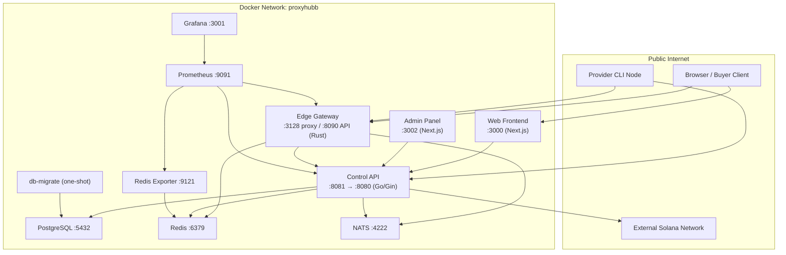
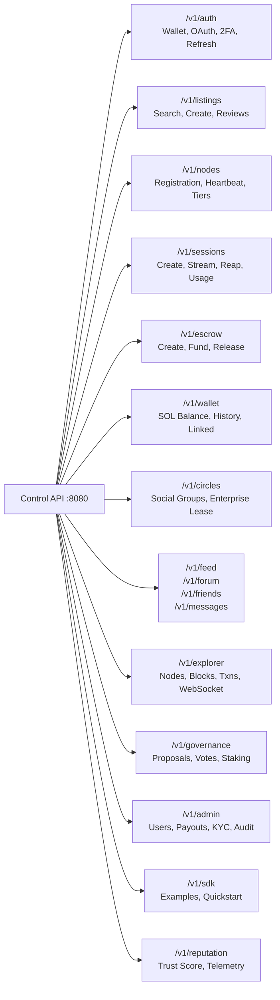
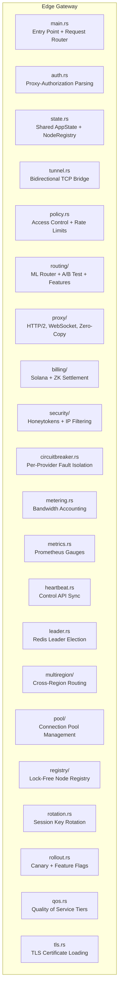
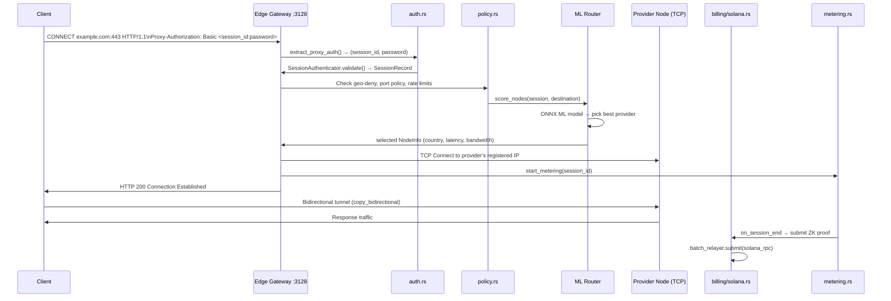
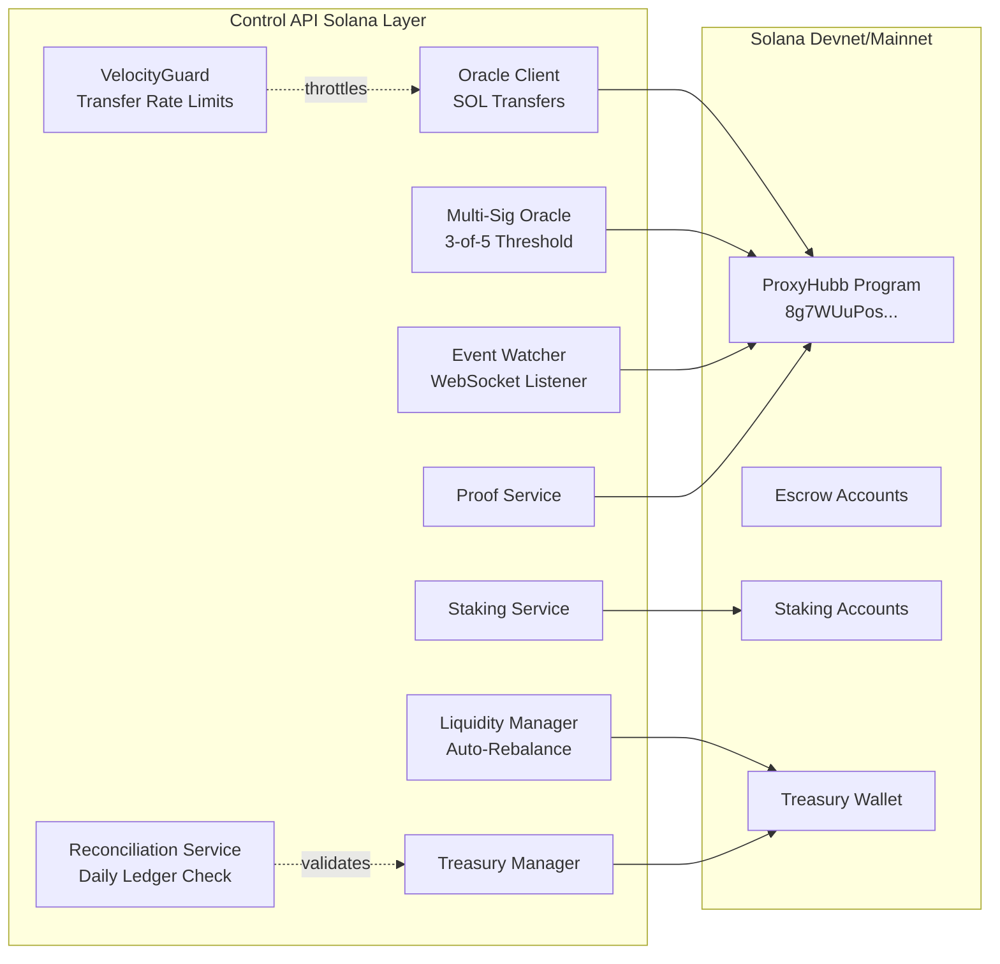
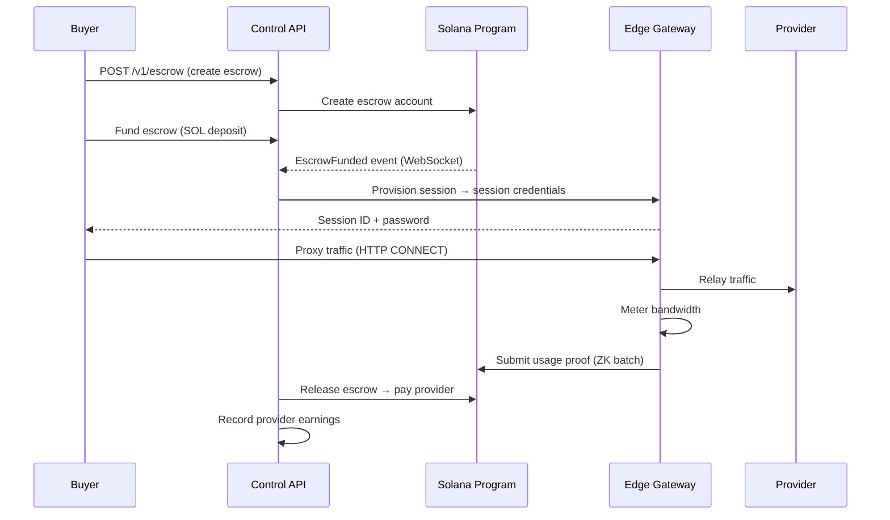
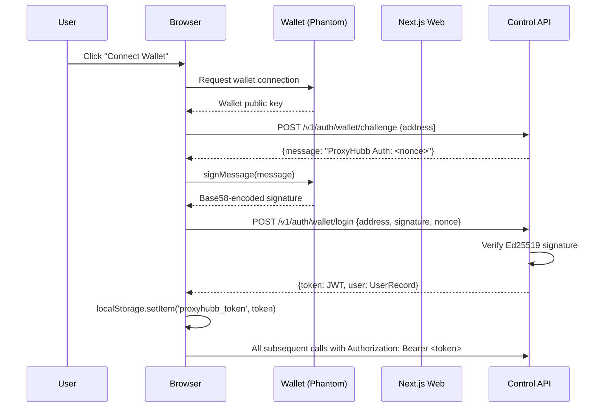
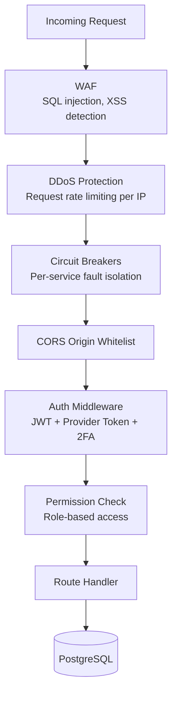
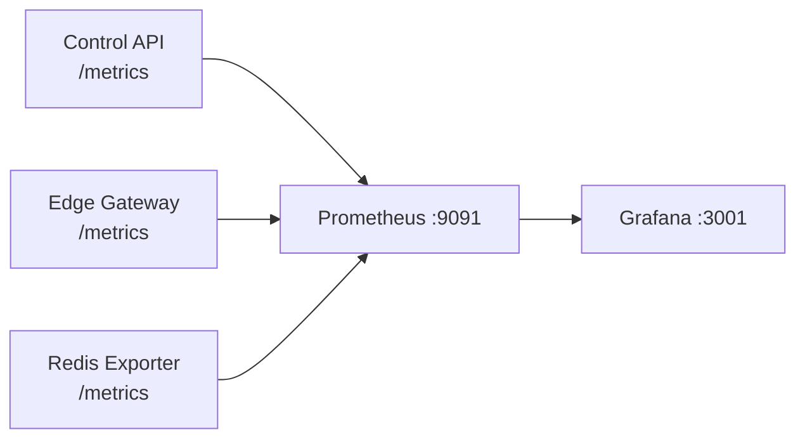

# ProxyHubb — Full System Architecture & Workflow Report

> **Classification:** Technical Architecture Document  
> **Version:** 1.0 — March 2026  
> **Scope:** Complete system — all services, data flows, integrations, and subsystems

---

## 1. Executive Summary

ProxyHubb is a **decentralized bandwidth marketplace** that lets individuals and organizations monetize their internet connections by sharing bandwidth capacity. It connects two types of participants:

- **Providers** — individuals/businesses offering bandwidth through an installed CLI node
- **Buyers** — users/enterprises purchasing proxy bandwidth for browsing, scraping, or routing

The platform is built on three core pillars:

1. **Decentralized Trust** — Payments and proofs are anchored to the Solana blockchain. No single party controls funds; escrow smart contracts enforce fair exchange.
2. **High-Performance Proxying** — A Rust-powered Edge Gateway handles all real-time proxy traffic at near-zero latency using ML-based intelligent routing.
3. **Social Commerce** — A full social layer (circles, feeds, reviews, forums, reputation) turns the marketplace into a community-driven network.

The system is containerized via Docker Compose with 13 distinct services communicating over a private bridge network.

---

## 2. Service Map & Infrastructure

### 2.1 Container Topology



### 2.2 Port Exposure Map

| Service | Internal Port | External Port | Protocol |
|---|---|---|---|
| Web Frontend | 3000 | 3000 | HTTP (Next.js SSR) |
| Admin Panel | 3002 | 3002 | HTTP (Next.js SSR) |
| Control API | 8080 | 8081 | HTTP/REST + WebSocket |
| Edge Gateway (Proxy) | 3128 | 3128 | HTTP CONNECT / SOCKS5 |
| Edge Gateway (API) | 8090 | 8090 | HTTP/REST |
| NATS | 4222 | 4222 | NATS Protocol |
| NATS Monitoring | 8222 | 8222 | HTTP |
| Prometheus | 9090 | 9091 | HTTP |
| Grafana | 3000 | 3001 | HTTP |
| Redis Exporter | 9121 | 9121 | HTTP |

### 2.3 Service Startup Order

```
postgres (healthy) → db-migrate (completed) → redis + nats (healthy) → control-api (healthy) → edge-gateway → web → admin
```

The `db-migrate` container is a one-shot init container running Control API with `MIGRATE_ONLY=true`, applying all SQL migrations before any service starts.

---

## 3. Control API — The System Brain

### 3.1 Overview

The **Control API** is the central nervous system of ProxyHubb. Written in **Go** using the **Gin** web framework, it manages every non-proxy operation: authentication, user management, marketplace listings, sessions, payments, social features, admin operations, and blockchain integrations.

- **Language:** Go 1.22+
- **Framework:** Gin + GORM
- **Database:** PostgreSQL 16 (primary) + optional read replica
- **Cache:** Redis 7
- **Message Bus:** NATS JetStream
- **Blockchain:** Solana (devnet/mainnet)

### 3.2 Internal Package Breakdown

The Control API is organized into **40 internal packages**, each with a defined responsibility:

| Package | Responsibility |
|---|---|
| [api](file:///f:/project/proxyhubb/apps/web/src/lib/api/client.ts#81-98) | All HTTP handlers (94 files, ~150 route endpoints) |
| `models` | GORM data models (56 entities) |
| [middleware](file:///f:/project/proxyhubb/apps/web/src/middleware.ts#4-14) | Auth, WAF, rate limiting, circuit breakers, tracing |
| `db` | Database initialization, repositories, read-replica |
| `billing` | SOL payout processing, batch transfers, retry logic |
| `solana` | Solana RPC client, oracle, watcher, staking, proofs |
| `crypto` | JWT/token generation, AES-GCM encryption, HMAC hashing |
| `worker` | 15 background goroutines (session reaper, heartbeat, etc.) |
| `treasury` | Auto-topup, liquidity management, ledger reconciliation |
| `governance` | DAO proposal scheduling and voting |
| `indexer` | On-chain program account indexer, node sync, blockchain explorer |
| `matching` | Smart matching engine for buyer↔provider pairing |
| `pricing` | Dynamic price feed (CoinGecko/CoinMarketCap), demand oracle |
| `monitoring` | Prometheus metrics, health checks, circuit breaker stats |
| [middleware](file:///f:/project/proxyhubb/apps/web/src/middleware.ts#4-14) | WAF, DDoS protection, emergency circuit breaker, OTel tracing |
| `logging` | Structured zerolog-based logging |
| [redis](file:///f:/project/proxyhubb/services/edge-gateway/src/config.rs#166-183) | Redis client pool, pub/sub helpers |
| `nats` | NATS JetStream initialization and publisher |
| `reputation` | ZK reputation scoring stubs |
| `geoip` | IP → lat/lon resolution via ip-api.com |
| `audit` | Immutable audit log writing |
| `security` | 2FA/TOTP, spending limits, device management |
| [zk](file:///f:/project/proxyhubb/services/edge-gateway/src/billing/zk.rs#73-77) | Zero-knowledge proof generation stubs |
| [config](file:///f:/project/proxyhubb/services/edge-gateway/src/auth.rs#241-249) | Environment configuration loading |
| `alerts` | Slack + email alerting on critical events |
| `ipfs` | Decentralized storage integration |
| `privacy` | GDPR data deletion handlers |
| `circuitbreaker` | Per-service circuit breaker management |
| `payments` | Paystack fiat payment integration |
| `ratelimiter` | Token-bucket rate limiting per user/IP |
| [cache](file:///f:/project/proxyhubb/services/edge-gateway/src/auth.rs#177-186) | Application-level caching helpers |
| `events` | Internal event type definitions |
| `gateway` | Redis gateway for session provisioning |
| `core/services` | Hexagonal architecture marketplace service |
| `gov` | Governance proposal models |
| [health](file:///f:/project/proxyhubb/services/edge-gateway/src/state.rs#214-219) | Extended health check aggregator |

### 3.3 API Route Categories

The Control API exposes roughly **150 HTTP endpoints** organized into these major groups:



### 3.4 Key Data Models (56 Entities)

| Entity | Purpose |
|---|---|
| [User](file:///f:/project/proxyhubb/apps/web/src/lib/auth.tsx#45-82) | App users with role (buyer/provider/admin), trust tier, wallet |
| [Session](file:///f:/project/proxyhubb/services/edge-gateway/src/auth.rs#13-42) | Active proxy sessions with encrypted credentials |
| `Listing` | Provider bandwidth offers with price, capacity, region |
| `Order` | Buyer purchase orders linked to listings |
| `Escrow` | Smart-contract-backed payment escrow on Solana |
| `ProviderNode` | Registered gateway nodes with heartbeat, health, GeoIP |
| [Circle](file:///f:/project/proxyhubb/apps/web/src/lib/api/circlePooling.ts#92-104) | Social bandwidth-sharing groups |
| [CircleMember](file:///f:/project/proxyhubb/apps/web/src/lib/api/circlePooling.ts#35-45) | Circle membership with roles and permissions |
| [CircleLease](file:///f:/project/proxyhubb/services/control-api/internal/api/circles.go#725-750) | Enterprise bandwidth lease agreements |
| [UsageProof](file:///f:/project/proxyhubb/services/edge-gateway/src/billing/zk.rs#25-28) | Cryptographic bandwidth consumption proofs |
| `ProviderEarnings` | SOL earnings ledger per provider |
| `BatchPayoutItem` | Queued SOL payouts for batch processing |
| `GovernanceProposal` | DAO governance proposals |
| `StakingPosition` | PHB token staking records |
| `DisputeCase` | Open disputes between buyers and providers |
| `DisputeJuror` | Jury member records for dispute resolution |
| `AuditLog` | Immutable system audit trail |
| `APIKey` | Developer API keys with scopes |
| `ProviderToken` | CLI authentication tokens (HMAC-SHA256 hashed) |
| `RefreshTokenFamily` | JWT refresh token rotation family tracking |
| `QualityAttestation` | Peer quality verification records |
| `UserSecurity` | 2FA/TOTP settings, spending limits, device list |

### 3.5 Middleware Stack

Every request to the Control API passes through this middleware chain in order:

```
1. CORS (Origin Whitelist Check)
2. Health Endpoint Bypass (no middleware for /health)
3. Emergency Circuit Breaker
4. OpenTelemetry Tracing (trace ID injection)
5. WAF + DDoS Protection (rate limit, payload inspection)
6. Security Headers (CSP, HSTS, X-Frame-Options)
7. Prometheus Metrics Recording
8. Circuit Breakers (database, redis, solana, supabase)
9. Auth Middleware:
   - Optional: validates token if present, proceeds as guest if not
   - Required: aborts with 401 if no valid token
```

---

## 4. Edge Gateway — The Proxy Engine

### 4.1 Overview

The **Edge Gateway** is a high-performance proxy relay written in **Rust** using **Tokio** and **Hyper**. It handles all live proxy traffic — neither the Control API nor the database are involved in the request path once a session is established.

- **Language:** Rust (2021 edition)
- **Async Runtime:** Tokio
- **HTTP Framework:** Hyper 1.x
- **Proxy Port:** 3128 (HTTP CONNECT / SOCKS5)
- **API/Metrics Port:** 8090

### 4.2 Module Architecture



### 4.3 Request Flow Through the Gateway

When a buyer's application makes a proxy request (e.g., `CONNECT example.com:443`):



### 4.4 ML Router (ONNX-based)

The [routing/ml_router.rs](file:///f:/project/proxyhubb/services/edge-gateway/src/routing/ml_router.rs) implements an **ML-based node scoring system** using an ONNX neural network model:

- **Model input:** Feature vector per candidate node — latency, bandwidth rate, active connections, health score, QoS tier, geographic distance
- **Model output:** Float score per node (higher = preferred)
- **Inference runtime:** ONNX Runtime ([ort](file:///f:/project/proxyhubb/services/edge-gateway/src/auth.rs#160-167) crate), supports CUDA/TensorRT in GPU builds
- **Fallback:** Pure latency-based weighted selection if ONNX model unavailable
- **A/B testing:** [routing/ab_test.rs](file:///f:/project/proxyhubb/services/edge-gateway/src/routing/ab_test.rs) sends a configurable percentage of traffic to experimental routing strategies

**Feature engineering** ([routing/features.rs](file:///f:/project/proxyhubb/services/edge-gateway/src/routing/features.rs)) normalizes:
- Bandwidth rate (KB/s)
- Active connection density
- Historical reliability (from heartbeat records)
- Geographic affinity score

### 4.5 NodeInfo & AppState

The [AppState](file:///f:/project/proxyhubb/services/edge-gateway/src/state.rs#318-377) (shared across all Tokio tasks via `Arc<AppState>`) holds:

```
AppState {
    config: Config,
    nodes: LockFreeNodeRegistry,        // All connected provider nodes
    session_cache: DashMap<Uuid, Session>, // In-memory session store (100k entries)
    rate_limiter: KeyedRateLimiter,     // Per-user request rate limiting
    circuit_breakers: CircuitBreakerManager, // Per-provider fault isolation
    redis_pool: RedisPool,              // Async Redis connection pool
    ml_model: Mutex<OnnxSession>,       // ONNX inference session
}
```

The [LockFreeNodeRegistry](file:///f:/project/proxyhubb/services/edge-gateway/src/registry/lockfree.rs#98-103) uses atomic operations to allow concurrent reads during node list updates, ensuring zero-copy node selection under high concurrency.

### 4.6 Tunnel Layer

[tunnel.rs](file:///f:/project/proxyhubb/services/edge-gateway/src/tunnel.rs) implements the bidirectional TCP tunnel that bridges the buyer's connection through the selected provider node:

- **Protocol:** HTTP CONNECT method creates the tunnel
- **Transport:** `tokio::io::copy_bidirectional` for zero-copy data relay
- **Multiplexing:** `yamux` protocol for multiple streams over a single TCP connection
- **TLS:** Client ↔ Gateway connection can be TLS-terminated; Gateway ↔ Provider can use raw TCP or TLS
- **Metering:** Byte counters on both directions feed into [metering.rs](file:///f:/project/proxyhubb/services/edge-gateway/src/metering.rs)

### 4.7 Billing & Settlement

`billing/` contains two settlement mechanisms:

1. **Solana Billing ([billing/solana.rs](file:///f:/project/proxyhubb/services/edge-gateway/src/billing/solana.rs))**: Direct SOL transfer on session end — calls the oracle to pay the provider for verified bandwidth served.
2. **ZK Settlement ([billing/zk.rs](file:///f:/project/proxyhubb/services/edge-gateway/src/billing/zk.rs))**: Zero-knowledge proof batching — accumulates bandwidth proofs, then submits a compressed batch proof to the Solana program, reducing on-chain transaction cost by up to 20x.

---

## 5. Solana / Blockchain Layer

### 5.1 Architecture Overview

ProxyHubb uses Solana as its **trust and settlement layer**. No payment or proof of service bypasses the blockchain.



### 5.2 Oracle System

The **Oracle** is the authorized signing key for all on-chain operations:

- **Single Oracle:** Used for small transfers (< 1 SOL)
- **Multi-Sig Oracle:** 3-of-5 threshold required for transfers ≥ 1 SOL — prevents single key compromise
- **VelocityGuard:** Redis-backed rate limiter prevents a compromised oracle from draining funds:
  - `ORACLE_MAX_SINGLE_TRANSFER_SOL` (default: 50)
  - `ORACLE_MAX_HOURLY_OUTFLOW_SOL` (default: 500)
  - `ORACLE_TRANSFER_FREEZE=true` to emergency-halt all transfers

### 5.3 Escrow Workflow



### 5.4 Treasury Management

The Treasury system ensures the platform remains solvent:

- **Auto-Topup Monitor:** Watches treasury SOL balance; automatically initiates topup when below threshold
- **Liquidity Manager:** Rebalances between operating wallet and treasury every hour
- **GhostProber:** Detects and reports "ghost" escrows (funded but never consumed)
- **Reconciliation Service:** Runs daily at 00:00 UTC to reconcile on-chain balances vs. internal DB ledger

### 5.5 On-Chain Indexer

The `indexer` package continuously polls the Solana program for new events:
- `RegistrySyncWorker` — pulls provider node registrations from program accounts every 5 minutes
- `BlockchainIndexer` — indexes blocks and transactions into the local DB for the Explorer feature
- Broadcasts new blocks/transactions via WebSocket to connected Explorer clients

---

## 6. Web Frontend — User Interface

### 6.1 Overview

The **Web App** is a **Next.js 15** application (App Router) running in standalone mode. It serves as the primary user interface for both buyers and providers.

- **Framework:** Next.js 15 (React 19)
- **Auth:** Wallet-only (Solana wallets: Phantom, Solflare, etc.) via localStorage JWT
- **Styling:** Tailwind CSS + custom CSS
- **State:** React Query (TanStack Query) + Zustand stores
- **Animations:** Framer Motion
- **Charts:** Recharts
- **API:** All `/v1/*` calls are proxied server-side via [next.config.ts](file:///f:/project/proxyhubb/apps/web/next.config.ts) rewrites → `control-api:8080`

### 6.2 Page / Route Structure

```
/                          → Marketing landing page
/login                     → Wallet connect + authentication
/dashboard
  /dashboard/overview      → Usage stats, balance, recent activity
  /dashboard/analytics     → Bandwidth charts, geo data, top destinations
  /dashboard/provider
    /provider/nodes        → Register and manage provider nodes
    /provider/earnings     → SOL earnings history
    /provider/circle       → Circle bandwidth pooling dashboard
    /provider/services     → Service configuration
  /dashboard/sessions      → Active + historical proxy sessions
  /dashboard/orders        → Purchase history
  /dashboard/wallet        → Multi-wallet management, SOL balance
  /dashboard/security      → 2FA, spending limits, devices
  /dashboard/admin         → Admin-only: users, nodes, payouts, KYC
/marketplace               → Browse proxy listings
/marketplace/create        → Create a new listing
/explorer
  /explorer/map            → Live interactive node map (3D globe)
  /explorer/blocks         → Blockchain block explorer
  /explorer/contracts      → On-chain program contracts
/circles                   → Social circles browse
/forum                     → Community forum
/community                 → Social feed + profiles
```

### 6.3 Authentication Flow



### 6.4 Real-Time Updates

The frontend maintains two real-time connections:
1. **WebSocket (`/v1/ws`)** — Session status updates, notifications, presence
2. **SSE (`/api/sessions/stream`)** — Live session metrics stream during active proxy use

The Explorer page additionally subscribes to `/v1/explorer/ws` for live block/node updates.

---

## 7. Admin Panel

### 7.1 Overview

The **Admin Panel** is a completely separate Next.js application (port 3002) with its own authentication system. It connects directly to the Control API's `/v1/admin` routes using a distinct `ADMIN_JWT_SECRET`.

### 7.2 Access Control

- **3 hardcoded admin accounts** loaded from environment variables on startup
- Admin JWT tokens are signed with `ADMIN_JWT_SECRET` — cannot be confused with user tokens
- Role-based: `admin` (full access) and `moderator` (read-only + content moderation)

### 7.3 Admin Capabilities

| Feature | Description |
|---|---|
| **User Management** | View, ban, unban, delete users |
| **KYC Verification** | Approve or reject provider identity verification |
| **Payouts** | Review and trigger pending SOL payouts |
| **Node Health** | Monitor all provider nodes, force-check or reactivate |
| **Provider Applications** | Approve/reject new provider applications |
| **Audit Logs** | View immutable system audit trail |
| **Revenue Stats** | Platform revenue, transaction volume, payout history |
| **Dashboard Stats** | Real-time system health overview |
| **Session Stream** | Live SSE stream of all active sessions |

---

## 8. Key Data Flows (End-to-End Narratives)

### 8.1 A Buyer Purchasing a Proxy Session

```
1. Buyer browses /marketplace → fetches GET /v1/listings from Control API
2. Buyer selects a listing and clicks "Buy" → POST /v1/orders
3. Control API creates Order record → triggers escrow creation on Solana
4. Buyer funds escrow wallet (SOL transfer from their wallet to escrow account)
5. Solana Event Watcher detects EscrowFunded event → emits to NATS
6. Provisioning Worker receives NATS event → calls Edge Gateway /provision
7. Edge Gateway allocates a session ID + one-time password from the provider pool
8. Control API returns session credentials to buyer → stored in browser
9. Buyer configures proxy software: host=<gateway_ip>:3128, user=<session_id>, pass=<password>
10. Each HTTP CONNECT request is authenticated by Edge Gateway auth.rs
11. ML Router scores available provider nodes → picks best match
12. Bidirectional TCP tunnel established → traffic flows buyer ↔ provider
13. metering.rs tracks byte counts every 1 second
14. On session expiry/close → ZK proof generated → submitted to Solana in a batch
15. Escrow released → SOL transferred to provider wallet minus platform fee (10%)
16. Provider earnings recorded in DB → available for withdrawal
```

### 8.2 A Provider Registering a Node

```
1. Provider downloads CLI: curl /v1/cli/download/<platform>
2. CLI runs: proxyhubb auth login → POST /v1/auth/wallet/challenge → wallet sign
3. JWT stored in CLI config
4. CLI registers node: POST /v1/nodes/register → ProviderNode created in DB
5. CLI connects to Edge Gateway WebSocket → keeps persistent connection alive
6. Edge Gateway adds node to LockFreeNodeRegistry → now eligible for routing
7. Heartbeat Monitor in Control API pings all nodes every 60s
8. If node misses heartbeats for 5 minutes → marked offline → removed from routing pool
9. Tier Evaluator runs every hour:
   - Checks bandwidth served, uptime, quality attestations
   - Updates provider trust tier (Basic → Silver → Gold → Platinum)
10. Higher tier → better position in ML Router scoring → more traffic → more earnings
```

### 8.3 Circle Pool Workflow

```
1. Provider or power user creates a Circle: POST /v1/circles {name, type: "enterprise"}
2. Other providers join: POST /v1/circles/:id/join
3. Each member contributes bandwidth: POST /v1/circles/:id/pool/contribute {bandwidth_gb: 500}
4. Enterprise buyer requests a quote: POST /v1/circles/:id/quotes {bandwidth_gb: 2000}
5. Circle's combined capacity fulfills the quote → quote returned with total price
6. Enterprise accepts: POST /v1/circles/quotes/:id/accept
7. CircleSession created → enterprise gets dedicated session pool
8. Revenue flows into the circle, distributed proportionally to each member's contribution
9. Members claim revenue: POST /v1/circles/:id/revenue/claim → SOL payout triggered
```

---

## 9. Authentication & Security Architecture

### 9.1 Token Types

| Token Type | Format | Used For | Storage |
|---|---|---|---|
| User JWT | HS256 signed JWT | Web/mobile API access | Browser localStorage |
| Provider Token | HMAC-SHA256 hash | CLI node authentication | CLI config file |
| Admin JWT | HS256 (different secret) | Admin panel access | Admin browser session |
| Gateway JWT | Short-lived JWT | Edge Gateway session provisioning | Memory only |

### 9.2 Credential Encryption

All session proxy credentials (username/password for the buyer's proxy config) are encrypted **at rest** using **AES-256-GCM**:
- Encryption key loaded from `ENCRYPTION_KEY` environment variable
- Encrypted before storage in PostgreSQL `sessions.credentials_user`
- Decrypted only when constructing the session payload for the buyer

A startup guard (`SKIP_CREDENTIAL_CHECK=false`) blocks the server from starting if any active session row has unencrypted credentials (short credential string detected), preventing accidental plaintext exposure after a migration.

### 9.3 Defense in Depth



Additional security layers:
- **2FA/TOTP:** Optional TOTP app enforcement for sensitive accounts
- **Spending Limits:** Per-user configurable maximum spend per transaction/day
- **Honeytokens (`security/honeytoken/`):** In the Edge Gateway, fake credentials are planted; any access using them triggers an alert
- **IP Allow/Deny Lists:** Per-circle or per-listing geographic filtering
- **Oracle Transfer Freeze:** Emergency kill-switch for all outgoing SOL transfers

---

## 10. Background Workers & Event-Driven Systems

### 10.1 Background Workers (Control API)

All 15 background goroutines start on server boot:

| Worker | Interval | Function |
|---|---|---|
| `HeartbeatMonitor` | Check every 60s | Marks nodes offline after 5m without heartbeat |
| `SessionReaper` | Every 5m | Expires and cleans up stale sessions |
| `TierEvaluator` | Hourly | Recalculates provider trust tiers based on performance |
| `TelemetryWorker` | Every 5s | Aggregates and writes session telemetry metrics |
| `UsageMilestoneWorker` | Every 5m | Checks if users hit bandwidth milestones → triggers rewards |
| `ZKSettlementWorker` | Continuous | Processes the ZK proof settlement queue |
| `ProvisioningWorker` | Event-driven (NATS) | Provisions gateway sessions on escrow-funded events |
| `SettlementAggregator` | Every 1h | Aggregates provider payouts into batches |
| `EscrowCleaner` | Every 30m | Closes and refunds expired unfulfilled escrows |
| `MarketplaceWatcher` | Continuous | Watches marketplace events for real-time pricing |
| `AgentWorker` | Event-driven (Redis Queue) | Executes AI agent tasks from the agent orchestration queue |
| `RegistrySyncWorker` | Every 5m | Syncs on-chain node registrations with local DB |
| `ValidatorSync` | On boot | Syncs Solana validator set for staking verification |
| `LeaderboardMVRefresh` | Every 15m | Refreshes the provider leaderboard materialized view |
| `GhostProber` | Every 5m | Detects and resolves ghost (stuck) escrow accounts |

### 10.2 NATS Event Bus

NATS JetStream provides durable pub/sub messaging between services:

```
Topics:
  session.provisioned    → Edge Gateway creates session
  session.expired        → Reaper triggers cleanup
  escrow.funded          → ProvisioningWorker notified
  escrow.released        → EarningsWorker queues payout
  node.heartbeat         → HeartbeatMonitor receives keep-alive
  node.offline           → UI WebSocket broadcast
  usage.milestone        → MilestoneWorker triggers reward
```

### 10.3 Redis Usage

Redis serves multiple distinct functions:

| Function | Key Pattern | TTL |
|---|---|---|
| Session cache | `sess:<uuid>` | 300s |
| Rate limiting | `rl:<user_id>` | 60s |
| Leader election | `leader:edge-gw` | 10s (auto-refresh) |
| Config sync | `config:<key>` | Persistent |
| NATS-like Queue | `agent:queue` | Persistent |
| Oracle velocity | `orch:hourly_outflow` | 3600s |

---

## 11. Monitoring & Observability

### 11.1 Metrics Pipeline



### 11.2 What is Measured

**Control API metrics:**
- HTTP request count + latency per route
- Active sessions count
- DB connection pool usage
- Circuit breaker state (open/closed/half-open) per service
- Payout queue depth
- Node count online/offline

**Edge Gateway metrics:**
- Active proxy connections
- Bytes proxied per second (upload/download)
- Session auth success/failure rate
- Provider node pool size
- ML router score distribution
- Circuit breaker trips per provider

### 11.3 OpenTelemetry Tracing

Every request to the Control API gets a trace injected by `TracingMiddleware`:
- Trace ID propagated in `X-Trace-ID` response header
- Spans exported to **Jaeger** via OTLP if `JAEGER_ENDPOINT`/`OTEL_EXPORTER_OTLP_ENDPOINT` is set
- Each DB query, external API call, and Redis operation is a child span

### 11.4 Alerting

Alerts (`alerts/` package) fire to **Slack** (webhook) and **email** (SMTP) on:
- Oracle transfer velocity limit exceeded
- Oracle transfer freeze activated
- Critical circuit breaker tripped
- Treasury balance below threshold
- Ledger reconciliation mismatch

---

## 12. CLI & SDKs

### 12.1 CLI (`cli/`)

The **ProxyHubb CLI** is the tool providers install on their machines to register and manage a node. Built in Go with Cobra.

**Key commands:**
```
proxyhubb auth login          → Wallet-based authentication
proxyhubb node register       → Register current machine as a provider node
proxyhubb node status         → View node health, uptime, earnings
proxyhubb node start          → Start the local proxy server
proxyhubb session list        → List active sessions on this node
proxyhubb withdraw            → Initiate SOL withdrawal to wallet
```

**CLI Distribution:** Published via `GET /v1/cli/download/:platform` (linux/mac/windows) — served from the `/cli-dist` volume mounted into the Control API container.

### 12.2 SDKs

ProxyHubb provides official SDKs in three languages, enabling programmatic proxy session management:

| SDK | Language | Key API |
|---|---|---|
| `sdks/go` | Go | `client.CreateSession()`, `client.GetProxy()`, `client.EndSession()` |
| `sdks/node` + `sdks/nodejs` | Node.js / TypeScript | `ProxyHubb.createSession()`, `ProxyHubb.getAgent()` |
| `sdks/python` | Python | `ProxyHubb().create_session()`, `ProxyHubb().get_proxy_config()` |

Each SDK handles:
- JWT authentication
- Session creation/teardown
- Proxy config generation (for HTTPS/SOCKS5)
- Usage polling

Interactive SDK examples are served at `GET /v1/sdk/examples` — runnable code snippets for the Web UI's "Developer" section.

---

## 13. Infrastructure & DevOps

### 13.1 Docker Compose Variants

ProxyHubb ships multiple compose files for different environments:

| File | Purpose |
|---|---|
| `docker-compose.yml` | Default production-like stack (all services) |
| `docker-compose.dev.yml` | Development stack with hot-reload |
| `docker-compose.prod.yml` | Production hardened (secrets, no exposed ports except 80/443) |
| `docker-compose.minimal.yml` | Control API + DB only (no Gateway) |
| `docker-compose.secure.yml` | Security-hardened with TLS termination |
| `docker-compose.test.yml` | Automated test environment |
| `docker-compose.mesh.yml` | Multi-gateway service mesh configuration |

### 13.2 Database Migrations

Migrations are managed via a one-shot **`db-migrate` init container**:
1. Runs `control-api` binary with `MIGRATE_ONLY=true`
2. Applies all SQL files from the `/migrations` volume directory
3. Sets `SKIP_CREDENTIAL_CHECK=true` only for migration mode
4. Exits with code 0 on success; all other services wait on `service_completed_successfully`

This guarantees schema is always up-to-date before any service connects to the database.

### 13.3 Secrets Management

| Secret | How Injected |
|---|---|
| `oracle-keypair.json` | Docker bind-mount at `/run/secrets/oracle-keypair.json` |
| `JWT_SECRET` | Environment variable from `.env` |
| `ENCRYPTION_KEY` | Environment variable from `.env` |
| `TOKEN_HMAC_SECRET` | Environment variable from `.env` |
| `REDIS_PASSWORD` | Environment variable from `.env` |
| `ADMIN_JWT_SECRET` | Environment variable from `.env` |
| Database credentials | Embedded in `DATABASE_URL` |

All secrets are sourced from a single `.env` file at the project root (excluded from version control via `.gitignore`). A `.env.example` provides the full template.

### 13.4 Network Isolation

All services communicate on the private Docker bridge network `proxyhubb`. Only the following ports are exposed to the host (and thus the public internet in production):

- `3000` — Web app
- `3128` — Proxy ingress (buyers connect here)
- `8081` — Control API (provider node registration, CLI)

In production (`docker-compose.prod.yml`), a reverse proxy (Nginx/Caddy) sits in front with TLS termination, and these ports are typically not exposed directly.

---

## 14. System-Wide Interaction Matrix

This matrix shows which services talk to which:

| From \ To | Control API | Edge Gateway | PostgreSQL | Redis | NATS | Solana |
|---|---|---|---|---|---|---|
| **Web Frontend** | ✅ REST/WS | ✅ Proxy | — | — | — | — |
| **Admin Panel** | ✅ REST | — | — | — | — | — |
| **Edge Gateway** | ✅ Auth/Provision | — | — | ✅ Cache | ✅ Events | ✅ Billing |
| **Control API** | — | ✅ Provision | ✅ Read/Write | ✅ Cache | ✅ Publish | ✅ Oracle |
| **CLI** | ✅ Register/Auth | ✅ Connect | — | — | — | ✅ Wallet |
| **SDK Clients** | ✅ Session API | ✅ Proxy | — | — | — | — |
| **Prometheus** | ✅ /metrics | ✅ /metrics | — | Via exporter | — | — |

---

## 15. Summary of Key Design Decisions

| Decision | Rationale |
|---|---|
| **Rust for Edge Gateway** | Zero-cost abstractions, fearless concurrency, sub-millisecond proxy latency required |
| **Go for Control API** | Fast development velocity, excellent gRPC/HTTP ecosystem, built-in goroutines for workers |
| **Solana for payments** | Sub-second finality, sub-cent transaction fees, mature NFT/token ecosystem |
| **NATS JetStream** | Durable, lightweight message bus without Kafka's operational complexity |
| **AES-GCM credential encryption** | GDPR compliance + security: proxy credentials must never be stored plaintext |
| **ONNX for ML routing** | Portable model format — same model can run on CPU, CUDA, or TensorRT |
| **Lock-free node registry** | Eliminates mutex contention on the hot path (node selection during every request) |
| **Multi-sig oracle** | Prevents single-key compromise from draining treasury (3-of-5 threshold for ≥1 SOL) |
| **Circles as social primitives** | Allows groups to pool capacity → enterprise-grade bandwidth without individual overhead |
| **Read replica support** | Analytics/explorer queries don't compete with write-heavy session operations |
