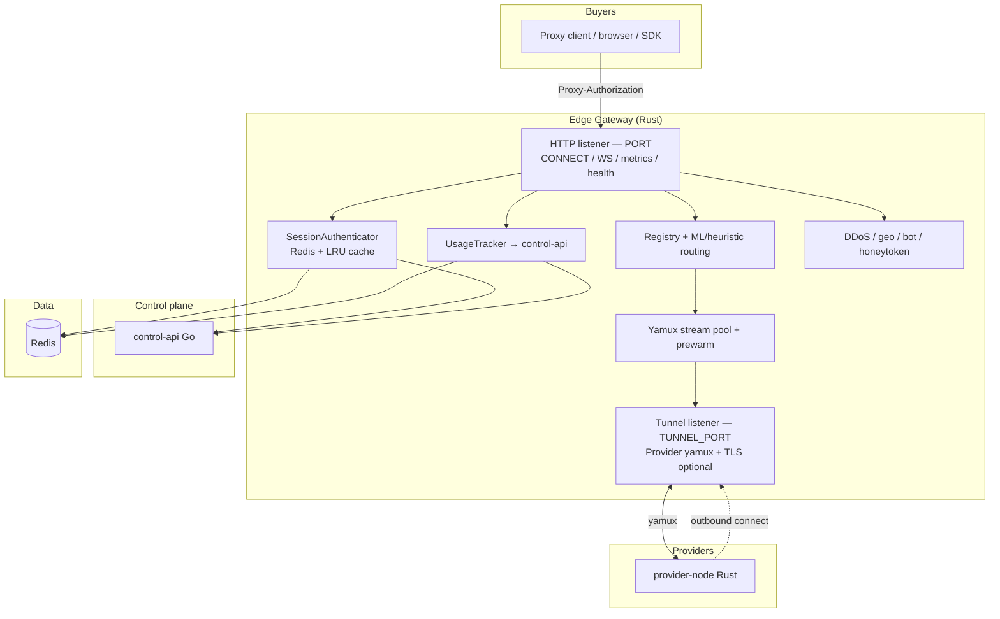
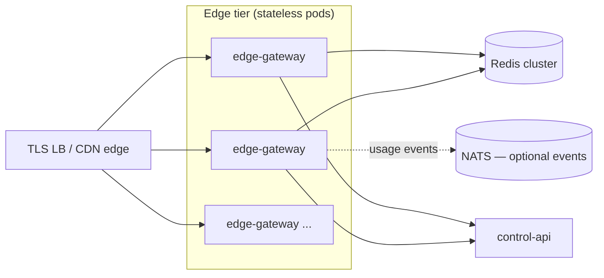

# ProxyHubb Edge Gateway — Deep Dive & Enhancement Roadmap

> **Status:** Analysis for review (no code changed).  
> **Date:** 2026-06-02  
> **Scope:** `services/edge-gateway/` — architecture, runtime behavior, strengths/weaknesses, operational fit, and a practical path to higher performance and scale.  
> **Next:** the forward-looking v2 plan lives in [`EDGE_GATEWAY_VNEXT_BLUEPRINT.md`](./EDGE_GATEWAY_VNEXT_BLUEPRINT.md) (phases, roadmap, implementation plan, 10× performance levers).

---

## 1. Executive Summary

The Edge Gateway is the **data-plane entry point** for ProxyHubb: it terminates buyer proxy traffic (HTTP `CONNECT`, WebSocket upgrade), authenticates sessions, enforces policy, selects provider nodes, bridges bytes over **yamux** tunnels to **provider-node** agents, meters usage, and exposes observability endpoints. It is implemented as a **Rust / Tokio / Hyper** service with a large, phase-organized module tree (auth, routing, security, pooling, metering, optional ML, legacy settlement hooks).

**Overall rating: 7.2 / 10** — strong engineering intent and many production patterns (fail-closed auth, circuit breakers, WAL metering, lock-free registry, connection prewarm), but held back by **configuration drift**, **unwired subsystems** (blockchain stream, pricing engine), **ops manifest mismatches**, and **per-connection task fan-out** without backpressure.

The gateway is **usable and thoughtfully designed** for a decentralized proxy marketplace, but it is not yet a **minimal, battle-tested edge** — it carries optional heavyweight dependencies (Solana client, ZK crates, ONNX/CUDA) and several “Phase N” code paths that are not on the hot path.

---

## 2. Rating Breakdown

| Area | Score | Notes |
|------|------:|-------|
| Core proxy correctness | 7.5 / 10 | CONNECT + yamux bridge, policy layers, sticky/rotation; some enforcement gaps (time limits, anomaly = warn-only). |
| Performance architecture | 7.0 / 10 | Lock-free registry, score snapshots, stream pool, prewarm, 64KB bridge, optional Linux splice; spawn-per-connection limits scale. |
| Security | 7.5 / 10 | Fail-closed auth, geo/DDoS/bot/honeytoken layers; JA3 deferred; challenge tokens not enforced; buyer port often plain HTTP. |
| Observability | 8.0 / 10 | Prometheus metrics, health, debug routes gated by env; rich label dimensions. |
| Operational readiness | 5.5 / 10 | Docker health checks align; **K8s deployment ports/probes do not match code**; port/env inconsistencies across compose files. |
| Code maturity / focus | 6.5 / 10 | Many modules; **pricing** and **blockchain** packages exist but are **not wired** into `AppState` / `main`. |
| Test coverage (unit) | 7.5 / 10 | Good module-level tests (~35 files with `#[test]`); limited integration/load tests visible in-tree. |
| Fit for proxy marketplace | 8.0 / 10 | Session intents, provider leases, node policy, metering → control-api — aligned with product model. |

---

## 3. Architecture Overview

### 3.1 Position in the system

### 3.2 Process model

On startup (`main.rs`), the gateway:

1. Loads `Config::from_env()` (requires `JWT_SECRET`, `GATEWAY_SHARED_SECRET`, `SESSION_SECRET`, `PROVIDER_PRIVATE_KEY`).
2. Builds `SessionAuthenticator` (Redis pool + LRU session cache).
3. Starts **leader election** (Redis key `edge-gateway-leader`).
4. Constructs `AppState` (registry, security, routing, metering, control-api client, etc.).
5. Binds **proxy listener** on `HOST:PORT`.
6. Spawns **tunnel server** on `TUNNEL_PORT`.
7. Accept loop: **one Tokio task per TCP connection** → Hyper auto HTTP/1.1 + HTTP/2 → `proxy()` handler.

### 3.3 Request path (HTTP CONNECT)

High-level flow for buyer traffic:

1. **Management paths:** `GET /metrics`, `GET /health` (same listener as proxy).
2. **Debug paths** (only if `ENABLE_DEBUG_ROUTES` or dev env): `/debug/ml/stats`, `/debug/nodes`, `/api/v1/network/status`.
3. **Security preflight:** geo-block, adaptive DDoS, HTTP bot classifier (UA + header order; JA3 not implemented).
4. **WebSocket:** upgrade path for WS-tunneled TCP.
5. **CONNECT:**
   - Parse `Proxy-Authorization` (legacy `user:pass` or `session-intent:<jwt>` / `intent:<jwt>`).
   - Validate via Redis cache or session-intent JWT (`fail-closed` on backend errors).
   - Policy: global destination rules (`policy.rs`), per-session domain lists, per-node config from Redis.
   - Rate limit per username (`governor`).
   - **Pre-select provider** before upgrade (503 if none).
   - `hyper::upgrade` → `bridge_to_provider` over yamux (`CONNECT host\n` handshake).
   - Meter bytes; sync session-intent lifecycle to control-api; optional legacy ZK path if explicitly enabled.

Provider selection order (`select_best_provider`):

1. Sticky binding from Redis (unless rotation due).
2. `registry.get_best_for(geo)` — lock-free scored snapshot.
3. `select_provider_ml` — feature cache + heuristic/ONNX backend.
4. Random healthy node fallback.

---

## 4. Module Map & Functions

| Module | Responsibility | Hot path? |
|--------|----------------|-----------|
| `main.rs` | Listeners, `proxy()` orchestration, provider bridge | Yes |
| `auth.rs` | Redis session validation, LRU cache, sticky node keys | Yes |
| `auth/session_intent.rs` | JWT delegation tokens for buyers | Yes |
| `auth/provider_lease.rs` | Provider tunnel JWT + lease freshness | Tunnel |
| `tunnel.rs` | Provider TCP/TLS accept, yamux, registration, heartbeats | Tunnel |
| `registry/lockfree.rs` | Lock-free node registry, score refresh | Yes |
| `registry/store.rs` | Redis-backed registry persistence | Background |
| `pool/` | Per-node yamux stream reuse | Yes |
| `routing/` | ML router, features, prewarm, analytics, A/B | Yes |
| `circuitbreaker.rs` | Per-provider breakers | Yes |
| `proxy/` | HTTP/2 builder, WebSocket, `bridge_tracked` / splice | Yes |
| `policy.rs` | Port whitelist, private IP block, metadata IP block | Yes |
| `metering.rs` | Signed usage batches + Redis WAL | Yes |
| `control_api.rs` | Gateway-authenticated control-api calls | Yes |
| `security/` | DDoS, reputation, fingerprint, honeytoken, anomaly | Yes |
| `heartbeat.rs` | Node liveness | Background |
| `leader.rs` | Leader-gated maintenance | Background |
| `multiregion/` | Region staleness | Partial |
| `qos.rs` | Traffic shaping | Bridge |
| `metrics.rs` | Prometheus | Yes |
| `billing/` | Legacy ZK + Solana relayer (off by default) | Optional |
| `blockchain/` | gRPC Solana stream (**not started in main**) | No |
| `pricing/` | Price oracle + demand (**not in AppState**) | No |

---

## 5. Current State Assessment

### 5.1 What is production-aligned today

- **Session authority:** Redis `session:{username}` documents pushed by control-api; edge validates status + bandwidth caps.
- **Session intents:** V2 auth path with lifecycle + usage sync to control-api (`sync_session_intent_*`).
- **Provider plane:** Outbound provider connections to `TUNNEL_PORT`, JWT role `provider`, optional TLS, capability negotiation.
- **Settlement path:** Canonical design disables edge-side Groth16 (`LEGACY_EDGE_ZK_SUBMISSION_ENABLED=false`); metering flush to control-api with Ed25519 signing and Redis WAL recovery.
- **CI:** `edge-gateway-check` job (fmt, clippy, build) in `.github/workflows/proxyhubb-ci.yml`.
- **Docker:** `Dockerfile` healthcheck hits `http://127.0.0.1:8090/health`; exposes `3128` + `8090`.

### 5.2 Configuration & ops drift (important)

| Setting | `config.rs` default | `docker-compose.yml` | `.env.example` | `infra/k8s/edge-gateway-deployment.yaml` |
|---------|---------------------|----------------------|----------------|------------------------------------------|
| Buyer/mgmt `PORT` | **3000** | **8090** | 8090 | **8443** (container + Service) |
| `TUNNEL_PORT` | **4000** | **3128** | 4000 (`PROXYHUB_GATEWAY_ADDRS`) | (not documented in manifest) |
| Metrics | same as `PORT` (`/metrics`) | 8090 | 8090 | **9090** (no listener in code) |
| Readiness | N/A | N/A | N/A | **`/ready` — not implemented** |

Additional inconsistency: `main.rs` uses `CONTROL_API_URL` default `http://localhost:8000` when constructing `UsageTracker`, while `Config` defaults to `8080`.

**Impact:** Kubernetes probes and Service ports likely **fail or route to wrong ports** without undocumented overrides. Operators must treat manifests as **aspirational** until reconciled with code.

> **Update (2026-06-02, vNext P0):** reconciled. Canonical is **`PORT=8090`** (buyer API + health + metrics + `/ready`) and **`TUNNEL_PORT=3128`** (provider tunnel). `config.rs` defaults, the K8s manifest (ports/probes/secrets), `main.rs` `CONTROL_API_URL` default, and the `.env*`/legacy compose stragglers are now aligned. See [`adr/0001-edge-gateway-scope-and-ports.md`](./adr/0001-edge-gateway-scope-and-ports.md) and `services/edge-gateway/README.md`.

### 5.3 Unwired or legacy subsystems

| Subsystem | Evidence | Status |
|-----------|----------|--------|
| `blockchain::BlockchainManager` | Defined in `blockchain/mod.rs`; **no reference in `main.rs` or `AppState`** | Scaffold only (P2-A9) |
| `pricing::PricingEngine` / `PriceOracle` | Module tree under `pricing/`; **not in `AppState`** | Scaffold only (P2-A10) |
| Edge ZK settlement | Gated by `LEGACY_EDGE_ZK_SUBMISSION_ENABLED` (default **false**) | Correctly deprecated |
| ONNX ML routing | Docker build `--features ml`; CUDA base image | Optional; needs GPU + model artifact path |

### 5.4 Dependency weight

Release image: **CUDA base** + Solana + arkworks ZK + optional ONNX. Even with legacy paths disabled, this increases **image size**, **CVE surface**, and **cold start**. For a pure edge proxy, most of this could live only in control-api / batch workers.

---

## 6. Strengths (Pros)

1. **Clear data-plane / control-plane split** — edge does auth, routing, bytes; control-api owns sessions, registry DB, batch settlement.
2. **Fail-closed authentication** — Redis/intent failures return `407`, not anonymous proxying.
3. **Layered policy** — global port/IP rules, session domain lists, per-node port/domain config (N-01), honeytoken sink for abuse.
4. **Performance-oriented data structures** — `LockFreeNodeRegistry` with periodic score snapshot (100ms) for O(1)-ish `get_best`.
5. **Resilience patterns** — per-provider circuit breakers, connect/idle timeouts, metering WAL + flush retries, graceful shutdown drain (30s).
6. **Connection amortization** — yamux stream pool + prewarm engine reduces stream-open RTT.
7. **Efficient bridging** — 64KB buffers, idle timeout, Linux `splice` path in `proxy/zerocopy.rs`.
8. **Observability** — Prometheus metrics for auth, policy blocks, routing, circuits, bandwidth, session cache.
9. **Auth evolution** — session-intent JWT path supports delegated, short-lived buyer credentials without sharing long-lived session passwords.
10. **Unit test culture** — broad tests across policy, security, routing, auth, pool, config.

---

## 7. Weaknesses (Cons)

### 7.1 Critical / high (fix before trusting prod K8s)

| # | Severity | Issue |
|---|----------|-------|
| 1 | **High** | K8s manifest ports (8443, 9090) and `/ready` probe **do not match** application (8090, `/health` only). |
| 2 | **High** | `PORT` / `TUNNEL_PORT` **defaults differ** across config, compose, and env docs → miswired provider nodes and buyers. |
| 3 | **Medium** | `blockchain` and `pricing` modules are **dead code** on the runtime path — misleading for operators and reviewers. |
| 4 | **Medium** | **Unbounded `tokio::spawn` per connection** — no global concurrency limit; vulnerable to connection exhaustion. |
| 5 | **Medium** | Buyer listener is **plain TCP/HTTP** in `main` (TLS only on tunnel via `tls.rs`) — TLS termination expected at LB without doc clarity. |

### 7.2 Security & policy gaps

| # | Severity | Issue |
|---|----------|-------|
| 6 | **Medium** | JA3/TLS fingerprinting **deferred**; bot detection is HTTP-only. |
| 7 | **Medium** | DDoS `Challenge` result **falls through** — token issued but request still allowed. |
| 8 | **Low** | Anomaly high-RPM **logs only** — does not block. |
| 9 | **Low** | Session `time_limit_minutes` — **placeholder** in CONNECT path (not enforced at edge). |
| 10 | **Low** | Honeytoken slash uses **`unknown_provider`** hardcoded — weak on-chain accountability. |

### 7.3 Performance & maintainability

| # | Severity | Issue |
|---|----------|-------|
| 11 | **Medium** | Session cache uses **`Mutex<LruCache>`** — contends under high auth QPS; consider `moka` or sharded caches. |
| 12 | **Medium** | `bridge_tracked` logs **warn on every read** in zerocopy — hot-path log noise and cost. |
| 13 | **Medium** | Heavy binary (CUDA + Solana + ZK) for edge role — slower deploys, larger attack surface. |
| 14 | **Low** | `select_provider_ml` may return node id `"random"` — special-case handling downstream? |
| 15 | **Low** | No dedicated `services/edge-gateway/README.md` — onboarding relies on env examples only. |

---

## 8. Pros & Cons (Summary)

### Pros

- Rust async stack well-suited to connection-heavy proxy workloads.
- Rich feature set for a **marketplace proxy** (geo routing, sticky, rotation, metering, intents).
- Production patterns: circuit breakers, WAL metering, leader election, graceful drain.
- Good modular boundaries and test coverage at unit level.
- Sensible default to **disable** legacy edge ZK settlement.

### Cons

- Ops/config **not single-source-of-truth** for ports and health checks.
- Significant **scope creep** in repo (unused blockchain/pricing/ML/CUDA/ZK in one binary).
- Missing **backpressure** and **connection admission control**.
- Some security features are **partially implemented** (challenge, anomaly, time limits).
- K8s and partial docs **overstate** maturity vs runtime wiring.

---

## 9. Recommended Target Architecture (Practical)

Goal: a **fast, horizontally scalable, purpose-built edge** that does one job extremely well: **authenticate, route, bridge, meter** — and nothing else.

### 9.1 Binary split (recommended)

| Binary | Contains | Deploy where |
|--------|----------|--------------|
| **edge-gateway** (lean) | proxy, auth, routing, pool, policy, metering client, metrics | Many replicas, autoscale on connections/CPU |
| **edge-settlement** (optional, existing control-api workers) | ZK batching, Solana submits | Few workers |
| **edge-ml** (optional sidecar or feature flag) | ONNX scoring only | GPU nodes only, if ML routing proven valuable |

Remove Solana/ark/ONNX from default edge image unless a feature flag is enabled at **compile time** for that deployment flavor.

### 9.2 Hot-path optimizations (ordered by ROI)

1. **Admission control** — global semaphore / `tower::limit::ConcurrencyLimit` + configurable `MAX_CONCURRENT_CONNECTIONS`; return `503` when saturated.
2. **Sharded session cache** — replace single mutex LRU with `moka::sync::Cache` or shard by username hash.
3. **Reduce logging in bridge** — demote per-chunk `warn!` in `zerocopy.rs` to `trace!` or feature-gated debug.
4. **SO_REUSEPORT + multiple accept loops** — one listener task per core on Linux for accept scalability.
5. **TLS termination clarity** — either terminate TLS in-gateway (rustls on buyer port) **or** document mandatory LB TLS; align ports everywhere.
6. **Wire or delete dead modules** — integrate `pricing` into routing scores **or** remove from crate; same for `blockchain` until actually used.
7. **Session time limits** — add `created_at` to `SessionData` and enforce in bridge revalidation callback (already supported in `bridge_tracked`).
8. **Enforce anomaly + challenge** — block or throttle when triggered; document client behavior for challenge header.

### 9.3 Scale-out model

- **Stateless edge pods** behind L4 LB; sticky buyer sessions already use Redis — compatible with any pod.
- **Provider tunnels** must reach **any** gateway instance that holds the yamux session — today registry is **in-memory per pod**. For multi-replica edge, you need either:
  - **Dedicated tunnel tier** (providers connect to a known pool with consistent hashing on `node_id`), or
  - **Shared connection registry** (hard with yamux Control handles), or
  - **One active tunnel aggregator per region** (smaller set of “tunnel gateway” pods) + separate “HTTP edge” pods.

**This is the largest architectural constraint for horizontal scale** and should be explicit in ops design.

Suggested pragmatic approach:

- **Regional tunnel gateways** (1–3 per region): provider-node connects here; holds yamux.
- **HTTP edge** (many): authenticates and forwards routing decisions via **internal RPC** to the tunnel tier holding the provider, *or* embed provider selection only for nodes connected to that same tunnel host.

### 9.4 Observability upgrades

- Add **`/ready`** that checks Redis ping + minimum healthy provider count.
- Separate **admin/metrics listener** (`METRICS_PORT`) from buyer proxy port — avoids exposing `/metrics` on the same surface as CONNECT (optional hardening).
- Trace context: inject `session_id` / `node_id` into tracing spans on CONNECT.

### 9.5 Testing & SLOs

| Test type | Purpose |
|-----------|---------|
| Integration | CONNECT through gateway → mock provider-node |
| Load | k6/vegeta: sustained CONNECT + throughput; measure p99 TTFB |
| Chaos | Redis down → expect 407 fail-closed, not crash |
| Failover | Provider disconnect → circuit opens, reroute sticky miss |

Target SLOs (starting points):

- Auth cache hit p99 < 2ms
- Provider selection p99 < 5ms (in-memory registry)
- CONNECT establish p99 < 200ms (excluding provider RTT)
- Zero metering loss across pod restart (WAL replay)

---

## 10. Enhancement Roadmap (Phased)

### Phase A — Operational truth (1–2 weeks)

- [ ] Reconcile `PORT`, `TUNNEL_PORT`, health paths across `config.rs`, compose, `.env*`, K8s.
- [ ] Fix K8s probes: `8090/health`, remove `/ready` or implement it.
- [ ] Align `CONTROL_API_URL` default in `main.rs` with `Config`.
- [ ] Add `services/edge-gateway/README.md` with port diagram and env table.

### Phase B — Performance & stability (2–4 weeks)

- [ ] Connection admission control + configurable limits.
- [ ] Sharded/Moka session cache.
- [ ] Bridge logging cleanup; verify splice path on Linux in CI.
- [ ] Enforce session time limits in `bridge_tracked` revalidation.

### Phase C — Architecture for scale (4–8 weeks)

- [ ] Design tunnel tier vs HTTP edge split for multi-replica.
- [ ] Slim default Docker image (no CUDA/ZK/Solana).
- [ ] Optional `ml` image flavor + model volume mount.

### Phase D — Product alignment (ongoing)

- [ ] Wire pricing into routing **or** delete module.
- [ ] Complete blockchain streaming **or** defer to control-api only.
- [ ] Full CAPTCHA/challenge enforcement for DDoS soft path.

---

## 11. Review Checklist (for sign-off)

Use this when reviewing this document:

- [ ] Confirm intended buyer port: **8090 vs 3128 vs 8443** and document TLS termination point.
- [ ] Confirm provider tunnel target: **`edge-gateway:4000` vs `:3128`** in dev/prod.
- [ ] Decide: multi-replica edge in v1, or single leader + LB to one pod?
- [ ] Decide: keep ML routing in v1, or heuristic-only until load data exists?
- [ ] Approve deprecating/removing unwired `blockchain` + `pricing` from default build.
- [ ] Approve Phase A ops fixes as prerequisite to any performance work.

---

## 12. Key Code References

| Topic | Location |
|-------|----------|
| Entry + accept loop | `services/edge-gateway/src/main.rs` |
| CONNECT handler | `services/edge-gateway/src/main.rs` (`proxy`, `select_best_provider`, `bridge_to_provider`) |
| Config / env | `services/edge-gateway/src/config.rs` |
| App state composition | `services/edge-gateway/src/state.rs` |
| Provider tunnel | `services/edge-gateway/src/tunnel.rs` |
| Session auth | `services/edge-gateway/src/auth.rs` |
| Policy | `services/edge-gateway/src/policy.rs` |
| Metering WAL | `services/edge-gateway/src/metering.rs` |
| Docker / health | `services/edge-gateway/Dockerfile`, `docker-compose.yml` |
| K8s (needs sync) | `infra/k8s/edge-gateway-deployment.yaml` |

---

*End of report — ready for review. After sign-off, implementation can follow Phase A → B in separate PRs.*

> **Continued in** [`EDGE_GATEWAY_VNEXT_BLUEPRINT.md`](./EDGE_GATEWAY_VNEXT_BLUEPRINT.md) — the complete v2 design: capability matrix, target architecture, the 10× performance levers, the P0→P6 roadmap, the per-PR implementation plan, SLOs, risks, and the "Definition of Done."
