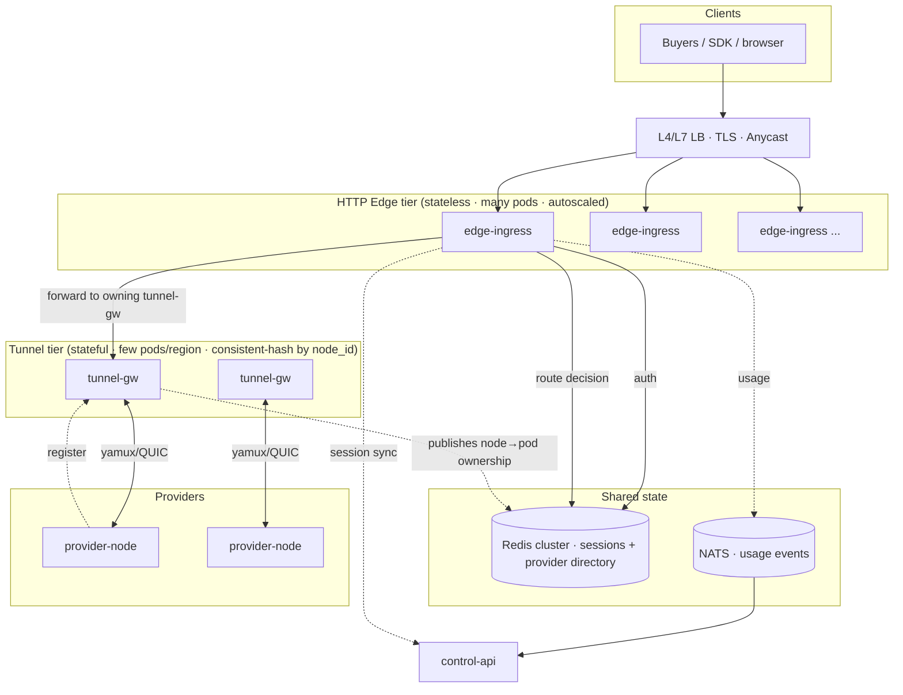
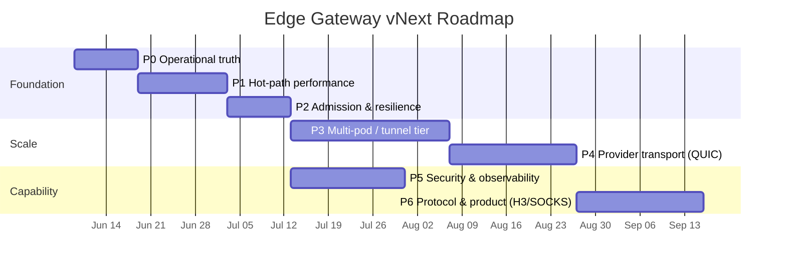

# ProxyHubb Edge Gateway — vNext (v2) Engineering Blueprint

> **Status:** Proposal for review (no code changed).
> **Date:** 2026-06-02
> **Companion to:** [`EDGE_GATEWAY_DEEP_DIVE.md`](./EDGE_GATEWAY_DEEP_DIVE.md) (current-state analysis).
> **Goal of this document:** Define the **next real version** of the Edge Gateway — a complete, sequenced plan to make it **~10× faster, ~10× more scalable, and dramatically more capable** — with explicit phases, roadmaps, an implementation plan, and prioritized recommendations.

---

## 0. How To Read This Document

The deep dive answered *"what is it and how good is it today?"* (rating **7.2 / 10**). This blueprint answers *"what does world-class look like, and exactly how do we get there?"*

It is organized so you can review top-down:

1. **Vision & target rating** (§1) — where we are going.
2. **The 10× thesis** (§2) — the specific levers that produce order-of-magnitude gains.
3. **Capability matrix** (§3) — everything that must be present in v2, current vs target.
4. **Target architecture** (§4) — diagrams + the tunnel/edge split that unlocks scale.
5. **Performance engineering** (§5) — concrete, code-level optimizations with expected impact.
6. **Security, reliability, observability, DX** (§6–§9).
7. **Phased roadmap** (§10) — P0→P6 with objectives, deliverables, exit criteria.
8. **Detailed implementation plan** (§11) — workstreams, files, env, tests per phase.
9. **SLOs, benchmarks, risks, acceptance** (§12–§15).
10. **Review checklist** (§16).

Every recommendation is grounded in the actual code under `services/edge-gateway/`. Where a finding is new versus the deep dive, it is marked **(new)**.

---

## 1. Vision & Target Rating

**vNext mission statement:**

> The Edge Gateway is a lean, stateless-by-default, horizontally scalable proxy data plane that authenticates, routes, bridges, and meters buyer traffic with sub-millisecond control overhead — and nothing else. Heavy/optional concerns (settlement, ML, blockchain) live behind compile-time feature flags or in dedicated tiers.

| Area | Today | vNext target |
|------|------:|-------------:|
| Core proxy correctness | 7.5 | 9.5 |
| Performance architecture | 7.0 | 9.5 |
| Security | 7.5 | 9.0 |
| Observability | 8.0 | 9.5 |
| Operational readiness | 5.5 | 9.5 |
| Code maturity / focus | 6.5 | 9.0 |
| Test coverage | 7.5 | 9.0 |
| Fit for proxy marketplace | 8.0 | 9.5 |
| **Overall** | **7.2** | **9.4** |

**Three north-star outcomes:**

1. **Throughput:** one edge pod sustains **≥10× more concurrent tunnels** at the same CPU, with bounded memory.
2. **Latency:** control-plane overhead on `CONNECT` (auth + route + bridge setup) at **p99 < 10 ms** (excluding provider/destination RTT).
3. **Scale:** the fleet scales **horizontally and linearly** to many regions and pods without a single in-memory chokepoint.

---

## 2. The 10× Thesis — Where Order-of-Magnitude Gains Come From

Order-of-magnitude improvement does not come from one trick; it comes from removing the **handful of chokepoints** that currently cap the system, then making the hot path allocation- and lock-free.

| # | Lever | Current limiter | vNext change | Expected gain |
|---|-------|-----------------|--------------|---------------|
| 1 | **Score-snapshot rebuild thrash** **(new)** | `rebuild_score_snapshot()` is O(N·logN) and runs on **every** insert/remove/mark/heartbeat (`update_live_metrics`) **and** a 100 ms timer | Mutations set a dirty flag only; one background task rebuilds (debounced). Snapshot stores precomputed eligibility. | Removes routing-path CPU spikes; flat cost as fleet grows |
| 2 | **Connection admission** | Unbounded `tokio::spawn` per TCP accept; no backpressure | Global concurrency limiter + queue + `503` on saturation | Prevents meltdown; protects p99 under load |
| 3 | **Auth cache lock** | `Mutex<LruCache>` global lock on every auth | `moka` (sharded, lock-free, TTL-native) | Removes auth-path contention → higher QPS |
| 4 | **Provider transport (yamux mux)** **(new)** | All streams multiplexed over **one** yamux/TCP per provider → window mgmt + head-of-line blocking caps throughput | Multiple yamux conns per provider **or** QUIC/HTTP3 provider transport; raw-TCP fast path for elephant flows | Large throughput unlock for busy providers |
| 5 | **Hot-path logging** **(new)** | `warn!` on **every** bridge read; `info!("Request path")` per request | Demote to `trace!`/sampled; structured spans | Fewer syscalls/allocs per byte → lower CPU |
| 6 | **Kernel zero-copy not wired** **(new)** | `splice_once()` exists but `bridge_tracked` uses a userspace 64 KB loop | Wire splice for raw client TCP leg; document yamux limitation | ~20% CPU off high-throughput tunnels |
| 7 | **Per-pod in-memory registry** | yamux `Control` handles live only in the pod the provider connected to | Tunnel tier + shared provider directory (Redis) + consistent hashing | Linear horizontal scale |
| 8 | **Per-request allocations** **(new)** | `format!("session:{}")`, domain `format!(".{}")` per check, repeated `.clone()`/`.to_string()` | Pre-sized keys, `itoa`, borrow over clone, interned domains | Lower CPU + GC pressure per request |
| 9 | **Buyer ingress TLS/H2** | Buyer listener is plain TCP; ALPN `h2` not advertised (`http2.rs` notes the gap) | In-process rustls + ALPN `["h2","http/1.1"]` + session resumption | Fewer handshakes, client mux, less churn |
| 10 | **Image weight / cold start** | CUDA + Solana + arkworks + ONNX in one binary | Feature-flagged lean default image | Faster deploys/autoscale, smaller CVE surface |

> **Key architectural truth (new):** Because the provider leg is **yamux-multiplexed over a single TCP connection**, true end-to-end kernel `splice` is impossible and per-provider throughput is bounded by one connection's flow control. Lever **#4** is therefore the single biggest *throughput* unlock and should be treated as the headline v2 architectural decision.

---

## 3. Capability Matrix — Everything That Must Be Present in vNext

Legend: ✅ present · 🟡 partial · ❌ missing · ➕ new in vNext

### 3.1 Ingress & protocol

| Capability | Today | vNext | Notes |
|------------|:----:|:----:|-------|
| HTTP/1.1 `CONNECT` | ✅ | ✅ | Core path |
| HTTP/2 `CONNECT` (h2/h2c) | 🟡 | ✅ | Auto-builder present; ALPN `h2` not advertised on TLS |
| WebSocket tunnel | ✅ | ✅ | `proxy/websocket.rs` |
| In-process TLS on buyer port | ❌ | ✅ | rustls termination, resumption, 0-RTT optional |
| HTTP/3 / QUIC ingress | ❌ | ➕ | Stretch; large mobile/loss-tolerance win |
| SOCKS5 ingress | ❌ | ➕ | Common proxy-client expectation |
| Per-listener admission control | ❌ | ✅ | Bounded concurrency |

### 3.2 Routing & provider plane

| Capability | Today | vNext |
|------------|:----:|:----:|
| Lock-free registry + score snapshot | ✅ | ✅ (debounced rebuild) |
| Geo/shard-aware selection | ✅ | ✅ |
| Sticky sessions + rotation | ✅ | ✅ |
| ML routing (ONNX) | 🟡 | ✅ (feature-flag, sidecar) |
| Multi-yamux / QUIC provider transport | ❌ | ➕ |
| Shared provider directory (multi-pod) | ❌ | ➕ |
| Least-loaded / EWMA latency routing | 🟡 | ✅ |
| Provider health (heartbeat + circuit) | ✅ | ✅ (unified thresholds) |

### 3.3 Auth, policy, security

| Capability | Today | vNext |
|------------|:----:|:----:|
| Fail-closed session auth | ✅ | ✅ |
| Session-intent JWT (v2) | ✅ | ✅ |
| Provider lease validation | ✅ | ✅ |
| Global + session + node policy | ✅ | ✅ |
| DDoS adaptive limiter | ✅ | ✅ (challenge **enforced**) |
| Bot detection (HTTP) | ✅ | ✅ |
| JA3/JA4 TLS fingerprinting | ❌ | ➕ (enabled by in-proc TLS) |
| Honeytoken sink | ✅ | ✅ (real provider attribution) |
| Anomaly enforcement (block) | 🟡 | ✅ |
| Session time-limit enforcement | ❌ | ✅ |
| mTLS for provider tunnels | 🟡 | ✅ (default in prod) |

### 3.4 Metering, billing, settlement

| Capability | Today | vNext |
|------------|:----:|:----:|
| Signed usage + Redis WAL | ✅ | ✅ |
| Batch flush + retry | ✅ | ✅ |
| Event stream (NATS) emission | 🟡 | ✅ |
| Edge-side ZK settlement | 🟡 (off) | ➖ removed from default build |
| Blockchain gRPC stream | ❌ (dead) | ➖ removed or moved to control-api |
| Pricing engine wired to routing | ❌ (dead) | Decision: wire or delete |

### 3.5 Operability & DX

| Capability | Today | vNext |
|------------|:----:|:----:|
| `/health` | ✅ | ✅ |
| `/ready` (Redis + provider count) | ❌ | ➕ |
| Separate metrics port | ❌ | ➕ |
| Single-source config (ports/env) | ❌ | ➕ |
| K8s manifests match runtime | ❌ | ✅ |
| OpenTelemetry traces | ❌ | ➕ |
| Service README + runbook | ❌ | ➕ |
| Integration/load/chaos tests | 🟡 | ✅ |
| Feature-flagged build flavors | ❌ | ➕ |

---

## 4. Target Architecture

### 4.1 Tiered data plane (the scale unlock)

The single largest constraint today is that **provider yamux `Control` handles live in-process**, so any pod can only route to providers connected to *it*. vNext splits responsibilities into two horizontally scalable tiers plus a shared directory.



**How routing works in v2:**

1. `provider-node` connects to a **tunnel-gw** chosen by consistent hash on `node_id` (or region-pinned).
2. tunnel-gw publishes `provider:{node_id} → {tunnel_pod, region, capabilities}` to the **shared directory** (Redis), with TTL refreshed by heartbeat.
3. **edge-ingress** authenticates the buyer, picks a provider from the directory snapshot, and forwards the upgraded byte stream to the **owning tunnel-gw** over an internal mux (gRPC stream / QUIC / internal yamux).
4. tunnel-gw opens the provider stream and bridges.

This keeps **edge-ingress fully stateless** (scales to N) while concentrating stateful tunnel ownership in a smaller, predictable tier.

> **Simpler interim option (P3a):** if a full split is too large for v2.0, run **co-located mode**: one pod type, but providers register their `node_id → pod` ownership in Redis, and edge pods that don't own a provider return a `307`-style internal redirect / proxy hop to the owner pod. This delivers multi-pod scale-out with less refactor and can evolve into the full tiered model.

### 4.2 `CONNECT` request lifecycle (vNext, instrumented)

```mermaid
sequenceDiagram
  autonumber
  participant C as Client
  participant I as edge-ingress
  participant R as Redis (auth+dir)
  participant T as tunnel-gw
  participant P as provider-node

  C->>I: CONNECT host:443 (Proxy-Authorization)
  I->>I: admission semaphore (503 if saturated)
  I->>I: security preflight (geo/ddos/bot/JA3)
  I->>R: resolve session (moka cache → Redis)
  R-->>I: session (fail-closed on error)
  I->>I: policy (global/session/node) + rate limit
  I->>R: pick provider from directory snapshot
  I->>T: open internal stream to owning tunnel-gw
  T->>P: yamux/QUIC stream + CONNECT host\n
  P-->>T: OK
  T-->>I: ready
  I-->>C: 200 / tunnel established
  loop bridge (splice fast path on client leg)
    C->>I->>T->>P: bytes ↔ bytes
    I-->>NATS: usage delta (revalidate session)
  end
  I->>API: finalize session-intent ledger
```

### 4.3 Proposed crate layout (focus & feature flags)

```
services/edge-gateway/
  crates/
    eg-core/         # config, state, types, errors  (single source of truth)
    eg-ingress/      # listeners, admission, TLS, CONNECT/WS/H2(/3)
    eg-routing/      # registry, snapshot, selection, (feature = ml)
    eg-tunnel/       # provider transport: yamux | quic, directory client
    eg-security/     # auth, policy, ddos, fingerprint, honeytoken
    eg-metering/     # WAL, batch, NATS emit, control-api client
    eg-observability/# metrics, /health, /ready, otel
  features:
    default = ["yamux"]
    ml      = ["dep:ort"]            # GPU image flavor only
    quic    = ["dep:quinn"]          # provider/buyer QUIC
    legacy-zk = ["dep:ark-*","solana"]  # off by default, separate flavor
```

> The current single-crate layout can stay for v2.0; the **feature-flag discipline** (lean default, optional heavy deps) is the part that matters most and can be applied without a full workspace split.

---

## 5. Performance Engineering (Concrete, Code-Level)

Each item lists the **file**, the **problem**, the **change**, and the **expected impact**. Ordered by ROI.

### 5.1 Stop rebuilding the score snapshot on every mutation **(new, highest ROI)**

- **File:** `src/registry/lockfree.rs`
- **Problem:** `insert`, `remove`, `mark_healthy`, `mark_unhealthy`, `update_live_metrics`, `update_node_info` each call `rebuild_score_snapshot()` (O(N·logN), clones every `Control` + `NodeInfo`). `update_live_metrics` fires on **every provider heartbeat**, and a 100 ms timer *also* rebuilds. At 1k nodes with frequent heartbeats this is constant churn.
- **Change:** mutations set an `AtomicBool dirty`; the background task rebuilds only when dirty (debounced, e.g. ≤ every 50–100 ms). Precompute an "eligible" snapshot (id, Control, lease_ok cached) so `get_best`/`get_best_for` don't re-`read()` `info` per candidate.
- **Impact:** routing-path CPU becomes flat and independent of mutation rate; removes lock churn on `top_nodes`/`shard_nodes` `RwLock`.

### 5.2 Connection admission control

- **File:** `src/main.rs` accept loop
- **Problem:** every accept does `tokio::task::spawn` with no ceiling; a connection flood exhausts memory/FDs and destroys tail latency.
- **Change:** `Arc<Semaphore>` (size = `MAX_CONCURRENT_CONNECTIONS`) acquired before serving; on `try_acquire` failure return `503` fast. Optionally a bounded queue with timeout. Add `tower` concurrency/load-shed layers.
- **Impact:** predictable memory, graceful degradation, protected p99.

### 5.3 Replace `Mutex<LruCache>` session cache with `moka`

- **File:** `src/auth.rs`
- **Problem:** every `validate_session` cache hit takes a global `tokio::sync::Mutex`. Under high auth QPS this serializes.
- **Change:** `moka::future::Cache<String, SessionData>` with TTL + capacity; lock-free reads, built-in expiry, no manual metrics task for size.
- **Impact:** removes the auth-path global lock; higher concurrent auth throughput; simpler code.

### 5.4 Hot-path logging discipline **(new)**

- **Files:** `src/proxy/zerocopy.rs` (warn on every read/write/flush), `src/main.rs` (`info!("Request path: {}")` per request, many `info!` in CONNECT).
- **Change:** demote per-chunk logs to `trace!`; gate verbose CONNECT logs behind debug; use `tracing` spans with fields (`session_id`, `node_id`) and sampling.
- **Impact:** fewer syscalls/allocations per transferred byte; cleaner logs; lower CPU at line rate.

### 5.5 Wire kernel `splice` on the client leg **(new)**

- **File:** `src/proxy/zerocopy.rs` (`splice` module exists but unused by `bridge_tracked`).
- **Change:** when the client side is a raw TCP `CONNECT` tunnel on Linux, use `splice_once` via `spawn_blocking`/`AsyncFd` for the client↔gateway leg. **Document** that the provider leg is yamux-multiplexed and cannot splice (motivates §5.8).
- **Impact:** ~20% CPU reduction on high-throughput tunnels (client leg).

### 5.6 Reduce per-request allocations **(new)**

- **Files:** `src/auth.rs` (`format!("session:{}")`), `src/main.rs` (domain `format!(".{}", d)` inside per-request loops, repeated `clone()`/`to_string()`).
- **Change:** pre-size/`SmallString` keys, avoid `format!` in inner loops (use `ends_with` + manual dot check), borrow instead of clone where lifetimes allow, intern hot domain lists.
- **Impact:** lower allocator pressure and CPU per request.

### 5.7 Buyer-side TLS + ALPN h2 + multi-acceptor

- **Files:** `src/main.rs`, `src/tls.rs`, `src/proxy/http2.rs`
- **Change:** optional in-process rustls on the buyer port; advertise ALPN `["h2","http/1.1"]` (the `http2.rs` doc-comment explicitly flags this as a pending Week-8 task); enable session resumption; run multiple accept loops with `SO_REUSEPORT` on Linux.
- **Impact:** fewer handshakes, client-side H2 multiplexing, better accept scalability across cores.

### 5.8 Provider transport beyond a single yamux connection **(new, biggest throughput lever)**

- **Files:** `src/tunnel.rs`, `src/pool/`, `provider-node`
- **Problem:** one yamux session per provider multiplexes all streams over one TCP connection → flow-control ceiling + head-of-line blocking under heavy throughput.
- **Change (choose one, sequence over phases):**
  - **(a)** Open **N yamux connections per provider** and shard streams across them (smallest change).
  - **(b)** Add a **QUIC** provider transport (`quinn`) — independent streams, no HoL blocking, better on lossy links.
  - **(c)** **Raw-TCP fast path** for elephant flows (dedicated TCP per high-throughput session, bypassing mux), enabling true end-to-end splice.
- **Impact:** removes the per-provider throughput ceiling; this is the headline v2 performance decision.

### 5.9 Metering as events

- **File:** `src/metering.rs`
- **Change:** keep WAL durability, but emit usage deltas to **NATS** for control-api/settlement consumers instead of (or in addition to) synchronous HTTP `report_usage` per tunnel close. Batch + coalesce.
- **Impact:** removes synchronous control-api dependency from the tunnel teardown path.

---

## 6. Security Hardening Plan

| Item | File(s) | Change |
|------|---------|--------|
| Enforce DDoS `Challenge` | `src/main.rs`, `security/ddos.rs` | Today the `Challenge` arm logs + **falls through**. Require the client to echo a valid challenge token (header/cookie) before allowing; otherwise `429`. |
| Enforce anomaly block | `src/main.rs`, `security/anomaly.rs` | High-RPM currently only `warn!`s. Add throttle/terminate when threshold breached. |
| Session time limits | `src/auth.rs`, `src/main.rs`, `proxy/zerocopy.rs` | Add `created_at` to `SessionData`; enforce in the `bridge_tracked` revalidation callback (callback already exists). |
| JA3/JA4 fingerprinting | `src/security/fingerprint.rs`, `tls.rs` | Once TLS terminates in-process, capture ClientHello → JA3/JA4 and feed `BotClassifier`. |
| Provider mTLS by default (prod) | `tls.rs`, `tunnel.rs` | `TLS_REQUIRE_CLIENT_CERT=true` default in prod manifests; rotate CA. |
| Honeytoken attribution | `src/main.rs` | Replace hardcoded `"unknown_provider"` slash target with the actually selected provider id. |
| Tunnel auth rate limit | `tunnel.rs` | Rate-limit/lockout repeated bad provider JWTs to deter brute force. |
| Secret hygiene | manifests / compose | All secrets via mounted secrets/`?` required envs (already partly done); never bake into image. |

---

## 7. Reliability & Correctness

| Item | Detail |
|------|--------|
| Unify circuit-breaker config | `CircuitConfig::default()` = 5 failures, but `bridge_to_provider` builds a breaker with `failure_threshold: 3` and a 30 s request timeout while config exposes `proxy_connect_timeout_secs`. Centralize in `eg-core` and drive from env. |
| Provider failover on sticky miss | Already falls back to `get_best_for`; add explicit metric + retry budget. |
| Graceful drain correctness | Drain loop (30 s) polls `ACTIVE_SESSIONS`; ensure tunnel-tier also drains and directory ownership is released on shutdown. |
| Backpressure on provider writes | Bridge should propagate slow-provider backpressure to client (already via `write_all`), but add per-tunnel max-buffer + timeout to avoid memory bloat on stalled peers. |
| Deterministic `node_id == "random"` | `select_provider_ml`/fallback can yield id `"random"`; ensure downstream metrics/circuit keys handle this sentinel or replace with the real id. |

---

## 8. Observability & SLOs

### 8.1 Endpoints & signals

| Add | Detail |
|-----|--------|
| `/ready` | Redis ping + ≥1 healthy provider (or directory reachable) before serving. K8s readiness gate. |
| Dedicated metrics port | `METRICS_PORT` separate from buyer proxy port (don't expose `/metrics` on the CONNECT surface). Matches K8s `9090` intent. |
| OpenTelemetry traces | Span per CONNECT with `session_id`, `node_id`, region, outcome; export OTLP. |
| RED + USE metrics | Rate/Errors/Duration per route; Utilization/Saturation/Errors for pools, semaphore, registry size. |
| Exemplars | Link latency histograms to trace IDs for fast drill-down. |

### 8.2 SLOs (initial targets)

| SLO | Target |
|-----|-------:|
| Auth (cache hit) p99 | < 2 ms |
| Provider selection p99 | < 3 ms |
| `CONNECT` control overhead p99 | < 10 ms |
| Tunnel establish p99 (excl. provider RTT) | < 150 ms |
| Throughput per pod (concurrent tunnels) | ≥ 10× current baseline |
| Metering loss across restart | 0 (WAL replay) |
| Availability | 99.9% per region |

---

## 9. Developer Experience & Repo Hygiene

- [ ] `services/edge-gateway/README.md`: ports diagram, env table, run/test/bench instructions, TLS termination policy.
- [ ] **Single-source config**: one table in `eg-core` that generates the env doc; CI test asserts compose/K8s match defaults.
- [ ] Slim default Docker image (no CUDA/Solana/ZK); separate `Dockerfile.ml` for the GPU flavor.
- [ ] Delete or quarantine dead build artifacts in-tree (`build_output.txt`, `cargo_errors*.txt`, `check_output*.txt`).
- [ ] Decision recorded (ADR) for `pricing` and `blockchain`: **wire or remove**.

---

## 10. Phased Roadmap (P0 → P6)

> Durations are engineering estimates assuming 1–2 focused engineers. Phases are sequenced so each is shippable and de-risks the next. **P0–P2 are prerequisites** to any scale work.



### P0 — Operational truth (1–2 weeks) · *prerequisite* · **🟢 mostly landed (2026-06-02)**

- **Objective:** manifests, config, and docs tell the truth; nothing is wired-but-dead silently.
- **Deliverables:**
  - [x] Reconcile `PORT`, `TUNNEL_PORT`, metrics port, health paths across `config.rs`, `docker-compose*.yml`, `.env*`, `infra/k8s/`. → canonical **`PORT=8090`**, **`TUNNEL_PORT=3128`**; `config.rs` defaults fixed (were 3000/4000); legacy `infra/docker-compose/docker-compose.yml` fixed.
  - [x] Fix K8s probes (`/health`, correct ports) and add `/ready`. → manifest now uses `8090`/`3128`, probes on `8090`, required secrets added via `secretKeyRef`.
  - [x] Align `CONTROL_API_URL` default in `main.rs` with `Config` (→ `http://localhost:8080`).
  - [x] ADR: keep/remove `pricing` + `blockchain`; feature-flag heavy deps; plan slim image. → [`docs/adr/0001-edge-gateway-scope-and-ports.md`](./adr/0001-edge-gateway-scope-and-ports.md).
  - [x] `README.md` + ports diagram → `services/edge-gateway/README.md`.
  - [ ] **D4 (deferred → P0.5/P1):** implement the dependency feature-gating + slim default image decided in the ADR.
  - [x] **CI parity test** — `deploy_manifests_use_canonical_ports` (K8s, root compose, infra compose, Dockerfile, `.env.example`) runs in `cargo test` on CI.
  - [x] **D4 feature-gating** — default `features = []`; lean `Dockerfile`; CI `cargo check --features legacy-zk,blockchain,pricing,ml`.
- **Exit criteria:** `docker compose up` and K8s deploy both pass health/readiness with **no undocumented env overrides**; CI asserts config parity.
- **Status:** P0 operational truth largely complete; validate with `docker compose up` in your environment.

### P1 — Hot-path performance (2 weeks) · **signed off**

- **Objective:** make the per-request and per-byte path lean.
- **Deliverables:** §5.1 snapshot debounce; §5.3 moka cache; §5.4 logging; §5.6 allocations; §5.5 splice (client leg).
- **Exit criteria:** criterion benchmarks show selection + auth path improvements; load test shows higher tunnels/CPU; flamegraph free of snapshot-rebuild hotspots.
- **Verification:** [`services/edge-gateway/docs/P1_SIGNOFF.md`](services/edge-gateway/docs/P1_SIGNOFF.md), [`P1_EXIT_CRITERIA.md`](services/edge-gateway/docs/P1_EXIT_CRITERIA.md), `scripts/p1-bench.sh`, `scripts/p1-exit-verify.ps1`, `scripts/p1-flamegraph.sh` (Linux), `scripts/p1-compose-smoke.*`, CI `edge-gateway-check` (tests + bench `--test`).
- **Recorded baseline (10k):** snapshot read ~38 ns vs rebuild ~1.26 ms (~33,000×) — [`P1_BASELINE.md`](services/edge-gateway/docs/P1_BASELINE.md).

### P2 — Admission & resilience (1.5 weeks) · **signed off**

- **Objective:** never melt down; degrade gracefully.
- **Deliverables:** §5.2 admission control; unified circuit config (§7); challenge + anomaly enforcement (§6); session time limits (§6).
- **Exit criteria:** soak/flood → **503** then recovery; chaos (Redis down) → fail-closed **407**, no crash; repeated Redis stop/start stable.
- **Verification:** [`services/edge-gateway/docs/P2_SIGNOFF.md`](services/edge-gateway/docs/P2_SIGNOFF.md), `p2-exit-verify.ps1`, `p2-compose-verify.ps1`, `p2-resilience-smoke.*`, `p2-admission-soak.*`, `p2-chaos-loop.*`.

### P3 — Multi-pod scale-out / tunnel tier (4–5 weeks) · **P3a signed off**

- **Objective:** remove the in-memory single-pod registry constraint.
- **Deliverables:** shared provider directory in Redis; **co-located mode (P3a)** first (owner-pod forwarding), then **tunnel-tier split (P3b)**; internal edge↔tunnel transport; ownership TTL + drain.
- **Exit criteria:** providers reachable from any edge pod; fleet directory benchmark; pod drain releases ownership for migration.
- **Verification:** [`services/edge-gateway/docs/P3_SIGNOFF.md`](services/edge-gateway/docs/P3_SIGNOFF.md), `p3-multipod-smoke.*`, `p3-scale-benchmark.*`, `p3-pod-drain.*`, `p3-multipod-e2e-full.*`.
- **P3b (next):** tunnel-tier split — see [`P3_MULTI_POD.md`](services/edge-gateway/docs/P3_MULTI_POD.md).

### P4 — Provider transport upgrade (3–4 weeks)

- **Objective:** lift the per-provider throughput ceiling (§5.8).
- **Deliverables:** multi-yamux per provider (a) → QUIC transport (b) behind `quic` feature; raw-TCP elephant-flow path (c) optional; benchmarks comparing transports.
- **Exit criteria:** single busy provider sustains ≥ target throughput without HoL stalls; documented transport selection policy.

### P5 — Security & observability depth (3 weeks, can parallel P3)

- **Objective:** production-grade trust + insight.
- **Deliverables:** in-proc TLS + JA3/JA4; provider mTLS default; OTel traces; dedicated metrics port; RED/USE dashboards; honeytoken attribution.
- **Exit criteria:** dashboards + alerts live; security review sign-off; trace-driven debugging demonstrated.

### P6 — Protocol & product expansion (3–4 weeks)

- **Objective:** broaden what the edge can serve.
- **Deliverables:** HTTP/3 ingress (`quic`), SOCKS5 ingress, optional ML routing flavor proven against load data, pricing→routing integration if approved.
- **Exit criteria:** new ingress protocols pass conformance + load; ML flavor shows measurable routing-quality lift or is shelved.

---

## 11. Detailed Implementation Plan (per phase)

> Format: **workstream → files touched → new env/flags → tests**. Each row is intended to map to one PR.

### P0 implementation

| Workstream | Files | Env/flags | Tests |
|------------|-------|-----------|-------|
| Config parity | `config.rs`, `docker-compose*.yml`, `.env.example`, `.env.docker.example`, `infra/k8s/edge-gateway-deployment.yaml` | canonical `PORT`, `TUNNEL_PORT`, `METRICS_PORT` | CI parity test (parse compose+k8s, assert == `Config` defaults) |
| Probes | `main.rs` (`/ready`), K8s manifest | — | readiness unit + `kubectl` smoke |
| Control URL default | `main.rs` | — | unit asserts default == `Config` |
| Dead-code ADR | `docs/adr/`, `Cargo.toml` features | `legacy-zk`, `ml` | build both flavors in CI |
| README | `services/edge-gateway/README.md` | — | doc-lint |

### P1 implementation

| Workstream | Files | New | Tests |
|------------|-------|-----|-------|
| Snapshot debounce | `registry/lockfree.rs` | `dirty: AtomicBool` | bench before/after; correctness test (best updates within debounce window) |
| moka cache | `auth.rs`, `Cargo.toml` | `dep:moka` | hit/miss + TTL tests; concurrency test |
| Logging | `proxy/zerocopy.rs`, `main.rs` | `EG_LOG_SAMPLE` | assert no per-chunk warn at info level |
| Allocations | `auth.rs`, `main.rs` | — | micro-bench domain match |
| Splice (client leg) | `proxy/zerocopy.rs` | `EG_SPLICE=auto` | Linux integration test; non-Linux fallback |

### P2 implementation

| Workstream | Files | New | Tests |
|------------|-------|-----|-------|
| Admission | `main.rs` | `MAX_CONCURRENT_CONNECTIONS` | flood test → 503; memory bound |
| Circuit unify | `circuitbreaker.rs`, `eg-core` | `CB_*` envs | state-transition tests |
| Challenge enforce | `main.rs`, `security/ddos.rs` | `DDOS_CHALLENGE_REQUIRED` | token echo accept/deny |
| Anomaly enforce | `main.rs`, `security/anomaly.rs` | `ANOMALY_ACTION=block` | high-RPM → terminate |
| Time limits | `auth.rs`, `proxy/zerocopy.rs` | — | expiry mid-tunnel terminates |

### P3 implementation

| Workstream | Files | New | Tests |
|------------|-------|-----|-------|
| Provider directory | `registry/store.rs`, new `tunnel/directory.rs` | `PROVIDER_DIR_TTL` | register/expire/list |
| Co-located ownership (P3a) | `main.rs`, `tunnel.rs` | `EDGE_MODE=colocated` | cross-pod route via owner forward |
| Tunnel tier (P3b) | new `eg-tunnel` path, `main.rs` | `EDGE_MODE=split`, `TUNNEL_GW_ADDRS` | edge→tunnel forward integration |
| Drain/ownership release | `main.rs`, `tunnel.rs` | — | shutdown releases directory entries |

### P4 implementation

| Workstream | Files | New | Tests |
|------------|-------|-----|-------|
| Multi-yamux | `tunnel.rs`, `pool/` | `YAMUX_CONNS_PER_NODE` | stream sharding correctness |
| QUIC transport | new `tunnel/quic.rs`, `provider-node` | `quic` feature, `PROVIDER_TRANSPORT` | loss/throughput bench vs yamux |
| Elephant raw-TCP | `tunnel.rs` | `ELEPHANT_FLOW_BYTES` | end-to-end splice path |

### P5 implementation

| Workstream | Files | New | Tests |
|------------|-------|-----|-------|
| In-proc TLS + JA3 | `tls.rs`, `main.rs`, `security/fingerprint.rs` | `BUYER_TLS_*` | handshake + JA3 capture |
| mTLS default | `tls.rs`, manifests | `TLS_REQUIRE_CLIENT_CERT` | reject no-cert provider |
| OTel | new `observability/otel.rs` | `OTEL_EXPORTER_OTLP_ENDPOINT` | span emitted per CONNECT |
| Metrics port | `main.rs` | `METRICS_PORT` | `/metrics` only on mgmt port |

### P6 implementation

| Workstream | Files | New | Tests |
|------------|-------|-----|-------|
| HTTP/3 ingress | new `ingress/h3.rs` | `quic` feature | h3 CONNECT conformance |
| SOCKS5 ingress | new `ingress/socks5.rs` | `SOCKS5_PORT` | socks negotiation + auth |
| ML flavor | `routing/`, `Dockerfile.ml` | `ml` feature, `ML_MODEL_PATH` | A/B vs heuristic on replay |
| Pricing→routing | `pricing/`, `routing/` | `PRICING_ENABLED` | score reflects price/demand |

---

## 12. Benchmarking & Test Strategy

| Layer | Tooling | What it proves |
|-------|---------|----------------|
| Micro | `criterion` (extend `benches/registry_bench.rs`) | selection/auth/domain-match ns-level wins |
| Integration | mock `provider-node` + real gateway | CONNECT/WS/H2 end-to-end correctness |
| Load | `k6`/`vegeta` + iperf-style payloads | tunnels/CPU, p99 control overhead, throughput/pod |
| Soak | sustained mixed traffic 24 h | no leak, stable p99, WAL integrity |
| Chaos | Redis down, provider drop, control-api 5xx | fail-closed, circuit opens, no crash |
| Scale | k8s HPA, increasing pods | near-linear tunnel capacity (P3+) |

**Baseline first:** capture current numbers (tunnels/pod, p99, CPU/Gbps) in P0 so every later phase reports a delta against a real baseline.

---

## 13. Risk Register

| Risk | Likelihood | Impact | Mitigation |
|------|-----------|--------|------------|
| Tunnel-tier split is large/complex | Med | High | Ship **P3a co-located** first; split later |
| QUIC provider transport requires `provider-node` changes | Med | Med | Feature-flag; keep yamux default; dual-stack rollout |
| Snapshot debounce introduces stale routing | Low | Med | Bounded debounce (≤100 ms) + dirty-on-mutation |
| moka migration changes eviction semantics | Low | Low | Mirror TTL/size; add tests |
| In-proc TLS adds CPU | Med | Med | rustls + resumption; offload option to LB remains |
| Removing CUDA/ZK breaks an env relying on it | Low | Med | Keep `Dockerfile.ml` / `legacy-zk` flavors |

**Rollout & rollback:** every phase behind env/feature flags; staged rollout (`rollout.rs` already exists) with canary %, metrics-gated promotion, and instant flag-flip rollback.

---

## 14. Recommendations Summary (Prioritized)

**Do first (P0–P2):**
1. Make config/manifests/docs the single source of truth; add `/ready`.
2. Debounce the score-snapshot rebuild **(new, biggest quiet CPU win)**.
3. Add connection admission control.
4. Move session cache to `moka`.
5. Clean hot-path logging; wire client-leg splice.
6. Enforce challenge, anomaly, and session time limits.

**Do next (P3–P4):**
7. Shared provider directory → multi-pod scale-out (co-located first).
8. Lift provider throughput ceiling (multi-yamux → QUIC).

**Do for depth (P5–P6):**
9. In-proc TLS + JA3/JA4, provider mTLS, OpenTelemetry, dedicated metrics port.
10. HTTP/3 + SOCKS5 ingress; decide ML and pricing wiring with data.

**Stop doing / clean up:**
11. Remove CUDA/Solana/ZK from the default image; feature-flag them.
12. Wire or delete `pricing` and `blockchain` (no dead modules in main path).

---

## 15. Definition of Done — "Edge Gateway v2"

v2 is considered shipped when **all** of the following hold:

- [ ] Config/health/ports are consistent across code, compose, and K8s; `/ready` gates traffic.
- [ ] Default image contains no GPU/blockchain/ZK deps; heavy paths are feature-flagged flavors.
- [ ] Score-snapshot rebuild is debounced; flamegraph shows no rebuild hotspot under heartbeat load.
- [ ] Admission control bounds memory and protects p99 under flood.
- [ ] Session cache is lock-free (`moka`); auth p99 < 2 ms on cache hit.
- [ ] Challenge, anomaly, and session time limits are **enforced**, not warned.
- [ ] A buyer can reach a provider connected to **any** pod (multi-pod scale-out).
- [ ] A single busy provider exceeds the old throughput ceiling (transport upgrade).
- [ ] OTel traces + RED/USE dashboards + alerts are live.
- [ ] Load, soak, and chaos suites pass against published SLOs.
- [ ] Service README + runbook + ADRs exist.

---

## 16. Review Checklist (sign-off for this blueprint)

- [ ] Approve the **vision & target rating** (§1) as the v2 goal.
- [ ] Approve the **tiered data plane** direction (§4.1) and whether to start with **co-located (P3a)** or go straight to **tunnel-tier split (P3b)**.
- [ ] Approve the **headline throughput decision** (§5.8): multi-yamux first, QUIC next?
- [ ] Confirm canonical ports/TLS termination policy (carried from the deep dive §11).
- [ ] Approve removing heavy deps from the default build (§9, §14).
- [ ] Decide on `pricing` and `blockchain`: wire or delete.
- [ ] Approve the **phase order and durations** (§10) and resourcing.
- [ ] Approve the **SLO targets** (§8.2) and the requirement to capture a P0 baseline first.

---

## 17. Cross-References

| Document | Purpose |
|----------|---------|
| [`EDGE_GATEWAY_DEEP_DIVE.md`](./EDGE_GATEWAY_DEEP_DIVE.md) | Current-state analysis, ratings, pros/cons, code map |
| `services/edge-gateway/src/registry/lockfree.rs` | Snapshot rebuild target (§5.1) |
| `services/edge-gateway/src/main.rs` | Accept loop, CONNECT, bridge orchestration |
| `services/edge-gateway/src/proxy/zerocopy.rs` | Bridge + unused `splice` (§5.5) |
| `services/edge-gateway/src/auth.rs` | Session cache → moka (§5.3) |
| `services/edge-gateway/src/tunnel.rs` | Provider transport upgrade (§5.8, P4) |
| `infra/k8s/edge-gateway-deployment.yaml` | Manifest parity (P0) |

---

*End of blueprint — ready for review. On sign-off, P0 lands first (operational truth + baseline), then P1/P2 performance and resilience, before any scale-out work.*
