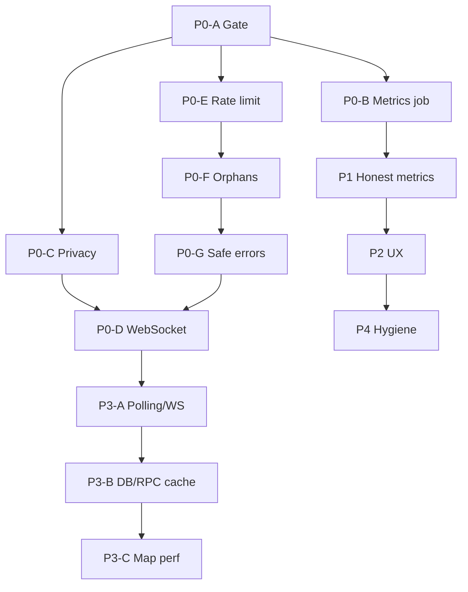

# ProxyHubb Explorer — Implementation Plan

> **Status:** Draft for review — implement after sign-off on [EXPLORER_DEEP_ANALYSIS.md](EXPLORER_DEEP_ANALYSIS.md).
> **Date:** 2026-06-01
> **Scope:** Remediation roadmap Phases 0–4 from the deep analysis.

---

## 1. How to use this document

| Section | Purpose |
|---------|---------|
| §2 | Principles and non-goals |
| §3–§7 | Phases 0–4 with epics, tasks, acceptance criteria, tests |
| §8 | Environment variables |
| §9 | Suggested delivery order and dependencies |
| §10 | Verification checklist (release gate) |

**Task ID convention:** `EXP-P{n}-{nn}` (phase, sequence).

**Complexity:** S (≤0.5 day), M (1–3 days), L (3+ days or cross-cutting).

---

## 2. Principles and non-goals

### Principles

1. **Truth in labeling** — If a metric is not computed, the API and UI must say so (empty state, `null`, or relabeled), never show a fabricated value.
2. **Public vs authenticated** — Default explorer remains **public read-only** for chain data. Sensitive fields move behind auth or are redacted in public DTOs.
3. **Single source of live updates** — After Phase 3, dashboard should not poll the same streams that WebSocket already pushes.
4. **Minimal scope per PR** — Each task should be reviewable as its own PR where possible.

### Non-goals (this plan)

- Full redesign of explorer UI/visual language.
- Replacing Solana indexer architecture or adding true multi-chain support.
- Mobile-native explorer app.

---

## 3. Phase 0 — Correctness and security blockers

**Goal:** Trustworthy public explorer: gate matches env, no deanonymization, WS policy parity, honest failures, non-orphan lists.

**Recommended duration:** 1–2 weeks.

---

### Epic P0-A — Decentralization gate threshold

| Field | Value |
|-------|--------|
| **Tasks** | EXP-P0-01 |
| **Complexity** | S |

**Problem:** `isExplorerFullyDecentralized` requires `MinWritersRequired >= 3` while `explorerMinWritersRequired()` defaults to `2`.

**Approach (choose one, document in PR):**

- **Option A (recommended):** Gate uses configured threshold only — remove hardcoded `>= 3`.
- **Option B:** Require `EXPLORER_MIN_WRITERS>=3` in full mode; update `.env.example`.

**Files:** `explorer.go`, decentralization tests, `.env.example`, operator doc.

**Acceptance criteria:**

- [ ] `FULL_DECENTRALIZATION=true`, `EXPLORER_MIN_WRITERS=2`, quorum satisfied → `GET /v1/explorer/metrics` returns 200.
- [ ] Tests cover `minWriters-1`, `minWriters`, `minWriters+1`.

---

### Epic P0-B — `explorer_metrics` writer

| Field | Value |
|-------|--------|
| **Tasks** | EXP-P0-02, EXP-P0-03 |
| **Complexity** | M / S |
| **Blocks** | `/analytics`, `/health/history`, earnings volume charts |

**EXP-P0-02 — Aggregation job**

1. Add `internal/jobs/explorer_metrics.go` (or worker package):
   - Interval: `EXPLORER_METRICS_INTERVAL` (default `10m`).
   - Upsert `models.ExplorerMetrics` for `chain=solana`, `period` ∈ `{hourly, daily}` using unique `(chain, period, period_start)`.
   - **Fields (define formulas in code comments):**
     - `total_transactions` — count non-orphan txs in bucket window.
     - `total_volume` — sum amounts in window.
     - `active_wallets` — distinct `from_address` ∪ `to_address` in window (not `COUNT(wallets)`).
     - `active_nodes` — nodes with heartbeat in window.
     - `average_block_time_ms` — mean block interval from non-orphan blocks.
     - `total_bandwidth_bytes` — from session/usage tables in window (document source).
     - `total_fees`, `avg_tx_fee` — from txs in window.
2. Register in `main.go` with `EXPLORER_METRICS_ENABLED=true` (default on in dev).
3. Optional one-shot backfill: last 24 hourly + 7 daily rows.

**Files:** new job file, `main.go`, `migrations/000059_explorer_metrics.up.sql` (already exists).

**Tests:** integration test — seed txs, run job, `GET /v1/explorer/analytics?period=24h` has `len(transaction_volume) > 0`.

**EXP-P0-03 — Until job ships**

- **Option A:** Handlers return `503` + `{ "error": "metrics_unavailable" }` when zero rows in range.
- **Option B:** Hide analytics/health nav; dashboard banner.

**Files:** `explorer.go` (`getExplorerAnalytics`, `getHealthHistory`), `apps/web/src/app/explorer/analytics/page.tsx`, `health/page.tsx`.

**Acceptance criteria:**

- [ ] After job runs, analytics and health-history return non-empty series when activity exists.
- [ ] No flat zero charts pretending to be real data.

---

### Epic P0-C — Public API privacy redaction

| Task | Change |
|------|--------|
| EXP-P0-04 | Remove `linked_user_id` from public wallet responses |
| EXP-P0-05 | Redact `rpc_endpoint` from writers |
| EXP-P0-06 | Remove provider id/username from public nodes |
| EXP-P0-07 | Auth-gate or redact sessions/earnings (product decision) |
| EXP-P0-08 | No full `raw_data` on public transaction detail |
| EXP-P0-09 | Remove validator `hotkey` from public node detail |

**Acceptance criteria:** Automated tests assert sensitive keys absent from public JSON.

---

### Epic P0-D — WebSocket hardening

| Task | Description |
|------|-------------|
| EXP-P0-10 | Apply decentralization gate to WS upgrade |
| EXP-P0-11 | IP rate limit + max concurrent connections |
| EXP-P0-12 | Log/metric on broadcast buffer drops |
| EXP-P0-13 | Poller: init `lastTxTime` from DB; use `>` for incremental fetch |

---

### Epic P0-E — Rate limiting without Redis

| Task | Description |
|------|-------------|
| EXP-P0-14 | In-memory fallback when `redis.Client == nil` (do not skip limiting) |
| EXP-P0-15 | Startup log: rate limit backend mode |

---

### Epic P0-F — Orphan filter consistency

| Task | Description |
|------|-------------|
| EXP-P0-16 | `is_orphaned = false` on tx/block lists and network stats |
| EXP-P0-17 | Same filter on all aggregate paths in `getExplorerMetrics` |

---

### Epic P0-G — Safe public error responses

| Task | Description |
|------|-------------|
| EXP-P0-18 | Remove `details: err.Error()` from public 500s; log server-side only |

---

## 4. Phase 1 — Honest metrics and frontend trust

**Depends on:** P0-B for analytics; P0-F for list consistency.

### Epic P1-A — Backend metric semantics

| ID | Fix |
|----|-----|
| EXP-P1-01 | Implement `avg_response_time_ms` in health handler |
| EXP-P1-02 | Fix bandwidth 24h vs lifetime labeling |
| EXP-P1-03 | Define or remove `average_throughput_mbps` |
| EXP-P1-04 | Rename/document TPS as 24h average |
| EXP-P1-05 | `active_wallets` = distinct addresses in window |
| EXP-P1-06 | Validator stake sort only when populated |

### Epic P1-B — Leaderboard trust

| ID | Fix |
|----|-----|
| EXP-P1-07 | Remove silent local leaderboard fallback |
| EXP-P1-08 | Analytics empty states for custom range |

### Epic P1-C — Detail page errors

| ID | Fix |
|----|-----|
| EXP-P1-09 | `ExplorerApiError` with not_found vs server vs network |
| EXP-P1-10 | Blocks pagination: no "Page 1 of 0" |

---

## 5. Phase 2 — UX and navigation

| ID | Fix |
|----|-----|
| EXP-P2-01 | Fix `layout.tsx` active tab; add Blocks/Contracts tabs |
| EXP-P2-02 | Link block rows to detail |
| EXP-P2-03 | Dashboard search: 88-char sig, contracts, `?q=` for nodes |
| EXP-P2-04 | Nodes page reads `q` param; server-side filter |
| EXP-P2-05 | Align unified search type detection |
| EXP-P2-06 | Normalize `success_rate` scale (0–1 vs 0–100) |
| EXP-P2-07 | Fix leaderboard link on nodes page |

---

## 6. Phase 3 — Performance

| ID | Fix |
|----|-----|
| EXP-P3-01 | Document refresh strategy; slow dashboard polls |
| EXP-P3-02 | WS primary for live txs/blocks on dashboard |
| EXP-P3-03 | `AbortSignal` in all explorer queryFns |
| EXP-P3-04 | Composite indexes migration |
| EXP-P3-05 | Cache decentralization status in Redis |
| EXP-P3-06 | Cache wallet balances (30–60s TTL) |
| EXP-P3-07 | Reduce `/metrics` query fan-out |
| EXP-P3-08 | Globe listener leak fix |
| EXP-P3-09 | Cap arcs |
| EXP-P3-10 | Cap city labels |
| EXP-P3-11 | Throttle WS node updates (250ms) |
| EXP-P3-12 | Three.js dispose on unmount |

---

## 7. Phase 4 — Hygiene

| ID | Fix |
|----|-----|
| EXP-P4-01 | Map inventory: integrate vs delete demos; fix script URLs |
| EXP-P4-02 | Shared `ExplorerTable`, pagination, CSV helper |
| EXP-P4-03 | Drop unused deps (`react-leaflet`, etc.) |
| EXP-P4-04 | Contracts page uses `explorer.ts` |
| EXP-P4-05 | Update/archive map README and integration guide |

---

## 8. Environment variables

| Variable | Phase |
|----------|-------|
| `FULL_DECENTRALIZATION` | 0 |
| `EXPLORER_MIN_WRITERS` | 0 |
| `EXPLORER_METRICS_ENABLED` | 0 |
| `EXPLORER_METRICS_INTERVAL` | 0 |
| `APP_URL` | 0 (WS origin) |
| `REDIS_URL` | 0, 3 |

---

## 9. Delivery order

**Parallel tracks after P0-A + P0-E:**

| Track | Tasks |
|-------|--------|
| Backend truth | P0-B → P0-C → P1-A |
| Realtime | P0-D → P3-A |
| Frontend UX | P2 (after P0-G) |
| Scale | P3-B, P3-C |
| Cleanup | P4 (last) |

**Suggested PR sequence (18 PRs max):** P0-01 alone → P0-14/15 → P0-16/17 → P0-18 → P0-04..09 (split 2 PRs) → P0-10..13 → P0-02 → P1 batch → P2 batch → P3 batch → P4.

---

## 10. Release verification

- [ ] Phase 0 criteria in staging (`FULL_DECENTRALIZATION` on/off)
- [ ] No sensitive fields in public API (automated grep/test)
- [ ] Explorer smoke: dashboard, map, search, WS
- [ ] `go test` + frontend CI green

---

## 11. Open decisions

| # | Question |
|---|----------|
| 1 | Sessions/earnings: public aggregate vs auth-only vs remove? |
| 2 | Gate: align env=2 vs require env≥3? |
| 3 | Map demos: integrate minimal vs delete? |
| 4 | Provider fields for authenticated providers only? |

---

## 12. Related documents

- [EXPLORER_DEEP_ANALYSIS.md](EXPLORER_DEEP_ANALYSIS.md)
- [NODE_REGISTRY.md](NODE_REGISTRY.md)
- [DEV_SOLANA_SMOKE.md](DEV_SOLANA_SMOKE.md)
