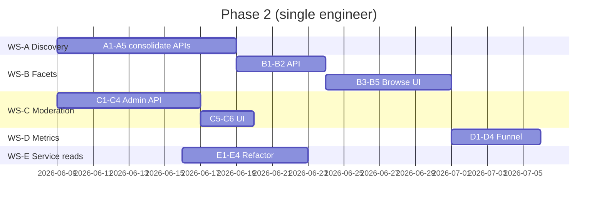

# Marketplace Phase 2 — Catalog & Discovery (Execution Scope)

**Status:** Complete (2026-06-03) — WS-A through WS-E shipped; see handoff in [MARKETPLACE_SYSTEM_ANALYSIS_REPORT.md](./reports/MARKETPLACE_SYSTEM_ANALYSIS_REPORT.md) §12  
**Horizon:** 4–8 weeks (one engineer) or 3–4 weeks (two engineers, parallel workstreams)  
**Prerequisite:** Phase 0–1 complete ([MARKETPLACE_SYSTEM_ANALYSIS_REPORT.md](./reports/MARKETPLACE_SYSTEM_ANALYSIS_REPORT.md) §12)  
**Parent strategy:** Option A hardening + Option B *light* (facets/collections without new catalog tables)

---

## 1. Goals

| # | Goal | Why now |
|---|------|---------|
| G1 | **One buyer discovery contract** | `GET /v1/listings` powers web; `GET /v1/services` duplicates queries (auth-only, unused by `apps/web`) |
| G2 | **Merchandising without schema churn** | `GET /v1/listings/featured` exists but browse does not surface it; buyers need curated entry points |
| G3 | **Operator safety** | Proof policy can `enforce`; no admin queue to approve/hide bad listings |
| G4 | **Measurable funnel** | Product cannot optimize view → save → order → escrow without events |
| G5 | **Thinner handlers** | Reads/writes split: `marketplace_service` for mutations + browse; handlers only HTTP/validation |

## 2. Non-goals (defer to Phase 3)

- `catalog_products` / `catalog_offers` tables (full Option B)
- Order state machine extraction (Option C)
- Buyer subscription SKUs
- `/agents` top-level IA split
- B2B API keys for purchase
- Replacing Solana escrow or credential gating policy

---

## 3. Architecture decision (ADR summary)

### ADR-1: Canonical discovery = `/v1/listings`

| Surface | Role after Phase 2 |
|---------|-------------------|
| **`GET /v1/listings`** (+ `/search`, `/featured`) | **Canonical** public buyer discovery; OpenAPI + SDK examples point here |
| **`GET /v1/services/*`** | **Legacy adapter** for protocol/routing filters; implemented as thin wrapper over shared discovery layer, marked `Deprecated` in OpenAPI |
| **`/v1/matching/*`** | Unchanged; smart match continues to recommend listings, CTA → `BuyListingModal` |

**Rationale:** Web already uses only listings APIs. Service discovery joins `service_configurations` with a **suspect join** (`sc.node_id = proxy_listings.id`) — consolidation fixes correctness while preserving advanced filters.

### ADR-2: Facets without new tables

`GET /v1/listings/facets` returns aggregated dimensions from `proxy_listings` (countries, proxy types, price histogram buckets, ISP top-N). Cached 5–15 minutes alongside listing list cache.

### ADR-3: Collections = config + queries (Option B light)

No migration for `catalog_products` in Phase 2. Collections defined in code or a small `marketplace_collections` JSON/config row:

- `featured` → existing featured query
- `verified-providers` → `listing_offer_verified = true` + min quality
- `us-residential` → country + proxy_type filters

Expose as `GET /v1/listings/collections` and `GET /v1/listings/collections/:slug`.

### ADR-4: Moderation MVP = status + admin API

Add listing status **`pending_review`** (migration). When `LISTING_PROOF_MODE=enforce` (or new `LISTING_MODERATION=enforce`), new listings start `pending_review` until admin approves → `active`. Admin routes under existing admin auth (not the redirect stub).

---

## 4. Current baseline (code pointers)

| Area | Today |
|------|--------|
| Listings browse | `listings.go` → `marketplaceService.BrowseMarket` ✓ |
| Listing CRUD | `PublishListing` / `UpdateListing` / `DeleteListing` via service ✓ |
| Listing by ID | `getListing` → direct `db.DB` + view counter |
| Featured | `getFeaturedListings` → direct `db.DB`; hook exists in `useApi.ts` but not browse hero |
| Service discovery | `service_discovery.go` → parallel GORM on `proxy_listings`, **protected** routes |
| Web marketplace | `apps/web/src/lib/api/marketplace.ts`, browse/map/detail/manage |
| Funnel analytics | No marketplace-specific client events; orders exist in DB |
| Admin marketplace | Report notes admin nav redirect; no listing moderation handlers |

---

## 5. Workstreams & deliverables

### WS-A — Discovery consolidation (≈1.5–2 weeks) ✅ Shipped 2026-06-03

**Owner skillset:** Go API, SQL, OpenAPI

| ID | Task | Status |
|----|------|--------|
| A1 | `internal/marketplace/discovery` shared filter builder | ✅ |
| A2 | Join `proxy_listings.provider_node_id` → `nodes` → `service_configurations` | ✅ + unit test |
| A3 | `discoverServices` uses shared discovery; response shape unchanged | ✅ |
| A4 | Deprecation headers + OpenAPI + [MARKETPLACE_DISCOVERY_API.md](./MARKETPLACE_DISCOVERY_API.md) | ✅ |
| A5 | `protocols`, `min_quality_score`, `min_bandwidth_mbps`, etc. on `GET /v1/listings` | ✅ |

**Exit:** No new feature work targets `/v1/services`; web stays on listings only.

---

### WS-B — Facets & collections (≈1.5–2 weeks) ✅ Shipped 2026-06-03

**Owner skillset:** Go API + React browse

| ID | Task | Status |
|----|------|--------|
| B1 | `GET /v1/listings/facets` with cache key `listings:facets:v1` | ✅ |
| B2 | `GET /v1/listings/collections` + `/:slug` | ✅ (`featured`, `verified`, `editors-pick`) |
| B3 | Browse UI: facet chips + collection rails | ✅ `marketplace/page.tsx` |
| B4 | Browse hero: Featured strip | ✅ `useFeaturedListings` |
| B5 | TanStack Query hooks on browse | ✅ `useListings`, debounced country |

**Exit:** Buyer can enter catalog via collections; filters show available dimensions.

---

### WS-C — Moderation MVP (≈1–1.5 weeks) ✅ Shipped 2026-06-03

**Owner skillset:** Go admin API + minimal admin UI (or API-only if no admin app)

| ID | Task | Acceptance criteria |
|----|------|---------------------|
| C1 | Migration: `pending_review` status + index | Existing listings remain `active` |
| C2 | Create listing: if moderation enforce → `pending_review`; else `active` | Env flag documented |
| C3 | Public browse/search/map: exclude `pending_review` | Buyers never see unapproved |
| C4 | Admin: `GET /admin/listings/pending`, `POST /admin/listings/:id/approve`, `POST .../reject` | Done — `/v1/moderation/*` + `/v1/admin/listings/*`; dashboard UI |
| C5 | Seller manage UI: show “Under review” when pending | Done — badge, disabled edit, create → manage banner |
| C6 | Re-enable or add admin nav entry only when C4 ships | Done — `/dashboard/admin` moderation queue for admin/moderator |

**Exit:** Enforce mode has human gate; operators can reject spam listings.

---

### WS-D — Funnel metrics (≈1 week) ✅ Shipped 2026-06-03

**Owner skillset:** API events + web instrumentation

| ID | Task | Acceptance criteria |
|----|------|---------------------|
| D1 | Define event schema `marketplace.funnel.v1` | Done — [MARKETPLACE_FUNNEL_METRICS.md](MARKETPLACE_FUNNEL_METRICS.md) |
| D2 | Server: emit on order create, escrow confirm, credentials GET | Done — `marketplace_funnel_events` + worker/API hooks |
| D3 | Web: thin `trackMarketplaceEvent()` in `BuyListingModal`, detail, browse inject, save | Done — client view/modal; server records save + purchase |
| D4 | Dashboard query doc or Grafana/sql example | Done — SQL examples in funnel metrics doc |

**Exit:** Can answer “browse → order → paid” rate per week without manual log grep.

---

### WS-E — `marketplace_service` read-path cleanup (≈1 week, can parallel) ✅ Shipped 2026-06-03

| ID | Task | Acceptance criteria |
|----|------|---------------------|
| E1 | `GetListingByID` via service + repo (move view increment to repo) | Done — `GetListingForViewer`; `getListing` uses service |
| E2 | `SearchListings` / `GetFeatured` via repo methods | Done — `listing_read_repository.go`; featured order test |
| E3 | `getMyListings` / `getSavedListings` → service methods (optional) | Done — service delegates to repo |
| E4 | Unit tests for new service methods | Done — `marketplace_service_read_test.go` (pending_review, saved) |

**Exit:** All listing **reads** go through ports; handlers stop importing `db.DB` except proof helpers.

---

## 6. Suggested timeline

**Parallel pairing (two engineers):**  
- Engineer 1: WS-A → WS-B  
- Engineer 2: WS-C → WS-D → WS-E  

**Milestone demos:**  
- **Week 2:** Facets API + discovery doc; moderation API in staging  
- **Week 4:** Browse collections UI + funnel dashboard query  
- **Week 6–8:** Buffer for E2E, OpenAPI SDK refresh, staging enforce-mode soak  

---

## 7. Testing & verification

| Layer | What to add |
|-------|-------------|
| **Go unit** | Facets aggregation; `pending_review` transitions; discovery filter parity |
| **Go integration** | `service_discovery_parity_test.go`, `admin_listings_moderation_test.go`, `discovery/equivalent_query_test.go` |
| **Web E2E** | `npm run test:e2e:map` (8/8); `npm run test:e2e:moderation` (admin approve queue, mocked API) |
| **Manual** | Enforce moderation: create listing → not on browse → approve → visible |

**Phase 2 done when:**

- [x] OpenAPI marks `/v1/services` deprecated; [MARKETPLACE_DISCOVERY_API.md](./MARKETPLACE_DISCOVERY_API.md) + [docs/README.md](./README.md) point to `/v1/listings`
- [x] `/v1/listings/facets` + `/v1/listings/collections/*` shipped
- [x] Browse shows featured + ≥1 collection rail
- [x] Admin can approve/reject `pending_review` listings
- [x] Funnel events queryable (table or log pipeline)
- [x] `getListing` / `getFeaturedListings` / `searchListings` / `getSavedListings` / `getMyListings` use `marketplace_service` + `listing_read_repository`
- [x] Report §12 Phase 2 checkboxes updated (WS-E)

---

## 8. Risks & mitigations

| Risk | Mitigation |
|------|------------|
| Breaking unknown `/v1/services` consumers | Wrapper preserves response; deprecation period 90 days |
| Wrong join in service_discovery today | Schema review in A2 before wrapper |
| Moderation blocks seller onboarding | Default moderation **off**; enforce only in staging/prod flag |
| Facet queries slow on large catalogs | Materialized view or cache; limit ISP facet to top 50 |
| Scope creep into Phase 3 catalog tables | Explicit non-goals §2; collections stay query-based |

---

## 9. First sprint backlog (recommended start order)

1. **A2 + A1** — Fix join + shared discovery module (unblocks everything)  
2. **B1** — Facets endpoint (quick win for browse UX)  
3. **C1 + C2** — `pending_review` + create path (security)  
4. **D1 + D2** — Server-side funnel events (cheap, high value)  
5. **B3 + B4** — Browse UI merchandising  
6. **A3 + A4** — Deprecate services API in docs  
7. **C4 + C5** — Admin approve UI  
8. **E1 + E2** — Read path through service  

---

## 10. References

- [MARKETPLACE_SYSTEM_ANALYSIS_REPORT.md](./reports/MARKETPLACE_SYSTEM_ANALYSIS_REPORT.md) — §10–12  
- [MARKETPLACE_CREDENTIAL_GATING.md](./MARKETPLACE_CREDENTIAL_GATING.md)  
- [openapi.yaml](./openapi.yaml) — `/v1/listings`, `/v1/services`  
- Code: `services/control-api/internal/api/listings.go`, `service_discovery.go`, `internal/core/services/marketplace_service.go`  
- Web: `apps/web/src/app/marketplace/page.tsx`, `src/lib/api/marketplace.ts`

---

## Document history

| Date | Notes |
|------|--------|
| 2026-06-03 | Initial Phase 2 execution scope |
| 2026-06-03 | WS-A–E complete; Phase 2 exit criteria met |
