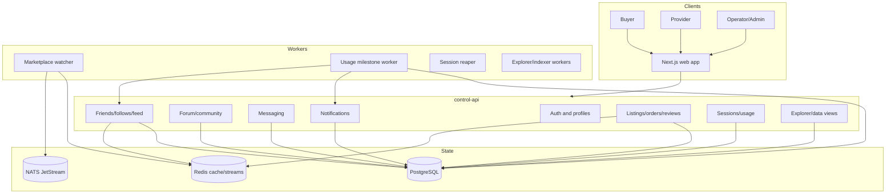
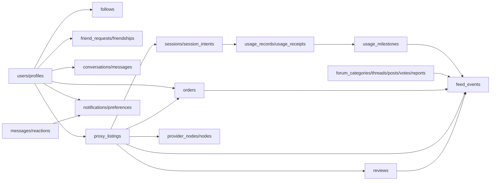
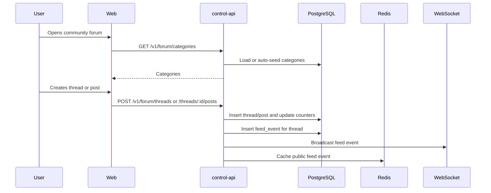
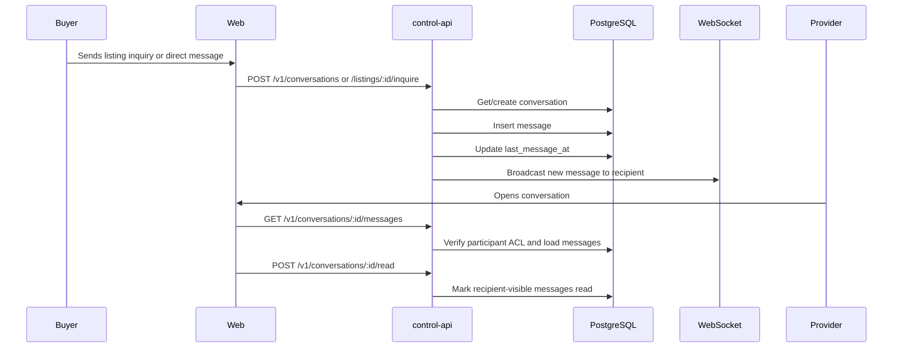
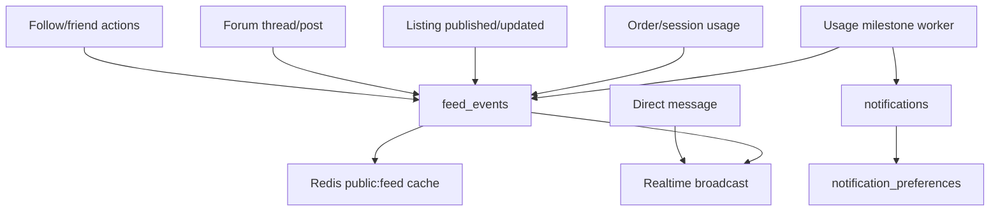
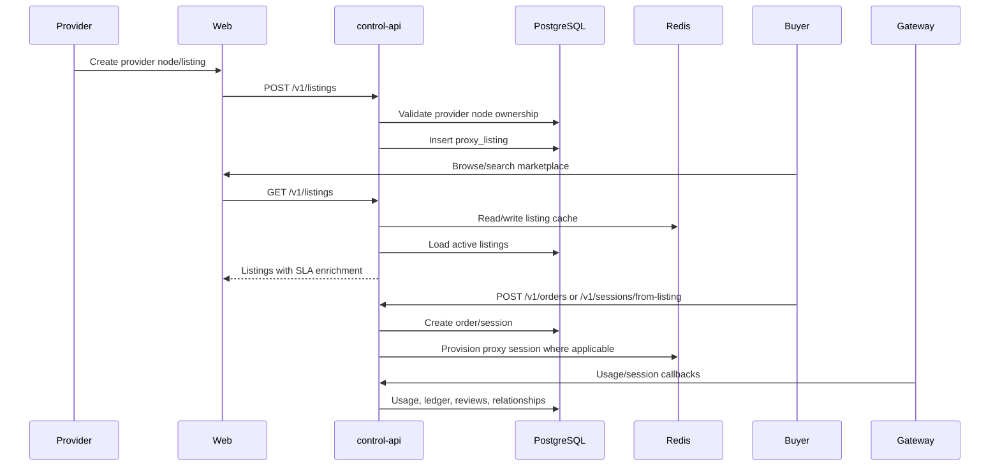
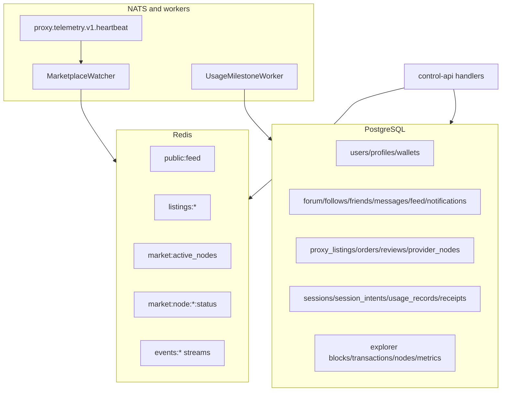

# ProxyHubb Network, Social, Marketplace, and Data-System Deep Dive

Generated: 2026-06-01  
Repository: `F:\project\proxyhubb`  
Scope: community, messaging, social graph, feed, notifications, marketplace, and the supporting data system inside the ProxyHubb monorepo.

## Executive Summary

ProxyHubb has a broad network layer that combines a proxy marketplace with social/community features: forum threads, private messaging, friends/follows, activity feeds, notifications, provider relationships, listings, orders, reviews, smart matching, usage milestones, and explorer/usage telemetry.

The architecture is directionally strong: a Next.js frontend calls a Go control API backed by PostgreSQL, Redis, NATS/JetStream, workers, and gateway/session/usage data. The main issue is maturity unevenness. Some workflows are production-minded and tested, while others are partially wired, have route/API drift, or lack hard privacy and data-integrity constraints.

Overall rating for this subsystem: **6.4 / 10**

| Area | Rating | Summary |
|---|---:|---|
| Community/forum | 6.0 / 10 | Core CRUD, votes, reports, search, and feeds exist, but moderation, public/private route design, frontend/backend route drift, and schema coverage need work. |
| Messaging | 6.5 / 10 | Conversations, messages, read state, edits, deletes, reactions, search, PII masking, and realtime broadcast exist. Reaction ACLs, reply validation, delete semantics, and notifications need tightening. |
| Social graph/feed | 5.8 / 10 | Follows, friends, feed events, badges, milestones, and discovery exist, but identity handling and event semantics are inconsistent. Some frontend calls target routes that do not exist. |
| Notifications | 6.8 / 10 | In-app notification model, preferences, unread counts, and dedupe helper exist. Fanout is inconsistent and preference enforcement is incomplete. |
| Marketplace | 7.0 / 10 | Listings, orders, saved listings, geo pins, SLA enrichment, listing inquiries, smart matching, and provider relationships exist. Filter implementation and domain/repository split are incomplete. |
| Data system | 6.0 / 10 | PostgreSQL migrations, Redis cache, NATS watcher, and explicit SQL migration runner are good. Schema/model drift and missing constraints are the largest risks. |

## System Context

## Domain Ownership Map

## Workflow Review

### Community and Forum

Current implementation:

- Routes live in `services/control-api/internal/api/forum.go`.
- Models live in `services/control-api/internal/models/forum.go`.
- Frontend helper lives in `apps/web/src/lib/forum-api.ts`.
- Forum routes are registered on the protected route group in `main.go`, so even read endpoints are currently authenticated.

Findings:

- Backend supports categories, category threads, thread detail, thread/post creation, votes, reports, search, recent/popular/unanswered, and "my posts/my threads".
- `getCategories` auto-seeds default categories at request time. That works for dev, but production should seed through migrations or an explicit seed job.
- View count update uses a read-modify-write pattern and should use an atomic increment.
- Vote behavior is implemented in handlers, but migration search did not find authoritative `forum_votes` table creation in the SQL migrations. This suggests model/schema drift.
- Forum frontend calls endpoints that are not registered in the backend:
  - `GET /v1/forum/threads/slug/:slug`
  - `GET /v1/forum/threads/:id/posts`
  - `PATCH /v1/forum/posts/:id`
  - `DELETE /v1/forum/posts/:id`
- Report records exist, but there is no complete moderation queue workflow in the inspected API route set.

Priority work:

- Add missing SQL migrations or remove dead model/API assumptions for `forum_votes`, `badges`, and `user_badges`.
- Align frontend forum calls with backend routes or add the missing backend routes.
- Add moderation endpoints for report review, lock/unlock, pin/unpin, hide/restore, and solution marking.
- Add authorization tests for create, vote, report, edit/delete, and moderation actions.

### Messaging

Current implementation:

- Routes live in `services/control-api/internal/api/messaging.go`.
- Models live in `services/control-api/internal/models/messaging.go`.
- Listing inquiry integration lives in `services/control-api/internal/api/listing_social.go`.
- Frontend clients exist in both `apps/web/src/lib/social-api.ts` and `apps/web/src/lib/api/social.ts`.

Strengths:

- Participant checks exist for listing conversations, message list, send, mark read, edit, delete, and search.
- Messages are PII-masked through `privacy.MaskPII` on send/edit.
- Read tracking, edits, soft deletes, replies, reactions, and conversation search exist.
- Listing inquiry connects marketplace to messaging and broadcasts realtime notifications.

Risks and gaps:

- `addReaction` only checks that a message exists; it does not verify that the reacting user is a participant in the message's conversation. This is a privacy and abuse-control issue.
- `removeReaction` also lacks conversation participant validation.
- `sendMessage` accepts `reply_to_id` without verifying that the referenced message belongs to the same conversation.
- `deleteMessage` allows any participant to soft-delete any message. That may be intended as "delete for conversation", but most products need either sender-only delete, per-user hide, or moderator delete semantics.
- `startConversation` creates messages inside a transaction but does not consistently check every write error before commit.
- Conversation listing does N+1 queries for last message and unread count.
- No durable notification record is created in the main `sendMessage` path, only realtime broadcast. This weakens offline delivery.

Priority work:

- Add participant ACL checks to reaction create/delete.
- Verify `reply_to_id` belongs to the same conversation.
- Decide and implement delete semantics: sender delete, per-user hide, or moderator delete.
- Create notification records for new direct messages based on preferences.
- Replace conversation list N+1 queries with a single query or precomputed preview fields.

### Social Graph, Feed, and Notifications

Current implementation:

- Feed routes live in `services/control-api/internal/api/feed.go`.
- Notification routes live in `services/control-api/internal/api/notifications_api.go`.
- Profile follow/block behavior lives in `services/control-api/internal/api/profile.go`.
- Friend request routes live in `services/control-api/internal/api/friends.go`.
- Feed and notification models live in `services/control-api/internal/models/feed.go` and `notification.go`.

Strengths:

- Notification preferences are modeled by category and channel.
- Notification dedupe exists through `Notification.CreateDeduped`.
- Feed events are persisted and cached into Redis for public feed page 1.
- Usage milestones create notifications, feed events, badges, and relationship score updates.
- Profile follows and listing social context bridge social and marketplace experiences.

Risks and gaps:

- Identity extraction is inconsistent. Some handlers use `GetUserID`, some manually inspect both `userID` and `user_id`, and `friends.go` directly asserts `c.Get("userID")`. This is fragile and can panic if middleware shape changes.
- `GetUserID` currently handles `user_id` as `uuid.UUID` and `userID` as string, but several tests and middleware paths set other combinations.
- Friend frontend calls routes that are not registered by `RegisterFriendRoutes`:
  - `DELETE /v1/friends/request/:requestId`
  - `DELETE /v1/friends/:friendId`
  - `GET /v1/friends/status/:userId`
  - `GET /v1/discover/people`
  - `GET /v1/users/:id/mutual-friends`
- SQL migration search did not find `friend_requests` or `friendships` table creation in the authoritative migrations, despite active models and handlers.
- Feed event names are not fully normalized. For example, listing inquiry currently reuses `FeedEventNewListing`.
- Notification preferences are modeled but not consistently enforced by all notification-producing flows.
- Redis public feed cache stores the last 100 events, but invalidation, privacy filtering, and cache versioning are basic.

Priority work:

- Standardize all handlers on a hardened `GetUserID` helper that accepts both key names and both UUID/string values.
- Add authoritative migrations and indexes for `friend_requests`, `friendships`, `forum_votes`, `badges`, and `user_badges`, or remove the unused features.
- Align frontend social/friend APIs with backend routes.
- Add a central notification service that enforces preferences, dedupe, realtime broadcast, and durable in-app persistence.
- Normalize feed event taxonomy and metadata schemas.

### Marketplace

Current implementation:

- Listings live in `services/control-api/internal/api/listings.go`.
- Orders live in `services/control-api/internal/api/orders.go`.
- Listing social/context lives in `services/control-api/internal/api/listing_social.go`.
- Marketplace repository/domain refactor lives in `internal/core` and `internal/db/marketplace_repository.go`.
- Frontend marketplace client lives in `apps/web/src/lib/api/marketplace.ts`, with older marketplace calls also present in `apps/web/src/lib/social-api.ts`.

Strengths:

- Listings support CRUD, save/unsave, my listings, search, featured, price suggestion, geo pins, and SLA enrichment.
- Listing creation validates provider node ownership and can infer country from provider node.
- Orders create sessions and feed events, and include Solana escrow initiation.
- Marketplace telemetry has a NATS watcher that updates Redis discovery cache from heartbeat events.
- Listing social context connects buyer/provider sessions, following, direct messaging, presence, and relationships.

Risks and gaps:

- `marketplaceRepository.GetListings` acknowledges filters are not fully mapped. `getListings` builds a cache key for many filters but only maps a subset into service filters, so user-visible filtering can be inaccurate.
- There are two marketplace implementation styles at once: domain service/repository and direct GORM handler logic. This is a transitional state and should be completed or simplified.
- Listing cache invalidation is not consistently tied to listing mutations, order creation, saved listings, provider telemetry, or SLA changes.
- Order status semantics are mixed: pay-as-you-go orders become `active` immediately, while Solana escrow creates `pending_payment`. This needs explicit product/API documentation and tests.
- Frontend marketplace types include fields not present in the Go model response (`node_id`, `price_total`, some staking/priority fields), which can produce fragile UI assumptions.
- Listing inquiry emits a feed event with an imprecise event type and does not use the central notification preference model.

Priority work:

- Complete marketplace filter mapping and add tests for every advertised filter/sort.
- Consolidate marketplace code paths around the domain service or document the boundary.
- Add cache invalidation on create/update/delete/save/order/provider heartbeat.
- Document and test order/session/payment state transitions.
- Align frontend marketplace types with backend/OpenAPI response shapes.

### Data System

Strengths:

- Explicit SQL migration runner replaces implicit GORM AutoMigrate, which is the right production direction.
- Most high-traffic tables have some indexes: listings, orders, notifications, feed events, messages, sessions, usage records, explorer data.
- Redis is used for short-lived feed/listing/node discovery caches.
- Redis Streams event queue abstraction supports consumer groups and at-least-once delivery.
- NATS JetStream is used for marketplace telemetry watcher.

Risks and gaps:

- Schema/model drift is the largest data-system risk. Active models exist for social/friend/forum/badge tables that were not found in the migration scan.
- `db.Social()` is a compatibility alias for the main DB. That is fine, but names still imply a separate social DB/Supabase legacy path.
- Cache keys and invalidation are ad hoc.
- There is no single data ownership contract for which subsystem owns derived counts such as listing views, saves, orders, active sessions, replies, unread messages, and relationship scores.
- The event queue abstraction exists but many flows directly write database rows, directly broadcast websockets, and directly update Redis instead of publishing canonical domain events.
- OpenAPI appears to cover marketplace better than community/messaging/social. That creates client drift.

Priority work:

- Create a model-to-table migration audit and close all missing schema gaps.
- Add ownership docs for derived counters and materialized/read-model fields.
- Create centralized domain event publishing for message sent, forum thread created, listing created, order created, review created, milestone reached, follow created, and provider heartbeat.
- Add cache invalidation policy per read model.
- Expand OpenAPI for forum, messaging, friends, feed, notifications, and listing social routes.

## Findings by Severity

### P0: Fix First

| Finding | Impact | Recommended fix |
|---|---|---|
| Message reactions lack participant ACL checks | Non-participants may react to messages if they know IDs; this leaks existence and allows abuse | Check conversation membership before add/remove reaction |
| Schema/model drift for friends/forum votes/badges | Runtime failures in fresh environments, broken migrations, hidden test setup assumptions | Add authoritative migrations or remove unsupported models/routes |
| Frontend calls unregistered forum/friend routes | User-facing 404s and broken workflows | Align clients and backend route set |
| Identity context extraction is inconsistent | Auth bugs or panics when middleware/test context shape differs | Use one hardened `GetUserID` helper everywhere |
| Notification fanout is not centralized | Missed offline notifications and inconsistent preference enforcement | Introduce notification service used by messaging, marketplace, forum, social, and workers |

### P1: Reliability and Correctness

| Finding | Impact | Recommended fix |
|---|---|---|
| Marketplace filters not fully mapped in repository | Browsing/search results can ignore requested filters | Implement every advertised filter/sort and add tests |
| Reply-to message not validated | Cross-conversation reply references possible | Validate reply target conversation |
| Conversation list uses N+1 queries | Slow inbox at scale | Query last message and unread count with joins/subqueries |
| Forum counters use non-atomic updates | Lost increments under concurrent traffic | Use database expressions and unique vote constraints |
| Listing/order/session state semantics are mixed | UI and finance flows can disagree | Document and test state machine |
| Cache invalidation is ad hoc | Stale listings/feed/node status | Define invalidation points and TTLs |

### P2: Architecture and Maintainability

| Finding | Impact | Recommended fix |
|---|---|---|
| Duplicate frontend API clients | Type drift and inconsistent error handling | Consolidate into `apps/web/src/lib/api/*` modules |
| Direct DB writes mixed with domain services | Harder to reason about marketplace behavior | Complete service/repository boundary or document direct-handler exceptions |
| `db.Social()` naming is legacy | Confusing architecture signal | Rename over time or document as compatibility alias |
| Event taxonomy is informal | Weak analytics and notification routing | Define canonical event types and metadata per domain |
| OpenAPI coverage is incomplete | External clients and frontend drift | Add community/social/messaging contracts |

### P3: Product Enhancements

| Enhancement | Value |
|---|---|
| Moderation queue for reports | Safer community and marketplace trust |
| Spam/abuse controls for messages, friend requests, posts, and votes | Reduces attack surface and support burden |
| Feed ranking and personalization | Better community discovery |
| Marketplace ranking by SLA, trust, price, availability, and fit | Better buyer conversion and provider incentives |
| Provider/buyer relationship dashboard | Stronger marketplace retention |
| Notification digests and channel delivery tracking | More mature user communication |

## Implementation Roadmap

### Phase 1: Stabilize Security and Schema

Goal: make existing network features safe and runnable on a clean database.

Tasks:

- Harden auth identity extraction:
  - Update `GetUserID` to accept `user_id` and `userID` as either `uuid.UUID` or string.
  - Replace direct `c.Get("userID")`, direct `c.Get("user_id")`, and hand-written fallback logic in social/marketplace handlers with `GetUserID`.
  - Add tests for both context-key variants.
- Fix messaging ACLs:
  - Validate participant membership in `addReaction` and `removeReaction`.
  - Validate `reply_to_id` belongs to the same conversation.
  - Decide and implement delete semantics as sender-only delete by default; add an explicit moderator/admin path later if needed.
- Close schema gaps:
  - Add migrations for missing active tables if they are intended: `friend_requests`, `friendships`, `forum_votes`, `badges`, `user_badges`.
  - Add unique constraints for friendships, friend requests, forum votes, follows, saved listings, message reactions, and user badges.
  - Add indexes for conversation participants, messages by conversation/created_at/read_at, forum thread category/latest, forum votes target/user, and notification unread queries.
- Align frontend/backend routes:
  - Either add missing backend routes or remove frontend calls for forum slug lookup, thread posts endpoint, post edit/delete, friend cancel/remove/status, people suggestions, and mutual friends.
  - Prefer implementing the missing routes if the UI already depends on them.

Acceptance criteria:

- Fresh database migrations create every table used by active models/routes.
- Social, messaging, forum, and marketplace tests pass against SQL-created schema.
- No handler in the reviewed subsystem directly asserts a context key without fallback.
- Non-participants cannot react to, search, read, edit, or delete private conversation content.

### Phase 2: Make Workflows Reliable

Goal: make community, messaging, social, and marketplace side effects consistent.

Tasks:

- Introduce a notification service:
  - Single API for durable notification, realtime websocket broadcast, dedupe, and preference checks.
  - Use it from direct messages, listing inquiries, friend requests, forum replies, votes/mentions, orders, milestones, and provider relationship offers.
- Standardize domain events:
  - Publish canonical events for `message.sent`, `friend.requested`, `follow.created`, `forum.thread_created`, `forum.post_created`, `listing.created`, `listing.updated`, `order.created`, `review.created`, and `usage.milestone_reached`.
  - Back events with Redis Streams or NATS consistently; avoid one-off goroutines for critical side effects.
- Fix marketplace filter behavior:
  - Implement mapping for proxy type, protocol, rotation type, country, ISP, min/max price, seller ID, rating/quality, and sort.
  - Add tests matching each query parameter used by the frontend.
- Define state machines:
  - Order: `pending`, `pending_payment`, `active`, `completed`, `cancelled`, `refunded`, `disputed`.
  - Listing: `active`, `paused`, `sold_out`, `deleted`.
  - Conversation/message: active, read, edited, deleted/hidden.
  - Forum report: `pending`, `resolved`, `dismissed`.

Acceptance criteria:

- Every side-effecting workflow has a single durable event or notification path.
- Marketplace filter tests prove all advertised filters work.
- Order/session/listing state transitions have table-driven backend tests.
- Notification preferences are honored by all notification-producing flows.

Implementation note, 2026-06-01:

- NSM-006 backend slice completed for marketplace browsing: `GET /listings` now passes advertised frontend filters through the marketplace service/repository path for proxy type, protocol, rotation type, country, ISP, min/max price, seller ID, rating/quality, pagination, and sort aliases including `newest`, `price_asc`, `price_desc`, `popular`, `sales`, `uptime`, `latency`, and `quality`.
- NSM-007 backend slice completed for listing read-model caches: listing response cache keys now include all active filters deterministically, and listing/feed/discovery/marketplace geo caches are invalidated after listing create/update/delete/save/unsave, order creation, provider auto-publish, provider node update/delete, heartbeat, and gateway node status updates.
- Focused backend coverage now validates frontend filter mapping, deterministic cache keys, price/popular sort behavior, pagination totals, and Redis cache invalidation.

Implementation note, 2026-06-01:

- NSM-008 backend slice completed for order/listing/session lifecycle safety: shared transition validators now cover order, listing, and session status moves; terminal states cannot be reopened or re-applied.
- API and worker paths now validate key transitions for listing update/delete/save, order payment/cancel, escrow release/dispute/auto-release, Solana escrow listener settlement, session termination, session repository updates, session reaper cleanup, and bandwidth auto-termination.
- Focused backend coverage now includes table-driven transition tests plus API regressions for inactive listing purchase, deleted listing browse/save behavior, invalid deleted-listing reactivation, order/session linkage, terminal order cancellation, P2P session creation from listing, and already-terminated session handling.

### Phase 3: Clean Architecture and Contracts

Goal: reduce drift and make the network system easy to maintain.

Tasks:

- Consolidate frontend API clients:
  - Keep canonical modules under `apps/web/src/lib/api/*`.
  - Make older `social-api.ts`, `legacy-social-api.ts`, `forum-api.ts`, and `friends-api.ts` either wrappers or remove them after callers are migrated.
  - Use shared response normalization for user summaries, conversations, listing cards, and pagination.
- Complete marketplace service boundary:
  - Move listing browse/search/filter logic into the marketplace service/repository.
  - Keep handlers thin: parse request, call service, map response.
  - Document any direct GORM exceptions.
- Expand OpenAPI:
  - Add forum, messaging, friends, feed, notifications, listing social, marketplace geo, and provider relationship endpoints.
  - Add schema examples for paginated responses and error shapes.
- Add data ownership docs:
  - For each derived field, record owner, write path, recalculation path, and cache invalidation path.
  - Cover `views_count`, `saves_count`, `orders_count`, `active_sessions_count`, `replies_count`, unread counts, usage milestones, provider relationship scores, listing SLA fields, and feed events.

Acceptance criteria:

- Frontend no longer contains conflicting API surface definitions for the same domain.
- OpenAPI covers all public/protected endpoints used by the web app for the reviewed subsystems.
- Marketplace handlers call a consistent service layer for core business operations.
- Derived counters have documented owners and tests for main update paths.

Implementation note, 2026-06-02:

- Phase 3 marketplace boundary slice started: listing browse/filter, create, update, delete, save, and unsave now flow through the marketplace service/repository port instead of handler-local lifecycle transactions.
- Listing handlers still own HTTP concerns: auth extraction, request parsing, response mapping, cache invalidation trigger, and presentation-only enrichment such as SLA/privacy shaping.
- Direct DB exceptions that remain by design for the next contract/data-ownership slice: order/session creation side effects, worker-driven escrow/session state transitions, `views_count` increments, saved-listing list reads, seller listing list reads, and discovery/search/featured read models.
- Added service-boundary tests for listing ownership, invalid terminal transitions, unavailable listing saves, and repository delegation.

### Phase 4: Product and Quality Enhancements

Goal: improve user experience, trust, and operational visibility.

Tasks:

- Community:
  - Add moderation dashboard for forum reports.
  - Add edit/delete history and lock/pin/solution controls.
  - Add mentions and notification routing.
- Messaging:
  - Add per-user hide/delete, unread summary, typing/presence, attachment policy, message rate limits, and abuse reporting.
  - Add full-text message search with proper indexing if usage grows.
- Social/feed:
  - Add feed ranking, filters, pagination cursors, and privacy-aware feed visibility.
  - Add people recommendations only after backend route and tests exist.
- Marketplace:
  - Add ranking by quality, availability, price, region fit, provider trust, and SLA freshness.
  - Add provider/buyer relationship view improvements and refill-offer lifecycle.
  - Add stale listing detection when linked provider node is offline.
- Observability:
  - Add metrics for message sends, unread counts, notification delivery, forum posts/reports, listing search latency, order creation, and cache hit rate.
  - Add dashboard panels for network/social/marketplace health.

Acceptance criteria:

- Operators can see health and abuse signals for the network system.
- Users receive predictable notifications and consistent empty/error states.
- Marketplace ranking and SLA displays are backed by measured data and freshness indicators.

## Testing Plan

Backend unit and integration tests:

- Messaging:
  - Participant-only message list/search/send/edit/delete/read.
  - Participant-only reaction add/remove.
  - Reply target must belong to conversation.
  - Message notification created for recipient and preference respected.
- Forum:
  - Category seed path or migration seed path.
  - Thread/post create, edit/delete if added, vote uniqueness, report creation and moderation state changes.
  - Atomic view/reply/vote counter behavior.
- Friends/social:
  - Friend request send/accept/reject/cancel/remove/status.
  - Duplicate and inverse request handling.
  - Follow/block visibility rules.
  - Feed event creation and privacy filters.
- Marketplace:
  - Listing create/update/delete ownership.
  - Provider node ownership validation.
  - All advertised filters and sorts.
  - Order creation, escrow initiation, cancellation, sales list, and session link.
  - Cache invalidation after listing mutation/order/provider heartbeat.
- Data:
  - Fresh migration smoke test for all reviewed models.
  - Constraint tests for duplicate votes/follows/friendships/saved listings/reactions.
  - Redis/NATS event publish/consume tests where practical.

Frontend/Playwright scenarios:

- Community:
  - Browse categories, create thread, reply, vote, report, see error states.
- Messaging:
  - Start conversation from profile/listing, send/read messages, edit/delete own message, reaction ACL behavior through UI.
- Social:
  - Follow/unfollow, friend request lifecycle, notification preferences.
- Marketplace:
  - Browse/filter/search listings, create listing, manage listing, save listing, buy/start session, listing inquiry, view provider relationship.
- Data/error states:
  - Empty feed, empty inbox, no listings, offline provider, forbidden conversation, deleted listing, expired session.

## Acceptance Criteria for the Remediation Program

- A clean local database can run all migrations and support all active routes without relying on GORM AutoMigrate.
- Backend and frontend agree on every route used by community, messaging, friends, feed, notifications, marketplace, and listing social flows.
- Private conversation data is protected by participant checks on every read/write side path.
- Notification creation is durable, deduped, preference-aware, and observable.
- Marketplace filters, sorting, and cache invalidation are deterministic and tested.
- OpenAPI documents the reviewed endpoint surfaces.
- Operators have metrics for the health and performance of network/social/marketplace workflows.

## Recommended Work Items

| ID | Priority | Work item | Outcome |
|---|---|---|---|
| NSM-001 | P0 | Add missing social/forum/friend/badge migrations and constraints | Clean DBs support active features |
| NSM-002 | P0 | Standardize `GetUserID` usage and update reviewed handlers | Fewer auth panics and inconsistent access checks |
| NSM-003 | P0 | Add participant ACL to message reactions and reply validation | Private messaging is properly protected |
| NSM-004 | P0 | Align frontend forum/friend clients with backend routes | Remove known 404 workflows |
| NSM-005 | P1 | Centralize notification service and use it from core flows | Durable, preference-aware notifications |
| NSM-006 | P1 | Complete marketplace filter/sort mapping | Marketplace search behaves as advertised |
| NSM-007 | P1 | Add cache invalidation for listing/feed/node read models | Lower stale data risk |
| NSM-008 | P1 | Add order/listing/session state-machine tests | Safer buyer/provider workflows |
| NSM-009 | P2 | Consolidate frontend API clients | Less type and route drift |
| NSM-010 | P2 | Expand OpenAPI for social/community/messaging | Better contract and QA coverage |
| NSM-011 | P2 | Document derived data ownership | Clear write paths for counters and read models |
| NSM-012 | P3 | Add moderation, abuse controls, and observability dashboards | More production-ready network operations |

## Final Assessment

The ProxyHubb network system is a serious feature set rather than a placeholder. The marketplace and messaging foundations are useful, social/community concepts are present, and the data architecture has credible infrastructure. The main work is to remove drift and harden privacy, schema, and workflow consistency.

The best next move is not to add another social feature. The highest return is to stabilize the existing system: close schema gaps, align frontend/backend APIs, standardize identity handling, centralize notifications, complete marketplace filtering, and add integration tests around buyer/provider/community workflows. After that, product enhancements like ranking, moderation, recommendations, and richer provider relationships will have a stronger base.
