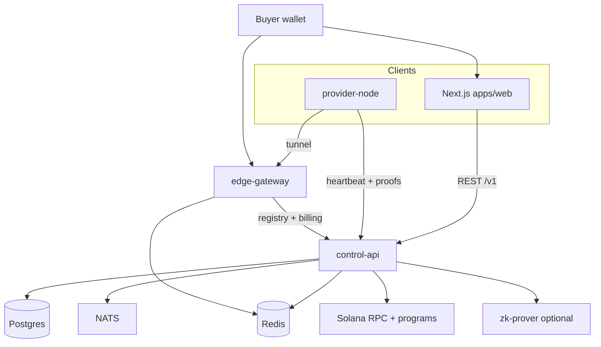

# ProxyHubb — project state & decentralization foundation

**As of:** 2026-06-02  
**Audience:** operators, contributors, and release planning  
**Rating (overall):** **8.0 / 10** — decentralization wiring is implemented across D1–D4; staging/devnet validation remains the main risk.

This document is the **canonical progress record**. Older deep-dive and duplicate status files were removed or merged; see [Documentation index](./README.md).

**Saved walkthrough reports:** [reports/DECENTRALIZATION_STATUS_REPORT.md](./reports/DECENTRALIZATION_STATUS_REPORT.md), [reports/IMPROVEMENTS_AND_ROADMAP.md](./reports/IMPROVEMENTS_AND_ROADMAP.md).

---

## Executive summary

ProxyHubb is a **decentralized residential proxy marketplace**: buyers fund sessions via Solana; providers run `provider-node` → `edge-gateway` tunnels; **control-api** (Go) is the control plane; **apps/web** (Next.js) is the product UI; optional **ZK prover** and on-chain programs support settlement and reputation narratives.

Recent work materially improved:

- **Web navigation and route policy parity** (nav derives route policy, dynamic prefixes validated, `validate:routes`)
- **Marketplace API consolidation** and public vs authenticated clients
- **Unified marketplace map** (`GET /v1/marketplace/map`, shared `ProxyMapCanvas`)
- **Provider proof foundation** (signed heartbeats + signed listing offers, Docker tooling, enforce mode, dev server signing on create)
- **Provider-node runtime registry merge** (`provider_nodes` is canonical; `nodes` is a compatibility mirror)
- **D4 usage-proof settlement wiring** (order/session finalization creates proof and routes escrow settlement)
- **Live devnet map-buy harness** (guarded Playwright test with Solana test wallet adapter)
- **Edge gateway vNext** (P1–P6 largely signed off — performance, multipod, tunnel split, transport, OTEL)

Remaining gaps are **staging validation**, **production provider key management**, **live devnet secrets/funded wallet setup**, and **legacy `nodes` read cleanup after the compatibility window**.

---

## Architecture (current)



| Layer | Role | Maturity |
|-------|------|----------|
| **apps/web** | Marketplace, provider ops, explorer, wallet, forum, governance | Stronger — route policy parity + map buy E2E + live devnet harness |
| **control-api** | Auth, listings, orders, sessions, wallet, explorer, provider registry | Stronger — D4 finalization + provider_nodes runtime registry |
| **edge-gateway** | Buyer CONNECT, provider tunnels, admission, multipod | Production-oriented; see edge-gateway sign-off docs |
| **provider-node** | Yamux tunnel, signed heartbeats, stats | Docker-proven with bootstrap scripts |
| **Solana + ZK** | Escrow, proofs, treasury, reputation | Wired for buyer settlement; live devnet oracle/program validation needed |

---

## Decentralization foundation

The “foundation” is staged: **identity → registry → edge enforcement → settlement proofs**. Status below.

### D1 — Provider cryptographic identity (implemented)

| Capability | Status | Where |
|------------|--------|--------|
| Ed25519 proof envelope (`PROXYHUB_*`) | Done | `control-api/internal/proofs/` |
| Signed provider heartbeats | Done | `provider-node`, `provider_nodes` API |
| Signed listing offers (create/update) | Done | `listings.go`, web `listing-offer.ts` |
| `PROVIDER_SIGNATURE_MODE=observe\|enforce` | Done | `provider_proofs.go` |
| Hotkey on `provider_nodes` | Done | bootstrap, verified heartbeat, listing verify |
| Docker bootstrap + verify | Done | [PROVIDER_PROOFS_DOCKER.md](./PROVIDER_PROOFS_DOCKER.md) |
| CLI sign listing | Done | `scripts/sign-provider-listing.ps1`, `cmd/provider_sign_listing` |
| Web create: wallet sign | Done | `marketplace/create/page.tsx` |
| Web create: dev server sign | Done | `POST /v1/provider/listings/sign-offer`, policy `dev_server_signing` |
| Enforce soak monitor | Done | `scripts/soak-enforce-monitor.ps1` |
| E2E map + proof UI | Done | `e2e/marketplace-map-proof.spec.ts` |
| E2E map buy-from-map (mocked order + credentials) | Done | `e2e/marketplace-map-buy.spec.ts` |

**Operational default:** `observe` in compose for first boot; **enforce** validated locally with soak + signed listing POST (see [reports](./reports/)).

**Not done:** hardware wallet / HSM signing for providers in production; key rotation runbook beyond bootstrap resync.

### D2 — Node registry unification (merged path implemented)

| Capability | Status | Where |
|------------|--------|--------|
| Canonical model documented | Done | [NODE_REGISTRY.md](./NODE_REGISTRY.md) |
| `reconcileProviderNodeRegistry` | Done | `provider_registry.go` |
| Called from provider create/heartbeat | Done | `provider_nodes.go` |
| Called from gateway register/reconnect/heartbeat | Done | `gateway.go` |
| Marketplace geo uses provider linkage | Done | `marketplace_geo.go` |
| Provider node runtime columns | Done | `migrations/000092_provider_nodes_runtime_merge.*.sql` |
| Gateway returns `provider_nodes.id` | Done | `gateway.go` |
| Explorer sync reads `provider_nodes` | Done | `indexer/node_sync.go` |
| Legacy `nodes` compatibility mirror | Transition | `gateway.go`, migration backfill |

### D3 — Edge & control-plane decentralization flags (advanced)

| Capability | Status | Where |
|------------|--------|--------|
| Edge gateway P1–P4 sign-off | Done | `services/edge-gateway/docs/P*_SIGNOFF.md` |
| P3 multipod + tunnel tier split (P3b) | Done | ADR 0002, compose stacks |
| P4 multi-yamux provider transport | Done | ADR 0003 |
| P5 OTEL + JA3/JA4 + buyer TLS options | Done | [P5_OTEL.md](../services/edge-gateway/docs/P5_OTEL.md) |
| P6 HTTP/3 + SOCKS5 ingress (initial) | Done | `REMAINING_PHASES.md` |
| `FULL_DECENTRALIZATION` gate | Done | `control-api/internal/decentralization`, explorer tests, edge skips legacy ZK path |
| Explorer decentralization status API | Done | `/v1/explorer/decentralization/*` |
| Optional signed tunnel heartbeats | Config | `PROXYHUB_REQUIRE_SIGNED_HEARTBEATS` on edge |

Tracker: [services/edge-gateway/docs/REMAINING_PHASES.md](../services/edge-gateway/docs/REMAINING_PHASES.md)  
Blueprint: [EDGE_GATEWAY_VNEXT_BLUEPRINT.md](./EDGE_GATEWAY_VNEXT_BLUEPRINT.md)

### D4 — Trustless usage & settlement (wired; staging validation required)

| Capability | Status | Where |
|------------|--------|--------|
| `UsageProof` model + dual signatures | Done | `models/usage_proof.go`, `trustless.go` |
| ZK prover service (Phase 5a) | Done | `services/zk-prover/` |
| Solana escrow / settlement workers | Wired | `solana/`, `billing/`, `usage.go` |
| Provider self-claim earnings | Done | Phase 4 wallet — [WALLET_STATUS.md](./WALLET_STATUS.md) |
| Buyer↔provider usage proof in purchase flow | Done | `orders.go`, `session.go`, `usage.go`, `trustless.ts` |
| Live devnet map-buy E2E harness | Done | `e2e/marketplace-map-buy.devnet.spec.ts` |
| On-chain reputation program | Scaffold | `programs/reputation/` |

**Next product slice:** run staging/devnet settlement with funded disposable wallet and oracle/program secrets.

---

## Wallet & Solana (parallel track)

SOL-only wallet hardening is largely **complete** through plan Phase 4 (streams deferred).

| Area | Status | Doc |
|------|--------|-----|
| Security / KYC / treasury verify | Done | [WALLET_STATUS.md](./WALLET_STATUS.md) |
| Tests (transfer, withdraw, deposit) | Substantial | same |
| Fiat removal | Done | migration 000088 |
| Treasury public + multisig | Done | `/treasury`, `TREASURY_4.1_AUDIT.md` |
| Manual devnet verification | Operator | [MANUAL_DEVNET_SESSION.md](./MANUAL_DEVNET_SESSION.md), [STAGING_ENFORCE_RUNBOOK.md](./STAGING_ENFORCE_RUNBOOK.md) |

---

## Web application (recent progress)

| Improvement | Impact |
|-------------|--------|
| Expanded `routes.ts` + `validate:routes` (71 static routes) | Fewer orphan pages |
| Sidebar + mobile nav alignment | Discoverability |
| `isNavigationRouteActive()` | Correct parent highlighting |
| Marketplace client consolidation | Clearer API boundary |
| Public vs authenticated API split | Public pages without spurious auth |
| `/marketplace/map` + shared map components | Unified geo discovery |
| Playwright route-policy + map proof + map buy + devnet harness | Regression guards |
| Provider proof UX on create + map | Enforce-ready workflows |

**Still open:** single `NAV_SECTIONS` registry; route policy validation vs middleware; provider-only **page guards** (badges exist); dependency/Node 22 audit.

---

## Marketplace & map

| Item | Status |
|------|--------|
| `GET /v1/marketplace/map` (listings + optional nodes, bbox, filters) | Done |
| Shared `ProxyMapCanvas` (Leaflet + globe) | Done |
| Explorer map reuses engine | Done |
| Deep link `?listing=<uuid>` on marketplace map | Done |
| Canonical `ProxyMapPoint` contract everywhere | Tracked in [reports/IMPROVEMENTS_AND_ROADMAP.md](./reports/IMPROVEMENTS_AND_ROADMAP.md) |
| Buy-from-map E2E (mocked purchase) | Done |
| Buy-from-map against live API + wallet | Harness done — requires live devnet env |

---

## Verification snapshot (local dev)

Typical green checks (when stack is up):

```powershell
# From repo root
.\scripts\bootstrap-provider-docker.ps1 -StartProvider
.\scripts\verify-provider-proofs-docker.ps1
curl http://localhost:18090/health   # edge-gateway (host port from EDGE_GATEWAY_PORT; default in .env may be 18090 not 8090)

cd services\control-api
$env:GIN_MODE='test'
go test ./internal/api/ -run "ReconcileProviderNodeRegistry|SignListingOfferDev" -count=1

cd ..\..\apps\web
npm run validate:routes
npm run typecheck
# Terminal 1: npm run dev:e2e  |  Terminal 2: npm run test:e2e:map
.\scripts\soak-enforce-monitor.ps1
```

Canonical local URLs: API **18080**, gateway **8090** inside Docker (host often **18090** via `EDGE_GATEWAY_PORT`), gateway metrics **9092** (host), web dev **4011** (`npm run dev:e2e`). If edge fails with **port 9090 in use**, see [PROVIDER_PROOFS_DOCKER.md](./PROVIDER_PROOFS_DOCKER.md) troubleshooting (stale Prometheus container).

---

## Risks & bottlenecks

1. **Large uncommitted diff** — split by area before release (web / control-api / edge / docs).
2. **Navigation duplication** — desktop vs mobile route lists can drift.
3. **Enforce mode** — requires aligned hotkey, signing key, and signed listings; test with soak + create flow.
4. **Registry compatibility window** — legacy `nodes` mirror remains until all readers move to `provider_nodes`.
5. **Trustless settlement ops** — code is wired; staging needs oracle/program secrets and funded devnet wallet.
6. **Dependencies** — npm audit, React peer warnings, Next middleware deprecation.

---

## Recommended next steps (priority)

### P0 — Decentralization ops

1. Staging: `PROVIDER_SIGNATURE_MODE=enforce` after heartbeat verification SQL checks ([PROVIDER_PROOFS_DOCKER.md](./PROVIDER_PROOFS_DOCKER.md)).
2. Set `PROXYHUB_PROVIDER_SIGNING_KEY` on control-api from bootstrap env for dev create UX.
3. Run soak + one signed listing via web and via CLI.

### P1 — Product hardening

1. Run staging live devnet map-buy with `STAGING_ENFORCE_RUNBOOK.md`.
2. Remove remaining legacy `nodes` read paths after one compatibility release.
3. Complete `ProxyMapPoint` contract cleanup everywhere.

### P2 — Architecture debt

1. Decide timeline for `nodes` + `provider_nodes` merge or formalize bridge-only forever.
2. Usage-proof path from session end → settlement.
3. Commit edge-gateway changes in logical slices (no `target/` artifacts).

### P3 — Release

1. Organize git branches per subsystem.
2. Dependency audit and Node 20/22 decision for web Docker image.
3. Staging wallet manual checklist ([WALLET_PRODUCTION_CLOSURE.md](./WALLET_PRODUCTION_CLOSURE.md)).

---

## Documentation map

| Need | Read |
|------|------|
| **This report** | `PROJECT_STATE.md` |
| Decentralization report (saved) | `reports/DECENTRALIZATION_STATUS_REPORT.md` |
| Achievements + roadmap (saved) | `reports/IMPROVEMENTS_AND_ROADMAP.md` |
| Provider proofs Docker | `PROVIDER_PROOFS_DOCKER.md` |
| Node registry rules | `NODE_REGISTRY.md` |
| Staging enforce runbook | `STAGING_ENFORCE_RUNBOOK.md` |
| Wallet status | `WALLET_STATUS.md` |
| Explorer delivery | `EXPLORER_IMPLEMENTATION_PLAN.md` |
| Edge gateway phases | `services/edge-gateway/docs/REMAINING_PHASES.md` |
| Architecture narrative | `SYSTEM_ARCHITECTURE_AND_PRODUCT_DEEP_DIVE.md` |
| API/route appendix | `SYSTEM_ANALYSIS_REPORT.md` |
| Edge ADRs | `docs/adr/` |

---

## Rating history (approximate)

| Snapshot | Rating | Notes |
|----------|--------|--------|
| Pre-navigation repair (web deep dive) | ~6.1 | Orphan routes, API drift |
| Project review (2026-06-01) | 7.0 | Broad monorepo, hygiene gaps |
| Post map + proofs + nav (2026-06-02) | **7.2** | Enforce-ready provider layer; map unified; still pre-release |
| Post map buy E2E + enforce soak (2026-06-02) | **7.3** | Enforce verified in Docker; map buy regression tests |

---

*Update this file when a decentralization phase closes or a subsystem reaches production sign-off.*
