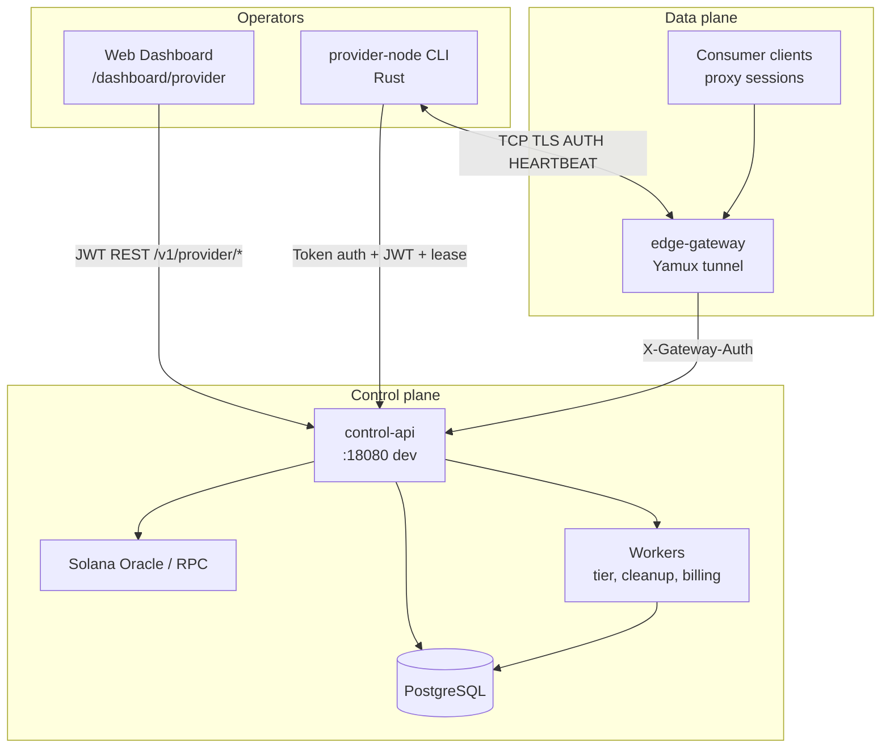
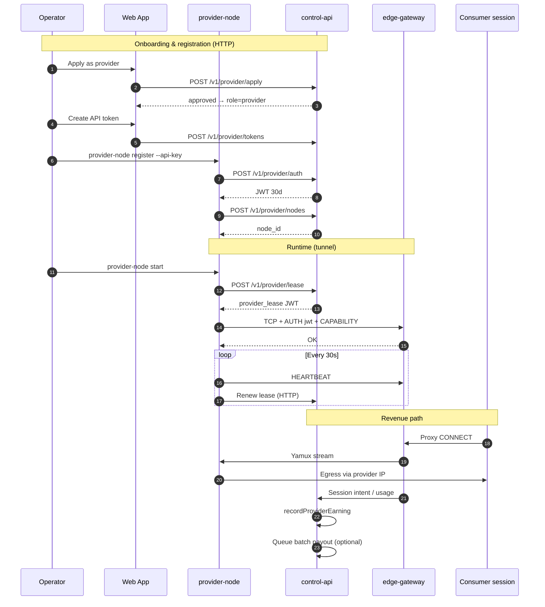
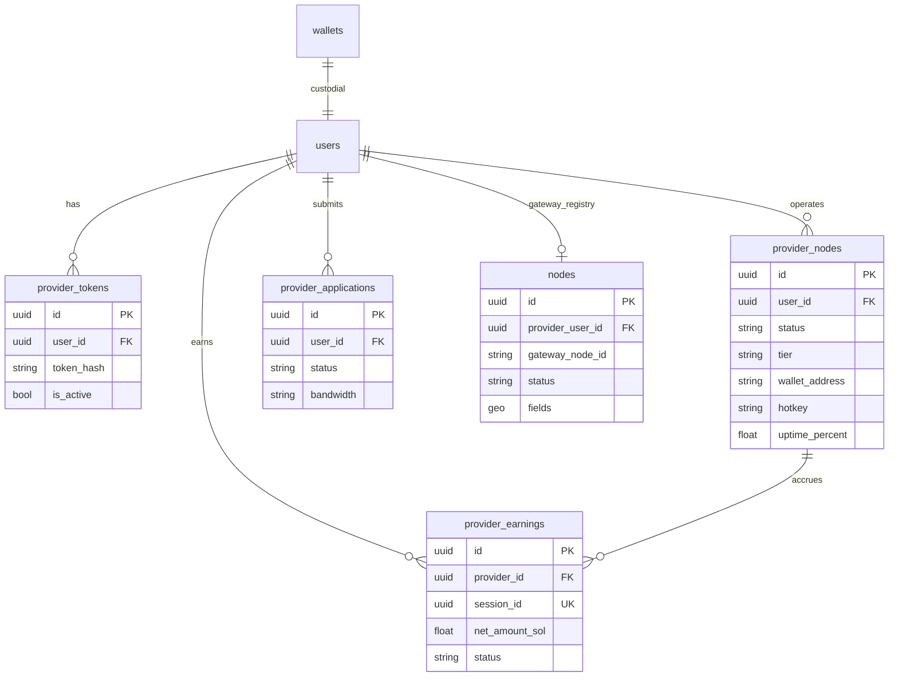
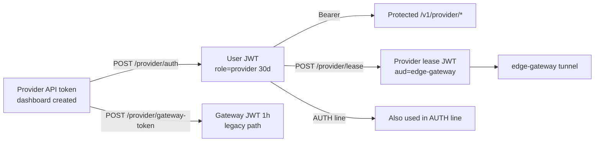
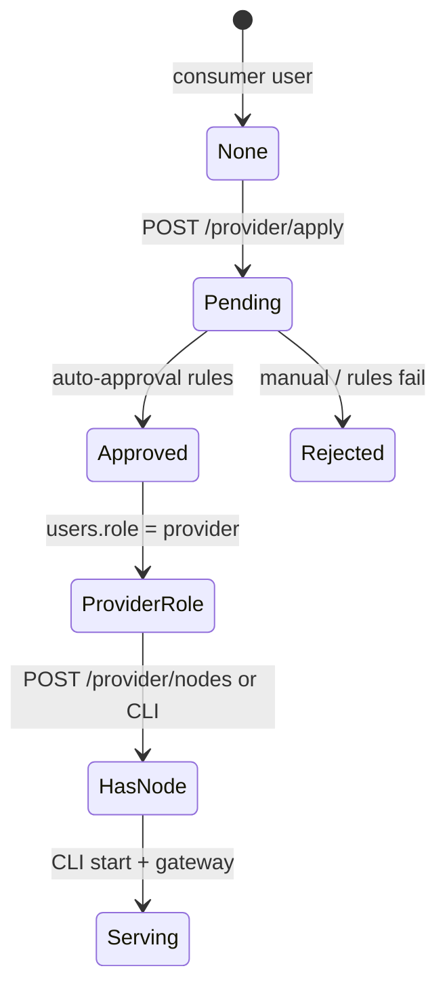
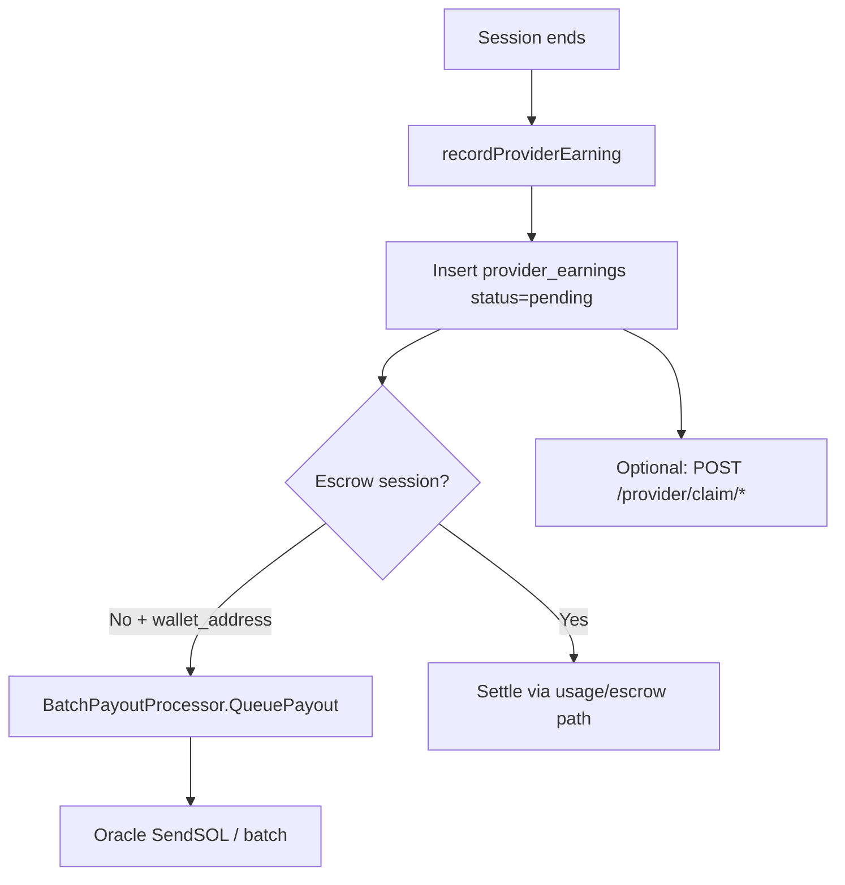
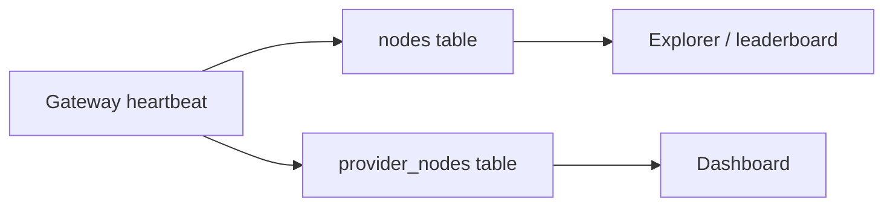
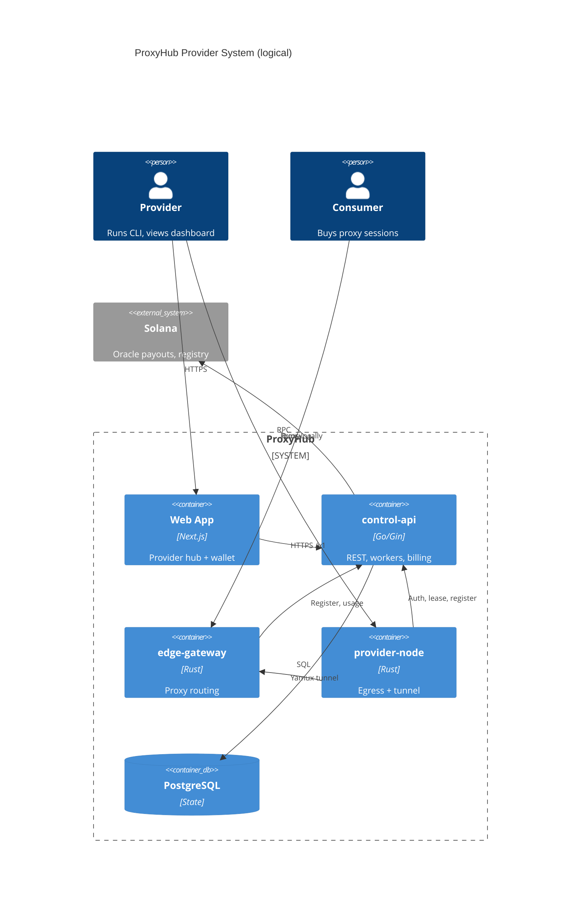

# ProxyHub Provider System — Deep Dive

**Date:** 2026-05-30  
**Scope:** Control API, `provider-node` CLI, edge gateway, web dashboard (`apps/web`)  
**Purpose:** Architecture reference, gap analysis, and prioritized improvement plan for review.

---

## Executive summary

ProxyHub’s provider system lets users **sell residential/datacenter bandwidth** by running a **provider node** that tunnels traffic through the **edge gateway**. The control plane lives in **control-api** (Postgres + Solana oracle). The **data plane** is **provider-node (Rust) ↔ edge-gateway (Yamux/TCP)**. Operators use the **web dashboard** (`/dashboard/provider/*`) for onboarding, tokens, nodes, and earnings; the **CLI** (`provider-node`) runs the actual proxy.

**What works well today**

- End-to-end path: apply → token → register node → CLI `start` → gateway tunnel → sessions → `provider_earnings` → batch payout / claim API.
- Clear separation of **control** (HTTP/JWT) vs **data** (gateway tunnel).
- HMAC-stored provider API tokens and lease JWTs for gateway authorization.

**Top risks / weaknesses**

| Priority | Issue | Impact |
|----------|--------|--------|
| P0 | **Dual node registries** (`provider_nodes` vs `nodes`) | Stale leaderboard, offline logic, explorer vs dashboard mismatch |
| P0 | **CLI does not call** `POST /provider/nodes/:id/heartbeat` | `provider_nodes` can show offline while gateway is healthy |
| P1 | **Admin API disabled** (410 on `/v1/admin/*`) | No manual application review or admin payout tools |
| P1 | **Go `provider-cli` missing**; UI/docs reference wrong binary | Broken downloads, confused operators |
| P1 | **`ProviderTokenAuth` middleware unused** | Raw tokens cannot be used on protected routes (by design, but docs inconsistent) |
| P2 | **On-chain heartbeat sends zero metrics** | Registry / explorer data stale |
| P2 | **Web UI missing claim flow** | Backend `/provider/claim/*` unused |
| P2 | **`kyc_verified` column unused** | Dead schema; tier system is separate |
| P2 | **Auto-deposit watcher** vs `linked_wallets` table | Background credits may skip users (falls back to `users.wallet_address`) |

---

## 1. System context



### Runtime services

| Service | Path | Role |
|---------|------|------|
| **control-api** | `services/control-api/` | Provider CRUD, auth, earnings, leases, gateway registration |
| **provider-node** | `services/provider-node/` | Production provider CLI (Rust) |
| **edge-gateway** | `services/edge-gateway/` | Accepts provider tunnels; routes consumer proxy traffic |
| **apps/web** | `apps/web/` | Provider hub UI + consumer wallet/marketplace |
| **relayer** | `services/relayer/` | **Decommissioned** (EVM stub only — not provider CLI) |
| **proxyhubb-cli** | `cli/` | Thin wrapper spawning `provider-node` |

---

## 2. Architecture — control vs data plane



---

## 3. Data model

### 3.1 Core tables



### 3.2 Dual registry problem (critical)

Two parallel concepts store “a provider’s node”:

| Table | Used by | Updated when |
|-------|---------|--------------|
| **`provider_nodes`** | Dashboard, CLI register, tier evaluator, stale cleanup (30 min) | `POST /provider/nodes`, `POST /provider/nodes/:id/heartbeat` |
| **`nodes`** | Gateway, explorer, `mv_provider_leaderboard` | `POST /gateway/nodes/register`, gateway heartbeat |

**Rust `provider-node` today:**

- Calls `POST /v1/provider/auth` and `POST /v1/provider/nodes` once.
- Sends heartbeats to **edge-gateway** only.
- Does **not** call `POST /v1/provider/nodes/:id/heartbeat`.

**Consequence:** Dashboard can show **offline** while the node is actively serving traffic; leaderboard/explorer may disagree with provider hub stats.

**Recommended direction:** Single source of truth — gateway heartbeats upsert both rows, or deprecate `provider_nodes` in favor of `nodes` + materialized view for dashboard.

---

## 4. Authentication & authorization

### 4.1 Token and JWT ladder



| Credential | Secret | TTL | Validated by |
|------------|--------|-----|--------------|
| Provider API token (raw) | HMAC in DB (`TOKEN_HMAC_SECRET`) | Optional expiry | `POST /provider/auth` only |
| Session JWT | `JWT_SECRET` | 30 days | `RequireAuth()` middleware |
| Provider lease JWT | `GATEWAY_SHARED_SECRET` or `JWT_SECRET` | `PROVIDER_LEASE_TTL_SECONDS` | edge-gateway `provider_lease.rs` |
| Gateway → API | `GATEWAY_SHARED_SECRET` | — | `X-Gateway-Auth` on `/gateway/*` |

**Gap:** `middleware/provider_token_auth.go` allows JWT **or** provider token on all routes but is **never registered** in `main.go`. It also hashes with plain SHA256, which would **not** match HMAC storage if enabled.

### 4.2 Key files

- `services/control-api/internal/api/provider_token.go`
- `services/control-api/internal/api/provider_lease.go`
- `services/control-api/internal/providerlease/token.go`
- `services/control-api/internal/middleware/provider_token_auth.go`
- `services/edge-gateway/src/auth/provider_lease.rs`
- `services/provider-node/src/ip.rs`

---

## 5. Provider CLI (`provider-node`)

### 5.1 Commands

| Command | Purpose |
|---------|---------|
| `register` | Detect public IP → auth → create `provider_nodes` row |
| `start` | Connect gateway(s), handshake, heartbeats, accept proxy streams |
| `metrics` | Local HTTP stats (default port **9090**) |
| `stop` | PID-based shutdown (`~/.proxyhubb/provider.pid`) |

Wrapper `proxyhubb-cli` (`cli/src/main.rs`): `join`, `start`, `status` (status targets port **9091** in sample config — inconsistency).

### 5.2 Config (`provider.toml`)

See `services/provider-node/src/config.rs` — `control_api_url`, `gateway_addr(s)`, `jwt_token`, `api_key`, TLS, bandwidth limits, `connection_type`.

Env: `PROXYHUB_API_URL`, `PROXYHUB_API_KEY`, `PROXYHUB_JWT_TOKEN`, `PROXYHUB_GATEWAY_ADDR(S)`.

### 5.3 CLI distribution gap

- `rebuild-cli.ps1` expects Go `services/control-api/cmd/provider-cli` — **not in repo**.
- `cli_distribution.go` serves `provider-cli-{version}-{platform}-{arch}` from `/app/cli-dist` — often empty.
- UI still says `provider-cli`; actual binary is **`provider-node`**.

**Fix:** Publish Rust cross-compiled binaries to `cli-dist`, rename UI copy, or restore a thin Go shim that wraps `provider-node`.

---

## 6. Provider web application

### 6.1 Route map

| Route | Page | APIs used |
|-------|------|-----------|
| `/dashboard/provider` | Hub / command center | status, nodes, earnings summary |
| `/dashboard/provider/setup` | Token → node → CLI wizard | tokens, nodes |
| `/dashboard/provider/nodes` | Node list, manual heartbeat | nodes CRUD, heartbeat |
| `/dashboard/provider/health` | Uptime history | `getNodeUptime` |
| `/dashboard/provider/earnings` | Payout ledger | earnings summary/history |
| `/dashboard/provider/tokens` | API tokens | tokens CRUD |
| `/dashboard/provider/cli` | Downloads + commands | `/v1/cli/*` |
| `/dashboard/provider/relationships` | Buyer relationships | `/v1/provider/relationships/*` |
| `/dashboard/provider/circle` | Circle pool | `/v1/circles/*` |
| `/dashboard/provider/services` | Per-node services | `/v1/provider/services/*` |
| `/dashboard/provider/analytics` | Scorecard (direct URL) | analytics + setup guide |

**Client module:** `apps/web/src/lib/api/provider.ts`  
**Role gating:** `hooks/useRole.ts`, `components/RoleGuard.tsx`, `components/Sidebar.tsx`

### 6.2 Onboarding flow



**Auto-approval** (`onboarding.go`): linked Solana wallet, oracle available, balance ≥ ~0.05 SOL (program config / `kyc.min_sol_balance`). Not full third-party KYC — wallet balance gate only.

**Components:** `ProviderApplicationForm.tsx`, gates on `provider/page.tsx`.

### 6.3 Provider vs consumer wallet

| | Consumer (`/dashboard/wallet`) | Provider (`/dashboard/provider/earnings`) |
|--|-------------------------------|------------------------------------------|
| Money | Custodial `balance_sol`, deposit/withdraw | Earned SOL: pending/paid per session |
| API | `/v1/wallet/*` | `/v1/provider/earnings/*` |
| On-chain | Phantom deposit, withdraw | Claim API exists but **no UI** |
| Real-time | `useWalletWS` | Polling (~30s on nodes) |

Shared prerequisite: linked Solana wallet for provider **application** (not for every payout if `wallet_address` on node is set).

---

## 7. Earnings, billing, and payouts

### 7.1 Accrual flow



**Files:**

- `internal/api/provider_earnings.go` — `recordProviderEarning`
- `internal/api/session.go` — session end hook
- `internal/billing/batch_payout.go` — batch processor
- `internal/api/provider_claim.go` — manual signed claim (min 0.01 SOL)

**Weakness:** Platform fee / price per GB partly hardcoded at call site (`0.002` in session path) — should be config-driven.

### 7.2 Payout paths

| Path | Mechanism |
|------|-----------|
| Automatic batch | `billing/batch_payout.go` after non-escrow earnings |
| Manual claim | Ed25519 message `proxyhubb:provider-claim:...` |
| Admin payouts | `admin_payouts.go` — **routes not registered**; admin API returns **410** |

---

## 8. Tiers, quality, and workers

| Worker | File | Behavior |
|--------|------|----------|
| Tier evaluator | `worker/tier_evaluator.go` | Hourly score → `unverified` … `enterprise` |
| Node cleanup | `worker/node_cleanup.go` | `provider_nodes` offline after **30 min** without API heartbeat |
| Usage milestones | `worker/usage_milestones.go` | Notify provider on buyer milestones |
| Pricing evaluator | `worker/pricing_evaluator.go` | Updates listings |
| Leaderboard MV | `main.go` refresh | Uses **`nodes`**, not `provider_nodes` |

**API:** `GET /providers/:id/tier`, `GET /tiers/requirements`  
**Misleading:** `PUT /providers/:id/tier` does not manually set tier (auto only).

**Schema:** `kyc_verified` on `provider_nodes` — **unused in Go**.

---

## 9. Gateway integration

| Direction | Endpoint | Auth |
|-----------|----------|------|
| Gateway → API | `POST /gateway/nodes/register`, `.../heartbeat` | `X-Gateway-Auth` |
| Gateway → API | Session intent state / usage | Gateway secret |
| Provider → API | `POST /provider/lease` | User JWT |
| Provider → Gateway | Yamux + `AUTH` + `CAPABILITY` | JWT + lease |

**Files:** `internal/api/gateway.go`, `edge-gateway/src/tunnel.rs`, `edge-gateway/src/control_api.rs`

**On-chain (optional):** `internal/solana/provider_registry.go` — register/heartbeat when node has `hotkey` and oracle configured.

---

## 10. API reference (provider surface)

### Public

| Method | Path | Notes |
|--------|------|-------|
| POST | `/v1/provider/auth` | Exchange API token → JWT |
| POST | `/v1/provider/gateway-token` | Token → short gateway JWT |
| GET | `/v1/cli/downloads`, `/v1/cli/download` | CLI binaries |

### Protected (Bearer JWT)

| Method | Path |
|--------|------|
| GET/POST/DELETE | `/v1/provider/tokens` |
| GET/POST/PUT/DELETE | `/v1/provider/nodes`, `.../uptime`, `.../heartbeat` |
| GET | `/v1/provider/earnings`, `/summary`, `/history` |
| GET/POST | `/v1/provider/claim/summary`, `/prepare`, `/confirm` |
| POST | `/v1/provider/lease` |
| POST/GET | `/v1/provider/apply`, `/status` |
| GET | `/v1/providers/:id/tier`, `/tiers/requirements` |
| CRUD | `/v1/provider/services/*` |
| GET/POST | `/v1/provider/relationships/*` |

### Disabled

All `/v1/admin/*` → **410** `admin_api_disabled` (including provider application approve/reject and admin payouts).

---

## 11. Bottlenecks, issues, and downsides (detailed)

### 11.1 Operational / architecture

1. **Split brain: `provider_nodes` vs `nodes`**  
   - Different freshness rules and consumers.  
   - Highest source of “it works but UI lies” bugs.

2. **Heartbeat path split**  
   - API heartbeat updates DB + optional Solana registry.  
   - CLI only heartbeats gateway → cleanup worker may mark node offline incorrectly.

3. **Single-gateway failover only in CLI**  
   - Good: `gateway_addrs` rotation.  
   - Missing: central visibility when provider is on backup gateway.

4. **Escrow vs non-escrow payout split**  
   - Operators may not understand why some earnings stay pending without batch payout.

### 11.2 Security

1. **30-day JWT for providers** — long-lived; compromise of JWT = full provider API access until expiry.  
   - Mitigation: shorter TTL + refresh, or scoped claims per endpoint.

2. **Lease JWT separate from session JWT** — good; ensure `GATEWAY_SHARED_SECRET` ≠ `JWT_SECRET` in production.

3. **Unused `ProviderTokenAuth`** — dead code with wrong hash algorithm; remove or fix to avoid future misuse.

4. **Auto-approval = wallet balance only** — not true KYC; fine for devnet, risky for mainnet without Sumsub/webhook tier gating.

### 11.3 Product / UX

1. **CLI naming mismatch** (`provider-cli` vs `provider-node`).  
2. **Empty `cli-dist`** — download page broken in Docker dev.  
3. **No claim UI** — providers cannot trigger on-chain claim from dashboard.  
4. **Metrics port 9090 vs 9091** — `status` command confusion.  
5. **Dual-role users** — sidebar crowded; `WorkspaceSwitcher` mostly cosmetic.

### 11.4 Reliability / data

1. **On-chain heartbeat zero metrics** — explorer/registry misleading.  
2. **Admin review disabled** — stuck applications only auto-path.  
3. **`linked_wallets` table missing in some DBs** — auto-deposit watcher logs errors (falls back to `users.wallet_address`).  
4. **Leaderboard MV refresh interval** — up to ~15 min stale.

### 11.5 Technical debt

1. **Relayer service** — dead weight in repo; confuses new contributors.  
2. **`social-api.ts` duplicate** provider apply/status calls.  
3. **Hardcoded economics** in earning calculation.  
4. **Large payout multisig** commented simplified to single `SendSOL` in `main.go`.

---

## 12. Recommendations and implementation plan

### Phase 0 — Quick wins (1–3 days)

| # | Action | Files / notes |
|---|--------|----------------|
| 0.1 | **Rename UI/docs** to `provider-node`; fix setup/cli pages | `apps/web/src/app/dashboard/provider/cli/*`, setup |
| 0.2 | **Ship Rust binaries** to `cli-dist` or document `cargo install` path | CI + `cli_distribution.go` |
| 0.3 | **Fix API error messages** (already started for wallet) — never return `"Ledger error"` for unrelated DB failures | `crypto.go` pattern |
| 0.4 | **CLI: call** `POST /provider/nodes/:id/heartbeat` every 2 min from `HeartbeatManager` | `provider-node/src/tunnel/heartbeat.rs` |
| 0.5 | **Align metrics port** to 9090 everywhere | `cli/provider.toml`, `proxyhubb-cli` |

### Phase 1 — Registry unification (1–2 weeks)

| # | Action | Detail |
|---|--------|--------|
| 1.1 | **Gateway heartbeat sync** | On `POST /gateway/nodes/heartbeat`, upsert matching `provider_nodes` by `provider_user_id` + `gateway_node_id` |
| 1.2 | **Deprecate duplicate offline rule** | Stale cleanup uses gateway last-seen OR API heartbeat |
| 1.3 | **Leaderboard** | Document that MV reads `nodes`; add view joining `provider_nodes` if needed |
| 1.4 | **Migration** | `linked_wallets` table from `20260121_database_improvements.sql` → numbered migration in `/migrations` |



### Phase 2 — Operator experience (1–2 weeks)

| # | Action | Detail |
|---|--------|--------|
| 2.1 | **Claim UI** | Wire `GET/POST /provider/claim/*` on earnings page |
| 2.2 | **Node health truth panel** | Show gateway-connected vs API-heartbeat vs DB status side-by-side |
| 2.3 | **Provider WebSocket** | Extend `useWalletWS` pattern for earnings/payout events |
| 2.4 | **Re-enable admin routes** behind feature flag | `ADMIN_API_ENABLED=true`; register `RegisterAdminOnboardingRoutes` |

### Phase 3 — Security and compliance (2–4 weeks)

| # | Action | Detail |
|---|--------|--------|
| 3.1 | **JWT refresh** | Short-lived access + refresh token for CLI |
| 3.2 | **Integrate KYC webhook → tier** | Use `kyc.go` + set `kyc_verified` or map to tier floor |
| 3.3 | **Remove or fix `ProviderTokenAuth`** | HMAC-aware; document token-only flows |
| 3.4 | **Rate limits** | Per-token and per-node on lease + register |

### Phase 4 — Economics and scale (ongoing)

| # | Action | Detail |
|---|--------|--------|
| 4.1 | **Config-driven pricing** | Move GB price, platform fee to `system_configurations` |
| 4.2 | **Batch payout observability** | Dashboard for failed payouts + retry queue |
| 4.3 | **On-chain metrics** | Pass real bandwidth/session counts to `ProviderHeartbeatOnChain` |
| 4.4 | **Multisig treasury** | Restore threshold payouts for large batch settlements |

---

## 13. Suggested fixes (concrete snippets)

### 13.1 provider-node: API heartbeat (Rust)

In `tunnel/heartbeat.rs` (or `ip.rs`), after successful gateway heartbeat:

- `POST {control_api}/v1/provider/nodes/{id}/heartbeat` with JWT body `{ uptime, latency, bandwidth, ... }`.

This aligns dashboard status with gateway reality.

### 13.2 Gateway → provider_nodes sync (Go)

In `gateway.go` heartbeat handler, after updating `nodes`:

```go
// Pseudocode: find ProviderNode by user_id + gateway id; set status=online, LastHeartbeat=now
```

### 13.3 Enable admin onboarding (Go)

In `main.go`, conditionally register admin routes when `os.Getenv("ADMIN_API_ENABLED") == "true"` and remove blanket 410 middleware for those paths.

### 13.4 Web: claim earnings component

Add to `apps/web/src/lib/api/provider.ts`:

- `getClaimSummary()`, `prepareClaim()`, `confirmClaim()`

New section on `earnings/page.tsx` when `pending_sol > 0`.

---

## 14. Testing checklist (provider)

- [ ] Apply as provider (auto-approve with funded devnet wallet)  
- [ ] Create token → `provider-node register` → `start`  
- [ ] Dashboard nodes show **online** while CLI running  
- [ ] Consumer session through provider → earning row with `session_id`  
- [ ] Batch payout or claim → `paid` status + `tx_hash`  
- [ ] Failover: stop primary gateway, CLI connects to `gateway_addrs[1]`  
- [ ] Tier evaluator run (or wait hourly) — tier updates in UI  
- [ ] CLI download from `/v1/cli/download` (after binaries published)  

---

## 15. File index (quick navigation)

### Control API

- `internal/api/provider_nodes.go` — nodes, heartbeat, listings  
- `internal/api/provider_token.go` — auth, tokens  
- `internal/api/provider_earnings.go` — earnings  
- `internal/api/provider_claim.go` — on-chain claim  
- `internal/api/provider_lease.go` — gateway lease  
- `internal/api/onboarding.go` — apply/status  
- `internal/api/gateway.go` — gateway registry  
- `internal/api/cli_distribution.go` — CLI downloads  
- `internal/billing/batch_payout.go` — payouts  
- `internal/worker/tier_evaluator.go` — tiers  
- `internal/worker/node_cleanup.go` — stale offline  
- `internal/solana/provider_registry.go` — on-chain  
- `main.go` — route registration, admin 410  

### Provider CLI

- `services/provider-node/src/main.rs`  
- `services/provider-node/src/ip.rs`  
- `services/provider-node/src/tunnel/client.rs`  
- `services/provider-node/src/tunnel/heartbeat.rs`  
- `services/provider-node/src/proxy/handler.rs`  

### Edge gateway

- `services/edge-gateway/src/tunnel.rs`  
- `services/edge-gateway/src/auth/provider_lease.rs`  
- `services/edge-gateway/src/control_api.rs`  

### Web

- `apps/web/src/lib/api/provider.ts`  
- `apps/web/src/app/dashboard/provider/**`  
- `apps/web/src/components/ProviderApplicationForm.tsx`  

---

## 16. What to do next (review agenda)

1. **Agree on registry model** — unify `provider_nodes` + `nodes` (Phase 1).  
2. **Approve Phase 0 CLI/UX fixes** — naming, heartbeat, binaries.  
3. **Decide admin API** — re-enable for ops or build separate internal tool.  
4. **Prioritize claim UI** vs automatic batch-only payouts.  
5. **Mainnet gate** — replace balance-only auto-approval with real KYC + tier floor.  

---

## Appendix A — Component diagram (deployment)



---

## Appendix B — Related docs

- `docs/DEV_SOLANA_SMOKE.md` — devnet wallet/treasury smoke (consumer side; providers share oracle/treasury context)  
- `docs/WALLET_IMPLEMENTATION_PLAN.md` — wallet hardening (orthogonal but linked wallet used in provider apply)  
- `cli/provider.toml` — example CLI config  

---

## 17. Decision record & execution status (2026-05-30)

### 17.1 Agree on unifying `provider_nodes` and `nodes`

**Decision:** Keep both tables short-term; treat **`nodes` as runtime truth** (gateway) and **`provider_nodes` as dashboard/CLI registration truth**, with explicit sync between them.

**Implemented (Phase 1):**

- Migration `000085`: `provider_nodes.gateway_node_id`, `nodes.provider_node_id`.
- `provider_registry.go` links dashboard ↔ gateway on create, register, reconnect, heartbeat.
- `syncProviderNodeFromGateway` updates `last_seen_at` / online status from gateway activity.
- `provider-node` sends `POST /v1/provider/nodes/:id/heartbeat` every ~120s when `node_id` in `provider.toml` is a UUID.
- Offline policy: `PROVIDER_NODE_STALE_AFTER` (default `5m`) via `HeartbeatMonitor`; explorer cleanup stays at 30m.

**Still to do:**

- Stop using only `node_{user_id}` in tunnel when operators expect `provider.toml` `node_id` as gateway identity (optional product decision).
- Full E2E: dashboard register → CLI with UUID → gateway → linked rows (see `scripts/verify-provider-phase1.ps1`).

### 17.2 Phase 0 — CLI naming, heartbeat, binaries

| Item | Status |
|------|--------|
| Rename UI/docs to `provider-node` / `proxyhubb-cli` | Done (setup, health, tokens, CLI page, ProviderSetupGuide) |
| API heartbeat from `provider-node` | Done (`ip.rs`, `heartbeat.rs`) |
| Publish binaries | `rebuild-cli.ps1` (+ `-All` for linux/macos); `SeedCLIDownloads` on API start; `cli-dist` mounted at `/app/cli-dist` in dev compose |

### 17.3 Admin routes behind a flag

**Decision:** Off by default; enable only in trusted environments.

**Implemented:** `ADMIN_API_ENABLED=true` registers `/v1/admin/*` (auth, onboarding review, payouts, me). When false, responses remain `410 admin_api_disabled`.

**Requires:** `ADMIN_JWT_SECRET` and `ADMIN_ACCOUNT_*` env vars (see `config.Load`).

### 17.4 Claim UI vs batch-only payouts

**Decision:** **Both** — keep automatic `batch_payout` for non-escrow earnings; add manual claim for operators who want on-chain pull with wallet signature.

**Implemented:** `ProviderClaimPanel` on `/dashboard/provider/earnings` wired to `/v1/provider/claim/*`.

**Still to do:** Surface claim errors from oracle; show batch payout status in the same panel.

### 17.5 Mainnet KYC / tier gating

**Implemented:**

| Environment | Provider apply gate |
|-------------|---------------------|
| Devnet | Wallet balance auto-approve (unchanged) |
| Mainnet | `mainnetProviderAutoApproval` — KYC required (`kyc_required` / `kyc_verified`); no balance-only auto-approve |

KYC webhook + manual recheck set `provider_nodes.kyc_verified` and call `PromoteProviderApplicationAfterKYC` for pending applications.

**Still to do:** Wire Sumsub tier floor into `tier_evaluator` for earnings caps; surface KYC state on provider setup UI.

---

*Generated for internal planning. §17 updated when roadmap items ship.*

