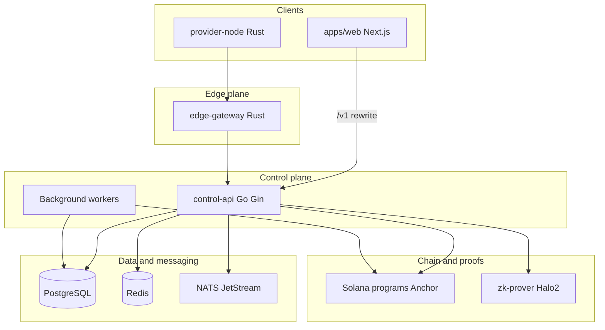
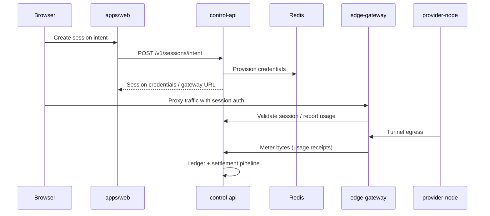
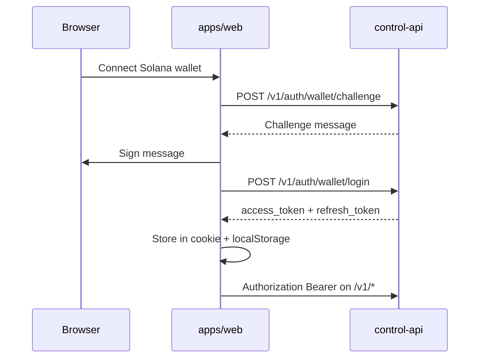

# ProxyHubb — Full System Analysis Report

**Document version:** 1.0  
**Generated:** 2026-05-29  
**Repository:** `F:/project/proxyhubb`  
**Scope:** Entire monorepo including current working-tree changes (wallet security migrations `000080`–`000082`, anomaly/GDPR workers, Paystack/relayer removal)

---

## Table of contents

1. [Executive summary](#1-executive-summary)
2. [System context and boundaries](#2-system-context-and-boundaries)
3. [Architecture overview](#3-architecture-overview)
4. [Component inventory](#4-component-inventory)
5. [Control API deep dive](#5-control-api-deep-dive)
6. [Background workers and async processing](#6-background-workers-and-async-processing)
7. [Data architecture](#7-data-architecture)
8. [Authentication, authorization, and security](#8-authentication-authorization-and-security)
9. [Wallet, treasury, and payments](#9-wallet-treasury-and-payments)
10. [Session, proxy, and marketplace flows](#10-session-proxy-and-marketplace-flows)
11. [Settlement, billing, and ZK](#11-settlement-billing-and-zk)
12. [Explorer and observability](#12-explorer-and-observability)
13. [Frontend architecture](#13-frontend-architecture)
14. [Deployment and environments](#14-deployment-and-environments)
15. [SDKs, protos, and integrations](#15-sdks-protos-and-integrations)
16. [In-flight changes (current branch)](#16-in-flight-changes-current-branch)
17. [Gaps, risks, and recommendations](#17-gaps-risks-and-recommendations)
18. [Appendices](#18-appendices)

---

## 1. Executive summary

**ProxyHubb** (also branded **ProxyHub** in API docs) is a **decentralized residential proxy marketplace**. Buyers purchase bandwidth through wallet-funded sessions; providers run software that tunnels traffic through an edge gateway; the control plane meters usage, maintains ledgers, and settles value on **Solana** with optional **ZK batch proofs** for settlement integrity.

### Product capabilities

| Capability | Description |
|------------|-------------|
| Marketplace | Listings, orders, smart matching, reviews, provider tiers |
| Proxy sessions | Session intents with geo/ISP targeting, rotation, bandwidth caps |
| Wallet | SOL-only custodial ledger, deposits, P2P transfer, SOL withdrawal |
| Provider ops | Node registration, CLI tokens, leases, earnings, circle pooling |
| Explorer | Public chain-style view of blocks, txs, nodes, contracts |
| Social / community | Feed, forum, messaging, friends, notifications |
| Governance | On-chain-linked proposals and voting |
| Trust / compliance | KYC hooks, trustless usage proofs, disputes, user security (MFA, API keys) |

### Primary user journeys

**Buyer:** Connect wallet → authenticate (`/v1/auth/wallet/*`) → fund wallet (crypto deposit verify) → create session intent or instant session → traffic via edge gateway → usage metered → wallet debited → settlement batched → optional on-chain commit.

**Provider:** Apply/onboard → register gateway node → issue provider token → run `provider-node` CLI against edge gateway → earn from usage → batch SOL payouts via oracle.

### Authoritative documentation

| Document | Path | Role |
|----------|------|------|
| Public HTTP API | [docs/openapi.yaml](openapi.yaml) | Contract of record for `/v1` |
| Wallet | [docs/WALLET_STATUS.md](WALLET_STATUS.md) | Phases and closure checklist |
| Wallet production checklist | [docs/WALLET_PRODUCTION_CLOSURE.md](WALLET_PRODUCTION_CLOSURE.md) | SOL-only verification and staging gate |
| Environment template | [.env.example](../.env.example) | Full-stack configuration |

There is **no root README**; onboarding relies on the above plus Docker Compose files.

---

## 2. System context and boundaries

### 2.1 In scope

| Area | Path |
|------|------|
| Web application | `apps/web/` |
| Backend services | `services/control-api/`, `edge-gateway/`, `provider-node/`, `zk-prover/`, `solana-programs/`, `admin-cli/` |
| Database migrations | `migrations/` (authoritative), `services/control-api/migrations/` (supplemental) |
| Infrastructure | `infra/` (K8s, Prometheus, Grafana, HAProxy, Consul) |
| Contracts / RPC | `proto/gateway.proto` |
| Client SDKs | `sdks/` |

### 2.2 Decommissioned or disabled

| Item | Status | Evidence |
|------|--------|----------|
| Ethereum relayer | **Decommissioned** | [services/relayer/main.go](../services/relayer/main.go) exits with error; Solana-only payouts |
| Paystack fiat | **Removed** | `internal/payments/paystack.go` deleted; wallet routes comment out fiat deposit/withdraw |
| Admin HTTP API | **Disabled (410)** | Middleware in [services/control-api/main.go](../services/control-api/main.go) blocks `/v1/admin/*` |
| Email/password auth | **Not active** | [docs/openapi.yaml](openapi.yaml): wallet-first auth only |

### 2.3 External dependencies

| Dependency | Usage |
|------------|--------|
| PostgreSQL 15/16 | Primary datastore (GORM) |
| Redis 7 | Sessions, rate limits, config cache, circuit breaker state, gateway provisioning |
| NATS JetStream | Telemetry, leader election fallback, event consumers (optional) |
| Solana RPC/WS | Escrow, payouts, explorer indexer, IDL validation |
| ip-api.com | GeoIP resolution ([internal/geoip/resolver.go](../services/control-api/internal/geoip/resolver.go)) |
| Pinata / IPFS | Proof and governance artifact storage |
| zk-prover (HTTP) | Halo2 batch digest proofs |
| CoinGecko / Binance / CMC | SOL/USD price feeds |
| Slack / SMTP / PagerDuty | Operational alerts |

Legacy **Supabase** schema remains in migration `000001_init_supabase.up.sql` (`auth.users`); runtime auth is **self-hosted JWT**, not Supabase Auth.

---

## 3. Architecture overview

### 3.1 Logical architecture

### 3.2 Request path (buyer proxy use)

### 3.3 Wallet authentication flow

Implementation: [apps/web/src/lib/auth.tsx](../apps/web/src/lib/auth.tsx), [services/control-api/internal/api/auth.go](../services/control-api/internal/api/auth.go).

### 3.4 Session intent lifecycle

States are defined in [services/control-api/internal/models/session_intent.go](../services/control-api/internal/models/session_intent.go):

| State | Meaning |
|-------|---------|
| `authorized` | Intent created, not yet routed |
| `routed` | Provider/gateway assignment in progress |
| `active` | Traffic allowed |
| `closing` | Tear-down in progress |
| `ledger_committed` | Off-chain ledger persisted |
| `batched` | Included in settlement batch |
| `chain_committed` | Batch root committed on-chain |
| `archived` | Terminal success |
| `expired` | Terminal timeout |

Gateway can push state/usage via [services/control-api/internal/api/gateway.go](../services/control-api/internal/api/gateway.go) (`POST /v1/gateway/session-intents/:id/state`, `.../usage`).

### 3.5 Settlement semantics (hybrid)

From [docs/openapi.yaml](openapi.yaml) description:

- **`ledger_committed`** — off-chain ledger state is durable in PostgreSQL.
- **`batched`** — usage aggregated into a settlement batch (ZK or batch escrow path).
- **`chain_committed`** — batch root recorded on Solana.
- Public testnet does **not** claim full on-chain proof verification for every batch.

Authority headers (`X-ProxyHubb-Authority-*`) distinguish chain-authoritative vs DB-authoritative responses at runtime.

---

## 4. Component inventory

| Component | Path | Runtime | Primary role |
|-----------|------|---------|--------------|
| Web app | `apps/web/` | Next.js 16, dev port **4011** | UI: marketplace, dashboard, explorer, governance, settings |
| Control API | `services/control-api/` | Go (module **1.25**), port **8080** | REST API, workers, Solana oracle, billing |
| Edge gateway | `services/edge-gateway/` | Rust (Tokio/Hyper) | HTTP(S) proxy, session auth, metering |
| Provider node | `services/provider-node/` | Rust CLI | Provider-side tunnel client |
| ZK prover | `services/zk-prover/` | Rust Axum, port **8095** | Halo2 batch proofs |
| Solana programs | `services/solana-programs/proxyhub/` | Anchor | On-chain escrow/treasury |
| Admin CLI | `services/admin-cli/` | Rust | Ops: seed, cleanup, verify flows |
| Relayer | `services/relayer/` | Go (stub) | **Decommissioned** |
| SDKs | `sdks/go`, `sdks/node`, `sdks/python`, etc. | — | API client libraries |

---

## 5. Control API deep dive

### 5.1 Startup sequence

Entry: [services/control-api/main.go](../services/control-api/main.go)

| Phase | Action |
|-------|--------|
| Config | `godotenv` → `config.Load()` → `alerts.Init()` |
| Database | `db.Init`, `db.SeedAll`, optional `MIGRATE_ONLY` exit |
| Security hooks | Credential encryption on `Session`; HMAC for provider tokens (`TOKEN_HMAC_SECRET`) |
| Credential gate | Blocks startup if plaintext session credentials exist (unless `SKIP_CREDENTIAL_CHECK`) |
| Infra | Redis, `ConfigManager`, NATS, OpenTelemetry |
| Solana | RPC endpoints, oracle client, watcher, escrow listener, treasury |
| HTTP | Gin router, middleware stack, route registration |
| Background | Indexers, billing workers, ZK worker, `worker.StartAll`, tier evaluator, heartbeat monitor |
| Listen | `PORT` default `8080` |

Migrations run via explicit SQL when `AUTO_MIGRATE=true` or `db-migrate` init container — **not** GORM AutoMigrate in production ([internal/db/migrate.go](../services/control-api/internal/db/migrate.go)).

### 5.2 Middleware order (after `/health`)

1. `EmergencyBreaker` — blocks mutating methods when `system.emergency_pause=true`
2. `TracingMiddleware` — OpenTelemetry
3. `WAFMiddleware` + `DDoSProtectionMiddleware`
4. `secure` headers (HSTS, CSP, frame deny, etc.)
5. `MetricsMiddleware`
6. Circuit breakers: `database`, `redis`, `solana`
7. Admin disable middleware — **410** for `/v1/admin/*`

### 5.3 Route registration model

| Group | Middleware | Registered in `main.go` |
|-------|------------|-------------------------|
| `/v1` | `SupabaseAuthMiddlewareOptional` | Public + mixed-auth routes |
| `/v1` + `/` | `RequireAuth()` | Protected routes |
| `/metrics`, `/health` | Various | Infra |

**Public / optional-auth (`/v1`):** health, monitoring, auth, listings, milestones, usage reviews, circle pool (partial), feed, profiles, public reviews, system, KYC, reputation, explorer (+ WS), SDK examples, gateway node registration.

**Protected (`RequireAuth`):** provider nodes/tokens/leases/earnings, sessions, wallet, orders, escrow, usage, staking, matching, governance, onboarding, circles, referrals, subscriptions, linked wallets, forum, messaging, friends, notifications, showcase, websocket, reviews, agents, analytics/geo, provider services, discovery, trustless, dispute jury, security, API keys, audit, state channels, Solana HTTP (`/v1/solana/*`), session SSE stream, bulk proxy, provider tiers.

**Public outside `RequireAuth` group (still under `/v1`):** provider CLI auth, gateway token exchange, CLI distribution downloads.

### 5.4 Routes defined but not mounted

These registrars exist in code but are **not** called from `main.go`:

| Registrar | File | Would expose |
|-----------|------|--------------|
| `RegisterCryptoRoutes` | [internal/api/crypto.go](../services/control-api/internal/api/crypto.go) | `/v1/crypto/deposit/verify`, batch-settle, emergency-pause, treasury, multisig-status, settlement-telemetry |
| `RegisterGDPRRoutes` | [internal/api/gdpr.go](../services/control-api/internal/api/gdpr.go) | `GET /v1/gdpr/export`, `DELETE /v1/gdpr/delete-account` |

**Note:** Wallet handlers include `POST /wallet/deposit/crypto` (mounted). Crypto treasury/admin routes under `/crypto/*` are separate and unmounted.

**Admin route registrars** (`RegisterAdminRoutes`, `RegisterAdminExtendedRoutes`, etc.) exist but are blocked by the 410 middleware regardless.

### 5.5 Solana HTTP routes (mounted)

Under protected group via [internal/solana/handlers.go](../services/control-api/internal/solana/handlers.go):

- `GET /v1/solana/health`
- `GET /v1/solana/escrow/:buyer/:seller`
- `POST /v1/solana/escrow/settle`

---

## 6. Background workers and async processing

Workers use supervised goroutines ([internal/worker/supervisor.go](../services/control-api/internal/worker/supervisor.go): `GoSupervised`, `RunSafely`.

### 6.1 Started from `main.go`

| Worker | Package | Purpose |
|--------|---------|---------|
| Chain indexer | `internal/indexer` | Generic chain indexing |
| Blockchain explorer indexer | `internal/indexer` | Blocks/txs for program ID; WS callbacks to explorer hub |
| Node sync | `internal/indexer` | Explorer node metadata + GeoIP |
| Governance proposal worker | `internal/governance` | Execute due proposals |
| Billing settlement | `internal/billing` | Session billing settlement loop |
| Payout retry | `internal/billing` | Retry failed provider payouts |
| Price feed updater | `internal/pricing` | SOL/USD every 5 minutes |
| Ledger reconciliation | `internal/treasury` | Daily reconciliation |
| Anomaly detector | `internal/worker` | Wallet anomaly → `user_flags` (**WIP**) |
| Liquidity manager | `internal/treasury` | Treasury rebalance hourly |
| Escrow cleaner | `internal/worker` | Stale escrow cleanup |
| Ghost prober / watchtower | `internal/treasury` | Treasury health probing |
| Settlement aggregator | `internal/worker` | Batch settlement hourly |
| ZK settlement worker | `internal/worker` | Async ZK proof processing |
| Settlement coordinator | `internal/worker` | Usage receipts → settlement manifests |
| Marketplace watcher | `internal/worker` | Marketplace telemetry |
| Provisioning worker | `internal/worker` | Session provisioning via Redis gateway |
| Registry sync | `internal/indexer` | On-chain registry sync |
| Agent worker | `internal/worker` | AI agent task execution |
| Tier evaluator | `internal/worker` | Provider tier updates |
| Heartbeat monitor | `internal/worker` | Node offline after 5m |
| Settlement telemetry alerts | `internal/monitoring` | Alert on settlement metrics |
| GeoIP backfill | `internal/worker` | Resolve lat/lon for explorer nodes |

Also started earlier in `main.go` (pre-router): treasury auto-topup, usage milestones, leaderboard MV refresh, Solana watcher/activator, escrow listener.

### 6.2 `worker.StartAll` ([internal/worker/worker.go](../services/control-api/internal/worker/worker.go))

| Worker | Purpose |
|--------|---------|
| Event consumers | `user.loggedin`, `bandwidth.consumed` (if NATS queue provided — currently `nil`) |
| Session reaper | DB/Redis session consistency |
| Telemetry worker | Usage telemetry |
| Pricing evaluator | Dynamic proxy pricing |
| GDPR deletion worker | Purge accounts past `scheduled_deletion_at` (**WIP**) |

---

## 7. Data architecture

### 7.1 Migration strategy

| Location | Role |
|----------|------|
| `migrations/*.up.sql` | **Authoritative** — applied by CI `db-migrate` job and Docker `db-migrate` service |
| `services/control-api/migrations/` | Supplemental (e.g. L2 ZK batch) — risk of drift if not synced |

Tracking table: `schema_migrations(version, applied_at)`.

### 7.2 ORM models

Package: [services/control-api/internal/models/](../services/control-api/internal/models/) (~60 files).

| Domain | Representative models |
|--------|----------------------|
| Identity | `user.go`, `profile.go`, `user_flag.go`, `refresh_token_family.go` |
| Wallet | `wallet.go`, `transaction.go`, `spending_limit.go` |
| Sessions | `session.go`, `session_intent.go`, `session_config.go`, `session_metrics.go` |
| Marketplace | `listing.go`, `order.go`, `node.go`, `provider_token.go`, `provider_earnings.go` |
| Escrow / disputes | `escrow.go`, `dispute.go`, `dispute_jury.go` |
| Settlement | `zk_batch.go`, usage receipt tables via migrations |
| Explorer | `explorer.go`, `blockchain.go` |
| Social | `feed.go`, `friend.go`, `messaging.go`, `forum.go`, `review.go` |
| Security | `user_security.go`, `totp.go`, `api_key.go`, `audit.go` |

Repositories under `internal/db/` (e.g. marketplace, session).

### 7.3 Migration domain map (numbered)

| Range / files | Domain |
|---------------|--------|
| `000001`–`000002` | Supabase auth baseline, consensus |
| `000003`–`000003f` | Wallets, marketplace core, subscriptions, system config |
| `000004`–`000013` | Indexes, audit partitioning, soft-delete sessions |
| `000005`, `000030`, `000033` | Provider tiers, earnings, token FKs |
| `000006`–`000008` | Social, forum seed, reports |
| `000011`–`000012` | Audit partitions, payout retry |
| `000027`, `000028`, `000042`, `000048`, `000058`, `000080` | Wallet SOL-only, limits, constraints, withdrawal security |
| `000029`, `000045` | Batch payouts, earnings uniqueness |
| `000031`, `000046`, `000043` | Disputes, escrow indexes |
| `000036`, `000069`–`000070` | Listing search, tier compat |
| `000039`–`000068` | Explorer geo, indexes, contracts, attestations |
| `000049` | Reconciliation history |
| `000053`, `000074`–`000078` | Usage records, session intent ledger, billing snapshot, state machine timestamps, usage receipts, settlement manifests |
| `000054`, `000057`, `000071` | Social follows, reviews, referrals |
| `000061` | Dynamic pricing |
| `000062`–`000063` | KYC |
| `000065`–`000066`, `000072`, `000081` | Provider applications, security modernization, refresh families, user flags |
| `000073`–`000076` | Session intents table and lifecycle |
| `000082` | Explorer numeric column widening |
| Dated `202603*` | Ad-hoc session/provider patches |

Full per-file index: [Appendix C](#appendix-c-migration-index-000001000082).

### 7.4 WIP migrations (current branch)

**`000080_withdrawal_security`** — adds to `wallets`:

- `withdrawal_whitelist` (JSONB, default `[]`)
- `primary_withdrawal_address` (VARCHAR 44)
- `withdrawal_address_changed_at` (TIMESTAMPTZ)

**`000081_user_flags`** — new table `user_flags` (`flag_type`, `reason`, `resolved`, indexed by `user_id`).

**`000082_widen_explorer_numeric_columns`** — `explorer_transactions.amount` and `.fee` → `NUMERIC` (overflow prevention).

---

## 8. Authentication, authorization, and security

### 8.1 Wallet-first JWT

- Challenge/login: `POST /v1/auth/wallet/challenge`, `POST /v1/auth/wallet/login`
- Refresh: `POST /v1/auth/refresh`
- Profile: `GET /v1/auth/me`
- Middleware: [internal/middleware/supabase.go](../services/control-api/internal/middleware/supabase.go) — validates JWT via `internal/crypto`; name is historical

### 8.2 Provider and gateway auth

- Provider CLI: `POST /v1/provider/auth` (HMAC-hashed tokens)
- Gateway JWT: `POST /v1/provider/gateway-token`
- Gateway node routes: registration/heartbeat under `/v1/gateway/nodes/*`

### 8.3 User security (protected)

[internal/api/user_security.go](../services/control-api/internal/api/user_security.go):

- MFA setup/verify/disable under `/v1/security/mfa/*` and `/v1/2fa/*`
- Session management: list/revoke login sessions
- Security settings and login attempt history

### 8.4 Session credential protection

- AES-GCM encryption for proxy session credentials (`ENCRYPTION_KEY`)
- Startup refuses to run if short plaintext credentials remain
- One-time `MIGRATE_CREDENTIALS=true` job for legacy rows

### 8.5 Oracle and payout controls

- `VelocityGuard` on Solana oracle — per-tx and hourly outflow caps; `ORACLE_TRANSFER_FREEZE`
- Multi-sig path for payouts ≥ 1 SOL when configured
- Spending limits per trust tier ([.env.example](../.env.example))

### 8.6 Anomaly detection (WIP)

[internal/worker/anomaly_detector.go](../services/control-api/internal/worker/anomaly_detector.go) scans recent `WalletLedgerEntry` rows every 5 minutes; rules include withdrawal frequency, large P2P, usage spikes; creates `UserFlag` records and sends alerts.

---

## 9. Wallet, treasury, and payments

### 9.1 SOL-only direction

- Migration `000027` and wallet API comments: fiat/Paystack paths removed
- Active wallet routes ([internal/api/wallet.go](../services/control-api/internal/api/wallet.go)):
  - `GET /wallet`, `GET/PUT /wallet/limits`
  - `POST /wallet/transfer` (rate limited 5/min)
  - `POST /wallet/deposit/crypto`
  - `POST /wallet/withdraw/sol` (rate limited 5/min)
  - `POST/DELETE /wallet/link`

### 9.2 Treasury

- `TreasuryManager` — monitoring, auto-topup, outgoing transfer recording
- Daily reconciliation worker
- Ghost prober / watchtower for liquidity health

### 9.3 Provider payouts

- `billing.SetSOLTransferFunc` wired to oracle `SendSOL`
- Batch processor for gas-efficient multi-recipient payouts
- Payout retry queue (migration `000012`)

For wallet hardening status, see [WALLET_PRODUCTION_CLOSURE.md](WALLET_PRODUCTION_CLOSURE.md) and [WALLET_STATUS.md](WALLET_STATUS.md).

**Consistency note:** `POST /wallet/deposit/crypto` is mounted under `RegisterWalletRoutes`. Separate `RegisterCryptoRoutes` (`/crypto/*` for batch-settle, treasury admin, settlement telemetry) remains **unmounted** in `main.go`. GDPR account export/delete routes are unmounted, but scheduled deletion is handled by `StartGDPRDeletionWorker` when users have `scheduled_deletion_at` set (likely via a future or internal code path).

---

## 10. Session, proxy, and marketplace flows

### 10.1 Session API

[internal/api/session.go](../services/control-api/internal/api/session.go):

- Legacy sessions: list, get, terminate, instant, from-listing
- Session intents: `POST /sessions/intent`, list/get intents
- Stream: SSE via `session_stream.go`

### 10.2 Provisioning

`ProvisioningWorker` writes session credentials to Redis for edge gateway pickup ([internal/gateway](../services/control-api/internal/gateway/), [internal/worker/provision_worker.go](../services/control-api/internal/worker/provision_worker.go)).

### 10.3 Edge gateway

Rust service ([services/edge-gateway/src/main.rs](../services/edge-gateway/src/main.rs)): modules include `auth`, `billing`, `metering`, `control_api`, `security`, `registry`. Exposes management port (e.g. 8090) and proxy port (e.g. 3128 in compose).

gRPC contract with control plane: [proto/gateway.proto](../proto/gateway.proto) — `ValidateProviderToken`, streaming `ReportUsage`.

### 10.4 Provider node

CLI ([services/provider-node/src/main.rs](../services/provider-node/src/main.rs)): `register`, `start`, `metrics`, `stop`. Connects to gateway addresses from `PROXYHUB_GATEWAY_ADDRS`.

### 10.5 Marketplace

- Listings CRUD/search: `listings.go`, `listing_social.go`
- Orders: `orders.go`
- Smart matching: `matching.go`
- Escrow/disputes: `escrow.go`, `disputes.go`, `dispute_jury.go`
- Hexagonal marketplace service: `internal/core/services` + repository in `main.go`

---

## 11. Settlement, billing, and ZK

### 11.1 Data model progression

| Migration | Adds |
|-----------|------|
| `000074` | Usage counters on `session_intents` |
| `000075` | Billing snapshot columns |
| `000076` | State machine timestamps |
| `000077` | `usage_receipts` |
| `000078` | `settlement_manifests` + FK from receipts |

### 11.2 Pipeline

1. Edge/gateway reports usage → API persists receipts
2. **Settlement coordinator** aggregates receipts into manifests per time window
3. **Settlement aggregator** / billing worker batches financial settlement
4. **ZK settlement worker** requests proofs from `zk-prover` ([services/zk-prover/](../services/zk-prover/))
5. Optional on-chain commit via Solana program / oracle

### 11.3 ZK prover service

HTTP API (default port 8095): health + `POST` batch prove (Halo2). Integrated via [internal/billing/zk_aggregator.go](../services/control-api/internal/billing/zk_aggregator.go).

### 11.4 Testnet limitations

Operators should treat `chain_committed` as **best-effort** on public testnet; full proof verification for every batch is not claimed ([openapi.yaml](openapi.yaml)).

---

## 12. Explorer and observability

### 12.1 Explorer API

Public under `/v1/explorer/*` ([internal/api/explorer.go](../services/control-api/internal/api/explorer.go)): metrics, blocks, transactions, wallets, nodes (with geo rate limit), contracts, bandwidth, network health, decentralization status, leaderboard, sessions, earnings.

WebSocket hub: [internal/api/explorer_ws.go](../services/control-api/internal/api/explorer_ws.go) for live block/tx/node updates.

### 12.2 Indexers

- `BlockchainIndexer` polls Solana for program transactions
- `NodeSync` enriches node records; GeoIP worker backfills coordinates

### 12.3 Metrics and tracing

- `GET /metrics`, `GET /metrics/json`, `GET /metrics/circuit-breakers`
- Prometheus + Grafana in `infra/` and compose files
- OpenTelemetry: Jaeger/OTLP env configuration in `main.go`

---

## 13. Frontend architecture

### 13.1 Stack

- **Next.js 16** App Router, **React 19**, **TypeScript**, **Tailwind CSS 4**
- State: TanStack Query, Zustand
- Wallets: Solana wallet adapters; optional EVM (wagmi/RainbowKit)

### 13.2 API integration

| Layer | Path | Pattern |
|-------|------|---------|
| Typed API modules | `apps/web/src/lib/api/` | `apiGet`/`apiPost`, `API_BASE_URL = ''` |
| Service layer | `apps/web/src/lib/services/` | Domain wrappers (wallet, security, explorer, …) |
| Auth | `apps/web/src/lib/auth.tsx` | `fetchWithAuth`, tokens in cookie + localStorage |

**Rewrites:** [apps/web/next.config.ts](../apps/web/next.config.ts) proxies `/v1/*` → `API_URL` (server-only; fallback `http://localhost:18080`). The control API listens on `PORT` default **8080** — align `API_URL` with your compose host port mapping (e.g. `http://control-api:8080` in Docker, or a published host port).

### 13.3 Route surface (~75 pages)

| Area | Examples |
|------|----------|
| Marketing / auth | `/`, `/login`, `/register` |
| Dashboard | `/dashboard/*` — wallet, sessions, usage, agents, security, admin |
| Provider | `/dashboard/provider/*` — nodes, earnings, CLI, circle |
| Marketplace | `/marketplace`, `/marketplace/create`, agents |
| Explorer | `/explorer/*` — map, blocks, txs, nodes, wallets, contracts |
| Community | `/community/feed`, `/community/forum/*`, `/community/messages` |
| Governance | `/governance`, `/governance/create`, `/governance/[id]` |
| Settings | `/settings`, `/dashboard/settings/*` |

### 13.4 Security UI

- `src/components/security/AnomaliesPanel.tsx`, `LoginHistoryPanel.tsx`
- Pages: `dashboard/security`, `dashboard/settings/security`, `settings/page.tsx` (WIP integration)

---

## 14. Deployment and environments

### 14.1 Docker Compose profiles

| File | Typical use |
|------|-------------|
| [docker-compose.yml](../docker-compose.yml) | Default stack |
| [docker-compose.dev.yml](../docker-compose.dev.yml) | Full dev: migrate, API, web, postgres, redis, nats, edge-gateway, zk-prover, prometheus, grafana |
| [docker-compose.full.yml](../docker-compose.full.yml) | Production-like all services |
| [docker-compose.minimal.yml](../docker-compose.minimal.yml) | API + redis (+ external DB) |
| [docker-compose.secure.yml](../docker-compose.secure.yml) | Hardened images, dropped caps |
| [docker-compose.prod.yml](../docker-compose.prod.yml) | Production tags |
| [docker-compose.mesh.yml](../docker-compose.mesh.yml) | Consul service mesh |

`db-migrate` init container: `MIGRATE_ONLY=true`, applies `migrations/`.

### 14.2 Kubernetes

Manifests under [infra/k8s/](../infra/k8s/): control-api, edge-gateway, postgres, redis, pgbouncer, HPA, ingress, HAProxy.

**Gap:** [.github/workflows/deploy.yml](../.github/workflows/deploy.yml) references `infra/k8s/overlays/staging` and `production` (kustomize) — overlays may be absent from the tree.

### 14.3 CI/CD

| Workflow | Purpose |
|----------|---------|
| [.github/workflows/ci.yml](../.github/workflows/ci.yml) | Go vet/test, web lint/build, Rust edge-gateway, Anchor, docker build, **db-migrate** on all `migrations/*.up.sql` |
| [.github/workflows/deploy.yml](../.github/workflows/deploy.yml) | GHCR images, EKS deploy, Vercel web |
| [.github/workflows/security.yml](../.github/workflows/security.yml) | govulncheck, gosec, npm audit, Trivy, cargo audit |

**CI gaps:** `contracts-check` job expects `packages/contracts/` (missing); Go **1.24** in CI vs **1.25** in `go.mod`.

### 14.4 Images

GHCR: `ghcr.io/proxyhubb/{control-api,edge-gateway,web}`.

---

## 15. SDKs, protos, and integrations

| Asset | Path | Notes |
|-------|------|-------|
| OpenAPI 3.1 | [docs/openapi.yaml](openapi.yaml) | Authoritative HTTP contract |
| gRPC proto | [proto/gateway.proto](../proto/gateway.proto) | Edge ↔ control plane usage validation |
| Go SDK | `sdks/go/` | |
| Node SDK | `sdks/node/`, `sdks/nodejs/` | |
| Python SDK | `sdks/python/` | |
| Legacy Swagger | `services/control-api/docs/` | Marked non-authoritative |

---

## 16. In-flight changes (current branch)

Based on git status and code review at report time:

### 16.1 New migrations (untracked / new)

| Migration | Purpose |
|-----------|---------|
| `000080_withdrawal_security` | Withdrawal whitelist + primary address + change timestamp on `wallets` |
| `000081_user_flags` | Security/fraud flags per user |
| `000082_widen_explorer_numeric_columns` | Fix numeric overflow on explorer tx amounts/fees |

### 16.2 Backend changes

| Area | Files |
|------|-------|
| Wallet API | `internal/api/wallet.go`, `wallet_test.go` |
| Crypto | `internal/api/crypto.go`, `crypto_test.go` |
| Security | `internal/api/user_security.go`, `middleware/security.go` |
| Models | `wallet.go`, `user_flag.go`, `user.go`, `profile.go`, `explorer.go` |
| Workers | `anomaly_detector.go` (new), `deletion_worker.go` (new), `escrow_listener.go`, `worker.go` |
| Treasury | `reconciliation.go` |
| Solana | `verify.go` |
| GeoIP | `resolver.go` |
| GDPR API | `gdpr.go` (routes still unmounted) |
| Main | `main.go` — wires anomaly detector |

### 16.3 Removals

| Item | Change |
|------|--------|
| Paystack | `internal/payments/paystack.go` deleted |
| Relayer payout | `services/relayer/workers/payout.go` deleted |
| Relayer service | Stub only — exits on start |

### 16.4 Frontend

- `apps/web/src/app/settings/page.tsx`
- `apps/web/src/lib/services/profile.ts`, `security.ts`
- Settings/security UX aligned with new API fields

### 16.5 Docker Compose

- `docker-compose.dev.yml`, `docker-compose.full.yml`, `docker-compose.minimal.yml` — env/service wiring for Solana oracle and security-related vars

### 16.6 Documentation

- Existing: `WALLET_STATUS.md`, `WALLET_PRODUCTION_CLOSURE.md`
- **This report:** `SYSTEM_ANALYSIS_REPORT.md`

---

## 17. Gaps, risks, and recommendations

| ID | Gap / risk | Severity | Recommendation |
|----|------------|----------|----------------|
| G1 | No root README | Medium | Add `README.md` linking openapi, compose, and this report |
| G2 | `RegisterCryptoRoutes` / `RegisterGDPRRoutes` not mounted | High (GDPR) / Medium (crypto ops) | Mount under `RequireAuth()` or document intentional disable; wire GDPR deletion scheduling to API |
| G3 | Dual migration directories | Medium | Consolidate or automate sync from `services/control-api/migrations/` |
| G4 | `packages/contracts` missing but CI references it | Low | Remove job or restore package |
| G5 | Kustomize overlays missing for deploy workflow | Medium | Add overlays or fix deploy.yml paths |
| G6 | Go 1.24 vs 1.25 drift | Low | Align CI and `go.mod` |
| G7 | Admin route code vs 410 middleware | Low | Remove dead admin registrars or gate behind feature flag |
| G8 | `worker.StartAll(nil)` — event consumers inactive | Low | Wire NATS event queue or remove dead subscription code |
| G9 | Hybrid settlement testnet semantics | Medium | Document operator runbooks; tighten authority headers in UI |
| G10 | Paystack keys still in `.env.example` | Low | Mark deprecated; remove when templates updated |

---

## 18. Appendices

### Appendix A: Key environment variables (grouped)

Source: [.env.example](../.env.example)

| Group | Variables (representative) |
|-------|---------------------------|
| **Secrets** | `JWT_SECRET`, `GATEWAY_SHARED_SECRET`, `SESSION_SECRET`, `ENCRYPTION_KEY`, `ADMIN_JWT_SECRET`, `TOKEN_HMAC_SECRET` |
| **Alerts** | `SLACK_ALERT_WEBHOOK_URL`, `ALERT_ADMIN_EMAILS`, `PAGERDUTY_ROUTING_KEY`, SMTP_* |
| **Database** | `DATABASE_URL`, `READ_REPLICA_URL`, `POSTGRES_*`, `AUTO_MIGRATE`, `FORCE_MIGRATE`, `DB_LOG_LEVEL` |
| **Redis** | `REDIS_URL`, `REDIS_PASSWORD` |
| **Supabase (legacy)** | `SUPABASE_*`, `NEXT_PUBLIC_SUPABASE_*` — optional; local Postgres default |
| **Solana** | `SOLANA_RPC_ENDPOINT(S)`, `SOLANA_WS_ENDPOINT`, `SOLANA_PROGRAM_ID`, `SOLANA_TREASURY_ADDRESS`, `ORACLE_*`, `ORACLE_MAX_*`, `ORACLE_TRANSFER_FREEZE`, `FULL_DECENTRALIZATION` |
| **Pricing** | `COINGECKO_API_KEY`, `EMERGENCY_SOL_PRICE_USD`, `COINMARKETCAP_API_KEY` |
| **Edge** | `EDGE_GATEWAY_PORT`, `SESSION_CACHE_*`, `NATS_URL`, `PROXYHUB_GATEWAY_ADDRS`, `GATEWAY_PUBLIC_URL` |
| **Web / CORS** | `APP_ENV`, `GIN_MODE`, `PORT`, `API_BASE_URL`, `FRONTEND_URL`, `CORS_ORIGINS`, `WS_PUBLIC_URL`, `APP_URL` |
| **Monitoring** | `GRAFANA_ADMIN_PASSWORD` |
| **Explorer indexer** | `EXPLORER_INDEXER_ENABLED`, `EXPLORER_INDEXER_POLL_INTERVAL_MS`, `EXPLORER_INDEXER_WRITER_ID`, signing keys |
| **Admin accounts** | `ADMIN_ACCOUNT_*` (username, password, role, TOTP) |
| **Dev only** | `DEV_LOGIN_SECRET`, `SKIP_CREDENTIAL_CHECK`, `MIGRATE_CREDENTIALS` |

Web-specific: `API_URL` / `NEXT_PUBLIC_*` in [apps/web/next.config.ts](../apps/web/next.config.ts) and Vercel deploy env.

### Appendix B: API route index (mounted registrars)

All paths prefixed with `/v1` unless noted. Auth: **O** = optional JWT, **R** = required JWT, **P** = public (no JWT).

| Registrar | Auth | Prefix / notes |
|-----------|------|----------------|
| `RegisterHealthRoutes` | O | `/health/*` |
| `RegisterMonitoringRoutes` | O | monitoring/NATS stats |
| `RegisterAuthRoutes` | O/P | `/auth/wallet/*`, `/auth/refresh`, `/auth/me` |
| `RegisterListingRoutes` | O/R mix | `/listings/*` |
| `RegisterListingSocialRoutes` | O/R | listing social |
| `RegisterMilestoneRoutes` | O | milestones |
| `RegisterUsageReviewRoutes` | O | usage reviews |
| `RegisterCirclePoolRoutes` | O/R | `/circles/:id/pool/*` |
| `RegisterFeedRoutes` | O/R | `/feed/*` |
| `RegisterProfileRoutes` | O/R | `/profile`, `/users/*` |
| `RegisterPublicReviewRoutes` | O | public reviews |
| `RegisterSystemRoutes` | O | system config/flags |
| `RegisterKYCRoutes` | O | `/kyc/*` |
| `RegisterReputationRoutes` | O | ZK reputation |
| `RegisterExplorerRoutes` | O | `/explorer/*` |
| `RegisterExplorerWSRoutes` | O | explorer WebSocket |
| `RegisterSDKRoutes` | O | SDK examples |
| `RegisterGatewayRoutes` | O | `/gateway/nodes/*`, session-intent updates |
| `RegisterProviderAuthRoute` | P | `/provider/auth` |
| `RegisterGatewayTokenRoute` | P | `/provider/gateway-token` |
| `RegisterCLIDistributionRoutes` | P | CLI artifacts |
| `RegisterProviderNodeRoutes` | R | provider nodes |
| `RegisterProviderTokenRoutes` | R | provider tokens |
| `RegisterProviderLeaseRoutes` | R | `/provider/lease` |
| `RegisterProviderEarningsRoutes` | R | earnings |
| `RegisterDisputeRoutes` | R | disputes |
| `RegisterSessionRoutes` | R | `/sessions/*`, intents |
| `RegisterWalletRoutes` | R | `/wallet/*` |
| `RegisterOrderRoutes` | R | orders |
| `RegisterEscrowRoutes` | R | `/escrow/*` |
| `RegisterUsageRoutes` | R | `/usage/*` |
| `RegisterStakingRoutes` | R | `/staking/*` |
| `RegisterSmartMatchingRoutes` | R | matching |
| `RegisterGovernanceRoutes` | R | `/governance/*` |
| `RegisterOnboardingRoutes` | R | `/provider/apply`, status |
| `RegisterCircleRoutes` | R | circles |
| `RegisterReferralRoutes` | R | `/referral/*` |
| `RegisterSubscriptionRoutes` | R | `/subscriptions/*` |
| `RegisterLinkedWalletRoutes` | R | linked wallets |
| `RegisterForumRoutes` | R | forum |
| `RegisterMessagingRoutes` | R | messaging |
| `RegisterFriendRoutes` | R | friends |
| `RegisterNotificationRoutes` | R | notifications |
| `RegisterShowcaseRoutes` | R | showcase |
| `RegisterWebSocketRoutes` | R | websocket |
| `RegisterProtectedReviewRoutes` | R | reviews |
| `RegisterAgentRoutes` | R | agents |
| `RegisterAgentRegistryRoutes` | R | agent registry |
| `RegisterAnalyticsRoutes` | R | `/analytics/*` |
| `RegisterGeoRoutes` | R | `/geo/*` |
| `RegisterProviderServicesRoutes` | R | provider services |
| `RegisterServiceDiscoveryRoutes` | R | discovery |
| `RegisterTrustlessRoutes` | R | trustless proofs |
| `RegisterDisputeJuryRoutes` | R | dispute jury |
| `RegisterSecurityRoutes` | R | `/security/*`, `/2fa/*` |
| `RegisterAPIKeyRoutes` | R | API keys |
| `RegisterAuditRoutes` | R | audit |
| `RegisterChannelRoutes` | R | state channels |
| `solana.RegisterRoutes` | R | `/solana/health`, `/solana/escrow/*` |
| `RegisterSessionStreamRoutes` | R | session SSE |
| `RegisterBulkRoutes` | R | bulk proxy |
| `RegisterTierRoutes` | R | provider tiers |

**Global (no `/v1`):** `GET /health`, `GET /metrics`, `GET /metrics/json`, `GET /metrics/circuit-breakers`.

**Blocked:** all `/v1/admin/*` → **410 Gone**.

**Not mounted:** `RegisterCryptoRoutes` (`/crypto/*`), `RegisterGDPRRoutes` (`/gdpr/*`), all `RegisterAdmin*` routes.

### Appendix C: Migration index (000001–000082)

| Version | File stem | Summary |
|---------|-----------|---------|
| 000001 | init_supabase | Profiles + auth.users baseline |
| 000002 | consensus_tables | Consensus metadata |
| 000003 | wallet_multi_currency | Wallet tables (later SOL-only) |
| 000003b | core_marketplace_tables | Listings, orders |
| 000003c | missing_supabase_tables | Supabase-compat tables |
| 000003d | nodes_sessions_extra_columns | Node/session columns |
| 000003e | subscription_plans | Subscription plans |
| 000003f | system_configurations | System config key-value |
| 000004 | performance_indexes | DB indexes |
| 000005 | provider_tiers | Provider tier system |
| 000006 | social_features | Social tables |
| 000007 | seed_forum_categories | Forum seed data |
| 000008 | forum_reports | Forum moderation |
| 000009 | admin_notes | Admin notes |
| 000010 | fix_admin_columns | Admin schema fix |
| 000011 | audit_log_partitioning | Partitioned audit logs |
| 000012 | payout_retry_queue | Payout retry queue |
| 000013 | soft_delete_sessions_nodes | Soft delete |
| 000027 | sol_only_currency | SOL-only wallet currency |
| 000028 | spending_limits | Spending limit columns |
| 000029 | batch_payouts | Batch payout tables |
| 000030 | provider_earnings | Provider earnings |
| 000031 | disputes | Dispute tables |
| 000032 | wallet_check_constraints | Wallet CHECK constraints |
| 000033 | provider_token_fk_constraints | Provider token FKs |
| 000034 | consolidated_baseline | Schema consolidation |
| 000035 | provider_leaderboard_mv | Leaderboard materialized view |
| 000036 | listing_fulltext_search | Full-text search on listings |
| 000037 | enable_pg_cron | pg_cron extension |
| 000038 | invalidate_legacy_provider_tokens | Token invalidation |
| 000039 | explorer_node_geo | Explorer geo fields |
| 000041 | explorer_indexes | Explorer indexes |
| 000042 | wallet_negative_balance_check | Prevent negative balance |
| 000043 | escrow_milestone_unique_index | Escrow uniqueness |
| 000044 | pending_tx_idempotency_key_unique | Idempotency |
| 000045 | provider_earnings_unique_session | Earnings uniqueness |
| 000046 | dispute_expires_at | Dispute expiry |
| 000047 | pending_tx_userid_uuid | UUID user id on pending tx |
| 000048 | wallet_limits_enabled | Limits enabled flag |
| 000049 | reconciliation_history | Treasury reconciliation history |
| 000050 | explorer_p3_fields | Explorer P3 fields |
| 000051 | free_tier_plan | Free subscription tier |
| 000052 | profiles_extra_columns_and_missing_tables | Profile extensions |
| 000053 | usage_records | Usage records |
| 000054 | social_follows_feed_events | Follows + feed events |
| 000055 | explorer_contracts | Contract registry |
| 000056 | blockchain_state_cache | Chain state cache |
| 000057 | reviews | Reviews |
| 000058 | widen_wallet_address | Wider wallet address column |
| 000059 | explorer_metrics | Explorer metrics |
| 000060 | fix_circle_schema | Circle schema fix |
| 000061 | dynamic_pricing | Dynamic pricing |
| 000062 | add_kyc_status | KYC status on users |
| 000063 | add_kyc_min_balance_config | KYC min balance config |
| 000064 | add_explorer_node_provider_fields | Explorer node provider linkage |
| 000065 | create_provider_applications | Provider application flow |
| 000066 | security_modernization | user_settings, api_keys, sessions |
| 000067 | explorer_block_attestations | Block attestations |
| 000068 | explorer_attestation_identity_fields | Attestation identity |
| 000069 | proxy_listings_uptime_percent_compat | Listing uptime compat |
| 000070 | proxy_listings_current_tier_compat | Tier compat |
| 000071 | referral_program_tables | Referrals |
| 000072 | refresh_token_families | Refresh token rotation |
| 000073 | session_intents | Session intents table |
| 000074 | session_intent_usage_ledger | Usage counters on intents |
| 000075 | session_intent_billing_snapshot | Billing snapshot |
| 000076 | session_intent_state_machine_timestamps | Lifecycle timestamps |
| 000077 | usage_receipts | Usage receipts |
| 000078 | settlement_manifests | Settlement manifests |
| 000079 | live_feature_schema_compat | Live feature compat |
| 000080 | withdrawal_security | **WIP** — withdrawal whitelist |
| 000081 | user_flags | **WIP** — user security flags |
| 000082 | widen_explorer_numeric_columns | **WIP** — explorer NUMERIC widen |
| 20260314 | sol_only_migration | Dated SOL migration |
| 20260315 | add_provider_tokens | Provider tokens |
| 20260319110000 | add_conversation_to_sessions | Session conversation id |

### Appendix D: References

| Title | Path |
|-------|------|
| OpenAPI 3.1 | [docs/openapi.yaml](openapi.yaml) |
| Wallet | [docs/WALLET_STATUS.md](WALLET_STATUS.md) |
| Wallet production closure | [docs/WALLET_PRODUCTION_CLOSURE.md](WALLET_PRODUCTION_CLOSURE.md) |
| Environment template | [.env.example](../.env.example) |
| Control API entry | [services/control-api/main.go](../services/control-api/main.go) |
| ZK prover README | [services/zk-prover/README.md](../services/zk-prover/README.md) |
| Relayer decommission notice | [services/relayer/main.go](../services/relayer/main.go) |

---

*End of report.*
