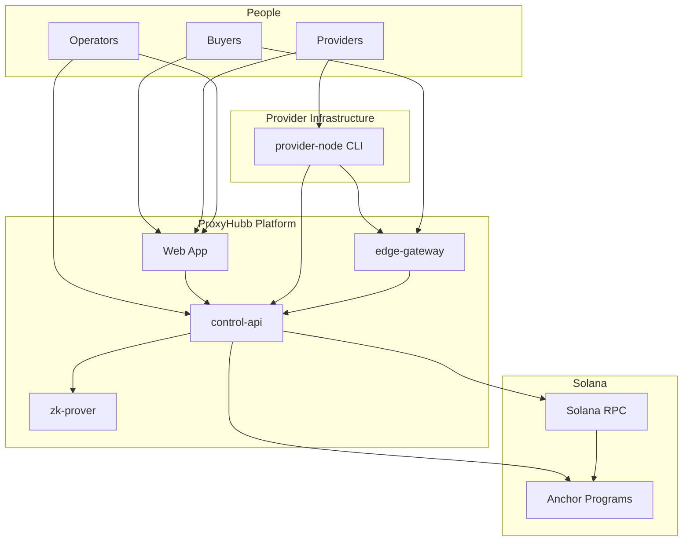
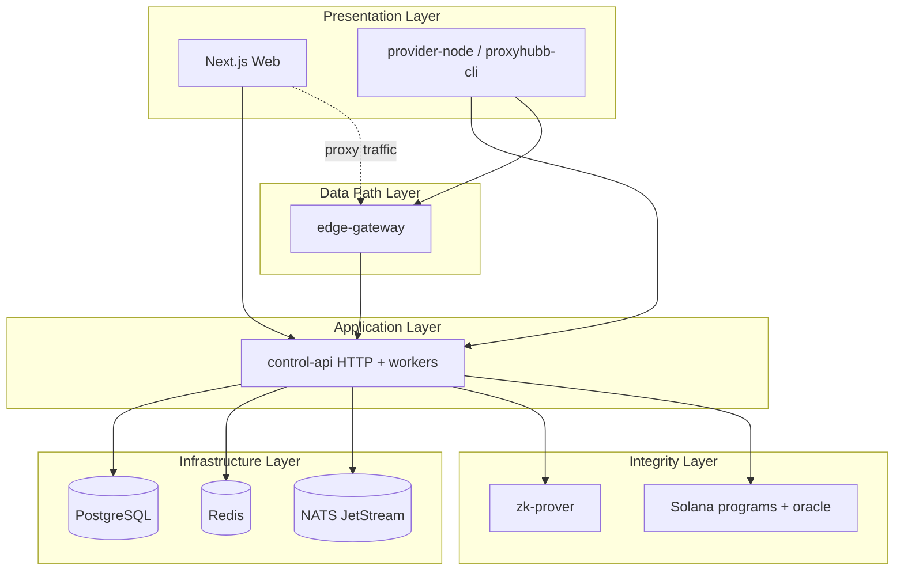
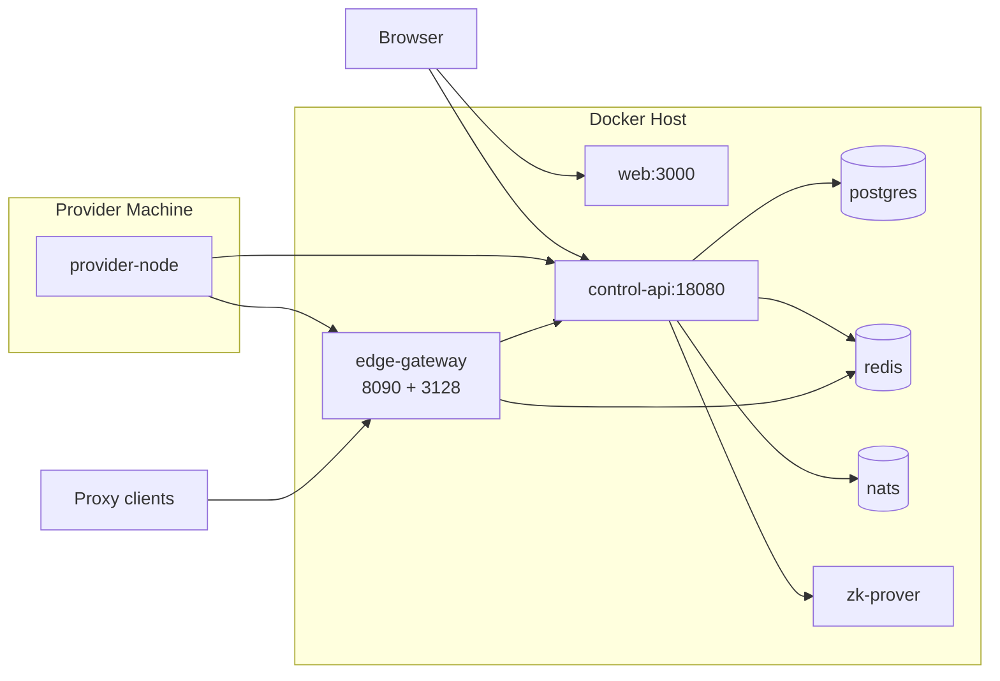
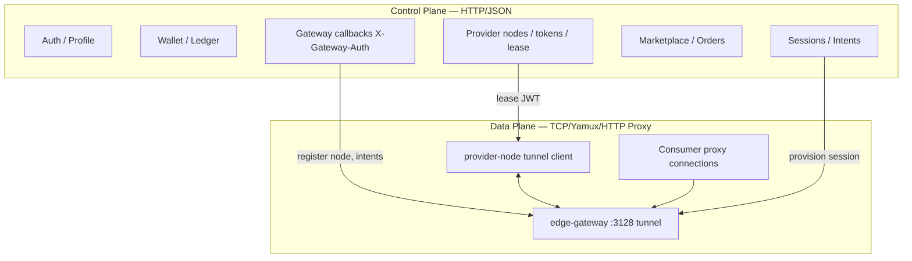
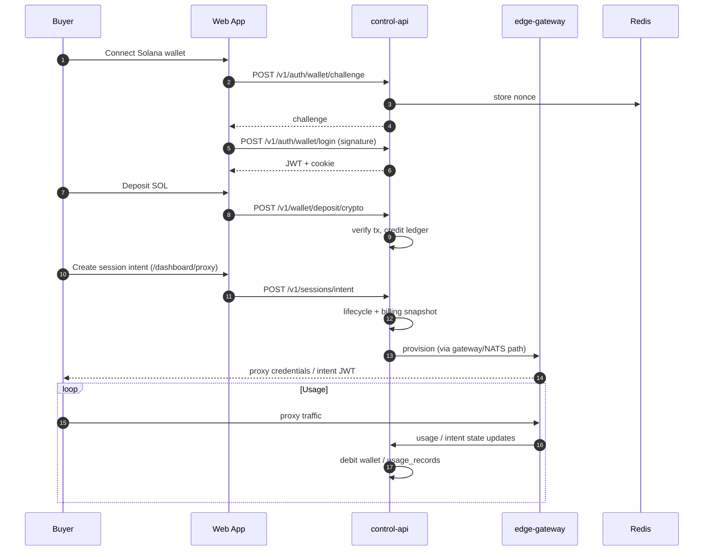
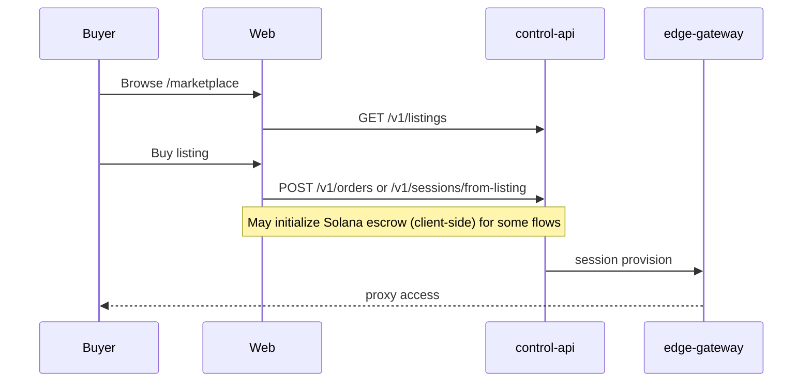
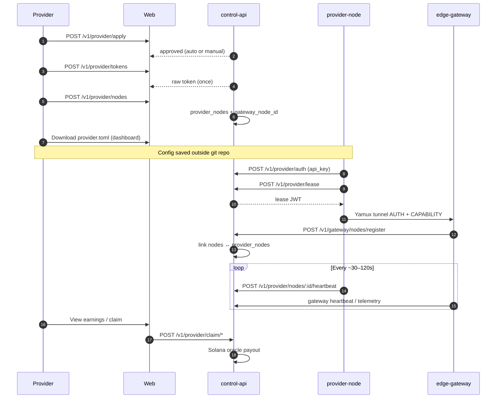
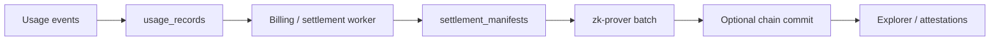
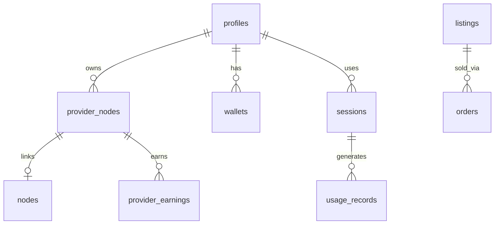
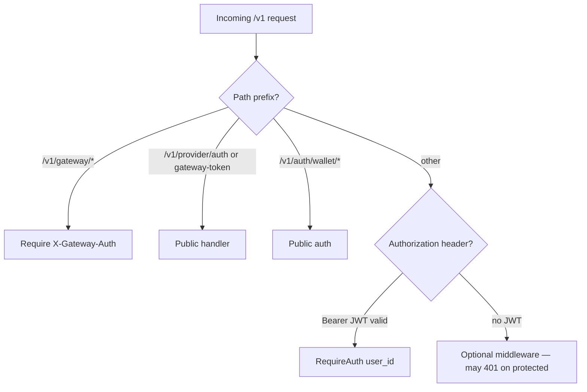

# ProxyHubb — System Architecture & Product Deep Dive

**Document version:** 2.0  
**Generated:** 2026-05-30  
**Repository:** `proxyhubb` monorepo  
**Audience:** Engineering, product, and operations reviewing what exists, what to fix, and what to build next  

**Companion documents (more specialized):**

| Document | Focus |
|----------|--------|
| [SYSTEM_ANALYSIS_REPORT.md](./SYSTEM_ANALYSIS_REPORT.md) | Exhaustive control-api route index, migration catalog, env matrix |
| [PROVIDER_SYSTEM_DEEP_DIVE.md](./PROVIDER_SYSTEM_DEEP_DIVE.md) | Provider control vs data plane, registry gaps, CLI |
| [WALLET_SYSTEM_DEEP_DIVE_REPORT.md](./WALLET_SYSTEM_DEEP_DIVE_REPORT.md) | Wallet threat model and ledger flows |
| [openapi.yaml](./openapi.yaml) | HTTP contract for `/v1` |
| [.env.example](../.env.example) | Full-stack configuration |

---

## Table of contents

1. [Executive summary](#1-executive-summary)
2. [Vision, objectives, and goals](#2-vision-objectives-and-goals)
3. [System context and boundaries](#3-system-context-and-boundaries)
4. [Logical architecture](#4-logical-architecture)
5. [Deployment and runtime topology](#5-deployment-and-runtime-topology)
6. [Control plane vs data plane](#6-control-plane-vs-data-plane)
7. [End-to-end workflows](#7-end-to-end-workflows)
8. [Features by subsystem](#8-features-by-subsystem)
9. [Web application map](#9-web-application-map)
10. [Backend services](#10-backend-services)
11. [Data, messaging, and state](#11-data-messaging-and-state)
12. [Blockchain, settlement, and ZK](#12-blockchain-settlement-and-zk)
13. [Security and trust model](#13-security-and-trust-model)
14. [Observability and operations](#14-observability-and-operations)
15. [Gaps, risks, and fix priorities](#15-gaps-risks-and-fix-priorities)
16. [Proposed enhancements for production](#16-proposed-enhancements-for-production)
17. [Documentation index](#17-documentation-index)

---

## 1. Executive summary

**ProxyHubb** (branded **ProxyHub** in parts of the API and UI) is a **decentralized residential and datacenter proxy marketplace**. The platform connects:

- **Buyers** who pay for metered proxy bandwidth (wallet-funded sessions, marketplace listings, or direct session intents).
- **Providers** who run software on their machines and tunnel traffic through a shared **edge gateway**.
- **Operators** who run the control plane, treasury, Solana oracle, and optional ZK settlement pipeline.

The system is implemented as a **monorepo** with a **Next.js** web app, a **Go control-api** (authoritative business logic), a **Rust edge-gateway** (proxy data path), optional **zk-prover**, **provider-node** CLI (runs on provider hardware, not in default Docker dev stack), and **Anchor** programs on **Solana**.

**Maturity snapshot (May 2026):** Core paths exist end-to-end (auth → session → gateway → usage → ledger → settlement), but several subsystems are **hybrid** (DB + chain), **partially wired** (admin API off, dual node registries), or **operator-friction** (CLI config must live outside git — addressed via dashboard download + `GET /v1/provider/nodes/:id/connect`).

---

## 2. Vision, objectives, and goals

### 2.1 Product vision

Build an **AI-native, trust-minimized proxy network** where:

- Bandwidth supply is **decentralized** (anyone can run a provider node).
- Demand is **discoverable** (marketplace, smart matching, subscriptions).
- Value flow is **transparent** (explorer, usage proofs, on-chain settlement where enabled).
- Operators retain **safety rails** (KYC hooks, rate limits, treasury reconciliation, withdrawal controls).

### 2.2 Strategic objectives

| Objective | How the codebase supports it | Current maturity |
|-----------|------------------------------|------------------|
| **Marketplace liquidity** | Listings, orders, reviews, tiers, smart match | Functional; some UI routes incomplete |
| **Reliable proxy delivery** | Session intents, edge-gateway routing, provider leases | Core path works; registry sync imperfect |
| **Fair provider compensation** | `provider_earnings`, batch payouts, claim API | Backend strong; dashboard claim UX partial |
| **Buyer trust & metering** | Usage records, wallet ledger, trustless proofs | Ledger + intents mature; proofs optional |
| **Decentralization narrative** | Explorer, on-chain escrow, ZK batches, attestations | Mixed — many explorer views are DB-backed |
| **Operational safety** | Redis limits, circuit breakers, anomaly worker, GDPR worker | Improving on current branch |
| **Developer / agent access** | OpenAPI, SDKs, agent APIs, session streaming | Present; not all routes in OpenAPI |

### 2.3 Non-goals (explicit in code today)

- **EVM relayer payouts** — `services/relayer` is decommissioned; Solana oracle only.
- **Paystack / fiat wallet** — removed from wallet API (SOL-only).
- **Supabase runtime auth** — middleware name legacy; JWT is issued locally.
- **Default admin API** — `/v1/admin/*` returns 410 unless `ADMIN_API_ENABLED=true`.

---

## 3. System context and boundaries

### 3.1 In scope

```text
proxyhubb/
├── apps/web/                 # Next.js 16 dashboard, marketplace, explorer
├── services/
│   ├── control-api/          # Go/Gin — system of record + workers
│   ├── edge-gateway/         # Rust — proxy + Yamux provider tunnels
│   ├── provider-node/        # Rust CLI — provider runtime
│   ├── zk-prover/            # Rust — Halo2 batch proofs
│   ├── solana-programs/      # Anchor escrow / registry
│   ├── relayer/              # Stub (decommissioned)
│   └── admin-cli/            # Admin tooling
├── migrations/               # Authoritative SQL (000001–000086+)
├── proto/                    # gateway.proto
├── sdks/                     # Node SDKs
├── cli/                      # proxyhubb-cli wrapper
├── infra/                    # K8s, Prometheus, Grafana
└── docs/                     # Reports, OpenAPI
```

### 3.2 External actors

| Actor | Interaction |
|-------|-------------|
| Buyer browser | Web app, wallet adapter, `/v1/sessions`, `/v1/wallet` |
| Provider operator | Dashboard + `provider-node` on own host/VPS |
| Proxy consumer | HTTP/SOCKS via edge-gateway (credentials or session-intent JWT) |
| Solana validators / RPC | Deposits, escrow, oracle transfers, registry |
| Operators | Docker/K8s, Grafana, env secrets |

### 3.3 Context diagram (C4 Level 1)



---

## 4. Logical architecture

### 4.1 Layered view



### 4.2 Responsibility split

| Layer | Owns | Does not own |
|-------|------|----------------|
| **Web** | UX, wallet connect, API client calls | Metering, routing, payouts |
| **control-api** | Users, wallets, sessions, billing, provider registry, gateway callbacks | Raw TCP proxy bytes |
| **edge-gateway** | Connection auth, routing, local metering, tunnel to providers | Long-term financial ledger |
| **provider-node** | Tunnel client, local stats, heartbeats (when configured) | Marketplace listings |
| **zk-prover** | Proof generation | Business rules |
| **Solana** | Escrow PDAs, on-chain registry (where used) | Session geo targeting |

---

## 5. Deployment and runtime topology

Default local stack: `docker-compose.dev.yml`.

### 5.1 Service map (dev)

| Service | Host ports (typical) | Role |
|---------|----------------------|------|
| **web** | 3000 | Next.js UI |
| **control-api** | 18080 → 8080 | REST + WebSocket + workers |
| **edge-gateway** | 8090 (mgmt/health), 3128 (proxy tunnel) | Data plane |
| **postgres** | 5433 → 5432 | Primary database |
| **redis** | 6380 → 6379 | Cache, limits, gateway state |
| **nats** | 4223, 8223 | Event bus |
| **zk-prover** | 8095 | ZK proofs |
| **prometheus** | 9090 | Metrics scrape |
| **grafana** | 3001 | Dashboards |
| **db-migrate** | — | One-shot migrations |

**Not in compose (by design):** `provider-node` runs on the provider’s machine against `API_BASE_URL` and `PROVIDER_TUNNEL_PUBLIC_ADDR`.

### 5.2 Deployment diagram



### 5.3 Critical environment variables

| Variable | Consumer | Purpose |
|----------|----------|---------|
| `DATABASE_URL` | control-api, migrate | Postgres |
| `JWT_SECRET` | control-api | User JWT |
| `TOKEN_HMAC_SECRET` | control-api | Provider API token storage |
| `GATEWAY_SHARED_SECRET` | control-api, edge-gateway | Gateway ↔ API auth |
| `SOLANA_ORACLE_KEYPAIR` | control-api | Payouts, deposits |
| `API_BASE_URL` / `NEXT_PUBLIC_API_URL` | web build, provider config | Public API URL |
| `PROVIDER_TUNNEL_PUBLIC_ADDR` | control-api connect, web | Tunnel host:port (**3128**, not 8090) |
| `GATEWAY_PUBLIC_URL` | web | Buyer proxy tests (**8090**) |
| `HALO2_PROVER_URL` | control-api | ZK worker |

---

## 6. Control plane vs data plane



**Identity linking (important):**

- Dashboard row: `provider_nodes.id` (UUID) — used in `provider.toml` `node_id` and heartbeats.
- Gateway tunnel id: `node_{user_uuid}` — JWT subject for Yamux AUTH.
- Registry table `nodes` links via `gateway_node_id` / `provider_node_id` (migration `000085`).

Misalignment between these causes “online in gateway, offline in dashboard” symptoms.

---

## 7. End-to-end workflows

### 7.1 Buyer: wallet auth → fund → connect



### 7.2 Buyer: marketplace purchase



### 7.3 Provider: onboard → register → run (target operator flow)



### 7.4 Settlement pipeline (simplified)



Public semantics (per OpenAPI): `ledger_committed` → `batched` → `chain_committed` are **distinct** stages; testnet does not guarantee full on-chain verification for every batch.

---

## 8. Features by subsystem

### 8.1 Feature matrix

| Feature | Primary UI | control-api | edge-gateway | provider-node | Solana / ZK |
|---------|------------|-------------|--------------|---------------|-------------|
| Wallet auth | `/login` | `/v1/auth/wallet/*` | — | — | — |
| Custodial wallet | `/dashboard/wallet` | `/v1/wallet/*` | — | — | deposit verify |
| Session intents | `/dashboard/proxy` | `/v1/sessions/intent*` | session-intent JWT | — | — |
| Classic sessions | `/dashboard/sessions` | `/v1/sessions` | routing | — | — |
| Marketplace | `/marketplace` | `/v1/listings`, orders | — | — | escrow optional |
| Smart match | marketplace widget | `/v1/smart-match` | — | — | — |
| Provider apply | provider setup | `/v1/provider/apply` | — | — | KYC balance check |
| Provider nodes | `/dashboard/provider/nodes` | `/v1/provider/nodes` | register | heartbeats | registry sync |
| Provider tokens | tokens page | `/v1/provider/tokens` | — | auth | — |
| Provider lease | CLI | `/v1/provider/lease` | validates lease | fetches lease | — |
| Provider earnings | `/dashboard/provider/earnings` | earnings + claim | — | — | oracle payout |
| Circle pooling | `/dashboard/provider/circle` | `/v1/circles/*` | — | — | — |
| Explorer | `/explorer/*` | `/v1/explorer/*` | telemetry | — | indexer |
| Governance | `/governance` | `/v1/governance/*` | — | — | — |
| Forum / feed | `/community/*` | forum, feed, messaging | — | — | — |
| AI agents | `/marketplace/agents` | `/v1/agents/*` | — | — | — |
| Trustless proofs | `/dashboard/trustless` | `/v1/trustless/*` | — | — | submit proof |
| Subscriptions | plans (API) | `/v1/subscriptions/*` | — | — | — |
| Referrals | profile/settings | `/v1/referral/*` | — | — | — |
| Security (MFA, API keys) | `/settings`, `/dashboard/security` | `/v1/security/*` | — | — | — |
| Monitoring | `/dashboard/monitoring` | `/v1/monitoring/*` | metrics | — | — |
| CLI distribution | `/dashboard/provider/cli` | `/v1/cli/*` | — | binary | — |
| Node connect package | setup / nodes | `GET .../nodes/:id/connect` | — | reads toml | — |

### 8.2 How each major subsystem operates

#### Authentication & identity

- Wallet challenge/login stores nonce in **Redis**, issues **JWT** from control-api.
- Profile role (`buyer`, `provider`, `both`) gates sidebar and onboarding.
- Provider **API tokens** are HMAC-hashed at rest; raw token shown once at creation.
- Refresh token families (migration `000072`) support session rotation.

#### Wallet & treasury

- **SOL-only** internal ledger (deposits verified on-chain, withdrawals with limits/whitelist).
- Treasury reconciliation worker, velocity guard on oracle, platform fee on provider payouts.
- See [WALLET_SYSTEM_DEEP_DIVE_REPORT.md](./WALLET_SYSTEM_DEEP_DIVE_REPORT.md).

#### Sessions & proxy

- **Session intents** are the modern path: state machine, usage ledger, billing snapshot (migrations `000073`–`000076`).
- Gateway accepts `session-intent:<jwt>` or legacy Basic credentials.
- Provisioning worker reacts to **NATS** `proxy.sessions.v1.*` events.

#### Provider network

- Operators register **provider_nodes** in dashboard; CLI connects with **api_key** + **node_id**.
- **Lease JWT** binds capabilities (ports, bandwidth) for gateway admission.
- Heartbeats update `provider_nodes.status`; stale after `PROVIDER_NODE_STALE_AFTER` (default 5m).
- Earnings accrue to `provider_earnings`; claim flow signs with payout wallet.

#### Marketplace & social

- Listings, orders, reviews, tiers; full-text search on listings.
- Social: feed, friends, forum, conversations — parallel product surface on same API.

#### Explorer

- Public transparency UI backed mostly by **DB + indexer**, styled like a block explorer.
- WebSocket for live updates; decentralization badges depend on attestation data quality.

#### Workers (control-api)

Background processes in `main.go` include: escrow listener, explorer indexer, billing/settlement, ZK settlement, provisioning, registry sync, tier evaluator, heartbeat monitor, anomaly detector, deletion worker, GeoIP backfill, marketplace watcher, treasury watchtower, and more. See [SYSTEM_ANALYSIS_REPORT.md](./SYSTEM_ANALYSIS_REPORT.md) §6 for the full list.

---

## 9. Web application map

### 9.1 Route structure

```text
/                          Landing
/login, /register          Wallet auth
/marketplace/*             Buyer commerce + agents
/explorer/*                Public network explorer
/governance/*              DAO-style proposals
/dashboard/*               Authenticated hub
  proxy, sessions, usage, trustless     → Buyer
  provider/*                            → Provider
  wallet, settings, monitoring          → Shared
/settings/*                Account security
/community/*               Forum, feed, messages
/profile/*                 Public profiles
```

### 9.2 Personas vs navigation

| Persona | `user.role` | Primary routes |
|---------|-------------|----------------|
| Buyer | `buyer`, `consumer` | proxy, sessions, marketplace, wallet |
| Provider | `provider` | `/dashboard/provider/*`, marketplace/create |
| Both | `both` | All of the above |
| New | `new`, empty | `NewUserDashboard` role picker |

### 9.3 Known UI gaps

| Issue | Impact |
|-------|--------|
| `/marketplace/manage` linked in nav but **no page** | Providers cannot manage listings from dedicated route |
| Claim UI vs backend | `/v1/provider/claim/*` may be underused in web |
| `NEXT_PUBLIC_GATEWAY_URL` vs tunnel port | Buyer features use 8090; provider tunnel must use **3128** (`NEXT_PUBLIC_PROVIDER_TUNNEL_ADDR`) |

---

## 10. Backend services

### 10.1 control-api (Go)

- **Entry:** `services/control-api/main.go`
- **Framework:** Gin, GORM, internal workers
- **Auth middleware:** JWT + optional provider token; gateway routes use `X-Gateway-Auth`
- **Route groups:** public/optional `v1`, protected `v1`, gateway `v1/gateway/*`, admin (disabled by default)

**Key packages:**

| Package | Responsibility |
|---------|----------------|
| `internal/api` | HTTP handlers (40+ registrars) |
| `internal/models` | GORM models |
| `internal/worker` | Background jobs |
| `internal/nats` | JetStream connector |
| `internal/solana` | Oracle, escrow, registry client |
| `internal/treasury` | Reconciliation |
| `internal/zk` | Batch settlement |

### 10.2 edge-gateway (Rust)

- **Entry:** `services/edge-gateway/src/main.rs`
- Listens on **8090** (management, health, metrics) and **3128** (proxy/tunnel)
- Validates provider **JWT role = provider**, session intents, leases
- Calls control-api for registration and session state
- Redis + NATS for registry and leader election

### 10.3 provider-node (Rust CLI)

- **Commands:** `register`, `start`, `metrics`, `stop`
- **Config:** TOML (`control_api_url`, `gateway_addr`, `api_key`, `node_id`, …)
- **Default config path:** `~/.config/proxyhubb/provider.toml` (or `%USERPROFILE%\.proxyhubb\`)
- On start: refresh JWT from `api_key` if needed; Yamux handshake; heartbeats when `node_id` is UUID

### 10.4 zk-prover (Rust)

- HTTP API for Halo2 proof generation
- Used when `HALO2_PROVER_REQUIRED` and settlement worker enabled

### 10.5 solana-programs

- Anchor program for escrow/registry (see `services/solana-programs/proxyhub`)
- Used by oracle and client escrow flows in web (`apps/web/src/lib/solana.ts`)

### 10.6 Decommissioned / stub

- **relayer:** exits immediately — do not deploy
- **paystack:** removed from control-api

---

## 11. Data, messaging, and state

### 11.1 PostgreSQL (system of record)

Core entity groups:



**Migration authority:** `migrations/*.up.sql` (80+ numbered migrations plus dated patches). Recent notable:

- `000080`–`000083` — withdrawal security, user flags, explorer numerics, ledger tx hash
- `000085` — `provider_nodes.gateway_node_id`, `nodes.provider_node_id`
- `000086` — `provider_nodes.base_price_per_gb`

### 11.2 Redis

- Auth nonces, rate limits, config cache, circuit breaker, oracle velocity, gateway provisioning interface

### 11.3 NATS JetStream

| Stream | Purpose |
|--------|---------|
| `SESSIONS` | Session provisioning pipeline |
| `SETTLEMENT` | Receipts, manifests |
| `TELEMETRY` | Heartbeats, alerts |
| `MESSAGING` | Real-time fan-out (explorer WS hub) |

---

## 12. Blockchain, settlement, and ZK

### 12.1 Solana usage

| Use case | Mechanism |
|----------|-----------|
| User wallet login | Ed25519 signature over challenge |
| Deposits | Tx verification → ledger credit |
| Withdrawals | Oracle-signed transfers, whitelist |
| Marketplace escrow | Client + `/v1/solana/escrow/*` |
| Provider payouts | Oracle + claim prepare/confirm |
| Registry | Program accounts + sync worker |

### 12.2 ZK settlement

- Usage aggregated into batches → **zk-prover** → optional on-chain root
- Treat as **integrity layer**, not the primary payment path for all users

---

## 13. Security and trust model

| Control | Implementation |
|---------|----------------|
| API authentication | JWT (users), HMAC provider tokens, gateway shared secret |
| Rate limiting | Redis-backed per IP/user |
| Withdrawal protection | Whitelist, cooldowns (migration `000080`) |
| User flags | Risk flags (migration `000081`) |
| Provider admission | Lease JWT with capability caps |
| TLS | Optional on gateway tunnel (`use_tls`) |
| Secrets | Env-based keypairs; never commit `provider.toml` with keys |

**Residual risks:** dual node registry desync, optional admin off, hybrid explorer claims vs DB reality, build-time env validation for Solana program ID (mitigated in `solana.ts`).

---

## 14. Observability and operations

| Tool | Targets |
|------|---------|
| Prometheus | control-api `/metrics`, edge-gateway metrics |
| Grafana | Dashboards in `infra/grafana` |
| Structured logs | control-api, edge-gateway (tracing) |
| Health | `/health`, `/healthz` per service |

**Operator runbooks in repo:**

- [DOCKER_REBUILD.md](./DOCKER_REBUILD.md)
- [PROVIDER_PHASE1_VERIFY.md](./PROVIDER_PHASE1_VERIFY.md)
- [DEV_SOLANA_SMOKE.md](./DEV_SOLANA_SMOKE.md)
- [WALLET_E2E_SMOKE.md](./WALLET_E2E_SMOKE.md)

---

## 15. Gaps, risks, and fix priorities

### P0 — Correctness / money / connectivity

| ID | Issue | Recommendation |
|----|-------|----------------|
| P0-1 | **Dual registries** (`provider_nodes` vs `nodes`) | Single source of truth; sync worker must update both or merge tables |
| P0-2 | **Heartbeat path** — dashboard offline while gateway online | Ensure `node_id` in provider.toml matches dashboard UUID; unify status from gateway sync |
| P0-3 | **Invalid `SOLANA_PROGRAM_ID` in .env** breaks web build | Validate env in CI; keep safe parser (done in `solana.ts`) |
| P0-4 | **Tunnel vs HTTP port confusion** (8090 vs 3128) | Document + enforce `PROVIDER_TUNNEL_PUBLIC_ADDR` everywhere |

### P1 — Product completeness

| ID | Issue | Recommendation |
|----|-------|----------------|
| P1-1 | **Admin API disabled** | Enable in staging with TOTP accounts for ops |
| P1-2 | **`/marketplace/manage` missing** | Implement listing management page |
| P1-3 | **Provider claim UI** | Wire earnings page to `/v1/provider/claim/*` |
| P1-4 | **GDPR routes** exist but not mounted | Mount or remove dead code |
| P1-5 | **Auto-deposit watcher** vs `linked_wallets` | Align schema and watcher |

### P2 — Hardening & scale

| ID | Issue | Recommendation |
|----|-------|----------------|
| P2-1 | OpenAPI incomplete vs mounted routes | Regenerate or audit diff |
| P2-2 | Explorer “decentralization” without attestations | Gate UI badges on real attestation data |
| P2-3 | `provider-node` not in compose | Document one-command prod install (systemd + downloaded toml) |
| P2-4 | Tier evaluator / KYC columns partially unused | Product decision: wire or drop |

---

## 16. Proposed enhancements for production

Grouped for roadmap planning — not committed work.

### 16.1 Provider experience

- Hosted **provider onboarding agent** (checks ports, NAT, latency before register)
- **One-click systemd** unit generated from dashboard connect package
- Real-time **node diagnostics** page (last lease error, tunnel AUTH failure reason)
- **Multi-node** dashboard bulk operations

### 16.2 Buyer experience

- **Session intent templates** (saved geo/ISP presets)
- **Spend caps** and alerts integrated with wallet limits
- **Usage anomaly** notifications

### 16.3 Marketplace

- Complete **listing management** UI
- **SLA metrics** on listing cards (verified uptime from gateway, not DB only)
- **Dispute** UI tied to `disputes` tables
- **Map + marketplace merge** (in progress): `GET /v1/listings/geo`, `proxy_listings.provider_node_id`, UI at `/marketplace/map`

### 16.4 Platform / ops

- **Staging admin** with provider application queue
- **Reconciliation dashboard** (treasury vs ledger vs chain)
- **Feature flags** UI for `system_configurations`
- **Automated migration** checks in CI against fresh DB

### 16.5 Decentralization (if strategic goal)

- Stronger **attestation** pipeline for explorer claims
- **Mandatory** usage proof samples on settlement batches
- **Provider stake** tied to slashing/dispute outcomes on-chain

---

## 17. Documentation index

| Need | Read |
|------|------|
| Full API route appendix | [SYSTEM_ANALYSIS_REPORT.md](./SYSTEM_ANALYSIS_REPORT.md) |
| Provider registry & CLI | [PROVIDER_SYSTEM_DEEP_DIVE.md](./PROVIDER_SYSTEM_DEEP_DIVE.md) |
| Wallet security | [WALLET_SYSTEM_DEEP_DIVE_REPORT.md](./WALLET_SYSTEM_DEEP_DIVE_REPORT.md) |
| Wallet roadmap | [WALLET_IMPLEMENTATION_PLAN.md](./WALLET_IMPLEMENTATION_PLAN.md) |
| HTTP contract | [openapi.yaml](./openapi.yaml) |
| Env setup | [.env.example](../.env.example) |
| Provider E2E check | [PROVIDER_PHASE1_VERIFY.md](./PROVIDER_PHASE1_VERIFY.md) |
| Docker rebuild | [DOCKER_REBUILD.md](./DOCKER_REBUILD.md) |

---

## Appendix A — Auth decision tree



## Appendix B — Port reference (single page)

| Port | Protocol | Service | Consumer |
|------|----------|---------|----------|
| 3000 | HTTP | web | Browsers |
| 18080 | HTTP | control-api | Web, CLI, gateway |
| 8090 | HTTP | edge-gateway | Health, buyer proxy API |
| 3128 | TCP/Yamux | edge-gateway | provider-node tunnel, proxy |
| 5433 | TCP | postgres | control-api |
| 6380 | TCP | redis | control-api, edge-gateway |
| 4223 | TCP | nats | control-api, edge-gateway |
| 8095 | HTTP | zk-prover | control-api |

---

*This document is the product-oriented architecture entry point. Update it when major subsystems or deployment topology change. For line-level API and migration inventories, prefer [SYSTEM_ANALYSIS_REPORT.md](./SYSTEM_ANALYSIS_REPORT.md).*
