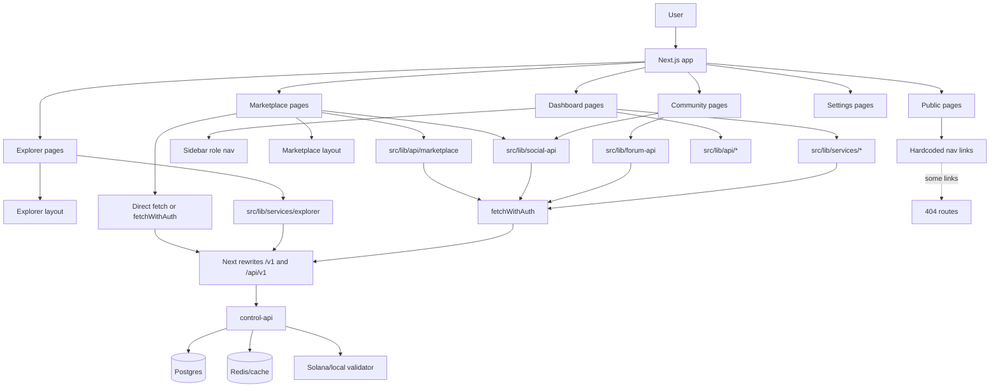
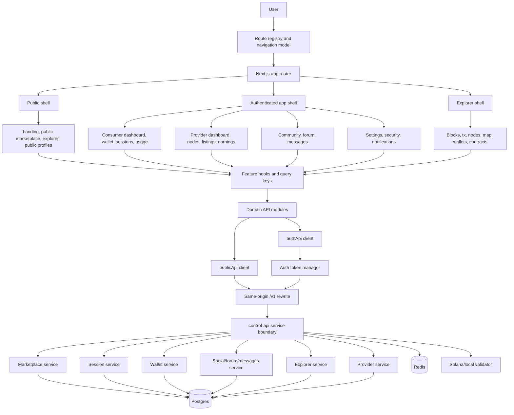
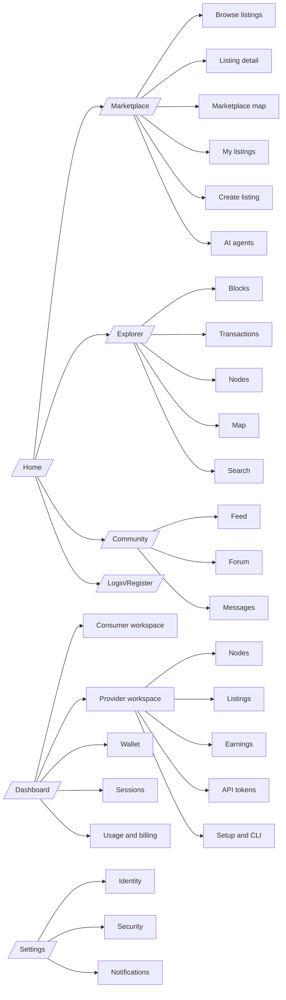
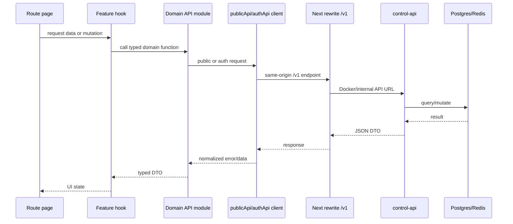

# ProxyHubb Web App Deep Dive Report

Date: 2026-06-02  
Scope: `apps/web` Next.js application, route structure, page connectivity, frontend architecture, API/data integration, Docker runtime checks, UI structure, and implementation roadmap.

## Executive Summary

The ProxyHubb web app has a large feature surface and many valuable pieces already in place: marketplace browse/detail/create/manage, provider dashboard, consumer dashboard, wallet, explorer, community forum/feed/messages, governance, treasury, settings, and API rewrites through the Next.js app. The core problem is not lack of pages. The core problem is that the pages, navigation, API clients, auth rules, and UI shells have grown in different directions.

Overall rating: **6.1 / 10**

- Product coverage: **8 / 10**. Most expected ProxyHubb features exist somewhere.
- Runtime route health: **6 / 10**. Many important pages return 200, but several visible links route to 404.
- Architecture consistency: **4 / 10**. API clients and page shells are duplicated and inconsistent.
- UI/navigation quality: **5 / 10**. The app has strong visual work, but information architecture is noisy and some routes are hard to find.
- Maintainability: **5 / 10**. TypeScript typecheck passes, but page components are large and data contracts are scattered.
- Production readiness: **5 / 10**. Docker web is running, but the local production build path needs cleanup.

The recommended direction is to keep the existing feature base, but introduce a single route registry, a single API client contract with public/auth variants, consolidated app shells, and feature modules organized around ProxyHubb workflows.

## Verification Performed

Commands and checks completed:

- Route inventory across `apps/web/src/app`.
- Source scan of navigation, layouts, auth, marketplace, forum, and API clients.
- Hardcoded link scan across `apps/web/src/app` and `apps/web/src/components`.
- Docker web runtime route probes against `http://localhost:3000`.
- Public API rewrite probes through the web app.
- `npm run typecheck` in `apps/web`.
- `npm run build` in `apps/web`.
- `npx next build --webpack` fallback attempt.

Results:

- `npm run typecheck`: **passed**.
- Docker web container: **running** and serving Next.js on port `3000`.
- Default production build: **failed due to Turbopack/native binding platform issue**.
- Webpack fallback build: **timed out after 2 minutes**.
- Public API rewrite probes:
  - `/api/health`: `200`
  - `/v1/system/config/public`: `200`
  - `/v1/listings`: `200`
  - `/v1/listings/geo`: `200`
  - `/v1/explorer/network-stats`: `404`

The build failure should be treated as a tooling/config issue first, not proof that the app source is broken. The route and link failures are real app issues.

## Live Route Probe Findings

Important routes tested through Docker web:

| Route | Result | Notes |
|---|---:|---|
| `/` | 200 | Home loads. Contains broken footer links. |
| `/marketplace` | 200 | Browse page loads. Uses canonical marketplace API client. |
| `/marketplace/manage` | 200 | Manage page loads. Uses legacy `social-api`. |
| `/marketplace/map` | 200 | Map page loads. API rewrite for geo data works. |
| `/marketplace/create` | 200 | Create page exists. Uses manual `NEXT_PUBLIC_API_URL` fetch path. |
| `/dashboard` | 307 | Expected unauthenticated redirect. |
| `/dashboard/wallet` | 307 | Expected unauthenticated redirect. |
| `/dashboard/provider` | 307 | Expected unauthenticated redirect. |
| `/explorer` | 200 | Explorer loads. Some explorer API paths differ from backend availability. |
| `/explorer/map` | 200 | Explorer map loads. |
| `/community/feed` | 200 | Feed page exists. |
| `/community/forum` | 200 | Forum page exists. Internal links point to wrong aliases. |
| `/settings` | 307 | Expected unauthenticated redirect. |
| `/settings/notifications` | 307 | Expected unauthenticated redirect. |
| `/leaderboards` | 200 | Top-level leaderboards page exists. |
| `/treasury` | 200 | Treasury page exists. |
| `/governance` | 307 | Protected. |

Confirmed broken linked routes:

| Broken Route | Found In | Correct Target |
|---|---|---|
| `/feed` | `Navbar`, `BottomNav`, home footer, `NetworkFeed` | `/community/feed` or `/dashboard/feed` |
| `/messages` | `Navbar`, `BottomNav` | `/community/messages` or `/dashboard/messages` |
| `/notifications` | `Navbar`, `NotificationCenter` | `/settings/notifications` or a new route |
| `/forum` | Forum pages | `/community/forum` |
| `/forum/new` | Forum pages | `/community/forum/new` |
| `/forum/recent` | Forum pages | `/community/forum/recent` |
| `/forum/unanswered` | Forum pages | `/community/forum/unanswered` |
| `/forum/my-posts` | Forum pages | `/community/forum/my-posts` |
| `/agents` | Marketplace agents pages | `/marketplace/agents` |
| `/agents/instances` | Marketplace agents pages | `/marketplace/agents/instances` |
| `/friends` | `PeopleYouMayKnow` | No page currently exists |
| `/help`, `/guidelines`, `/contact`, `/terms`, `/privacy` | Home footer | No pages currently exist |

## Current Web App Route Map

Main route groups currently present:

- Public and auth:
  - `/`
  - `/login`
  - `/register`
- Marketplace:
  - `/marketplace`
  - `/marketplace/[id]`
  - `/marketplace/create`
  - `/marketplace/manage`
  - `/marketplace/map`
  - `/marketplace/agents`
  - `/marketplace/agents/instances`
- Dashboard:
  - `/dashboard`
  - `/dashboard/proxy`
  - `/dashboard/sessions`
  - `/dashboard/usage`
  - `/dashboard/trustless`
  - `/dashboard/wallet`
  - `/dashboard/wallet/callback`
  - `/dashboard/provider`
  - `/dashboard/provider/nodes`
  - `/dashboard/provider/setup`
  - `/dashboard/provider/cli`
  - `/dashboard/provider/tokens`
  - `/dashboard/provider/earnings`
  - `/dashboard/provider/health`
  - `/dashboard/provider/services`
  - `/dashboard/provider/circle`
  - `/dashboard/provider/relationships`
  - `/dashboard/provider/analytics`
  - `/dashboard/admin`
  - `/dashboard/analytics`
  - `/dashboard/monitoring`
  - `/dashboard/feed`
  - `/dashboard/messages`
  - `/dashboard/profile`
  - `/dashboard/security`
  - `/dashboard/settings/account`
  - `/dashboard/settings/identity`
  - `/dashboard/settings/security`
- Explorer:
  - `/explorer`
  - `/explorer/analytics`
  - `/explorer/blocks`
  - `/explorer/blocks/[number]`
  - `/explorer/transactions`
  - `/explorer/transactions/[hash]`
  - `/explorer/nodes`
  - `/explorer/nodes/[id]`
  - `/explorer/nodes/compare`
  - `/explorer/map`
  - `/explorer/leaderboard`
  - `/explorer/sessions`
  - `/explorer/earnings`
  - `/explorer/health`
  - `/explorer/search`
  - `/explorer/wallets`
  - `/explorer/wallets/[address]`
  - `/explorer/contracts`
  - `/explorer/contracts/[address]`
- Community:
  - `/community/feed`
  - `/community/forum`
  - `/community/forum/new`
  - `/community/forum/recent`
  - `/community/forum/popular`
  - `/community/forum/unanswered`
  - `/community/forum/my-posts`
  - `/community/forum/category/[slug]`
  - `/community/forum/thread/[id]`
  - `/community/messages`
- Governance and network:
  - `/governance`
  - `/governance/create`
  - `/governance/[id]`
  - `/treasury`
  - `/leaderboards`
- User and provider profile:
  - `/profile`
  - `/profile/[username]`
  - `/providers/[id]`
- Settings:
  - `/settings`
  - `/settings/notifications`

## Major Findings

### 1. Visible navigation points to missing pages

Severity: **High**

The main `Navbar` uses `/feed`, `/messages`, and `/notifications`, but those routes do not exist. Mobile `BottomNav` also uses `/feed` and `/messages`. The home page footer also links to `/feed`, `/help`, `/guidelines`, `/contact`, `/terms`, and `/privacy`, which currently 404.

Impact:

- Users hit dead routes from first-party navigation.
- Working pages appear broken because the app sends people to the wrong URL.
- Search engines and crawlers will find invalid product links.

Primary files:

- `apps/web/src/components/Navbar.tsx`
- `apps/web/src/app/page.tsx`
- `apps/web/src/components/NetworkFeed.tsx`
- `apps/web/src/components/NotificationCenter.tsx`
- `apps/web/src/components/PeopleYouMayKnow.tsx`

Fix:

- Change `/feed` to `/community/feed`.
- Change `/messages` to `/community/messages` or intentionally consolidate to `/dashboard/messages`.
- Change `/notifications` to `/settings/notifications`, or create `/notifications` as a redirect.
- Add real static/support pages or remove footer links until they exist.

### 2. Forum routes exist under `/community/forum`, but internal forum links use `/forum`

Severity: **High**

The forum feature has real pages, but many internal links point to `/forum/...`, which returns 404.

Impact:

- Forum navigation is internally broken.
- Creating a post, switching to recent/unanswered/my posts, category navigation, and thread navigation can fail depending on link path.

Primary files:

- `apps/web/src/app/community/forum/page.tsx`
- `apps/web/src/app/community/forum/new/page.tsx`
- `apps/web/src/app/community/forum/recent/page.tsx`
- `apps/web/src/app/community/forum/popular/page.tsx`
- `apps/web/src/app/community/forum/unanswered/page.tsx`
- `apps/web/src/app/community/forum/my-posts/page.tsx`
- `apps/web/src/app/community/forum/category/[slug]/page.tsx`
- `apps/web/src/app/community/forum/thread/[id]/page.tsx`

Fix:

- Replace all `/forum` links with `/community/forum`.
- Optionally add redirects:
  - `/forum` -> `/community/forum`
  - `/forum/:path*` -> `/community/forum/:path*`

### 3. Marketplace agent links use `/agents`, but pages live under `/marketplace/agents`

Severity: **Medium**

`/marketplace/agents` and `/marketplace/agents/instances` exist, but some links point to `/agents` and `/agents/instances`.

Impact:

- Agent marketplace appears partially broken.
- Users cannot reliably reach their agent instances.

Primary files:

- `apps/web/src/app/marketplace/agents/page.tsx`
- `apps/web/src/app/marketplace/agents/instances/page.tsx`

Fix:

- Change internal links to `/marketplace/agents` and `/marketplace/agents/instances`.
- Consider redirect aliases if old URLs are expected.

### 4. API client architecture is fragmented

Severity: **High**

The app uses several competing API layers:

- `src/lib/api/client.ts`
- `src/lib/api/*`
- `src/lib/services/*`
- `src/lib/social-api.ts`
- `src/lib/forum-api.ts`
- `src/lib/friends-api.ts`
- `src/lib/notifications-api.ts`
- `src/lib/showcase-api.ts`
- direct `fetch`
- direct `fetchWithAuth`
- direct `NEXT_PUBLIC_API_URL` usage
- same-origin `/v1/...`
- same-origin `/api/v1/...`

Impact:

- Pages do not share one backend contract.
- Cache invalidation is inconsistent.
- Error behavior is inconsistent.
- Public versus authenticated requests are mixed.
- Frontend changes can accidentally bypass Next.js rewrites and hit wrong origins.

Examples:

- `/marketplace` uses `@/lib/api/marketplace`.
- `/marketplace/manage` uses legacy `@/lib/social-api`.
- `/marketplace/create` manually calls `fetchWithAuth` and `NEXT_PUBLIC_API_URL`.
- `/dashboard/wallet` imports from `@/lib/api` and `@/lib/services/client`.
- Explorer services use raw unauthenticated fetch helpers.
- Security/settings pages manually fetch `/v1/2fa/*` in duplicate pages.

Fix:

- Create one API client package under `src/lib/api`.
- Split request methods into:
  - `publicApiGet/publicApiPost`
  - `authApiGet/authApiPost/authApiPatch/authApiDelete`
- Move every domain into `src/lib/api/domains/*`.
- Deprecate and then delete `services/*`, `social-api.ts`, `forum-api.ts`, `friends-api.ts`, `notifications-api.ts`, and `showcase-api.ts` after migration.

### 5. Public pages can accidentally require authentication

Severity: **High**

`fetchWithAuth` always attempts token refresh and throws `Not authenticated` when no token exists. That is correct for private endpoints, but wrong for public pages using API modules that rely on `fetchWithAuth`.

Current `fetchWithAuth` behavior:

```ts
let token = await refreshAccessToken();

if (!token) {
  throw new Error('Not authenticated');
}
```

Impact:

- Public pages can render but fail their data load.
- Marketplace public browsing is at risk if the canonical client remains auth-only.
- Public profile/showcase/forum pages can become unavailable to unauthenticated users.

Fix:

- Keep `fetchWithAuth` for private endpoints only.
- Add unauthenticated `apiFetch` and `publicApiGet`.
- Have public pages use public clients.
- Have mixed public/private pages load public data first, then optional private state like `is_saved`.

### 6. Layout shells are inconsistent

Severity: **Medium**

Dashboard and explorer layouts respect `isSidebarCollapsed`, but marketplace layout hardcodes `md:pl-64`. Dashboard and explorer include breadcrumbs, error boundaries, and mobile tab bar; marketplace does not consistently mirror that shell behavior.

Impact:

- Collapsed sidebar causes marketplace spacing mismatch.
- UX changes depend on which section the user is in.
- Error isolation is weaker in marketplace than dashboard/explorer.

Primary files:

- `apps/web/src/app/dashboard/layout.tsx`
- `apps/web/src/app/explorer/layout.tsx`
- `apps/web/src/app/marketplace/layout.tsx`

Fix:

- Create one `AppShell` component for authenticated/workspace pages.
- Pass section config: `dashboard`, `marketplace`, `explorer`, `community`, `settings`.
- Let all app shells share sidebar state, mobile nav, breadcrumbs, and error boundary behavior.

### 7. Sidebar contains a stray rendered source artifact

Severity: **Medium**

`Sidebar.tsx` includes a literal stray line after bottom nav links:

```tsx
prefetch={false}
```

It does not break `npm run typecheck`, which means it can slip into runtime output as text or create confusing DOM structure.

Impact:

- UI polish issue.
- Evidence that current checks are not catching visible UI defects.

Fix:

- Remove the stray text immediately.
- Add route/nav smoke tests that render shell components.

### 8. Settings and security pages are duplicated

Severity: **Medium**

There are both top-level `/settings/*` pages and dashboard settings/security pages:

- `/settings`
- `/settings/notifications`
- `/dashboard/security`
- `/dashboard/settings/security`
- `/dashboard/settings/account`
- `/dashboard/settings/identity`

`next.config.ts` redirects some old dashboard settings paths, but the source still contains overlapping implementations.

Impact:

- Security settings can drift.
- Users can find different settings shells.
- Frontend API work is duplicated.

Fix:

- Keep `/settings` as the canonical settings area.
- Redirect dashboard settings paths to `/settings/...`.
- Reuse one set of settings panels.

### 9. Community messaging has two route concepts

Severity: **Medium**

Messaging exists at `/community/messages` and `/dashboard/messages`, while `Navbar` points to missing `/messages`.

Impact:

- The app has no clear primary message inbox.
- Buyer/provider conversations can become hard to find.

Fix:

- Use `/community/messages` as canonical if messaging is social/community-oriented.
- Use `/dashboard/messages` only if it is operational/provider inbox.
- If both are needed, name them differently:
  - `/community/messages`: social inbox
  - `/dashboard/provider/customers`: provider/customer conversations

### 10. Explorer has many strong pages, but endpoint contracts need alignment

Severity: **Medium**

Explorer pages are well represented, but a public API probe for `/v1/explorer/network-stats` returned `404`. Explorer services mostly use raw fetch and endpoint-specific fallback logic rather than the canonical API client.

Impact:

- Individual explorer pages may load, but some panels can silently show empty states.
- Contract mismatch can be hidden by client fallbacks.

Fix:

- Align explorer frontend endpoints with `docs/openapi.yaml` and backend handlers.
- Move explorer fetches into `src/lib/api/domains/explorer.ts`.
- Add smoke tests for overview, transactions, blocks, nodes, map, and search.

### 11. Page components are large and client-heavy

Severity: **Medium**

Many route pages are `"use client"` and contain UI, data fetching, data mapping, mutation handling, and local presentation state in one file.

Impact:

- Harder to test.
- Harder to reuse behavior.
- Harder to reason about which API contract a page uses.
- More client JavaScript than necessary.

Fix:

- Keep route pages thin.
- Move feature logic into `features/<domain>/hooks`.
- Move presentational sections into `features/<domain>/components`.
- Use server components where public static data or shell rendering does not require browser state.

### 12. UI language is visually strong but inconsistent with an operational app

Severity: **Medium**

The app mixes retro terminal styling, glass cards, dense dashboard widgets, large sci-fi marketplace headings, forum cards, and explorer subnavs. Some areas are polished, but the whole product does not feel like one coherent system.

Impact:

- The product feels harder to navigate than it needs to be.
- Users may not understand what area they are in.
- Cards, rounded shapes, and visual density vary by section.

Fix:

- Define one ProxyHubb UI system:
  - quiet operational dashboard style
  - clear content hierarchy
  - consistent shell and breadcrumbs
  - consistent page headers
  - consistent table/list/card patterns
  - 8px max border radius for cards unless a component has a functional reason
  - fewer oversized decorative treatments inside workflow screens

## Current Architecture Diagram



## Target Architecture

The next architecture should make routes, API contracts, auth state, and UI shell explicit.



## Proposed Folder Structure

Recommended `apps/web/src` structure:

```text
src/
  app/
    (public)/
      page.tsx
      login/page.tsx
      register/page.tsx
      marketplace/page.tsx
      marketplace/[id]/page.tsx
      explorer/...
      providers/[id]/page.tsx
      profile/[username]/page.tsx
    (app)/
      dashboard/...
      marketplace/create/page.tsx
      marketplace/manage/page.tsx
      community/...
      settings/...
      governance/...
      treasury/...
    api/
      health/route.ts
      proxy/test/route.ts
      sessions/stream/route.ts
  features/
    marketplace/
      api.ts
      hooks.ts
      components/
      types.ts
      routes.ts
    provider/
    consumer/
    wallet/
    sessions/
    explorer/
    community/
    governance/
    settings/
    admin/
  lib/
    api/
      client.ts
      errors.ts
      domains/
        marketplace.ts
        orders.ts
        sessions.ts
        wallet.ts
        provider.ts
        explorer.ts
        community.ts
        settings.ts
    auth/
      AuthProvider.tsx
      tokenStore.ts
      fetchWithAuth.ts
    navigation/
      routes.ts
      navItems.ts
      guards.ts
    ui/
      shell/
      primitives/
      feedback/
  components/
    shared-only/
```

The key rule: route files should compose features. They should not own domain contracts.

## Proposed Information Architecture



## Required Pages For A Complete ProxyHubb Web App

These should be treated as the minimum working product surface.

Public:

- `/`
- `/login`
- `/register`
- `/marketplace`
- `/marketplace/[id]`
- `/marketplace/map`
- `/explorer`
- `/explorer/search`
- `/providers/[id]`
- `/profile/[username]`
- `/terms`
- `/privacy`
- `/help`
- `/contact`

Consumer:

- `/dashboard`
- `/dashboard/proxy`
- `/dashboard/sessions`
- `/dashboard/usage`
- `/dashboard/wallet`
- `/dashboard/trustless`
- `/community/feed`
- `/community/forum`
- `/community/messages`
- `/settings`
- `/settings/notifications`

Provider:

- `/dashboard/provider`
- `/dashboard/provider/setup`
- `/dashboard/provider/cli`
- `/dashboard/provider/nodes`
- `/dashboard/provider/tokens`
- `/dashboard/provider/earnings`
- `/dashboard/provider/relationships`
- `/marketplace/manage`
- `/marketplace/create`

Network and governance:

- `/explorer/blocks`
- `/explorer/transactions`
- `/explorer/nodes`
- `/explorer/map`
- `/explorer/wallets`
- `/explorer/contracts`
- `/leaderboards`
- `/governance`
- `/treasury`

Admin and operations:

- `/dashboard/admin`
- `/dashboard/monitoring`
- `/dashboard/analytics`

Each page should have a route owner, API owner, auth policy, and test status.

## Proposed API/Data Contract

The frontend should use one data path:



Rules:

- Browser code must use same-origin `/v1/...` paths.
- No page should build URLs from `NEXT_PUBLIC_API_URL` unless it is a documented exception.
- `publicApi` must not require tokens.
- `authApi` must require tokens and handle refresh.
- Every TanStack Query key should be owned by the feature that owns the data.
- Mutations must invalidate or update the matching feature cache.
- API modules should return consistent DTOs, not mixed raw backend response shapes.

## UI Redesign Direction

ProxyHubb should feel like an operational marketplace and network dashboard, not a set of unrelated demo screens.

Recommended design principles:

- One shell for signed-in workspaces.
- Public landing should route users into actual product workflows quickly.
- Marketplace should prioritize listing comparison, filters, map, trust, price, availability, and purchase action.
- Provider dashboard should prioritize node health, listing status, earnings, setup, and customer activity.
- Consumer dashboard should prioritize active sessions, bandwidth usage, wallet balance, connection instructions, and recent purchases.
- Explorer should remain data-dense, but use consistent tables, tabs, and detail pages.
- Community should be clearly separated into feed, forum, and messages.
- Cards should be used for repeated items, not every page section.
- Use consistent page header pattern:
  - title
  - short operational subtitle
  - primary action
  - secondary section tabs when needed
- Use consistent empty, loading, and error states.
- Use icons for compact actions and tooltips where actions are ambiguous.
- Keep border radius restrained and consistent.
- Avoid route-specific visual languages that make each module feel like a different product.

Suggested top-level navigation:

- Marketplace
- Dashboard
- Provider
- Explorer
- Community
- Wallet
- Settings

Suggested mobile navigation:

- Dashboard
- Market
- Sessions
- Community
- Wallet

## Implementation Roadmap

### Phase 1: Route and navigation repair

Priority: **Immediate**

Tasks:

- Replace `/feed` with `/community/feed`.
- Replace `/messages` with `/community/messages` or canonical message route.
- Replace `/notifications` with `/settings/notifications` or create a redirect page.
- Replace `/forum/*` with `/community/forum/*`.
- Replace `/agents/*` with `/marketplace/agents/*`.
- Remove or create `/help`, `/guidelines`, `/contact`, `/terms`, `/privacy`.
- Remove stray `prefetch={false}` from `Sidebar.tsx`.
- Add redirects for legacy aliases if external links may exist.

Acceptance criteria:

- No first-party nav link returns 404.
- Route probe list passes for all canonical routes.
- Navbar, Sidebar, BottomNav, forum links, and agent links are covered by tests or link-check script.

### Phase 2: Route registry and shell consolidation

Priority: **High**

Tasks:

- Create `src/lib/navigation/routes.ts`.
- Define route metadata:
  - path
  - label
  - section
  - auth policy
  - role policy
  - sidebar visibility
  - mobile visibility
- Generate `Navbar`, `Sidebar`, `MobileTabBar`, breadcrumbs, and footer links from the registry.
- Create shared `AppShell`.
- Update marketplace layout to respect collapsed sidebar and use the same error boundary behavior.

Acceptance criteria:

- No hardcoded top-level nav arrays inside page components.
- One source of truth for route paths.
- Marketplace, dashboard, explorer, community, and settings share consistent shell behavior.

### Phase 3: API client consolidation

Priority: **High**

Tasks:

- Add `publicApiFetch` and `authApiFetch`.
- Refactor `src/lib/api/client.ts` around public/auth variants.
- Move marketplace, orders, sessions, provider, wallet, explorer, forum, messages, notifications, friends, profile, governance, treasury into domain modules under `src/lib/api/domains`.
- Replace direct `NEXT_PUBLIC_API_URL` use in browser pages.
- Replace `services/*` imports with domain API imports.
- Replace `social-api.ts`, `forum-api.ts`, `friends-api.ts`, `notifications-api.ts`, and `showcase-api.ts` usage incrementally.

Acceptance criteria:

- Public marketplace browsing works without auth.
- Authenticated user actions still refresh tokens and include credentials.
- All frontend API calls are same-origin unless documented.
- Query cache invalidation is feature-owned.

### Phase 4: Critical workflow hardening

Priority: **High**

Marketplace:

- Browse/filter/sort returns correct data and empty states.
- Listing detail handles deleted/paused/sold-out correctly.
- Create listing uses provider nodes correctly.
- Manage listing uses canonical marketplace domain API.
- Save/unsave and buy actions invalidate listing and browse caches.

Consumer:

- Buy listing -> order -> session -> credentials flow is clear.
- Sessions page reflects active/completed/expired/cancelled states.
- Usage and billing match session records.
- Wallet balance and transaction state are visible where purchase actions happen.

Provider:

- Provider setup guides users to node registration and CLI.
- Node health, tokens, earnings, and listings are connected.
- Provider listing lifecycle is clear: active, paused, sold out, deleted.

Community:

- Forum links work.
- Feed is reachable.
- Messages have one canonical inbox.
- Notifications are reachable and connected to settings.

Explorer:

- Overview panels match backend endpoint names.
- Search, blocks, transactions, nodes, and map have reliable empty/error states.

Acceptance criteria:

- End-to-end smoke tests cover buyer, provider, marketplace, sessions, wallet, forum, and explorer paths.

### Phase 5: UI system redesign

Priority: **Medium**

Tasks:

- Define page header, toolbar, tabs, table, list, card, empty state, loading state, and error state components.
- Replace excessive one-off rounded/glass/retro styles in workflow screens.
- Keep stronger visual treatments for landing and explorer map only where useful.
- Normalize typography scale and spacing.
- Add responsive checks for mobile and desktop.

Acceptance criteria:

- All primary pages use shared shell and shared UI primitives.
- No text overlaps or clipped button labels on common mobile and desktop widths.
- Marketplace and dashboard read as one product.

### Phase 6: Build and Docker verification

Priority: **Medium**

Tasks:

- Fix Next build command for Windows/local and Docker consistency.
- Set `turbopack.root` or remove duplicate lockfile ambiguity.
- Replace deprecated `middleware` convention if present.
- Decide whether Docker production builds use Turbopack or Webpack.
- Add web route smoke tests to Docker verification scripts.

Acceptance criteria:

- `npm run typecheck` passes.
- Production build completes in the intended environment.
- Docker web serves all canonical routes.
- API rewrite smoke tests pass.

## Immediate Next Work Recommendation

Start with **Phase 1: Route and navigation repair**.

This is the highest value first step because it fixes visible broken pages without changing backend logic. It also gives a clean base for the architecture work.

Recommended first patch:

1. Fix `Navbar` and `BottomNav` route targets.
2. Fix `NetworkFeed` and home footer route targets.
3. Fix forum internal links.
4. Fix marketplace agent links.
5. Remove `Sidebar.tsx` stray `prefetch={false}`.
6. Add redirects for `/feed`, `/messages`, `/notifications`, `/forum/:path*`, and `/agents/:path*` if preserving old URLs is useful.
7. Re-run route probes.

## Open Questions

- Should `/community/messages` or `/dashboard/messages` be the canonical inbox?
- Should `/feed` remain as a backwards-compatible redirect to `/community/feed`?
- Should forum be publicly readable or fully auth-gated?
- Should support/legal pages be real pages now, or should footer links be removed until content exists?
- Should `/marketplace/create` be provider-only at the route guard level, or visible with an upgrade/provider onboarding prompt?
- Should explorer remain public, including wallet/contract detail pages?

## Final Assessment

ProxyHubb has enough web app surface to become a coherent product, but the current structure needs consolidation before more features are added. The most urgent issues are not deep algorithmic problems. They are route correctness, navigation ownership, API client consistency, public/auth data separation, and shell/UI consistency.

Once those are corrected, the application can support the next backend contract work cleanly: marketplace service boundaries, OpenAPI/frontend type alignment, and more reliable Docker-based verification.
