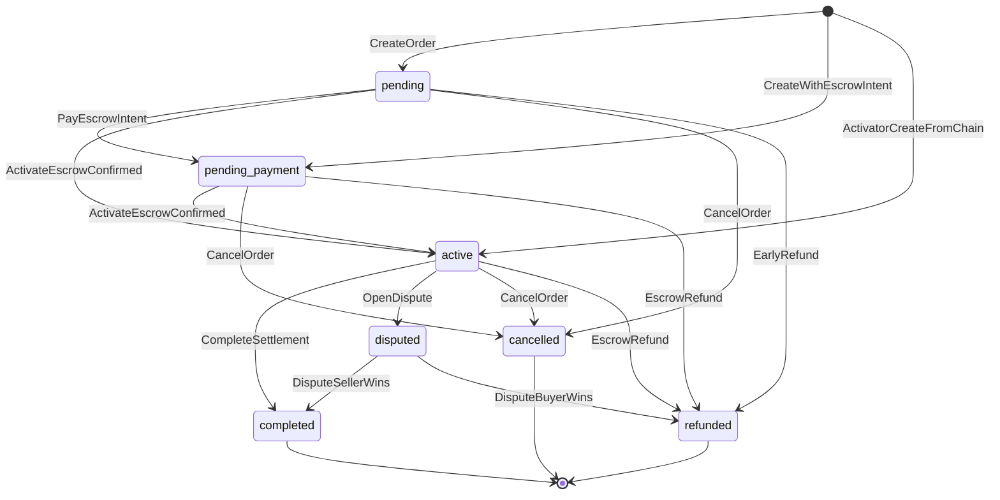

# ADR 0006 — Order status finite state machine (Phase 3B)

- **Status:** Accepted (model documented; enforcement hardening is 3B-2+)
- **Date:** 2026-07-30
- **Epic:** GitHub [#8](https://github.com/samuel-1-avson/ProxySocialHub/issues/8)
- **Issue:** [#21](https://github.com/samuel-1-avson/ProxySocialHub/issues/21) (3B-1)
- **Code source of truth:** `services/control-api/internal/models/state_transitions.go`, `order.go`
- **Tests:** `services/control-api/internal/models/state_transitions_test.go`

---

## Context

Marketplace orders use a free-form `orders.status VARCHAR(50)` column (migration `000003b`). Go already defines seven `OrderStatus` constants and a transition matrix (`CanTransitionOrderStatus` / `ValidateOrderStatusTransition`), but:

1. There is **no single write API** — callers validate (usually) then `Updates` / `Save` ad hoc.
2. **`internal/solana/activator.go` bypasses the validator** on create-as-`active`, complete, and refund paths.
3. Credential release and cancel/refund business rules are **policy overlays**, not edges in the matrix.
4. TypeScript `OrderStatus` mirrors the seven values but allows `| string`.

Track 3B standardizes on the **existing** graph (Option C from the marketplace report) rather than inventing new statuses.

## Decision

### D1 — Keep the seven production statuses (Accepted)

| Status | Role |
|--------|------|
| `pending` | Order row created; escrow not yet initiated |
| `pending_payment` | Escrow intent / PDA recorded; awaiting on-chain confirm |
| `active` | Escrow funded / session may run; credentials eligible |
| `completed` | Settled successfully (terminal) |
| `disputed` | Dispute opened; not terminal — resolves to completed or refunded |
| `refunded` | Funds returned (terminal) |
| `cancelled` | Buyer/system cancel without escrow resolution path (terminal) |

**Do not add** statuses in 3B-1. Schema CHECK / enum is optional follow-up after call sites converge (3B-2/3).

### D2 — Canonical transition graph (Accepted)

Same-status updates are allowed only for **non-terminal** statuses. Terminal = `completed` | `refunded` | `cancelled`. `disputed` is **not** terminal.

Matrix (matches `CanTransitionOrderStatus`):

| From \\ To | pending | pending_payment | active | completed | disputed | refunded | cancelled |
|------------|:-------:|:---------------:|:------:|:---------:|:--------:|:--------:|:---------:|
| _(empty)_ | ✓ | ✓ | ✓ | | | | |
| pending | ≈ | ✓ | ✓ | | | ✓ | ✓ |
| pending_payment | | ≈ | ✓ | | | ✓ | ✓ |
| active | | | ≈ | ✓ | ✓ | ✓ | ✓ |
| disputed | | | | ✓ | ≈ | ✓ | |
| completed | | | | | | | |
| refunded | | | | | | | |
| cancelled | | | | | | | |

≈ = same-status allowed (non-terminal only).

### D3 — Named events → edges → owners (Accepted)

| Event | From → To | Primary owners today |
|-------|-----------|----------------------|
| `CreateOrder` | `` → `pending` | `api/orders.go` create |
| `PayEscrowIntent` | `pending` → `pending_payment` | `api/orders.go` escrow init |
| `ActivateEscrowConfirmed` | `pending`\|`pending_payment` → `active` | `worker/escrow_listener.go` (**validates**); `solana/activator.go` (**does not**) |
| `ActivatorCreateFromChain` | `` → `active` | `solana/activator.go` create-on-event |
| `CompleteSettlement` | `active`\|`disputed` → `completed` | `escrow_listener`, `api/escrow.go`, activator settle |
| `OpenDispute` | `active` → `disputed` | `api/escrow.go`, `api/dispute_jury.go` |
| `DisputeResolved` | `disputed` → `completed`\|`refunded` | `dispute_jury` / escrow settle paths |
| `EscrowRefund` | `pending`\|`pending_payment`\|`active`\|`disputed` → `refunded` | `escrow_cleaner`, activator refund |
| `CancelOrder` | `pending`\|`pending_payment`\|`active` → `cancelled` | `api/orders.go` (blocked when escrow needs resolution) |

### D4 — Credential gating is a read policy, not an FSM edge (Accepted)

Credentials / session activation for buyers require order status ∈ {`active`, `completed`} (`orderCredentialsEligible` in `api/orders.go`). Moving status into those values is what unlocks credentials; there is no separate `credentials_released` status.

### D5 — Cancel vs escrow resolution (Accepted)

Even when `pending_payment` → `cancelled` or `active` → `cancelled` is **matrix-legal**, `orderNeedsEscrowResolutionBeforeCancel` rejects cancel while Solana escrow still needs refund/settle/dispute. That gate stays **outside** the matrix as a side-effect precondition (3B-3 keeps it around `Transition`).

### D6 — Dual activation paths are a known hazard (Accepted for 3B-1; fix in 3B-2)

| Path | Validates? |
|------|------------|
| `worker/escrow_listener.go` | Yes |
| `solana/activator.go` | **No** — can create already-`active`, or `Save` to `completed`/`refunded` |

3B-2 must route activator through the same validator (and eventually a single `TransitionOrder` helper).

## Alternatives considered

| Option | Rejected because |
|--------|------------------|
| Invent new statuses (`paid`, `fulfilling`, …) | Breaks web/API clients; existing matrix already covers commerce |
| Make `disputed` terminal | Production resolves disputes to completed/refunded |
| DB enum in 3B-1 | Premature while activator bypasses validation |
| Replace matrix with external workflow engine | Overkill; Go helper + tests sufficient |

## Consequences

- **Positive:** Shared vocabulary for eng/product; 3B-2+ can enforce without redesign.
- **Positive:** Credential and cancel policies documented relative to statuses.
- **Positive (3B-2):** `orders/fsm.TransitionOrder` is the validated write helper; activator + escrow_listener + escrow_cleaner use it.
- **Negative:** API handlers (`orders.go`, `escrow.go`, `dispute_jury.go`) still validate then `Updates` ad hoc until 3B-3.
- **Follow-ups:** #23 handler sweep; #24 metrics; #25 TS sync; optional DB CHECK on `orders.status`.

## Sign-off checklist (#21)

- [x] Diagram matches `CanTransitionOrderStatus`
- [x] Event table names owners
- [x] Gaps for 3B-2+ listed (no single write API; activator bypass)
- [x] Credential gating documented as overlay (D4)
