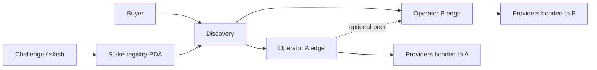

# ADR 0007 — Multi-operator gateways

- **Status:** Accepted (Wave 5.B **PASS** — 2026-08-12)
- **Date:** 2026-08-11
- **Related:** Wave 5 plan `docs/ops/WAVE5_DECENTRALIZATION_PLAN.md`, J2 multipod, Wave 2 design stub
- **Non-goals:** deploy `programs/session`, live economic slash, multi-region fleets, DePIN marketing

---

## Context

Wave 2 delivered **same-operator multipod** (two edge processes, sticky tunnels, peer forward). Buyers still trust a single control plane and a single host.

True multi-operator gateways imply:

1. Independent operators run edge fleets with their own tunnel endpoints.
2. Buyers (or a discovery layer) choose a gateway without trusting ProxyHubb's single VM.
3. Misbehavior is economically punishable (stake + slash) or cryptographically constrained (receipts / ZK later).

Shipping stake/slash without a sound program and challenge window would create false security theater. `programs/session` remains **unsafe / undeployed**.

## Decision

### D1 — Separate multipod from multi-operator

| Capability | Wave 2 | Wave 5.B |
|------------|--------|----------|
| 2× edge same VM | Yes (J2) | Still host SPOF |
| Peer forward same operator | Lab + PARTIAL live | **PASS** live soak (`W5B_PEER_FORWARD_OK`) |
| Independent gateway operators | Design only | Discovery registry (logical ops; same host OK) |
| Stake / slash | Design only | Observe hooks only (no live slash) |
| Buyer gateway choice UX | Stub | API only (no full UX) |

### D2 — Target architecture

Minimum viable trust model:

1. **Registry:** signed/off-chain list of gateway operator pubkeys + endpoints + stake accounts (W5.B: Postgres + public GET).
2. **Bonding:** providers register which operator(s) they dial; buyers select gateway by stake/reputation/geo.
3. **Accountability:** usage receipts / session escrow settle against operator-attested metering; disputes use existing jury path before inventing new slash instructions.
4. **Fail-closed:** unpaid / unstaked operators are not routable when bond-enforce flags are on (`PROXYHUB_GATEWAY_OPERATOR_BOND_ENFORCE`, default off).

### D3 — Explicit non-goals

- Do **not** deploy `programs/session`.
- Do **not** invent slash instructions in Go without an audited Solana program.
- Do **not** claim DePIN from J2 multipod or W5.B discovery.
- Do **not** treat sticky cookie LB as operator diversity.
- Do **not** require a second GCP host for W5.B exit.

### D4 — Implementation order

1. Discovery read API (operator list + health) — centralized OK for Testnet. **(W5.B)**
2. Provider CLI multi-endpoint tunnel pick via registry + `PROVIDER_TUNNEL_PUBLIC_ADDRS`. **(W5.B)**
3. Stake registry fields + challenge window design (reuse Phase B). **(W5.B hooks)**
4. Only then wire live slash / bond enforcement on-chain. **(deferred → Wave 6.D design / later live)**

Wave 6 continues with independent hosts: [`WAVE6_DECENTRALIZATION_PLAN.md`](../ops/WAVE6_DECENTRALIZATION_PLAN.md), ADR 0012.
## Appendix — Challenge window (design)

Reuse Phase B escrow hold + auto-release patterns
([`PHASEB_challenge_window_20260808T135716Z.md`](../ops/evidence/PHASEB_challenge_window_20260808T135716Z.md)):

- Accuse → challenge window → resolve / slash
- W5.B only records honeytoken hits as `slashing_events` audit rows (observe); no on-chain transfer

Live slash deferred until a bonded gateway program + challenge UX exist.

## Consequences

- Honest claim after W5.B: **multi-operator discovery stub + multipod mesh proven**, still same host/control-plane SPOF.
- Marketing must not say DePIN or trustless gateway selection from this slice.
