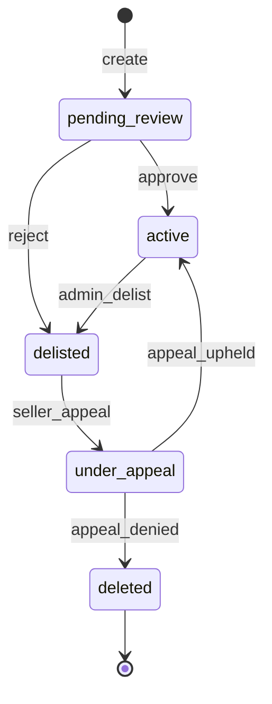

# ADR 0008 — Listing moderation appeals

- **Status:** Accepted (Wave 3.5 APIs shipped 2026-08-11; full jury voting still optional follow-up)
- **Date:** 2026-08-11
- **Related:** Wave 3 plan, evidence `W3_5_moderation_appeals_api_20260811.md`
- **Prior art:** escrow dispute jury (`models/dispute_jury.go`), admin reject path

---

## Context

Marketplace discovery is Postgres-indexed (W3.2 honesty). Moderators could reject pending listings straight to `deleted` with an audit reason — there was **no seller appeal**. That made supply censorship a platform-only power even when listing offer hashes exist for independent verification.

## Decision

### D1 — No silent hard-delete as the only path ✅ shipped

Reject/delist now:

1. Leaves durable audit events.
2. Uses `delisted` (appealable) instead of immediate terminal `deleted` for moderation reject.
3. Seller may open a time-boxed appeal (`PROXYHUB_LISTING_APPEAL_DAYS`, default 7).

### D2 — Appeal → moderator resolve (jury optional follow-up) ✅ partial

Moderator resolve ships in Wave 3.5. Multi-juror voting reuse of dispute-jury remains a follow-up (not required to close 3.5).

### D3 — Preserve commitments for indexers ✅

Appeal rows store `listing_offer_hash` snapshot.

### D4 — Non-goals remaining

- On-chain listing PDAs
- Claiming full censorship-resistance
- Conflating escrow jury payouts with catalog visibility

## APIs (Wave 3.5)

| Method | Path | Role |
|--------|------|------|
| POST | `/v1/listings/:id/appeal` | Seller |
| GET | `/v1/listings/:id/appeals` | Seller |
| GET | `/v1/appeals/mine` | Seller |
| GET | `/v1/moderation/appeals` | Platform moderator |
| POST | `/v1/moderation/appeals/:id/resolve` | Platform moderator |
| POST | `/v1/admin/listings/:id/delist` | Admin JWT |
| GET/POST | `/v1/admin/listings/appeals*` | Admin JWT |

Migration: `000145_listing_moderation_appeals`.
