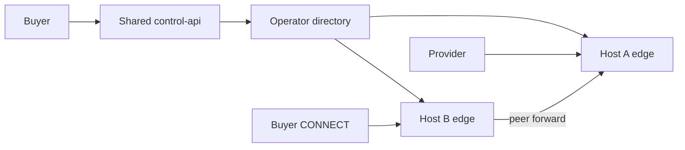

# ADR 0012 — Independent gateway operators (Wave 6)

- **Status:** Accepted (Wave 6 code 2026-08-12; live two-host soak still pending)
- **Date:** 2026-08-12
- **Related:** ADR 0007, `WAVE6_DECENTRALIZATION_PLAN.md`, W5.B evidence
- **Non-goals:** DePIN marketing, unsafe `programs/session`, fully split control plane

---

## Context

Wave 5.B proved multi-operator **discovery + same-host peer-forward**. Both edges
still share one VM and one control plane. ADR 0007 explicitly deferred independent
hosts and live slash.

Wave 6 attacks the **host SPOF** first, then attestation, then cross-host soak.
Economic slash remains design-gated.

## Decision

### D1 — Host diversity before control-plane split

| Capability | W5.B | W6 target |
|------------|------|-----------|
| Distinct logical operators | Yes (J2) | Yes |
| Distinct hosts | No | **Required for W6.A PASS** |
| Shared control-api | Yes | Allowed through W6 |
| Operator-signed manifest | No | **W6.B** |
| Cross-host peer-forward | No | **W6.C** |
| Live on-chain slash | No | Deferred (W6.D design only) |

### D2 — Trust model (honest)

Buyers still mint sessions via shared control-api. Independence claim is:
**gateway data plane** survives loss of the other operator host, and routing can
cross hosts — not that ProxyHubb cannot censor discovery.

### D3 — Explicit non-goals

- Do **not** claim DePIN from two VMs + shared API.
- Do **not** deploy `programs/session` for slash.
- Do **not** require a second Postgres/control-api to close Wave 6.
- Do **not** treat sticky LB cookies as operator diversity.

### D4 — Manifests and bond-enforce (W6.B / W6.D)

- Canonical operator manifest: `PROXYHUB_OPERATOR_MANIFEST:v1:…` Ed25519 over
  slug, pubkey, host_id, endpoints, stake/bond, expiry.
- `PROXYHUB_OPERATOR_MANIFEST=off|observe|enforce` (default off).
- `PROXYHUB_GATEWAY_OPERATOR_BOND_ENFORCE=off|observe|enforce` (default off;
  `true` aliases enforce).
- Host diversity is computed from `host_id` (loopback twins → `same_host`).

## Consequences

- Wave 6 PASS language: **independent-host gateway fleets + cross-host soak**,
  control-plane SPOF acknowledged.
- Wave 7 candidate: split or federate control-plane / session minting
  ([`WAVE7_DECENTRALIZATION_PLAN.md`](../ops/WAVE7_DECENTRALIZATION_PLAN.md),
  ADR 0013).
