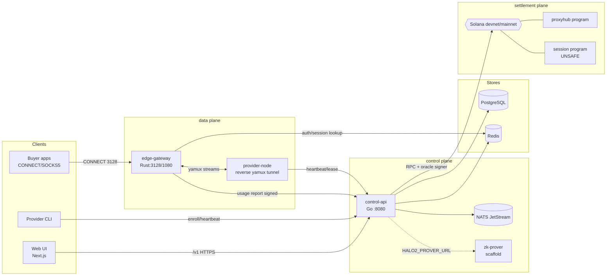

# 01 — System Architecture Map

## 1. Component Inventory

| Component | Path | Lang / Framework | Responsibility | Talks to | Owns (data) | Status |
|-----------|------|------------------|----------------|----------|-------------|--------|
| Web app | `apps/web` | TypeScript / Next.js 16 (App Router, React Query, Zustand) | Buyer/provider/admin/public UI | control-api `/v1` via rewrites; explorer WS | none (stateless) | **Complete** for core; realtime fragile |
| Control API | `services/control-api` | Go / Gin, GORM, go-redis, NATS client, solana-go | Auth, marketplace, orders, escrow, wallet/ledger, sessions, usage ingest, provider ops, admin, explorer, social, governance, treasury | Postgres, Redis, NATS, Solana RPC, edge-gateway (HTTP), zk-prover (HTTP) | All canonical OLTP tables | **Complete-ish**; fragile spots below |
| Edge Gateway | `services/edge-gateway` | Rust / tokio, hyper, yamux, (QUIC feature) | Buyer proxy ingress (CONNECT, WS, SOCKS5 opt), auth, policy, provider selection, reverse tunnels, byte metering, signed usage reports | Redis, control-api HTTP, provider-node tunnels | Redis session/metering state | **Complete for CONNECT**; HTTP fwd/SOCKS4 missing |
| Provider Node | `services/provider-node` | Rust / tokio, yamux | Agent on provider machines: enrollment, reverse tunnel dial-out, CONNECT handling, post-DNS egress filtering, heartbeats, local stats | edge-gateway (outbound), control-api (heartbeat/lease) | local config/stats | **Complete** for core; no schedule/consent |
| Provider CLI | `cli` | Rust / clap | Onboarding wrapper (`join`, `start`, `doctor`) — delegates to provider-node | control-api | local config | Complete (wrapper) |
| Solana program `proxyhub` | `services/solana-programs/proxyhub/programs/proxyhub` | Rust / Anchor | Escrow, multisig oracle, staking, registry, KYC attestations, governance, jury disputes, price oracle, ZK batch anchor, channels | Solana runtime | on-chain accounts | **Partial-secure**; payout binding fixed this audit |
| Solana program `session` | `services/solana-programs/proxyhub/programs/session` | Rust / Anchor | Session escrow + gateway stake/slash | Solana runtime | on-chain accounts | **Unsafe to deploy** (BC-03/04) |
| Reputation program | `programs/reputation` | Rust / Anchor | Stake/slash/verify-usage | — | — | **Stub** (fake program ID, no CPI, no proof verify) |
| Relayer | `services/relayer` | Go | Former ETH marketplace relayer | — | — | **Decommissioned** (`os.Exit(1)`) |
| zk-prover | `services/zk-prover` | Rust / Halo2 (HTTP) | Batch digest proofs | control-api (`HALO2_PROVER_URL`) | — | **Scaffold**; on-chain verifies oracle sig, not Halo2 |
| admin-cli | `services/admin-cli` | Rust | DB cleanup/seed/ping | Postgres | — | Utility; destructive guard missing |
| SDKs | `sdks/go`, `sdks/nodejs`, `sdks/python` (`sdks/node` deprecated) | Go/TS/Py | Bulk proxy-pool API clients (`X-API-Key`) | control-api `/v1/bulk/*` | — | Complete for bulk surface |
| Postgres | `infra/postgres`, `migrations/` | PostgreSQL 16 | System of record | control-api, relayer (legacy) | all OLTP | OK for MVP scale |
| Redis | — | Redis 7 | Sessions, metering WAL, cache, rate limits, streams | control-api, edge-gateway | volatile state | **SPOF** |
| NATS | — | NATS 2.10 JetStream | Async events (sessions, settlement, telemetry, messaging) | control-api producers/consumers | streams | OK; treasury subjects unstreamed |
| Prometheus/Grafana/OTEL | `infra/prometheus`, `infra/grafana`, `infra/otel` | — | Metrics/alerts/dashboards; tracing (debug-only collector) | all services | TSDB | Partial (prod alert mount fixed; OTEL debug-only) |
| HAProxy / pgbouncer / k8s | `infra/haproxy`, `infra/k8s` | — | TLS, pooling, orchestration | — | — | Partial; broken deploy refs |

**Data stores present:** PostgreSQL, Redis, NATS JetStream, Solana. **Absent:** Kafka, ClickHouse, TimescaleDB, object storage (referenced nowhere in code).

## 2. Context Diagram (as-built)

## 3. Trust Boundaries

| Boundary | Crosses | Current controls | Gaps |
|----------|---------|------------------|------|
| Buyer ↔ Gateway | untrusted client → data plane | Basic/JWT proxy auth, port/IP/hostname policy, admission semaphore, rate limit | No per-session concurrency/RPM; HTTP fwd unimplemented (501 confusion) |
| Gateway ↔ Provider | tunnel | Provider token → gateway JWT; optional lease enforcement | Lease optional in compat mode; DNS-rebinding defense lives only on provider |
| Gateway ↔ Control API | metering | `X-Gateway-Auth` shared secret + Ed25519 usage signature | Signature soft-accept **fixed**; WAL/nonce replay windows remain |
| Public ↔ Control API | API | Wallet-JWT, API keys+scopes, WAF/DDoS, CORS whitelist | Role-key mismatch **fixed**; dev flags defaulted on **fixed** |
| Control API ↔ Solana | money | Oracle keypair signer (file or KMS), velocity guard, confirmed commitment | Hot wallet = treasury spender; confirmed-not-finalized deposits |
| Admin ↔ Control API | ops | Separate admin JWT + `ADMIN_API_ENABLED` gate | Dispute admin routes mounted on user JWT group |
| K8s data stores | cluster | NetworkPolicy partial | pgbouncer empty-password MD5; Redis no auth (SEC-04/05) |

## 4. Events & Data Ownership (summary — detail in `06`, `12`)

- **Producers/consumers (JetStream):** sessions.created/terminated → provision worker; settlement.receipts.created → settlement worker; telemetry.heartbeat → marketplace watcher; messaging.broadcast → WS hub.
- **Orphaned:** `proxy.treasury.v1.*` (no stream), `settlement.manifests.coordinated` (no consumer), `telemetry.alerts` (no consumer), Redis `user.loggedin` (no producer).
- **Ownership:** control-api owns all OLTP writes; edge-gateway never touches Postgres (correct); relayer still contains direct wallet writes (legacy, conflicting column names).

## 5. Deployment Map (as-built)

- **Local/dev:** `docker-compose.yml` (now loopback-bound DB/Redis/NATS ports after fix) with profile-gated OTEL.
- **GCP testnet/prod:** `docker-compose.gcp-testnet.yml` + `docker-compose.gcp-images.yml` (GHCR `samuel-1-avson/*`), provisioned by `scripts/gcp-testnet-provision.sh`; backup cron tooling in `scripts/gcp-postgres-backup*.sh`.
- **Claimed k8s/EKS path:** `.github/workflows/deploy.yml` → **broken** (missing `infra/k8s/overlays/{staging,production}`, registry mismatch `ghcr.io/proxyhubb/*`).
- **Frontend:** `apps/web/Dockerfile` (standalone); bakes `NEXT_PUBLIC_WS_URL=ws://localhost:18080` default (browser-hostile).

## 6. Mocked / Dead / Disconnected Inventory

| Item | Kind | Evidence |
|------|------|----------|
| `main_secure.go` | dead (build-ignored) | `//go:build ignore`; Dockerfile builds `main.go` |
| `proto/gateway.proto` gRPC | unused contract | control-api & gateway use HTTP instead |
| 11 `Register*` packages (pricing, favorites, teams, badges, admin_extended…) | unwired | not called in `main.go` |
| `usage_records` table | writer never called | `analytics.go` only defines helper |
| Redis event types (`user.registered`, `order.*`…) | declared, unused | `events/queue.go:12-19` |
| `/v1/circle/my-contributions`, `/revenues` | stubs returning `[]` | `circle_pool.go:48-57` |
| ZK reputation verify (frontend) | client-side mock `ph-local-zk-*` | `marketplace.ts:677-684` |
| Supabase clients | stubs + dead env | `lib/supabase/*`, Dockerfile args |
| Landing stats / provider uptime | hardcoded | `page.tsx:69-73`, `providers/[id]/page.tsx:83` |
| Reputation program | fake ID, no-op verify | `programs/reputation/src/lib.rs:3` |
| Relayer | exits 1 | `services/relayer/main.go` |
| control-api local `migrations/` | divergent, unapplied | runner uses repo-root `migrations/` |
| `infra/docker-compose/docker-compose.yml` | legacy footgun | hardcoded `POSTGRES_PASSWORD: password` |
