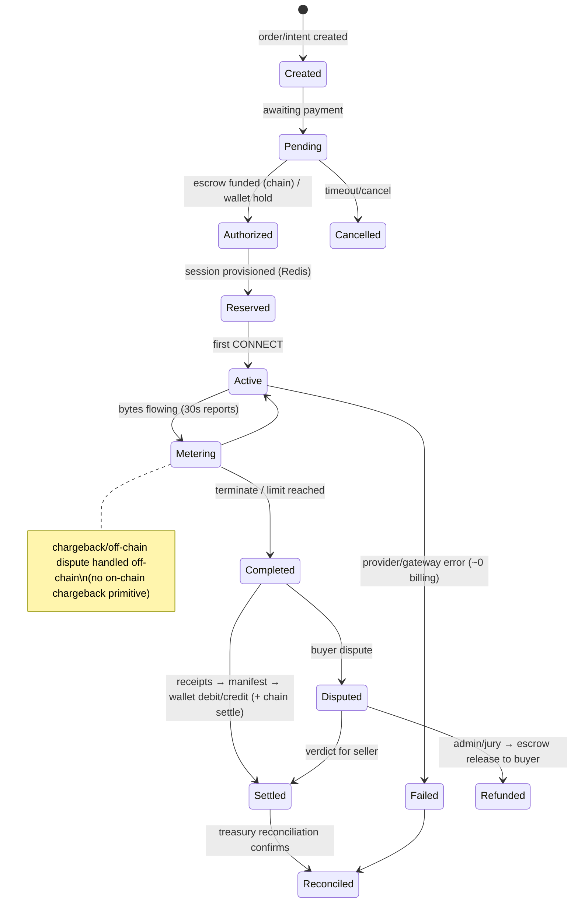

# 10 — Billing, Wallet, Escrow & Transaction Audit

## 1. Accounting Model

**Current model:** mutable balance column + append-only single-entry journal.

```text
wallets.balance_sol (NUMERIC(20,9))         ← mutated in place
wallet_ledger_entries (wallet_id, type, ±amount, balance_after, reference_id, tx_hash)
```

Helpers `LockWalletForUpdate` / `CreditWalletLocked` / `DebitWalletLocked` (`internal/models/wallet_tx.go:12-65`) wrap lock+update+insert atomically. **This is not double-entry accounting** (no debit/credit account pairs, no balance equation). Drift is detected after the fact by reconciliation, not prevented by construction.

| Check | Verdict | Evidence |
|-------|---------|----------|
| Every movement has ledger entry | ⚠️ mostly | helpers enforce it; `staking.go:168-191`, `escrow_listener.go` hand-roll updates |
| Balances never modified without journal | ⚠️ by convention only | no DB trigger/REVOKE (DB-03) |
| Fixed precision | ⚠️ | NUMERIC(20,9) columns OK; **Go float64** (`models/wallet.go:27-52`), lamports helpers mitigate; DOUBLE PRECISION money columns in intents/receipts/circle/recon (DB-02) |
| Idempotency keys | ✅ | unique `(wallet_id,type,reference_id)` partial (000109); `pending_transactions.idempotency_key`; receipts `(session,nonce)`; deposit `reference=txHash` unique |
| Duplicate usage charge protection | ✅⚠️ | receipt unique + SetNX `billing:receipt:<id>:applied` (aggregator.go:122-129); residual GW-08 windows |
| Concurrent overspend | ✅ | `SELECT … FOR UPDATE` ordered locks; `balance_sol>=0` CHECK (000032/000042) |
| Holds/reservations | ⚠️ | spending limits + pending ledger in Redis; no formal hold state in PG |
| Partial sessions | ✅ | proportional on-chain payout `min(used,limit)/limit` (lib.rs settle) |
| Failed connections billed | ✅ fair | ~0 bridged bytes → ~0 charge |
| Refund consistency | ✅⚠️ | on-chain settle BEFORE DB release when PDA present; compensation outbox for chain failures (000108) |
| Revenue/commission reconcile | ⚠️ | `escrowOnChainSkimsPlatformFee=false` drift flag (BE-13); treasury reconciliation hourly |
| Chain vs internal reconcile | ✅ | `treasury/reconciliation.go`: treasury vs Σ balances; per-wallet balance vs Σ journal; orphan-ref scan |
| Admin financial actions audited | ✅ | audit logs + admin JWT gate |
| Withdrawal fraud prevention | ✅ strong | linked/whitelist dest, 24h cooldown, flags freeze, limits, Ed25519 re-sign for large amounts, 5/min RL, oracle preflight |

## 2. Transaction State Machine (as-built)



Gaps: `Reserved`/`Metering` states live in Redis only (lost on Redis outage); `Failed` has no automatic buyer credit policy; `Chargeback` is an off-chain ops process without ledger types.

## 3. Escrow Flow (critical path)

1. Buyer funds escrow PDA via frontend-built tx (non-custodial) — `apps/web/src/lib/solana.ts`.
2. Release: control-api prefers **on-chain settle before DB release** (`escrow.go:162-195`) — correct ordering.
3. On-chain `settle_escrow`: authority ∈ {buyer, seller, admin}; proportional payout with checked math; **payout accounts now bound to escrow record (BC-01 fix — redeploy required)**.
4. Multisig path: ed25519 precompile introspection + threshold; nonce bumped on settle (**BC-06 resolved** 2026-08-08).
5. Milestones: locked row + `CreditWalletLocked` (`escrow_milestones.go:57-88`) — good.

## 4. Withdrawal Flow

`wallet.go:658+`: security gates (whitelist/cooldown/flags/limits/re-sign/RL/preflight) → lock → debit → ledger → `oracle.SendSOL` → on chain failure: compensating credit + compensation outbox (000108). **Sound**, with residual risks: custodial hot wallet (BC-08), confirmed-vs-finalized elsewhere (BC-07), oracle underfund blocks by design (BE-12).

## 5. Usage Charging Pipeline (post-fix)

```
gateway meters bytes (authoritative) → signed report (Ed25519) → control-api
→ VerifySignature FAIL-CLOSED (BE-01 fixed; 4 regression tests)
→ receipt upsert (unique) → Redis pending → NATS settlement.receipts
→ settlement worker → manifest → buyer debit / provider credit / fee
```

**Remaining metering risks (GW-08):** millis-nonce dedup windows; WAL requeue only at restart. Fix spec in `17`.

## 6. "Wireless transaction system" interpretation (as requested)

| Reading | Audit result |
|---------|--------------|
| Bandwidth usage transactions | Covered above; gateway-measured, signed, batched |
| Wallet transactions | Covered §1; single-entry + reconciliation |
| Provider→buyer settlement | On-chain proportional settle; payout binding fixed |
| Mobile/wireless provider connectivity | Provider agent works on mobile/CGNAT (outbound tunnel); no mobile-specific metering |
| Blockchain transaction handling | confirmed-commitment deposits (BC-07); finalized for outbound blockhash; unique tx-hash dedup; watcher + indexer |

## 7. Findings

| ID | Title | Severity | Status |
|----|-------|----------|--------|
| FIN-01 (=DB-01) | Not double-entry | High | Open |
| FIN-02 (=DB-02) | float64/DOUBLE PRECISION money | High | Partial (Sprint I) |
| FIN-03 (=DB-03) | Ledger mutable at DB layer | High | Open |
| FIN-04 (=BE-01) | Usage signature soft-accept | High | **Fixed** |
| FIN-05 (=GW-08) | Metering WAL/nonce windows | Medium-High | Open |
| FIN-06 (=BE-10) | Async P2P settle post-commit | Low-Med | Open |
| FIN-07 (=BE-13) | Platform-fee chain/DB drift flag | Low | Open |
| FIN-08 (=BC-07) | Deposits confirmed-not-finalized | Medium | Open |
| FIN-09 (=BC-08) | Custodial hot wallet = treasury spender | High | **Resolved** 2026-08-08 (vault≠hot≠oracle; `BC08_custody_split_*.md`) |
| FIN-10 | No formal hold/reservation state in PG | Medium | Open |
| FIN-11 | No automatic failed-session credit policy | Low-Med | Open |
