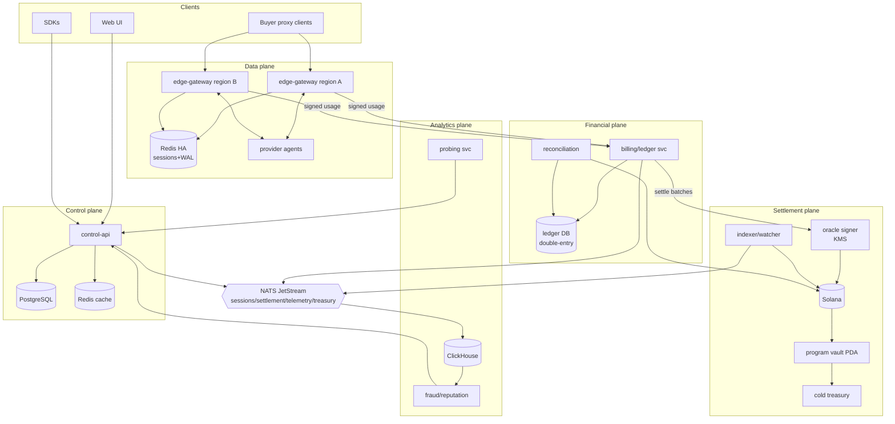
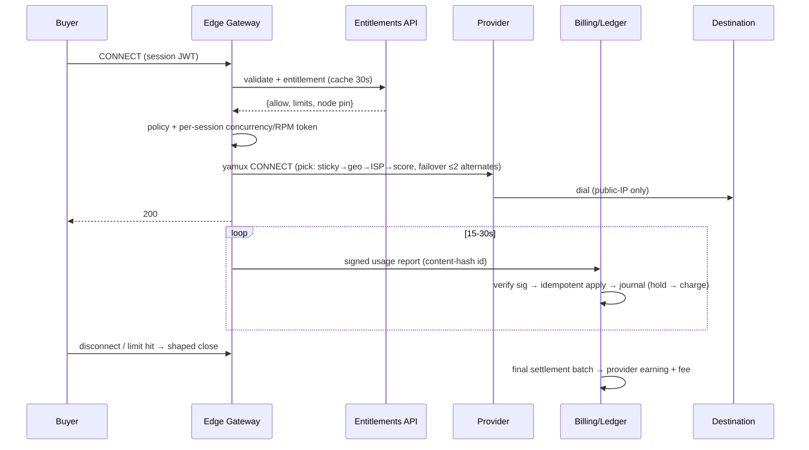

# 18 — Target Production Architecture

Design goal: keep what works (reverse tunnels, gateway-measured metering, Solana escrow, wallet-ledger helpers) and re-plane the system so correctness, scale, and trust boundaries are explicit.

## 1. Planes

| Plane | Contents | Owns | Must never do |
|-------|----------|------|---------------|
| **Control plane** | control-api (auth, marketplace, orders, sessions, provider mgmt, admin), Postgres, Redis(cache) | OLTP entities, entitlements | meter traffic; hold raw telemetry |
| **Data plane** | edge-gateway fleets (regional), provider agents, tunnel registry, session cache (Redis HA) | live sessions, byte counters, WAL | write Postgres directly; make billing decisions |
| **Financial plane** | billing/ledger service (extracted from control-api), double-entry ledger DB, escrow coordinator, payout service, reconciliation | journal, holds, settlements | trust gateway/provider numbers without verification |
| **Settlement plane** | Solana programs, oracle signer (KMS), indexer/watcher, cold treasury, batch settlement | on-chain state, proofs | custody deposits in a hot wallet |
| **Analytics plane** | ClickHouse (usage/explorer rollups), NATS→warehouse consumers, fraud/reputation scoring, probing service | historical telemetry, stats | serve transactional reads |

## 2. Component Diagram



## 3. Key Architectural Changes vs As-Built

| # | Change | Why |
|---|--------|-----|
| 1 | **Double-entry ledger DB** (journal lines: debit/credit account pairs; balance as materialized view) | DB-01/03 — provable consistency, immutable journal |
| 2 | **Program vault PDA for deposits; hot wallet only for withdrawals; cold treasury** | BC-08 — key compromise no longer drains user funds |
| 3 | **Metering report-id = content hash; WAL requeue; ACK-before-delete** | GW-08 — exactly-once billing semantics |
| 4 | **Entitlement check at CONNECT** (gateway → control-api entitlements API with 30s cache) | T7 — no access without purchase; instant revocation |
| 5 | **Per-session concurrency/RPM/shaping enforced in gateway** | GW-03/05 — purchased limits real |
| 6 | **Bounded failover (N alternates) per CONNECT** | GW-06 — session reliability |
| 7 | **Telemetry to ClickHouse via NATS consumers; OLTP keeps 7-30d hot window** | EV-06 — OLTP stays lean |
| 8 | **Probing service** continuously measures node latency/uptime/geo/ISP from platform vantage points | T4/FE-06 — honest marketplace stats |
| 9 | **DLQs + consumer-lag metrics + treasury stream** | EV-01/06/07 — durable events |
| 10 | **Gateway↔control mTLS or short-lived signed JWTs** | SEC-08/API-08 |
| 11 | **gRPC ControlPlane implemented (or proto deleted)** | GW-09/BE-11 — one contract |
| 12 | **On-chain: payout binding (done), Config-bound session program, finalized deposits, ZK only when real** | BC-01..11 |

## 4. Proxy-Session Sequence (target)



## 5. Purchase & Settlement Sequence (target)

```mermaid
sequenceDiagram
    participant U as Buyer
    participant A as control-api
    participant L as Ledger
    participant O as Oracle(KMS)
    participant S as Solana

    U->>A: purchase listing
    A->>L: hold(buyer, amount) [journal: available→held]
    U->>S: fund escrow PDA (wallet-signed)
    A->>A: verify funding (finalized)
    A->>L: convert hold → escrowed
    Note over U,S: usage metering off-chain
    A->>O: settle batch (N sessions)
    O->>S: settle_escrow ×N (payouts bound to escrow record)
    S-->>A: confirmed events (indexer)
    A->>L: escrowed→provider payable; fee→platform revenue
    L->>L: daily payout run → withdrawable
```

## 6. Failure-Recovery Sequence (target)

```mermaid
sequenceDiagram
    participant G as Gateway
    participant W as WAL(PG/Redis HA)
    participant B as Billing
    participant R as Reconciliation

    G->>W: append report (id=hash)
    G->>B: deliver report
    B--xG: timeout
    G->>W: keep entry; retry with backoff
    G->>B: redeliver (same id)
    B->>B: idempotent apply (id unique)
    Note over G: crash
    G->>W: on restart, reload unacked
    G->>B: replay → dedup by id
    R->>R: hourly: Σjournal == balances; receipts vs settlements; chain vs ledger
    R->>B: alert + auto-heal queue for gaps
```

## 7. Trust-Boundary Diagram

```mermaid
flowchart LR
    subgraph Untrusted
        BU[Buyers]
        PR[Providers]
    end
    subgraph SemiTrusted[Semi-trusted (verify everything)]
        GW[Edge gateways]
    end
    subgraph Trusted[Trusted core]
        API[control-api]
        BILL[billing/ledger]
    end
    subgraph RootOfTrust[Root of trust]
        KMS[KMS signer]
        PROG[Solana programs]
    end
    BU -->|authn + entitle| GW
    PR -->|lease + attest| GW
    GW -->|signed, verified, deduped| BILL
    PR -.never trusted for billing.-> BILL
    BILL --> API
    BILL -->|batch settle requests| KMS
    KMS --> PROG
```

Rules: providers never authoritative for usage; gateways never authoritative for policy; ledger never accepts unverifiable reports; chain payouts bound to escrow records; KMS never exports keys.

## 8. Deployment & DR (target)

- **Regions:** ≥2 gateway fleets behind anycast/DNS; control plane active-passive across zones; PG primary+replica; Redis sentinel; NATS cluster.
- **Kubernetes:** fix overlays; all secrets from ExternalSecrets/KMS; NetworkPolicy default-deny; PgBouncer with real auth; no `:latest`.
- **DR:** PG PITR + cross-region snapshot copy; documented RTO/RPO; restore drill scheduled (tooling already exists).
- **Observability:** Prometheus + Grafana (existing) + durable tracing (Tempo/Jaeger) + NATS lag + financial-invariant alerts (Σjournal≠balance, recon mismatch, metering delay, settle backlog).
