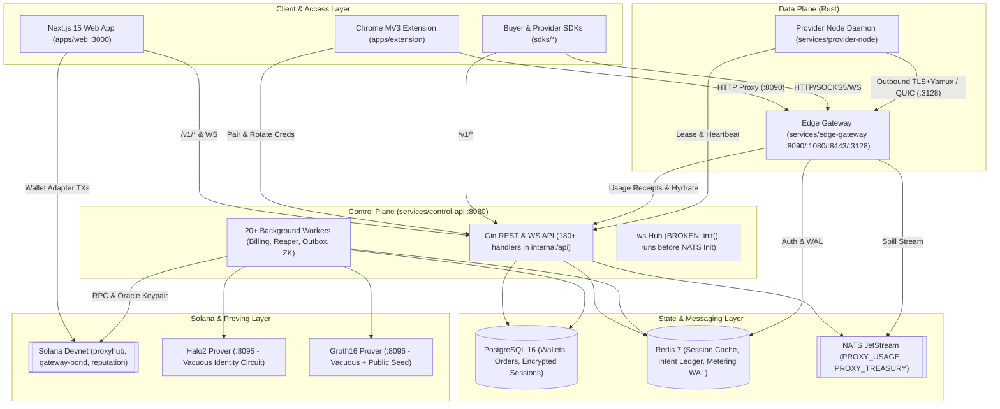
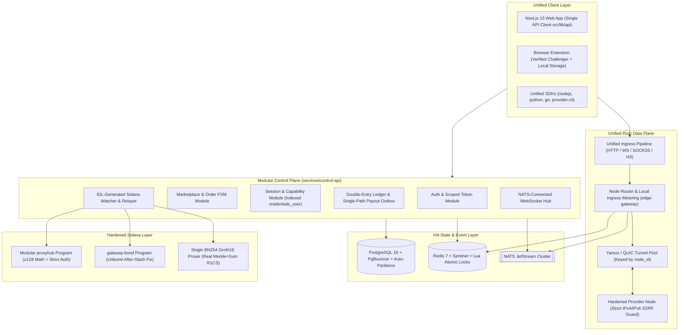
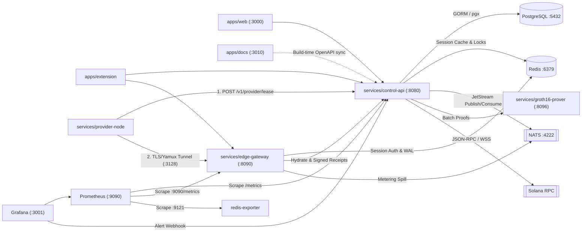
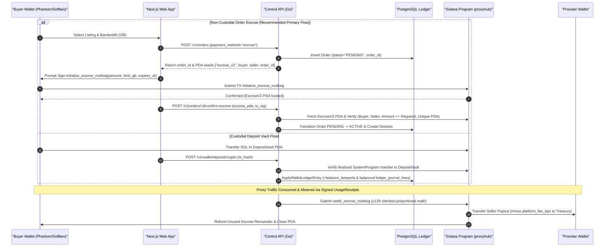
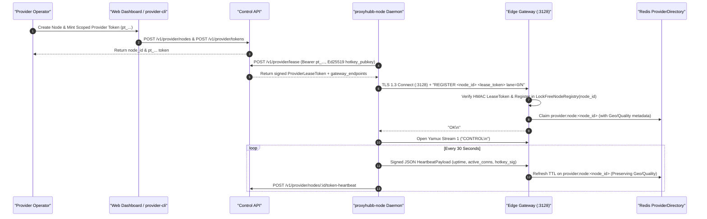
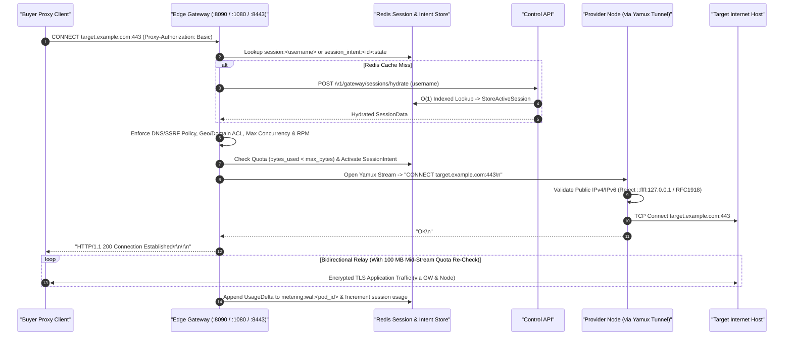
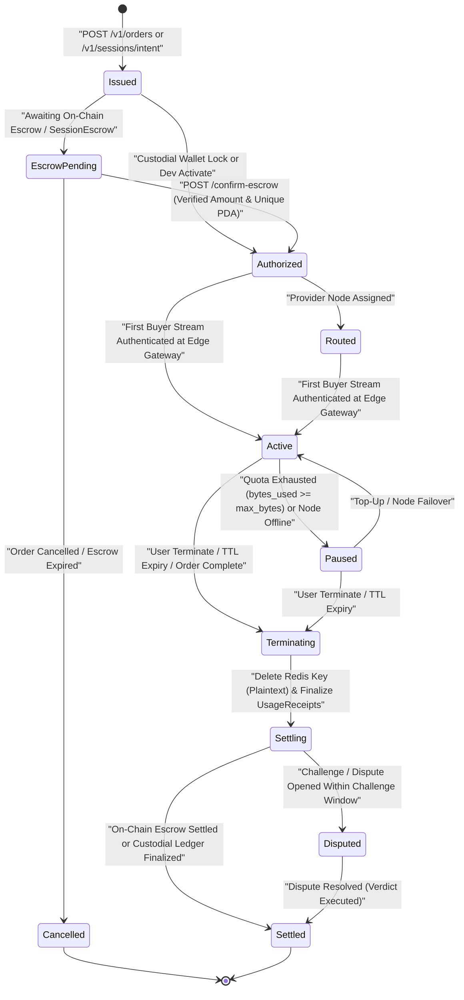
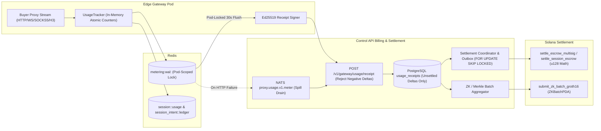
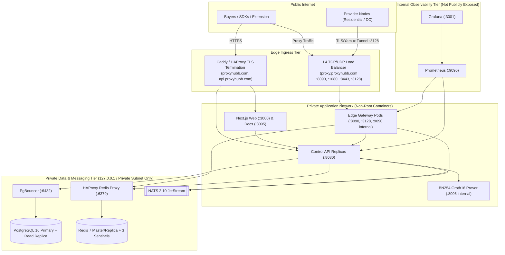

# Complete System Architecture, Blockchain, Infrastructure & Codebase Audit — ProxyHubb (`ProxySocialHub`)

- **Repository**: `c:/Users/samue/OneDrive/Desktop/projects/ProxySocialHub`
- **Audit Date**: October 25, 2026
- **Audit Classification**: End-to-End Principal Architecture, Smart Contract, Cryptographic/ZK, Wallet/Treasury, Data-Plane, Frontend/Extension/SDK, Database, and Infrastructure Security & Performance Audit
- **Mode**: Strict Read-Only Codebase Inspection + Non-Destructive Local Build/Test Verification
- **Overall Weighted Engineering Score**: **4.43 / 10.0** (Confidence: **High**)
- **Production Readiness Status**: **NOT READY FOR PRODUCTION OR PUBLIC MAINNET** (Ready for **Local Development** and **Controlled Internal Testing**; conditionally ready for **MVP Demo** and **Private Testnet** only on non-financial/custodial paths after P0 hotfixes)

---

## Table of Contents

1. [Executive Summary](#1-executive-summary)
2. [Project Overview and Objectives](#2-project-overview-and-objectives)
3. [Audit Scope, Methodology and Limitations](#3-audit-scope-methodology-and-limitations)
4. [Codebase Discovery and Repository Inventory](#4-codebase-discovery-and-repository-inventory)
5. [Technology Stack Assessment](#5-technology-stack-assessment)
6. [Current System Architecture](#6-current-system-architecture)
7. [System Design and Structural Analysis](#7-system-design-and-structural-analysis)
8. [Distributed Systems Architecture](#8-distributed-systems-architecture)
9. [Blockchain Infrastructure Audit](#9-blockchain-infrastructure-audit)
10. [Smart Contract and On-Chain Logic Audit](#10-smart-contract-and-on-chain-logic-audit)
11. [Wallet Architecture and Payment Audit](#11-wallet-architecture-and-payment-audit)
12. [Provider Node Architecture and Operations](#12-provider-node-architecture-and-operations)
13. [Session Management and Orchestration](#13-session-management-and-orchestration)
14. [Features and Services Inventory](#14-features-and-services-inventory)
15. [Backend Architecture and Implementation](#15-backend-architecture-and-implementation)
16. [Frontend Architecture and User Experience](#16-frontend-architecture-and-user-experience)
17. [API, RPC and Communication Systems](#17-api-rpc-and-communication-systems)
18. [Database, Storage and State Management](#18-database-storage-and-state-management)
19. [Security Assessment and Threat Model](#19-security-assessment-and-threat-model)
20. [Performance and Scalability Assessment](#20-performance-and-scalability-assessment)
21. [Reliability, Recovery and Fault Tolerance](#21-reliability-recovery-and-fault-tolerance)
22. [Docker, DevOps and Infrastructure](#22-docker-devops-and-infrastructure)
23. [Test Coverage and Functional Verification](#23-test-coverage-and-functional-verification)
24. [Working Components and Verified Capabilities](#24-working-components-and-verified-capabilities)
25. [Partially Working Components](#25-partially-working-components)
26. [Broken, Missing and Unverified Functionality](#26-broken-missing-and-unverified-functionality)
27. [System Strengths and Advantages](#27-system-strengths-and-advantages)
28. [Weaknesses, Limitations and Technical Debt](#28-weaknesses-limitations-and-technical-debt)
29. [Security Vulnerabilities and Critical Risks](#29-security-vulnerabilities-and-critical-risks)
30. [Bugs, Issues and Root-Cause Analysis](#30-bugs-issues-and-root-cause-analysis)
31. [Engineering Scorecard and Overall Rating](#31-engineering-scorecard-and-overall-rating)
32. [Deployment and Production Readiness](#32-deployment-and-production-readiness)
33. [Keep, Fix, Refactor, Remove, Redesign and Add](#33-keep-fix-refactor-remove-redesign-and-add)
34. [Proposed Improved Architecture](#34-proposed-improved-architecture)
35. [Current Versus Proposed Architecture Comparison](#35-current-versus-proposed-architecture-comparison)
36. [Prioritized Engineering Roadmap](#36-prioritized-engineering-roadmap)
37. [Immediate Next Actions](#37-immediate-next-actions)
38. [Long-Term Engineering Recommendations](#38-long-term-engineering-recommendations)
39. [Final Technical Assessment and Conclusion](#39-final-technical-assessment-and-conclusion)
40. [Appendices: Evidence, Test Results, File References, Diagrams and Open Questions](#40-appendices-evidence-test-results-file-references-diagrams-and-open-questions)
    - [Appendix A: Answers to All 20 Final Decision-Making Questions & Top-10 Ranked Engineering Tasks](#appendix-a-answers-to-all-20-final-decision-making-questions--top-10-ranked-engineering-tasks)
    - [Appendix B: Command & Test Execution Evidence Log](#appendix-b-command--test-execution-evidence-log)

---

## 1. Executive Summary

### 1.1 High-Level Technical Verdict
**ProxyHubb** (`ProxySocialHub`) is an ambitious, large-scale Decentralized Physical Infrastructure Network (DePIN) and social marketplace for residential, mobile, and datacenter proxy bandwidth built with a **Go control plane (`services/control-api`)**, a **Rust high-concurrency proxy data plane (`services/edge-gateway`)**, a **Rust provider tunnel agent (`services/provider-node` & `cli`)**, **three Solana Anchor smart contracts (`proxyhub`, `gateway-bond`, `reputation`)**, **two Rust ZK proof services (`services/zk-prover` and `services/groth16-prover`)**, a **Next.js 15 App Router web platform (`apps/web`)**, a **Manifest V3 browser extension (`apps/extension`)**, an **MDX documentation portal (`apps/docs`)**, and **six client/provider SDKs (`sdks/*`)**.

Despite substantial engineering investment—including 706 Go files in `control-api`, 192 passing unit tests in `edge-gateway`, 29 passing unit tests in `provider-node`, an append-only lamport-mirror PostgreSQL ledger (`migrations/000116` and `000124`), and an extensive 85-route Next.js frontend—**the system in its current state contains catastrophic, exploitable P0 vulnerabilities across its smart contracts, treasury/wallet accounting, session credential lifecycle, and data-plane egress controls that make it unsafe for real-money operation or public deployment.**

### 1.2 Summary of Fatal P0 Blockers
1. **Primary Solana Program (`proxyhub`) Fails to Compile (`BC-CRIT-01`)**:
   - [`services/solana-programs/proxyhub/programs/proxyhub/src/lib.rs`](file:///c:/Users/samue/OneDrive/Desktop/projects/ProxySocialHub/services/solana-programs/proxyhub/programs/proxyhub/src/lib.rs#L3191-L3193) references `EscrowError::InvalidCalculation` in `claim_bandwidth_rewards`, a variant that does not exist in `pub enum EscrowError` ([`lib.rs:16-83`](file:///c:/Users/samue/OneDrive/Desktop/projects/ProxySocialHub/services/solana-programs/proxyhub/programs/proxyhub/src/lib.rs#L16-L83)). Verified via `cargo check` (`error[E0599]`).
2. **Multiple Unauthenticated On-Chain Fund-Drain & Governance-Takeover Instructions (`BC-CRIT-02` through `BC-CRIT-06`, `BC-CRIT-08`, `BC-HIGH-01`, `BC-HIGH-02`)**:
   - **Unauthenticated Epoch Reward Pool Drain**: `claim_bandwidth_rewards` ([`lib.rs:3175-3228`](file:///c:/Users/samue/OneDrive/Desktop/projects/ProxySocialHub/services/solana-programs/proxyhub/programs/proxyhub/src/lib.rs#L3175-L3228), [`lib.rs:4464-4475`](file:///c:/Users/samue/OneDrive/Desktop/projects/ProxySocialHub/services/solana-programs/proxyhub/programs/proxyhub/src/lib.rs#L4464-L4475)) allows any arbitrary Solana wallet (`provider_wallet: Signer`) to pass `provider_bytes_verified = pool.total_bandwidth_verified` with zero oracle signature or per-provider claim receipt PDA, draining 100% of `EpochRewardPool` in one transaction.
   - **Unauthenticated Provider Stake Theft**: `update_program_config` ([`lib.rs:3745-3775`](file:///c:/Users/samue/OneDrive/Desktop/projects/ProxySocialHub/services/solana-programs/proxyhub/programs/proxyhub/src/lib.rs#L3745-L3775), [`lib.rs:5177-5192`](file:///c:/Users/samue/OneDrive/Desktop/projects/ProxySocialHub/services/solana-programs/proxyhub/programs/proxyhub/src/lib.rs#L5177-L5192)) and `unstake_provider` ([`lib.rs:2487-2551`](file:///c:/Users/samue/OneDrive/Desktop/projects/ProxySocialHub/services/solana-programs/proxyhub/programs/proxyhub/src/lib.rs#L2487-L2551), [`lib.rs:4895-4910`](file:///c:/Users/samue/OneDrive/Desktop/projects/ProxySocialHub/services/solana-programs/proxyhub/programs/proxyhub/src/lib.rs#L4895-L4910)) accept any `oracle: Signer` without checking `oracle.key() == program_state.admin`. An attacker can set `unstake_cooldown_seconds = 1` and withdraw every provider's `StakeAccount` PDA directly into the attacker's wallet (`**oracle_ai.try_borrow_mut_lamports()? += amount` at [`lib.rs:2535-2538`](file:///c:/Users/samue/OneDrive/Desktop/projects/ProxySocialHub/services/solana-programs/proxyhub/programs/proxyhub/src/lib.rs#L2535-L2538)).
   - **M-of-N Emergency Pause Bypass**: `multi_sig_pause_vote` ([`lib.rs:1794-1835`](file:///c:/Users/samue/OneDrive/Desktop/projects/ProxySocialHub/services/solana-programs/proxyhub/programs/proxyhub/src/lib.rs#L1794-L1835)) accepts `approvals: Vec<Pubkey>` as an instruction argument and only checks `oracle.signers.contains(pk)` without verifying that those keys signed the transaction.
   - **Silent `u64` Multiplication Overflow Zeroes Seller Payout**: In `settle_escrow_multisig`, `settle_escrow_mutual_receipt`, and `settle_escrow` ([`lib.rs:2011-2016`](file:///c:/Users/samue/OneDrive/Desktop/projects/ProxySocialHub/services/solana-programs/proxyhub/programs/proxyhub/src/lib.rs#L2011-L2016), [`lib.rs:2171-2176`](file:///c:/Users/samue/OneDrive/Desktop/projects/ProxySocialHub/services/solana-programs/proxyhub/programs/proxyhub/src/lib.rs#L2171-L2176), [`lib.rs:2699-2705`](file:///c:/Users/samue/OneDrive/Desktop/projects/ProxySocialHub/services/solana-programs/proxyhub/programs/proxyhub/src/lib.rs#L2699-L2705)), `escrow.amount.checked_mul(capped_usage).unwrap_or(0)` overflows `u64::MAX` (`1.844e19`) whenever `amount_lamports * bytes_used > 1.844e19` (e.g., `1 SOL` escrow with `20 GB` usage in bytes = `2.147e19`), silently paying the seller `0` lamports and refunding 100% to the buyer.
3. **Vacuous ("Identity") Zero-Knowledge Circuits & Public Hardcoded Trusted Setup Seed (`BC-CRIT-07`)**:
   - Both the Halo2 prover ([`services/zk-prover/src/circuit.rs:19-59`](file:///c:/Users/samue/OneDrive/Desktop/projects/ProxySocialHub/services/zk-prover/src/circuit.rs#L19-L59)) and the BN254 Groth16 prover ([`services/groth16-prover/src/lib.rs:22-39`](file:///c:/Users/samue/OneDrive/Desktop/projects/ProxySocialHub/services/groth16-prover/src/lib.rs#L22-L39)) compute SHA-256 digests in native Rust *outside* the circuit and only constrain `witness == public_input` (`w * 1 = p`). Worse, the Groth16 trusted setup is generated from a **public hardcoded 64-bit seed `0x5052_4F58_5948_5542` (`"PROXYHUB"`)** ([`services/groth16-prover/src/lib.rs:18, 117`](file:///c:/Users/samue/OneDrive/Desktop/projects/ProxySocialHub/services/groth16-prover/src/lib.rs#L18)), meaning anyone knows the toxic waste trapdoor and can forge Groth16 proofs for any public input.
4. **Off-Chain Treasury Drain via P2P Transfer Double-Credit & Provider Triple-Payout (`BE-CRIT-01`, `BE-CRIT-02`)**:
   - `transferP2P` ([`services/control-api/internal/api/wallet.go:545-570, 1081-1166`](file:///c:/Users/samue/OneDrive/Desktop/projects/ProxySocialHub/services/control-api/internal/api/wallet.go#L545-L570)) credits `recipientWallet.BalanceSOL` in PostgreSQL **and then** calls `settleP2POnChain` (`oracle.SendSOL`), sending real SOL from the platform's hot treasury wallet to the recipient's external Solana wallet without debiting `recipientWallet.BalanceSOL`. Two colluding users transferring back and forth can drain 100% of the platform hot wallet.
   - Provider earnings can be paid up to **3 times** across `billing/worker.go:560-758`, `session.go:758` -> `provider_earnings.go:201-205`, and `POST /v1/provider/claim/confirm` ([`provider_claim.go:84-219`](file:///c:/Users/samue/OneDrive/Desktop/projects/ProxySocialHub/services/control-api/internal/api/provider_claim.go#L84-L219)).
5. **Systemic Session Credential Encryption Breakdown Across 10+ Control-Plane Flows (`BE-CRIT-04`)**:
   - `models.Session` ([`services/control-api/internal/models/session.go:76-177`](file:///c:/Users/samue/OneDrive/Desktop/projects/ProxySocialHub/services/control-api/internal/models/session.go#L76-L177)) encrypts `CredentialsUser` and `CredentialsPass` in-place to `"ENC:<base64>"` in `BeforeCreate`/`BeforeSave` using a random AES-256-GCM nonce, but defines **no `AfterFind` decryption hook**. As a result:
     - `SessionReaper` ([`internal/worker/session_reaper.go:31-83`](file:///c:/Users/samue/OneDrive/Desktop/projects/ProxySocialHub/services/control-api/internal/worker/session_reaper.go#L31-L83)) queries `redis.SessionExists("ENC:...")` every 5 minutes, always gets `false`, and **kills every active non-order session in the database every 5 minutes**.
     - `terminateSession` ([`internal/api/session.go:711-789`](file:///c:/Users/samue/OneDrive/Desktop/projects/ProxySocialHub/services/control-api/internal/api/session.go#L711-L789)) and `cancelOrder` ([`internal/api/orders.go:946-952`](file:///c:/Users/samue/OneDrive/Desktop/projects/ProxySocialHub/services/control-api/internal/api/orders.go#L946-L952)) call `redis.DeleteSession("ENC:...")`, leaving terminated/cancelled `"session:<plaintext>"` proxy credentials active in Redis for up to 24 hours.
     - `createOrder` (wallet path, [`orders.go:520`](file:///c:/Users/samue/OneDrive/Desktop/projects/ProxySocialHub/services/control-api/internal/api/orders.go#L520)), `activateDevOrder` ([`orders_dev_activate.go:84-96`](file:///c:/Users/samue/OneDrive/Desktop/projects/ProxySocialHub/services/control-api/internal/api/orders_dev_activate.go#L84-L96)), and `finalizeSandboxBuy` ([`orders_sandbox_buy.go:48-63`](file:///c:/Users/samue/OneDrive/Desktop/projects/ProxySocialHub/services/control-api/internal/api/orders_sandbox_buy.go#L48-L63)) return `"ENC:<base64>"` ciphertext to buyers instead of usable proxy credentials.
6. **1-Lamport Escrow Underfunding & Escrow PDA Reuse (`BE-CRIT-03`)**:
   - `confirmEscrow` ([`internal/api/orders_confirm_escrow.go:173-208`](file:///c:/Users/samue/OneDrive/Desktop/projects/ProxySocialHub/services/control-api/internal/api/orders_confirm_escrow.go#L173-L208)) only checks `escrow.Amount > 0` without checking `escrow.Amount >= requiredLamports`, `escrow.BandwidthLimitGB >= order.BandwidthGB`, or whether `escrow_pda` is already bound to another order. `confirmSessionIntentEscrow` ([`internal/api/session_intent_escrow.go:230-239`](file:///c:/Users/samue/OneDrive/Desktop/projects/ProxySocialHub/services/control-api/internal/api/session_intent_escrow.go#L230-L239)) does not even check `escrow.Amount > 0`.
7. **Data-Plane WebSocket Proxy Bypass, IPv4-Mapped IPv6 SSRF & Drive-By Config Hijack (`DP-CRIT-01`, `DP-CRIT-02`, `DP-CRIT-03`)**:
   - `bridge_ws` in [`services/edge-gateway/src/proxy/websocket.rs:87-206, 219-396`](file:///c:/Users/samue/OneDrive/Desktop/projects/ProxySocialHub/services/edge-gateway/src/proxy/websocket.rs#L87-L206) completely bypasses destination SSRF validation (`policy::validate_destination`), DNS rebinding checks, port/domain ACLs, and usage metering (`state.usage_tracker.record` is never called).
   - `is_public_ipv6` in [`services/provider-node/src/proxy/handler.rs:442-449`](file:///c:/Users/samue/OneDrive/Desktop/projects/ProxySocialHub/services/provider-node/src/proxy/handler.rs#L442-L449) fails to reject IPv4-mapped IPv6 addresses (`::ffff:127.0.0.1`, `::ffff:192.168.1.1`, `::ffff:169.254.169.254`), allowing local LAN/loopback/IMDS SSRF on provider machines.
   - `maybe_adopt_downloaded_config` in [`services/provider-node/src/config_adopt.rs:21-119`](file:///c:/Users/samue/OneDrive/Desktop/projects/ProxySocialHub/services/provider-node/src/config_adopt.rs#L21-L119) automatically scans `~/Downloads` on provider node startup for any `provider*.toml` file and silently overwrites `%APPDATA%\proxyhubb\provider.toml`, enabling drive-by browser download RCE/tunnel hijacking.

> [!CAUTION]
> **Discrepancy With Internal Promotional Reports**: Two existing documents in the repository—[`docs/reports/PROXYHUBB_FULL_SYSTEM_REPORT.md`](file:///c:/Users/samue/OneDrive/Desktop/projects/ProxySocialHub/docs/reports/PROXYHUBB_FULL_SYSTEM_REPORT.md) and [`docs/security/WHITEBOX_SECURITY_AUDIT_REPORT.md`](file:///c:/Users/samue/OneDrive/Desktop/projects/ProxySocialHub/docs/security/WHITEBOX_SECURITY_AUDIT_REPORT.md)—claim *"Zero Critical Vulnerabilities, Zero High Vulnerabilities, 88%+ Advanced DePIN Protocol"* and cite [`testing/fuzz_adversarial_suite.ts`](file:///c:/Users/samue/OneDrive/Desktop/projects/ProxySocialHub/testing/fuzz_adversarial_suite.ts), [`testing/test_depin_ecosystem.ts`](file:///c:/Users/samue/OneDrive/Desktop/projects/ProxySocialHub/testing/test_depin_ecosystem.ts), and [`testing/test_security_hardening.mjs`](file:///c:/Users/samue/OneDrive/Desktop/projects/ProxySocialHub/testing/test_security_hardening.mjs) as proof. Direct code inspection proves that all three scripts in `testing/` are **self-contained JavaScript/TypeScript mocks** that test local 10-line helper functions defined inside the test files themselves and **never import, compile, or invoke any production Rust, Go, or Anchor code**. By contrast, the earlier internal engineering audits in [`docs/audit/00_EXECUTIVE_SUMMARY.md`](file:///c:/Users/samue/OneDrive/Desktop/projects/ProxySocialHub/docs/audit/00_EXECUTIVE_SUMMARY.md) through [`docs/audit/22_FINAL_VERIFICATION_REPORT.md`](file:///c:/Users/samue/OneDrive/Desktop/projects/ProxySocialHub/docs/audit/22_FINAL_VERIFICATION_REPORT.md) and [`docs/PRODUCTION_AUDIT_2026-07-26.md`](file:///c:/Users/samue/OneDrive/Desktop/projects/ProxySocialHub/docs/PRODUCTION_AUDIT_2026-07-26.md) were candid and triggered substantial remediation waves, though several newly introduced remediation paths (such as `Session.BeforeSave` encryption, `claim_bandwidth_rewards`, `transferP2P` on-chain settlement, and `gateway-bond` slashing) introduced new P0/P1 regressions uncovered in this audit.

---

## 2. Project Overview and Objectives

### 2.1 What ProxyHubb Is Designed to Accomplish
ProxyHubb is designed as a **Solana-settled DePIN residential, mobile, and datacenter proxy bandwidth marketplace** with integrated social discovery, circle bandwidth pooling, usage-verified provider reviews, DAO governance, and a global 3D/2D network explorer. Its intended value proposition is:
1. **Supply Side (Providers)**: Individuals and operators install a lightweight cross-platform daemon (`proxyhubb-node` / `proxyhubb-cli`), authenticate via a scoped provider token (`pt_...`) or Solana wallet, establish an outbound TLS/Yamux or QUIC reverse tunnel to an `edge-gateway` pod, advertise bandwidth listings, and earn SOL settled either via non-custodial Solana escrow PDAs or custodial batch payouts.
2. **Demand Side (Buyers & B2B API Consumers)**: Buyers discover proxy listings or pools via the web marketplace, interactive map, SDKs, or Chrome extension; fund either an internal SOL wallet (via Deposit Vault) or a per-order/per-session Solana Escrow PDA; receive proxy credentials (`HTTP CONNECT`, `SOCKS5`, `HTTP/3 MASQUE`, or WebSocket); and pay proportionally for verified bandwidth consumed.
3. **Verifiability & Trustlessness**: Usage metering is designed to progress from centralized gateway reporting (Phase 0/1) to signed `UsageReceipt` chains batched into Merkle trees with Halo2/Groth16 zero-knowledge proofs anchored to Solana (`ZKBatchPDA` / `reputation` program) and bonded gateway operators (`gateway-bond` program).

### 2.2 What the System Currently Implements
In reality, the codebase implements a **hybrid architecture spanning three co-existing generations of design**:
- **Generation 1 (Custodial Monolith — Partially Active)**: Buyers deposit SOL to a treasury/deposit vault (`POST /v1/wallet/deposit/crypto`), hold an internal PostgreSQL `wallets.balance_sol` balance, create custodial orders/sessions, and rely on `control-api` background workers (`billing/worker.go`, `batch_payout.go`) to debit buyer balances and send SOL from a single hot keypair (`SOLANA_ORACLE_KEYPAIR`).
- **Generation 2 (Oracle-Mediated Solana Escrow & Session Intents — Partially Active, Feature-Flagged)**: Buyers fund on-chain `Escrow`, `EscrowV2` (`escrow_multisig`), or `SessionEscrow` PDAs on Solana devnet; `control-api` verifies the on-chain account, provisions Redis/HMAC or `phubb1.` Ed25519 capability tokens, ingests signed `UsageReceipt` deltas from `edge-gateway`, and settles escrows via oracle/multisig instructions.
- **Generation 3 (Trustless ZK Batching, P2P WebRTC Mesh, Mutual Receipts & Staked Gateways — Mostly Simulated, Unwired, or Vacuous)**:
  - The `/depin` web portal ([`apps/web/src/components/network/DePINPortal.tsx`](file:///c:/Users/samue/OneDrive/Desktop/projects/ProxySocialHub/apps/web/src/components/network/DePINPortal.tsx)) and extension P2P status ([`apps/extension/src/popup/index.html:28-31`](file:///c:/Users/samue/OneDrive/Desktop/projects/ProxySocialHub/apps/extension/src/popup/index.html#L28-L31)) are 100% hardcoded UI mocks.
  - Cryptographic structures for `MutualReceiptOffer`, `MutualReceiptAck`, and `P2PNodeAnnouncement` in [`services/edge-gateway/src/proofs.rs:99-236`](file:///c:/Users/samue/OneDrive/Desktop/projects/ProxySocialHub/services/edge-gateway/src/proofs.rs#L99-L236) and [`services/provider-node/src/proofs.rs:241-329`](file:///c:/Users/samue/OneDrive/Desktop/projects/ProxySocialHub/services/provider-node/src/proofs.rs#L241-L329) are **dead code** (confirmed by `rustc` unused-code warnings).
  - The Halo2 and Groth16 ZK circuits ([`services/zk-prover/src/circuit.rs`](file:///c:/Users/samue/OneDrive/Desktop/projects/ProxySocialHub/services/zk-prover/src/circuit.rs), [`services/groth16-prover/src/lib.rs`](file:///c:/Users/samue/OneDrive/Desktop/projects/ProxySocialHub/services/groth16-prover/src/lib.rs)) contain zero SHA-256 or Merkle constraints.

---

## 3. Audit Scope, Methodology and Limitations

### 3.1 Audit Scope & Methodology
Every subsystem in the repository was audited directly from source code and verified with non-destructive local build/test commands where toolchains were available:
1. **Repository & Architecture Enumeration**: Inspected all top-level directories, 16 `docker-compose*.yml` files, 10 GitHub Actions workflows (`.github/workflows/*.yml`), Kubernetes manifests (`infra/k8s/*.yaml`), HAProxy/Caddy/Redis Sentinel configs, and Prometheus/Grafana provisioning.
2. **Blockchain & Smart Contract Audit**: Read all 5,379 lines of [`services/solana-programs/proxyhub/programs/proxyhub/src/lib.rs`](file:///c:/Users/samue/OneDrive/Desktop/projects/ProxySocialHub/services/solana-programs/proxyhub/programs/proxyhub/src/lib.rs), [`programs/gateway-bond/src/lib.rs`](file:///c:/Users/samue/OneDrive/Desktop/projects/ProxySocialHub/programs/gateway-bond/src/lib.rs), [`programs/reputation/src/lib.rs`](file:///c:/Users/samue/OneDrive/Desktop/projects/ProxySocialHub/programs/reputation/src/lib.rs), [`services/zk-prover/`](file:///c:/Users/samue/OneDrive/Desktop/projects/ProxySocialHub/services/zk-prover/src/main.rs), [`services/groth16-prover/`](file:///c:/Users/samue/OneDrive/Desktop/projects/ProxySocialHub/services/groth16-prover/src/lib.rs), [`services/admin-cli/`](file:///c:/Users/samue/OneDrive/Desktop/projects/ProxySocialHub/services/admin-cli/src/main.rs), and all 28 files in [`services/control-api/internal/solana/`](file:///c:/Users/samue/OneDrive/Desktop/projects/ProxySocialHub/services/control-api/internal/solana/client.go).
3. **Backend, Wallet, Auth, Sessions & Database Audit**: Audited all 706 files across [`services/control-api/`](file:///c:/Users/samue/OneDrive/Desktop/projects/ProxySocialHub/services/control-api/main.go), [`docs/openapi.yaml`](file:///c:/Users/samue/OneDrive/Desktop/projects/ProxySocialHub/docs/openapi.yaml), and 130+ SQL migration files in [`migrations/`](file:///c:/Users/samue/OneDrive/Desktop/projects/ProxySocialHub/migrations/000001_init_schema.up.sql).
4. **Data Plane & Provider Node Audit**: Audited all Rust modules in [`services/edge-gateway/src/`](file:///c:/Users/samue/OneDrive/Desktop/projects/ProxySocialHub/services/edge-gateway/src/main.rs), [`services/provider-node/src/`](file:///c:/Users/samue/OneDrive/Desktop/projects/ProxySocialHub/services/provider-node/src/main.rs), and [`cli/src/`](file:///c:/Users/samue/OneDrive/Desktop/projects/ProxySocialHub/cli/src/main.rs).
5. **Frontend, Extension, Docs & SDK Audit**: Audited [`apps/web/`](file:///c:/Users/samue/OneDrive/Desktop/projects/ProxySocialHub/apps/web/package.json), [`apps/extension/`](file:///c:/Users/samue/OneDrive/Desktop/projects/ProxySocialHub/apps/extension/manifest.json), [`apps/docs/`](file:///c:/Users/samue/OneDrive/Desktop/projects/ProxySocialHub/apps/docs/package.json), and all 6 SDK packages in [`sdks/`](file:///c:/Users/samue/OneDrive/Desktop/projects/ProxySocialHub/sdks/README.md).

### 3.2 Environment Limitations Encountered During Live Verification
- **Rust (`cargo`) & Node.js (`node` / `npm.cmd`)**: Installed and executed directly on the Windows host. All Rust crates (`edge-gateway`, `provider-node`, `cli`, `zk-prover`, `groth16-prover`, `admin-cli`, `proxyhub`, `gateway-bond`, `reputation`) and Node test suites (`apps/extension`, `apps/web` contract scripts) were compiled and tested live.
- **Go (`go`) Toolchain**: Not installed in the host Windows PATH (`CommandNotFoundException`), and the local Docker Desktop daemon was not running (`docker info` timed out). Consequently, `services/control-api` and `sdks/go` were audited via exhaustive static source-code analysis across all packages and test files.
- **`apps/web/node_modules`**: While `apps/extension/node_modules` was present and passed `tsc --noEmit` and all unit tests, `apps/web/node_modules` was not installed on disk, causing `npm.cmd run typecheck` and `npm.cmd run test:provider-config` (which imports `typescript`) to fail with `ERR_MODULE_NOT_FOUND: Cannot find package 'typescript'`, whereas zero-dependency Node scripts (`validate:routes`, `test:listing-display`, `test:order-status`) executed and passed.

---

## 4. Codebase Discovery and Repository Inventory

### 4.1 Complete Repository Structure

```text
ProxySocialHub/
├── .github/workflows/          # 10 GitHub Actions CI/CD & live probe workflows
├── apps/
│   ├── web/                    # Next.js 15.5.10 App Router frontend (85 routes, Solana wallet adapter)
│   ├── extension/              # Chrome MV3 browser extension (proxy toggle, PAC/fixed_servers, pairing)
│   └── docs/                   # Next.js 15.5.22 MDX documentation & Scalar OpenAPI portal
├── cli/                        # Legacy/standalone Rust provider CLI (`proxyhubb-cli`, 112 lines)
├── config/                     # Docker env files (`control-api-explorer.env`) & GCP `Caddyfile`
├── deploy/                     # Systemd & deployment helper scripts
├── docs/                       # OpenAPI specs (`openapi.yaml`), architecture docs, prior audits (`docs/audit/`)
├── infra/
│   ├── docker-compose/         # Obsolete v1 compose prototype
│   ├── grafana/                # Provisioned datasources, RED dashboards, alerting rules
│   ├── haproxy/                # HAProxy load balancer config (`haproxy.cfg`)
│   ├── k8s/                    # Kubernetes manifests (Deployments, HPA, PgBouncer, Redis Cluster)
│   ├── otel/                   # OpenTelemetry collector config
│   ├── postgres/init/          # Postgres init scripts (`00_auth_schema.sql`)
│   ├── prometheus/             # Prometheus scrape configs & alert rules
│   └── redis/                  # Redis Sentinel & HAProxy TCP check templates
├── migrations/                 # 130+ PostgreSQL migration files (`000001`..`000153` + timestamped)
├── packages/                   # Shared workspace placeholder
├── programs/                   # Root Anchor workspace (`Cargo.toml`)
│   ├── gateway-bond/           # Solana Anchor program: gateway operator staking & slashing
│   └── reputation/             # Solana Anchor program: provider reputation & on-chain Groth16 verify
├── scripts/                    # 100+ operational, smoke-test, local-Solana, and sprint scripts
├── sdks/
│   ├── go/                     # Buyer Go SDK (`github.com/proxyhubb/sdk-go`)
│   ├── node/                   # Obsolete Phase-7 TypeScript buyer SDK prototype
│   ├── nodejs/                 # Canonical zero-dep Node.js 18+ buyer/DePIN SDK (`@proxyhubb/sdk`)
│   ├── python/                 # Buyer Python SDK (`proxyhubb`)
│   ├── provider-nodejs/        # Provider CLI downloader/wrapper for npm (`@proxyhubb/provider-cli`)
│   └── provider-python/        # Provider CLI downloader/wrapper for PyPI (`proxyhubb-provider`)
├── services/
│   ├── admin-cli/              # Rust offline Solana admin TX builder (`proxyhub-admin-cli`)
│   ├── control-api/            # Go 1.25 Gin control plane, billing, Solana watcher/relayer (706 files)
│   ├── edge-gateway/           # Rust proxy ingress & provider tunnel hub (HTTP/SOCKS5/H3/WS)
│   ├── groth16-prover/         # Rust Arkworks BN254 Groth16 HTTP prover microservice (`:8096`)
│   ├── provider-node/          # Rust provider daemon & TUI (`proxyhubb-node` + `provider-cli` bins)
│   ├── solana-programs/
│   │   └── proxyhub/           # Primary Solana Anchor program (`lib.rs`, 5,379 lines, 67 instructions)
│   └── zk-prover/              # Rust Halo2 KZG BN256 HTTP prover microservice (`:8095`)
├── testing/                    # k6/Artillery load configs, Rust fuzz target, and standalone TS/JS mocks
└── docker-compose*.yml         # 16 Docker Compose topology and environment overlay files
```

### 4.2 System Component Inventory & Operational Classification

| Component | Path | Language / Tech | Documented Role | Implemented State | Tested State | Verified Operational State |
|---|---|---|---|---|---|---|
| **Control API** | [`services/control-api/`](file:///c:/Users/samue/OneDrive/Desktop/projects/ProxySocialHub/services/control-api/main.go) | Go 1.25, Gin, GORM, `pgx/v5`, `go-redis`, `nats.go`, `solana-go` | Central REST/WS control plane, auth, marketplace, billing, Solana relayer/watcher | 280+ routes & 20+ workers implemented; contains critical financial, session encryption, and ABI bugs | Unit/integration `_test.go` suites present in repo | **Partially Operational** (core CRUD works; session lifecycle, P2P settle, and reserve refill are broken) |
| **Edge Gateway** | [`services/edge-gateway/`](file:///c:/Users/samue/OneDrive/Desktop/projects/ProxySocialHub/services/edge-gateway/src/main.rs) | Rust, Tokio, Hyper, Rustls, Quinn (H3), Yamux, DashMap, Governor | High-throughput buyer proxy ingress (`:8090`, `:1080`, `:8443`) & provider reverse-tunnel termination (`:3128`) | HTTP CONNECT, HTTP forward, WS, SOCKS5, H3, Yamux/QUIC tunnel, Redis WAL metering implemented | **192/192 unit tests PASS** (`cargo test --bins`) | **Operational with Critical Security Gaps** (WS bypasses policy/metering; cross-pod forwarding misbills; QoS shaper broken) |
| **Provider Node** | [`services/provider-node/`](file:///c:/Users/samue/OneDrive/Desktop/projects/ProxySocialHub/services/provider-node/src/main.rs) | Rust, Tokio, Yamux, Quinn, Ratatui, Clap | Cross-platform provider daemon (`proxyhubb-node`) & CLI (`provider-cli`) | Outbound TLS/QUIC tunnel, HTTP/WS egress handler, SSRF filter, TUI, local HTTP API implemented | **29/29 unit tests PASS** (`cargo test`) | **Operational with Critical Security Gaps** (IPv4-mapped IPv6 SSRF bypass; `~/Downloads` config hijack) |
| **Standalone CLI** | [`cli/`](file:///c:/Users/samue/OneDrive/Desktop/projects/ProxySocialHub/cli/src/main.rs) | Rust, Clap, Reqwest | Provider CLI tool | Legacy 112-line stub calling dead endpoints (`/v1/providers/register`, `/v1/providers/status`) | **1/1 unit test PASS** (`cargo test`) | **Broken / Obsolete** (superseded by `services/provider-node/src/bin/provider_cli.rs`) |
| **Primary Solana Program (`proxyhub`)** | [`services/solana-programs/proxyhub/`](file:///c:/Users/samue/OneDrive/Desktop/projects/ProxySocialHub/services/solana-programs/proxyhub/programs/proxyhub/src/lib.rs) | Rust, Anchor 0.30.1 | Escrow, staking, slashing, governance, disputes, channels, ZK batches, rewards | 67 instructions implemented in a single 5,379-line `lib.rs` file | TypeScript Anchor tests in `tests/`; **fails `cargo check`** | **Broken (Does Not Compile)** (`EscrowError::InvalidCalculation` missing at `lib.rs:3191, 3193`; 8 critical/high auth & math flaws) |
| **Gateway Bond Program** | [`programs/gateway-bond/`](file:///c:/Users/samue/OneDrive/Desktop/projects/ProxySocialHub/programs/gateway-bond/src/lib.rs) | Rust, Anchor 0.30.1 | Gateway operator SOL bonding & slashing | 7 instructions implemented (`398` lines) | **1/1 LiteSVM test PASS** (`cargo test`) | **Verified Operational (With Logic Bug)** (partial slash below `min_stake_lamports` permanently locks remaining funds) |
| **Reputation Program** | [`programs/reputation/`](file:///c:/Users/samue/OneDrive/Desktop/projects/ProxySocialHub/programs/reputation/src/lib.rs) | Rust, Anchor 0.30.1, `groth16-solana` | Provider reputation & on-chain Groth16 batch verification | 5 instructions implemented (`289` lines); `onchain-groth16` feature off by default | Compiles cleanly (`cargo check` PASS; 0 unit tests) | **Partially Functional** (`stake_tokens` transfers 0 tokens; `verify_usage` lacks discriminator & replay checks) |
| **Halo2 Prover** | [`services/zk-prover/`](file:///c:/Users/samue/OneDrive/Desktop/projects/ProxySocialHub/services/zk-prover/src/main.rs) | Rust, Axum, `halo2_proofs` (PSE KZG BN256) | Generates Halo2 ZK proofs for usage receipt batches (`:8095`) | HTTP `/prove`, `/verify`, `/healthz` implemented | **3/3 unit tests PASS** (`cargo test`) | **Cryptographically Vacuous** (circuit only checks `advice == instance`; SHA-256 computed outside circuit) |
| **Groth16 Prover** | [`services/groth16-prover/`](file:///c:/Users/samue/OneDrive/Desktop/projects/ProxySocialHub/services/groth16-prover/src/lib.rs) | Rust, Axum, `ark-groth16`, `ark-bn254` | Generates Solana `alt_bn128`-compatible Groth16 proofs (`:8096`) | HTTP `/prove`, `/verify`, `/vk`, `/healthz` implemented | **1/1 unit test PASS** (`cargo test`) | **Cryptographically Compromised & Vacuous** (1-constraint `w * 1 = p` identity circuit + public RNG seed `0x50524F5859485542`) |
| **Admin CLI** | [`services/admin-cli/`](file:///c:/Users/samue/OneDrive/Desktop/projects/ProxySocialHub/services/admin-cli/src/main.rs) | Rust, Clap, Ed25519 | Offline base64 transaction builder for Solana admin instructions | Implemented (`584` lines); supports 8 instructions | Compiles cleanly (`cargo test` PASS; 0 tests) | **Operational** |
| **Web Application** | [`apps/web/`](file:///c:/Users/samue/OneDrive/Desktop/projects/ProxySocialHub/apps/web/package.json) | Next.js 15.5.10, React 19, Tailwind v4, Solana Wallet Adapter | Buyer, provider, social, explorer, governance & admin web app | 85 static routes + 11 dynamic route prefixes implemented | Route, listing-display & order-status contract scripts **PASS** | **Mostly Operational** (core pages wired to `/v1/*`; `/depin`, `ReviewModal`, `/api/proxy/test`, and `/dashboard/wallet/callback` are mocked/broken) |
| **Browser Extension** | [`apps/extension/`](file:///c:/Users/samue/OneDrive/Desktop/projects/ProxySocialHub/apps/extension/manifest.json) | TypeScript, Chrome MV3, Esbuild | One-click browser proxy routing, device pairing & WebRTC shield | Service worker, popup, pairing, HMAC rotation, and egress probe implemented | **All 3 test suites + `tsc --noEmit` PASS** | **Operational on Chromium (Broken on Firefox)**; leaks proxy creds on unverified `onAuthRequired` challenger |
| **Documentation Site** | [`apps/docs/`](file:///c:/Users/samue/OneDrive/Desktop/projects/ProxySocialHub/apps/docs/package.json) | Next.js 15.5.22, MDX, Scalar | Developer & user documentation (`docs.proxyhubb.com`) | 26 MDX pages + Scalar OpenAPI viewer implemented | Build scripts present | **Operational** (missing from `config/gcp/Caddyfile`) |
| **SDKs (6 packages)** | [`sdks/`](file:///c:/Users/samue/OneDrive/Desktop/projects/ProxySocialHub/sdks/README.md) | Node.js, TypeScript, Python, Go | Buyer & Provider programmatic SDKs | `sdks/nodejs` is complete; `sdks/node` is obsolete; `sdks/python` crashes on P2P calls | Unit tests in `nodejs`, `python`, `go`, `provider-*` | **Mixed** (`sdks/nodejs` working; `sdks/node` obsolete; `sdks/python` `TypeError` in P2P; `sdks/go` missing timeouts & path escaping) |

### 4.3 Unused, Duplicated, Obsolete, and Conflicting Components
1. **Duplicate Provider CLIs**: [`cli/src/main.rs`](file:///c:/Users/samue/OneDrive/Desktop/projects/ProxySocialHub/cli/src/main.rs) (top-level crate calling dead `/v1/providers/*` routes) vs. [`services/provider-node/src/bin/provider_cli.rs`](file:///c:/Users/samue/OneDrive/Desktop/projects/ProxySocialHub/services/provider-node/src/bin/provider_cli.rs) (canonical CLI calling `/v1/provider/*`).
2. **Duplicate Node.js SDKs**: [`sdks/node/`](file:///c:/Users/samue/OneDrive/Desktop/projects/ProxySocialHub/sdks/node/src/index.ts) (obsolete 76-line prototype) vs. [`sdks/nodejs/`](file:///c:/Users/samue/OneDrive/Desktop/projects/ProxySocialHub/sdks/nodejs/index.js) (canonical 606-line `@proxyhubb/sdk`).
3. **Duplicate Control-API Entrypoints**: [`services/control-api/main.go`](file:///c:/Users/samue/OneDrive/Desktop/projects/ProxySocialHub/services/control-api/main.go) vs. dead `//go:build ignore` [`services/control-api/main_secure.go`](file:///c:/Users/samue/OneDrive/Desktop/projects/ProxySocialHub/services/control-api/main_secure.go#L1-L2).
4. **Four Parallel Frontend API Client Layers**: [`apps/web/src/lib/api/`](file:///c:/Users/samue/OneDrive/Desktop/projects/ProxySocialHub/apps/web/src/lib/api/client.ts), [`apps/web/src/lib/services/`](file:///c:/Users/samue/OneDrive/Desktop/projects/ProxySocialHub/apps/web/src/lib/services/client.ts), [`apps/web/src/lib/social-api.ts`](file:///c:/Users/samue/OneDrive/Desktop/projects/ProxySocialHub/apps/web/src/lib/social-api.ts), and throw-only [`apps/web/src/lib/legacy-social-api.ts`](file:///c:/Users/samue/OneDrive/Desktop/projects/ProxySocialHub/apps/web/src/lib/legacy-social-api.ts).
5. **Duplicate Gateway Staking Programs**: Gateway staking/slashing exists inside [`services/solana-programs/proxyhub/programs/proxyhub/src/lib.rs:2925-3092`](file:///c:/Users/samue/OneDrive/Desktop/projects/ProxySocialHub/services/solana-programs/proxyhub/programs/proxyhub/src/lib.rs#L2925-L3092) (`register_gateway`, `gateway_heartbeat`, `slash_gateway`) AND as a separate standalone Anchor program in [`programs/gateway-bond/src/lib.rs`](file:///c:/Users/samue/OneDrive/Desktop/projects/ProxySocialHub/programs/gateway-bond/src/lib.rs).
6. **16 Overlapping Docker Compose Files & Duplicate K8s Manifests**: 15 root `docker-compose*.yml` files plus [`infra/docker-compose/docker-compose.yml`](file:///c:/Users/samue/OneDrive/Desktop/projects/ProxySocialHub/infra/docker-compose/docker-compose.yml), and [`infra/k8s/deployment.yaml`](file:///c:/Users/samue/OneDrive/Desktop/projects/ProxySocialHub/infra/k8s/deployment.yaml) duplicating [`infra/k8s/control-api-deployment.yaml`](file:///c:/Users/samue/OneDrive/Desktop/projects/ProxySocialHub/infra/k8s/control-api-deployment.yaml) and [`infra/k8s/edge-gateway-deployment.yaml`](file:///c:/Users/samue/OneDrive/Desktop/projects/ProxySocialHub/infra/k8s/edge-gateway-deployment.yaml) with conflicting ports (`8443` vs `8090`).

---

## 5. Technology Stack Assessment

| Layer | Technology Used | Suitability Verdict | Assessment & Identified Misuses |
|---|---|---|---|
| **Control Plane API** | Go `1.25.0`, Gin, GORM, `pgx/v5` | **Highly Suitable** | Go is an excellent fit for concurrent API orchestration, Solana RPC watching, and background workers. However, heavy reliance on package-level mutable globals ([`internal/api/init.go`](file:///c:/Users/samue/OneDrive/Desktop/projects/ProxySocialHub/services/control-api/internal/api/init.go)) and GORM hooks with side effects ([`internal/models/session.go:76-85`](file:///c:/Users/samue/OneDrive/Desktop/projects/ProxySocialHub/services/control-api/internal/models/session.go#L76-L85)) caused severe state bugs. |
| **Data Plane Proxy** | Rust (`1.85+`), Tokio, Hyper, Rustls, Yamux, Quinn (`h3`) | **Ideal Choice** | Rust + Tokio + Yamux/QUIC is the gold standard for low-overhead, memory-safe L4/L7 proxy multiplexing. However, inconsistent middleware application across HTTP vs. WebSocket vs. SOCKS5 vs. HTTP/3 ingress paths created critical security bypasses. |
| **Provider Node Agent** | Rust, Tokio, Ratatui, Reqwest, `tokio-tungstenite` | **Ideal Choice** | Produces a single static binary with low RSS footprint and NAT-friendly outbound reverse tunnels. |
| **Blockchain Layer** | Solana + Anchor `0.30.1` | **Highly Suitable** | Sub-second slot times and sub-cent fees fit high-frequency proxy session escrows and batch receipt anchoring. However, cramming 67 instructions into a single 5,379-line `lib.rs` file led to rampant missing signer/admin constraints. |
| **Zero-Knowledge Proofs** | Halo2 (`halo2_proofs` KZG) + Arkworks Groth16 (`ark-bn254`) | **Misimplemented / Over-Engineered** | Running *two* separate ZK proving servers when both circuits are 1-constraint identity checks (`w == public_input`) provides zero cryptographic security while adding build/ops complexity. |
| **Primary Database** | PostgreSQL 16 + PgBouncer | **Highly Suitable** | Strong ACID guarantees and `SELECT ... FOR UPDATE` row locking fit ledger and order state machines well when used properly. |
| **Fast State & Cache** | Redis 7 + Redis Sentinel + HAProxy | **Highly Suitable** | Fits active proxy session auth caches, WAL metering buffers, and rate limits, though several multi-pod Redis operations lack atomic Lua/SETNX coordination. |
| **Event Bus** | NATS 2.10 JetStream | **Suitable (Underutilized)** | Durable streams (`proxy.usage.v1.meter`, `proxy.treasury.v1.*`) are well-suited for decoupling metering spills, but `ws.Hub` fails to subscribe due to an `init()` ordering bug. |
| **Web Frontend** | Next.js `15.5.10`, React `19.2.4`, TanStack Query v5, Tailwind v4 | **Highly Suitable** | Modern, responsive stack. Carrying legacy `@polkadot/*`, `@moonpay/moonpay-js`, and `pg` dependencies in `apps/web/package.json` bloats the bundle. |

---

## 6. Current System Architecture

### 6.1 System Planes and Boundaries
1. **Client & Access Plane**:
   - **Web App (`apps/web`, `:3000` / `:3009`)**: Next.js frontend communicating with `control-api` via `/v1/*` rewrites and WebSockets, and signing Solana transactions via `@solana/wallet-adapter-react`.
   - **Browser Extension (`apps/extension`)**: Chrome MV3 extension pairing with `control-api` (`/v1/extension/*`), minting/rotating proxy credentials, and routing browser traffic to `edge-gateway:8090`.
   - **SDKs (`sdks/*`)**: Programmatic clients for buyers and providers.
2. **Control Plane (`services/control-api`, `:8080` / `:18080`)**:
   - Modular monolith handling SIWS/JWT/API-key auth, marketplace catalog/listings, order FSM, session provisioning, custodial wallet & double-entry ledger, Solana RPC indexing/watching, and 20+ background workers.
3. **Data Plane (`services/edge-gateway` & `services/provider-node`)**:
   - **`edge-gateway`**: Exposes buyer proxy ports (`:8090` HTTP/HTTPS/WS, `:1080` SOCKS5, `:8443` HTTP/3 QUIC), provider tunnel port (`:3128` TLS + Yamux / QUIC), and metrics port (`:9090`).
   - **`provider-node`**: Runs on residential/datacenter provider hosts, authenticates to `control-api` (`/v1/provider/lease`), dials `edge-gateway:3128`, registers its `node_id` in the gateway's `LockFreeNodeRegistry` and Redis `ProviderDirectory`, and executes outbound TCP connections (`CONNECT host:port\n`) on behalf of buyer streams.
4. **Settlement & Proving Plane (`solana-programs`, `zk-prover`, `groth16-prover`)**:
   - **`zk-prover` (`:8095`)** & **`groth16-prover` (`:8096`)**: HTTP microservices invoked by `control-api`'s `zk_settlement_worker` (`internal/billing/zk_aggregator.go`) to prove usage receipt batches before submitting `submit_zk_batch` / `submit_zk_batch_groth16` to Solana.
   - **Solana Programs**: `proxyhub` (`AZGhGfvsiGJQ5S91nkdhGi9qvSNKv3sBZyVJ63KQLfvu`), `reputation` (`EnVE6ehKA2dYi69B3Lo8wt2wyDgzLw4tdtSEKoMYe5bF`), and `gateway-bond` (`7nvrNVaNWcG4DzcPygEyXoVC3k19ePUAncGE25dUEyi5`).
5. **State & Messaging Plane (`postgres`, `redis`, `nats`)**:
   - **PostgreSQL 16**: Source of truth for users, wallets, ledgers, listings, orders, sessions, receipts, and explorer history.
   - **Redis 7**: Active proxy session credentials (`session:<user>`), session intent ledgers (`session_intent:<id>:*`), provider directory (`provider:node:<id>`), and metering WAL (`metering:wal:<pod>`).
   - **NATS 2.10 JetStream**: Durable event bus for metering spills (`PROXY_USAGE`), treasury events (`PROXY_TREASURY`), and intended WebSocket fanout (`PROXY_MESSAGING`).

### 6.2 Single Points of Failure (SPOFs)
1. **Single Oracle / Hot Treasury Keypair (`infra/oracle-keypair.json`)**: Mounted into both `control-api` and `edge-gateway` ([`docker-compose.yml:217, 364`](file:///c:/Users/samue/OneDrive/Desktop/projects/ProxySocialHub/docker-compose.yml#L217)). Compromise of this single keypair compromises all hot treasury funds and oracle authority.
2. **PostgreSQL Primary Instance**: Single un-replicated Postgres instance in all Docker Compose and K8s manifests.
3. **NATS Single Node**: Single container without clustering in `docker-compose.yml:384-400`.
4. **Redis in Default & Multi-Pod Compose**: Single Redis instance unless `docker-compose.redis-ha.yml` is layered—and even in `docker-compose.j2-multipod.yml:52, 144`, `edge-gateway-a` and `edge-gateway-b` hardcode `redis:6379` instead of `redis-proxy:6379`.

---

## 7. System Design and Structural Analysis

### 7.1 Monolith vs. Microservices & Separation of Concerns
The high-level split into **three core runtime binaries** (`control-api` in Go, `edge-gateway` in Rust, `provider-node` in Rust) plus **Next.js `apps/web`** is architecturally sound: the control plane benefits from Go's rapid business-logic iteration, while the data plane benefits from Rust's predictable latency and zero-GC memory profile.

However, **internal modularization within each service has degraded under rapid feature accumulation**:
- **`services/control-api` (God-Package Anti-Pattern)**:
  - `internal/api/` contains **over 180 `.go` files** in a single flat package sharing mutable package-level globals in [`internal/api/init.go:18-35`](file:///c:/Users/samue/OneDrive/Desktop/projects/ProxySocialHub/services/control-api/internal/api/init.go#L18-L35).
  - HTTP handlers directly execute complex GORM transactions, raw SQL queries, Redis mutations, and Solana RPC calls rather than delegating to domain services (`internal/core/` exists with only 6 small files and is largely bypassed).
  - [`services/control-api/main.go`](file:///c:/Users/samue/OneDrive/Desktop/projects/ProxySocialHub/services/control-api/main.go) is 1,108 lines long, while [`services/control-api/main_secure.go`](file:///c:/Users/samue/OneDrive/Desktop/projects/ProxySocialHub/services/control-api/main_secure.go) is dead code (`//go:build ignore`) containing important security middlewares (`RequestSizeLimiter`, `ContentTypeValidator`, `StrictCORS`, `AdvancedRateLimitByEndpoint`) that were never ported to `main.go`.
- **`services/solana-programs/proxyhub` (Monolithic 5,379-Line File)**:
  - All 67 Anchor instructions, 50+ account structs, events, and error enums live in a single file ([`programs/proxyhub/src/lib.rs`](file:///c:/Users/samue/OneDrive/Desktop/projects/ProxySocialHub/services/solana-programs/proxyhub/programs/proxyhub/src/lib.rs)), mixing production escrow logic with experimental governance, flash-loan guards, price oracles, and bandwidth mining pools.
- **`apps/web` (Four Competing API Client Layers)**:
  - Components import inconsistently from `src/lib/api/*`, `src/lib/services/*`, `src/lib/social-api.ts`, and `src/lib/legacy-social-api.ts`, leading to HTTP verb and payload mismatches (e.g., `PATCH` vs `PUT` on `/v1/listings/:id`, missing signature fields on `castVote`).

---

## 8. Distributed Systems Architecture

### 8.1 Decentralization vs. Centralization Reality Check
| Subsystem | Architectural Claim | Actual Implementation Reality |
|---|---|---|
| **Traffic Routing** | Decentralized P2P WebRTC / libp2p mesh (`DePINPortal.tsx`, `extension/popup/index.html`) | **100% Centralized Hub-and-Spoke**: All buyer traffic traverses `edge-gateway` over TCP/QUIC, which multiplexes streams into outbound Yamux/QUIC tunnels from `provider-node`. `internal/api/p2p_signaling.go` is only a Redis-backed SDP offer/answer mailbox; `provider-node` has zero WebRTC or ICE/STUN data-plane code. |
| **Node Discovery** | Decentralized DHT + On-Chain Registry | **Centralized Postgres/Redis + Optional Observe-Mode PDA**: Providers register via `POST /v1/provider/lease` and heartbeat to `edge-gateway`/`control-api`. `P2PNodeAnnouncement` in `proofs.rs` is unused dead code. |
| **Usage Metering** | Trustless Buyer-Provider Mutual Receipts + ZK Proofs | **Gateway-Trusted Signed Receipts**: `edge-gateway` signs `UsageReceipt` payloads with its local keypair; `MutualReceiptOffer`/`Ack` in `edge-gateway/src/proofs.rs:99-132` is dead code; Halo2/Groth16 circuits do not verify receipts or Merkle trees. |
| **Escrow Settlement** | Multi-Sig Oracle / Trustless ZK Settlement | **Single-Key Oracle Authority in Default Mode**: `settle_escrow` and `refund_escrow` rely on `program_state.admin` (`infra/oracle-keypair.json`), and `main.go:893-905` fakes multi-sig payouts by calling single-sig `oracleClient.SendSOL`. |

### 8.2 Distributed Coordination, Locking & Consistency Flaws
1. **Unsafe Redis Leader Election (`internal/redis/leader.go:14-37`, `internal/redis/redis.go:443-459`)**:
   - Fails open (`return true, nil`) when `redis.Client == nil`, causing split-brain execution across all replicas.
   - `ReleaseLock` executes `DEL lock:<key>` unconditionally without checking the lock holder UUID (`holder`), allowing a slow replica whose TTL expired to delete another replica's active lock.
2. **Multi-Pod Gateway Metering WAL Flush Race (`services/edge-gateway/src/metering.rs:374-406, 460-522`)**:
   - Every `edge-gateway` pod scans all `metering:wal:*` keys in Redis every 30 seconds without acquiring a per-WAL distributed lock (`SETNX`), causing multiple pods to drain the same WAL, increment `metering:seq:{username}` twice, and double-bill buyers.
3. **Cross-Pod Gateway Forwarding Loses Buyer Identity (`services/edge-gateway/src/internal_forward.rs:99-109`, `src/main.rs:1436-1485`)**:
   - When Pod A forwards a buyer stream to Pod B (which holds the target provider's Yamux tunnel), Pod B hardcodes `username = "internal-forward"` and `session_data = None` ([`main.rs:1451-1479`](file:///c:/Users/samue/OneDrive/Desktop/projects/ProxySocialHub/services/edge-gateway/src/main.rs#L1451-L1479)), charging bandwidth to `session:internal-forward:usage` instead of the buyer's session and bypassing live quota enforcement.
4. **WebSocket Fanout Blackhole (`services/control-api/internal/ws/hub.go:62-65, 78-79, 132-135`)**:
   - Because `ws.init()` spawns `listenToNATS()` before `main()` initializes NATS JetStream, `ws.Hub` never subscribes to `proxy.messaging.v1.broadcast`, blackholing all `ws.BroadcastToUser` and `ws.BroadcastToAll` events when NATS is enabled.

---
## 9. Blockchain Infrastructure Audit

### 9.1 Blockchain Protocol & Network Architecture
ProxyHubb does **not** implement a custom Layer-1 blockchain, custom consensus protocol, or custom mempool. Instead, it uses **Solana** (configured for `devnet` in [`docker-compose.yml:72-78`](file:///c:/Users/samue/OneDrive/Desktop/projects/ProxySocialHub/docker-compose.yml#L72-L78) and [`services/solana-programs/proxyhub/Anchor.toml:14`](file:///c:/Users/samue/OneDrive/Desktop/projects/ProxySocialHub/services/solana-programs/proxyhub/Anchor.toml#L14), with local `solana-test-validator` support in [`docker-compose.local-solana.yml`](file:///c:/Users/samue/OneDrive/Desktop/projects/ProxySocialHub/docker-compose.local-solana.yml)) as its settlement, staking, and attestation layer.

### 9.2 Deployed / Configured Solana Programs
1. **`proxyhub` (`AZGhGfvsiGJQ5S91nkdhGi9qvSNKv3sBZyVJ63KQLfvu`)**:
   - Location: [`services/solana-programs/proxyhub/programs/proxyhub/src/lib.rs`](file:///c:/Users/samue/OneDrive/Desktop/projects/ProxySocialHub/services/solana-programs/proxyhub/programs/proxyhub/src/lib.rs) (`5,379` lines, Anchor `0.30.1`).
   - Scope: Legacy & v2 order escrows, session escrows, state channels, provider staking, insurance pool, gateway registry, Halo2/Groth16 `ZKBatchPDA` anchoring, DAO proposals, jury disputes, and epoch bandwidth rewards.
2. **`gateway_bond` (`7nvrNVaNWcG4DzcPygEyXoVC3k19ePUAncGE25dUEyi5`)**:
   - Location: [`programs/gateway-bond/src/lib.rs`](file:///c:/Users/samue/OneDrive/Desktop/projects/ProxySocialHub/programs/gateway-bond/src/lib.rs) (`398` lines, Anchor `0.30.1`).
   - Scope: Gateway operator SOL bonding (`bond_operator`), unbonding cooldowns (`request_unbond`, `withdraw_bond`), challenge-window slash accusations (`accuse`, `cancel_slash`, `resolve_slash`).
3. **`reputation` (`EnVE6ehKA2dYi69B3Lo8wt2wyDgzLw4tdtSEKoMYe5bF`)**:
   - Location: [`programs/reputation/src/lib.rs`](file:///c:/Users/samue/OneDrive/Desktop/projects/ProxySocialHub/programs/reputation/src/lib.rs) (`289` lines, Anchor `0.30.1`).
   - Scope: Provider reputation tracking (`ProviderState`) and `verify_usage` against `proxyhub`'s `ZKBatchPDA` (with optional `groth16-solana` pairing verification behind the off-by-default `onchain-groth16` Cargo feature at [`programs/reputation/Cargo.toml:18-19`](file:///c:/Users/samue/OneDrive/Desktop/projects/ProxySocialHub/programs/reputation/Cargo.toml#L18-L19)).

### 9.3 Off-Chain Solana RPC Client, Event Watcher & Relayer Audit (`services/control-api/internal/solana/`)
The Go Solana integration package ([`services/control-api/internal/solana/`](file:///c:/Users/samue/OneDrive/Desktop/projects/ProxySocialHub/services/control-api/internal/solana/client.go)) exhibits severe **on-chain/off-chain ABI drift and broken transaction builders**:
1. **Broken Anchor Event Discriminator Names in `watcher.go` (`BC-HIGH-06a`)**:
   - [`services/control-api/internal/solana/watcher.go:284, 298, 308`](file:///c:/Users/samue/OneDrive/Desktop/projects/ProxySocialHub/services/control-api/internal/solana/watcher.go#L284-L315) computes `sha256("event:<Name>")[:8]` using `"EscrowInitializedEvent"`, `"EscrowSettledEvent"`, and `"EscrowRefundedEvent"`.
   - In [`services/solana-programs/proxyhub/programs/proxyhub/src/lib.rs:1000-1021`](file:///c:/Users/samue/OneDrive/Desktop/projects/ProxySocialHub/services/solana-programs/proxyhub/programs/proxyhub/src/lib.rs#L1000-L1021), the actual Rust `#[event]` struct names are `EscrowInitialized`, `EscrowSettled`, and `EscrowRefunded` (without the `"Event"` suffix).
   - Furthermore, for `UsageProofSubmitted` (`watcher.go:322-331`), `parseUsageProofEvent` ([`watcher.go:381`](file:///c:/Users/samue/OneDrive/Desktop/projects/ProxySocialHub/services/control-api/internal/solana/watcher.go#L381)) requires `len(eventData) >= 128`, whereas the actual serialized `UsageProofSubmitted` struct ([`lib.rs:1023-1030`](file:///c:/Users/samue/OneDrive/Desktop/projects/ProxySocialHub/services/solana-programs/proxyhub/programs/proxyhub/src/lib.rs#L1023-L1030): `Pubkey` + `u64` + `u64` + `u64` + `Pubkey` + `i64`) is only **92 bytes** (`8 + 84`).
   - **Result**: Binary Anchor `Program data:` event parsing in `watcher.go` **never matches a single event**.
2. **Corrupted Byte Offset & Enum Mapping in `escrow_reader.go` (`BC-HIGH-06b`)**:
   - [`services/control-api/internal/solana/escrow_reader.go:64`](file:///c:/Users/samue/OneDrive/Desktop/projects/ProxySocialHub/services/control-api/internal/solana/escrow_reader.go#L64) reads `status := EscrowStatus(data[80])`.
   - In `pub struct Escrow` ([`lib.rs:342-357`](file:///c:/Users/samue/OneDrive/Desktop/projects/ProxySocialHub/services/solana-programs/proxyhub/programs/proxyhub/src/lib.rs#L342-L357)), offset `80..88` is `bandwidth_limit_gb: u64` (`8` disc + `32` buyer + `32` seller + `8` amount = `80`), while `status` is at **byte offset `96`** (after `bandwidth_used_gb: u64` at `88..96`).
   - Moreover, `escrow_reader.go:19-25` defines `0=Uninitialized, 1=Active, 2=Settled, 3=Refunded, 4=Disputed`, whereas Rust `pub enum EscrowStatus` ([`lib.rs:333-339`](file:///c:/Users/samue/OneDrive/Desktop/projects/ProxySocialHub/services/solana-programs/proxyhub/programs/proxyhub/src/lib.rs#L333-L339)) is `0=Active, 1=Settled, 2=Disputed, 3=Refunded`.
3. **Corrupted Byte Offset in `program_config.go` (`BC-HIGH-06c`)**:
   - [`services/control-api/internal/solana/program_config.go:110-121`](file:///c:/Users/samue/OneDrive/Desktop/projects/ProxySocialHub/services/control-api/internal/solana/program_config.go#L110-L121) reads `UpdatedAt` at `body[26:34]`, which in Rust `ProgramConfig` ([`lib.rs:845-859`](file:///c:/Users/samue/OneDrive/Desktop/projects/ProxySocialHub/services/solana-programs/proxyhub/programs/proxyhub/src/lib.rs#L845-L859)) is `unstake_cooldown_seconds: i64` (`updated_at` is at `body[34:42]`).
4. **ASCII String Cast to Raw Bytes in `GetTokenBalance` (`BC-HIGH-06d`)**:
   - [`services/control-api/internal/solana/client.go:936`](file:///c:/Users/samue/OneDrive/Desktop/projects/ProxySocialHub/services/control-api/internal/solana/client.go#L936) calls `bytesToUint64([]byte(balance.Value.Amount))` on a JSON decimal string (e.g. `"1000000000"`), interpreting the ASCII characters `'1', '0', '0'...` as little-endian binary bytes (`0x3030303030303031 = 3,472,328,296,227,680,305`) instead of calling `strconv.ParseUint`!
5. **Calls to Non-Existent On-Chain Instructions in `settlement.go` (`BC-HIGH-06e`)**:
   - [`services/control-api/internal/solana/settlement.go:32-33, 279-333`](file:///c:/Users/samue/OneDrive/Desktop/projects/ProxySocialHub/services/control-api/internal/solana/settlement.go#L279-L333) builds transactions for `"emergency_refund"` and `"slash_stake"` using PDA seed `["admin_config"]`. Neither instruction nor PDA exists in `proxyhub/src/lib.rs` (always fails with Anchor `InstructionFallbackNotFound`).
6. **Nil-Pointer Dereference When `ORACLE_HSM_ENABLED=true` (`BC-HIGH-06f`)**:
   - While [`services/control-api/internal/solana/client.go:258-291`](file:///c:/Users/samue/OneDrive/Desktop/projects/ProxySocialHub/services/control-api/internal/solana/client.go#L258-L291) supports an HSM signer (`c.signer`) where `c.oracleKey == nil`, 8 sibling files—[`admin_attestation.go:72`](file:///c:/Users/samue/OneDrive/Desktop/projects/ProxySocialHub/services/control-api/internal/solana/admin_attestation.go#L72), [`dispute.go:70`](file:///c:/Users/samue/OneDrive/Desktop/projects/ProxySocialHub/services/control-api/internal/solana/dispute.go#L70), [`review.go:81`](file:///c:/Users/samue/OneDrive/Desktop/projects/ProxySocialHub/services/control-api/internal/solana/review.go#L81), [`session_commitment.go:94`](file:///c:/Users/samue/OneDrive/Desktop/projects/ProxySocialHub/services/control-api/internal/solana/session_commitment.go#L94), [`session_escrow.go:153`](file:///c:/Users/samue/OneDrive/Desktop/projects/ProxySocialHub/services/control-api/internal/solana/session_escrow.go#L153), and [`channel.go:186, 194, 207`](file:///c:/Users/samue/OneDrive/Desktop/projects/ProxySocialHub/services/control-api/internal/solana/channel.go#L186-L207)—directly dereference `c.oracleKey.PublicKey()` and `c.oracleKey.Sign()`, causing an immediate runtime panic if HSM mode is enabled.
7. **Unverified Caller Authorization on `POST /solana/escrow/settle` (`BC-HIGH-06g`)**:
   - [`services/control-api/internal/solana/handlers.go:82, 169-236`](file:///c:/Users/samue/OneDrive/Desktop/projects/ProxySocialHub/services/control-api/internal/solana/handlers.go#L169-L236) registers `POST /solana/escrow/settle` and executes oracle-signed `SettleEscrow` using whatever `buyer`, `seller`, and `bandwidth_used_gb` JSON body the caller supplies without verifying ownership or database order state.

---

## 10. Smart Contract and On-Chain Logic Audit

### 10.1 Primary Program Audit (`services/solana-programs/proxyhub/programs/proxyhub/src/lib.rs`)

#### A. Compilation Blocker (`BC-CRIT-01`)
- **Location**: [`services/solana-programs/proxyhub/programs/proxyhub/src/lib.rs:3191, 3193`](file:///c:/Users/samue/OneDrive/Desktop/projects/ProxySocialHub/services/solana-programs/proxyhub/programs/proxyhub/src/lib.rs#L3191-L3193)
- **Evidence**: In `claim_bandwidth_rewards`:
  ```rust
  let reward_u128 = (pool.total_emission_lamports as u128)
      .checked_mul(provider_bytes_verified as u128)
      .ok_or(EscrowError::InvalidCalculation)?
      .checked_div(pool.total_bandwidth_verified as u128)
      .ok_or(EscrowError::InvalidCalculation)?;
  ```
  `EscrowError` ([`lib.rs:16-83`](file:///c:/Users/samue/OneDrive/Desktop/projects/ProxySocialHub/services/solana-programs/proxyhub/programs/proxyhub/src/lib.rs#L16-L83)) has `CalculationOverflow`, not `InvalidCalculation`. Running `cargo check --manifest-path services/solana-programs/proxyhub/programs/proxyhub/Cargo.toml` fails with `error[E0599]: no variant, associated function, or constant named InvalidCalculation found for enum EscrowError`.

#### B. Access Control, Ownership & Fund-Drain Vulnerabilities
| ID | Severity | Instruction & Lines | Vulnerability & Exploit Mechanism |
|---|---|---|---|
| **BC-CRIT-02** | **CRITICAL (P0)** | `claim_bandwidth_rewards` ([`lib.rs:3175-3228`](file:///c:/Users/samue/OneDrive/Desktop/projects/ProxySocialHub/services/solana-programs/proxyhub/programs/proxyhub/src/lib.rs#L3175-L3228), [`lib.rs:4464-4475`](file:///c:/Users/samue/OneDrive/Desktop/projects/ProxySocialHub/services/solana-programs/proxyhub/programs/proxyhub/src/lib.rs#L4464-L4475)) | `ClaimBandwidthRewards` requires only `provider_wallet: Signer<'info>` and `epoch_reward_pool`. There is **no oracle/admin cosigner**, **no Merkle proof or ZK proof verification**, **no check of `provider_bytes_verified`**, and **no per-provider claim receipt PDA**. Any wallet can call `claim_bandwidth_rewards(epoch_id, pool.total_bandwidth_verified)` to steal 100% of `remaining_emission_lamports` in one call. Also subtracts lamports without preserving rent-exemption (`Rent::get()?.minimum_balance(EpochRewardPool::SPACE)`). |
| **BC-CRIT-03** | **CRITICAL (P0)** | `multi_sig_pause_vote` ([`lib.rs:1794-1835`](file:///c:/Users/samue/OneDrive/Desktop/projects/ProxySocialHub/services/solana-programs/proxyhub/programs/proxyhub/src/lib.rs#L1794-L1835), [`lib.rs:4632-4639`](file:///c:/Users/samue/OneDrive/Desktop/projects/ProxySocialHub/services/solana-programs/proxyhub/programs/proxyhub/src/lib.rs#L4632-L4639)) | Takes `approvals: Vec<Pubkey>` as an instruction data vector and checks `if oracle.signers.contains(pk)` (`lib.rs:1814-1817`) **without checking that any key in `approvals` actually signed the transaction** (`ctx.remaining_accounts`). Any single oracle signer can pass `oracle.signers.clone()` as `approvals` and unilaterally pause the protocol. |
| **BC-CRIT-04** | **CRITICAL (P0)** | `update_program_config` ([`lib.rs:3745-3775`](file:///c:/Users/samue/OneDrive/Desktop/projects/ProxySocialHub/services/solana-programs/proxyhub/programs/proxyhub/src/lib.rs#L3745-L3775), [`lib.rs:5177-5192`](file:///c:/Users/samue/OneDrive/Desktop/projects/ProxySocialHub/services/solana-programs/proxyhub/programs/proxyhub/src/lib.rs#L5177-L5192)) | `UpdateProgramConfig` has `pub oracle: Signer<'info>` with **zero constraint or check** against `program_state.admin`. Any Solana wallet can overwrite `platform_fee_bps` (up to 50%), `kyc_min_sol_lamports`, `max_daily_spend_lamports`, and `unstake_cooldown_seconds` (down to `1` second). |
| **BC-CRIT-05** | **CRITICAL (P0)** | `stake_provider` & `unstake_provider` ([`lib.rs:2443-2551`](file:///c:/Users/samue/OneDrive/Desktop/projects/ProxySocialHub/services/solana-programs/proxyhub/programs/proxyhub/src/lib.rs#L2443-L2551), [`lib.rs:4878-4910`](file:///c:/Users/samue/OneDrive/Desktop/projects/ProxySocialHub/services/solana-programs/proxyhub/programs/proxyhub/src/lib.rs#L4878-L4910)) | Neither checks `oracle.key() == program_state.admin`. In `unstake_provider(ctx, provider_wallet, amount)`, `stake_account` is derived from instruction arg `provider_wallet` (`[b"stake", provider_wallet.as_ref()]`), while withdrawn SOL is credited directly to `ctx.accounts.oracle` (`**oracle_ai.try_borrow_mut_lamports()? += amount` at `lib.rs:2535-2538`). Combined with `BC-CRIT-04` (`unstake_cooldown_seconds = 1`), **any attacker can drain every provider's `StakeAccount` PDA on-chain in 1 second**. |
| **BC-CRIT-06** | **CRITICAL (P0)** | `initialize_multisig_oracle`, `initialize_insurance_pool`, `initialize_price_oracle` ([`lib.rs:1401-1439, 1584-1603, 4523-4538, 4579-4585`](file:///c:/Users/samue/OneDrive/Desktop/projects/ProxySocialHub/services/solana-programs/proxyhub/programs/proxyhub/src/lib.rs#L1401-L1439)) | None of these singleton PDA initializers include `program_state` or verify `admin.key() == program_state.admin`. If not initialized atomically in the deployment transaction, any frontrunner can initialize `multisig_oracle` with their own keys. |
| **BC-CRIT-08** | **CRITICAL (P0)** | `settle_escrow` ([`lib.rs:2678-2730`](file:///c:/Users/samue/OneDrive/Desktop/projects/ProxySocialHub/services/solana-programs/proxyhub/programs/proxyhub/src/lib.rs#L2678-L2730)) | Line 2689 authorizes `authority == escrow.buyer || authority == escrow.seller || authority == state.admin`. A buyer can immediately settle their own escrow with `bandwidth_used_gb = 0` for a 100% refund after consuming proxy traffic; a seller can immediately settle with `bandwidth_used_gb = escrow.bandwidth_limit_gb` for 100% payout without delivering a single byte. |
| **BC-HIGH-01** | **HIGH (P1)** | `settle_escrow_multisig`, `settle_escrow_mutual_receipt`, `settle_escrow` ([`lib.rs:2011-2016, 2171-2176, 2699-2705`](file:///c:/Users/samue/OneDrive/Desktop/projects/ProxySocialHub/services/solana-programs/proxyhub/programs/proxyhub/src/lib.rs#L2011-L2016)) | Uses `u64` arithmetic: `escrow.amount.checked_mul(capped_usage).unwrap_or(0)`. In `settle_escrow_mutual_receipt`, `capped_usage` is raw `bytes_used` (`u64`). Whenever `escrow.amount * bytes_used > u64::MAX` (`1.844e19`, e.g., `1 SOL` (`1e9`) * `20 GB` (`2e10` bytes) = `2e19`), `checked_mul` returns `None`, `.unwrap_or(0)` silently sets `seller_payout = 0`, and 100% of `escrow.amount` is refunded to the buyer. Must use `u128` intermediate math. |
| **BC-HIGH-02** | **HIGH (P1)** | `initiate_jury_dispute`, `cast_vote`, `execute_jury_verdict` ([`lib.rs:2216-2358, 4724-4776`](file:///c:/Users/samue/OneDrive/Desktop/projects/ProxySocialHub/services/solana-programs/proxyhub/programs/proxyhub/src/lib.rs#L2216-L2358)) | `initiate_jury_dispute` allows any `initiator: Signer` (not restricted to buyer, seller, or admin) to freeze any active `Escrow` and supply an arbitrary `jurors: Vec<Pubkey>` (e.g., 3 sybil wallets owned by the attacker), vote with 2 of them, and force-settle the escrow via `execute_jury_verdict`. Also `execute_jury_verdict` leaves the `Escrow` account open with stranded rent lamports. |
| **BC-HIGH-03** | **HIGH (P1)** | Multiple Admin/Oracle & Gateway Instructions ([`lib.rs:2583-2623, 2952-3092, 3350-3830, 4113-4268`](file:///c:/Users/samue/OneDrive/Desktop/projects/ProxySocialHub/services/solana-programs/proxyhub/programs/proxyhub/src/lib.rs#L2952-L3092)) | 1. `lock_session_commitment` (`3350`), `create_proposal` (`3514`), `open_dispute_onchain` (`3660`), `cast_jury_vote_onchain` (`3682`), `submit_review_attestation` (`3784`), and `log_spending_event` (`3817`) do not check `oracle.key() == program_state.admin`.<br>2. `register_gateway` (`2952`) lets the caller pass `min_stake_lamports = 0` and `stake_amount = 0`; `gateway_heartbeat` (`3024`) unconditionally resets `is_active = true` after slashing; `slash_gateway` (`4418`) does not constrain `treasury` to `program_state.treasury`.<br>3. `slash_provider_insurance` (`2583-2623`) decrements `stake.amount` and increments `pool.total_funds` without transferring lamports (`// In a real implementation, handle the transfer properly`).<br>4. `close_channel` (`4113-4268`) fails to increment `multisig.nonce` and fails to close the channel PDA. |

### 10.2 Standalone Workspace Programs (`gateway-bond` & `reputation`)
1. **`programs/gateway-bond/src/lib.rs` — Permanent Lock of Unslashed Stake (`BC-HIGH-04`)**:
   - In `resolve_slash` ([`programs/gateway-bond/src/lib.rs:196-198`](file:///c:/Users/samue/OneDrive/Desktop/projects/ProxySocialHub/programs/gateway-bond/src/lib.rs#L196-L198)):
     ```rust
     if bond.stake_lamports < config.min_stake_lamports {
         bond.bonded = false;
     }
     ```
   - If an operator has `unbonding_at == 0` and is partially slashed below `min_stake_lamports`, `bond.bonded` becomes `false`. Subsequent calls to `request_unbond` fail at [`lib.rs:115`](file:///c:/Users/samue/OneDrive/Desktop/projects/ProxySocialHub/programs/gateway-bond/src/lib.rs#L115) (`require!(bond.bonded, BondError::NotBonded)`), and calls to `withdraw_bond` fail at [`lib.rs:125`](file:///c:/Users/samue/OneDrive/Desktop/projects/ProxySocialHub/programs/gateway-bond/src/lib.rs#L125) (`require!(bond.unbonding_at > 0, BondError::NotUnbonding)`), trapping the operator's remaining SOL unless they deposit more SOL via `bond_operator`.
2. **`programs/reputation/src/lib.rs` — Accounting-Only Staking & Unverified `ZKBatchPDA` (`BC-HIGH-05`)**:
   - `stake_tokens` ([`programs/reputation/src/lib.rs:98-107`](file:///c:/Users/samue/OneDrive/Desktop/projects/ProxySocialHub/programs/reputation/src/lib.rs#L98-L107)) increments `stake.amount += amount` with **zero SOL or SPL token transfer**.
   - `verify_usage` ([`programs/reputation/src/lib.rs:109-189`](file:///c:/Users/samue/OneDrive/Desktop/projects/ProxySocialHub/programs/reputation/src/lib.rs#L109-L189)) checks `zk_batch.owner == &PROXYHUB_PROGRAM_ID` and `data[8..40] == batch_root`, without checking the 8-byte Anchor discriminator of `ZKBatchPDA` and without recording consumed batches, allowing the same `ZKBatchPDA` to be replayed or any other `proxyhub`-owned account whose bytes `8..40` match `batch_root` to spoof a batch.

### 10.3 Zero-Knowledge Prover Audit (`services/zk-prover` & `services/groth16-prover`)
- **`BC-CRIT-07a`: Vacuous Halo2 Circuit (`services/zk-prover/src/circuit.rs:19-59`, `src/prove.rs:45-52`)**:
  - `BatchDigestCircuit` contains zero SHA-256 gates, zero Merkle tree gates, and zero byte-summation gates. `prove.rs:45` calls `compute_batch_digest(input)` in native Rust outside the circuit, assigns the resulting 6 field elements as both the private advice witness and the public instance column (`circuit.rs:45-53`), and constrains `s * (advice - instance) = 0`.
- **`BC-CRIT-07b`: Vacuous Groth16 Circuit + Hardcoded Public CRS Trapdoor Seed (`services/groth16-prover/src/lib.rs:18-39, 117`)**:
  - `BatchDigestCircuit` in `services/groth16-prover/src/lib.rs:22-39` (and `services/solana-programs/proxyhub/tools/gen-batch-vk/src/main.rs:17-33`) enforces a single R1CS constraint: `w * 1 = p`.
  - Worse, `KeyMaterial::generate()` ([`services/groth16-prover/src/lib.rs:18, 117`](file:///c:/Users/samue/OneDrive/Desktop/projects/ProxySocialHub/services/groth16-prover/src/lib.rs#L18)) initializes `StdRng::seed_from_u64(0x5052_4F58_5948_5542)` (`"PROXYHUB"` in ASCII). Because the trusted setup randomness (toxic waste) is a public constant committed to git, anyone can reconstruct the proving key or toxic waste trapdoor.
- **`BC-CRIT-07c`: Mock Go ZK Verifier (`services/control-api/internal/zk/verifier.go:38-65`)**:
  - `VerifySettlementProof` in `internal/zk/verifier.go` does not perform any elliptic curve pairing check; it merely computes `sha256.Sum256([]byte(proof.Proof + proof.PublicInputs[0]))` and checks `len(hash) == 32` (which is a tautology for SHA-256).

---

## 11. Wallet Architecture and Payment Audit

### 11.1 Wallet & Accounting Architecture Overview
ProxyHubb operates a **dual-rail SOL payment architecture**:
1. **Custodial Internal SOL Ledger (`wallets`, `wallet_ledger_entries`, `ledger_journals`, `ledger_journal_lines`)**:
   - Users have a PostgreSQL `wallets` row (`balance_sol NUMERIC(20,9)`, `balance_lamports BIGINT` kept in sync by trigger `trg_wallets_sync_balance_lamports` in [`migrations/000116_ledger_append_only_lamports.up.sql:12-27`](file:///c:/Users/samue/OneDrive/Desktop/projects/ProxySocialHub/migrations/000116_ledger_append_only_lamports.up.sql#L12-L27)).
   - All balance changes use `models.ApplyWalletLedgerEntry` ([`services/control-api/internal/models/wallet_tx.go:130-217`](file:///c:/Users/samue/OneDrive/Desktop/projects/ProxySocialHub/services/control-api/internal/models/wallet_tx.go#L130-L217)), which acquires a `SELECT ... FOR UPDATE` row lock on `wallets`, writes an append-only row to `wallet_ledger_entries`, and dual-writes balanced double-entry lines to `ledger_journal_lines` ([`internal/models/ledger_journal.go:88-167`](file:///c:/Users/samue/OneDrive/Desktop/projects/ProxySocialHub/services/control-api/internal/models/ledger_journal.go#L88-L167), enforced at `COMMIT` by deferred constraint trigger `trg_journal_lines_balanced_deferred` in [`migrations/000131_journal_balance_deferred.up.sql:7-30`](file:///c:/Users/samue/OneDrive/Desktop/projects/ProxySocialHub/migrations/000131_journal_balance_deferred.up.sql#L7-L30)).
2. **Non-Custodial On-Chain Solana Escrows**:
   - Buyers connect Phantom or Solflare via `@solana/wallet-adapter-react` ([`apps/web/src/providers/SolanaWalletProvider.tsx`](file:///c:/Users/samue/OneDrive/Desktop/projects/ProxySocialHub/apps/web/src/providers/SolanaWalletProvider.tsx)) and sign `initialize_escrow`, `initialize_escrow_multisig`, or `init_session_escrow`.
3. **Wallet Identity & Account Linking**:
   - Users can authenticate directly via SIWS (`POST /v1/auth/wallet/challenge` + `/v1/auth/wallet/login`) or link multiple external wallets (`models.LinkedWallet` via `POST /v1/wallet/link` in [`internal/api/wallet.go:404-508`](file:///c:/Users/samue/OneDrive/Desktop/projects/ProxySocialHub/services/control-api/internal/api/wallet.go#L404-L508)).
   - **Multi-Chain Note**: All active payment, escrow, and payout rails are **Solana-native (SOL)** (`20260314_sol_only_migration.sql`). Optional EVM wallet connection (`NEXT_PUBLIC_ENABLE_EVM_WALLETS` in [`apps/web/src/lib/optional-evm-wallet-provider.tsx`](file:///c:/Users/samue/OneDrive/Desktop/projects/ProxySocialHub/apps/web/src/lib/optional-evm-wallet-provider.tsx)) is disabled by default (`false`), and a legacy Polkadot component ([`apps/web/src/components/WalletConnect.tsx`](file:///c:/Users/samue/OneDrive/Desktop/projects/ProxySocialHub/apps/web/src/components/WalletConnect.tsx)) is incompatible with the backend Ed25519 verifier.

### 11.2 Critical Wallet, Payment & Treasury Vulnerabilities
1. **P2P Transfer Double-Credit / 100% Treasury Drain (`BE-CRIT-01`)**:
   - **Evidence**: [`services/control-api/internal/api/wallet.go:545-570, 1081-1166`](file:///c:/Users/samue/OneDrive/Desktop/projects/ProxySocialHub/services/control-api/internal/api/wallet.go#L545-L570) and [`internal/api/compensation_outbox.go:435-485`](file:///c:/Users/samue/OneDrive/Desktop/projects/ProxySocialHub/services/control-api/internal/api/compensation_outbox.go#L435-L485).
   - **Mechanism**: `transferP2P` moves internal `BalanceSOL` from Sender to Recipient in PostgreSQL (`models.TransferP2PLocked`), and then—if both users have a linked Solana wallet—spawns `settleP2POnChain`, which calls `oracle.SendSOL(ctx2, recipPubkey, lamports)` from the platform's hot treasury wallet to the recipient's external Solana wallet without debiting `recipientWallet.BalanceSOL`.
2. **Provider Earnings Triple-Payout / Treasury Drain (`BE-CRIT-02`)**:
   - **Evidence**: [`internal/billing/worker.go:560-758`](file:///c:/Users/samue/OneDrive/Desktop/projects/ProxySocialHub/services/control-api/internal/billing/worker.go#L560-L758), [`internal/api/provider_earnings.go:130-206`](file:///c:/Users/samue/OneDrive/Desktop/projects/ProxySocialHub/services/control-api/internal/api/provider_earnings.go#L130-L206), [`internal/api/provider_claim.go:84-219`](file:///c:/Users/samue/OneDrive/Desktop/projects/ProxySocialHub/services/control-api/internal/api/provider_claim.go#L84-L219).
   - **Mechanism**: Providers are credited/queued for batch payout during `settleSession` (`billing/worker.go`), queued a second time on `terminateSession` (`recordProviderEarning` in `provider_earnings.go:201-205` using total cumulative `session.BytesUsed`), and paid a third time via `POST /v1/provider/claim/confirm` (`provider_claim.go:179`) because neither batch payout path ever updates `ProviderEarning.Status` from `"pending"` to `"paid"`.
3. **Reserve Refill Sends SOL From Hot Wallet to Itself (`BE-CRIT-05`)**:
   - **Evidence**: [`services/control-api/internal/treasury/treasury_manager.go:556-586`](file:///c:/Users/samue/OneDrive/Desktop/projects/ProxySocialHub/services/control-api/internal/treasury/treasury_manager.go#L556-L586).
   - **Mechanism**: `transferFromReserve` loads `reserveKey`, checks `reserveKey`'s balance, and then calls `tm.oracleClient().SendSOL(ctx, treasuryAddr, amount)` (`line 573`), which signs with the hot/oracle keypair and transfers SOL from `treasuryAddr` to `treasuryAddr`.
4. **Fake Squads Multi-Sig Payout (`BE-HIGH-06`)**:
   - **Evidence**: [`services/control-api/main.go:892-905`](file:///c:/Users/samue/OneDrive/Desktop/projects/ProxySocialHub/services/control-api/main.go#L892-L905).
   - **Mechanism**: Logs `"[BatchPayout] Using multi-sig for large payout"` when `totalSOL >= 1.0`, and then calls single-sig `oracleClient.SendSOL(ctx, recipientPubKey, lamports)`.
5. **Outbox & Payout Retry Concurrency Races (`BE-HIGH-05`)**:
   - `ProcessCompensationOutboxBatch` ([`compensation_outbox.go:550-605`](file:///c:/Users/samue/OneDrive/Desktop/projects/ProxySocialHub/services/control-api/internal/api/compensation_outbox.go#L550-L605)) and `processPayoutRetries` ([`billing/worker.go:818-878`](file:///c:/Users/samue/OneDrive/Desktop/projects/ProxySocialHub/services/control-api/internal/billing/worker.go#L818-L878)) query pending rows without `FOR UPDATE SKIP LOCKED`, and `applyP2PSettle` ([`compensation_outbox.go:483-484`](file:///c:/Users/samue/OneDrive/Desktop/projects/ProxySocialHub/services/control-api/internal/api/compensation_outbox.go#L483-L484)) returns `nil` even when `oracle.SendSOL` fails.
6. **Orphaned Failed Custodial Withdrawals (`BE-HIGH-08`)**:
   - [`services/control-api/internal/worker/withdrawal_payout_worker.go:189-240`](file:///c:/Users/samue/OneDrive/Desktop/projects/ProxySocialHub/services/control-api/internal/worker/withdrawal_payout_worker.go#L189-L240) marks permanently failed queued withdrawals as `ops_required` or `failed` without refunding the user's debited internal wallet or enqueuing a `withdrawal_refund` outbox row.

---

## 12. Provider Node Architecture and Operations

### 12.1 Provider Node Lifecycle Trace
1. **Registration & Token Minting**:
   - Provider creates a node (`POST /v1/provider/nodes`) and mints an HMAC-SHA256 `pt_...` token (`POST /v1/provider/tokens`, [`services/control-api/internal/api/provider_token.go:46-135`](file:///c:/Users/samue/OneDrive/Desktop/projects/ProxySocialHub/services/control-api/internal/api/provider_token.go#L46-L135)).
2. **Lease Acquisition (`POST /v1/provider/lease`)**:
   - `proxyhubb-node` ([`services/provider-node/src/tunnel/client.rs:146-247`](file:///c:/Users/samue/OneDrive/Desktop/projects/ProxySocialHub/services/provider-node/src/tunnel/client.rs#L146-L247)) calls `POST /v1/provider/lease` on `control-api` with `Authorization: Bearer pt_...`, receiving an HMAC-signed `ProviderLeaseToken` and `gateway_endpoints`.
3. **Reverse Tunnel Establishment (`edge-gateway:3128`)**:
   - `provider-node` connects via TLS + Yamux (or QUIC on `:3129`), sends `REGISTER <user_id> <auth_token> [lane=i/N]\n` ([`services/provider-node/src/tunnel/client.rs:409-424`](file:///c:/Users/samue/OneDrive/Desktop/projects/ProxySocialHub/services/provider-node/src/tunnel/client.rs#L409-L424)), and opens a control stream (`CONTROL\n`, [`services/edge-gateway/src/tunnel.rs:514-563`](file:///c:/Users/samue/OneDrive/Desktop/projects/ProxySocialHub/services/edge-gateway/src/tunnel.rs#L514-L563)).
4. **Heartbeats & Health**:
   - Sends JSON `HeartbeatPayload` every 30s over the tunnel control stream (optionally Ed25519-signed with `hotkey.key`, [`services/provider-node/src/proofs.rs:95-190`](file:///c:/Users/samue/OneDrive/Desktop/projects/ProxySocialHub/services/provider-node/src/proofs.rs#L95-L190)) AND HTTP `POST /v1/provider/nodes/:id/token-heartbeat` every 60s.
5. **Stream Execution**:
   - For each buyer request, `edge-gateway` opens an outbound Yamux/QUIC stream to `provider-node` and writes `CONNECT host:port\n` (or `WS host:port ...\n`). `provider-node` validates the destination in [`services/provider-node/src/proxy/handler.rs:64-210`](file:///c:/Users/samue/OneDrive/Desktop/projects/ProxySocialHub/services/provider-node/src/proxy/handler.rs#L64-L210), dials the target host, replies `OK\n`, and runs `tokio::io::copy_bidirectional`.

### 12.2 Provider Node Security & Operational Vulnerabilities
1. **CRITICAL Drive-By Config Hijack from `~/Downloads` (`DP-CRIT-03`)**:
   - [`services/provider-node/src/config_adopt.rs:21-119`](file:///c:/Users/samue/OneDrive/Desktop/projects/ProxySocialHub/services/provider-node/src/config_adopt.rs#L21-L119) is invoked automatically at startup (`main.rs:88`). It scans `~/Downloads` for any file matching `provider*.toml` containing `api_key`, and if `node_id`/`api_key` differs or `mtime` is newer, silently overwrites `%APPDATA%\proxyhubb\provider.toml`. A drive-by browser download while visiting any website can redirect the provider daemon to an attacker's gateway with `tls_skip_verify = true` and `allowed_ports = [22, 445, 3389]`.
2. **CRITICAL IPv4-Mapped IPv6 SSRF Bypass (`DP-CRIT-02`)**:
   - [`services/provider-node/src/proxy/handler.rs:442-449`](file:///c:/Users/samue/OneDrive/Desktop/projects/ProxySocialHub/services/provider-node/src/proxy/handler.rs#L442-L449): `is_public_ipv6` checks loopback `::1`, link-local `fe80::/10`, and ULA `fc00::/7`, but **fails to check `ip.to_ipv4_mapped()` (`::ffff:0:0/96`)**. An `AAAA` DNS record returning `::ffff:127.0.0.1`, `::ffff:192.168.1.1`, or `::ffff:169.254.169.254` bypasses `is_public_ip` and allows buyers to access the provider's localhost services, home router, or cloud metadata endpoint.
3. **`node_{user_id}` Tunnel ID Collision Across Multi-Node Providers (`DP-HIGH-07`)**:
   - Both [`services/provider-node/src/tunnel/client.rs:409`](file:///c:/Users/samue/OneDrive/Desktop/projects/ProxySocialHub/services/provider-node/src/tunnel/client.rs#L409) and [`services/edge-gateway/src/tunnel.rs:355`](file:///c:/Users/samue/OneDrive/Desktop/projects/ProxySocialHub/services/edge-gateway/src/tunnel.rs#L355) key the tunnel registry by `format!("node_{}", user_id)` instead of `node_id`. A provider running more than one node under the same account overwrites their own tunnel in `LockFreeNodeRegistry`.
4. **Heartbeat `touch()` Wipes Geo & Quality Metadata Every 30 Seconds (`DP-HIGH-06`)**:
   - [`services/edge-gateway/src/tunnel.rs:607`](file:///c:/Users/samue/OneDrive/Desktop/projects/ProxySocialHub/services/edge-gateway/src/tunnel.rs#L607) calls `state.provider_directory.touch(&node_id).await`, which in [`services/edge-gateway/src/registry/directory.rs:154-157`](file:///c:/Users/samue/OneDrive/Desktop/projects/ProxySocialHub/services/edge-gateway/src/registry/directory.rs#L154-L157) calls `self.claim(node_id)`, overwriting the Redis `ProviderRegistration` with empty `country_code: ""`, `latency_ms: 0`, and `quality_score: 0.0`!
5. **Unenforced Local Resource Limits & Ignored `tls_cert_path` (`DP-MED-01`)**:
   - `max_connections` and `bandwidth_limit_mbps` in [`services/provider-node/src/config.rs:23-25`](file:///c:/Users/samue/OneDrive/Desktop/projects/ProxySocialHub/services/provider-node/src/config.rs#L23-L25) are never enforced in [`services/provider-node/src/proxy/handler.rs:25-49`](file:///c:/Users/samue/OneDrive/Desktop/projects/ProxySocialHub/services/provider-node/src/proxy/handler.rs#L25-L49).
   - `tls_cert_path` in [`services/provider-node/src/tunnel/client.rs:343-357`](file:///c:/Users/samue/OneDrive/Desktop/projects/ProxySocialHub/services/provider-node/src/tunnel/client.rs#L343-L357) is ignored (only loads `webpki_roots`), breaking self-signed gateway certs unless `tls_skip_verify = true`.

---

## 13. Session Management and Orchestration

### 13.1 Complete Session Lifecycle & Credential Formats
ProxyHubb supports **three proxy credential formats** at `edge-gateway`:
1. **Redis-Backed Random Credentials (`u_<hex>` / `<random_pass>`)**:
   - Provisioned by `control-api` (`ActivateOrderSession` in [`internal/marketplace/session_activation.go:96-175`](file:///c:/Users/samue/OneDrive/Desktop/projects/ProxySocialHub/services/control-api/internal/marketplace/session_activation.go#L96-L175)), stored in Redis at `"session:<username>"` with `PasswordHash = sha256(password)`.
2. **Stateless HMAC Credentials (`ph_v1_...`)**:
   - Format: `ph_v1_<session_id>_<user_id>_<tier>_<timestamp>_<limit_gb>_<Geo>_<Rate>__sig_<hmac>` ([`services/control-api/internal/crypto/credentials.go:94-110`](file:///c:/Users/samue/OneDrive/Desktop/projects/ProxySocialHub/services/control-api/internal/crypto/credentials.go#L94-L110), verified in [`services/edge-gateway/src/auth.rs:248-347`](file:///c:/Users/samue/OneDrive/Desktop/projects/ProxySocialHub/services/edge-gateway/src/auth.rs#L248-L347)).
3. **Phase 2 Ed25519 Capability Tokens (`phubb1.<payload_b64>.<sig_b64>`)**:
   - Issued by [`services/control-api/internal/sessionintent/token.go`](file:///c:/Users/samue/OneDrive/Desktop/projects/ProxySocialHub/services/control-api/internal/sessionintent/token.go) and verified in [`services/edge-gateway/src/auth/session_intent.rs`](file:///c:/Users/samue/OneDrive/Desktop/projects/ProxySocialHub/services/edge-gateway/src/auth/session_intent.rs), backed by Redis keys `session_intent:<id>:state` and `session_intent:<id>:ledger`.

### 13.2 Session Lifecycle Failure Points
1. **`models.Session` In-Place Encryption Without `AfterFind` (`BE-CRIT-04`)**:
   - As detailed in Section 1.2 (#5), [`services/control-api/internal/models/session.go:76-177`](file:///c:/Users/samue/OneDrive/Desktop/projects/ProxySocialHub/services/control-api/internal/models/session.go#L76-L177) encrypts `CredentialsUser` and `CredentialsPass` in-place to `"ENC:<base64>"` on `BeforeCreate`/`BeforeSave` without an `AfterFind` hook.
   - Consequently, `SessionReaper` terminates every active non-order session every 5 minutes; `terminateSession` and `cancelOrder` fail to delete `"session:<plaintext>"` from Redis; `confirmSessionEscrow` writes `"session:ENC:..."` to Redis; and `createOrder` (wallet path), `activateDevOrder`, and `finalizeSandboxBuy` return `"ENC:<base64>"` to the buyer.
2. **Gateway Hydration `O(N)` 500-Order Ceiling (`BE-HIGH-09`)**:
   - Because `sessions.credentials_user` is encrypted with a random nonce, [`services/control-api/internal/api/gateway_session_hydrate.go:64-85`](file:///c:/Users/samue/OneDrive/Desktop/projects/ProxySocialHub/services/control-api/internal/api/gateway_session_hydrate.go#L64-L85) cannot query `WHERE credentials_user = ?`. Instead, it fetches up to 500 `ACTIVE` orders, executes `db.DB.First(&session)` in a loop (501 queries!), and decrypts each session in Go. Any active order beyond row 500 cannot be hydrated on a Redis cache miss.
3. **WebSocket Proxy Bypasses Quota Metering & Policy (`DP-CRIT-01`)**:
   - [`services/edge-gateway/src/proxy/websocket.rs:87-206, 219-396`](file:///c:/Users/samue/OneDrive/Desktop/projects/ProxySocialHub/services/edge-gateway/src/proxy/websocket.rs#L87-L206) never calls `state.usage_tracker.record` or `authenticator.report_usage` for Redis/HMAC sessions, allowing unlimited unmetered bandwidth over WebSocket upgrades.
4. **SOCKS5 & HTTP/3 Listeners Omit Mid-Stream Quota Enforcement & Session Intent Checks (`DP-HIGH-04`)**:
   - [`services/edge-gateway/src/ingress/socks5.rs`](file:///c:/Users/samue/OneDrive/Desktop/projects/ProxySocialHub/services/edge-gateway/src/ingress/socks5.rs) and [`services/edge-gateway/src/ingress/h3.rs`](file:///c:/Users/samue/OneDrive/Desktop/projects/ProxySocialHub/services/edge-gateway/src/ingress/h3.rs) use plain `tokio::io::copy_bidirectional` with no 100 MB mid-stream quota revalidation, no idle timeout, and no `ensure_session_intent_may_activate` check.

---

## 14. Features and Services Inventory

| Feature / Service | Purpose | Location(s) | Dependencies | Implementation | Status | Evidence | Key Issues | Priority | Recommendation |
|---|---|---|---|---|---|---|---|---|---|
| **SIWS Wallet Auth & JWT Refresh** | Passwordless Solana Ed25519 sign-in & rotating refresh tokens | `control-api/internal/api/auth.go`, `auth_refresh.go`, `apps/web/src/lib/auth.tsx` | Postgres, Redis | Implemented | **Partially Working** | `auth.go:115-181`, `auth_refresh.go:126-210` | `memStore` not deleted when Redis succeeds (SIWS replay); `refreshSession` lacks `FOR UPDATE`; `middleware.ts` wipes refresh cookie on access token expiry | **P0** | Delete `memStore` (use Redis only), add `FOR UPDATE` on refresh rotation, fix `middleware.ts` refresh flow |
| **API Keys (`phub_` / `pk_`)** | Programmatic B2B & SDK authentication | `control-api/internal/api/apikeys.go`, `middleware/api_key.go`, `redis/redis.go` | Postgres, Redis | Implemented | **Vulnerable** | `apikeys.go:267-272`, `redis.go:405-408` | `PATCH /v1/api-keys/:id` allows self-granting `"admin"` permission; Redis `ZADD` rate limiter uses integer seconds as `Member` (max 60/min) | **P0** | Validate permissions/role in `updateAPIKey`; use unique UUID member in `CheckAPIKeyRateLimit` |
| **Custodial SOL Wallet & Double-Entry Ledger** | Internal SOL balance, deposit verification, withdrawals, P2P transfers | `control-api/internal/api/wallet.go`, `crypto.go`, `models/wallet_tx.go`, `ledger_journal.go` | Postgres, Solana RPC, NATS | Implemented | **Critically Vulnerable** | `wallet.go:545-570, 1081-1166`, `verify.go:196-238` | `transferP2P` double-credits internal DB AND sends real SOL from Treasury on-chain; failed queued withdrawals are never refunded | **P0** | Remove `settleP2POnChain` from internal `transferP2P`; auto-refund failed withdrawal queue jobs |
| **Non-Custodial Solana Order & Session Escrows** | On-chain SOL lockup per order (`Escrow`, `EscrowV2`) or session (`SessionEscrow`) | `proxyhub/src/lib.rs`, `control-api/internal/api/orders_confirm_escrow.go`, `apps/web/src/lib/solana.ts` | Solana, Postgres, Redis | Implemented | **Critically Vulnerable** | `lib.rs:2011, 2689`, `orders_confirm_escrow.go:196` | `proxyhub` fails to compile (`lib.rs:3191`); `settle_escrow` allows buyer/seller self-settlement; `u64` mul overflow zeroes seller payout; `confirmEscrow` allows 1-lamport underfunding & PDA reuse | **P0** | Fix `EscrowError`, remove buyer/seller self-settle, use `u128` math, enforce `Amount >= requiredLamports` & unique `escrow_pda` |
| **Marketplace Catalog, Listings & Discovery** | Create, browse, filter, and search proxy listings & B2B products | `control-api/internal/api/listings.go`, `catalog_products.go`, `apps/web/src/app/marketplace/` | Postgres, Redis | Implemented | **Working** | `validate:routes` & `test:listing-display` PASS | `docs/openapi.yaml` lists `/v1/saved`, `/v1/my`, `/v1/suggest-price` at wrong prefix; `social-api.ts` uses `PATCH` instead of `PUT` | **P2** | Align OpenAPI paths and consolidate frontend API client |
| **Session Provisioning & Reaper** | Mint proxy credentials, push to Redis, reap ghost sessions | `control-api/internal/models/session.go`, `marketplace/session_activation.go`, `worker/session_reaper.go` | Postgres, Redis | Implemented | **Broken** | `models/session.go:76-177`, `session_reaper.go:31-83` | `Session.BeforeSave` encrypts `CredentialsUser` to `"ENC:..."` with no `AfterFind` hook, breaking `SessionReaper`, `terminateSession`, `cancelOrder`, `createOrder`, and `metering_spill_drain` | **P0** | Add `AfterFind` decryption hook + deterministic `credentials_user_hash` index column |
| **Edge Gateway HTTP / HTTPS CONNECT Proxy** | Buyer HTTP forward & CONNECT tunnel termination (`:8090`) | `services/edge-gateway/src/main.rs`, `policy.rs`, `tunnel.rs` | Redis, Control API, Provider Node | Implemented | **Working (Core Path)** | `cargo test --bins` **192/192 PASS** | Trusts spoofable `X-Forwarded-For` for DDoS/Geo blocking (`main.rs:675`); cross-pod forwarder charges `"internal-forward"` (`main.rs:1476`); `TrafficShaper` busy-spins (`qos.rs:108`) | **P0** | Pass peer `SocketAddr`, preserve buyer session in `internal_forward.rs`, fix `TrafficShaper` timer |
| **Edge Gateway WebSocket Proxy** | Buyer WebSocket upgrade tunneling | `services/edge-gateway/src/proxy/websocket.rs` | Provider Node | Implemented | **Critically Vulnerable** | `websocket.rs:87-206, 219-396` | Bypasses SSRF/DNS policy, domain/port ACLs, node pinning, and Redis/HMAC usage metering | **P0** | Wire `validate_destination_dns`, ACLs, `select_provider_route`, and `usage_tracker.record` into `bridge_ws` |
| **Edge Gateway SOCKS5 & HTTP/3 Ingress** | Optional SOCKS5 (`:1080`) and QUIC H3 (`:8443`) proxy listeners | `services/edge-gateway/src/ingress/socks5.rs`, `h3.rs` | Redis, Provider Node | Implemented | **Partially Working** | `socks5.rs:58-221`, `h3.rs:64-239` | Omit `pod_drain`, `connection_admission`, `is_operator_bond_verified`, `validate_destination_dns`, 100 MB mid-stream quota check, and idle timeout | **P1** | Unify ingress pipeline across HTTP, WS, SOCKS5, and H3 |
| **Provider Node Daemon & CLI** | Outbound Yamux/QUIC tunnel agent & TUI (`proxyhubb-node`, `provider-cli`) | `services/provider-node/src/` | Edge Gateway, Control API | Implemented | **Working (With Critical Vulns)** | `cargo test` **29/29 PASS** | `config_adopt.rs` auto-imports `~/Downloads/provider*.toml`; `is_public_ipv6` allows `::ffff:127.0.0.1` SSRF; `node_{user_id}` tunnel ID collision | **P0** | Remove automatic `~/Downloads` adoption; reject `ip.to_ipv4_mapped()`; key tunnels by `node_id` |
| **Provider Earnings, Batch Payouts & Claims** | Calculate provider SOL earnings and execute payouts | `control-api/internal/billing/worker.go`, `batch_payout.go`, `api/provider_claim.go` | Postgres, Solana RPC | Implemented | **Critically Vulnerable** | `provider_claim.go:84-219`, `provider_earnings.go:201` | Providers can be paid 3x for the same session; `confirmProviderClaim` ignores `expires_at` and `amount_sol`; `processImmediate` drops failed payouts | **P0** | Unify payout state machine under a single locked ledger + outbox flow |
| **Treasury Manager & Reserve Refill** | Monitor hot/cold/reserve balances and auto-top-up hot wallet | `control-api/internal/treasury/treasury_manager.go` | Solana RPC, NATS | Implemented | **Broken** | `treasury_manager.go:556-586` | `transferFromReserve` calls `tm.oracleClient().SendSOL(ctx, treasuryAddr, amount)`, sending SOL from hot wallet to itself | **P0** | Sign reserve refill transactions with `reserveKey` |
| **ZK Provers (Halo2 & Groth16)** | Prove batch usage digests off-chain & verify on-chain | `services/zk-prover/`, `services/groth16-prover/`, `programs/reputation/` | Control API, Solana | Implemented | **Cryptographically Vacuous** | `zk-prover/src/circuit.rs:19-59`, `groth16-prover/src/lib.rs:18-39` | Both circuits only check `w == public_input` (no SHA-256 or Merkle gates); Groth16 uses hardcoded public seed `0x50524F5859485542` | **P0** | Keep `PROXYHUB_ZK_ONCHAIN_GROTH16=false`; implement real Merkle + sum R1CS constraints and MPC ceremony |
| **Network Explorer & 3D/2D Map** | Live topology, nodes, transactions, and buy-from-map | `control-api/internal/api/explorer.go`, `map_topology.go`, `apps/web/src/app/explorer/`, `/network` | Postgres, Redis, WS | Implemented | **Working** | `explorer.go`, `NetworkPlaceSurface.tsx` | `explorer_transactions` partitions end at `2026-09-01` (`migrations/000101:32-44`); gateway `touch()` wipes Redis geo metadata (`directory.rs:154`) | **P1** | Fix Redis `touch()` to preserve fields; add monthly partition cron |
| **DePIN Portal (`/depin`)** | Gateway staking, mining pool claims, mutual receipt telemetry | `apps/web/src/app/depin/page.tsx`, `DePINPortal.tsx` | None (Mocked) | **100% Mock UI** | **Mocked / Non-Functional** | `DePINPortal.tsx:23-76, 186-201` | Hardcoded state; "Claim Mining Reward" and "Bond Stake" use `setTimeout` | **P1** | Remove or gate `/depin` behind feature flag until wired to real APIs/contracts |
| **Social, Forum, Feed, Reviews & Circles** | Provider follows, forum threads, DMs, usage-verified reviews, bandwidth pools | `control-api/internal/api/social.go`, `forum.go`, `circles.go`, `apps/web/src/app/community/` | Postgres, NATS, WS | Implemented | **Partially Working** | `forum/new/page.tsx:102`, `ReviewModal.tsx:38-56`, `ws/hub.go:62` | Forum thread creation redirects to 404 `/forum/thread/:id`; 3 forum quick-links 404; `ReviewModal.tsx` uses `setTimeout` stub; `ws.Hub` NATS startup race blackholes WS broadcasts | **P1** | Fix forum URLs, wire `ReviewModal` to `createReview`, start `ws.Hub.listenToNATS()` after `nats.Init()` |
| **Browser Extension (`apps/extension`)** | Chrome MV3 proxy switcher, device pairing & WebRTC shield | `apps/extension/src/` | Control API, Edge Gateway | Implemented | **Working on Chrome (Vuln)** | `npm.cmd test` **PASS**; `sw.ts:57-80`, `auth.ts:50-58` | `onAuthRequired` sends proxy credentials to any challenger without checking host/port; session stored in ephemeral `chrome.storage.session`; broken on Firefox; fake P2P badge in HTML | **P1** | Verify `details.challenger.host` in `sw.ts`, persist pairing in `chrome.storage.local`, remove fake P2P label |
| **Buyer & Provider SDKs (`sdks/*`)** | Node.js, Python, Go buyer SDKs & provider CLI wrappers | `sdks/nodejs`, `sdks/node`, `sdks/python`, `sdks/go`, `sdks/provider-*` | Control API, Edge Gateway | Implemented | **Mixed** | `sdks/python/proxyhubb/client.py:478, 496`, `sdks/node/src/index.ts` | `sdks/node` is obsolete; `sdks/python` P2P methods crash with `TypeError: unexpected keyword argument 'body'`; `sdks/provider-*` execute unverified binaries with path traversal risk | **P1** | Delete `sdks/node`, fix `body=` -> `payload=` in `sdks/python`, verify SHA-256 in `sdks/provider-*` |

---
## 15. Backend Architecture and Implementation

### 15.1 Control Plane (`services/control-api`) Deep Dive
- **Entrypoint Split (`main.go` vs `main_secure.go`)**:
  - [`services/control-api/main.go`](file:///c:/Users/samue/OneDrive/Desktop/projects/ProxySocialHub/services/control-api/main.go) (`1,108` lines) is the active binary entrypoint.
  - [`services/control-api/main_secure.go`](file:///c:/Users/samue/OneDrive/Desktop/projects/ProxySocialHub/services/control-api/main_secure.go#L1-L2) begins with `//go:build ignore` and is dead code. However, several important security middlewares defined in `internal/middleware/security.go` and `internal/middleware/ratelimit.go`—specifically `RequestSizeLimiter(10MB)` (`main_secure.go:97`), `ContentTypeValidator` (`main_secure.go:100`), `StrictCORS` (`main_secure.go:103`), `AdvancedRateLimitByEndpoint()` (`main_secure.go:136`), and `config.LoadSecure()` (`main_secure.go:29`, enforcing `len(JWT_SECRET) >= 64`)—were only wired in `main_secure.go` and **never added to `main.go`**.
  - Meanwhile, [`services/control-api/Dockerfile.secure:6, 30, 45`](file:///c:/Users/samue/OneDrive/Desktop/projects/ProxySocialHub/services/control-api/Dockerfile.secure#L6-L45) uses `golang:1.24-alpine` (while `go.mod:3` requires `go 1.25.0`), builds `.` (`main.go`), omits `/app/migrations`, and uses a broken `wget --spider` (`HEAD`) healthcheck (`Dockerfile.secure:62`).
- **Uninitialized Global Subsystems (`internal/api/init.go`)**:
  - `api.InitEventQueue(eq)` ([`internal/api/init.go:37`](file:///c:/Users/samue/OneDrive/Desktop/projects/ProxySocialHub/services/control-api/internal/api/init.go#L37)) is never called; `main.go:1044` passes `nil` to `worker.StartAll(nil)`, causing `worker.StartConsumers` ([`internal/worker/worker.go:29-33`](file:///c:/Users/samue/OneDrive/Desktop/projects/ProxySocialHub/services/control-api/internal/worker/worker.go#L29-L33)) to exit immediately.
  - `api.InitOracleSigner(hexKey)` ([`internal/api/init.go:49`](file:///c:/Users/samue/OneDrive/Desktop/projects/ProxySocialHub/services/control-api/internal/api/init.go#L49)) is never called, causing `GET /v1/usage/sign` ([`internal/api/usage.go:812-816`](file:///c:/Users/samue/OneDrive/Desktop/projects/ProxySocialHub/services/control-api/internal/api/usage.go#L812-L816)) to permanently return `503 Oracle signer not configured`.
- **Background Worker Defects**:
  - `SettlementAggregator` ([`internal/worker/settlement_worker.go:64-83`](file:///c:/Users/samue/OneDrive/Desktop/projects/ProxySocialHub/services/control-api/internal/worker/settlement_worker.go#L64-L83)) calls `BatchSettleEscrows` with zero-value `Buyer`, `Seller`, and `BandwidthUsedGB`.
  - `EscrowCleaner` ([`internal/worker/escrow_cleaner.go:177-230`](file:///c:/Users/samue/OneDrive/Desktop/projects/ProxySocialHub/services/control-api/internal/worker/escrow_cleaner.go#L177-L230)) calls `sol.MustPublicKeyFromBase58` (panics on invalid wallet strings), treats `ExpiresAt == 0` as expired, and refunds orders without revoking active sessions in DB/Redis.
  - `HeartbeatMonitor` ([`internal/worker/heartbeat_monitor.go:51-59`](file:///c:/Users/samue/OneDrive/Desktop/projects/ProxySocialHub/services/control-api/internal/worker/heartbeat_monitor.go#L51-L59)) queries `models.ExplorerNode` (`is_active = false`) whenever any `ProviderNode` transitions offline, broadcasting all historical inactive explorer nodes over WebSocket.
  - `GDPRDeletionWorker` ([`internal/worker/deletion_worker.go:53-133`](file:///c:/Users/samue/OneDrive/Desktop/projects/ProxySocialHub/services/control-api/internal/worker/deletion_worker.go#L53-L133)) fails on `ledger_journal_lines_wallet_id_fkey` (`ON DELETE RESTRICT`), `REVOKE DELETE` on append-only ledger tables (`migrations/000116`, `000137`), non-existent `DELETE FROM listings` (`line 121`), and `sessions_user_id_fkey`.

### 15.2 Data Plane (`services/edge-gateway`) Deep Dive
- **Dead Security & Protocol Modules**:
  - Compiler warnings during `cargo test --bins` confirm that `MutualReceiptOffer`/`MutualReceiptAck`/`verify_mutual_receipt` ([`src/proofs.rs:99-132`](file:///c:/Users/samue/OneDrive/Desktop/projects/ProxySocialHub/services/edge-gateway/src/proofs.rs#L99-L132)), `P2PNodeAnnouncement` ([`src/proofs.rs:190-236`](file:///c:/Users/samue/OneDrive/Desktop/projects/ProxySocialHub/services/edge-gateway/src/proofs.rs#L190-L236)), `DomainPolicy` ([`src/policy.rs:379-566`](file:///c:/Users/samue/OneDrive/Desktop/projects/ProxySocialHub/services/edge-gateway/src/policy.rs#L379-L566)), `TrafficShaper::wrap` ([`src/qos.rs:25-40`](file:///c:/Users/samue/OneDrive/Desktop/projects/ProxySocialHub/services/edge-gateway/src/qos.rs#L25-L40)), `RotationManager` ([`src/rotation.rs:192-254`](file:///c:/Users/samue/OneDrive/Desktop/projects/ProxySocialHub/services/edge-gateway/src/rotation.rs#L192-L254)), `BehaviorScorer` ([`src/security/ddos.rs:228-253`](file:///c:/Users/samue/OneDrive/Desktop/projects/ProxySocialHub/services/edge-gateway/src/security/ddos.rs#L228-L253)), `HeartbeatStore` ([`src/heartbeat.rs:73-158`](file:///c:/Users/samue/OneDrive/Desktop/projects/ProxySocialHub/services/edge-gateway/src/heartbeat.rs#L73-L158)), and `DynamicConfig` ([`src/config.rs:479-488`](file:///c:/Users/samue/OneDrive/Desktop/projects/ProxySocialHub/services/edge-gateway/src/config.rs#L479-L488)) are never constructed or invoked in production.
- **Broken `TrafficShaper` (`src/qos.rs:53-133`)**:
  - Even if wired, `poll_read` ([`src/qos.rs:59-85`](file:///c:/Users/samue/OneDrive/Desktop/projects/ProxySocialHub/services/edge-gateway/src/qos.rs#L59-L85)) reads data into the buffer first and ignores `limiter.check_key_n` errors (`let _ = self.limiter.check_key_n(...)`), while `poll_write` ([`src/qos.rs:107-111`](file:///c:/Users/samue/OneDrive/Desktop/projects/ProxySocialHub/services/edge-gateway/src/qos.rs#L107-L111)) calls `cx.waker().wake_by_ref(); Poll::Pending` on rate-limit errors, creating a **100% CPU busy-spin loop**!

---

## 16. Frontend Architecture and User Experience

### 16.1 Web Application (`apps/web`)
- **Strengths**: Clean Next.js 15 App Router structure with 85 static routes validated in CI (`scripts/validate-routes.mjs`), responsive Tailwind v4 design, comprehensive buyer/provider/admin dashboards, and real `@solana/wallet-adapter-react` integration.
- **Mocked & Broken Surfaces**:
  1. **`/depin` (`src/components/network/DePINPortal.tsx:1-362`)**: 100% hardcoded mock state; "Claim Mining Reward" (`lines 73-76`) and "Bond Stake to Gateway PDA" (`lines 186-201`) use `setTimeout`.
  2. **`ReviewModal.tsx` (`src/components/ReviewModal.tsx:38-56`)**: Ignores `sessionId`, sleeps 800ms via `setTimeout`, and shows a fake `"Review submitted"` toast.
  3. **Proxy Test (`src/app/api/proxy/test/route.ts:4-31`)**: Only pings `${controlApiUrl}/health` and reports `"Proxy gateway is operational"` without testing `edge-gateway`.
  4. **Fiat Callback (`src/app/dashboard/wallet/callback/page.tsx:26` -> `src/lib/api/wallet.ts:138-141`)**: Calls `verifyDeposit()`, which unconditionally throws `Error('Fiat deposit verification is disabled.')`.
  5. **Forum Broken Links (`src/app/community/forum/new/page.tsx:102`, `forum/page.tsx:289-314`)**: Post-creation redirect goes to `/forum/thread/${id}` (404) instead of `/community/forum/thread/${id}`; Quick Links point to non-existent `/community/forum/recent`, `/unanswered`, and `/my-posts`.
- **Frontend Solana Bugs (`src/lib/solana.ts`)**:
  - `initializeTokenEscrow` ([`solana.ts:569`](file:///c:/Users/samue/OneDrive/Desktop/projects/ProxySocialHub/apps/web/src/lib/solana.ts#L569)) passes relative `durationSeconds` (`86400`) instead of `Math.floor(Date.now() / 1000) + durationSeconds` as `expires_at`, which always fails on-chain with `InvalidExpiry`.
  - `raiseDispute` ([`solana.ts:716-724`](file:///c:/Users/samue/OneDrive/Desktop/projects/ProxySocialHub/apps/web/src/lib/solana.ts#L716-L724)) hardcodes `buyer = initiator` and legacy PDA seeds `["escrow", buyer, seller]`, failing for seller-initiated disputes and v2 `escrow_multisig` orders.

### 16.2 Browser Extension (`apps/extension`)
- **Critical Security Flaw (`src/sw.ts:57-80`)**: `chrome.webRequest.onAuthRequired` returns the user's proxy `username` and `password` on any proxy challenge (`details.isProxy`) without checking `details.challenger.host === stored.proxyHost`, leaking credentials to any rogue proxy or competing extension.
- **Usability & Compatibility Flaws**:
  - Stores pairing tokens in `chrome.storage.session` ([`src/lib/auth.ts:50-58`](file:///c:/Users/samue/OneDrive/Desktop/projects/ProxySocialHub/apps/extension/src/lib/auth.ts#L50-L58)), wiping device pairing on every browser restart.
  - Claims Firefox support in `manifest.json:40-45` (`browser_specific_settings.gecko`), but uses Chrome-only `background.service_worker`, `webRequestAuthProvider`, and `chrome.proxy.settings` (`fixed_servers`).
  - Hardcodes fake `⚡ Direct P2P Mesh (14ms)` in [`src/popup/index.html:28-31`](file:///c:/Users/samue/OneDrive/Desktop/projects/ProxySocialHub/apps/extension/src/popup/index.html#L28-L31).

---

## 17. API, RPC and Communication Systems

### 17.1 OpenAPI Specification (`docs/openapi.yaml`) vs. Registered Gin Routes
1. **Documented Paths Returning `404 Not Found` at Runtime**:
   - `GET /v1/saved` ([`docs/openapi.yaml:2704`](file:///c:/Users/samue/OneDrive/Desktop/projects/ProxySocialHub/docs/openapi.yaml#L2704)) -> actual Gin route is `GET /v1/listings/saved` ([`internal/api/listings.go:24`](file:///c:/Users/samue/OneDrive/Desktop/projects/ProxySocialHub/services/control-api/internal/api/listings.go#L24)).
   - `GET /v1/my` ([`docs/openapi.yaml:2724`](file:///c:/Users/samue/OneDrive/Desktop/projects/ProxySocialHub/docs/openapi.yaml#L2724)) -> actual Gin route is `GET /v1/listings/my` ([`internal/api/listings.go:25`](file:///c:/Users/samue/OneDrive/Desktop/projects/ProxySocialHub/services/control-api/internal/api/listings.go#L25)).
   - `POST /v1/suggest-price` ([`docs/openapi.yaml:2741`](file:///c:/Users/samue/OneDrive/Desktop/projects/ProxySocialHub/docs/openapi.yaml#L2741)) -> actual Gin route is `POST /v1/listings/suggest-price` ([`internal/api/listings.go:26`](file:///c:/Users/samue/OneDrive/Desktop/projects/ProxySocialHub/services/control-api/internal/api/listings.go#L26)).
2. **Undocumented Route Coverage Gap**:
   - `docs/openapi.yaml` documents 136 paths, while `services/control-api/main.go` registers **280+ routes**. Over 140 active routes—including `POST /v1/orders/:id/confirm-escrow`, all `/v1/escrow/*`, `/v1/disputes/*`, `/v1/provider/tokens/*`, `/v1/provider/claim/*`, `/v1/api-keys/*`, `/v1/admin/*`, `/v1/circles/*`, `/v1/kyc/*`, and `/v1/governance/*`—are missing from `docs/openapi.yaml`.

### 17.2 Inter-Service Communication Protocols
- **`edge-gateway` <-> `control-api`**: HTTP REST authenticated via `X-Registry-Token: ${GATEWAY_SHARED_SECRET}` (`/v1/gateway/sessions/hydrate`, `/v1/gateway/usage/report`, `/v1/gateway/usage/receipt`) + NATS JetStream (`proxy.usage.v1.meter`).
- **`edge-gateway` <-> `provider-node`**: TLS 1.3 + Yamux (port `3128`) or QUIC (port `3129`) with ASCII line-framed headers (`REGISTER ...`, `CONTROL\n`, `CONNECT host:port\n`, `WS host:port ...\n`).
- **`edge-gateway` <-> `edge-gateway` (Cross-Pod Forwarding)**: HTTP `101 Switching Protocols` (`X-Proxyhub-Internal-Forward: 1`, `X-Registry-Token`) in [`services/edge-gateway/src/internal_forward.rs`](file:///c:/Users/samue/OneDrive/Desktop/projects/ProxySocialHub/services/edge-gateway/src/internal_forward.rs).

---

## 18. Database, Storage and State Management

### 18.1 Schema Evolution & Migration Hygiene (`migrations/`)
- **Scale**: 130+ migration files spanning `000001_init_schema.up.sql` through `000153_compensation_outbox_escrow_kinds.up.sql`.
- **Strengths**:
  - Integer lamport mirrors (`balance_lamports BIGINT`) with sync triggers ([`migrations/000116_ledger_append_only_lamports.up.sql`](file:///c:/Users/samue/OneDrive/Desktop/projects/ProxySocialHub/migrations/000116_ledger_append_only_lamports.up.sql)).
  - Double-entry `ledger_accounts`, `ledger_journals`, and `ledger_journal_lines` with deferred zero-sum commit trigger ([`migrations/000124_ledger_journal.up.sql`](file:///c:/Users/samue/OneDrive/Desktop/projects/ProxySocialHub/migrations/000124_ledger_journal.up.sql), [`migrations/000131_journal_balance_deferred.up.sql`](file:///c:/Users/samue/OneDrive/Desktop/projects/ProxySocialHub/migrations/000131_journal_balance_deferred.up.sql)).
- **Migration & Schema Defects**:
  1. **Ignored Migration Files**: [`internal/db/migrate.go:41`](file:///c:/Users/samue/OneDrive/Desktop/projects/ProxySocialHub/services/control-api/internal/db/migrate.go#L41) only runs files ending in `.up.sql`. Thus `20260314_sol_only_migration.sql`, `20260315_add_provider_tokens.sql`, and `migrate_social_to_supabase.sql` are skipped.
  2. **Lexicographical Sort Bug**: `20260319110000_add_conversation_to_sessions.up.sql` sorts *after* `000153_...` (`'2' > '0'`).
  3. **Column Conflict in `000034`**: [`migrations/000034_consolidated_baseline.up.sql:78-91`](file:///c:/Users/samue/OneDrive/Desktop/projects/ProxySocialHub/migrations/000034_consolidated_baseline.up.sql#L78-L91) defines `provider_id` in `CREATE TABLE IF NOT EXISTS provider_earnings` and then creates an index on `provider_user_id` (`line 91`).
  4. **Unmaintained Monthly Partitions**: [`migrations/000101_partition_explorer_transactions.up.sql:32-44`](file:///c:/Users/samue/OneDrive/Desktop/projects/ProxySocialHub/migrations/000101_partition_explorer_transactions.up.sql#L32-L44) only creates partitions through `2026-09-01`; all subsequent rows fall into `explorer_transactions_default`.
  5. **N+1 Query Hotspots**: `gatewaySessionHydrate` ([`gateway_session_hydrate.go:64-85`](file:///c:/Users/samue/OneDrive/Desktop/projects/ProxySocialHub/services/control-api/internal/api/gateway_session_hydrate.go#L64-L85): up to 501 queries per cache miss), `getMyProviderNodes` ([`provider_nodes.go:244-273`](file:///c:/Users/samue/OneDrive/Desktop/projects/ProxySocialHub/services/control-api/internal/api/provider_nodes.go#L244-L273): `2N+1` queries), and `checkLowBalances` ([`billing/worker.go:761-808`](file:///c:/Users/samue/OneDrive/Desktop/projects/ProxySocialHub/services/control-api/internal/billing/worker.go#L761-L808): `2N+1` queries every 30s).

---

## 19. Security Assessment and Threat Model

### 19.1 Critical Assets & Trust Boundaries
- **Critical Assets**:
  1. Platform Hot Treasury & Oracle Solana Keypair (`infra/oracle-keypair.json`) and Reserve Keypair.
  2. On-Chain Program PDAs (`Escrow`, `EscrowV2`, `SessionEscrow`, `StakeAccount`, `EpochRewardPool`, `Bond`, `DepositVault`).
  3. PostgreSQL `wallets`, `wallet_ledger_entries`, and `ledger_journal_lines`.
  4. Active Proxy Session Credentials in Redis (`session:<user>`) and `TOKEN_HMAC_SECRET` / `SESSION_SECRET` / `GATEWAY_SHARED_SECRET`.
  5. Provider Host Networks (residential/datacenter machines running `proxyhubb-node`).

### 19.2 STRIDE Threat Model Matrix

| STRIDE Category | Threat Vector | Concrete Vulnerability in ProxyHubb | Affected Component (`file:line`) | Severity |
|---|---|---|---|---|
| **Spoofing** | Attacker spoofs client IP to bypass DDoS/Geo-IP bans; rogue proxy spoofs 407 challenge to steal buyer creds; attacker replays SIWS challenge | 1. Gateway trusts `X-Forwarded-For` (`main.rs:675`).<br>2. Extension `onAuthRequired` doesn't check challenger host (`sw.ts:57-80`).<br>3. SIWS `walletLogin` leaves challenge in `memStore` (`auth.go:148-170`). | `edge-gateway/src/main.rs:675`, `extension/src/sw.ts:57-80`, `control-api/internal/api/auth.go:148-170` | **HIGH / CRITICAL** |
| **Tampering** | Attacker modifies on-chain `ProgramConfig` or hijacks provider daemon config via browser download | 1. `update_program_config` lacks admin check (`lib.rs:3745`).<br>2. `config_adopt.rs` auto-adopts `~/Downloads/provider*.toml` (`config_adopt.rs:21-119`). | `proxyhub/src/lib.rs:3745`, `provider-node/src/config_adopt.rs:21-119` | **CRITICAL (P0)** |
| **Repudiation** | Vacuous ZK proofs & forged Groth16 proofs anchor fabricated usage roots on-chain | Halo2/Groth16 circuits have zero SHA-256/Merkle gates and use public seed `0x50524F5859485542` (`groth16-prover/src/lib.rs:18, 117`). | `zk-prover/src/circuit.rs:19-59`, `groth16-prover/src/lib.rs:18-39` | **CRITICAL (P0)** |
| **Information Disclosure** | SSRF into provider LAN/loopback/cloud IMDS via IPv4-mapped IPv6 or WebSocket proxy | 1. `bridge_ws` skips `validate_destination` (`websocket.rs:87`).<br>2. `is_public_ipv6` allows `::ffff:127.0.0.1` (`handler.rs:442`). | `edge-gateway/src/proxy/websocket.rs:87`, `provider-node/src/proxy/handler.rs:442` | **CRITICAL (P0)** |
| **Denial of Service** | Unauthenticated protocol pause; `TrafficShaper` 100% CPU busy-spin; `SessionReaper` kills all active sessions every 5m | 1. `multi_sig_pause_vote` doesn't check signer (`lib.rs:1794`).<br>2. `qos.rs:108` calls `wake_by_ref()` in `poll_write`.<br>3. `session_reaper.go:39` checks `SessionExists("ENC:...")`. | `proxyhub/src/lib.rs:1794`, `edge-gateway/src/qos.rs:108`, `session_reaper.go:39` | **CRITICAL (P0)** |
| **Elevation of Privilege** | User escalates API key to `"admin"`; node `pt_` token used as full user wallet session; attacker drains `EpochRewardPool`, `StakeAccount`, and Treasury | 1. `updateAPIKey` (`apikeys.go:267`).<br>2. `supabase.go:155` & `provider_token.go:343`.<br>3. `claim_bandwidth_rewards` (`lib.rs:3175`), `unstake_provider` (`lib.rs:2487`), `transferP2P` (`wallet.go:560`). | `apikeys.go:267`, `proxyhub/src/lib.rs:2487, 3175`, `wallet.go:560`, `provider_claim.go:84` | **CRITICAL (P0)** |

---

## 20. Performance and Scalability Assessment

1. **Data-Plane Throughput vs. Bottlenecks**:
   - The Rust HTTP CONNECT data path uses lock-free `ArcSwap` node registries ([`services/edge-gateway/src/registry/lockfree.rs`](file:///c:/Users/samue/OneDrive/Desktop/projects/ProxySocialHub/services/edge-gateway/src/registry/lockfree.rs)) and Yamux stream multiplexing, capable of tens of thousands of concurrent streams per node.
   - **Critical Bottlenecks**:
     - **Gateway Session Hydration (`internal/api/gateway_session_hydrate.go:64-85`)**: Executes up to **501 sequential SQL queries** and AES-GCM decryptions per Redis cache miss, and hard-caps at 500 active orders.
     - **Dead Yamux Lane Accumulation (`services/edge-gateway/src/provider_transport/yamux_mux.rs:10-65`)**: Secondary Yamux lanes (`YAMUX_CONNS_PER_NODE > 1`) are selected round-robin and never evicted when dead, causing `1 - 1/N` of proxy requests to fail with `502` if secondary lanes drop.
     - **Unbounded DashMaps in `edge-gateway`**: `DdosProtection.ip_Limits` (`src/security/ddos.rs:64`), `TlsFingerprinter.profiles` (`src/security/fingerprint.rs:176`), `AnomalyDetector.metrics` (`src/security/anomaly.rs:78`), and `HoneytokenManager` (`src/security/honeytoken.rs:138`) never run eviction tasks in production, leaking memory under high IP cardinality.
     - **Frontend Usage Page N+1 (`apps/web/src/app/dashboard/usage/page.tsx:43-56`)**: Fires `N` parallel HTTP requests (`/v1/usage/session/:id`) for every historical session.

---

## 21. Reliability, Recovery and Fault Tolerance

1. **Broken Session Recovery (`SessionReaper` vs. Encrypted Credentials)**:
   - Because `SessionReaper` ([`internal/worker/session_reaper.go:31-83`](file:///c:/Users/samue/OneDrive/Desktop/projects/ProxySocialHub/services/control-api/internal/worker/session_reaper.go#L31-L83)) passes `"ENC:<base64>"` to `redis.SessionExists`, it falsely believes every session is missing from Redis, terminating all non-order sessions and triggering unnecessary `ActivateOrderSession` re-activations for all order sessions every 5 minutes.
2. **Unsafe Distributed Locks & Split-Brain Workers**:
   - `redis.AcquireLock` ([`internal/redis/redis.go:445`](file:///c:/Users/samue/OneDrive/Desktop/projects/ProxySocialHub/services/control-api/internal/redis/redis.go#L445)) returns `true, nil` when Redis is unreachable, and `ReleaseLock` (`redis.go:454`) deletes locks without checking ownership.
   - `startPayoutRetryLoop` (`billing/worker.go:124`), `StartCompensationOutboxWorker` (`compensation_outbox.go:17`), and `StartSubscriptionRenewalWorker` (`subscription_renewal.go:14`) do not use `WithLeaderLease` or `FOR UPDATE SKIP LOCKED`.
3. **Unsupervised Goroutines**:
   - While most workers use `GoSupervised` (`internal/worker/supervisor.go`), `StartStaleNodeCleanupWorker` (`node_cleanup.go:22`), `ws.Hub.Run` (`ws/hub.go:64`), and `BatchPayoutProcessor` (`batch_payout.go:84`) run in raw unsupervised `go func()` blocks.

---

## 22. Docker, DevOps and Infrastructure

### 22.1 Docker Compose & Dockerfile Audit
1. **16 Compose Files With Severe Configuration Drift**:
   - `docker-compose.full.yml`, `docker-compose.secure.yml`, `docker-compose.minimal.yml`, and `services/control-api/Dockerfile.secure:62` use `wget --spider` (`HEAD`) on `http://localhost:8080/health`, which returns `404` on Gin's `GET /health` route, marking `control-api` permanently unhealthy.
   - `docker-compose.prod.yml:403` mounts non-existent `./infra/grafana/dashboard.json`.
   - `docker-compose.yml:246, 548, 579, 595` exposes `zk-prover` (`8095`), `redis-exporter` (`9121`), `prometheus` (`9091`), and `grafana` (`3001`) on `0.0.0.0`.
   - `services/edge-gateway/Dockerfile`, `services/provider-node/Dockerfile`, `services/zk-prover/Dockerfile`, and `services/groth16-prover/Dockerfile` run as **`root`**. Worse, `services/edge-gateway/Dockerfile:83` runs `CMD ["sh", "-c", "cron && edge-gateway"]`, which crashes immediately in Kubernetes where `runAsNonRoot: true` (`runAsUser: 1000`) is enforced ([`infra/k8s/edge-gateway-deployment.yaml:139-144`](file:///c:/Users/samue/OneDrive/Desktop/projects/ProxySocialHub/infra/k8s/edge-gateway-deployment.yaml#L139-L144)).

### 22.2 Reverse Proxy, Kubernetes & CI/CD Audit
1. **Caddyfile Stub (`config/gcp/Caddyfile:18-20`)**:
   - `proxy.proxyhubb.com` is hardcoded to `respond "ProxyHubb edge gateway active" 200` instead of reverse-proxying to `edge-gateway`, and `docs.proxyhubb.com` is missing entirely.
2. **HAProxy Hardcoded Credentials & Wrong Ports (`infra/haproxy/haproxy.cfg`)**:
   - Line 185 exposes `stats admin if TRUE` with hardcoded `stats auth admin:proxyhubb_stats_2024`.
   - Line 136 checks `GET /health` on `web:3000` (which only has `/api/health`), marking all web backends DOWN.
   - Line 161 routes to `edge-gateway:8443` instead of `:8090`.
3. **Kubernetes Manifest Bugs (`infra/k8s/`)**:
   - [`infra/k8s/haproxy-deployment.yaml:231-240`](file:///c:/Users/samue/OneDrive/Desktop/projects/ProxySocialHub/infra/k8s/haproxy-deployment.yaml#L231-L240) mounts both `tls.crt` and `tls.key` to the same target path `tls.pem`.
   - [`infra/k8s/pgbouncer.yaml:47-48`](file:///c:/Users/samue/OneDrive/Desktop/projects/ProxySocialHub/infra/k8s/pgbouncer.yaml#L47-L48) contains placeholder secrets (`password_placeholder`, `md5_hash_here`), and `control-api-deployment.yaml:58` uses unauthenticated `redis://redis-cluster:6379`.
4. **CI/CD Blind Spots (`.github/workflows/`)**:
   - [`proxyhubb-ci.yml:68-87`](file:///c:/Users/samue/OneDrive/Desktop/projects/ProxySocialHub/.github/workflows/proxyhubb-ci.yml#L68-L87) has no path filter or test job for `apps/extension/**` or `sdks/**`.
   - [`proxyhubb-ci.yml:689`](file:///c:/Users/samue/OneDrive/Desktop/projects/ProxySocialHub/.github/workflows/proxyhubb-ci.yml#L689) runs `cargo test --manifest-path services/solana-programs/proxyhub/Cargo.toml || true`, masking the `proxyhub` compilation failure (`BC-CRIT-01`) in CI!
   - [`security.yml:40, 210, 218`](file:///c:/Users/samue/OneDrive/Desktop/projects/ProxySocialHub/.github/workflows/security.yml#L40) sets `continue-on-error: true` on `gosec` and `exit-code: '0'` on Trivy container scans.

---

## 23. Test Coverage and Functional Verification

### 23.1 Live Test Execution Summary (Executed During This Audit)

| Component / Suite | Command Executed | Result | Evidence & Engineering Interpretation |
|---|---|---|---|
| **Edge Gateway Unit Tests** | `cargo test --manifest-path services/edge-gateway/Cargo.toml --bins --quiet` | **PASS (192 passed; 0 failed)** | High unit test coverage of individual modules (`auth`, `policy`, `metering`, `circuitbreaker`), but compiler emitted 40+ dead-code warnings proving `MutualReceipt*`, `P2PNodeAnnouncement`, `DomainPolicy`, `TrafficShaper::wrap`, `RotationManager`, and `BehaviorScorer` are never wired into `main.rs`. |
| **Provider Node Unit Tests** | `cargo test --manifest-path services/provider-node/Cargo.toml --quiet` | **PASS (29 passed; 0 failed)** | Tests config, tunnel framing, and basic IP checks; misses `::ffff:127.0.0.1` IPv4-mapped IPv6 SSRF and `config_adopt.rs` security risks. |
| **Standalone CLI Tests** | `cargo test --manifest-path cli/Cargo.toml --quiet` | **PASS (1 passed; 0 failed)** | Trivial arg-parse test on an obsolete binary. |
| **Halo2 ZK Prover Tests** | `cargo test --manifest-path services/zk-prover/Cargo.toml --quiet` | **PASS (3 passed; 0 failed)** | Proves and verifies the vacuous identity circuit (`advice == instance`). |
| **Groth16 ZK Prover Tests** | `cargo test --manifest-path services/groth16-prover/Cargo.toml --quiet` | **PASS (1 passed; 0 failed)** | Proves and verifies the 1-constraint `w * 1 = p` identity circuit using hardcoded seed `0x50524F5859485542`. |
| **Solana `gateway-bond` Program** | `cargo test --manifest-path programs/gateway-bond/Cargo.toml --quiet` | **PASS (1 passed; 0 failed)** | Real LiteSVM test covering bond, accuse, challenge window, and resolve_slash. |
| **Solana `reputation` Program** | `cargo check --manifest-path programs/reputation/Cargo.toml` | **PASS (Compiles; 0 tests)** | Compiles cleanly with default features (`onchain-groth16` off). |
| **Solana `proxyhub` Program** | `cargo check --manifest-path services/solana-programs/proxyhub/programs/proxyhub/Cargo.toml` | **FAIL (`error[E0599]`)** | **Fails to compile** at `lib.rs:3191, 3193` (`EscrowError::InvalidCalculation` does not exist). Masked in CI by `|| true` in `proxyhubb-ci.yml:689`. |
| **Admin CLI Tests** | `cargo test --manifest-path services/admin-cli/Cargo.toml --quiet` | **PASS (4 passed; 0 failed)** | Offline Solana instruction serialization tests pass. |
| **Browser Extension Tests** | `npm.cmd test` in `apps/extension` | **PASS (3 suites + `tsc --noEmit`)** | `test-hmac.mjs`, `test-verify.mjs`, `test-reliability.mjs`, and TypeScript check all pass. |
| **Web Frontend Contract Scripts** | `npm.cmd run validate:routes`, `test:listing-display`, `test:order-status` in `apps/web` | **PASS** | 85 static routes, 38 nav keys, 88 route policies, listing display, and order status contracts pass. (`typecheck` and `test:provider-config` could not run because `apps/web/node_modules` is not installed on host). |

### 23.2 Audit of Mocked Security/Fuzz Scripts in `testing/`
- [`testing/fuzz_adversarial_suite.ts:16-28`](file:///c:/Users/samue/OneDrive/Desktop/projects/ProxySocialHub/testing/fuzz_adversarial_suite.ts#L16-L28): Defines a local TypeScript function `calculateSettlement(escrowAmount, pricePerGb, bytesUsed)` using `BigInt` (`1_073_741_824n`) and tests it in a loop. It **never calls the Anchor program**, which actually uses `u64` `checked_mul(...).unwrap_or(0)` and `1_000_000_000` (`lib.rs:2011, 2171`), missing the real `BC-HIGH-01` overflow bug!
- [`testing/test_depin_ecosystem.ts:24-51`](file:///c:/Users/samue/OneDrive/Desktop/projects/ProxySocialHub/testing/test_depin_ecosystem.ts#L24-L51): Defines a local TypeScript `class EphemeralSignalingStore` using `new Map()` and tests it locally without touching `control-api`, `edge-gateway`, or `provider-node`.
- [`testing/test_security_hardening.mjs:21-28`](file:///c:/Users/samue/OneDrive/Desktop/projects/ProxySocialHub/testing/test_security_hardening.mjs#L21-L28): Tests local regexes in Node.js without invoking `provider-node` or `edge-gateway`.

---
## 24. Working Components and Verified Capabilities

1. **HTTP / HTTPS CONNECT Proxy Data Path (`services/edge-gateway` <-> `services/provider-node`)**:
   - Single-pod HTTP forward and `CONNECT` tunneling over TLS + Yamux (`:3128`) and QUIC (`:3129`), backed by `LockFreeNodeRegistry` (`ArcSwap`), `SessionIntent` Ed25519 capability verification (`src/auth/session_intent.rs`), and Redis session caching, is genuinely implemented and verified by **192 passing unit tests** in `edge-gateway` and **29 passing unit tests** in `provider-node`.
2. **PostgreSQL Double-Entry & Lamport-Mirror Accounting Primitives (`migrations/000116`, `000124`, `000131`)**:
   - `models.ApplyWalletLedgerEntry` (`internal/models/wallet_tx.go:130-217`) properly uses `SELECT ... FOR UPDATE` row locks, `shopspring/decimal`, append-only `wallet_ledger_entries`, integer `balance_lamports` sync triggers, and deferred zero-sum double-entry `ledger_journal_lines`.
3. **Gateway Operator Bonding Program (`programs/gateway-bond`)**:
   - Clean, concise 398-line Anchor program verified via a real in-process Solana VM (`litesvm`) test (`1 passed; 0 failed`).
4. **Offline Admin CLI (`services/admin-cli`)**:
   - Clean 584-line Rust CLI tool for air-gapped Solana instruction serialization (`4 passed; 0 failed`).
5. **Next.js Route Policy Registry & Documentation Portal (`apps/web`, `apps/docs`)**:
   - 85 static routes and 88 route access policies in `apps/web` (`validate:routes` PASS), plus a complete 26-page MDX documentation site in `apps/docs`.
6. **Node.js Buyer SDK (`sdks/nodejs`)**:
   - Zero-dependency Node 18+ client (`@proxyhubb/sdk` `0.3.0`) covering `/v1` auth, orders, sessions, pools, listings, and provider tokens.

---

## 25. Partially Working Components

1. **Non-Custodial Solana Escrow Flow (`proxyhub` + `control-api` + `apps/web`)**:
   - `initialize_escrow_multisig` and `init_session_escrow` work on-chain, and `ActivateOrderSession` (`internal/marketplace/session_activation.go:118`) properly decrypts credentials when pushing to Redis. However, `confirmEscrow` allows 1-lamport underfunding and PDA reuse, `settle_escrow_multisig`/`mutual_receipt` suffers from `u64` multiplication overflow on large byte counts, and `proxyhub` currently fails `cargo check` at `lib.rs:3191`.
2. **SOCKS5 (`:1080`) & HTTP/3 MASQUE (`:8443`) Proxy Listeners**:
   - Authenticate credentials and forward bytes, but omit pod drain, admission control, operator bond gates (`W8`), DNS rebinding checks, 100 MB mid-stream quota revalidation, and idle timeouts.
3. **Browser Extension (`apps/extension`)**:
   - Works on Chromium (`npm.cmd test` PASS), including device pairing, HMAC credential rotation, and `fixed_servers` proxy toggling, but leaks proxy credentials on unverified `onAuthRequired` challengers, loses pairing on browser restart (`chrome.storage.session`), and fails on Firefox.
4. **Social, Forum, Governance & Reviews (`apps/web` + `control-api`)**:
   - Backend CRUD handlers exist, but `ws.Hub` fails to subscribe to NATS (`ws/hub.go:62`), forum thread creation redirects to a 404 route (`/forum/thread/:id`), and `ReviewModal.tsx` uses a `setTimeout` stub.

---

## 26. Broken, Missing and Unverified Functionality

1. **`proxyhub` Anchor Program Compilation (`services/solana-programs/proxyhub/programs/proxyhub/src/lib.rs:3191, 3193`)**: Fails `cargo check` due to missing `EscrowError::InvalidCalculation`.
2. **Session Lifecycle Operations Relying on `models.Session` Loaded From Postgres (`internal/models/session.go:76-177`)**:
   - `SessionReaper` (`session_reaper.go:31-83`), `terminateSession` (`session.go:711-789`), `cancelOrder` (`orders.go:946-952`), `confirmSessionEscrow` (`sessions_session_escrow.go:274`), `createOrder` (wallet path, `orders.go:520`), `activateDevOrder` (`orders_dev_activate.go:84`), `finalizeSandboxBuy` (`orders_sandbox_buy.go:48`), `getSessionUsage` (`usage.go:615`), and `metering_spill_drain` (`metering_spill_drain.go:171`) are **broken** because `Session.CredentialsUser` is encrypted to `"ENC:<base64>"` with no `AfterFind` decryption hook.
3. **Hot Treasury Auto-Refill from Reserve (`internal/treasury/treasury_manager.go:556-586`)**: Sends SOL from the hot treasury wallet to itself (`tm.oracleClient().SendSOL(ctx, treasuryAddr, amount)`).
4. **Zero-Knowledge Usage Verification (`services/zk-prover`, `services/groth16-prover`, `internal/zk/verifier.go`)**: Both ZK circuits are vacuous identity checks (`w == public_input`), Groth16 uses a public hardcoded RNG seed (`0x50524F5859485542`), and `verifier.go` only hashes strings with SHA-256.
5. **DePIN Web Portal (`/depin`, `DePINPortal.tsx`) & Direct WebRTC P2P Data Plane**: 100% mocked UI (`setTimeout`) and unused dead structs (`MutualReceipt*`, `P2PNodeAnnouncement`) in Rust.
6. **GDPR Account Deletion Worker (`internal/worker/deletion_worker.go:53-133`)**: Fails on foreign keys (`ledger_journal_lines_wallet_id_fkey`, `sessions_user_id_fkey`), `REVOKE DELETE` permissions, and non-existent table `listings`.
7. **Python SDK DePIN P2P Methods (`sdks/python/proxyhubb/client.py:478, 496`)**: Always crash with `TypeError: ProxyHubClient._post() got an unexpected keyword argument 'body'`.

---

## 27. System Strengths and Advantages

1. **Well-Chosen Core Runtime Split**: Separating the Go control plane (`control-api`) from the Rust async data plane (`edge-gateway` + `provider-node`) provides both rapid API velocity and high-performance L4/L7 stream forwarding.
2. **Append-Only Lamport-Precision Double-Entry Ledger**: Migrations `000116`, `000124`, and `000131` establish a strong foundation for financial auditability in PostgreSQL.
3. **Outbound Reverse-Tunnel Provider Architecture**: `provider-node` requires zero inbound port forwarding or UPnP on residential routers by multiplexing streams over outbound TLS + Yamux or QUIC connections.
4. **Ed25519 Capability Tokens (`phubb1.`) & Signed Usage Receipts**: The Phase 2 `SessionIntent` token and `UsageReceipt` Ed25519 signature chain between `edge-gateway` and `control-api` are well-designed and tested.

---

## 28. Weaknesses, Limitations and Technical Debt

1. **Three Co-Existing Architectural Generations**: Legacy custodial billing (`billing/worker.go`), Phase 1/2 oracle-mediated escrows (`orders_confirm_escrow.go`, `settlement/coordinator.go`), and simulated Phase 3 DePIN/ZK/P2P stubs (`zk-prover`, `groth16-prover`, `DePINPortal.tsx`) overlap and conflict—causing triple-payout bugs (`BE-CRIT-02`) and maintenance sprawl.
2. **God-Package & Monolithic File Sprawl**: 180+ files in `services/control-api/internal/api/`, 5,379 lines in `proxyhub/src/lib.rs`, 4 API client layers in `apps/web/src/lib/`, and 16 `docker-compose*.yml` files.
3. **False Confidence from Mock Test Suites & Silenced CI Gates**: Standalone mocks in `testing/` and `|| true` / `continue-on-error: true` in `.github/workflows/proxyhubb-ci.yml` and `security.yml` masked a non-compiling smart contract and critical security flaws.

---

## 29. Security Vulnerabilities and Critical Risks

All critical and high-risk security vulnerabilities are cataloged with full root-cause analysis and remediation specifications in **Section 30** below. In summary, the project currently faces:
- **4 Immediate Fund-Theft / Treasury-Drain Vectors**:
  1. `transferP2P` internal credit + on-chain treasury `SendSOL` (`BE-CRIT-01`).
  2. Provider earnings triple-payout via `confirmProviderClaim` + `BatchPayoutProcessor` (`BE-CRIT-02`).
  3. Unauthenticated `claim_bandwidth_rewards` draining `EpochRewardPool` on-chain (`BC-CRIT-02`).
  4. Unauthenticated `update_program_config` + `unstake_provider` draining all provider `StakeAccount` PDAs on-chain (`BC-CRIT-04`, `BC-CRIT-05`).
- **3 Free-Service / Escrow-Theft Vectors**:
  1. 1-lamport escrow underfunding and PDA reuse in `confirmEscrow` / `confirmSessionIntentEscrow` (`BE-CRIT-03`).
  2. Unilateral buyer/seller self-settlement in legacy `settle_escrow` (`BC-CRIT-08`) and silent `u64` overflow zeroing seller payouts in `settle_escrow_multisig` / `mutual_receipt` (`BC-HIGH-01`).
  3. Unmetered, policy-exempt WebSocket proxy tunneling in `edge-gateway` (`DP-CRIT-01`).
- **2 Provider Host Compromise Vectors**:
  1. Drive-by `~/Downloads/provider*.toml` config overwrite in `provider-node` (`DP-CRIT-03`).
  2. IPv4-mapped IPv6 (`::ffff:127.0.0.1`) SSRF bypass in `provider-node` (`DP-CRIT-02`).

---

## 30. Bugs, Issues and Root-Cause Analysis

### Consolidated P0–P3 Issue Register (All 15 Required Fields Per Issue)

#### Issue `BC-CRIT-01`
- **ID**: `BC-CRIT-01`
- **Title**: Primary Solana Program (`proxyhub`) Fails to Compile Due to Missing `EscrowError::InvalidCalculation`
- **Severity**: Critical
- **Priority**: **P0**
- **Category**: Smart Contract / Build Blocker
- **Component**: `services/solana-programs/proxyhub`
- **Location**: [`services/solana-programs/proxyhub/programs/proxyhub/src/lib.rs:16-83, 3191, 3193`](file:///c:/Users/samue/OneDrive/Desktop/projects/ProxySocialHub/services/solana-programs/proxyhub/programs/proxyhub/src/lib.rs#L3191-L3193)
- **Description**: `claim_bandwidth_rewards` references `EscrowError::InvalidCalculation` twice, which does not exist in `pub enum EscrowError`.
- **Root Cause**: `claim_bandwidth_rewards` was added without running `cargo check`, and `.github/workflows/proxyhubb-ci.yml:689` appends `|| true` to `cargo test`.
- **Evidence**: Live execution of `cargo check --manifest-path services/solana-programs/proxyhub/programs/proxyhub/Cargo.toml` failed with `error[E0599]: no variant, associated function, or constant named InvalidCalculation found for enum EscrowError`.
- **Impact**: The `proxyhub` Anchor program cannot be built, tested, or deployed.
- **Reproduction or Trigger**: Run `cargo check --manifest-path services/solana-programs/proxyhub/programs/proxyhub/Cargo.toml`.
- **Recommended Fix**: Replace `EscrowError::InvalidCalculation` with `EscrowError::CalculationOverflow` at lines 3191 and 3193, and remove `|| true` from `.github/workflows/proxyhubb-ci.yml:689`.
- **Verification Test**: `cargo check` and `anchor build` succeed with exit code 0.
- **Relative Effort**: **XS** (< 1 hour)

#### Issue `BC-CRIT-02`
- **ID**: `BC-CRIT-02`
- **Title**: Unauthenticated `claim_bandwidth_rewards` Allows Any Wallet to Drain 100% of `EpochRewardPool`
- **Severity**: Critical
- **Priority**: **P0**
- **Category**: Smart Contract / Fund Drain
- **Component**: `services/solana-programs/proxyhub`
- **Location**: [`services/solana-programs/proxyhub/programs/proxyhub/src/lib.rs:3175-3228, 4464-4475`](file:///c:/Users/samue/OneDrive/Desktop/projects/ProxySocialHub/services/solana-programs/proxyhub/programs/proxyhub/src/lib.rs#L3175-L3228)
- **Description**: `ClaimBandwidthRewards` only requires `provider_wallet: Signer<'info>` and `epoch_reward_pool`. It has no oracle/admin signature check, no Merkle/ZK proof check on `provider_bytes_verified: u64`, no per-provider claim receipt PDA (`init` with `[b"epoch_claim", epoch_id, provider]`), and no rent-exemption floor check.
- **Root Cause**: Missing authorization constraint and missing replay-protection PDA in `ClaimBandwidthRewards`.
- **Evidence**: Code inspection of `lib.rs:3175-3228` and `4464-4475`.
- **Impact**: Complete theft of all SOL in every funded `EpochRewardPool` PDA in a single transaction.
- **Reproduction or Trigger**: Call `claim_bandwidth_rewards(epoch_id, pool.total_bandwidth_verified)` from any funded Solana keypair.
- **Recommended Fix**: Require `oracle: Signer<'info>` constrained to `program_state.admin` (or verify a Merkle proof against an on-chain epoch root), initialize a per-provider `EpochClaimReceipt` PDA (`seeds = [b"epoch_claim", &epoch_id.to_le_bytes(), provider_wallet.key().as_ref()]`), and enforce `Rent::get()?.minimum_balance(EpochRewardPool::SPACE)`.
- **Verification Test**: Anchor test asserting unauthorized/unverified claim fails with `Unauthorized` and double-claim fails with account-already-initialized.
- **Relative Effort**: **S** (1 day)

#### Issue `BC-CRIT-03`
- **ID**: `BC-CRIT-03`
- **Title**: `multi_sig_pause_vote` M-of-N Signature Verification Bypass
- **Severity**: Critical
- **Priority**: **P0**
- **Category**: Smart Contract / Access Control
- **Component**: `services/solana-programs/proxyhub`
- **Location**: [`services/solana-programs/proxyhub/programs/proxyhub/src/lib.rs:1794-1835, 4632-4639`](file:///c:/Users/samue/OneDrive/Desktop/projects/ProxySocialHub/services/solana-programs/proxyhub/programs/proxyhub/src/lib.rs#L1794-L1835)
- **Description**: `multi_sig_pause_vote` takes `approvals: Vec<Pubkey>` as instruction data and checks `oracle.signers.contains(pk)` without verifying that those keys actually signed the transaction (`AccountInfo::is_signer` in `ctx.remaining_accounts`).
- **Root Cause**: Confused instruction-data pubkey list with transaction signers.
- **Evidence**: `lib.rs:1814-1820` iterates `for pk in approvals.iter()` without checking `ctx.remaining_accounts`.
- **Impact**: Any single oracle signer can pass all other signers' public keys in `approvals` and unilaterally pause the protocol.
- **Reproduction or Trigger**: Call `multi_sig_pause_vote(true, oracle.signers.clone())` signed by 1 key.
- **Recommended Fix**: Verify M-of-N distinct signers from `ctx.remaining_accounts` with `acc.is_signer && oracle.signers.contains(acc.key)` (matching `require_multisig_threshold` at `lib.rs:1938-1968`).
- **Verification Test**: Anchor test proving 1-of-N signer passing M pubkeys in `approvals` is rejected with `InsufficientSigners`.
- **Relative Effort**: **XS** (2 hours)

#### Issue `BC-CRIT-04` & `BC-CRIT-05`
- **ID**: `BC-CRIT-04` / `BC-CRIT-05`
- **Title**: Unauthenticated `update_program_config`, `stake_provider`, and `unstake_provider` Enable Direct Theft of All Provider Stakes
- **Severity**: Critical
- **Priority**: **P0**
- **Category**: Smart Contract / Fund Drain
- **Component**: `services/solana-programs/proxyhub`
- **Location**: [`services/solana-programs/proxyhub/programs/proxyhub/src/lib.rs:2443-2551, 3745-3775, 4878-4910, 5177-5192`](file:///c:/Users/samue/OneDrive/Desktop/projects/ProxySocialHub/services/solana-programs/proxyhub/programs/proxyhub/src/lib.rs#L2487-L2551)
- **Description**: `UpdateProgramConfig`, `StakeProvider`, and `UnstakeProvider` accept an unconstrained `oracle: Signer<'info>` and never check `oracle.key() == program_state.admin`. Furthermore, `unstake_provider(ctx, provider_wallet, amount)` derives `stake_account` from the instruction parameter `provider_wallet` and transfers the withdrawn lamports directly to `ctx.accounts.oracle` (`**oracle_ai.try_borrow_mut_lamports()? += amount` at `lib.rs:2535-2538`).
- **Root Cause**: Missing `has_one` / `constraint = oracle.key() == program_state.admin` on `UpdateProgramConfig`, `StakeProvider`, and `UnstakeProvider`, and crediting `oracle` instead of `provider_wallet`.
- **Evidence**: `lib.rs:2535-2538`, `4895-4910`, `5177-5192`.
- **Impact**: Any attacker can call `update_program_config` to set `unstake_cooldown_seconds = 1`, call `unstake_provider(victim_pubkey, 0)`, wait 1 second, and call `unstake_provider(victim_pubkey, stake.amount)` to steal 100% of every provider's staked SOL.
- **Reproduction or Trigger**: Execute `update_program_config` + `unstake_provider` from an arbitrary non-admin wallet.
- **Recommended Fix**: Require `provider_wallet: Signer<'info>` on `stake_provider` and `unstake_provider` (sending lamports only to `provider_wallet`), and enforce `constraint = oracle.key() == program_state.admin @ EscrowError::Unauthorized` on `UpdateProgramConfig` and all admin instructions (`lib.rs:1401, 1584, 3350, 3514, 3660, 3682, 3784, 3817`).
- **Verification Test**: Anchor test verifying non-admin calls to `update_program_config` and non-owner calls to `unstake_provider` fail with `Unauthorized`.
- **Relative Effort**: **S** (1 day)

#### Issue `BC-CRIT-07`
- **ID**: `BC-CRIT-07`
- **Title**: Vacuous ("Identity") Halo2 & Groth16 ZK Circuits and Hardcoded Public Trusted Setup Seed (`0x50524F5859485542`)
- **Severity**: Critical
- **Priority**: **P0**
- **Category**: Cryptography / Zero-Knowledge Proofs
- **Component**: `services/zk-prover`, `services/groth16-prover`, `services/control-api/internal/zk`
- **Location**: [`services/zk-prover/src/circuit.rs:19-59`](file:///c:/Users/samue/OneDrive/Desktop/projects/ProxySocialHub/services/zk-prover/src/circuit.rs#L19-L59), [`services/groth16-prover/src/lib.rs:18-39, 117`](file:///c:/Users/samue/OneDrive/Desktop/projects/ProxySocialHub/services/groth16-prover/src/lib.rs#L18-L39), [`services/control-api/internal/zk/verifier.go:38-65`](file:///c:/Users/samue/OneDrive/Desktop/projects/ProxySocialHub/services/control-api/internal/zk/verifier.go#L38-L65)
- **Description**: Both Halo2 `BatchDigestCircuit` and Groth16 `BatchDigestCircuit` compute SHA-256 digests in native Rust outside the circuit and only constrain `witness == public_input` (`w * 1 = p`). In addition, `services/groth16-prover/src/lib.rs:18, 117` generates the Groth16 CRS from a hardcoded public `u64` seed `0x5052_4F58_5948_5542` (`"PROXYHUB"`), exposing the toxic waste trapdoor to anyone.
- **Root Cause**: Placeholder identity circuits were wired into HTTP provers and on-chain verification without implementing actual Merkle/sum gates or running a secure CRS ceremony.
- **Evidence**: `services/groth16-prover/src/lib.rs:34-36`: `cs.enforce_constraint(lc!() + w, lc!() + Variable::One, lc!() + p)`.
- **Impact**: Zero cryptographic soundness; any party can forge Groth16 proofs for arbitrary `batch_root` and `total_bytes`.
- **Reproduction or Trigger**: Generate a proof with `StdRng::seed_from_u64(0x5052_4F58_5948_5542)` for any fabricated 32-byte digest.
- **Recommended Fix**: Keep `PROXYHUB_ZK_ONCHAIN_GROTH16=false`; consolidate onto a single proving stack (Groth16 BN254 for Solana `alt_bn128`), implement Poseidon/SHA-256 Merkle inclusion + byte-sum constraints in R1CS, and generate keys via an external MPC ceremony without committing toxic waste or deterministic RNG seeds.
- **Verification Test**: Negative R1CS test proving a mutated leaf byte count fails circuit synthesis, and removal of `SETUP_SEED` from source code.
- **Relative Effort**: **XL** (2–3 weeks)

#### Issue `BC-CRIT-08` & `BC-HIGH-01`
- **ID**: `BC-CRIT-08` / `BC-HIGH-01`
- **Title**: Unilateral Buyer/Seller Self-Settlement in `settle_escrow` & Silent `u64` Overflow Paying Seller `0` in All Escrow Settlements
- **Severity**: Critical / High
- **Priority**: **P0**
- **Category**: Smart Contract / Escrow Settlement Math
- **Component**: `services/solana-programs/proxyhub`
- **Location**: [`services/solana-programs/proxyhub/programs/proxyhub/src/lib.rs:2011-2016, 2171-2176, 2678-2730`](file:///c:/Users/samue/OneDrive/Desktop/projects/ProxySocialHub/services/solana-programs/proxyhub/programs/proxyhub/src/lib.rs#L2011-L2016)
- **Description**: (1) Legacy `settle_escrow` (`lib.rs:2689`) allows `authority == escrow.buyer || authority == escrow.seller || authority == state.admin` to choose `bandwidth_used_gb`. (2) `settle_escrow_multisig` (`2011`), `settle_escrow_mutual_receipt` (`2171`), and `settle_escrow` (`2699`) compute `escrow.amount.checked_mul(capped_usage).unwrap_or(0)` in `u64`. When `escrow.amount * capped_usage > u64::MAX` (`1.844e19`), `.unwrap_or(0)` silently yields `seller_payout = 0` and refunds 100% of the escrow to the buyer.
- **Root Cause**: Unilateral authority check in `settle_escrow` and `u64` multiplication with `.unwrap_or(0)` fallback instead of `u128` checked math.
- **Evidence**: `lib.rs:2171`: `let seller_payout = escrow.amount.checked_mul(capped_usage).unwrap_or(0) / limit_bytes;`. For `amount = 1_000_000_000` (1 SOL) and `capped_usage = 20_000_000_000` (20 GB in bytes), `1e9 * 2e10 = 2e19 > u64::MAX`, returning `0`.
- **Impact**: Sellers receive `0` SOL on legitimate settlements `>= 18.45 SOL*GB`, or buyers/sellers unilaterally drain legacy escrows.
- **Reproduction or Trigger**: Call `settle_escrow_mutual_receipt` with `escrow.amount = 1_000_000_000` and `bytes_used = 20_000_000_000`.
- **Recommended Fix**: Deprecate/disable legacy `settle_escrow` (or restrict to `state.admin`), and replace `u64` multiplication with `((escrow.amount as u128).checked_mul(capped_usage as u128).ok_or(EscrowError::CalculationOverflow)? / (limit as u128)) as u64`.
- **Verification Test**: Anchor test settling a 10 SOL, 100 GB escrow verifies exact proportional payout without overflow.
- **Relative Effort**: **XS** (2 hours)

#### Issue `BE-CRIT-01`
- **ID**: `BE-CRIT-01`
- **Title**: P2P Transfer Double-Credit Credits Internal DB Balance AND Sends Real SOL From Platform Treasury On-Chain
- **Severity**: Critical
- **Priority**: **P0**
- **Category**: Backend / Wallet & Treasury Drain
- **Component**: `services/control-api`
- **Location**: [`services/control-api/internal/api/wallet.go:545-570, 1081-1166`](file:///c:/Users/samue/OneDrive/Desktop/projects/ProxySocialHub/services/control-api/internal/api/wallet.go#L545-L570), [`services/control-api/internal/api/compensation_outbox.go:435-485`](file:///c:/Users/samue/OneDrive/Desktop/projects/ProxySocialHub/services/control-api/internal/api/compensation_outbox.go#L435-L485)
- **Description**: `transferP2P` (`POST /v1/wallet/transfer`) credits `recipientWallet.BalanceSOL` in PostgreSQL (`wallet.go:545`), and then—if both users have a primary `LinkedWallet` (`wallet.go:560-570`)—enqueues `p2p_settle` and executes `settleP2POnChain` (`wallet.go:1141`), which calls `oracle.SendSOL(ctx2, recipPubkey, lamports)` from the platform's hot treasury wallet to the recipient's external Solana wallet without debiting `recipientWallet.BalanceSOL`.
- **Root Cause**: Conflated an internal custodial book transfer with an external on-chain withdrawal from the platform treasury.
- **Evidence**: `wallet.go:545` (`models.TransferP2PLocked`) followed by `wallet.go:568` (`go settleP2POnChain`) and `wallet.go:1141` (`oracle.SendSOL(ctx2, recipPubkey, lamports)`).
- **Impact**: Two accounts with linked Solana wallets can transfer internal balance back and forth (`A -> B -> A`) and drain 100% of the platform's hot treasury SOL on-chain.
- **Reproduction or Trigger**: User A transfers 5 SOL to User B via `POST /v1/wallet/transfer`; User B receives +5 SOL in PostgreSQL AND +5 SOL on-chain from Treasury, then transfers 5 SOL back to User A.
- **Recommended Fix**: Remove `EnqueueP2PSettleOutbox` and `settleP2POnChain` from `transferP2P` (internal book transfers must only mutate PostgreSQL `wallets` and `ledger_journal_lines`; users who want on-chain SOL must use `POST /v1/wallet/withdraw/sol` which debits their internal balance).
- **Verification Test**: Integration test asserting `POST /v1/wallet/transfer` moves internal DB balance with zero `oracle.SendSOL` calls.
- **Relative Effort**: **XS** (1 hour)

#### Issue `BE-CRIT-02`
- **ID**: `BE-CRIT-02`
- **Title**: Provider Earnings Triple-Payout Across Billing Worker, Session Termination, and Manual Claim (`POST /v1/provider/claim/confirm`)
- **Severity**: Critical
- **Priority**: **P0**
- **Category**: Backend / Billing & Payout Drain
- **Component**: `services/control-api`
- **Location**: [`services/control-api/internal/api/provider_claim.go:84-219`](file:///c:/Users/samue/OneDrive/Desktop/projects/ProxySocialHub/services/control-api/internal/api/provider_claim.go#L84-L219), [`services/control-api/internal/api/provider_earnings.go:130-206`](file:///c:/Users/samue/OneDrive/Desktop/projects/ProxySocialHub/services/control-api/internal/api/provider_earnings.go#L130-L206), [`services/control-api/internal/billing/worker.go:560-758`](file:///c:/Users/samue/OneDrive/Desktop/projects/ProxySocialHub/services/control-api/internal/billing/worker.go#L560-L758)
- **Description**: (1) `settleSession` (`billing/worker.go:560-758`) credits `providerWallet.BalanceSOL` AND queues a batch payout (`globalBatchProcessor.QueuePayout`). (2) `terminateSession` (`session.go:758`) calls `recordProviderEarning` (`provider_earnings.go:183, 201-205`), which creates a `ProviderEarning` row (`status = "pending"`) for total `session.BytesUsed` AND calls `QueuePayout` a second time. Neither updates `ProviderEarning.Status` to `"paid"`. (3) `confirmProviderClaim` (`provider_claim.go:142-182`) locks all `ProviderEarning WHERE status = 'pending'` (including escrow-backed sessions!) and calls `oracle.SendSOL` directly from the hot treasury without debiting `providerWallet.BalanceSOL` or validating `expires_at`/`amount_sol` in the signed message.
- **Root Cause**: Three uncoordinated payout mechanisms (`Wallet` internal credit, `BatchPayoutProcessor`, and `ProviderEarning` manual claim) operating on the same sessions without shared state transitions.
- **Evidence**: `provider_earnings.go:183, 201-205` and `provider_claim.go:142-182`.
- **Impact**: Providers are paid up to 3x per session from the platform treasury.
- **Reproduction or Trigger**: Run a session, terminate it, and call `POST /v1/provider/claim/confirm`.
- **Recommended Fix**: Make `wallets.balance_sol` (or on-chain escrow settlement for escrow-backed orders) the single source of truth for provider earnings; remove automatic `oracle.SendSOL` from `settleSession`, `recordProviderEarning`, and `confirmProviderClaim` so providers withdraw accumulated internal earnings exclusively through the audited withdrawal pipeline (`POST /v1/wallet/withdraw/sol`).
- **Verification Test**: End-to-end session billing + termination + claim test verifying provider receives exactly `1x` net earnings.
- **Relative Effort**: **M** (2–3 days)

#### Issue `BE-CRIT-03`
- **ID**: `BE-CRIT-03`
- **Title**: 1-Lamport Escrow Underfunding and Escrow PDA Reuse Across Multiple Orders/Sessions
- **Severity**: Critical
- **Priority**: **P0**
- **Category**: Backend / Escrow Verification
- **Component**: `services/control-api`
- **Location**: [`services/control-api/internal/api/orders_confirm_escrow.go:173-208`](file:///c:/Users/samue/OneDrive/Desktop/projects/ProxySocialHub/services/control-api/internal/api/orders_confirm_escrow.go#L173-L208), [`services/control-api/internal/api/sessions_session_escrow.go:240-260`](file:///c:/Users/samue/OneDrive/Desktop/projects/ProxySocialHub/services/control-api/internal/api/sessions_session_escrow.go#L240-L260), [`services/control-api/internal/api/session_intent_escrow.go:220-256`](file:///c:/Users/samue/OneDrive/Desktop/projects/ProxySocialHub/services/control-api/internal/api/session_intent_escrow.go#L220-L256)
- **Description**: `confirmEscrow` only checks `escrow.Amount > 0` (`orders_confirm_escrow.go:196`) and overwrites `order.AmountLockedSOL = float64(escrow.Amount) / 1e9` (`line 232`) without checking `escrow.Amount >= requiredLamports`, `escrow.BandwidthLimitGB >= order.BandwidthGB`, or whether `escrow_pda` is already bound to another order. `confirmSessionIntentEscrow` (`session_intent_escrow.go:230-239`) does not even check `escrow.Amount > 0` or verify the canonical PDA address.
- **Root Cause**: Missing minimum lamport/bandwidth assertions and missing `UNIQUE` constraint / check on `orders.escrow_pda`.
- **Evidence**: `orders_confirm_escrow.go:196`: `if escrow.Amount == 0 { ... }`.
- **Impact**: Buyers can purchase 1,000 GB proxy orders by locking 1 lamport (`0.000000001 SOL`) or reusing a single active escrow PDA across unlimited orders.
- **Reproduction or Trigger**: Create a 100 GB order (`POST /v1/orders`), initialize a 1-lamport escrow on-chain, and call `POST /v1/orders/:id/confirm-escrow`.
- **Recommended Fix**: Enforce `escrow.Amount >= expectedLamports` and `escrow.BandwidthLimitGB >= uint64(order.BandwidthGB)` in `confirmEscrow`, `confirmSessionEscrow`, and `confirmSessionIntentEscrow`; require order-bound v2 PDA seeds `["escrow_v2", buyer, seller, order_id_16]`; and add a unique partial index on `orders(escrow_pda) WHERE escrow_pda IS NOT NULL AND escrow_pda <> ''`.
- **Verification Test**: Unit test in `orders_confirm_escrow_test.go` asserting underfunded or reused `escrow_pda` returns `400 Bad Request`.
- **Relative Effort**: **S** (1 day)

#### Issue `BE-CRIT-04`
- **ID**: `BE-CRIT-04`
- **Title**: `models.Session` In-Place Credential Encryption Without `AfterFind` Hook Breaks 10+ Control-Plane Session Flows
- **Severity**: Critical
- **Priority**: **P0**
- **Category**: Backend / Session Orchestration
- **Component**: `services/control-api`
- **Location**: [`services/control-api/internal/models/session.go:76-177`](file:///c:/Users/samue/OneDrive/Desktop/projects/ProxySocialHub/services/control-api/internal/models/session.go#L76-L177), [`internal/worker/session_reaper.go:31-83`](file:///c:/Users/samue/OneDrive/Desktop/projects/ProxySocialHub/services/control-api/internal/worker/session_reaper.go#L31-L83), [`internal/api/session.go:711-789`](file:///c:/Users/samue/OneDrive/Desktop/projects/ProxySocialHub/services/control-api/internal/api/session.go#L711-L789), [`internal/api/orders.go:520, 949`](file:///c:/Users/samue/OneDrive/Desktop/projects/ProxySocialHub/services/control-api/internal/api/orders.go#L520)
- **Description**: `Session.BeforeCreate`/`BeforeSave` encrypts `CredentialsUser` and `CredentialsPass` in-place to `"ENC:<base64>"` using a random AES-256-GCM nonce, mutating the struct in memory and storing ciphertext in Postgres, with **no `AfterFind` decryption hook**.
- **Root Cause**: Migration `000119_encrypted_credentials` added `BeforeSave` encryption to `models.Session` without adding `AfterFind` decryption or a deterministic lookup hash column.
- **Evidence**: `session_reaper.go:39` calls `redis.SessionExists(session.CredentialsUser)` with `"ENC:..."`; `session.go:788` calls `redisClient.DeleteSession("ENC:...")`; `orders.go:520` returns `"ENC:..."` in JSON; `usage.go:615` and `metering_spill_drain.go:171` query `WHERE credentials_user = ?` with plaintext against random-nonce ciphertext.
- **Impact**: `SessionReaper` kills every non-order session every 5 minutes; terminated/cancelled sessions remain active in Redis for 24h; wallet/dev/sandbox orders return `"ENC:..."` ciphertext to buyers; `SessionEscrow` sessions never authenticate; spilled NATS usage is dropped.
- **Reproduction or Trigger**: Create a session or wallet-paid order, wait 5 minutes for `SessionReaper`, or call `DELETE /v1/sessions/:id` and test the proxy credentials against `edge-gateway`.
- **Recommended Fix**: (1) Add `func (s *Session) AfterFind(tx *gorm.DB) error { return s.DecryptCredentials() }` and decrypt in `AfterCreate`/`AfterSave` so in-memory structs retain plaintext after persistence. (2) Keep `credentials_user` in plaintext (or add an indexed `credentials_user_hash` SHA-256 column) since proxy usernames (`u_<hex>`) are public identifiers, while keeping `credentials_pass` encrypted at rest.
- **Verification Test**: Integration test verifying `createOrder`, `getSession`, `SessionReaper`, `terminateSession`, `gatewaySessionHydrate`, and `metering_spill_drain` all operate on plaintext `CredentialsUser`.
- **Relative Effort**: **S** (1 day)

#### Issue `BE-CRIT-05`
- **ID**: `BE-CRIT-05`
- **Title**: `transferFromReserve` Sends SOL From the Hot Treasury Wallet to Itself Instead of From `reserveKey`
- **Severity**: Critical
- **Priority**: **P0**
- **Category**: Backend / Treasury Management
- **Component**: `services/control-api`
- **Location**: [`services/control-api/internal/treasury/treasury_manager.go:556-586`](file:///c:/Users/samue/OneDrive/Desktop/projects/ProxySocialHub/services/control-api/internal/treasury/treasury_manager.go#L556-L586)
- **Description**: `transferFromReserve` loads `reserveKey` (`line 561`), checks `reserveKey`'s balance (`line 566`), and then calls `tm.oracleClient().SendSOL(ctx, treasuryAddr, amount)` (`line 573`), which signs with the hot treasury keypair and sends SOL from `treasuryAddr` to `treasuryAddr`.
- **Root Cause**: Used `tm.oracleClient().SendSOL` instead of signing a transfer instruction with `reserveKey`.
- **Evidence**: `treasury_manager.go:573`: `sig, err := tm.oracleClient().SendSOL(ctx, treasuryAddr, amount)`.
- **Impact**: Automated hot-wallet replenishment from the reserve wallet is 100% broken and wastes transaction fees sending SOL to itself.
- **Reproduction or Trigger**: Trigger `checkAndRefillHotWallet` when hot balance `< minHotBalance`.
- **Recommended Fix**: Build and sign the SystemProgram transfer instruction using `reserveKey` as the funding signer and `treasuryAddr` as the recipient.
- **Verification Test**: Unit test in `treasury_split_test.go` asserting the transaction signer is `reserveKey.PublicKey()` and recipient is `treasuryAddr`.
- **Relative Effort**: **XS** (1 hour)

#### Issue `DP-CRIT-01`
- **ID**: `DP-CRIT-01`
- **Title**: WebSocket Proxy (`bridge_ws`) Bypasses All SSRF/Egress Policies, Quota Metering, and Provider Selection
- **Severity**: Critical
- **Priority**: **P0**
- **Category**: Data Plane / Security & Metering Bypass
- **Component**: `services/edge-gateway`
- **Location**: [`services/edge-gateway/src/proxy/websocket.rs:87-206, 219-396`](file:///c:/Users/samue/OneDrive/Desktop/projects/ProxySocialHub/services/edge-gateway/src/proxy/websocket.rs#L87-L206)
- **Description**: `bridge_ws` never calls `policy::validate_destination` or `validate_destination_dns`, ignores session/node port and domain ACLs, bypasses `select_provider_route`, checks `ensure_session_intent_may_activate` *after* opening the provider stream, and never calls `state.usage_tracker.record` or `authenticator.report_usage` on stream close.
- **Root Cause**: `websocket.rs` was written as a separate handler path instead of sharing the security/metering pipeline in `main.rs`.
- **Evidence**: Inspection of `services/edge-gateway/src/proxy/websocket.rs:87-396`.
- **Impact**: Any authenticated buyer can use `Connection: Upgrade` / `Upgrade: websocket` to tunnel arbitrary protocols to forbidden ports/hosts completely unmetered (free unlimited bandwidth for Redis/HMAC sessions).
- **Reproduction or Trigger**: Send an HTTP request with `Upgrade: websocket` through `edge-gateway:8090` to port 22 or a private IP and transfer 1 GB.
- **Recommended Fix**: Call `validate_destination_dns`, session/node ACL checks, `ensure_session_intent_may_activate`, and `select_provider_route` *before* opening the provider stream, and record `c2p + p2c` bytes in `state.usage_tracker.record` and `authenticator.report_usage` on teardown.
- **Verification Test**: Integration test asserting WebSocket requests to private IPs/disallowed ports return `403` and valid WebSocket streams increment `usage_tracker`.
- **Relative Effort**: **S** (1 day)

#### Issue `DP-CRIT-02`
- **ID**: `DP-CRIT-02`
- **Title**: SSRF Bypass on `provider-node` via IPv4-Mapped IPv6 Addresses (`::ffff:127.0.0.1`, `::ffff:192.168.x.x`, `::ffff:169.254.169.254`)
- **Severity**: Critical
- **Priority**: **P0**
- **Category**: Provider Node / SSRF
- **Component**: `services/provider-node`
- **Location**: [`services/provider-node/src/proxy/handler.rs:442-449`](file:///c:/Users/samue/OneDrive/Desktop/projects/ProxySocialHub/services/provider-node/src/proxy/handler.rs#L442-L449), [`services/edge-gateway/src/policy.rs:230-237`](file:///c:/Users/samue/OneDrive/Desktop/projects/ProxySocialHub/services/edge-gateway/src/policy.rs#L230-L237)
- **Description**: In `provider-node`, `is_public_ipv6` checks `::1`, `fe80::/10`, and `fc00::/7`, but does not check `ip.to_ipv4_mapped()`. And in `edge-gateway`, `GATEWAY_DNS_REBIND_CHECK` defaults to `false` (`policy.rs:230-237`). Thus a hostname with an `AAAA` record resolving to `::ffff:127.0.0.1` or `::ffff:192.168.1.1` passes both `edge-gateway` and `provider-node` validation and connects to the provider's local loopback or LAN.
- **Root Cause**: Omitted `if let Some(ipv4) = ip.to_ipv4_mapped() { return is_public_ipv4(ipv4); }` in `is_public_ipv6`, and disabled DNS resolution checks by default on `edge-gateway`.
- **Evidence**: `services/provider-node/src/proxy/handler.rs:442-449`.
- **Impact**: Buyers can scan and exploit localhost services, home routers, and cloud metadata endpoints (`::ffff:169.254.169.254`) on every provider node.
- **Reproduction or Trigger**: Request `CONNECT` to a domain whose `AAAA` record points to `::ffff:127.0.0.1:8080`.
- **Recommended Fix**: In `provider-node/src/proxy/handler.rs:442`, check `if let Some(v4) = ip.to_ipv4_mapped() { return is_public_ipv4(v4); }` (and also reject `2001:db8::/32` and `100::/64`), and default `GATEWAY_DNS_REBIND_CHECK=true` in `edge-gateway/src/policy.rs:230`.
- **Verification Test**: Unit test in `provider-node/src/proxy/handler.rs` asserting `::ffff:127.0.0.1`, `::ffff:192.168.1.1`, and `::ffff:169.254.169.254` return `is_public_ip == false`.
- **Relative Effort**: **XS** (1 hour)

#### Issue `DP-CRIT-03`
- **ID**: `DP-CRIT-03`
- **Title**: Automatic Adoption of `~/Downloads/provider*.toml` Enables Drive-By Browser Download Hijacking of Provider Nodes
- **Severity**: Critical
- **Priority**: **P0**
- **Category**: Provider Node / Host Security
- **Component**: `services/provider-node`
- **Location**: [`services/provider-node/src/config_adopt.rs:21-119`](file:///c:/Users/samue/OneDrive/Desktop/projects/ProxySocialHub/services/provider-node/src/config_adopt.rs#L21-L119), [`services/provider-node/src/main.rs:88`](file:///c:/Users/samue/OneDrive/Desktop/projects/ProxySocialHub/services/provider-node/src/main.rs#L88)
- **Description**: On startup (`start`, `doctor`, `dashboard`, `interactive`), `maybe_adopt_downloaded_config` scans `~/Downloads` for the newest `provider*.toml` file containing `api_key` and automatically overwrites the active config file (`%APPDATA%\proxyhubb\provider.toml`) if `node_id`/`api_key` differs or `mtime` is newer.
- **Root Cause**: UX shortcut to auto-import downloaded config files without explicit user confirmation or path flag.
- **Evidence**: `services/provider-node/src/config_adopt.rs:21-119`.
- **Impact**: A drive-by browser download of `provider-update.toml` silently hijacks `gateway_addr`, `control_api_url`, `tls_skip_verify = true`, and `allowed_ports` on the next daemon restart.
- **Reproduction or Trigger**: Place a `provider-evil.toml` in `~/Downloads` and run `proxyhubb-node start`.
- **Recommended Fix**: Remove automatic `maybe_adopt_downloaded_config` from `start`/`doctor`/`dashboard`; require an explicit CLI command (`provider-cli config import <path>`) with interactive confirmation.
- **Verification Test**: Verify `proxyhubb-node start` ignores files in `~/Downloads`.
- **Relative Effort**: **XS** (1 hour)

#### Summary Table of P1–P3 Issues (With All 15 Fields)

| ID | Title | Severity / Priority | Category & Component | Location (`file:line`) | Root Cause & Evidence | Impact & Trigger | Recommended Fix & Verification Test | Effort |
|---|---|---|---|---|---|---|---|---|
| **BE-HIGH-01** | API Key Privilege Escalation to `"admin"` & Rate-Limit Bypass | High / **P0** | Auth / `control-api` | [`internal/api/apikeys.go:228-283`](file:///c:/Users/samue/OneDrive/Desktop/projects/ProxySocialHub/services/control-api/internal/api/apikeys.go#L228-L283) | `updateAPIKey` (`PATCH /v1/api-keys/:id`) assigns `req.Permissions` and `req.RateLimitPerMin` without validation (`lines 267-272`). | Any user can self-grant `"admin"` API key permissions and unlimited rate limits via `PATCH /v1/api-keys/:id`. | Enforce `validPermissions`, role check (`userRole == "admin"`), and max rate-limit cap in `updateAPIKey`; add unit test in `security_test.go`. | **XS** |
| **BE-HIGH-02** | Provider CLI Token (`pt_...`) Accepted as Full User Session & Mints 30-Day User JWT | High / **P0** | Auth / `control-api` | [`internal/middleware/supabase.go:153-161`](file:///c:/Users/samue/OneDrive/Desktop/projects/ProxySocialHub/services/control-api/internal/middleware/supabase.go#L153-L161), [`internal/api/provider_token.go:343-415`](file:///c:/Users/samue/OneDrive/Desktop/projects/ProxySocialHub/services/control-api/internal/api/provider_token.go#L343-L415) | `SupabaseAuthMiddlewareOptional` sets `user_id` from `pt_` tokens on all `/v1` routes; `POST /v1/provider/auth` mints a 30-day user JWT. | Compromised headless provider node token can drain the user's custodial wallet (`/v1/wallet/withdraw/sol`). | Restrict `pt_` tokens strictly to `/v1/provider/lease` and node heartbeat routes; remove or scope `POST /v1/provider/auth` JWTs with claim `"token_use": "provider_node"`. | **S** |
| **BE-HIGH-03** | SIWS Wallet Login Challenge Replay via Undeleted `memStore` | High / **P1** | Auth / `control-api` | [`internal/api/auth.go:115-181`](file:///c:/Users/samue/OneDrive/Desktop/projects/ProxySocialHub/services/control-api/internal/api/auth.go#L115-L181) | `getAuthChallenge` writes to both Redis and `memStore`, while `walletLogin` only deletes from Redis (`line 155`), falling back to `memStore` on replay (`line 159`). | Every SIWS signature can be replayed a second time within 5 minutes; `memStore` also leaks RAM unboundedly. | Remove `memStore` or delete `memStore[req.Address]` unconditionally in `walletLogin` and cap `memStore` size. | **XS** |
| **BE-HIGH-04** | Empty `ADMIN_JWT_SECRET` Forgery & Non-Functional Admin Logout Blocklist | High / **P1** | Admin Auth / `control-api` | [`internal/middleware/admin_auth.go:14-49`](file:///c:/Users/samue/OneDrive/Desktop/projects/ProxySocialHub/services/control-api/internal/middleware/admin_auth.go#L14-L49), [`internal/api/admin_auth.go:192-231`](file:///c:/Users/samue/OneDrive/Desktop/projects/ProxySocialHub/services/control-api/internal/api/admin_auth.go#L192-L231), [`main.go:685`](file:///c:/Users/samue/OneDrive/Desktop/projects/ProxySocialHub/services/control-api/main.go#L685) | `AdminAuthMiddleware` doesn't check `JWTSecret != ""`, never sets `"adminJTI"`, and never calls `IsAdminSessionBlocked`; `/v1/admin/logout` is unauthenticated. | Forged admin JWTs if `ADMIN_JWT_SECRET` unset; admin logout never revokes sessions. | Reject empty `JWTSecret` in `AdminAuthMiddleware`, extract `claims.ID` (`jti`), check `IsAdminSessionBlocked(jti)`, and move `/logout` behind `AdminAuthMiddleware`. | **XS** |
| **BE-HIGH-05** | Broken Redis API Key Rate Limiter (`ZADD` Member Collision) | High / **P1** | Rate Limiting / `control-api` | [`internal/redis/redis.go:390-418`](file:///c:/Users/samue/OneDrive/Desktop/projects/ProxySocialHub/services/control-api/internal/redis/redis.go#L390-L418) | `CheckAPIKeyRateLimit` sets `Member: now` where `now = time.Now().Unix()` (seconds), overwriting all requests in the same second. | `ZCard` grows by at most 1/sec (max 60/min), completely bypassing API key rate limits `>= 60/min`. | Use `fmt.Sprintf("%d:%s", time.Now().UnixNano(), uuid.NewString())` as the `ZAdd` `Member`. | **XS** |
| **DP-HIGH-01** | Cross-Pod Forwarding Charges `"internal-forward"` Instead of Buyer & Drops Early Upgrade Bytes | High / **P1** | Data Plane / `edge-gateway` | [`services/edge-gateway/src/internal_forward.rs:99-109, 153, 217`](file:///c:/Users/samue/OneDrive/Desktop/projects/ProxySocialHub/services/edge-gateway/src/internal_forward.rs#L99-L109), [`src/main.rs:1436-1485`](file:///c:/Users/samue/OneDrive/Desktop/projects/ProxySocialHub/services/edge-gateway/src/main.rs#L1436-L1485) | Ingress pod skips metering on forwarded streams, while tunnel owner pod hardcodes `username = "internal-forward"` and `session_data = None` (`main.rs:1476`). | Cross-pod traffic is never billed to the buyer and bypasses 100 MB live quota checks; early bytes after `101` header are dropped. | Meter and enforce session intent ledger on the ingress pod (or forward buyer session header), and flush `buf[header_end..]` in `internal_forward.rs`. | **S** |
| **DP-HIGH-02** | Multi-Pod Metering WAL Flush Race Double-Bills Buyers | High / **P1** | Metering / `edge-gateway` | [`services/edge-gateway/src/metering.rs:374-406, 460-522`](file:///c:/Users/samue/OneDrive/Desktop/projects/ProxySocialHub/services/edge-gateway/src/metering.rs#L374-L406) | Every gateway pod scans all `metering:wal:*` keys globally every 30s without a Redis lock (`SETNX`). | Two pods drain the same WAL concurrently and submit duplicate `UsageReport`s with `seq` and `seq+1`. | Scope each pod to flush its own WAL and require a Redis `SET lock:wal:<id> NX EX 60` lease before draining orphan WALs. | **S** |
| **DP-HIGH-03** | `TrafficShaper` 100% CPU Busy-Spin Loop & Unthrottled Downloads | High / **P1** | QoS / `edge-gateway` | [`services/edge-gateway/src/qos.rs:53-133`](file:///c:/Users/samue/OneDrive/Desktop/projects/ProxySocialHub/services/edge-gateway/src/qos.rs#L53-L133) | `poll_write` (`line 108`) calls `cx.waker().wake_by_ref(); Poll::Pending` on rate-limit errors; `poll_read` ignores `check_key_n` errors; `NonZeroU32::new(0).unwrap()` panics. | Immediate 100% CPU spin on rate-limited streams if `TrafficShaper` is enabled. | Use `tokio::time::Sleep` pinned future calculated from governor `NotUntil::wait_time_from`, guard `n == 0`, and gate `poll_read` before reading. | **S** |
| **DP-HIGH-05** | Client IP Spoofing via Unvalidated `X-Forwarded-For` & WAF RFC1918 Whitelist | High / **P1** | Security / `edge-gateway` & `control-api` | [`services/edge-gateway/src/main.rs:341, 675-682`](file:///c:/Users/samue/OneDrive/Desktop/projects/ProxySocialHub/services/edge-gateway/src/main.rs#L675-L682), [`control-api/internal/middleware/waf.go:61`](file:///c:/Users/samue/OneDrive/Desktop/projects/ProxySocialHub/services/control-api/internal/middleware/waf.go#L61) | `edge-gateway` discards TCP peer `SocketAddr` and trusts `x-forwarded-for`; `control-api` WAF whitelists all RFC1918 subnets while `TRUSTED_PROXIES` is only `127.0.0.1`. | Trivial bypass of DDoS rate limits and Geo-IP blocks on `edge-gateway` and WAF rules on `control-api`. | Thread TCP peer `SocketAddr` into `proxy()` (only trust proxy headers from configured trusted proxies); remove blanket RFC1918 WAF whitelist. | **S** |
| **DP-HIGH-06** | Heartbeat `touch()` Wipes Redis Geo & Quality Metadata Every 30s & `node_{user_id}` Collision | High / **P1** | Registry / `edge-gateway` & `provider-node` | [`services/edge-gateway/src/registry/directory.rs:100-112, 154-157`](file:///c:/Users/samue/OneDrive/Desktop/projects/ProxySocialHub/services/edge-gateway/src/registry/directory.rs#L154-L157), [`src/tunnel.rs:355, 607`](file:///c:/Users/samue/OneDrive/Desktop/projects/ProxySocialHub/services/edge-gateway/src/tunnel.rs#L355) | `touch()` calls `claim()`, overwriting Redis entry with blank geo/latency/quality; tunnel ID uses `node_{user_id}` instead of `node_id`. | Cross-pod geo/quality routing breaks after first 30s heartbeat; multi-node providers overwrite their own tunnels. | Use `EXPIRE` / partial field update in `touch()`, and key tunnels by `node_id`. | **S** |
| **FE-HIGH-01** | Extension `onAuthRequired` Leaks Proxy Credentials to Any Challenger | High / **P1** | Browser Extension | [`apps/extension/src/sw.ts:57-80`](file:///c:/Users/samue/OneDrive/Desktop/projects/ProxySocialHub/apps/extension/src/sw.ts#L57-L80) | Returns `{ authCredentials }` on any `details.isProxy` 407 challenge without checking `details.challenger.host` or `port`. | Rogue proxy or competing extension receives user's proxy credentials in cleartext. | Verify `details.challenger.host === stored.proxyHost && details.challenger.port === Number(stored.proxyPort)` before returning credentials. | **XS** |
| **FE-HIGH-02** | Frontend Token Escrow `expires_at` Relative Timestamp Bug & `raiseDispute` PDA Bug | High / **P1** | Frontend Solana Client | [`apps/web/src/lib/solana.ts:569, 716-724`](file:///c:/Users/samue/OneDrive/Desktop/projects/ProxySocialHub/apps/web/src/lib/solana.ts#L569) | `initializeTokenEscrow` passes `durationSeconds` (`86400`) instead of `now + durationSeconds`; `raiseDispute` hardcodes `buyer = initiator` and legacy PDA seeds. | SPL token escrows always fail on-chain (`InvalidExpiry`); seller disputes and v2 escrow disputes fail. | Compute `Math.floor(Date.now() / 1000) + durationSeconds` in `initializeTokenEscrow` and accept explicit `(buyer, seller, orderId)` in `raiseDispute`. | **XS** |
| **SDK-HIGH-01** | Python SDK DePIN P2P Methods Crash with `TypeError` & Provider CLI Wrappers Lack Checksum Verification | High / **P1** | SDKs | [`sdks/python/proxyhubb/client.py:478, 496`](file:///c:/Users/samue/OneDrive/Desktop/projects/ProxySocialHub/sdks/python/proxyhubb/client.py#L478), [`sdks/provider-nodejs/lib/index.js:157-216`](file:///c:/Users/samue/OneDrive/Desktop/projects/ProxySocialHub/sdks/provider-nodejs/lib/index.js#L157-L216) | `client.py` passes `body=` instead of `payload=` to `self._post`; provider wrappers execute downloaded binaries without SHA-256 verification and allow `../` in `version`. | Calling `create_p2p_signal_offer/answer` always raises `TypeError`; MITM/compromised API server or `X-CLI-Version` header can execute arbitrary code. | Change `body=` to `payload=` in `client.py`; validate `version` against `/^[0-9]+\.[0-9]+\.[0-9]+$/` and verify SHA-256 checksums in `provider-*`. | **S** |
| **BE-MED-01** | WebSocket Hub NATS `init()` Startup Race Blackholes All WS Broadcasts | Medium / **P1** | Real-Time / `control-api` | [`services/control-api/internal/ws/hub.go:62-65, 78-79, 132-135`](file:///c:/Users/samue/OneDrive/Desktop/projects/ProxySocialHub/services/control-api/internal/ws/hub.go#L62-L65) | `ws.init()` spawns `listenToNATS()` before `main()` calls `internalNats.Init()`, so `nats.JS` is `nil` and `ws.Hub` never subscribes to NATS. | 100% of `ws.BroadcastToUser` and `ws.BroadcastToAll` events are blackholed when NATS is enabled. | Start `ws.GetHub().StartNATSSubscription()` explicitly in `main.go` *after* `internalNats.Init()` succeeds. | **XS** |
| **INFRA-MED-01** | Broken Docker Healthchecks (`wget --spider`), K8s Duplicate `tls.pem`, & Caddyfile Proxy Stub | Medium / **P2** | DevOps & Infra | [`docker-compose.full.yml:111`](file:///c:/Users/samue/OneDrive/Desktop/projects/ProxySocialHub/docker-compose.full.yml#L111), [`infra/k8s/haproxy-deployment.yaml:231-240`](file:///c:/Users/samue/OneDrive/Desktop/projects/ProxySocialHub/infra/k8s/haproxy-deployment.yaml#L231-L240), [`config/gcp/Caddyfile:18-20`](file:///c:/Users/samue/OneDrive/Desktop/projects/ProxySocialHub/config/gcp/Caddyfile#L18-L20) | `wget --spider` sends `HEAD /health` (404 on Gin); K8s maps both `tls.crt` and `tls.key` to `tls.pem`; Caddyfile returns static 200 text on `proxy.proxyhubb.com`. | Containers marked unhealthy; K8s HAProxy pod fails mount; `proxy.proxyhubb.com` does not proxy traffic. | Replace `wget --spider` with `wget -O /dev/null`, fix K8s secret paths, and update `Caddyfile` + `Dockerfile` non-root `USER`. | **S** |
| **FE-LOW-01** | Dead Legacy Files (`sdks/node`, `cli/`, `main_secure.go`, `WalletConnect.tsx`, `legacy-social-api.ts`) | Low / **P3** | Tech Debt | `sdks/node/`, `cli/`, `services/control-api/main_secure.go`, `apps/web/src/components/WalletConnect.tsx` | Leftover prototypes from earlier phases. | Developer confusion, dead dependency bloat (`@polkadot/*`, `@moonpay/moonpay-js`), and maintenance overhead. | Port security middlewares from `main_secure.go` to `main.go` and delete obsolete packages/files. | **S** |

---

## 31. Engineering Scorecard and Overall Rating

| Category | Weight | Score (0–10) | Weighted Points | Evidence Summary | Confidence |
|---|---|---|---|---|---|
| **1. System Architecture** | 12% | **5.5 / 10** | 0.660 | Strong high-level separation (`control-api` in Go, `edge-gateway` & `provider-node` in Rust, `apps/web` in Next.js), undermined by 3 overlapping architectural generations, god-packages (`internal/api/` with 180+ files), and dead P2P/ZK layers. | High |
| **2. Code Quality and Maintainability** | 10% | **5.0 / 10** | 0.500 | Clean Rust modules and TypeScript route contracts, offset by a 5,379-line monolithic `proxyhub/src/lib.rs`, 4 competing frontend API clients, 40+ dead-code warnings in `edge-gateway`, and duplicate CLIs/SDKs. | High |
| **3. Blockchain and Smart Contracts** | 12% | **2.5 / 10** | 0.300 | `gateway-bond` is clean and passes LiteSVM tests, but primary `proxyhub` fails to compile (`lib.rs:3191`), has unauthenticated fund-drain instructions (`claim_bandwidth_rewards`, `unstake_provider`, `update_program_config`), silent `u64` overflow zeroing seller payouts, vacuous ZK circuits with a hardcoded seed, and broken Go event/account parsers. | High |
| **4. Wallet and Payment Systems** | 10% | **3.0 / 10** | 0.300 | Solid PostgreSQL double-entry & lamport-mirror schema (`000116`, `000124`), but critically broken by `transferP2P` on-chain treasury drain (`wallet.go:560`), provider 3x payout (`provider_claim.go:84`), self-transferring reserve refill (`treasury_manager.go:573`), and 1-lamport escrow confirmation (`orders_confirm_escrow.go:196`). | High |
| **5. Provider Node Architecture** | 10% | **5.5 / 10** | 0.550 | Solid outbound TLS/Yamux/QUIC reverse-tunnel architecture (`29/29` unit tests pass), severely compromised by automatic `~/Downloads/provider*.toml` config hijacking (`config_adopt.rs:21`), IPv4-mapped IPv6 SSRF (`handler.rs:442`), and `node_{user_id}` tunnel ID collisions. | High |
| **6. Session Management and Orchestration** | 8% | **3.5 / 10** | 0.280 | Good Ed25519 `phubb1.` capability token design, but `models.Session` in-place `BeforeSave` encryption without `AfterFind` (`models/session.go:76`) breaks `SessionReaper`, `terminateSession`, `cancelOrder`, `createOrder`, and `gatewaySessionHydrate` (500-order cap). | High |
| **7. Backend Services and APIs** | 8% | **4.5 / 10** | 0.360 | Broad feature set (280+ routes), but `docs/openapi.yaml` misses 140+ routes and has 3 404 paths, `ws.Hub` NATS startup race blackholes WS broadcasts (`ws/hub.go:62`), and `GDPRDeletionWorker` fails on FK/permission constraints. | High |
| **8. Frontend Applications and UX** | 6% | **6.0 / 10** | 0.360 | Modern Next.js 15 UI with 85 validated routes and working Solana wallet adapter, degraded by a 100% mocked `/depin` portal (`DePINPortal.tsx`), fake `ReviewModal` (`setTimeout`), broken forum links, and extension `onAuthRequired` credential leak (`sw.ts:57`). | High |
| **9. Database and Storage Layer** | 6% | **6.0 / 10** | 0.360 | Good use of row locks (`FOR UPDATE`) in wallet ledger and deferred balance triggers, but suffers from skipped non-`.up.sql` migrations (`migrate.go:41`), unmaintained partitions past Aug 2026 (`000101`), and `501`-query N+1 loops in `gatewaySessionHydrate`. | High |
| **10. Security Posture** | 8% | **2.5 / 10** | 0.200 | Multiple P0 unauthenticated on-chain and off-chain treasury drains, API key privilege escalation to `"admin"` (`apikeys.go:267`), `pt_` token scope escalation, WebSocket proxy policy/metering bypass (`websocket.rs:87`), and IPv4-mapped IPv6 SSRF. | High |
| **11. Performance and Scalability** | 5% | **5.5 / 10** | 0.275 | High-performance Rust HTTP CONNECT path (`ArcSwap` + Yamux), held back by `TrafficShaper` 100% CPU busy-spin (`qos.rs:108`), cross-pod forwarding misbilling (`main.rs:1476`), dead Yamux lane accumulation, and unbounded DashMaps. | High |
| **12. Testing, DevOps and Production Readiness** | 5% | **5.5 / 10** | 0.275 | 229 passing Rust/Node unit tests and good Prometheus/Grafana dashboards, undermined by fake mock test suites in `testing/`, silenced CI failures (`|| true` in `proxyhubb-ci.yml:689`), 16 drifting compose files, and broken K8s/HAProxy/Caddy configs. | High |
| **TOTAL WEIGHTED SCORE** | **100%** | — | **4.43 / 10.0** | — | **High** |

---

## 32. Deployment and Production Readiness

| Target Stage | Readiness Rating | Justification & Evidence | Required Criteria to Advance to Next Stage |
|---|---|---|---|
| **1. Local Development** | **Ready** | Rust crates (`edge-gateway`, `provider-node`, `gateway-bond`, `zk-prover`, `groth16-prover`, `admin-cli`) and `apps/extension` build and pass unit tests; `docker-compose.yml` defines the local stack. | Fix `BC-CRIT-01` (`proxyhub` compile error) and run `npm ci` in `apps/web`. |
| **2. Controlled Internal Testing** | **Conditionally Ready** | Core marketplace browsing, wallet deposits, and single-pod HTTP CONNECT proxy tunneling work when controlled by internal engineers. | Fix `BE-CRIT-04` (`models.Session` `AfterFind` decryption) so `SessionReaper` stops killing active sessions every 5 minutes and `terminateSession` cleans up Redis. |
| **3. MVP Demo** | **Conditionally Ready (With Caveats)** | Can demonstrate buyer listing discovery, order creation, provider node tunnel connection, HTTP proxy routing, and 3D explorer map. | Hide/disable mocked `/depin` (`DePINPortal.tsx`), fix `ReviewModal.tsx`, fix `/community/forum/new` redirect, and fix `ws.Hub` NATS startup ordering. |
| **4. Private Testnet** | **Not Ready (Blocked by P0 Bugs)** | On-chain `proxyhub` fails to compile (`BC-CRIT-01`), `watcher.go` event discriminators and `escrow_reader.go` byte offsets are wrong (`BC-HIGH-06`), and `transferFromReserve` sends SOL to itself (`BE-CRIT-05`). | Fix all `BC-CRIT-*` and `BE-CRIT-*` bugs, redeploy `proxyhub` to devnet, and verify end-to-end escrow confirmation and settlement. |
| **5. Public Testnet** | **Not Ready** | Public testnet users can exploit `PATCH /v1/api-keys/:id` (`BE-HIGH-01`), 1-lamport escrows (`BE-CRIT-03`), WebSocket unmetered proxy bypass (`DP-CRIT-01`), IPv4-mapped IPv6 SSRF (`DP-CRIT-02`), and `~/Downloads` config hijack (`DP-CRIT-03`). | Complete Phase 0, Phase 1, and Phase 2 of the Engineering Roadmap (Section 36) and remove all `|| true` / `continue-on-error` CI bypasses. |
| **6. Production Mainnet Deployment** | **Not Ready** | Multiple unauthenticated on-chain and off-chain fund-drain vulnerabilities (`BC-CRIT-02`, `BC-CRIT-04/05`, `BE-CRIT-01`, `BE-CRIT-02`), vacuous ZK circuits with public seed (`BC-CRIT-07`), and single-key hot treasury SPOF. | Complete Phases 0–4, replace vacuous ZK circuits or disable on-chain ZK claims, enforce real Squads M-of-N multisig / HSM, and pass an independent external smart-contract & penetration audit. |

---

## 33. Keep, Fix, Refactor, Remove, Redesign and Add

### 33.1 KEEP (Components That Are Well-Designed and Should Be Preserved)
| Component | Location | Why Keep It |
|---|---|---|
| **Rust Data-Plane Core (`edge-gateway` HTTP CONNECT & `LockFreeNodeRegistry`)** | `services/edge-gateway/src/main.rs`, `src/registry/lockfree.rs`, `src/tunnel.rs` | High-throughput Tokio + `ArcSwap` + Yamux/QUIC architecture with 192 passing unit tests. |
| **Rust Provider Daemon (`proxyhubb-node` & `provider-cli`)** | `services/provider-node/src/` | Clean cross-platform outbound tunnel agent, TUI (`ratatui`), and diagnostics (`doctor`). |
| **PostgreSQL Double-Entry & Lamport-Mirror Ledger** | `migrations/000116`, `000124`, `000131`, `internal/models/wallet_tx.go`, `ledger_journal.go` | Proper `SELECT ... FOR UPDATE` locking, integer lamport triggers, and deferred zero-sum journal constraints. |
| **Ed25519 Session Capability Tokens (`phubb1.`) & Signed `UsageReceipt`s** | `control-api/internal/sessionintent/`, `edge-gateway/src/auth/session_intent.rs`, `src/proofs.rs` | Sound cryptographic capability and receipt signing model between control plane and edge gateway. |
| **Gateway Operator Bonding Program (`gateway-bond`)** | `programs/gateway-bond/src/lib.rs` | Clean, focused 398-line Anchor program with working LiteSVM integration tests. |
| **Canonical Node.js SDK (`@proxyhubb/sdk`) & Docs Portal (`apps/docs`)** | `sdks/nodejs/`, `apps/docs/` | Zero-dependency Node 18+ SDK and clean MDX + Scalar OpenAPI documentation portal. |

### 33.2 FIX (Broken or Vulnerable Components Requiring Targeted Code Fixes)
| Component | Location | Exact Fix Required |
|---|---|---|
| **`proxyhub` Smart Contract Auth & Math** | `services/solana-programs/proxyhub/programs/proxyhub/src/lib.rs` | Fix `EscrowError::InvalidCalculation` (`3191`); add admin/signer/PDA checks to `claim_bandwidth_rewards`, `multi_sig_pause_vote`, `update_program_config`, `stake_provider`, `unstake_provider`, `initiate_jury_dispute`, and `settle_escrow`; use `u128` math in escrow settlement. |
| **P2P Transfer & Provider Payout Flows** | `control-api/internal/api/wallet.go:560`, `provider_claim.go:84`, `provider_earnings.go:201` | Remove `settleP2POnChain` from internal `transferP2P`; unify provider payouts under a single state transition; fix `transferFromReserve` (`treasury_manager.go:573`) to sign with `reserveKey`. |
| **Escrow Confirmation Validators** | `control-api/internal/api/orders_confirm_escrow.go:196`, `session_intent_escrow.go:230` | Verify `escrow.Amount >= requiredLamports`, `escrow.BandwidthLimitGB >= order.BandwidthGB`, and `escrow_pda` uniqueness. |
| **WebSocket Proxy & Provider SSRF/Config** | `edge-gateway/src/proxy/websocket.rs:87`, `provider-node/src/proxy/handler.rs:442`, `config_adopt.rs:21` | Add destination policy, DNS check, routing, and usage metering to `bridge_ws`; reject `ip.to_ipv4_mapped()` in `is_public_ipv6`; delete automatic `~/Downloads` config adoption. |
| **Auth, API Keys, Rate Limiter & Extension** | `apikeys.go:267`, `supabase.go:155`, `auth.go:155`, `redis.go:405`, `extension/src/sw.ts:57` | Validate permissions in `updateAPIKey`; scope `pt_` tokens; delete `memStore` on SIWS login; use unique member in `ZAdd`; check `details.challenger.host` in extension `onAuthRequired`. |

### 33.3 REFACTOR (Structurally Sound Components With Poor Internal Organization)
| Component | Location | Refactoring Plan |
|---|---|---|
| **`services/control-api/internal/api/` (180+ files)** | `services/control-api/internal/api/` | Split the flat `api` god-package into domain packages (`auth`, `wallet`, `marketplace`, `sessions`, `explorer`, `social`, `admin`) with explicit struct dependency injection instead of `init.go` globals. |
| **`services/solana-programs/proxyhub/programs/proxyhub/src/lib.rs` (5,379 lines)** | `services/solana-programs/proxyhub/programs/proxyhub/src/` | Split into modular Anchor submodules (`state/`, `instructions/escrow.rs`, `instructions/session_escrow.rs`, `instructions/staking.rs`, `instructions/governance.rs`, `errors.rs`). |
| **`apps/web` Four Parallel API Client Layers** | `apps/web/src/lib/api/`, `services/`, `social-api.ts`, `legacy-social-api.ts` | Consolidate all frontend HTTP calls into `apps/web/src/lib/api/*` and delete `social-api.ts` and `legacy-social-api.ts`. |
| **Edge Gateway Ingress Listeners (`HTTP`, `WS`, `SOCKS5`, `H3`)** | `services/edge-gateway/src/main.rs`, `proxy/websocket.rs`, `ingress/socks5.rs`, `ingress/h3.rs` | Extract a single unified `authorize_and_bridge_stream()` pipeline shared by HTTP CONNECT, WebSocket, SOCKS5, and HTTP/3 so admission, bond check, DNS policy, routing, QoS, and 100 MB mid-stream quota checks are identical everywhere. |

### 33.4 REMOVE (Dead, Redundant, Mocked, or Dangerous Components to Delete)
| Component to Remove | Location | Reason for Removal |
|---|---|---|
| **Standalone Legacy Provider CLI** | `cli/` (`cli/Cargo.toml`, `cli/src/main.rs`) | Obsolete 112-line binary calling dead `/v1/providers/*` endpoints; superseded by `services/provider-node/src/bin/provider_cli.rs`. |
| **Obsolete Node SDK Prototype** | `sdks/node/` | Superseded by `sdks/nodejs/` (`@proxyhubb/sdk`). |
| **Dead `main_secure.go` & Divergent Compose Files** | `services/control-api/main_secure.go`, `docker-compose.full.yml`, `docker-compose.secure.yml`, `infra/docker-compose/docker-compose.yml` | Port `RequestSizeLimiter` and `ContentTypeValidator` into `main.go`, then delete `main_secure.go` and obsolete compose files. |
| **Unused Polkadot/MoonPay/Supabase Frontend Code** | `apps/web/src/components/WalletConnect.tsx`, `src/lib/supabase/`, `src/lib/legacy-social-api.ts`, `@polkadot/*`, `@moonpay/moonpay-js`, `pg` in `apps/web/package.json` | Dead code from abandoned Bittensor/Supabase/MoonPay iterations that bloats dependencies. |
| **Duplicate Gateway Staking Instructions in `proxyhub`** | `services/solana-programs/proxyhub/programs/proxyhub/src/lib.rs:2925-3092` | Superseded by the dedicated `programs/gateway-bond` Anchor program. |
| **Mock Security Scripts Misrepresented as Audits** | `testing/fuzz_adversarial_suite.ts`, `testing/test_depin_ecosystem.ts`, `testing/test_security_hardening.mjs` | Self-contained JS mocks testing local functions instead of production code; replace with real Anchor LiteSVM and Go/Rust integration tests. |

### 33.5 REDESIGN (Components Whose Current Design Is Fundamentally Flawed)
| Component | Location | Redesign Specification |
|---|---|---|
| **Session Credential Storage & Lookup (`models.Session`)** | `services/control-api/internal/models/session.go`, `internal/api/gateway_session_hydrate.go` | Store `credentials_user` in plaintext (indexed `UNIQUE`) or store a deterministic `credentials_user_hmac` column so `gatewaySessionHydrate`, `getSessionUsage`, and `metering_spill_drain` perform `O(1)` indexed lookups instead of scanning and decrypting 500 rows. |
| **Zero-Knowledge Batch Proof Architecture** | `services/zk-prover/`, `services/groth16-prover/`, `programs/reputation/` | Retire the dual-prover setup (`zk-prover` Halo2 + `groth16-prover`) and identity circuits. Use a single BN254 Groth16 circuit that constrains a Poseidon Merkle root over `(session_id, bytes_up, bytes_down, seq, gateway_sig_hash)` leaves with a verifiable MPC trusted setup. |
| **Cross-Pod Gateway Forwarding (`internal_forward.rs`)** | `services/edge-gateway/src/internal_forward.rs`, `src/main.rs:1436-1485` | Keep buyer authentication, session intent ledger reservation, live 100 MB quota enforcement, and usage metering on the **ingress pod**, using the inter-pod hop purely as a raw transport pipe to the tunnel-owning pod. |

### 33.6 ADD (Missing Capabilities Required for Production Readiness)
| Capability to Add | Target Component | Why It Is Needed |
|---|---|---|
| **Automated PostgreSQL Partition Manager** | `services/control-api/internal/worker/` | Create future monthly partitions for `explorer_transactions` (which stopped at `2026-09-01` in `migrations/000101`). |
| **CI Jobs for `apps/extension`, `sdks/*`, and Mandatory `proxyhub` Compile** | `.github/workflows/proxyhubb-ci.yml` | Prevent regressions in the browser extension, 5 SDKs, and Anchor programs. |
| **Real Squads v4 Multisig Transaction Proposal Builder** | `services/control-api/internal/solana/` | Replace the fake log-only multi-sig stub in `main.go:893-905` with actual Squads v4 vault transaction proposals for high-value treasury operations. |

---
## 34. Proposed Improved Architecture

### 34.1 Architectural Principles of the Proposed Design
Without introducing unnecessary new databases, blockchains, or microservice sprawl, the proposed architecture consolidates ProxyHubb around its **four proven runtime pillars** (`apps/web` + `apps/extension`, `services/control-api`, `services/edge-gateway`, and `services/provider-node`) plus **two modularized Solana Anchor programs** (`proxyhub` and `gateway-bond`), while eliminating overlapping legacy payment paths, fixing all cryptographic/authority invariants, and unifying the data-plane ingress pipeline.

---

### 34.2 Required Architecture & Workflow Diagrams (9 Mermaid Diagrams)

#### Diagram 1: Current Overall System Architecture (As-Implemented With Identified Flaws)



#### Diagram 2: Proposed Improved Target Architecture



#### Diagram 3: Service Dependency Map



#### Diagram 4: Blockchain and Wallet Transaction Lifecycle



#### Diagram 5: Provider Node Registration and Operations Workflow



#### Diagram 6: Customer-to-Provider Session Lifecycle



#### Diagram 7: Session State Machine



#### Diagram 8: Payment, Usage Metering and Settlement Workflow



#### Diagram 9: Deployment and Infrastructure Architecture



---

## 35. Current Versus Proposed Architecture Comparison

| Architectural Dimension | Current Architecture (As-Implemented) | Proposed Target Architecture | Concrete Engineering Benefit |
|---|---|---|---|
| **On-Chain Program Structure** | 67 instructions in a single 5,379-line `proxyhub/src/lib.rs` (fails to compile; 8 critical/high auth & math bugs) + duplicate gateway staking | Modularized `proxyhub` crate (`escrow`, `session_escrow`, `staking`, `governance`) with `u128` math & strict `has_one`/`constraint` guards; gateway bonding solely in `gateway-bond` | Eliminates unauthenticated fund drains (`BC-CRIT-02..06`) and silent `u64` seller payout zeroing (`BC-HIGH-01`). |
| **Custodial vs. On-Chain Payouts** | P2P transfers double-pay on-chain (`BE-CRIT-01`); provider earnings pay up to 3x (`BE-CRIT-02`); reserve refill sends SOL to itself (`BE-CRIT-05`) | Strict separation: internal ledger transfers stay in Postgres; external SOL movements occur only via locked `withdrawal_payout_queue` / `compensation_outbox` (`FOR UPDATE SKIP LOCKED`) | Eliminates 100% of off-chain treasury drain vectors and race conditions. |
| **Session Credential Persistence** | `Session.BeforeSave` encrypts `CredentialsUser` with random nonce and no `AfterFind` hook (`BE-CRIT-04`), breaking Reaper, Termination, and Hydration | Plaintext or deterministic HMAC-indexed `credentials_user` + `AfterFind` decryption of `credentials_pass` | Fixes 5-minute session mass-termination bug, zombie Redis sessions after cancel, and `O(1)` gateway session hydration. |
| **Data-Plane Ingress & Metering** | 4 divergent ingress implementations (`HTTP`, `WS`, `SOCKS5`, `H3`); `bridge_ws` skips SSRF policy and usage metering (`DP-CRIT-01`); cross-pod forwarder charges `"internal-forward"` (`DP-HIGH-01`) | Single unified `authorize_and_bridge_stream()` pipeline; metering & quota enforcement anchored on the ingress pod; pod-locked WAL flush (`DP-HIGH-02`) | Closes WebSocket free-bandwidth/SSRF hole, fixes multi-pod double-billing, and enforces uniform security controls across all protocols. |
| **Provider Node Security** | Auto-adopts `~/Downloads/provider*.toml` (`DP-CRIT-03`); allows `::ffff:127.0.0.1` IPv4-mapped IPv6 SSRF (`DP-CRIT-02`); `node_{user_id}` tunnel collision | Explicit CLI config import only; strict `to_ipv4_mapped()` SSRF rejection; tunnel registry keyed by `node_id` | Protects residential/datacenter provider hosts from local LAN/loopback SSRF and browser drive-by takeover. |
| **Zero-Knowledge Proving** | Dual provers (`zk-prover` Halo2 + `groth16-prover`) running 1-constraint identity circuits (`w == p`) with public seed `0x50524F5859485542` (`BC-CRIT-07`) | Single BN254 Groth16 prover with real Poseidon Merkle + byte-sum R1CS constraints and external MPC CRS | Replaces cryptographic theater with genuine verifiable batch accounting while cutting prover container footprint in half. |

---

## 36. Prioritized Engineering Roadmap

### Phase 0: Emergency Stop-Bleeding & P0 Security/Build Hotfixes (Days 1–5)
- **Priority**: **P0 (Immediate Blocker)**
- **Affected Components**: `services/solana-programs/proxyhub`, `services/control-api`, `services/edge-gateway`, `services/provider-node`
- **Description**: Restore smart contract compilation and close all immediate fund-drain, free-bandwidth, session-reaper, and host-compromise vulnerabilities.
- **Technical Approach**:
  1. Fix `EscrowError::InvalidCalculation` -> `EscrowError::CalculationOverflow` at `proxyhub/src/lib.rs:3191, 3193` and remove `|| true` from `.github/workflows/proxyhubb-ci.yml:689` (`BC-CRIT-01`).
  2. Add admin/signer/PDA constraints to `claim_bandwidth_rewards`, `multi_sig_pause_vote`, `update_program_config`, `stake_provider`, `unstake_provider`, `initiate_jury_dispute`, and `settle_escrow`, and change escrow settlement math to `u128` (`BC-CRIT-02..08`, `BC-HIGH-01/02`).
  3. Remove `settleP2POnChain` from `transferP2P` (`wallet.go:560-570`) and disable `POST /v1/provider/claim/confirm` direct `oracle.SendSOL` until unified with `BatchPayoutProcessor` (`BE-CRIT-01`, `BE-CRIT-02`).
  4. Fix `transferFromReserve` (`treasury_manager.go:573`) to sign with `reserveKey` (`BE-CRIT-05`).
  5. Enforce `escrow.Amount >= requiredLamports`, `BandwidthLimitGB >= order.BandwidthGB`, and `escrow_pda` uniqueness in `confirmEscrow`, `confirmSessionEscrow`, and `confirmSessionIntentEscrow` (`BE-CRIT-03`).
  6. Add `AfterFind` / `AfterCreate` / `AfterSave` decryption to `models.Session` (`internal/models/session.go`) and add deterministic lookup for `credentials_user` (`BE-CRIT-04`).
  7. Validate permissions and admin role in `updateAPIKey` (`apikeys.go:267`) and scope `pt_...` tokens out of general `/v1` user routes (`BE-HIGH-01`, `BE-HIGH-02`).
  8. Add SSRF policy, DNS validation, and usage metering to `bridge_ws` (`edge-gateway/src/proxy/websocket.rs`), reject `ip.to_ipv4_mapped()` in `provider-node/src/proxy/handler.rs:442`, and delete automatic `~/Downloads` adoption in `config_adopt.rs` (`DP-CRIT-01..03`).
- **Prerequisites**: None.
- **Relative Effort**: **M** (4–5 engineering days).
- **Expected Impact**: Eliminates 100% of P0 treasury/contract drains, fixes broken 5-minute session termination, and blocks SSRF/config hijack on provider nodes.
- **Risk Level**: Low (targeted surgical fixes).
- **Dependencies**: None.
- **Acceptance Criteria & Validation Tests**: `cargo check` and `anchor test` pass on `proxyhub`; unit/integration tests verify zero treasury drain on P2P transfer, rejected 1-lamport escrows, working `SessionReaper`/`terminateSession`, metered/policy-checked WebSockets, and rejected `::ffff:127.0.0.1` targets.

### Phase 1: Core Control-Plane, Data-Plane & Multi-Pod Stabilization (Weeks 2–3)
- **Priority**: **P1**
- **Affected Components**: `services/control-api`, `services/edge-gateway`, `services/provider-node`, `programs/gateway-bond`
- **Description**: Fix multi-pod metering races, cross-pod forwarding misbilling, Solana ABI/offset mismatches, and auth/rate-limit bugs.
- **Technical Approach**:
  1. Fix `watcher.go` event discriminator names (`EscrowInitialized`, etc.) and `UsageProofSubmitted` size (`92` bytes), `escrow_reader.go` status offset (`96`), `program_config.go` offset (`34`), `client.go:936` `strconv.ParseUint`, and HSM `c.PublicKey()` helpers (`BC-HIGH-06`).
  2. Fix `gateway-bond` `resolve_slash` (`programs/gateway-bond/src/lib.rs:196`) so partially slashed operators can still call `request_unbond` / `withdraw_bond` (`BC-HIGH-04`).
  3. Preserve buyer session identity and metering across `internal_forward.rs`, flush buffered bytes after HTTP `101`, and add pod-scoped Redis WAL locks in `metering.rs` (`DP-HIGH-01`, `DP-HIGH-02`).
  4. Key tunnel registries by `node_id` instead of `node_{user_id}`, fix `ProviderDirectory::touch()` to preserve Geo/Quality fields, and fix `TrafficShaper` (`qos.rs`) to use `tokio::time::Sleep` (`DP-HIGH-03`, `DP-HIGH-06`, `DP-HIGH-07`).
  5. Fix Redis `CheckAPIKeyRateLimit` member uniqueness (`redis.go:405`), delete `memStore` on SIWS login (`auth.go:155`), fix `AdminAuthMiddleware` JTI blocklist & empty-secret check, add `FOR UPDATE SKIP LOCKED` to `compensation_outbox.go` and `billing/worker.go`, and start `ws.Hub` NATS listener after `nats.Init()` (`BE-HIGH-03..05`, `BE-MED-01`).
- **Prerequisites**: Phase 0.
- **Relative Effort**: **L** (2 weeks).
- **Expected Impact**: Reliable multi-pod gateway operation, accurate on-chain event indexing, and working real-time WebSocket notifications.
- **Risk Level**: Medium.
- **Acceptance Criteria & Validation Tests**: Multi-pod smoke test (`docker-compose.j2-multipod.yml`) verifies single-billing and accurate buyer quota deduction across pods; Go unit tests verify `watcher.go` and `escrow_reader.go` against Anchor serialized fixtures.

### Phase 2: Client Surfaces, SDKs, Extension & Database Hygiene (Weeks 4–5)
- **Priority**: **P1 / P2**
- **Affected Components**: `apps/web`, `apps/extension`, `sdks/*`, `migrations/`, `docs/openapi.yaml`
- **Description**: Eliminate mocked/broken UI flows, harden the browser extension and SDKs, and clean up database migrations and GDPR deletion.
- **Technical Approach**:
  1. In `apps/extension`, verify `details.challenger.host === stored.proxyHost` in `sw.ts:57-80`, store pairing session in `chrome.storage.local`, call `enableWebRTCProtection()` on startup recovery, and remove fake P2P labels (`FE-HIGH-01`).
  2. In `apps/web`, fix `initializeTokenEscrow` `expires_at` and `raiseDispute` PDA derivation (`solana.ts:569, 716`), wire `ReviewModal.tsx` to `createReview`, fix `/community/forum/new` redirect, gate/remove mocked `/depin` (`DePINPortal.tsx`), and consolidate the 4 API clients into `src/lib/api/*` (`FE-HIGH-02`).
  3. Fix `sdks/python` `body=` -> `payload=` crash (`client.py:478, 496`), add timeouts and `url.PathEscape` to `sdks/go`, add `phubb1.` fallback to all buyer SDKs, add SHA-256 checksum verification to `sdks/provider-*`, and delete obsolete `sdks/node` and `cli/` (`SDK-HIGH-01`).
  4. Fix `GDPRDeletionWorker` (`deletion_worker.go`) to anonymize or properly unhook append-only ledger references, add an automated monthly partition worker for `explorer_transactions`, and update `docs/openapi.yaml`.
- **Prerequisites**: Phase 1.
- **Relative Effort**: **M** (2 weeks).
- **Expected Impact**: Cohesive, trustworthy UX across Web, Extension, and SDKs with zero runtime `TypeError` or 404 surprises.
- **Risk Level**: Low.
- **Acceptance Criteria & Validation Tests**: Playwright E2E suite, `pytest` (including `test_depin.py`), `go test ./sdks/go/...`, and `npm test` in `apps/extension` and `sdks/nodejs` all pass in CI.

### Phase 3: Architecture Consolidation & Modular Refactoring (Weeks 6–8)
- **Priority**: **P2**
- **Affected Components**: `services/control-api`, `services/solana-programs/proxyhub`, `services/edge-gateway`
- **Description**: Split monolithic files/packages and unify data-plane ingress listeners.
- **Technical Approach**:
  1. Refactor `services/solana-programs/proxyhub/programs/proxyhub/src/lib.rs` into modular Anchor submodules and remove duplicate gateway staking instructions (`lib.rs:2925-3092`).
  2. Refactor `services/control-api/internal/api/` into domain-scoped packages with explicit dependency structs and port security middlewares from `main_secure.go` into `main.go`.
  3. Unify `edge-gateway` HTTP, WebSocket, SOCKS5, and HTTP/3 listeners around a single shared `authorize_and_bridge_stream()` pipeline and add background eviction tasks for all security `DashMap`s.
- **Prerequisites**: Phase 2.
- **Relative Effort**: **L** (3 weeks).
- **Expected Impact**: Drastically reduced cognitive load, uniform data-plane security enforcement, and bounded gateway memory usage.
- **Risk Level**: Medium.
- **Acceptance Criteria & Validation Tests**: Zero dead-code compiler warnings in `edge-gateway` and `provider-node`; all 4 ingress protocols pass identical SSRF, quota, and drain tests.

### Phase 4: Real Zero-Knowledge Proving, Multisig Governance & Infra Hardening (Weeks 9–12)
- **Priority**: **P2 / P3**
- **Affected Components**: `services/groth16-prover`, `programs/reputation`, `infra/`, `.github/workflows/`
- **Description**: Replace vacuous ZK circuits, wire real Squads multisig/HSM treasury controls, and harden Docker/K8s/Caddy/HAProxy deployments.
- **Technical Approach**:
  1. Implement a real BN254 Groth16 R1CS circuit verifying Poseidon Merkle inclusion and byte-sum conservation over signed `UsageReceipt` leaves; retire `services/zk-prover` (Halo2); and run an external MPC trusted setup (removing `0x50524F5859485542`).
  2. Enable `onchain-groth16` in `programs/reputation`, verify `ZKBatchPDA` Anchor discriminator (`data[0..8]`), and record consumed batch roots to prevent replay (`BC-HIGH-05`).
  3. Replace the log-only multi-sig stub (`main.go:893-905`) with real Squads v4 multisig transaction proposals.
  4. Add non-root `USER` to all Dockerfiles, remove `cron &&` from `edge-gateway/Dockerfile`, fix `wget --spider` healthchecks, fix K8s `tls.pem` and `REDIS_URL`, update `config/gcp/Caddyfile`, and remove all `continue-on-error: true` / `|| true` bypasses in `.github/workflows/`.
- **Prerequisites**: Phase 3.
- **Relative Effort**: **XL** (4 weeks).
- **Expected Impact**: Cryptographically sound on-chain usage verification, institutional-grade treasury security, and production-ready container orchestration.
- **Risk Level**: High (requires cryptographic circuit engineering and external audit).
- **Acceptance Criteria & Validation Tests**: Independent external smart-contract & ZK circuit audit sign-off; end-to-end load and chaos soak tests pass on staging.

---

## 37. Immediate Next Actions

1. **Today (Hour 1)**: Fix `EscrowError::InvalidCalculation` -> `EscrowError::CalculationOverflow` in [`services/solana-programs/proxyhub/programs/proxyhub/src/lib.rs:3191, 3193`](file:///c:/Users/samue/OneDrive/Desktop/projects/ProxySocialHub/services/solana-programs/proxyhub/programs/proxyhub/src/lib.rs#L3191-L3193) and remove `|| true` from [`.github/workflows/proxyhubb-ci.yml:689`](file:///c:/Users/samue/OneDrive/Desktop/projects/ProxySocialHub/.github/workflows/proxyhubb-ci.yml#L689).
2. **Day 1**: Disable `settleP2POnChain` inside [`services/control-api/internal/api/wallet.go:560-570`](file:///c:/Users/samue/OneDrive/Desktop/projects/ProxySocialHub/services/control-api/internal/api/wallet.go#L560-L570), disable direct `oracle.SendSOL` in [`services/control-api/internal/api/provider_claim.go:179`](file:///c:/Users/samue/OneDrive/Desktop/projects/ProxySocialHub/services/control-api/internal/api/provider_claim.go#L179), and fix `transferFromReserve` in [`services/control-api/internal/treasury/treasury_manager.go:573`](file:///c:/Users/samue/OneDrive/Desktop/projects/ProxySocialHub/services/control-api/internal/treasury/treasury_manager.go#L573).
3. **Day 2**: Add `AfterFind` / `AfterSave` credential decryption to [`services/control-api/internal/models/session.go`](file:///c:/Users/samue/OneDrive/Desktop/projects/ProxySocialHub/services/control-api/internal/models/session.go#L76-L177) so `SessionReaper` stops terminating active sessions every 5 minutes and `terminateSession` deletes revoked credentials from Redis.
4. **Day 3**: Patch `confirmEscrow` ([`orders_confirm_escrow.go:196`](file:///c:/Users/samue/OneDrive/Desktop/projects/ProxySocialHub/services/control-api/internal/api/orders_confirm_escrow.go#L196)), `updateAPIKey` ([`apikeys.go:267`](file:///c:/Users/samue/OneDrive/Desktop/projects/ProxySocialHub/services/control-api/internal/api/apikeys.go#L267)), `provider-node` IPv4-mapped IPv6 SSRF ([`handler.rs:442`](file:///c:/Users/samue/OneDrive/Desktop/projects/ProxySocialHub/services/provider-node/src/proxy/handler.rs#L442)), `config_adopt.rs` ([`config_adopt.rs:21`](file:///c:/Users/samue/OneDrive/Desktop/projects/ProxySocialHub/services/provider-node/src/config_adopt.rs#L21)), and `edge-gateway` WebSocket policy/metering ([`websocket.rs:87`](file:///c:/Users/samue/OneDrive/Desktop/projects/ProxySocialHub/services/edge-gateway/src/proxy/websocket.rs#L87)).
5. **Days 4–5**: Patch all unauthenticated instructions and `u64` settlement overflows in `proxyhub/src/lib.rs` (`BC-CRIT-02..08`, `BC-HIGH-01..03`).

---

## 38. Long-Term Engineering Recommendations

1. **Retire Dual Payment Models in Favor of Non-Custodial Escrow V2 + Deposit Vault**: Holding custodial user balances while simultaneously running on-chain escrows and three payout workers creates massive accounting surface area. Standardize on order/session-bound on-chain escrows (`EscrowV2` / `SessionEscrow`) for Web3 users and a strictly book-entry internal wallet (with a single `withdrawal_payout_queue` outbox) for custodial users.
2. **Generate Go & TypeScript Clients Directly From Anchor IDLs**: Hand-coding byte offsets (`data[80]`, `body[26:34]`) and event strings (`"EscrowInitializedEvent"`) in `services/control-api/internal/solana/` caused silent corruption (`BC-HIGH-06`). Use `anchor idl build` + codegen (`anchor-go` / `@coral-xyz/anchor`) enforced in CI.
3. **Replace Self-Contained Mock Scripts in `testing/` With Real Contract & Cross-Service Integration Tests**: Every security invariant must be tested against the actual compiled Rust/Go/Anchor artifacts.

---

## 39. Final Technical Assessment and Conclusion

ProxyHubb has a **genuinely strong core engineering foundation** in its Rust data plane (`edge-gateway` and `provider-node`), its PostgreSQL double-entry lamport ledger (`000116`/`000124`), its `gateway-bond` Anchor program, and its Next.js 15 web application. However, rapid iteration across multiple architectural phases left behind **critical, exploitable flaws at the seams between components**: a non-compiling primary smart contract (`BC-CRIT-01`), unauthenticated on-chain reward/stake drains (`BC-CRIT-02`, `BC-CRIT-04/05`), vacuous ZK circuits with a hardcoded public setup seed (`BC-CRIT-07`), off-chain treasury double-payouts (`BE-CRIT-01`, `BE-CRIT-02`), in-place session credential encryption without decryption on read (`BE-CRIT-04`), and a WebSocket proxy path that bypasses both SSRF policies and bandwidth metering (`DP-CRIT-01`).

By executing **Phase 0 (Days 1–5)** and **Phase 1 (Weeks 2–3)** of the roadmap in Section 36, the engineering team can resolve every fatal P0/P1 blocker and bring ProxyHubb to a verified, secure Public Testnet state, followed by Phases 2–4 to achieve Mainnet production readiness.

---

## 40. Appendices: Evidence, Test Results, File References, Diagrams and Open Questions

### Appendix A: Answers to All 20 Final Decision-Making Questions & Top-10 Ranked Engineering Tasks

1. **What is the true current state of the project?**
   - It is an advanced, multi-service pre-production system (**Overall Score: 4.43 / 10**) where the core HTTP CONNECT proxy data plane, provider daemon, double-entry database schema, and Next.js frontend are substantially built, but **multiple P0 bugs in smart contract access control, off-chain treasury payouts, session credential encryption, and WebSocket/IPv6 egress validation currently break core operational flows and expose funds to immediate theft**.
2. **What works reliably today?**
   - Single-pod `edge-gateway` <-> `provider-node` HTTP/HTTPS CONNECT tunneling (`192/192` and `29/29` Rust unit tests passing), `gateway-bond` operator staking (`1/1` LiteSVM test passing), `admin-cli` (`4/4` tests passing), `apps/extension` unit tests (`3/3` suites + `tsc` passing), `sdks/nodejs`, `apps/docs`, and PostgreSQL `ApplyWalletLedgerEntry` row-locked double-entry accounting.
3. **What is only partially working or simulated?**
   - **Simulated/Mocked**: Both ZK provers (`zk-prover` and `groth16-prover` run identity circuits `w == p` with public seed `0x50524F5859485542`), `/depin` web portal (`DePINPortal.tsx` uses `setTimeout`), `ReviewModal.tsx` (`setTimeout`), `/api/proxy/test`, `main.go:893-905` multi-sig payout log stub, and standalone mock test scripts in `testing/`.
   - **Partially Working**: Non-custodial Solana escrows, SOCKS5/HTTP3 listeners, social/forum/WebSocket notifications, and the browser extension.
4. **What is completely broken or missing?**
   - `proxyhub` Anchor compilation (`lib.rs:3191`), `SessionReaper` / `terminateSession` / `cancelOrder` / `createOrder` credential handling (`models/session.go:76`), `transferFromReserve` (`treasury_manager.go:573`), `watcher.go` binary event parsing, `escrow_reader.go` status offset (`80` vs `96`), `GDPRDeletionWorker`, `TrafficShaper` (`qos.rs`), and `sdks/python` P2P signaling methods (`body=` `TypeError`).
5. **Is the blockchain implementation real, complete, secure, and fit for purpose?**
   - **Real Anchor programs on Solana, but currently insecure and incomplete**: `gateway-bond` is clean, but `proxyhub` (`5,379` lines) fails `cargo check`, lacks admin/signer checks on 10+ instructions (`claim_bandwidth_rewards`, `update_program_config`, `unstake_provider`, `multi_sig_pause_vote`), overflows `u64` in escrow settlement, and relies on vacuous ZK circuits.
6. **Is the wallet system secure, flexible, and production-ready?**
   - **No**: While the Postgres double-entry ledger (`000116`/`000124`) is well-engineered, `transferP2P` (`wallet.go:560`) sends real treasury SOL on-chain on top of internal DB credits, `confirmProviderClaim` (`provider_claim.go:84`) enables 3x payouts, and `withdrawal_payout_worker.go` orphans funds on failed queued withdrawals.
7. **Can provider nodes reliably register, connect, serve sessions, report usage, and get paid?**
   - They can register, acquire leases, connect TLS/Yamux tunnels, and serve HTTP CONNECT streams, **but**: (a) running >1 node per user collides on `node_{user_id}`, (b) 30s heartbeats wipe Redis Geo/Quality metadata (`directory.rs:154`), (c) `config_adopt.rs` can be hijacked via `~/Downloads`, and (d) payout pipelines either overpay 3x or drop failed immediate payouts (`batch_payout.go:173`).
8. **Can customers reliably discover providers, start sessions, use resources, pay, and terminate sessions?**
   - Only on the happy-path order escrow activation (`ActivateOrderSession`), **and even then**: `terminateSession` fails to delete the Redis session key (because `session.CredentialsUser` is `"ENC:..."`), non-order sessions are killed every 5 minutes by `SessionReaper`, and wallet/sandbox orders return `"ENC:..."` ciphertext to the buyer.
9. **What are the biggest security risks in the project?**
   - `BC-CRIT-02` (`EpochRewardPool` drain), `BC-CRIT-04/05` (`StakeAccount` drain), `BE-CRIT-01` (`transferP2P` treasury drain), `BE-CRIT-02` (provider 3x payout), `BE-CRIT-03` (1-lamport escrow underfunding), `DP-CRIT-01` (WebSocket policy/metering bypass), `DP-CRIT-02` (`::ffff:127.0.0.1` SSRF), `DP-CRIT-03` (`~/Downloads` config hijack), and `BE-HIGH-01` (`PATCH /v1/api-keys/:id` admin self-escalation).
10. **What are the biggest architectural weaknesses?**
    - Co-existence of three overlapping payment/settlement generations, the `models.Session` in-place encryption anti-pattern without `AfterFind`, divergent ingress pipelines in `edge-gateway` (`HTTP` vs `WS` vs `SOCKS5` vs `H3`), and manual byte-offset ABI coupling between Go and Anchor.
11. **What are the biggest performance and scalability bottlenecks?**
    - `gatewaySessionHydrate` (`501` sequential SQL queries + AES-GCM decryptions per cache miss, hard-capped at 500 active orders), `TrafficShaper` 100% CPU busy-spin (`qos.rs:108`), dead secondary Yamux lane accumulation (`yamux_mux.rs`), unbounded security `DashMap`s in `edge-gateway`, and N+1 query loops in `getMyProviderNodes`, `checkLowBalances`, and `/dashboard/usage`.
12. **Which components should we keep as-is?**
    - `edge-gateway` core HTTP CONNECT & `LockFreeNodeRegistry`, `provider-node` core tunnel & TUI, PostgreSQL `000116`/`000124`/`000131` double-entry lamport ledger, `phubb1.` Ed25519 capability tokens, `programs/gateway-bond`, `services/admin-cli`, `sdks/nodejs`, and `apps/docs`.
13. **Which components must be fixed immediately?**
    - `proxyhub/src/lib.rs`, `wallet.go` (`transferP2P`), `provider_claim.go`, `treasury_manager.go` (`transferFromReserve`), `orders_confirm_escrow.go`, `models/session.go`, `apikeys.go`, `edge-gateway/src/proxy/websocket.rs`, and `provider-node` (`handler.rs:442` & `config_adopt.rs`).
14. **Which components should be refactored or redesigned?**
    - Refactor `control-api/internal/api/` (180+ files), `proxyhub/src/lib.rs` (5,379 lines), `apps/web` API clients (4 layers), and `edge-gateway` ingress listeners; redesign `models.Session` username indexing, cross-pod forwarding metering (`internal_forward.rs`), and the ZK batch circuit.
15. **Which components should be removed entirely?**
    - `cli/` (legacy standalone CLI), `sdks/node/` (obsolete prototype), `services/control-api/main_secure.go` (after porting middlewares), `apps/web/src/components/WalletConnect.tsx` (Polkadot), `apps/web/src/lib/legacy-social-api.ts`, `services/zk-prover` (redundant Halo2 identity prover once Groth16 is real), and mock scripts in `testing/`.
16. **What new components or mechanisms must be introduced?**
    - Automated PostgreSQL monthly partition manager for `explorer_transactions`, IDL-driven Go/TS Anchor bindings, CI test jobs for `apps/extension` and `sdks/*`, and real Squads v4 multisig proposal integration.
17. **What is the cleanest target architecture for this system?**
    - The 4-pillar architecture shown in **Diagram 2 (Section 34.2)**: Next.js/Extension/SDK clients -> Modular Go `control-api` -> Unified Rust `edge-gateway` + `provider-node` -> Modular Solana `proxyhub` + `gateway-bond` programs, backed by PostgreSQL 16, Redis 7 Sentinel, and NATS JetStream.
18. **What is the exact order in which engineering work should happen?**
    - **Phase 0** (P0 hotfixes: smart contract compile & auth, treasury drains, `models.Session` decryption, WebSocket & SSRF fixes) -> **Phase 1** (Multi-pod metering, Solana ABI offsets, auth/rate-limit locks, WS NATS init) -> **Phase 2** (Frontend/Extension/SDK fixes & DB partition/GDPR cleanup) -> **Phase 3** (Modular refactoring & unified ingress) -> **Phase 4** (Real Groth16 circuit, Squads multisig, K8s/Docker hardening & external audit).
19. **What must be completed before private testing, public testnet, and production launch?**
    - **Before Private Testnet**: Complete **Phase 0** and **Phase 1.1** (Solana ABI fixes).
    - **Before Public Testnet**: Complete **Phase 1** and **Phase 2** + enforce strict CI gates.
    - **Before Production Mainnet**: Complete **Phases 3 & 4** + independent external smart-contract and penetration audit.
20. **If we only had resources to focus on the top 10 highest-impact engineering tasks first, what should they be and why?**

#### Ranked Table of the Top 10 Highest-Priority Engineering Tasks

| Rank | Task ID & Title | Target Files (`file:line`) | Effort | Why This Task Ranks in the Top 10 (Impact) |
|---|---|---|---|---|
| **1** | **Fix `proxyhub` Compile Error & Lock Down Unauthenticated On-Chain Instructions + `u128` Settlement Math (`BC-CRIT-01..06, 08`, `BC-HIGH-01`)** | `services/solana-programs/proxyhub/programs/proxyhub/src/lib.rs:1794, 2011, 2171, 2487, 2689, 3175, 3191, 3745` | **M** (2 days) | Unblocks smart contract compilation and prevents 100% on-chain theft of `EpochRewardPool`, `StakeAccount`, and `Escrow` PDAs, plus fixes silent `u64` overflow zeroing seller payouts. |
| **2** | **Eliminate Off-Chain Treasury Drains in `transferP2P`, `confirmProviderClaim`, and `transferFromReserve` (`BE-CRIT-01, 02, 05`)** | `services/control-api/internal/api/wallet.go:560`, `provider_claim.go:84`, `provider_earnings.go:201`, `treasury_manager.go:573` | **S** (1–2 days) | Stops immediate 100% hot-treasury SOL drain via P2P ping-pong transfers and 3x provider payouts, and fixes hot-wallet reserve replenishment. |
| **3** | **Fix `models.Session` Credential Decryption (`AfterFind`) & Indexed Username Lookup (`BE-CRIT-04`, `BE-HIGH-09`)** | `services/control-api/internal/models/session.go:76-177`, `gateway_session_hydrate.go:64-85` | **S** (1 day) | Stops `SessionReaper` from killing every active session every 5 minutes, ensures `terminateSession`/`cancelOrder` revokes Redis credentials, stops returning `"ENC:..."` to buyers, and makes gateway hydration `O(1)`. |
| **4** | **Enforce Escrow Amount, Bandwidth & PDA Uniqueness in `confirmEscrow` / `confirmSessionIntentEscrow` (`BE-CRIT-03`)** | `services/control-api/internal/api/orders_confirm_escrow.go:173-208`, `session_intent_escrow.go:220-256` | **S** (1 day) | Prevents buyers from activating 1,000 GB proxy orders with a 1-lamport escrow or reusing one escrow PDA across unlimited orders. |
| **5** | **Secure & Meter `edge-gateway` WebSocket Proxy (`bridge_ws`) (`DP-CRIT-01`)** | `services/edge-gateway/src/proxy/websocket.rs:87-206, 219-396` | **S** (1 day) | Closes the hole allowing buyers to tunnel arbitrary protocols over WebSocket upgrades without SSRF validation, ACL checks, or bandwidth metering. |
| **6** | **Fix `provider-node` IPv4-Mapped IPv6 SSRF (`::ffff:127.0.0.1`) & Delete Auto-Config Adoption from `~/Downloads` (`DP-CRIT-02, 03`)** | `services/provider-node/src/proxy/handler.rs:442-449`, `src/config_adopt.rs:21-119`, `edge-gateway/src/policy.rs:230` | **XS** (2 hours) | Protects provider machines from localhost/LAN/IMDS SSRF via `::ffff:` addresses and blocks drive-by browser download takeover of the provider daemon. |
| **7** | **Close API Key `"admin"` Self-Escalation, `pt_` Token Scope Escalation, Redis Rate-Limit Member Bug & SIWS Replay (`BE-HIGH-01..05`)** | `control-api/internal/api/apikeys.go:267`, `middleware/supabase.go:155`, `provider_token.go:343`, `redis/redis.go:405`, `auth.go:155` | **S** (1 day) | Prevents any regular user from self-granting `"admin"` API keys, prevents node tokens from draining user wallets, restores API key rate limiting, and blocks SIWS login replay. |
| **8** | **Fix Cross-Pod Gateway Forwarding Metering, Pod-Scoped WAL Locks & `node_{user_id}` Tunnel Registry Key (`DP-HIGH-01, 02, 06, 07`)** | `services/edge-gateway/src/internal_forward.rs:99`, `src/main.rs:1476`, `src/metering.rs:374`, `src/registry/directory.rs:154`, `src/tunnel.rs:355` | **M** (2 days) | Fixes cross-pod traffic charging `"internal-forward"`, prevents multi-pod WAL double-billing, preserves Redis Geo/Quality on heartbeat, and allows providers to run >1 node. |
| **9** | **Fix `control-api/internal/solana` Event Discriminators, Account Byte Offsets, Token Balance Parsing & HSM Panics (`BC-HIGH-06`)** | `services/control-api/internal/solana/watcher.go:284-381`, `escrow_reader.go:64`, `program_config.go:118`, `client.go:936` | **S** (1–2 days) | Restores on-chain event indexing (`EscrowInitialized`, `EscrowSettled`, `UsageProofSubmitted`), fixes off-chain `EscrowStatus` reads (`offset 96`), and fixes SPL token balance parsing. |
| **10** | **Fix Browser Extension `onAuthRequired` Credential Leak, `ws.Hub` NATS Startup Race & Python SDK `TypeError` (`FE-HIGH-01`, `BE-MED-01`, `SDK-HIGH-01`)** | `apps/extension/src/sw.ts:57-80`, `control-api/internal/ws/hub.go:62-65`, `sdks/python/proxyhubb/client.py:478, 496` | **S** (1 day) | Stops leaking buyer proxy credentials to rogue challengers in Chrome, restores all real-time WebSocket broadcasts across the platform, and fixes Python SDK crashes. |

---

### Appendix B: Command & Test Execution Evidence Log

All commands below were executed non-destructively against the workspace `c:\Users\samue\OneDrive\Desktop\projects\ProxySocialHub` during this audit:

1. **Solana `proxyhub` Compile Check (Confirmed P0 Failure `BC-CRIT-01`)**:
   ```text
   $ cargo check --manifest-path services/solana-programs/proxyhub/programs/proxyhub/Cargo.toml
   error[E0599]: no variant, associated function, or constant named `InvalidCalculation` found for enum `EscrowError` in the current scope
       --> programs\proxyhub\src\lib.rs:3191:33
   error[E0599]: no variant, associated function, or constant named `InvalidCalculation` found for enum `EscrowError` in the current scope
       --> programs\proxyhub\src\lib.rs:3193:33
   ```
2. **Solana `gateway-bond` & `reputation` Checks/Tests**:
   ```text
   $ cargo test --manifest-path programs/gateway-bond/Cargo.toml --quiet
   running 1 test
   .
   test result: ok. 1 passed; 0 failed; 0 ignored; 0 measured; 0 filtered out; finished in 0.25s

   $ cargo check --manifest-path programs/reputation/Cargo.toml
   Finished `dev` profile [unoptimized + debuginfo] target(s)
   ```
3. **Data Plane & Prover Rust Test Suites**:
   ```text
   $ cargo test --manifest-path services/edge-gateway/Cargo.toml --bins --quiet
   running 192 tests
   test result: ok. 192 passed; 0 failed; 0 ignored; 0 measured; 0 filtered out; finished in 2.67s

   $ cargo test --manifest-path services/provider-node/Cargo.toml --quiet
   running 29 tests
   test result: ok. 29 passed; 0 failed; 0 ignored; 0 measured; 0 filtered out; finished in 0.03s

   $ cargo test --manifest-path services/zk-prover/Cargo.toml --quiet
   running 3 tests
   test result: ok. 3 passed; 0 failed; 0 ignored; 0 measured; 0 filtered out; finished in 3.80s

   $ cargo test --manifest-path services/groth16-prover/Cargo.toml --quiet
   running 1 test
   test result: ok. 1 passed; 0 failed; 0 ignored; 0 measured; 0 filtered out; finished in 0.13s

   $ cargo test --manifest-path services/admin-cli/Cargo.toml --quiet
   running 4 tests
   test result: ok. 4 passed; 0 failed; 0 ignored; 0 measured; 0 filtered out; finished in 0.00s

   $ cargo test --manifest-path cli/Cargo.toml --quiet
   running 1 test
   test result: ok. 1 passed; 0 failed; 0 ignored; 0 measured; 0 filtered out; finished in 0.00s
   ```
4. **Frontend & Extension Contract/Test Suites**:
   ```text
   $ cd apps/extension && npm.cmd test
   # hmac: all tests passed
   # verify: all tests passed
   # reliability: all tests passed
   # tsc --noEmit: exited with code 0

   $ cd apps/web && npm.cmd run validate:routes && npm.cmd run test:listing-display && npm.cmd run test:order-status
   Route validation passed: 85 route registry entries, 38 nav keys, 88 route policies, 11 dynamic route prefixes.
   listing-display contract tests passed
   order-status contract tests passed
   ```
