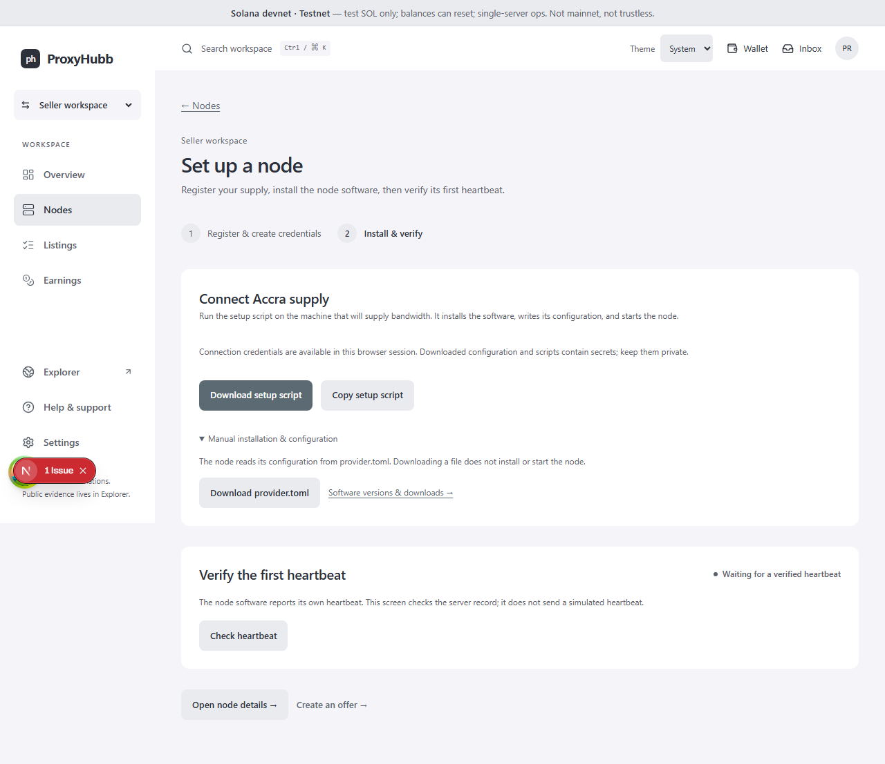
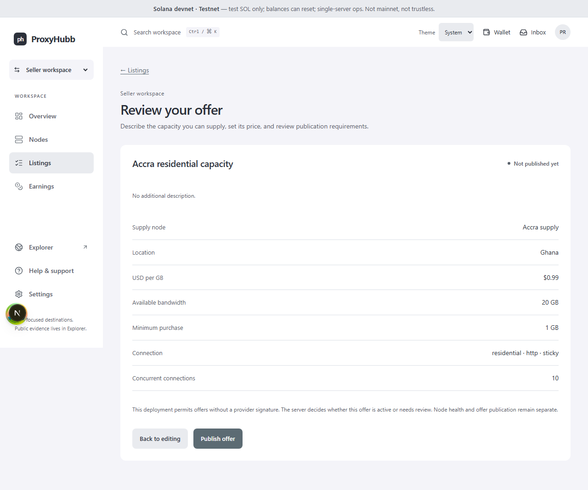
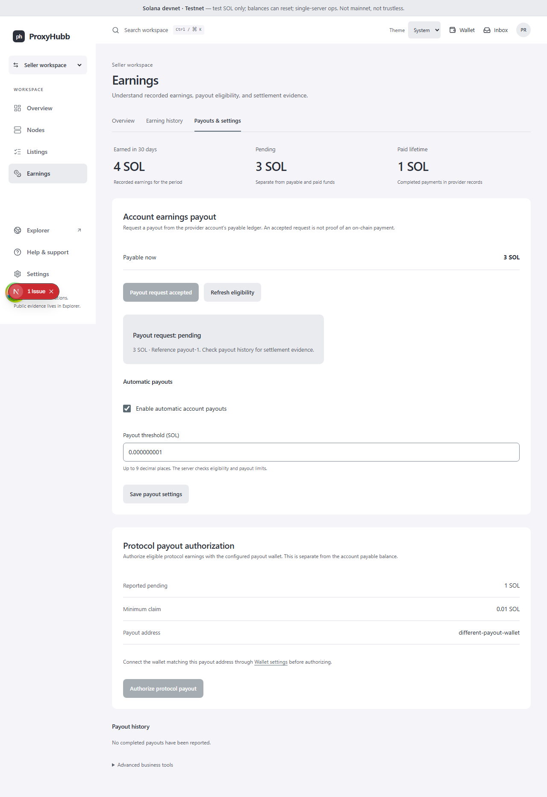

# ProxyHubb frontend rebuild — seller workflows

Date: 28 October 2026. This phase continues the working source implementation described in `IMPLEMENTATION.md`. The buyer/seller navigation and separate Explorer remain in place.

## Implemented in the application

| Workflow | New destination | Working behavior |
|---|---|---|
| Node inventory | `/provider/nodes` | Owned nodes, actual service state, heartbeat signature and latency, with a direct management screen |
| Node setup | `/provider/nodes/new` | Register once, create a node-scoped connection token, prepare configuration, install externally, then check the real server heartbeat |
| Node management | `/provider/nodes/[id]` | Connection setup, observed diagnostics, registration settings, removal review and offer creation |
| Credentials | `/provider/nodes/credentials` | Explicit creation/replacement for an owned node, expiry selection, one-time token display/copy, and revocation |
| Offer creation | `/provider/listings/new` | Supply selection, connection/location fields, USD pricing and capacity, review, provider signing and submission |
| Offer management | `/provider/listings` | Edit price/capacity/minimum/concurrency, pause/resume eligible offers, remove an offer, and inspect publication state |
| Earnings | `/provider/earnings` | Summary, paginated earning records, separate payout controls, automatic payout preferences and transaction evidence |

The implementation uses the existing provider and marketplace APIs. It does not introduce a second payment service or a new node protocol.

## What changed in the experience

Node setup now has two clear stages: registration/credentials, then installation/verification. It no longer creates an unrelated generic token before registering the node. If token creation fails after registration succeeds, the screen retains the registered node and retries only its token. The user can also open that node directly to finish setup. Downloading a setup script does not claim that software has started or that the node is online.

Opening a node does not mint credentials. The user explicitly requests a connection token when needed. Server connection settings must load before setup downloads become available; an endpoint failure is not silently replaced with a successful setup state. The new workflow loads only a token stored for the selected node, preventing the legacy global fallback from supplying another node's token.

The legacy manual “ping” operation sent a heartbeat from the dashboard. It has been replaced with a read of the node's actual server record. The UI separately reports online state, signature verification, measured diagnostics and unknown observations.

Offer creation requires an owned node and a successfully loaded publication policy. Users review the price, quota, minimum, protocol, session behavior and concurrency before the first create request. Existing canonical signing helpers support the local provider key, matching wallet, and server-authorized development signing path. A required signature cannot be skipped when no signer is available. The server's pending-review response stays pending in the UI, with no client-side activation shortcut.

Earnings now contains Overview, Earning history, and Payouts & settings. Account payable funds and protocol claim eligibility are displayed separately. A payout response is shown with its actual status and reference; it is not presented as a completed transfer without transaction evidence. Protocol authorization requires the connected wallet to match both the reported payout address and the prepared authorization's address.

## Recovery and write behavior

The shared query provider retries mutations by default. New seller mutations explicitly disable automatic retries, so a failed response does not silently repeat node, credential, offer, revocation, or payout writes. The user sees the error and chooses the next action.

Account payout retries retain one idempotency key while the payout panel remains mounted. A failed protocol-confirmation request retains the signed authorization for retry, with a wallet-address check before resubmission. Node registration retains the known node ID after a subsequent token failure. These are browser-flow recovery measures; cross-tab/reload guarantees and reconciliation after an ambiguous create response still depend on backend guarantees and record history.

SOL payout thresholds are parsed as decimal strings into exact integer lamports. Values with fractional lamports, exponent syntax, negative amounts or unsafe JSON integer precision are rejected. Changes to automatic payouts go through the existing settings API.

Revocation clears cached provider connection tokens in this browser without deleting signing keys or unrelated session data. A running machine still needs its replacement configuration. Node and listing removal each explain their effect before the mutation; existing order/settlement behavior remains owned by the backend.

## Consolidation and compatibility

| Legacy entry | Result |
|---|---|
| `/dashboard/provider/setup` | Redirects to `/provider/nodes/new` |
| `/dashboard/provider/nodes` | Redirects to `/provider/nodes` |
| `/dashboard/provider/tokens` | Redirects to `/provider/nodes/credentials` |
| `/marketplace/create` | Renders the same new listing editor |
| `/marketplace/manage` | Redirects to `/provider/listings`, preserving page and submission context |
| `/dashboard/provider/earnings` | Redirects to `/provider/earnings?tab=payouts` |

Node-bound token replacement is the standard credential workflow. The new UI does not offer an unbound token-rotation shortcut. Advanced services, software-version downloads, customer relationships, enterprise pooling and catalog product management remain available through existing destinations while their remaining interfaces are migrated.

## Validation

- Eight seller browser tests passed in Chromium: partial node-setup recovery with no duplicate registration, node-bound TOML download, no token creation on read, rejection of another node's legacy token, offer review before submission, pending publication, policy failure blocking, offer edit/pause, explicit credential revocation, stable payout retry keys, exact payout thresholds, payout-wallet mismatch, legacy setup redirect and a 320px layout check.
- Four existing workspace regressions passed during this phase: buyer/seller switching, persistent theme/mobile utilities, role denial and anonymous redirect.
- Three exact SOL amount tests passed, including the safe JSON integer boundary.
- The provider configuration contract passed, extended with node token isolation and selective token-cache cleanup.
- Route validation passed with 95 static registry entries, 99 policy entries and middleware guard coverage.
- Listing display and order-status contracts passed.
- ESLint passed on the new seller modules, shared claim panel and amount parser.
- Main application and standalone Explorer production builds passed. The main build generates 102 prerendered pages plus dynamic routes.

The shared modal now lets Radix manage description IDs so labels and descriptions remain correctly associated. Two focused offer-editing and token-revocation checks passed after that change, including an assertion that the dialog description resolves to an existing element.

Browser tests use local API fixtures. TOML downloads contain test credentials and are never executed. No real node installation, live wallet signature, payout, production deployment or DNS change was performed. The local control API remains a prerequisite for reviewing populated private workflows with a real account. Full cross-browser and screen-reader audits remain outstanding.

The screenshots below come from the actual source application with test API data; development diagnostics are visible in the captures.







## Reproduce

From `apps/web`:

```sh
npm run test:e2e:seller
npm run test:sol-amount
npm run test:provider-config
npm run validate:routes
npm run build
```

The Playwright command starts its own local web server and fixtures. Stop another process on port 4011 before running it. For normal development, run the main application with the existing API/wallet environment and `npm run dev:e2e` or its configured development command.

## Remaining work

Buyer wallet/settings, connection lifecycle and order recovery are covered by `IMPLEMENTATION-BUYER-JOURNEY.md`. The remaining Explorer views and support/community route consolidation are tracked in the current migration status in `IMPLEMENTATION.md`. Catalog product editing and advanced provider operations still need dedicated UI passes. Backend integration, live devnet checks, cross-browser/accessibility review, and deployment gates remain release work.
