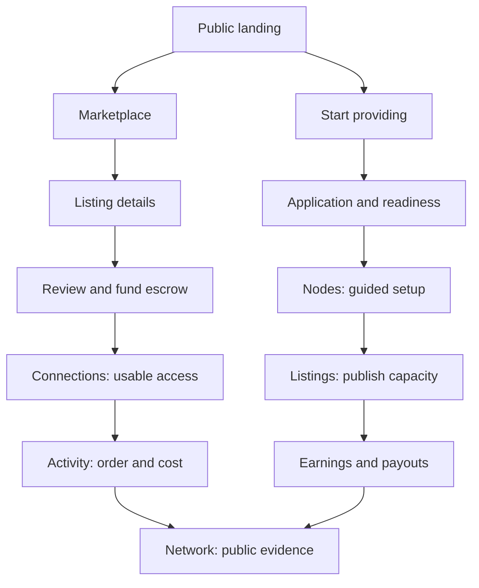

# ProxyHubb: frontend audit and replacement experience design

> **Revision 2 update:** see [the current refinement report](REPORT-V2.md) for light/dark themes, four-destination buyer/seller workspaces, the standalone explorer and feature coverage. The audit below remains the original baseline.

**Date:** 28 October 2026 · **Status:** design proposal for review · **Source revision:** `6e72b2d8` plus the working tree observed during this audit.

**Deliverables:** this report, [the disposition of all 100 current page files](route-disposition.csv), and [a standalone visual concept](CONCEPT.html). The concept uses invented example data and performs no product actions.

## 1. Recommendation and rating

**The current frontend scores 3.8/10 in this heuristic review.** Its breadth is ahead of its coherence. A user must learn the product's internal subsystems before completing an ordinary purchase or understanding whether a connection is usable. Decorative technical language and unsupported default metrics further reduce confidence.

Rebuild the experience around two outcomes: **get and use a working proxy**, and **publish reliable capacity and receive earnings**. Design a new shell, screen hierarchy, component system, content language, and interaction model from those outcomes. Existing screen compositions and CSS are not the design starting point. Preserve verified service contracts, authentication, transaction handling, privacy boundaries, and useful domain logic as integration constraints.

The proposed navigation is:

| Buyer workspace | Provider workspace | Purpose |
|---|---|---|
| Overview | Overview | What is happening, and what should I do next? |
| Marketplace | Nodes | Find capacity / operate infrastructure |
| Connections | Listings | Use purchased access / publish offers |
| Activity | Earnings | Understand orders, usage, money / revenue |
| Network | Network | Inspect public network evidence |

Settings, wallet, notifications, messages, and help are utilities. Each has an explicit, discoverable entry point. They do not expand the main navigation into a sitemap.

This is a design specification, not authorization to remove production capabilities or a claim that the redesign has already shipped. The implementation plan should be created from the decisions and acceptance criteria below.

## 2. What was examined, and how confident the findings are

### Scope and method

- Enumerated **100 `page.tsx` files** in `apps/web/src/app`, including detail pages, redirect wrappers, legal pages, and callback pages. This is not a count of 100 distinct working user experiences.
- Reviewed route definitions, policies, redirects, feature flags, navigation filtering, application layouts, global tokens, and shared components.
- Reviewed source for marketplace discovery, listing presentation, matching, checkout, credentials, order status, connections/sessions, dashboards, wallet, provider setup/CLI, settings, agent readiness, and network surfaces.
- Inspected the deployed site in the browser: landing page, marketplace, signed-in buyer dashboard, Connect, provider application, and explorer. Checked marketplace and explorer at a **390 × 844 CSS-pixel viewport**, including the mobile More menu.
- Examined available E2E coverage and scripts to identify existing integration contracts worth retaining. Tests were **not executed** for this report.

The existing browser session was used only for read-only inspection. No wallet signature, purchase, application submission, transfer, role change, message, or production setting change was performed.

### Evidence labels

**Observed** means visible in the deployed UI. **Source-confirmed** means directly supported by the checked-out code. **Inference** means a likely user consequence that needs testing. A live deployment is not proven to be built from the exact local commit, even where the screens match.

This is not a moderated usability study, comprehensive accessibility certification, performance benchmark, backend audit, or hackathon judging prediction. No conversion rate, completion time, or Core Web Vitals baseline was measured. The provider's approved operational screens were inspected in source; the available session displayed the application stage.

### Existing redesign document

`docs/UI_UX_REDESIGN_PLAN.md` existed before this work and has been preserved. Its statements described as “locked” are not treated as user approval in this conversation. This proposal is independent and differs materially:

- It specifies a **new visual system**, rather than evolving the current “Quiet Infrastructure” palette and layouts.
- It separates Marketplace, Connections, and Activity by user intent.
- It uses five consistent destinations in each workspace, with a working mode switch.
- It limits Network to four main tabs instead of reproducing an explorer sitemap in tabs.
- It does not reintroduce the disabled globe.
- It preserves order states and separates order, connection, payment, and verification status.
- It does not treat blocks as a transaction filter or redirect a provider ID to a username without an identity mapping.
- It avoids claiming a measured eight-page purchase flow: checkout already has a modal and credential handling.

## 3. Scorecard

Scores use a 0–10 scale: 0–2 blocks understanding, 3–4 creates recurring confusion, 5–6 is usable with friction, 7–8 is coherent and dependable, 9–10 is exceptionally clear and validated. Weights reflect the importance of completing this marketplace's core tasks.

| Dimension | Weight | Score | Reason |
|---|---:|---:|---|
| Information architecture and navigation | 20% | 3 | Eight sidebar sections; the inspected buyer sees 35 destination links; explorer navigation repeats in three places. |
| Core workflow clarity | 20% | 4 | Checkout and credentials exist, but buying, intent creation, sessions, orders, and connection setup have competing entry points. |
| Visual hierarchy and readability | 15% | 4 | Large decorative panels precede useful inventory; dense uppercase microcopy, glow, and inconsistent surfaces compete for attention. |
| Data credibility and status clarity | 15% | 3 | Hard-coded or fabricated fallback metrics appear alongside real provenance labels; status concepts are conflated. |
| Onboarding and recovery | 10% | 4 | Wallet and escrow checks are useful; role/application/setup pathways are fragmented and do not consistently preserve task context. |
| Mobile and accessibility | 10% | 5 | Mobile layout exists and sampled pages did not show document-wide horizontal overflow; navigation remains complex and the skip link has no target on inspected app pages. |
| Cross-screen consistency | 5% | 4 | Different shell implementations, multiple names for the product and actions, and legacy styling bypass shared tokens. |
| Demo communication | 5% | 5 | The landing page communicates the category, but a short demo must traverse substantial conceptual and visual noise. |
| **Weighted overall** | **100%** | **3.8** | **Σ(weight × score). A heuristic assessment, not a statistical measurement.** |

The proposed design should aim for **at least 8/10 on a repeat review**, plus the task-based validation in section 16. A future score is a target, not an achieved result.

## 4. Diagnosis: the problems that matter most

### A. Navigation exposes the organisation of the code

**High · Observed and source-confirmed.** `nav.ts` defines Use, Market, Sell, Advanced, Provider, Community, Explorer, and Governance. With the two opt-in public explorer feeds disabled, there are **49 candidate navigation slots including the three bottom links, before role and unified-network filtering**; enabling both feeds adds two. This is not the number every user sees. The inspected signed-in buyer saw 35 links.

The same buyer sees provider application paths, social Activity, proofs, experimental agents, and an eleven-item explorer. Collapsing sections reduces visible length without giving these concepts a coherent home. Mobile More reproduces most of the same structure, while Forum occupies a primary bottom tab ahead of orders or cost history.

**Replacement:** five role-specific destinations, one clear active destination, a small utility menu, and contextual detail routes. Search accelerates work but never substitutes for visible access to an essential task.

### B. Buying and connecting use competing models

**High · Observed and source-confirmed.** Marketplace checkout creates an order and funds escrow. Connect and Sessions also expose session-intent creation. The Sessions source itself distinguishes the paid shop path from the intent tooling. A user should not have to understand that implementation distinction before obtaining access.

Checkout already checks the cluster and balance, handles funding confirmation, and retrieves credentials. The redesign must preserve these strengths. A new sheet by itself is not the missing feature.

**Replacement:** Marketplace owns discovery and purchase; Connections owns usable access and client setup; Activity owns orders, history, and cost. Intent/API tooling becomes an advanced integration path where still supported. Links connect the three views to the same order and connection identity.

### C. Trust is weakened by invented defaults

**High · Observed and source-confirmed.** The marketplace contains literal “99.9% Global Liquidity” and “Registry State: Normalized.” Listing components substitute 5.0 for an absent/zero rating and 40 ms for absent/zero latency. The basic card labels a quality score as Capacity, with a fallback of 95%. It displays an unconditional Active badge and a generic Multi-Sig claim. The enhanced card derives Online/Offline from seller presence. Featured and ordinary presentations therefore give different-looking status claims for the same inventory.

The dashboard renders “Network Online” unconditionally. Connect claims “150+ Countries” independently of available inventory. These are presentation defects supported by the source; they are not evidence that all API telemetry is false.

The DePIN portal is a more serious source-confirmed example: `DePINPortal.tsx` initializes mock bonded SOL, operator counts, mining rewards, and receipt rows. Its stake button uses a timer, and Claim sets local state to “Reward Claimed!” without a transaction. These controls must be removed from the production-facing experience or unmistakably isolated as simulation until connected to verified contracts. This finding concerns that frontend implementation; it does not establish whether related backend/program capabilities exist. The deployed `/depin` screen was not inspected in this review.

**Replacement:** use a metric contract containing value, unit, source, observation time, window, and availability. Unknown values say “Not measured” or “Unavailable.” Show “No reviews yet.” Distinguish seller presence, node health, offer availability, and session activity. Every claim must answer “what exactly was measured?”

### D. Visual drama displaces useful information

**High · Observed.** On desktop, a large Smart Match panel and ornamental registry header precede listings. At the sampled mobile viewport, the first screen contains the title, view controls, a hard-coded statistic panel, and the beginning of Smart Match; inventory is below these. The default experience asks users to configure an elaborate matching form before seeing the basic market.

**Replacement:** results appear immediately below a compact search/filter row. Matching becomes an optional “Help me choose” refinement. A modest geographic view supports location discovery. The result list remains useful if map or matching services fail.

### E. The vocabulary makes ordinary actions hard to decode

**High · Observed.** “Inject,” “Grid Sector Dark,” “Integration Matrices,” “Vault Data,” “Rotating Stream,” and enum-like sort options burden users with a fictional operations vocabulary.

**Replacement:** “Buy bandwidth,” “No matching proxies,” “Connect your app,” “Datacenter,” “Rotating,” and “Lowest price.” Keep technical detail where it helps a real decision: HTTP CONNECT/SOCKS5, session duration, price/GB, wallet network, and payment state.

### F. The displayed workspace switch does not switch

**High · Source-confirmed.** `WorkspaceSwitcher.tsx` renders Buyer and Provider buttons for dual-role accounts without action handlers. Both use `role === 'both'` for their selected styling. It communicates a stateful control without changing workspace.

**Replacement:** capabilities and selected workspace are separate. A permitted user switches modes without changing their account role or signing again. URL and selected navigation update together. A buyer without provider capability sees “Start providing,” leading to a clear application flow.

### G. Account identity and money are difficult to understand

**High · Observed and source-confirmed.** The dashboard greets a wallet-authenticated user with a long wallet-derived identifier. The sidebar fallback reads OPERATOR and always includes Authorized. The buyer overview promotes a custodial platform balance, although marketplace checkout explicitly uses the linked wallet and escrow instead.

**Replacement:** show a short display name or “Your workspace,” a shortened address in the account utility, and verified authentication state. Separate **wallet available**, **locked in escrow**, **platform balance**, and **provider payable earnings**. Do not combine them into a misleading available balance. Keep platform-ledger access for existing funds and supported uses even if it becomes secondary.

### H. Explorer is navigated three times

**Medium · Observed and source-confirmed.** Destinations recur in the sidebar, the explorer header tabs, and overview shortcut chips. Wallets, contracts, blocks, rankings, analytics, and search all compete for top-level attention. Network and DePIN introduce further conceptual entry points; Network is flag-controlled and redirects to the marketplace map when disabled.

**Replacement:** one Network hub: Overview, Nodes, Ledger, Governance. Health is a section of Overview; maps are a Nodes view. Ledger has distinct Transactions and Blocks subviews. Address lookup is one search with typed detail results. Rankings become optional table sorting.

### I. Accessibility infrastructure is present but incomplete

**High · Observed and source-confirmed.** The root skip link targets `#main-content`; the inspected marketplace and explorer have no element with that ID. The mobile snapshot exposes unnamed buttons. The More overlay is assembled from ordinary containers rather than the shared dialog pattern. Many listing labels use 8–11 px type and low-opacity white text; these hard-coded colors also threaten light-theme readability.

Reduced-motion rules, focus styles, accessibility utilities, and focus handling in some notification components already exist. A rewrite should preserve the requirements they serve. This review did not measure every contrast pair or perform full keyboard/screen-reader testing, so it does not certify the whole application as passing or failing WCAG.

**Replacement:** one correctly targeted main landmark, meaningful names, accessible modal/menu primitives, a usable list alternative to maps, 14–16 px core text, and explicit verification at narrow widths and zoom.

### J. Feature readiness competes with the core product

**Medium · Source-confirmed.** The Agent console states that payment, escrow, and job execution are not live. Legacy globe flags return false. Social feeds, friends, beta recruitment, provider pooling, and other specialist features add breadth without strengthening the first purchase.

**Replacement:** define a coherent core release. Hide unfinished experiments from ordinary navigation and the demo. Remove redundant presentation and unsupported claims; archive or restrict specialist capabilities according to actual users and obligations. Do not erase data or supported entitlements as a side effect of design cleanup.

### K. Alerts and support do not have one clear owner

**Medium · Source-confirmed.** Desktop AppShell mounts watchtower-style AlertCenter; Navbar uses a separate notification system. Help and Contact are mostly informational text. This fragments notifications and gives an affected user limited visible recovery guidance.

**Replacement:** one user inbox for account, order, connection, and provider events. Infrastructure-only alerts belong to Admin. Each actionable event links to the affected object. Help provides task-specific recovery and a real configured support destination, with safe copyable diagnostic references.

### L. Existing reuse does not enforce a consistent experience

**Medium · Source-confirmed.** AppShell coexists with a custom Explorer layout and marketing chrome. Legacy aliases coexist with direct white/black colors, glass effects, gradients, custom card compositions, and duplicated card variants. Sessions is 1,189 lines; explorer map is 816; pooling is 815. File length is a maintenance signal, not a user-facing defect by itself.

**Replacement:** thin route composition, domain modules, one accessible component kit, shared view models for metrics/status, and explicit performance boundaries for maps, wallet providers, and charts.

## 5. What should survive the redesign

Preserve the product's substantive differentiators: location-based discovery; residential/mobile/datacenter distinctions where supported; accurate price and purchase limits; signed-offer verification; pre-purchase network privacy; wallet-native escrow; metered usage; traceable settlement/refunds; connection credentials; browser extension and SDK integration; provider node onboarding; real health and readiness evidence.

Preserve the explicit devnet disclosure. Make it short in the shell and contextual at payment, with details available on demand. Do not imply mainnet readiness, trustless operation, zero-knowledge verification, global coverage, client traffic routing, or network decentralization beyond what the implementation can substantiate.

Public provider reputation, buyer/provider communication, governance participation, security history, existing subscriptions, refunds, and withdrawals remain accessible. They can have fewer entry points without losing their underlying purpose.

## 6. New information architecture

### Roles, URLs, and ownership

| Area | Canonical route family | Access | Owned concepts |
|---|---|---|---|
| Public landing | `/` | Public | Explain product, browse capacity, start providing |
| Buyer Overview | `/app` | Signed in | Current access, next action, attention items |
| Marketplace | `/marketplace` | Public browse | Browse, saved listings, listing/provider detail, purchase |
| Connections | `/app/connections` | Signed in | Purchased access, sessions, credentials, client integration |
| Activity | `/app/activity` | Signed in | Orders, usage/spend, billing/entitlements, proofs and receipts |
| Provider Overview | `/provider` | Capability-aware | Readiness, operational exceptions, earnings summary |
| Nodes | `/provider/nodes` | Provider | Setup, nodes, health, diagnostics, advanced services |
| Listings | `/provider/listings` | Provider | Offers, catalog products, inventory, linked-node readiness |
| Earnings | `/provider/earnings` | Provider | Revenue, payouts, customers, optional pooling |
| Network | `/network` | Public | Overview/health, nodes/map, ledger, governance/treasury |
| Account utilities | `/settings/*`, `/messages`, `/help/*` | Appropriate to content | Account, wallet, keys, notifications, support |
| Authentication | `/auth` | Public | Wallet sign-in and account creation in one flow |
| Provider entry | `/provide` | Public; application requires sign-in | Explain requirements, application, approval/recovery |
| Administration | `/admin/*` | Server-authorized admin | Moderation, operations, funnel diagnostics |

The landing URL stays stable for public visitors; authentication goes to `/app` or the intended destination. This avoids making the same URL alternate between marketing and private application content. Route groups may share underlying layout code without changing the URL contract.

Marketplace remains named Marketplace: that language is already understandable and discoverable. A full redesign does not require renaming every familiar noun.



### Desktop shell

Use a **224 px quiet left rail**, a **64 px utility header**, and one content region. The rail shows the five current-workspace destinations and Help at the bottom. It never nests an explorer or provider sitemap. Brand and workspace selector sit above the destinations. The account menu contains Settings and public-profile access.

The utility header holds a visible search entry, compact environment indicator, wallet summary, notifications, and account menu. Messages are accessible from the inbox and from order/provider context. Do not display every utility as an equally prominent colored button. Limit a screen to one primary action at each decision point.

A short rail is selected over five horizontal primary links because it keeps workspace identity stable and leaves the utility header legible at laptop widths. Full-width map views may collapse the rail; the five labeled destinations remain available. Do not show two competing primary navigation systems.

### Mobile shell

Use the **same five destinations** as the selected workspace in a labeled bottom bar. Header: brand/workspace control, search, and account/inbox access. The workspace chooser is an accessible sheet. Account utilities appear in one small menu. Remove the sitemap-style More menu and extra hamburger primary navigation.

At 320–767 px, show one working column. Filters become a sheet with applied-filter chips and clear results count. Map and list become explicit views of the same dataset. Detail drawers become full-screen routes/dialogs. Sticky actions respect safe-area insets and never cover the last row or focused control.

### Navigation rules

1. One canonical route for each object and task; contextual entry points may link to it.
2. Overview summaries link to canonical task pages rather than reproducing whole workflows.
3. A main destination has at most four primary tabs. Advanced content uses contextual detail, optional subviews, or a clearly named section.
4. Tab, filter, sorting, and selected view state are URL-addressable where useful. Browser Back restores list position and filters.
5. Deep links survive wallet authentication. Workspace follows the destination without silently changing account capabilities.
6. Search has both a visible input/button and Ctrl/Cmd+K support. It can find pages and authorized objects; it cannot reveal another user's private order/session data.
7. Detail breadcrumbs state real ancestry. Remove the generic SYSTEM breadcrumb.

## 7. Screen specifications

### 7.1 Landing and authentication

Lead with **“Residential proxies. Clear pricing. Verifiable settlement.”** Under it: a plain explanation of buying capacity or earning from a node; primary “Browse proxies,” secondary “Start providing.” Show a compact sample of genuine current availability if it can load accurately. Explain escrow with an honest sequence. Link the network evidence and documentation. Avoid a decorative full-screen particle network as the main demonstration of product value.

Browsing requires no wallet. At purchase or a private action, explain why a wallet signature is needed, distinguish sign-in from a payment, and return to the user's selected listing and quantity. One `/auth` screen handles returning and new accounts according to the service response. Preserve referral codes and safe return destinations. Provider status is not a mandatory buyer onboarding choice.

### 7.2 Buyer Overview

The first region answers **“Do I have usable access?”** States: no purchase, access preparing, access ready, recently active traffic, expired access, or action required. It does not claim the browser is routed simply because credentials exist.

Below it, show three summaries with context: active access, usage this period, and spend this period. A compact attention list prioritizes interrupted provisioning, approaching expiry, and unresolved payment/refund states. A short recent-activity list links to Activity. No chart is required for an account with no usage.

New user: “Find a proxy → Fund escrow → Connect your app.” Return user: most recent valid connection with “Open connection.” An extension-confirmed routing state may expose its own supported action. Do not put an unsupported universal Connect/Disconnect toggle on the web.

```text
Overview                                  Wallet · Devnet
Your proxy access is ready                Open connection
US residential · remaining allocation · last verified time

Active access       Usage this month       Spend this month
2                   3.2 GB                 0.04 SOL

Your connections                 Needs attention
US residential   Ready            Order awaiting confirmation
GH residential   Expiring         View order →

Recent activity                                  View all →
```

All numbers in this sketch are illustrative.

### 7.3 Marketplace

Header: “Marketplace” plus a short inventory count with freshness. Primary filter row: location, proxy type, max price, and More filters. Sort: availability/recommended when explainable, lowest price, lowest measured latency, newest. Default to the list. Offer a map toggle; expand the map alongside the list on sufficiently wide screens.

Result row: location and product name; protocol/session-mode support; live availability with timestamp; price/GB and minimum purchase; measured latency or “Not measured”; review count or “No reviews yet.” Actions: “View details” and Save. Compare two or three listings in a compact comparison panel, using the same metric definitions. Do not add a separate comparison destination.

Saved is a filter/view within Marketplace. Explain recommended ranking using actual available signals; if the matching service is unavailable, ordinary browsing remains usable. “Help me choose” may ask location, budget, and session type progressively. Do not call scoring AI unless the service supports and explains that claim.

Listing detail: value proposition and availability first; specifications and trust evidence next; provider and reviews after. Purchase summary remains visible on desktop. Approximate region is public; exact network identity remains protected until the authorized session handshake.

### 7.4 Purchase and recovery

Use a route-backed checkout sheet on desktop and a full-screen flow on mobile. Keep a durable order reference as soon as it exists.

| Stage | User sees | Required behavior |
|---|---|---|
| Configure | Quantity, price/GB, any minimum/bulk rate | Availability and quote validation; preserve inputs |
| Review | USD reference, exact SOL amount from authoritative quote, fees/rent where known, wallet/network, refund explanation | Show what is estimated; explain quote expiry and signature consequence |
| Authorize | Wallet approval request | Separate wallet rejection, wrong network, insufficient funds, and provider unavailability |
| Confirm | Submitted transaction and order references, current confirmation/provisioning stage | Allow leaving and returning; do not ask to pay again because polling timed out |
| Ready | Credentials available, remaining allocation, “Open connection” | Reveal usable access only when authorized by the service |

If funding succeeds but provisioning fails, show **“Payment confirmed; access is still preparing”**, with Retry status and the existing order link. Resume from that order. Idempotency, quote expiry, and resumability need backend-contract verification before implementation; the frontend alone cannot guarantee them.

Do not replace the existing order model with a four-step happy-path badge. Retain `pending`, `pending_payment`, `active`, `completed`, `disputed`, `refunded`, and `cancelled`, with a safe unknown-state fallback. Escrow funding, settlement, refund, and account closure can have separate substates.

### 7.5 Connections

Tabs: **Access** and **Sessions**. Access is purchased entitlement/credential availability; Sessions is the actual usage lifecycle. These remain linked but are not conflated.

Each access item shows region, protocol, available allocation/expiry, and operational state. Detail: Overview, Connect your app, Usage/settlement links. Connect your app provides Browser extension, cURL, and supported SDK snippets. Mask secrets, copy one field or a safe connection string, explain expiry, and keep generated credentials out of URLs and analytics.

Distinguish **access ready**, **client configured**, **traffic observed**, and **client routing unknown**. A successful website health request does not establish that every browser request uses the proxy. Extension pairing must show the paired browser/profile and confirmed status when the extension supplies it. The purchase receipt and integration instructions remain recoverable after an overlay is closed.

Ending a session states its effect on traffic, settlement, and unused funds. It does not imply that an unsupported client can be remotely disconnected. Any API intent creation stays under an explicit advanced integration section, retaining its real limitations.

### 7.6 Activity and billing

Tabs: **Orders**, **Usage**, **Billing**. Default Orders lists active/pending records first, then history; use date and state filters. Order detail ties together the purchase, funding transaction, related sessions, metered cost, settlement/refund, credentials eligibility, provider contact, and dispute route where supported.

Usage shows a useful period selector, GB and spend with exact units, a chart with a tabular equivalent, per-connection breakdown, and downloadable/exportable records if a supporting endpoint exists. Billing holds Access Pass/subscription entitlements and payment history. Retain existing entitlement names in the detail; do not silently reinterpret NFT tiers as a recurring subscription.

Proof verification is an action on the relevant session/order/receipt. Explain “Oracle-attested usage record” and its current trust assumptions. Do not label it zero knowledge or trustless until that is supported.

### 7.7 Provider entry and Overview

`/provide` explains requirements and network before sign-in. The application shows wallet eligibility, actual prerequisites, status, and recovery. Distinguish not submitted, evaluating, approved, rejected with reason, and a service/network failure. Avoid presenting insufficient funds as the outcome of a completed application when it is a prerequisite.

Approved Provider Overview: nodes needing attention, live listings, measured usage, earnings and next payout state. A readiness checklist links directly to the blocked step: approved account → node installed → heartbeat verified → offer published → eligible traffic. A registered node is not automatically healthy or sellable.

### 7.8 Nodes and guided setup

Default Nodes table: node name/region, last heartbeat, health/readiness, linked listings, observed usage, action. Health and diagnostics appear on the relevant node; fleet-level issues appear in a summary. Advanced service configuration is a node detail section.

“Add node” uses one guided flow: **choose supported OS/build → create or select a scoped credential and node configuration → install/start → verify heartbeat → publish an offer**. Reuse existing setup/config generation where sound. Avoid issuing an extra general token when a node-bound credential is sufficient. Credential creation remains explicit and secrets are shown only as supported by the API.

Show copyable commands for the selected OS, available builds and verification information, last successful heartbeat, retry guidance, and “Continue later.” Do not declare setup complete merely because a token or node row was created. A new service action should verify actual readiness from the backend.

### 7.9 Listings and products

One provider destination; tabs **Offers** and **Products**. Offer rows show linked node, region, supported protocol, price, availability, and reason if unpublishable. Creation is a full-page, short step flow because it is a substantial task. Use draft/resume where the service supports it. Validate price/capacity, node readiness, and offer signature before publication.

Products remain catalog templates/groupings; offers remain purchasable supply. A common screen must not collapse these distinct records into an ambiguous object. “Preview as buyer” uses the public listing template. Supply map becomes an optional coverage view, sharing the same listing data and availability definitions.

### 7.10 Earnings and customers

Tabs **Overview**, **Payouts**, **Customers**. Show earned, pending settlement, payable, and paid values separately. Include period, node/offer breakdown, payout references, and fee explanations. Chart actual earnings; never promise a passive-income rate using a decorative calculator.

Customers retains necessary relationship and contact/refill workflows. Optional enterprise pooling appears only for eligible/enrolled users, under an advanced section with a direct route. Pooling is not deleted merely because it is uncommon. Provider credentials are distinct from buyer API keys even when both are manageable through account utilities.

### 7.11 Network

Four tabs: **Overview**, **Nodes**, **Ledger**, **Governance**.

- Overview: measured totals, data freshness, operating environment, network health, indexing/trust conditions, and recent settlement evidence. Define the population and time window for each total.
- Nodes: table/map views, region filters, healthy/unknown/offline distinctions, details, and optional comparison. A geographic view reflects measured supply, not imagined topology.
- Ledger: Transactions and Blocks are separate subviews with linked detail routes. Address search resolves the supported wallet/contract type. Keep a normal search results route so this task is not keyboard-only.
- Governance: proposals, proposal detail, eligibility-aware voting/creation actions, execution state, and Treasury as a linked subview. Preserve public read access and real voting/authorization rules.

Leaderboards become an optional ranking sort/view using defined metrics. Public session or earnings feeds stay subject to their existing privacy/feature permissions. The legacy globe stays outside the core specification; its flags are disabled today. Reintroducing it would require a distinct validated use case, data source, accessibility alternative, and performance budget.

### 7.12 Utilities, support, and administration

Account menu → Settings: **Profile**, **Wallet**, **Security**, **Developer access**, **Notifications**. Security combines devices, login history, active account sessions, and anomaly notices without confusing these sessions with proxy traffic sessions. Developer access distinguishes buyer API keys from provider/node credentials, scopes, expiry, and revocation impact.

Wallet summary opens a focused panel; full wallet route remains for history, balances, supported deposits/withdrawals, and recovery. Existing funds and history are never hidden by de-scoping the platform ledger from the primary purchase journey.

One inbox offers Notifications and Messages; order/provider context opens the appropriate conversation. Help groups purchasing, client setup, wallet issues, provider operation, and support contact. Forum remains reachable through Help with its thread links preserved. Public profile is a view; editing is in Settings. Admin uses a separate authorized shell and never occupies a regular buyer/provider destination.

## 8. Merge, remove, retain, and defer decisions

The accompanying CSV gives every current page file a proposed destination and migration note. This table explains the product decisions behind it.

| Current surfaces | Decision | New home / reason |
|---|---|---|
| Dashboard + buyer action/stats fragments | Recompose | Overview; actual access state and next action |
| Marketplace list + marketplace map + Saved | Merge discovery model | Marketplace views with shared filters and data |
| Connect + private Sessions + credential views | Merge workflow, retain objects | Connections; separate Access and Sessions |
| Orders + Usage + buyer Analytics | Consolidate | Activity; one order/cost history, not three reporting destinations |
| Standalone Usage proofs | Remove destination, retain verification | Contextual action on receipt/order/session |
| Access Passes/subscriptions | Retain, relocate | Activity → Billing; preserve purchased entitlements |
| Provider hub + application entry duplication | Consolidate | `/provide` and capability-aware Provider Overview |
| Setup + CLI/download + token acquisition + Add node | Merge guided task | Nodes → Add node; credential management still exists |
| Node diagnostics + provider health | Consolidate | Nodes detail/fleet health |
| Provider analytics + income | Consolidate | Earnings; operational metrics stay with Nodes |
| My listings + create listing + catalog products | Consolidate destination | Listings; distinguish offers and products |
| Provider customer relationships | Retain, relocate | Earnings → Customers; contextual messaging |
| Provider services | Retain as advanced | Node detail/services; not primary navigation |
| Circle/enterprise pool | Conditional retention | Eligible/enrolled provider advanced section; defer expansion |
| Explorer + Network + DePIN | Consolidate presentation | Network and provider explanation; retain distinct supported workflows |
| DePIN mock stake/claim/receipt controls | Remove simulated production-facing actions | Protocol explanation may remain; real financial controls require verified service and wallet integration |
| Governance + Treasury | Consolidate destination | Network → Governance and Treasury subview |
| Separate leaderboard pages | Remove duplicate destinations | Network → Nodes rankings view |
| Explorer search/wallet/contract browse pages | Consolidate lookup | Network Ledger search/results and typed details |
| Feed + friends + beta recruitment | Remove from core UI proposal | Preserve data; optional archived community routes until dependency/usage review |
| Follow/review/contact functions | Retain useful context | Provider/listing detail and order conversations; social graph not foregrounded |
| Referrals | Demote | Settings/invite utility; preserve referral entitlements and links |
| Agent console | Defer from core and demo | Optional explicitly experimental developer area; no execution/payment claim |
| Legacy 3D globe | Exclude | Disabled in current flags; no added 3D dependency burden for the core |
| Duplicate settings/profile/security URLs | Consolidate routing | Settings; retain public-profile routes and identity mappings |
| Separate alert centers | Consolidate user experience | One user inbox; operational watchtower under Admin |
| Hard-coded metrics, fictional status, ornamental protocol jargon | Remove | No capability or obligation depends on preserving misleading presentation |
| Legal/privacy/extension privacy and wallet callback | Retain | Necessary content/contracts; visual consistency and stable routing |

**Removal means removal from the proposed frontend surface, not destruction of database records, balances, obligations, or backend APIs.** Before retiring a feature entirely, inventory active consumers and dependencies. Where unknown, preserve a compatible, secondary route until the product decision is resolved.

## 9. New visual system

### Direction: precise, calm, and useful

Choose a light-first **Minimalist Slate** direction: a near-white canvas, dark slate text, restrained slate actions, typography-led grouping, and limited semantic color. This is a deliberate departure from the current black/emerald tactical console. The visual identity comes from exact alignment, readable geographic inventory, and a clear order-to-settlement narrative.

Whitespace separates sections; typography distinguishes information. Use filled surfaces sparingly for active input regions or data visualization. Avoid enclosing every number in its own card. Reserve elevation for overlays. Tables use alignment and spacing; subtle separators are permitted where necessary for legibility. Focus outlines and validation must remain visible: visual minimalism never overrides interaction clarity.

The optional design-skill reference supplies the palette and restraint, not a requirement to use oversized editorial spacing inside dense operational tables. Marketing can breathe; operational screens must still make a laptop viewport useful.

| Token / rule | Proposed value |
|---|---|
| Canvas | `#F4F4F9` |
| Working surface | `#FFFFFF` |
| Primary text | `#2B303A` |
| Primary action / links | `#5C6B73`, white label where contrast is verified |
| Secondary base / nonessential separators | `#C0C5C1`; not small body text |
| Secondary text | `#59616B`; verify actual pairings |
| Success / warning / error | Dedicated semantic tokens; always text/icon plus color, never color alone |
| Dark counterpart | Canvas `#15191F`, surface `#1D222A`, text `#EEF1F5`, secondary text `#B8C1CC`, action `#AAB8C1` with `#182027` label; validate after light flow |
| UI type | One dependable sans family; system stack for the concept; selected bundled/self-hosted family in implementation |
| Data type | Monospace only for addresses, secrets, code, aligned numeric data |
| Type scale | 12 metadata, 14 compact UI, 16 body, 20 section, 28 page title, 48–64 marketing |
| Weight | 400 body, 500 controls, 600 headings; uppercase only when convention requires it |
| Spacing | 4 px base; 8/12/16/24/32/48/64 steps |
| Layout | 224 px rail; 64 px header; 32 px desktop / 16–20 px mobile content gutters |
| Width | 1,200 px reading/workspace content; full remaining width for large tables/maps |
| Controls | 44 px preferred touch height; consistent 6–10 px control radius |
| Motion | 120–180 ms state/overlay transitions; no pulsing fake “live” indicators |

Charts use labeled axes, explicit units, restrained series colors, and accessible summaries. Do not render an empty account as a fabricated healthy chart. Maps use a muted basemap, real region markers/clusters, an inspectable legend, and a synchronized list. Brand motion cannot compete with transaction progress or active data entry.

### Component system

**Primitives:** Button, TextField, Select/Combobox, Checkbox, Toggle, Tabs, Menu, Dialog, Sheet, Tooltip, Toast, Skeleton, Table, Pagination.

**Shared patterns:** PageHeader, FilterBar, SearchResults, ObjectSummary, StatusLabel, MetricWithSource, EmptyState, InlineError, Timeline, AttentionList, DetailDrawer, WalletSummary, SecretField, AmountBreakdown, TransactionProgress.

**Domain compositions:** ListingRow, AvailabilitySummary, OfferTrustEvidence, Checkout, OrderReceipt, AccessSummary, ClientSetup, SessionDetail, NodeReadiness, NodeSetup, PayoutReceipt, ProposalDetail.

Each component includes empty, loading, partial, stale, error, keyboard focus, disabled, and mobile states where relevant. Disabled actions explain why. Only shared tokens determine color and size. A single ListingRow/view model replaces divergent basic and enhanced truth claims.

### Content replacements

| Current | Proposed |
|---|---|
| Inject | Buy bandwidth / View details, according to action |
| Grid Sector Dark | No proxies match these filters |
| Reset Parameters | Clear filters |
| Vault Data | Datacenter |
| RATE_INT_ASCENDING | Lowest price |
| Integration Matrices | Connect your app |
| cURL Intercept / Copy Payload | cURL example / Copy command |
| Signal Integrity: Standby | No traffic observed, with source/time where known |
| OPERATOR / Authorized | Display name / actual signed-in account state |
| 5.0 (0) | No reviews yet |
| 0 ms for missing latency | Not measured |

## 10. State and data architecture

Treat **role capability**, **selected workspace**, **authentication**, **wallet connection**, **wallet network**, **order**, **escrow**, **access provisioning**, **session activity**, and **client routing** as distinct state dimensions. Most current confusion comes from collapsing several into one green badge.

| Object | State examples | UI owner |
|---|---|---|
| Authentication | checking, signed out, signed in, expired | Auth boundary/account utility |
| Provider capability | not applied, evaluating, approved, restricted | Provider entry/readiness |
| Wallet | unavailable, connected, wrong network, insufficient funds | Wallet utility and checkout |
| Order | existing canonical order enum, plus unknown fallback | Activity/order detail |
| Escrow | intent, submitted, funded, settling, refunding, closed where supplied | Checkout/receipt, based on actual API/on-chain contract |
| Access | preparing, ready, expired, revoked, failed | Connections |
| Session | idle, starting, observed active, ending, ended, interrupted | Connections → Sessions |
| Client | unpaired, configured, routing confirmed, routing unknown | Client setup/extension evidence |
| Node | registered, heartbeat unknown, healthy, degraded, offline | Provider Nodes and permitted public summary |
| Metric | measured, stale, not measured, unavailable | Shared metric component |

Avoid replacing unknown values with success or zero. A zero from a valid measurement is different from a failed request. Cached data can remain visible with “Last updated …; reconnecting.” A partial API failure should affect the relevant section, not erase an otherwise usable page.

The frontend consumes shared typed adapters for price, status, provenance, and availability. Services may require additions to support freshness, authoritative quotes, recovery, and client evidence. Mark those as backend dependencies in the implementation plan instead of mocking them into production UI.

## 11. Accessibility, responsive behavior, and performance

Target **WCAG 2.2 AA**. Minimum checks include 4.5:1 normal text contrast, 3:1 large text and applicable non-text controls, visible focus, correct labels, semantic headings/landmarks, keyboard-operable navigation, error association, and focus restoration. Modal focus must be contained and restored; Escape must behave predictably. Alerts should announce meaningful events without reading every polling update.

Use **44 × 44 px as the product's preferred touch target**. WCAG 2.2 AA's minimum target criterion is 24 × 24 CSS px with specified exceptions; 44 px is our stronger design target. [W3C target-size guidance](https://www.w3.org/WAI/WCAG22/Understanding/target-size-minimum.html).

Validate at 320, 390, 768, 1,024, and 1,440 px; test text resizing/zoom, long addresses, large currency values, many filters, localized-length labels, and empty/large datasets. A data table can scroll in its own labeled container when necessary; the whole document should not require horizontal scrolling. Essential actions remain visible without relying on hover or map precision.

Set implementation performance targets of **LCP ≤2.5 s, INP ≤200 ms, CLS ≤0.1 at the 75th percentile**, measured separately for mobile and desktop when field data is available. Lab runs guide development but do not establish field compliance. [Google's Core Web Vitals guidance](https://web.dev/articles/vitals).

Load wallet providers where required; do not reintroduce chain JavaScript globally to make the shell uniform. Lazy-load maps, charts, and specialist tooling. Avoid loading a hidden map by default, duplicate polling streams, per-card social requests when a list-level response can provide context, and global animation wrappers on every result. Establish production-build bundle and lab baselines before adopting numeric bundle budgets. Respect reduced motion and handle map/WebGL unavailability with a useful list.

## 12. Frontend system structure for implementation planning

Retain Next.js/React and existing service APIs where they meet the new contracts. A clean frontend architecture does not require a framework rewrite. Replace the presentation layer and its screen ownership; reuse verified nonvisual logic deliberately.

```text
src/
  app/                    thin routes, layouts, route loading/error boundaries
  modules/
    overview/
    marketplace/
    connections/
    activity/
    provider/             nodes, setup, listings, earnings
    network/              health, ledger, governance
    account/              auth, wallet, security, developer access
    support/              inbox, help, forum
    admin/
  shared/
    ui/                   accessible primitives and tokens
    patterns/             cross-domain presentation patterns
    navigation/           route registry, policies, workspace model
    api/                  transport, errors, typed contracts
    domain/               common money/status/provenance adapters
```

TanStack Query remains suitable for remote state. Local state handles form/overlay UI; persistent workspace preference may use a small store. URL state handles shareable filters and views. Do not duplicate fetched data into several stores or make the shell depend on every domain's query.

Use one capability policy for navigation, route guards, and server authorization requirements. Hiding Operations in navigation is not authorization; the current route policy lists monitoring as authenticated while the navigation filter hides it for non-admins. Verify backend permissions before treating this as a security issue. The new design must specify who may access the data independently of whether a link is visible.

Avoid prescribing unnecessary folder boilerplate, universal barrel files, or banning all inline values as design requirements. Enforce the boundaries that prevent duplicate state, divergent truth labels, and inaccessible interactions.

## 13. Migration and removal safeguards

1. Turn the CSV into an executable route migration table during planning. Its destinations are design recommendations; several require new routes or identity lookups.
2. Preserve listing/order/node/proposal IDs, block numbers, transaction hashes, and wallet addresses. Do not redirect detail pages to a generic overview.
3. Preserve allowed filters, referral codes, view state, pagination, and safe return paths. Do not forward arbitrary redirect parameters.
4. Apply specific routes before dynamic and catch-all redirects. Test `/marketplace/orders` and `/marketplace/manage` against `[id]` routes, and preserve original route permissions.
5. Use temporary rollout redirects while mapping is provisional; promote stable GET destinations to permanent redirects after validation. Next.js's existing `permanent: true` configuration uses framework semantics; do not assume every “permanent” redirect is HTTP 301.
6. Keep the wallet callback contract and external extension/SDK/deep links valid. Callback handling is not a redundant page simply because it is not a navigation destination.
7. Maintain public-profile and provider-ID mappings. A provider ID cannot be replaced with a username by string substitution.
8. Back up/retain user data and service capability for demoted features. Existing entitlements, balances, disputes, payouts, conversations, and notification links must remain reachable.
9. Retire old components/CSS only after replacement routes and recovery paths work. Runtime dependency removal requires an import/consumer audit; disabled UI alone does not prove a package is unused elsewhere.
10. Use a reversible feature rollout and observe auth, checkout, provisioning, and provider setup failures. No mass data deletion is part of frontend cleanup.

Do not set a route-file reduction target as the main success measure. A coherent product can need many detail routes. The measurable simplification is **five destinations per workspace, one owner per task, and fewer competing choices**.

## 14. Hackathon presentation and release scope

The strongest demonstration is a completed, inspectable loop: **choose capacity → fund devnet escrow → obtain credentials → observe actual traffic → inspect cost and settlement**. A second short loop shows **provider readiness → published offer → corresponding usage/earnings evidence**.

The visual moment should come from a selected geographic offer turning into a clear access record and traceable receipt. A subtle transition between those objects communicates more than a decorative globe. Never connect a staged UI transition to a claim of actual network activity unless telemetry supports it.

Suggested 3-minute narrative:

| Time | Demonstration | Proof |
|---|---|---|
| 0:00–0:25 | Problem and Marketplace | Understandable availability, price, location, and constraints |
| 0:25–1:10 | Purchase and confirmation | Correct devnet/wallet, durable order, transaction reference |
| 1:10–1:50 | Connect supported client and send a request | Credentials and observable traffic; explain client scope |
| 1:50–2:20 | Usage and receipt | Metered quantity, charge, refund/settlement state where complete |
| 2:20–2:45 | Provider workspace | Healthy node, published listing, linked earnings evidence |
| 2:45–3:00 | Network and product close | Public verification and honest operating limitations |

This timing is a rehearsal target; chain latency may require a clearly disclosed prepared devnet order. If live services fail, use a visibly labeled rehearsal mode or a real prior receipt, with no simulated data presented as live. Specific judging criteria and deadlines are not known and should guide later scope choices.

**Core redesign release:** shell, auth return path, Marketplace, checkout recovery, Connections/client setup, Activity/order receipt, provider readiness/setup/nodes/listings/earnings, account security/wallet, and a focused Network evidence path.

**Secondary migration:** full forum/inbox polish, all ledger detail templates, advanced service/pooling operations, comprehensive governance presentation, and detailed reporting. Existing live functionality stays reachable during migration.

**Deferred expansion:** agent execution marketplace, social feed growth features, beta recruitment destination, automatic income projections, and 3D network theatrics. These do not belong on the critical path to a credible demo.

## 15. Decisions to resolve when writing the implementation plan

The report supplies recommended defaults so planning can start without repeating the audit:

| Decision | Recommended default | Why / dependency |
|---|---|---|
| Product spelling | ProxyHubb everywhere | Matches repository/marketplace; current ProxyHub/ProxyHubb/PS is inconsistent |
| Workspace model | Buyer first; Provider is a persistent mode | Separate capability from selected experience |
| Visual direction | New light-first Minimalist Slate system | Readable, distinct from current console, supported by the concept |
| Shell | Short left rail + utilities; five matching mobile tabs | Consistent spatial model and manageable laptop layout |
| Community | Help/forum and contextual messages; feed/friends/beta outside core | Preserve support and transaction communication |
| Advanced pooling | Retain for eligible/enrolled users | Current usage and commitments not measured |
| Agents and globe | Exclude from core/demo | Execution incomplete; globe currently disabled |
| Wallet ledger | Secondary, fully recoverable | Marketplace escrow and platform ledger have different meanings |
| Required data work | Audit quote, recovery, freshness and client-state contracts | Design cannot guarantee absent backend capabilities |
| Hackathon priorities | Core completed loop first | Confirm deadline, team capacity, and judging rubric during planning |

A user can revise these defaults. No unanswered preference prevents producing this design specification. Before destructive retirement, obtain actual usage/dependency evidence and an explicit product decision.

## 16. Validation and acceptance criteria

Run a small formative test with 5–8 representative participants: first-time buyer, repeat buyer, technical integrator, new provider, operating provider, and at least one mobile/keyboard-led session. Small-sample findings are directional, not population estimates.

| Task / quality | Proposed acceptance criterion |
|---|---|
| Understand product | After five seconds, most test participants can identify buying capacity and providing capacity; record answers without coaching |
| Find a suitable offer | At least 80% unassisted task completion in the study; note inventory suitability separately from UI failure |
| Purchase comprehension | Participant can state quantity, amount/network, what the signature does, and where unused funds go before approving |
| First usable access | A buyer reaches credentials/client instructions without choosing between unrelated intent and order systems |
| Resume purchase | Reload/leave during confirmation returns to the same order and never creates a second charge merely to refresh status |
| Returning buyer | Open a valid recent connection from Overview with one application action; any wallet/client steps are counted separately |
| Understand status | Participants distinguish ready credentials from observed traffic and a connected wallet from funded escrow |
| Provider setup | One guided setup links installation to verified heartbeat and offer readiness, with no unexplained navigation to Tokens/CLI/Nodes |
| Money accuracy | Wallet, platform balance, locked escrow, and earnings are separately labeled and reconciled to authoritative data |
| Data credibility | No synthetic success/ratings/latency/coverage defaults; unknown and stale cases visibly handled |
| Navigation | Exactly five primary destination links in each mode; all essential tasks also have a visible path without command search |
| Responsive/accessibility | Core paths usable at 320/390 px and keyboard/zoom; no missing main landmark target or unnamed primary controls |
| Integration continuity | Existing order/credential, provider wallet-session, route-policy, and relevant marketplace suites adapted and passing |
| Network continuity | Public/private boundaries preserved; transactions, blocks, proposals and addresses retain linked identities |
| Performance | Production-build baseline captured; target Core Web Vitals tracked with lab/field distinction |

Measure task completion and errors before/after using the same scenarios. Capture application decision time separately from wallet signing, network confirmation, daemon installation, and waiting for real traffic. Do not describe “three screens” as “three clicks” or promise a chain-dependent completion time.

## 17. Evidence index and supporting files

Paths are relative to the repository root. Line references reflect the inspected working tree and can shift during implementation.

| ID | Evidence |
|---|---|
| E01 | `apps/web/src/lib/navigation/nav.ts` — eight sections, bottom items, mobile tab definitions |
| E02 | `apps/web/src/lib/navigation/explorer-nav.ts` — thirteen possible tabs; public feeds default off |
| E03 | `apps/web/src/lib/navigation/filter-nav.ts` — role/flag filtering and admin-only navigation subset |
| E04 | `apps/web/src/components/WorkspaceSwitcher.tsx` — buttons without switching handlers |
| E05 | `apps/web/src/components/Sidebar.tsx` — identity fallback/Authorized, presentation and navigation rendering |
| E06 | `apps/web/src/components/AppShell.tsx`; `apps/web/src/app/explorer/layout.tsx`; `apps/web/src/components/MobileTabBar.tsx` — shells, repeated navigation, mobile overlay |
| E07 | `apps/web/src/app/marketplace/page.tsx:164–200` — registry header, literal liquidity metric, matching placement |
| E08 | `apps/web/src/components/ListingCard.tsx:73,101–105,129,144,165,189` — rating/latency/quality fallbacks, unconditional status, Multi-Sig and Inject |
| E09 | `apps/web/src/components/ListingCardEnhanced.tsx:54,104,138,152,244` — seller presence, fallback rating/latency, action language |
| E10 | `apps/web/src/app/dashboard/page.tsx:89–100,201–259` — greeting, unconditional network status, dashboard summaries |
| E11 | `apps/web/src/app/dashboard/proxy/page.tsx:449–467`; `apps/web/src/app/dashboard/sessions/page.tsx:584–610` — coverage claim and distinct intent/shop paths |
| E12 | `apps/web/src/components/BuyListingModal.tsx`; `apps/web/src/components/marketplace/MarketplaceOrderDetailView.tsx`; `MarketplaceOrderCredentials.tsx` — existing checkout, recovery stages and credentials |
| E13 | `apps/web/src/lib/order-status.ts` — canonical order states and action eligibility |
| E14 | `apps/web/src/app/dashboard/provider/setup/page.tsx`; `provider/cli/page.tsx`; `provider/page.tsx` — onboarding, token/node creation, CLI instructions/readiness |
| E15 | `apps/web/src/features/wallet/components/WalletOverview.tsx:65,91,138,167` — ledger versus wallet/escrow distinction |
| E16 | `apps/web/src/app/dashboard/agents/page.tsx:98–108,241`; `apps/web/src/lib/feature-flags.ts` — experiment limitations and disabled globe |
| E16b | `apps/web/src/components/network/DePINPortal.tsx:23–75,185–190,254–274` — mock data and local-state/timer financial-looking actions |
| E17 | `apps/web/src/app/layout.tsx`; `apps/web/src/components/Accessibility.tsx`; `apps/web/src/app/globals.css` — skip link, providers, focus/motion/tokens; missing target verified in live DOM on sampled app pages |
| E18 | `apps/web/next.config.ts`; `apps/web/src/lib/navigation/policies.ts` — aliases, redirects, route policies |
| E19 | `apps/web/src/components/AlertCenter.tsx`; `NotificationCenter.tsx`; `apps/web/src/app/help/page.tsx`; `contact/page.tsx` — alerts and support |
| E20 | `apps/web/package.json`; `apps/web/playwright.config.ts`; `apps/web/e2e/` — available validation infrastructure, not execution results |

Browser observations are a point-in-time review of [the deployed marketplace](https://proxyhubb.com/marketplace), [buyer dashboard](https://proxyhubb.com/dashboard), [Connect](https://proxyhubb.com/dashboard/proxy), [provider entry](https://proxyhubb.com/dashboard/become-provider), and [explorer](https://proxyhubb.com/explorer). Reopen them to inspect current deployment behavior; account visibility and live inventory can differ.

The next planning artifact should convert this specification into a screen/state matrix, API dependency list, component inventory, route migration work items, and milestone acceptance gates. This report intentionally does not modify the application or replace the pre-existing plan.

### Deliverable checks

The route inventory was checked against the filesystem: 100 current page files, 100 mappings, no unmapped or nonexistent source routes. The weighted rating was recomputed as 3.8/10. The standalone concept's JavaScript syntax was checked; browser checks exercised workspace switching, marketplace filtering and details, and mobile workspace switching. Sampled concept layouts at 390 px (Nodes) and 320 px (Marketplace) had no document-wide horizontal overflow, and displayed five mobile destinations. The node table scrolls within its own container. These checks concern the design specimen and do not establish production accessibility or integration correctness.
