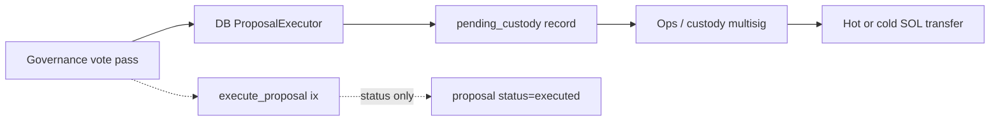
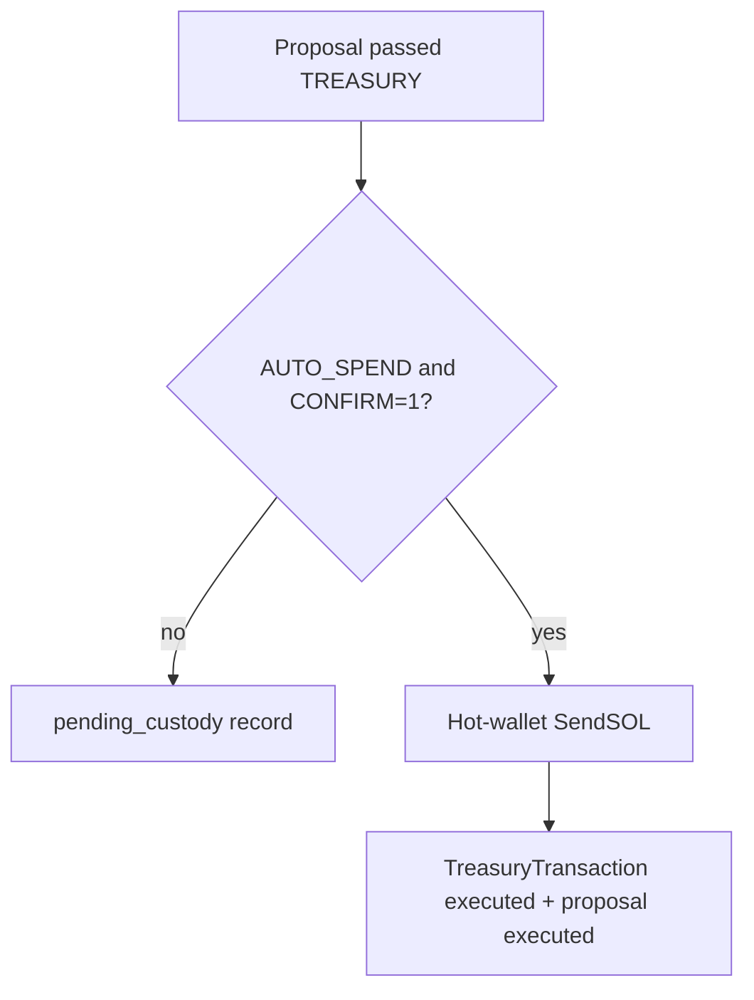

# Governance autonomy (Wave 4.4)

## Exit claim

Narrow pause powers; on-chain proposal → treasury execution path documented; reduce ops multisig as sole *automatic* spend path where safe.

## Paths

## Pause matrix

| Action | Env / confirm | Effect |
|--------|---------------|--------|
| `POST …/emergency-pause` | JWT admin | Redis app breaker |
| Same + `onchain_pause:true` | Needs `PROXYHUB_OPS_ONCHAIN_PAUSE` + `CONFIRM_ONCHAIN_PAUSE=1` | Optionally calls program `emergency_pause` |
| Ops script | program admin keypair | Direct on-chain pause/resume |

## Env

| Var | Default | Meaning |
|-----|---------|---------|
| `PROXYHUB_OPS_ONCHAIN_PAUSE` | `false` | Allow API → on-chain pause when confirmed |
| `PROXYHUB_GOV_TREASURY_AUTO_SPEND` | `false` | First gate for hot-wallet treasury execute (W5.C.3) |
| `PROXYHUB_GOV_TREASURY_EXECUTE_CONFIRM` | unset | Second gate; must be `1` for live SendSOL |
| `CONFIRM_ONCHAIN_PAUSE` | unset | Required `1` for on-chain pause/resume client |

## Treasury execution (W5.C.3)

- **Default:** queue `pending_custody` (multisig/ops) — same as Wave 4.4.
- **Dual-gated:** hot treasury SendSOL; record `tx_hash`; proposal can mark executed.
- **Still not:** on-chain `execute_proposal` → treasury PDA CPI; cold Squads replacement; token-weighted DAO.

## Non-claims

- Not a fully autonomous on-chain treasury
- App pause ≠ chain pause
- Multisig settle (BC-06) is separate from governance treasury custody
- Hot-wallet dual-gate ≠ proposal program CPI
