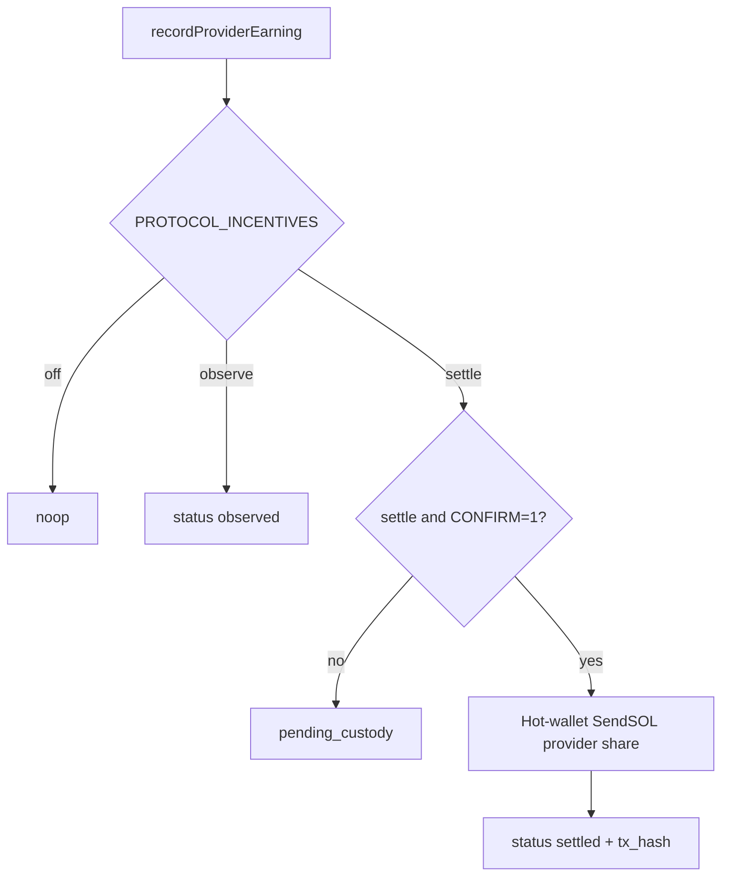

# Protocol incentives (Wave 4.3 → Wave 5.C.4)

## Exit claim

Design + optional **observe** accounting for gateway fees / provider rewards, plus
optional dual-gated **settle** of the provider incentive share via hot-wallet
`SendSOL` — **no reckless mint**.

## Mode

| Env | Default | Behavior |
|-----|---------|----------|
| `PROXYHUB_PROTOCOL_INCENTIVES` | `off` | No ledger writes |
| `observe` | — | Write hypothetical splits to `protocol_incentive_events` (`status=observed`) |
| `settle` | — | Write splits; without confirm → `pending_custody`; with confirm → hot-wallet SendSOL of **provider share** |
| mint | **not implemented** | Intentionally absent |

## Dual gate (W5.C.4)

| Env | Default | Meaning |
|-----|---------|---------|
| `PROXYHUB_PROTOCOL_INCENTIVES=settle` | off | First gate (settle mode) |
| `PROXYHUB_INCENTIVE_SETTLE_CONFIRM` | unset | Second gate; must be `1` for live SendSOL |

`SolSettleArmed()` = settle mode **and** confirm `1`. gcp-testnet defaults stay off/observe.

## Split knobs (accounting math)

| Env | Default | Meaning |
|-----|---------|---------|
| `PROXYHUB_PROTOCOL_FEE_BPS` | `500` (5%) | Share of gross settlement treated as protocol fee |
| `PROXYHUB_INCENTIVE_PROVIDER_SHARE_BPS` | `6000` | Share of fee → provider incentive accrual |
| `PROXYHUB_INCENTIVE_GATEWAY_SHARE_BPS` | `2000` | Share of fee → gateway incentive accrual |
| (remainder) | 20% of fee | Treasury retain (ledger-only) |

## Settlement flow (W5.C.4)

Ops may also call `SettlePendingCustody(eventID)` to claim an `observed` /
`pending_custody` row once dual-gated.

## Non-claims

- Does **not** mint PHB/PHUBB
- Does **not** skim SOL from escrow settles (chain still pays full seller share)
- Does **not** auto-pay gateway or treasury retain shares in W5.C.4 (ledger only)
- Does **not** enable staking APY as live protocol economics
- Hot-wallet settle ≠ on-chain incentive program CPI
- Escrow-backed rows may still show `platform_fee_sol=0` in `provider_earnings`; incentive accounting uses gross settlement independently

## Surfaces

- Package: `services/control-api/internal/incentives`
- Hook: `recordProviderEarning` → `ObserveSettlement`
- Claim: `SettlePendingCustody`
- Public: `/v1/system/config/public` → `protocol_incentives`
- Migrations: `000146_protocol_incentive_events`, `000148_protocol_incentive_settle`
