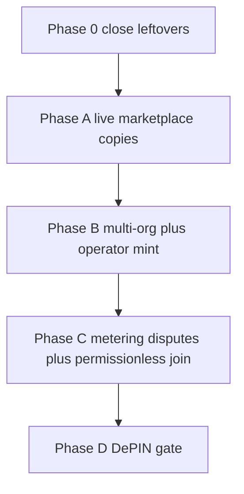

# Wave 10+ roadmap — decentralized marketplace toward DePIN

**Date:** 2026-08-13  
**Baseline:** [`PROXYHUBB_FULL_STATUS_REPORT_20260813.md`](PROXYHUBB_FULL_STATUS_REPORT_20260813.md) (~3.2 / 5 federated hybrid)  
**Stance:** This is a **path**, not a claim. Do **not** say DePIN, trustless
egress, or on-chain store until the **DePIN gate** in Phase D is evidenced.
`programs/session` stays undeployed.

**Why this file exists:** Waves 1–9 made ProxyHubb a federated hybrid
marketplace. That is **heading toward** a DePIN-shaped network; it is not one.
3.2 / 5 is better than August 8 (~2.5 / 5). The remaining 1.8 points are
**structural** (single issuer, same org, Postgres shop, edge-attested bytes,
no live slash) — not a missing script.

---

## 1. Two destinations (do not collapse them)

| Destination | What “done” means | Score target | DePIN? |
|-------------|-------------------|--------------|--------|
| **A. Decentralized marketplace** | Buyers can discover, commit, pay, CONNECT, and reconstruct listings/settlement **without ProxyHubb being the only copy**. Platform may still moderate merchandising. | ~4.2 / 5 | **No** |
| **B. DePIN-shaped proxy network** | Independent operators join with stake, issue/verify sessions, get paid/slashed on-chain, and the **platform API is optional at CONNECT and reconstruct**. Byte claims are disputable. | ~4.7–5.0 / 5 | **Only after Phase D gate** |

A is a **decentralized marketplace for buying and selling proxy access**.  
B is a **DePIN**. A is required for B. B is not “A plus marketing.”

### What DePIN would require here (honest)

Residential proxy DePIN is unusually hard because **bytes are observed at a
gateway you run**, not at a public L1. ADR 0010 is still true: Groth16 binds
**claimed leaves**, not physical traffic.

Minimum DePIN gate (all must be evidenced):

1. **≥3 operator orgs** not in `gen-lang-client-0022105784`
2. **Permissionless join** (keygen + bond + discover) documented and soaked
3. **CONNECT works** after control-api and Redis are down (capability default
   on a soak fleet, not a one-off flag flip)
4. **Listing-commitment set** reconstructs from chain PDAs and/or signed
   bundles with `on_chain=true` rows
5. **Settlement receipts** verify without `orders` (escrow tx as SoT where
   escrow exists)
6. **One live bonded slash** (or release) on a public cluster after the 3600s
   window — `programs/gateway-bond`, never session
7. **Usage dispute path** exists (challenge a leaf/window; not only edge
   honor-system)
8. Token issuer is **not solely** ProxyHubb control-api (operators can mint)
9. Public config does **not** say `remaining_spof=control_api_hmac_and_redis`
   as the default product
10. Explicit non-claims still hold: not trustless residential physics; not
    censorship-proof merchandising CDN

Until 1–10 pass, copy is: *federated hybrid marketplace on Solana devnet*.

---

## 2. Score movement (use this, not wave-ladder 4.9)

Informal **audit hybrid** score from the 2026-08-13 status report:

| After | Score | Why |
|-------|-------|-----|
| Aug 8 (pre-W2–9) | ~2.5 / 5 | Single VM, HMAC sessions, Postgres catalog |
| Aug 13 (now) | **~3.2 / 5** | Two hosts, Groth16, registry enforce, capability *soak*, localnet slash |
| Phase 0 done | ~3.4 / 5 | Live ListingCommitment + foreign org *or* live bond observe |
| Phase A done | **~4.0–4.2 / 5** | Marketplace copies live; capability observe on a fleet |
| Phase B done | ~4.4 / 5 | Multi-org + operator mint + public-cluster bond |
| Phase C done | ~4.7 / 5 | Disputable metering + permissionless join |
| Phase D gate | ~4.8–5.0 / 5 | Only then DePIN-shaped **language** is allowed |

Wave-ladder numbers in older plans (~4.5 / 5 after Wave 4) were **inflated**.
Do not put them on a landing page.

---

## 3. Constraints that survive every phase

- Never deploy `programs/session` (`8TP21JyrghboxZqXMozx2sVzrDrNSZyN2hkf1D7dQGmb`).
- Dual-gate any path that **sends SOL**.
- Upgrade authority stays on the laptop, not the app VM.
- gcp defaults return **off** after soaks unless a phase explicitly changes
  the default product (Phase A capability observe is the first such debate).
- Rotate the Helius key that appeared in a local CLI log (2026-08-13).
- Mainnet is **not** a decentralization substitute.

If an on-chain **lease PDA** is ever needed, it is a **new safe program**, not
session. Track that as a later ADR (**0016+**), not a sneak deploy.

---

## 4. Phase 0 — Close leftovers (start now)

Unblocks both destinations. **Not DePIN.**

Order (do not skip A for D):

### P0.1 — RPC that can write a 1.1MB program buffer

Public `api.devnet.solana.com` and the current Helius key **429 / timeout** on
`solana program deploy`. Settle may still work; **upgrade does not**.

- [x] Rotate Helius key; store in `proxyhubb-testnet-solana-rpc-url` + Host-A `.env`
      ([`evidence/HELIUS_ROTATE_20260814.md`](evidence/HELIUS_ROTATE_20260814.md);
      SM **v2** enabled, v1 disabled; Host-A apply kept w6 + W10.A observe)
- [x] Confirm a keyed endpoint that can complete write-buffer (paid Helius,
      QuickNode, or Triton). Probe: `getHealth` **and** a dummy write-buffer
      of the current `.so` size, then `program close` the buffer
      **(2026-08-13: paid RPC skipped.** Public burst FAIL; **throttled
      writer PASS** — see
      [`evidence/W9_A_listing_commitment_live_20260813.md`](evidence/W9_A_listing_commitment_live_20260813.md).)
- [x] Do not copy upgrade authority to GCP

### P0.2 — W9.A live ListingCommitment (devnet)

Laptop `.so` already has ListingCommitment **and** Groth16
(`4DC0D0A5ACD3CAFE824D81AFE8D3F672D276AF39FE346E750A4BCAC9B673925B`).
Program data is already **1,160,552** bytes (extended). Session program
refused.

- [x] `CONFIRM_W9A_UPGRADE=1` deploy to `AZGhGfvsiGJQ5S91nkdhGi9qvSNKv3sBZyVJ63KQLfvu`
      (throttled public RPC, slot `483571293`, sha `4DC0D0A5…925B`)
- [x] Dump ELF: `Listing commitment registered` **and** `Groth16`
- [x] `CONFIRM_W9A_LIVE=1` register soak → PDA
      (`Ci1FqUWEdMZ8AtYjeoLrn3k9hkyW7rXR4zLb7RHZYC8R`,
      [`evidence/W9_A_listing_commitment_pda_live_20260813.md`](evidence/W9_A_listing_commitment_pda_live_20260813.md))
- [ ] Optional PG `listing_commitment_on_chain` if observe mode on for soak
- [ ] gcp default may return **off**
- [ ] Evidence `W9_A_listing_commitment_live_*`

### P0.3 — W7.D foreign operator (org diversity)

Host-B does **not** count (`same_org`).

- [x] Apply live migration `000151` (`org_id`) if not applied
      ([`evidence/P0_3_host_b_bundle_migration_20260813.md`](evidence/P0_3_host_b_bundle_migration_20260813.md))
- [ ] Volunteer VPS `CONFIRM_W7D_EXTERNAL_VPS=1`
- [x] Honesty `operator_org_diversity` — still **`same_org`** (no volunteer;
      Host-B does not count). Documented `W7D_EXTERNAL_VPS_SKIPPED`
- [x] HTTP `GET /v1/gateways/operators/bundle` live (`W7B_HTTP_BUNDLE_OK`)
- [x] Roll Host-B to Wave 7 edge binary (`W7_HOST_B_ROLL_OK`; capability **off**)

### P0.4 — W8 public-cluster bond (observe)

- [x] Build `gateway-bond` `.so` (Docker SBF, same edition2024 pins)
      — [`evidence/W8_P0_4_gateway_bond_docker_sbf_20260813.md`](evidence/W8_P0_4_gateway_bond_docker_sbf_20260813.md)
      (`W8_GATEWAY_BOND_SBF_OK`; 317928 bytes;
      sha256 `538027b2c375f5b0caaf9e9e411d57234131bdf81066345ece6f50a2db085186`).
- [x] Deploy to **devnet** (not session, not mainnet)
      — program `7nvrNVaNWcG4DzcPygEyXoVC3k19ePUAncGE25dUEyi5`, slot
      `483716945`, authority laptop
      `6thzwmrfijDA5eukKzMAbQnL86RqdxiLx2maM94bRJcR`
- [x] `deploy_allowed` starts false; soak initialize + one bond
      ([`evidence/W8_D_gateway_bond_devnet_observe_20260814.md`](evidence/W8_D_gateway_bond_devnet_observe_20260814.md);
      `W8_DEVNET_DEPLOY_OK` + `W8_DEVNET_SOAK_OK`; 1_000_000 lamports;
      accused=false; slashed=false)
- [x] Execute slash remains dual-gated **off** on GCP
- [x] `live_economic_slash` stays **false** until Phase B soak

### P0.5 — W9.D GCP reconstruct (optional, after P0.2)

- [x] `CONFIRM_W9D_STOP_API=1` on Host-A with pinned bundle
      ([`evidence/W9_D_host_a_api_down_20260814.md`](evidence/W9_D_host_a_api_down_20260814.md);
      `W9D_API_DOWN_RECONSTRUCT_OK`; pin listed unsigned same_org;
      `docker start` restored `observe` + `GATEWAY_OP_A_HOST_ID`)
- [x] Do not claim shop-without-ProxyHubb

**Phase 0 exit:** Live ListingCommitment PDA **or** documented RPC blocker
still open; at least one of {foreign org, Host-B Wave 7 roll, bond program
on devnet observe}. Score ~3.4. Still not DePIN.

---

## 5. Phase A — Decentralized marketplace copies (Wave 10)

**Goal:** Buying/selling proxy access uses **verifiable copies** for
commitments, discovery, and settlement. Postgres is a cache for those
objects. Merchandising (title, media, search) may stay Postgres.

### W10.A — Capability as a product soak (not default-off forever)

Today capability CONNECT **works** then flags return to HMAC. A marketplace
cannot decentralize if the default product is the SPOF.

- [x] Pick **one** soak fleet (Host-A J2 edge-b *and* rolled Host-B)
      ([`evidence/W10_A_capability_observe_started_20260814.md`](evidence/W10_A_capability_observe_started_20260814.md))
- [ ] `PROXYHUB_SESSION_CAPABILITY=observe` for that fleet for ≥7 days
      (**started 2026-08-14**; due **2026-08-21**; not restored off)
- [ ] Host-A control-api roll is queued behind that decision
      ([`HOST_A_CONTROL_API_ROLL.md`](HOST_A_CONTROL_API_ROLL.md)); the live
      binary lacks W11.A labels, `listing_commitment_sync`, and
      `bonded_gateway_program`
- [x] Honesty while observe: `session_mint=control_api_hmac`,
      `remaining_spof=control_api_hmac_and_redis` (enforce’s `token_issuer`
      label is not used until capability is admission)
- [x] Kill-API CONNECT week 1 (`W10A_KILL_API_CONNECT_OK`); next **2026-08-21**
- [ ] Decision record: stay observe vs enforce vs revert (after ≥7 days)

**Non-claim:** Issuer can still be control-api. That is Phase B.

### W10.B — Listing commitments in the shop path

- [x] After live PDAs: W9.B bundles with `on_chain=true`
      ([`evidence/W9_B_on_chain_true_20260813.md`](evidence/W9_B_on_chain_true_20260813.md))
- [x] Browse honesty `listing_commitments=ed25519_offer_hash+listing_commitment_pda` when observe
      ([`evidence/W10_B_browse_honesty_observe_20260813.md`](evidence/W10_B_browse_honesty_observe_20260813.md); GCP restored **off**)
- [ ] Optional enforce: hide listings with verified offer but no PDA
- [x] Delist still platform (ADR 0008) — `delist_authority=platform_moderation` during observe

### W10.C — Settlement receipt as the auditor path

- [x] `GET /v1/usage/settlement-receipts/:window_key` used in a soak
      ([`evidence/W10_C_settlement_auditor_20260814.md`](evidence/W10_C_settlement_auditor_20260814.md))
- [x] Escrow-backed windows: `settlement_sot=escrow_pda`
- [x] `WouldBroadcast()` remains false unless a later dual-gate
- [x] Workers still may use Postgres; auditors must not need `orders`

### W10.D — Discovery bundle as cache

- [x] Pin operator bundle on edges (`PROXYHUB_OPERATOR_BUNDLE_*`)
      ([`evidence/W10_D_operator_bundle_pin_20260814.md`](evidence/W10_D_operator_bundle_pin_20260814.md))
- [x] Pinned rows are **signed** and verify offline (2026-08-15;
      [`evidence/W6_B_operator_manifest_signed_20260815.md`](evidence/W6_B_operator_manifest_signed_20260815.md);
      `W6B_MANIFEST_SIGNED_OK`; `verified=2 failed=0` on both hosts and on the
      public bundle endpoint. Platform holds both keys — still `same_org`)
- [x] `discovery_sot=postgres_cache` on the soak fleet
- [x] HTTP operator bundle export claimed

**Phase A exit:** A buyer/auditor can reconstruct **listing commitments +
operator set + settlement receipts** without live API, and CONNECT on the
soak fleet with a pre-minted capability. Checkout/new orders may still need
API. Score ~4.0–4.2. **Not DePIN.**

---

## 6. Phase B — Multi-org network (Wave 11)

**Goal:** ProxyHubb is no longer the only operator org and not the only
session issuer.

### W11.A — Operator-minted capabilities

- [x] Canonical bytes already exist (`PROXYHUB_SESSION_CAPABILITY:v1`)
- [x] Operator signing keys in the pinned bundle (W10.D)
- [x] Edge accepts issuer ∈ operator key set (not only platform issuer
      `GG9tJqK1…`) — **in-repo**; live edges not rolled during W10.A observe
      ([`evidence/W11_A_operator_mint_issuers_20260814.md`](evidence/W11_A_operator_mint_issuers_20260814.md))
- [ ] Honesty `session_mint=operator_capability` on soak — code emits this
      only when `enforce` + `PROXYHUB_SESSION_CAPABILITY_OPERATOR_MINT`.
      Do **not** flip while W10.A HMAC still gates (decision 2026-08-21).
- [x] Control-api may still mint as a convenience cache

### W11.B — Three-org proof

- [ ] Org 1: ProxyHubb GCP
- [ ] Org 2: foreign VPS (W7.D)
- [ ] Org 3: second foreign (volunteer or paid colo)
- [ ] Each has distinct `org_id`, pubkey, bond (even if small, observe)

### W11.C — Live bond observe on public cluster

- [x] Operators bond via `gateway-bond` (W8 tiny bond still live)
- [x] Accuse + window visible in honesty — **client** (`fetch` challenge
      fields; `wait-window`). Live accuse **on-chain** 2026-08-14
      (tx `4ks8M72LXcvYgeTbjW5g2Bhc75AsA9a985LGbHiG7hGLqQ5i3gWyc4UJTFwKLmNSYKW7RryY3geSYVZyLUjPNqhJ`;
      challenge `JApaFv1qigB9ksEqiooGj9419E48cgu5XUZJQzWzjCYf`)
- [x] One **release** soak after 3600s (`CONFIRM_W11C_RELEASE_SOAK=1`;
      prefer release; `resolve_slash` is not a CLI command)
      ([`evidence/W11_C_gateway_bond_release_soak_20260814.md`](evidence/W11_C_gateway_bond_release_soak_20260814.md);
      release tx `4ZmyYtDZWRJmRzdYfihxXkzqCPTkhJc6P69JGCzoMTeU7iFshbSdqqo4wdEjqjmzuCUoZQPKP3bLHNWDU2Cio8Mf`;
      stake still 1_000_000; `slashed=false`)
- [ ] Then `live_economic_slash` may become true **for that cluster only**
      (only after a **slash** soak — this **release** soak must not and
      did **not** flip it)
- [x] Still not APY / token yield marketing

**Phase B exit:** `operator_org_diversity=multi_org`, operator-issued CONNECT
on soak, one public-cluster bond resolve. Score ~4.4. **Not DePIN** until
metering is disputable and join is permissionless.

---

## 7. Phase C — Metering disputes and permissionless join (Wave 12)

**Goal:** Attack the two remaining DePIN lies: “the edge’s byte count is
physics” and “you join if we seed you.”

### W12.A — Usage challenge (ADR 0010 follow-on)

- [x] Buyer or protocol accuser can open a challenge on a settlement window
      / leaf set (reuse Wave 8 window pattern, **not** session slash) —
      **slice 1 in-repo**: off-chain petition + protocol `accuse`
      ([`W12_USAGE_CHALLENGE.md`](W12_USAGE_CHALLENGE.md);
      ADR [`0015`](../adr/0015-usage-challenge.md)). Live usage accuse
      unclaimed. Not permissionless buyer-to-chain (slice 2).
- [x] Resolve after window: **release** via existing `w8-gateway-bond`
      `resolve-release`. Slash bond and escrow clawback stay dual-gated
      off (`WouldBroadcast` false; `resolve_slash` is not a CLI command).
- [x] Still not TEE / R1CS-over-packets
- [x] New ADR (0015) before code
      ([`docs/adr/0015-usage-challenge.md`](../adr/0015-usage-challenge.md);
      slice 1 client [`evidence/W12_A_usage_challenge_client_20260815.md`](evidence/W12_A_usage_challenge_client_20260815.md))

### W12.B — Permissionless join runbook

- [x] `w7d-operator-join` + bond **CLI** + publish manifest + appear in
      bundle without a ProxyHubb engineer seeding Postgres
      ([`W12_PERMISSIONLESS_JOIN.md`](W12_PERMISSIONLESS_JOIN.md);
      [`evidence/W12_B_permissionless_join_runbook_20260814.md`](evidence/W12_B_permissionless_join_runbook_20260814.md);
      `W12B_JOIN_RUNBOOK_OK`; bond tx skipped — no foreign SOL key)
- [x] Platform may still refuse **merchandising** (title on proxyhubb.com)
- [x] Discovery bundle can include the operator anyway (censorship of the
      **shop UI** ≠ censorship of the commitment set)
- [ ] Live foreign org still required before `multi_org` /
      `CONFIRM_W7D_EXTERNAL_VPS=1`

### W12.C — Optional second control-api / operator relay

- [ ] Orders may remain on Host-A for the branded shop
- [ ] Operators can activate a capability without Host-A mint
- [ ] Do not require a second full Postgres to close this slice

**Phase C exit:** Join without seed + a usage challenge soak. Score ~4.7.

---

## 8. Phase D — DePIN gate (Wave 13)

Run the ten-item list in §1 as a **single evidence pack**. If any item fails,
the pack’s title is `DEPIN_GATE_FAIL_*`, not a claim.

Only after PASS:

- Public config may say `network_shape=depin_shaped_hybrid_metering` or
  similar **honest** string (bytes still gateway-attested unless TEE exists).
- Marketing: “DePIN-shaped operator network with platform merchandising”
  — not “trustless residential DePIN.”

If TEE / independent probes ever exist, that is **Wave 14**, not this gate.

---

## 9. Implementation plan — start this week

This is the concrete queue. Do not start Phase B code until P0.2 has a live
PDA **or** a dated RPC blocker still open after a paid keyed endpoint.

### Week 1 (now)

1. **Rotate Helius** — done 2026-08-14 (`HELIUS_ROTATE_SM_OK`).
2. **Write-buffer probe** (~1.16MB) then `program close` (never session).
3. If probe PASS → **W9.A upgrade + dump + register soak** (`CONFIRM_W9A_*`).
4. Evidence live PDA. gcp listing mode may stay off.
5. Re-emit a W9.B bundle; note `on_chain` flags.

### Week 2

1. [x] Host-B Wave 7 binary roll (does not make W7.D).
2. [x] HTTP operator bundle export.
3. [x] Migration `000151` on live DB.
4. [x] Foreign VPS join **or** document no volunteer
      (`W7D_EXTERNAL_VPS_SKIPPED` in
      [`evidence/P0_3_host_b_bundle_migration_20260813.md`](evidence/P0_3_host_b_bundle_migration_20260813.md)).
      Live `CONFIRM_W7D_EXTERNAL_VPS=1` remains open if a volunteer appears.

### Week 3

1. [x] Docker SBF `gateway-bond` with Groth16-irrelevant edition2024 pins
      (`W8_GATEWAY_BOND_SBF_OK`).
2. [x] Devnet observe deploy of bond program (not execute)
      (`W8_DEVNET_DEPLOY_OK` + `W8_DEVNET_SOAK_OK`).
3. Capability **observe** on J2 edge-b for 7 days (W10.A start) **only if**
   W9.A live or explicitly deferred in evidence.
      **Started 2026-08-14** on Host-A J2 edge-b **and** Host-B
      (`W10A_OBSERVE_STARTED`). Decision **2026-08-21**.

### Dual-track after week 3

- Marketplace: W10.B–D (bundles in the shop path, settlement auditor soak).
- Network: W11.A in-repo (bundle issuers + ADR 0013 D5). Live
  `operator_capability` soak after the W10.A decision. Orgs 2–3 still
  required for W11.B.

---

## 10. Suggested ownership of leftover vs new work

| Work | Track | Blocks DePIN? |
|------|--------|----------------|
| W9.A live upgrade | Marketplace | Yes — no on-chain listing commitments |
| W7.D foreign VPS | Network | Yes — still `same_org` |
| W8 `.so` public cluster | Network | Yes — slash is still theater on GCP |
| Capability default/observe fleet | Marketplace + network | Yes — default HMAC is the CONNECT SPOF |
| Operator-minted tokens | Network | Yes — ProxyHubb still the issuer |
| Usage challenge | DePIN physics | Yes — edge is still undisputed SoT |
| Permissionless join | DePIN | Yes — seeded operators only |
| Host-B Wave 7 roll | Hygiene | No for DePIN; yes for honest two-host capability |
| Money-book alerts (Aug 8) | Ops | No for DePIN; yes for a serious marketplace |

---

## 11. Non-goals (still)

- Claiming DePIN from two GCP VMs or from localnet slash
- Deploying `programs/session`
- Full listing search/index on Solana
- Trustless residential packet physics / TEE in Phase A–B
- Token-weighted DAO catalog
- Mainnet as proof of decentralization
- APY / “mine proxy” yield copy

---

## Related

- Status: [`PROXYHUBB_FULL_STATUS_REPORT_20260813.md`](PROXYHUBB_FULL_STATUS_REPORT_20260813.md)
- [`WAVE9_DECENTRALIZATION_PLAN.md`](WAVE9_DECENTRALIZATION_PLAN.md)
- [`WAVE8_DECENTRALIZATION_PLAN.md`](WAVE8_DECENTRALIZATION_PLAN.md)
- [`WAVE7_DECENTRALIZATION_PLAN.md`](WAVE7_DECENTRALIZATION_PLAN.md)
- ADR [`0010`](../adr/0010-trust-minimized-metering.md),
  [`0012`](../adr/0012-independent-gateway-operators.md),
  [`0013`](../adr/0013-federated-session-mint.md),
  [`0014`](../adr/0014-bonded-gateway-slash.md)
- [`MULTI_OPERATOR_GATEWAY_NON_GOALS.md`](MULTI_OPERATOR_GATEWAY_NON_GOALS.md)
