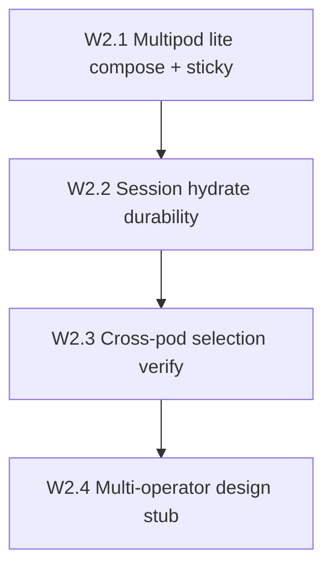

# Wave 2 Decentralization Implementation Plan

**Status:** Landed in-repo + live smoke `SPRINT_J2_MULTIPOD_OK` on proxyhubb-testnet (2026-08-11).

**Goal:** Raise decentralization from ~3.3/5 (post-Wave 1) toward **~3.8/5** by making the **data plane** less single-process — without claiming multi-operator DePIN or multi-region HA.

**Honest end-state:** PARTIAL multipod on one VM (or 2 edge processes with sticky tunnels + peer forward). Still single control-api / single host SPOF.

## Baseline

| Item | State |
|------|--------|
| J0 session hydrate PG dual-read | Done (PARTIAL↑ EV-05) |
| J1 Session PDA fail-closed | Done (Wave 1) |
| P3 multipod lab compose | Done (`services/edge-gateway/docker-compose.p3-multipod.yml`) |
| Live gcp-testnet 2× edge | **Overlay ready** — apply `docker-compose.j2-multipod.yml` |
| Multi-operator stake/slash | **Design only** — ADR 0007 |

## W2.1 — Multipod lite ✅

**Exit claim:** `SPRINT_J2_MULTIPOD_OK` — two healthy edge pods, distinct ports, `EDGE_MODE=colocated`, peer URLs set; kill one pod → other stays up; sticky buyer hash documented.

Surfaces:
- [`docker-compose.j2-multipod.yml`](../../docker-compose.j2-multipod.yml)
- [`scripts/gcp-smoke-sprint-j2-multipod.sh`](../../scripts/gcp-smoke-sprint-j2-multipod.sh)
- Caddy sticky example for CONNECT :8090
- [`docs/ops/GCP_HA_LITE.md`](GCP_HA_LITE.md) PARTIAL multipod language
- Evidence: [`evidence/W2_1_j2_multipod_20260811.md`](evidence/W2_1_j2_multipod_20260811.md)

## W2.2 — Session hydrate durability ✅

**Exit claim:** Expired `session_gateway_cache` rows reaped; evidence pack filed; hydrate docs honest about Redis still hot path.

- `sessioncache.DeleteExpired` + `StartSessionGatewayCacheReaper`
- Evidence: [`evidence/W2_2_session_hydrate_reaper_20260811.md`](evidence/W2_2_session_hydrate_reaper_20260811.md)

## W2.3 — Cross-pod provider selection ✅ (PARTIAL)

**Exit claim:** Documented sticky-only PARTIAL with peer URLs wired; full live CONNECT e2e optional via P3 script against j2 ports.

- Evidence: [`evidence/W2_3_cross_pod_partial_20260811.md`](evidence/W2_3_cross_pod_partial_20260811.md)

## W2.4 — Multi-operator gateways (design) ✅

**Exit claim:** ADR/stub describing stake + slash + buyer gateway choice; **no** unsafe `programs/session` deploy; implementation deferred to Wave 3+.

- [`docs/adr/0007-multi-operator-gateways.md`](../adr/0007-multi-operator-gateways.md)
- [`docs/ops/MULTI_OPERATOR_GATEWAY_NON_GOALS.md`](MULTI_OPERATOR_GATEWAY_NON_GOALS.md)

## Non-goals

- Multi-region / Memorystore / multi-VM HA
- Trustless metering
- Deploying `programs/session`
- Always-on 99.9% claims
