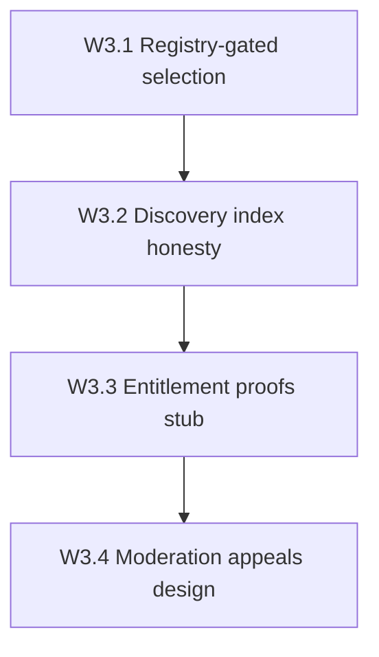

# Wave 3 Decentralization Implementation Plan

**Status:** Complete in-repo 2026-08-11 (W3.1–W3.5). See Wave 4 plan for next work.

**Goal:** Raise decentralization from ~3.8/5 (post-Wave 2 multipod) toward **~4.2/5** by making **discovery & entitlement** less platform-erasable (DISC-01) — without claiming trustless catalog or multi-operator DePIN.

**Honest end-state:** On-chain `ProviderRegistry` gates live selection (observe → enforce); listing browse remains Postgres with optional registry annotations; entitlement proofs staged; moderation appeals designed. Catalog still not fully on-chain.

## Baseline

| Item | State |
|------|--------|
| `ProviderRegistry` PDA + register/heartbeat/deregister | Done (write path on hotkey bind) |
| Registry reads in live routing / activate | **W3.1 gate** (observe/enforce flag) |
| Marketplace listings / map | Postgres + Redis cache + W3.2 honesty meta |
| Listing offer Ed25519 proofs | Off-chain columns on `proxy_listings` |
| Access Pass NFT entitlement | Live (platform quota) — unchanged |
| Order credential proof | **W3.3 observe stub** |
| Moderation delist appeals | **Design only** — ADR 0008 |
| Multi-operator gateways | Design only (ADR 0007) |
| Groth16 / reputation deploy | Wave 4 |

## W3.1 — Registry-gated selection ✅

**Exit claim:** `DISC01_REGISTRY_GATE_OBSERVE` then optional enforce — order/session activation and smart-match consult on-chain registry (`is_active` + heartbeat TTL).

Surfaces:
- Flags: `PROXYHUB_PROVIDER_REGISTRY_GATE` = `off` \| `observe` \| `enforce` (default `off`; gcp-testnet → `observe`)
- Helper: `providergate.Check` → `ReadProviderRegistry`
- Call sites: session activation hook + smart-match enforce filter
- Evidence: [`evidence/W3_1_registry_gate_20260811.md`](evidence/W3_1_registry_gate_20260811.md)

**Non-goals for 3.1:** edge CONNECT reading Solana; on-chain listing PDAs; map rewrite.

## W3.2 — Discovery index honesty ✅

**Exit claim:** Browse/map responses expose registry liveness fields; document that delist is still Postgres-admin; signed listing commitment hash published in API (reuse existing offer hash).

- Evidence: [`evidence/W3_2_discovery_honesty_20260811.md`](evidence/W3_2_discovery_honesty_20260811.md)
- Docs: [`MARKETPLACE_DISCOVERY_API.md`](../MARKETPLACE_DISCOVERY_API.md) Wave 3.2 section

## W3.3 — Entitlement proofs (stub → observe) ✅

**Exit claim:** Design + optional observe path for buyer order credential as verifiable artifact (hash + HMAC signature), without ripping Access Pass NFT model.

- Flag: `PROXYHUB_CREDENTIAL_PROOF=off|observe`
- `proofs.BuildOrderCredentialArtifact` + attach on `GET /orders/:id/credentials`
- Evidence: [`evidence/W3_3_entitlement_proofs_stub_20260811.md`](evidence/W3_3_entitlement_proofs_stub_20260811.md)

## W3.4 — Censorship-resistant moderation (design) ✅

**Exit claim:** ADR for delist appeals → jury/governance; **no** silent hard-delete as only path.

- [`docs/adr/0008-moderation-appeals.md`](../adr/0008-moderation-appeals.md)
- [`docs/ops/MODERATION_APPEALS_NON_GOALS.md`](MODERATION_APPEALS_NON_GOALS.md)

## W3.5 — Appeal APIs ✅

**Exit claim:** Seller appeal + moderator resolve live; reject → `delisted`; migration `000145`.

- Evidence: [`evidence/W3_5_moderation_appeals_api_20260811.md`](evidence/W3_5_moderation_appeals_api_20260811.md)
- Next: [`WAVE4_DECENTRALIZATION_PLAN.md`](WAVE4_DECENTRALIZATION_PLAN.md)

## Non-goals

- Deploying `programs/session`
- BC-11-B Groth16 (Wave 4)
- Multi-region HA as a decentralization claim
- Claiming “platform cannot erase supply” until listing commitments are independently indexable **and** appeals ship

## Sequence note

Do **W3.1 first**. It turns today’s write-only registry into a real selection trust check — the DISC-01 foothold. W3.2–W3.4 complete the Wave 3 honesty + stubs layer.
