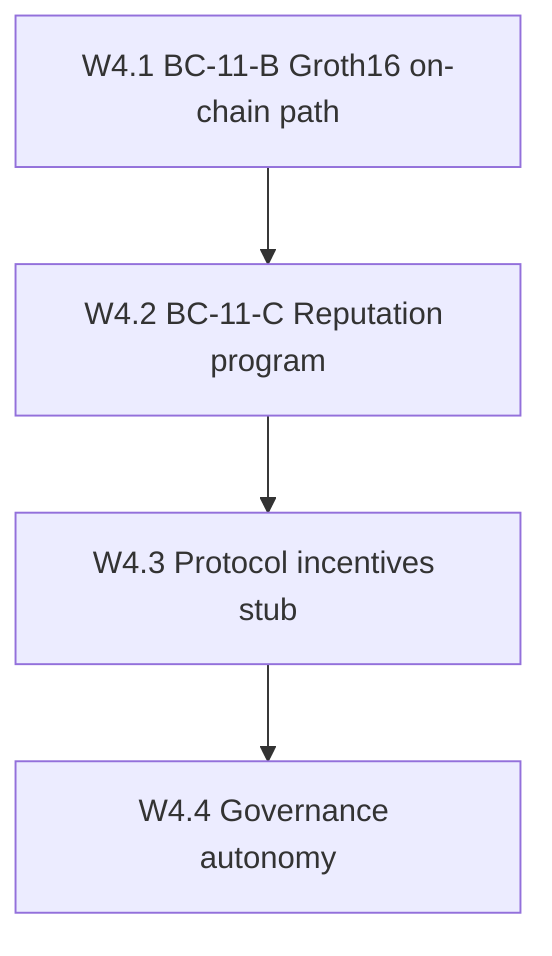

# Wave 4 Decentralization Implementation Plan

**Goal:** Raise decentralization from ~4.2/5 (post-Wave 3 / 3.5) toward **~4.5/5** with **verifiable reputation & incentives** — without claiming fully trustless metering or mainnet readiness overnight.

**Honest end-state:** BN254 Groth16 path designed/flagged for on-chain batch verify; reputation program path clarified; token incentives + governance autonomy scoped. Metering may still use a trusted relay for residential egress.

## Baseline (post Wave 3.5)

| Item | State |
|------|--------|
| Session PDA fail-closed / jury default / multipod | Waves 1–2 |
| Registry gate + discovery honesty + credential observe + appeals API | Wave 3 / 3.5 |
| Halo2-IPA off-chain verify | BC-11 Sprint A (PARTIAL) |
| On-chain ZK | Oracle Ed25519 over Merkle root — **not** Groth16 |
| Reputation program | Placeholder / undeployed path |
| Protocol token incentives | Mostly absent |
| Governance | Proposals exist; treasury execution still ops-heavy |

## W4.1 — BC-11-B Groth16 on-chain verify ✅ live on testnet

**Exit claim:** Circuit/VK path + real `alt_bn128` verify via `groth16-solana` +
PDA write under Cargo `onchain-groth16`. Control-api ready gate **on** on
proxyhubb-testnet (`PROXYHUB_ZK_ONCHAIN_GROTH16` + `_READY`).

- Spec: [`BC11_GROTH16_PATH.md`](BC11_GROTH16_PATH.md)
- Evidence (stub): [`evidence/W4_1_groth16_fail_closed_20260811.md`](evidence/W4_1_groth16_fail_closed_20260811.md)
- Evidence (verify): [`evidence/BC11_B_groth16_verify_20260811.md`](evidence/BC11_B_groth16_verify_20260811.md)
- Evidence (live): [`evidence/BC11_B_groth16_live_devnet_20260811.md`](evidence/BC11_B_groth16_live_devnet_20260811.md)
- **Prover→aggregator:** wired + **testnet lane enabled**. Evidence: [`evidence/BC11_B_groth16_lane_enabled_20260811.md`](evidence/BC11_B_groth16_lane_enabled_20260811.md).

## W4.2 — BC-11-C real reputation program ✅ live consume + enforce

**Exit claim:** Deploy path with real program IDs (devnet); placeholder dropped;
scores gated when Groth16 flag on; on-chain `onchain-groth16` build requires ZKBatchPDA;
control-api credits after settle; registry gate **enforce** on session activate.

- Program ID: `EnVE6ehKA2dYi69B3Lo8wt2wyDgzLw4tdtSEKoMYe5bF`
- Spec: [`BC11_REPUTATION_DEPLOY.md`](BC11_REPUTATION_DEPLOY.md)
- Deploy: [`scripts/deploy-reputation-devnet.ps1`](../../scripts/deploy-reputation-devnet.ps1) (builds with `--features onchain-groth16`)
- Evidence: [`evidence/W4_2_reputation_program_id_20260811.md`](evidence/W4_2_reputation_program_id_20260811.md)
- **Devnet deploy:** [`evidence/W4_2_reputation_devnet_deploy_20260811.md`](evidence/W4_2_reputation_devnet_deploy_20260811.md) (sig `3q8AFBci…63jn`)
- **Init + allow:** [`evidence/W4_2_reputation_init_deploy_allowed_20260811.md`](evidence/W4_2_reputation_init_deploy_allowed_20260811.md) (`deploy_allowed=true`)
- **Consume + registry enforce:** [`evidence/W4_2_reputation_consume_registry_enforce_20260811.md`](evidence/W4_2_reputation_consume_registry_enforce_20260811.md) — settle→score **PASS**; enforce **PASS**

## W4.3 — Protocol token incentives (stub → observe) ✅

**Exit claim:** Design + optional observe accounting for gateway fees / provider rewards; no reckless mint.

- Spec: [`PROTOCOL_INCENTIVES.md`](PROTOCOL_INCENTIVES.md)
- Evidence: [`evidence/W4_3_protocol_incentives_observe_20260811.md`](evidence/W4_3_protocol_incentives_observe_20260811.md)

## W4.4 — Governance autonomy ✅

**Exit claim:** Narrow pause powers; on-chain proposal → treasury execution path documented; reduce ops hot-wallet as sole automatic spend path.

- ADR: [`0009-governance-autonomy.md`](../adr/0009-governance-autonomy.md)
- Spec: [`GOVERNANCE_AUTONOMY.md`](GOVERNANCE_AUTONOMY.md)
- Evidence: [`evidence/W4_4_governance_autonomy_20260811.md`](evidence/W4_4_governance_autonomy_20260811.md)

## Ops polish (post-gate)

Wave 4 gates closed. Next greenfield wave: [`WAVE5_DECENTRALIZATION_PLAN.md`](WAVE5_DECENTRALIZATION_PLAN.md)
(W5.A leaf-committed Groth16 digest-v2 in progress / code complete).

Routine polish:

- Keep control-api image in sync with Finalized PDA wait + aggregator PDA pass-through
- Prefer GHCR push over ad-hoc VM source copies for routine deploys
- Optional: broaden browse/map registry hard-filter (intentionally honesty-only today)
- Do **not** claim trustless metering or mainnet

## Non-goals

- Deploying `programs/session` (still unsafe)
- Claiming fully trustless byte metering
- Multi-region HA as a decentralization score substitute

## Sequence note

Start with **W4.1** — without on-chain proof verify, reputation and incentives remain oracle-attested theater.
