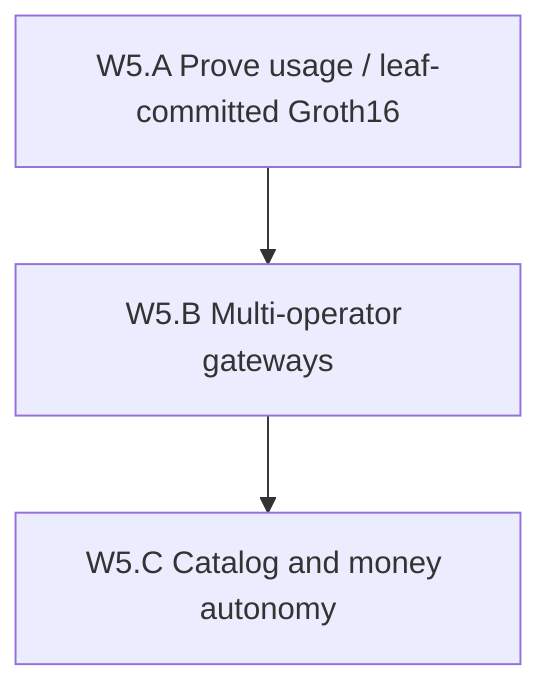

# Wave 5 Decentralization Implementation Plan

**Goal:** Move past Wave 4’s ~4.45/5 wave-ladder / ~3.3/5 audit hybrid by attacking
**trust-minimized usage binding**, then multi-operator routing, then catalog/money
autonomy — without claiming fully trustless residential egress.

## Baseline (post Wave 5.A ops, 2026-08-11)

| Item | State |
|------|--------|
| Groth16 lane | Live digest-v2 (`groth16-bn254-batch-digest-v2`) |
| Reputation consume | Live (ZKBatchPDA + score smoke) |
| Registry gate | `enforce` on activate / smart-match |
| Byte metering | Edge-attested; leaf-committed batch header (digest-v2) |
| Multi-operator | W5.B **PASS** (discovery + peer-forward soak) |
| Catalog | Postgres + honesty annotations |

## W5.A — Prove usage (leaf-committed batch) — **OPS COMPLETE**

**Exit claim:** ADR 0010 + **batch-digest-v2** binds ordered leaf hashes into the
on-chain Groth16 public digest. Aggregator fail-closes without leaves.
**Does not** claim trustless edge bytes or R1CS Merkle verification.

- Evidence: [`evidence/W5_A_batch_digest_v2_20260811.md`](evidence/W5_A_batch_digest_v2_20260811.md)

## W5.B — Multi-operator gateways — **PASS** (2026-08-12)

**Exit claim:** ADR 0007 discovery API + peer-forward CONNECT soak + stake/slash
**hooks** (observe). Same host/control-plane SPOF remains. Not DePIN.

Checklist:

- [x] Operator registry + `GET /v1/gateways/operators` (`W5B_OPERATORS_OK`)
- [x] Tunnel addrs prefer registry
- [x] Bond-enforce flag (default off) + honeytoken → `slashing_events` audit
- [x] Live cross-pod peer-forward soak (`W5B_PEER_FORWARD_OK` — TLS AUTH, Redis master,
      credential hash, signed HB, `route=remote`, tunneled origin GET)

- ADR: [`docs/adr/0007-multi-operator-gateways.md`](../adr/0007-multi-operator-gateways.md)
- Evidence: [`evidence/W5_B_multi_operator_20260811.md`](evidence/W5_B_multi_operator_20260811.md)

## W5.C — Catalog & money autonomy — **PASS** (2026-08-12)

**Goal:** Reduce platform-erasable discovery and money theater without claiming
full on-chain catalog sovereignty, trustless egress, or full DAO treasury autonomy.

### W5.C.1 — Browse registry hard-filter (first slice) — **PASS**

**Exit claim:** `PROXYHUB_BROWSE_REGISTRY_FILTER=enforce` omits listings without
PG `provider_nodes.is_registered_on_chain` from browse/map; honesty meta exposes
the flag. **Not** an on-chain listing index.

Checklist:

- [x] Flag + honesty field `browse_registry_filter`
- [x] `GET /v1/listings` + listing detail + geo/map filter
- [x] gcp-testnet smoke + evidence [`W5_C_browse_registry_hard_filter_20260812.md`](evidence/W5_C_browse_registry_hard_filter_20260812.md)

### W5.C.2 — Credential proofs enforce on CONNECT — **PASS**

**Exit claim:** `PROXYHUB_CREDENTIAL_PROOF=enforce` binds platform HMAC into Redis at
marketplace activation; edge rejects CONNECT for marketplace sessions (`listing_id`
set) when the proof is missing/invalid/expired. Still platform-attested HMAC (not
buyer VC / lease PDA).

Checklist:

- [x] Flag `enforce` + Redis bind at activation
- [x] Edge CONNECT verify (marketplace sessions)
- [x] gcp-testnet smoke + evidence [`W5_C_credential_proof_enforce_20260812.md`](evidence/W5_C_credential_proof_enforce_20260812.md)

### Later W5.C slices

_(none — listing commitment PDA shipped as W5.C.5)_

### W5.C.3 — Treasury hot-wallet execute (dual-gated) — **PASS**

**Exit claim:** `PROXYHUB_GOV_TREASURY_AUTO_SPEND` + `PROXYHUB_GOV_TREASURY_EXECUTE_CONFIRM=1`
enables real hot-wallet `SendSOL` for passed treasury proposals; otherwise
`pending_custody`. Not on-chain proposal→treasury PDA CPI. gcp-testnet defaults stay off.

Checklist:

- [x] Dual-gate flags + honesty meta
- [x] `ProposalExecutor` hot-wallet path
- [x] Unit tests + evidence `W5_C_treasury_execute_*` (`docs/ops/evidence/W5_C_treasury_execute_20260812.md`)

### W5.C.4 — Protocol incentives beyond observe (dual-gated settle) — **PASS**

**Exit claim:** `PROXYHUB_PROTOCOL_INCENTIVES=settle` + `PROXYHUB_INCENTIVE_SETTLE_CONFIRM=1`
enables hot-wallet `SendSOL` of the **provider incentive share**; settle without
confirm queues `pending_custody`. Observe mode unchanged. No mint. Gateway/treasury
shares remain ledger-only. gcp defaults stay off/observe.

Checklist:

- [x] Mode `settle` + confirm dual-gate + honesty meta
- [x] `ObserveSettlement` custody / hot-wallet paths + `SettlePendingCustody`
- [x] Migration `000148` + unit tests + evidence [`W5_C_protocol_incentives_settle_20260812.md`](evidence/W5_C_protocol_incentives_settle_20260812.md)

### W5.C.5 — Listing commitment PDA / index (honest first slice) — **PASS**

**Exit claim:** On-chain `ListingCommitment` PDA anchors verified `listing_offer_hash`
(seeds `listing-commitment` + provider + hash). PG mirror + browse honesty /
optional enforce filter. **Not** a full on-chain catalog. gcp default stays `off`
until program upgrade is deployed.

Checklist:

- [x] Anchor account + register/deactivate ix on `proxyhub`
- [x] Go client PDA + register/deactivate + unit tests
- [x] Migration `000149` + async oracle register after verified offer
- [x] Discovery honesty + observe/enforce browse filter
- [x] ADR 0011 + evidence [`W5_C_listing_commitment_20260812.md`](evidence/W5_C_listing_commitment_20260812.md)

## Non-goals

- Fully trustless residential egress
- Deploying unsafe `programs/session`
- Mainnet as a decentralization substitute
- TEE metering in W5.A (deferred design note in ADR 0010)
- Live economic gateway slash in W5.B

## Next wave

Wave 5 gates closed. Next greenfield wave:
[`WAVE6_DECENTRALIZATION_PLAN.md`](WAVE6_DECENTRALIZATION_PLAN.md)
(independent operators / second-host fleets — ADR 0012).

Ops polish still open from W5.C.5: deploy upgraded `proxyhub` with
`ListingCommitment` before enabling `PROXYHUB_LISTING_COMMITMENT=observe`.