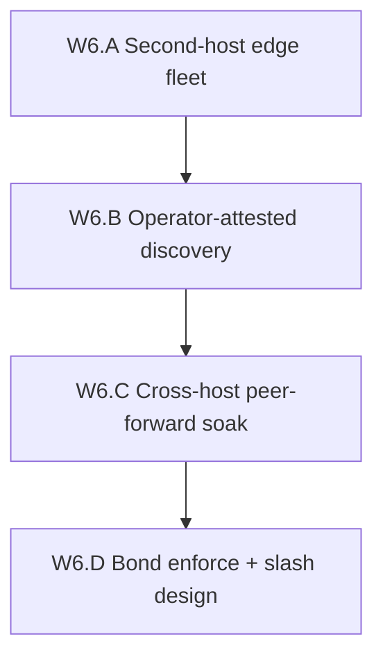

# Wave 6 Decentralization Implementation Plan

**Goal:** Break the **same-host / same-fleet SPOF** left after Wave 5.B by proving
**independent gateway operators** can route real CONNECT traffic — without claiming
DePIN, trustless egress, or a second fully independent control plane overnight.

**Honest end-state after Wave 6:** At least two operator fleets on **distinct hosts**
(org or machine boundary), discovery lists their real endpoints, and a cross-host
peer-forward soak passes. Control-api may still be shared SoT for sessions/orders.
Stake/slash may advance from observe → bond-enforce, but **live economic slash**
still requires a safe bonded program (not undeployed `programs/session`).

## Baseline (post Wave 5, 2026-08-12)

| Item | State |
|------|--------|
| W5.A leaf-committed Groth16 | OPS COMPLETE |
| W5.B multi-operator | **PASS** — logical ops on **same VM**; discovery + soak |
| W5.C catalog/money | C.1–C.5 **PASS** (listing commitment deploy still pending) |
| Host diversity | **two_hosts** — `proxyhubb-testnet` + `proxyhubb-w6-edge-b` (us-west1-b) |
| Control-plane SoT | Single control-api / Postgres / Redis |
| Stake / slash | Observe hooks only (`slashing_events` audit) |
| `programs/session` | Unsafe — **do not deploy** |

Prior art:

- ADR [`0007`](../adr/0007-multi-operator-gateways.md) — multipod ≠ multi-operator
- Non-goals [`MULTI_OPERATOR_GATEWAY_NON_GOALS.md`](MULTI_OPERATOR_GATEWAY_NON_GOALS.md)
- Evidence [`W5_B_multi_operator_20260811.md`](evidence/W5_B_multi_operator_20260811.md)

## W6.A — Second-host edge fleet — **PASS** (live 2026-08-12)

**Exit claim:** A second machine (GCP VM, other cloud, or external VPS) runs at least
one edge gateway that registers as a distinct operator and accepts provider tunnels.
Same control-api is allowed. **Not** multi-region mesh; **not** DePIN.

Checklist:

- [x] Remote-edge compose + ops doc (`docker-compose.w6-remote-edge.yml`, `W6_SECOND_HOST_EDGE.md`)
- [x] Seed `host_id` + honesty `operator_host_diversity`
- [x] Provision second host `proxyhubb-w6-edge-b` (us-west1-b e2-small)
- [x] Seed operator-b with **external** tunnel `35.252.224.81:3128`
- [x] Host-B tunnel `:3128` reachable from host-A / public; health `edge_pod_id=edge-b`
- [x] Honesty `operator_host_diversity=two_hosts` live
- [x] Evidence [`W6_A_second_host_edge_20260812.md`](evidence/W6_A_second_host_edge_20260812.md) (`W6A_HOST_DIVERSITY_OK`)

**Non-claims:** Shared control-api/Postgres/Redis may remain; killing host-1 can still
take down discovery/session minting.

## W6.B — Operator-attested discovery — **PASS** (unit)

**Exit claim:** Operator registry entries carry a **signed operator manifest**
(pubkey + endpoints + stake/bond fields + expiry) that clients/edges can verify —
not only Postgres rows written by platform admin. Platform may still host the
directory blob.

Checklist:

- [x] Manifest schema + Ed25519 signature over canonical bytes
- [x] `GET /v1/gateways/operators` returns manifest + `manifest_verified`
- [x] Reject / mark unhealthy when signature invalid or expired (`PROXYHUB_OPERATOR_MANIFEST=observe|enforce`)
- [x] ADR 0012
- [x] Evidence [`W6_B_operator_manifest_20260812.md`](evidence/W6_B_operator_manifest_20260812.md)

**Non-claims:** Directory hosting can stay centralized; this is attestation of
operator identity, not censorship-resistant discovery.

## W6.C — Cross-host peer-forward soak — **SCRIPT READY** (live pending W6.A host)

**Exit claim:** Live CONNECT path where provider tunnels to **host-A** and buyer
CONNECT lands on **host-B** (or the reverse), with `route=remote` and origin 200 —
mirroring W5.B soak but across **distinct hosts**.

Checklist:

- [x] Smoke fail-closed unless `operator_host_diversity=two_hosts`
- [x] Smoke script [`gcp-smoke-sprint-w6c-cross-host-peer.sh`](../../scripts/gcp-smoke-sprint-w6c-cross-host-peer.sh)
- [ ] Live `W6C_PEER_FORWARD_OK` (needs host-B)
- [x] Document remaining SPOFs (control-api, Redis master, DNS)
- [x] Evidence [`W6_C_cross_host_peer_forward_20260812.md`](evidence/W6_C_cross_host_peer_forward_20260812.md)

**Non-claims:** Does not prove buyers can avoid ProxyHubb control-plane entirely.

## W6.D — Bond enforce + slash design — **PASS** (unit + design)

**Exit claim:** `PROXYHUB_GATEWAY_OPERATOR_BOND_ENFORCE` can exclude
unbonded operators from discovery/routing on testnet; slash path is **designed**
against a future bonded gateway program + challenge window (reuse Phase B patterns).
Live on-chain slash remains gated and is **not** required to close Wave 6.

Checklist:

- [x] Bond-enforce `off|observe|enforce` (default off; `true` aliases enforce)
- [x] Challenge-window design [`GATEWAY_OPERATOR_SLASH.md`](GATEWAY_OPERATOR_SLASH.md)
- [x] Explicit reject of `programs/session` as the slash vehicle
- [x] Slash-audit remains observe / no on-chain transfer
- [x] Evidence [`W6_D_bond_enforce_20260812.md`](evidence/W6_D_bond_enforce_20260812.md)

**Non-claims:** Not live economic slash; not DePIN staking APY; not mainnet.

## Suggested score movement (honesty)

| Dimension | Post-W5 | Post-W6 (if A–C PASS) |
|-----------|---------|----------------------|
| Gateway host SPOF | Single VM multipod | Two hosts; control-plane still shared |
| Operator diversity | Logical J2 ops | Distinct host operators + attested manifests |
| DePIN claim | Forbidden | Still forbidden |
| Wave-ladder (informal) | ~4.5+/5 hybrid | ~4.7/5 hybrid if cross-host soak PASS |

## Non-goals

- Marketing “DePIN ready” or trustless gateway selection
- Deploying unsafe `programs/session`
- Fully independent control-api / Postgres per operator (Wave 7+ candidate)
- Multi-region world mesh / anycast
- Trustless residential egress / TEE metering (ADR 0010 deferral)
- Replacing listing commitment or treasury work from Wave 5
- Mainnet as a decentralization substitute

## Implementation order

1. **W6.A** first — without a second host, discovery signatures are still theater on one box.
2. **W6.B** — make operator identity portable before expanding UX.
3. **W6.C** — the only soak that upgrades W5.B’s claim.
4. **W6.D** — economic teeth last; design may parallel C but enforce only after A+C green.

## Next wave

Wave 6 data-plane split does not make a DePIN. Wave 7 (federated session mint +
discovery-as-cache) is **claimed A–C live 2026-08-13**:
[`WAVE7_DECENTRALIZATION_PLAN.md`](WAVE7_DECENTRALIZATION_PLAN.md)
([`W7_CLAIMED_20260813.md`](evidence/W7_CLAIMED_20260813.md)). Still not DePIN.

## Related

- ADR: [`0012-independent-gateway-operators.md`](../adr/0012-independent-gateway-operators.md)
- Prior: [`WAVE5_DECENTRALIZATION_PLAN.md`](WAVE5_DECENTRALIZATION_PLAN.md)
- Companion: [`MULTI_OPERATOR_GATEWAY_NON_GOALS.md`](MULTI_OPERATOR_GATEWAY_NON_GOALS.md)
