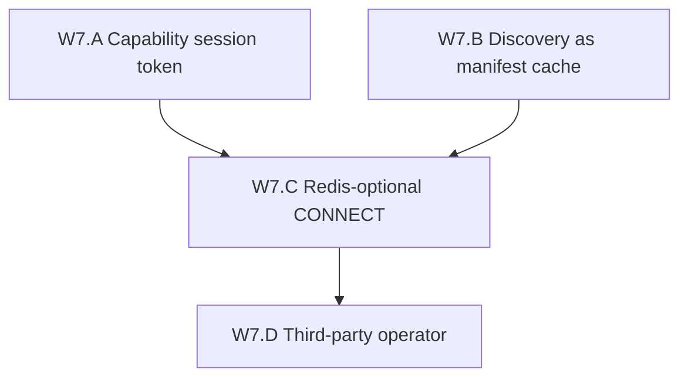

# Wave 7 Decentralization Implementation Plan

**Goal:** Remove **control-api as the sole session mint and discovery source of
truth** — the reason Wave 6 is still not DePIN — without claiming trustless
residential egress or deploying unsafe `programs/session`.

**Status (2026-08-13):** W7.A–C **PASS live**. W7.D join path **PASS in-repo**;
live foreign VPS **unclaimed**. Evidence:
[`W7_CLAIMED_20260813.md`](evidence/W7_CLAIMED_20260813.md). Not DePIN.

**Honest end-state after Wave 7 (live A–C 2026-08-13):** A marketplace CONNECT can
be admitted on J2 edge-b using a self-contained capability after control-api is
down; a signed operator bundle verifies without Postgres/API. Shared
Postgres/Redis remain a cache / convenience. `operator_org_diversity` is still
`same_org` (Host-B is the same GCP project). That is federated coordination, not
DePIN.



## Why this wave exists

Wave 6 split the **data plane** (two hosts). Buyers still:

1. Hit **one** control-api to activate an order
2. Get a Redis session blob keyed by username
3. Carry a **platform HMAC** (`SESSION_SECRET`) as `credential_proof`
4. CONNECT to an edge that **reads that Redis blob**

Kill host-A control-api: **no new sessions**. Kill shared Redis: **even live
CONNECT dies**. That is a company coordination network with extra edges — not
DePIN.

Current mint path (W5.C.2):

```
ActivateOrderSession → StoreSession(Redis) + AttachCredentialProof(HMAC)
edge auth.rs → GetSession(Redis) → verify HMAC with SESSION_SECRET
```

W5.C.2 non-claim still holds: not a buyer VC / on-chain lease PDA.

## Baseline (post Wave 6.A, 2026-08-12)

| Item | State |
|------|--------|
| Host diversity | **two_hosts** (`proxyhubb-testnet` + `proxyhubb-w6-edge-b`) |
| Control-api | Single SoT for session mint / orders |
| Session store | Shared Redis (`session:<username>`) |
| Credential | Platform HMAC (`SESSION_SECRET`) |
| Discovery | Postgres `gateway_operators` + optional unsigned manifests |
| Listing commitment PDA | Code complete; program deploy still pending |
| `programs/session` | Unsafe — **do not deploy** |
| DePIN claim | Forbidden |

Prior: [`WAVE6_DECENTRALIZATION_PLAN.md`](WAVE6_DECENTRALIZATION_PLAN.md),
ADR [`0012`](../adr/0012-independent-gateway-operators.md),
ADR [`0013`](../adr/0013-federated-session-mint.md).

## W7.A — Capability session token — **PASS** (live 2026-08-13)

**Exit claim:** Marketplace CONNECT can be authorized by a **self-contained
token** (Ed25519 over canonical lease bytes: session_id, listing_commitment or
offer_hash, buyer, expiry, bandwidth cap, operator pubkey). Edge verifies the
signature with a **known operator or protocol key set**, not by calling
control-api. Redis blob may still be written as a cache.

Live soak: mint token while API is up → **stop control-api** → CONNECT on
host-A J2 `edge-gateway-b` (`127.0.0.1:18091`) still 200. us-west Host-B image
was not rolled.

Checklist:

- [x] Canonical lease bytes + Ed25519 (reuse listing-offer / operator-manifest patterns)
- [x] Flag `PROXYHUB_SESSION_CAPABILITY=off\|observe\|enforce` (default off)
- [x] Edge verify path that does **not** require `CONTROL_API_URL` at CONNECT time
- [x] Honesty: `session_mint=control_api_hmac` vs `session_mint=capability_token`
- [x] Evidence [`W7_A_capability_session_20260812.md`](evidence/W7_A_capability_session_20260812.md) (`W7A_CAPABILITY_OK` unit; live `W7A_API_DOWN_CONNECT_OK` 2026-08-13)
- [x] Explicit: still not on-chain lease PDA; still not `programs/session`

**Non-claims:** Token issuer may still be control-api at mint time. The DePIN
test is **verify without the issuer being online**, not “buyer self-issues.”

## W7.B — Discovery as manifest cache — **PASS** (live CLI 2026-08-13)

**Exit claim:** `GET /v1/gateways/operators` is documented and implemented as a
**cache** of W6.B signed manifests. A client or edge can load operators from a
second channel (static bundle / IPFS CID / gossip file) and treat Postgres as
optional. Enforce mode already omits unsigned rows; Wave 7 requires at least
one **non-Postgres** reconstruct path.

Checklist:

- [x] Manifest bundle format (JSON array of payload+sig) + verify CLI
- [x] Edge/client can pin a bundle CID or URL and skip live directory GET
- [x] Honesty `discovery_sot=postgres_cache` when bundle configured
- [x] Evidence [`W7_B_discovery_cache_20260812.md`](evidence/W7_B_discovery_cache_20260812.md) (`W7B_BUNDLE_VERIFY_OK` live)
- [x] Control-api down does **not** prevent listing known operators from bundle (CLI; HTTP `/bundle` export not claimed)

**Non-claims:** Not censorship-resistant global discovery. Platform can still
refuse to host a cache. The point is **copies exist that verify without the API**.

## W7.C — Redis-optional CONNECT — **PASS** (live 2026-08-13)

**Exit claim:** With `PROXYHUB_SESSION_CAPABILITY=enforce`, marketplace CONNECT
succeeds when the capability token is presented **even if Redis `session:` is
missing** (simulating Redis SPOF or a fleet that does not share Redis).

Checklist:

- [x] Edge: token-first auth; Redis lookup optional fallback
- [x] Soak: flush/delete Redis key → CONNECT still 200 with token (`W7C_REDIS_DELETE_CONNECT_OK` 2026-08-13)
- [x] Evidence [`W7_C_redis_optional_connect_20260813.md`](evidence/W7_C_redis_optional_connect_20260813.md) (`W7C_REDIS_OPTIONAL_OK` unit + live)
- [x] Document remaining SPOF: whoever **signed** the token (until W8/W9 chain lease)

**Non-claims:** Usage counters may still use Redis/WAL; this slice is **admission**,
not metering sovereignty (ADR 0010).

## W7.D — Third-party operator (org boundary) — **PASS** (unit / CLI; live VPS unclaimed)

**Exit claim:** An operator **not** in `gen-lang-client-0022105784` runs edge +
holds its own signing key; ProxyHubb control-api is only a cache. Host-B today
is still the same GCP project — that does **not** count.

Checklist:

- [x] Runbook: foreign operator generates key, signs manifest, publishes bundle
- [x] ProxyHubb cannot rotate their key
- [ ] Optional: one volunteer/external VPS smoke (script-ready)
- [x] Evidence [`W7_D_third_party_operator_20260813.md`](evidence/W7_D_third_party_operator_20260813.md) (`W7D_JOIN_CLI_OK` unit)
- [x] Honesty `operator_org_diversity=same_org|multi_org`

**Non-claims:** Not permissionless join; not DePIN marketing. One external org
is the minimum org-boundary proof.

## Suggested score movement (honesty)

| Dimension | Post-W6 | Post-W7 (A–C live 2026-08-13) |
|-----------|---------|------------------------|
| Session mint SPOF | control-api + Redis | Mint may still be API; **verify** is local (enforce soak) |
| Discovery SoT | Postgres | Postgres cache + verifiable bundle (CLI reconstruct) |
| Redis SPOF for CONNECT | Hard | Optional for marketplace admission (enforce soak) |
| DePIN claim | Forbidden | Still forbidden until W7.D live + W8 slash |
| Wave-ladder (informal) | ~4.7/5 hybrid | ~4.85/5 hybrid (A+C live; D still `same_org`) |

## Non-goals

- Marketing “DePIN ready”
- Deploying unsafe `programs/session`
- Fully trustless residential byte metering / TEE (ADR 0010)
- Token-weighted DAO / PHB mint
- Replacing listing commitment or treasury work
- Multi-region anycast
- Mainnet as a substitute

## Implementation order

1. **W7.A** first — without a capability token, discovery federation is still
   theater (you cannot CONNECT).
2. **W7.B** can parallel A (manifests already exist).
3. **W7.C** only after A green (token-first edge).
4. **W7.D** after A+C — org boundary is ops, not another HMAC flag.

## Next wave

Wave 7 A–C does not make a DePIN. Next greenfield wave is bonded slash:
[`WAVE8_DECENTRALIZATION_PLAN.md`](WAVE8_DECENTRALIZATION_PLAN.md)
(safe `programs/gateway-bond`; not undeployed `programs/session`). Optional live
W7.D foreign-org VPS remains open (`CONFIRM_W7D_EXTERNAL_VPS=1`).

## Related

- Claim: [`evidence/W7_CLAIMED_20260813.md`](evidence/W7_CLAIMED_20260813.md)
- ADR: [`0013-federated-session-mint.md`](../adr/0013-federated-session-mint.md)
- Ops: [`W7_SESSION_CAPABILITY.md`](W7_SESSION_CAPABILITY.md), [`W7_OPERATOR_BUNDLE.md`](W7_OPERATOR_BUNDLE.md), [`W7_THIRD_PARTY_OPERATOR.md`](W7_THIRD_PARTY_OPERATOR.md)
- Prior: [`WAVE6_DECENTRALIZATION_PLAN.md`](WAVE6_DECENTRALIZATION_PLAN.md)
- Credential status: [`evidence/W5_C_credential_proof_enforce_20260812.md`](evidence/W5_C_credential_proof_enforce_20260812.md)
