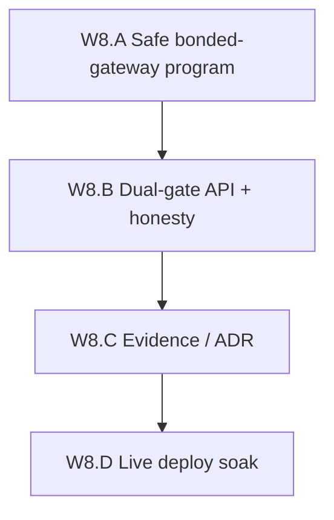

# Wave 8 Decentralization Implementation Plan

**Goal:** Make gateway misbehavior **economically punishable on-chain** with a
**challenge window**, without deploying unsafe `programs/session` and without
claiming DePIN.

**Status (2026-08-13):** W8.A–C **code complete**. W8.D **PASS localnet**
(`W8D_BOND_SLASH_OK`). GCP/mainnet execute **unclaimed**. Evidence:
[`W8_A_bonded_gateway_program_20260813.md`](evidence/W8_A_bonded_gateway_program_20260813.md),
[`W8_D_bonded_slash_localnet_20260813.md`](evidence/W8_D_bonded_slash_localnet_20260813.md).

**Honest end-state after Wave 8 (A–D localnet 2026-08-13):** A dedicated
bonded-gateway program can lock operator stake, open an accuse, wait a minimum
challenge window, then slash to treasury **or** release. Localnet soak moved
lamports after the window (`W8D_BOND_SLASH_OK`). Control-api slash-audit stays
observe-only on GCP. `programs/session` remains undeployed. Not DePIN.



## Why this wave exists

Wave 6.D designed accuse → challenge window → custody slash and **rejected**
`programs/session` (`slash_gateway` is unconstrained admin transfer). Wave 7
federated session **verify**, not stake. Honeytoken hits are still
`slashing_events` rows with `tx_hash=""` and `slash_percentage=0`.

That is audit theater. Wave 8 is the first **safe** on-chain vehicle.

Unsafe session slash (do **not** copy):

```
slash_gateway(admin, percentage) → immediate lamports to treasury
```

No pending accuse, no window, no rent floor.

## Baseline (post Wave 7 A–C, 2026-08-13)

| Item | State |
|------|--------|
| Host diversity | **two_hosts** |
| Session CONNECT | Capability verify live; default mode **off** (HMAC + Redis) |
| Org diversity | **same_org** (W7.D live VPS unclaimed) |
| Slash | Observe audit only (`W6D_BOND_OK`) |
| `programs/session` | Unsafe — **do not deploy** |
| DePIN claim | Forbidden |

Prior: [`WAVE7_DECENTRALIZATION_PLAN.md`](WAVE7_DECENTRALIZATION_PLAN.md),
[`GATEWAY_OPERATOR_SLASH.md`](GATEWAY_OPERATOR_SLASH.md),
ADR [`0007`](../adr/0007-multi-operator-gateways.md),
ADR [`0012`](../adr/0012-independent-gateway-operators.md).

## W8.A — Safe bonded-gateway program — **PASS** (unit 2026-08-13)

**Exit claim:** A dedicated program (`programs/gateway-bond`) holds operator
stake on a PDA, records an accuse, and will not move stake until
`clock >= resolve_after`. There is **no** `slash_gateway` instruction.
`deploy_allowed` starts **false**. Challenge window cannot be initialized below
**3600s**.

Checklist:

- [x] Config PDA: admin, accuser, treasury, window, unbonding, min stake, max bps
- [x] OperatorBond PDA: stake, bonded, unbonding_at, open_challenge
- [x] Challenge PDA: one open accuse per operator
- [x] `resolve_slash` only after window; rent-exempt floor on bond PDA
- [x] `resolve_release` (admin, or operator after 2× window)
- [x] Unbond / withdraw blocked while a challenge is open
- [x] Explicit reject of `programs/session` as the slash vehicle
- [x] Evidence [`W8_A_bonded_gateway_program_20260813.md`](evidence/W8_A_bonded_gateway_program_20260813.md)

**Non-claims:** Not deployed. Placeholder program ID until ops generates a
keypair. Not live economic slash. Not DePIN APY.

## W8.B — Dual-gate API + honesty — **PASS** (unit 2026-08-13)

**Exit claim:** `POST /v1/gateway/slash-audit` remains observe-only by default.
Execute requires **both** `PROXYHUB_GATEWAY_SLASH_AUTO` (truthy) **and**
`PROXYHUB_GATEWAY_SLASH_CONFIRM=1`. Confirm without a **deployed** bonded
program is still a no-op. Session program ID is rejected if someone points
`PROXYHUB_GATEWAY_BOND_PROGRAM_ID` at it.

Honesty (`GET /v1/gateways/operators` / public config):

| Field | Values |
|-------|--------|
| `live_economic_slash` | **always false** until a live execute soak is claimed |
| `programs_session` | `unsafe_do_not_deploy` |
| `bonded_gateway_program` | `code_complete_undeployed` |
| `gateway_slash_execute` | `off` \| `gates_armed_undeployed` |

Checklist:

- [x] Dual-gate helpers + tests
- [x] Slash-audit response names the bonded program (not session)
- [x] Honesty never reports `live_economic_slash=true` in this slice
- [x] CLI `cmd/w8-gateway-bond` (id / pda / gates)

**Non-claims:** Armed gates on GCP would still not broadcast. Do not set the
confirm env on testnet.

## W8.C — Evidence / ADR — **PASS** (2026-08-13)

- [x] ADR [`0014-bonded-gateway-slash.md`](../adr/0014-bonded-gateway-slash.md)
- [x] Ops [`GATEWAY_OPERATOR_SLASH.md`](GATEWAY_OPERATOR_SLASH.md) updated
- [x] Smoke [`gcp-smoke-sprint-w8-gateway-bond.sh`](../../scripts/gcp-smoke-sprint-w8-gateway-bond.sh)

## W8.D — Live deploy soak — **PASS** (localnet 2026-08-13)

**Exit claim:** Localnet `solana-program-test` of `gateway-bond` with
`deploy_allowed=true`, one operator bonds, accuser opens a challenge, window is
warped past 3600s, `resolve_slash` moves lamports. Honesty
`live_economic_slash=false` on GCP. Public devnet/GCP deploy is still gated.

Checklist:

- [x] Generate a real program keypair (replace placeholder `declare_id!`) — `7nvrNVaNWcG4DzcPygEyXoVC3k19ePUAncGE25dUEyi5`
- [x] Localnet soak `cargo test --test w8d_soak` (`W8D_BOND_SLASH_OK`)
- [x] Gated: `CONFIRM_W8_DEPLOY=1` still refuses cluster/mainnet in soak scripts
- [x] Never deploy `programs/session`
- [x] Evidence [`W8_D_bonded_slash_localnet_20260813.md`](evidence/W8_D_bonded_slash_localnet_20260813.md)

**Non-claims:** Not mainnet. Not GCP program deploy. Not DePIN. Not W7.D foreign org.

## Suggested score movement (honesty)

| Dimension | Post-W7 | Post-W8 (A–D localnet 2026-08-13) |
|-----------|---------|----------------------------|
| Slash vehicle | Audit row | Safe program + localnet slash soak; GCP execute off |
| Session program | Unsafe / undeployed | Still unsafe / undeployed |
| DePIN claim | Forbidden | Still forbidden |
| Wave-ladder (informal) | ~4.85/5 hybrid | ~4.9/5 hybrid (localnet slash; not live GCP) |

## Non-goals

- Marketing “DePIN ready” or staking APY
- Deploying `programs/session`
- Trustless metering / TEE (ADR 0010)
- Permissionless operator join (W7.D live still open)
- Mainnet
- Jury/DAO slash (admin+accuser+window is the Wave 8 minimum)

## Implementation order

1. **W8.A** program invariants first — without them the API is still theater.
2. **W8.B** dual-gate so GCP cannot accidentally broadcast.
3. **W8.C** honesty docs.
4. **W8.D** only after a generated keypair and a local/devnet soak.

## Next wave

Wave 8 localnet slash does not make a DePIN. Next greenfield wave is catalog
and settlement copies that verify without Postgres being the only index:
[`WAVE9_DECENTRALIZATION_PLAN.md`](WAVE9_DECENTRALIZATION_PLAN.md).
Optional leftovers: W7.D foreign VPS; W8 `.so` / public-cluster deploy.

## Related

- Claim: [`evidence/W8_A_bonded_gateway_program_20260813.md`](evidence/W8_A_bonded_gateway_program_20260813.md),
  [`evidence/W8_D_bonded_slash_localnet_20260813.md`](evidence/W8_D_bonded_slash_localnet_20260813.md)
- ADR: [`0014-bonded-gateway-slash.md`](../adr/0014-bonded-gateway-slash.md)
- Ops: [`GATEWAY_OPERATOR_SLASH.md`](GATEWAY_OPERATOR_SLASH.md)
- Prior: [`WAVE7_DECENTRALIZATION_PLAN.md`](WAVE7_DECENTRALIZATION_PLAN.md)
