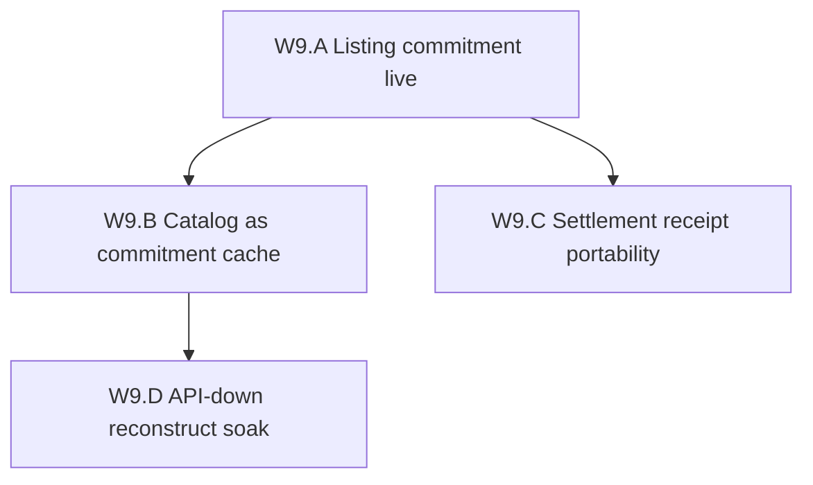

# Wave 9 Decentralization Implementation Plan

**Goal:** Remove **Postgres as the sole catalog index and settlement ledger
copy** — the reason Waves 5–8 still cannot claim marketplace autonomy —
without claiming a censorship-resistant catalog, trustless metering, or DePIN.

**Status (2026-08-13 evening):** W9.A **live ELF + soak PDA PASS**
(`W9A_PROXYHUB_UPGRADE_DONE` slot `483571293`; PDA
`Ci1FqUWEdMZ8AtYjeoLrn3k9hkyW7rXR4zLb7RHZYC8R`). gcp listing mode stays
**off**. W9.B–C **unit PASS**. W9.D **PASS local reconstruct**.
`programs/session` stays undeployed. DePIN still forbidden.

**Honest end-state after Wave 9 (if A–C PASS):** A buyer or auditor can
reconstruct the **listing-commitment set** from a signed bundle or chain PDAs
without live `GET /v1/listings`. Escrow-backed settlement rows can be checked
against a portable signed manifest / chain tx without the `orders` table being
the only copy. Merchandising (title, media, search) and delist stay Postgres /
platform moderation. Edge bytes stay gateway-attested (ADR 0010). That is a
federated catalog **cache** plus a reconstructible settlement **receipt**, not
an on-chain store.



## Why this wave exists

Wave 5.C shipped honesty annotations and a **ListingCommitment PDA** (ADR 0011)
that is still **off** on GCP until the upgraded `proxyhub` program is deployed.
Browse/map still say `catalog_source=postgres`. Kill control-api: **no listings
index**, even if offer hashes exist off-chain.

Settlement is the same shape: `orders`, `usage_receipts`, and
`settlement_manifests` live in Postgres; workers push Solana. Escrow PDAs and
Groth16 batches exist on-chain, but reconstructing “who is owed what” without
PG is not a first-class path. Kill control-api: **in-flight payout/settle
workers die**; the chain copy is not wired as a cache-of-last-resort.

Wave 7 federated **session verify** and **operator discovery**. Wave 8 made
gateway slash **possible** on localnet. Neither moved the marketplace **index**
or the **money ledger copy**. ADR 0013 named that leftover Wave 9.

Current catalog path:

```
GET /v1/listings → Postgres proxy_listings (+ catalog_products embed)
listing_offer_hash = off-chain Ed25519
ListingCommitment PDA = code complete; PROXYHUB_LISTING_COMMITMENT=off
delist_authority = platform_moderation
```

Current settlement path:

```
edge bytes → usage_receipts / settlement_manifests (PG)
  → billing worker → escrow PDA and/or custodial hot-wallet
```

W5.C.5 non-claim still holds: not a full on-chain catalog.

## Baseline (post Wave 8.D localnet, 2026-08-13)

| Item | State |
|------|--------|
| Host diversity | **two_hosts** |
| Session CONNECT | Capability verify live; default **off** (HMAC + Redis) |
| Org diversity | **same_org** (W7.D live VPS unclaimed) |
| Gateway slash | Localnet `W8D_BOND_SLASH_OK`; GCP `live_economic_slash=false` |
| Catalog | Postgres + `catalog_source=postgres` |
| Listing commitment | Code complete; gcp **off**; program upgrade deploy still pending |
| Settlement | PG manifests + oracle/Groth16 lane; escrow PDA optional flag |
| `programs/session` | Unsafe — **do not deploy** |
| DePIN claim | Forbidden |

Prior: [`WAVE8_DECENTRALIZATION_PLAN.md`](WAVE8_DECENTRALIZATION_PLAN.md),
[`WAVE5_DECENTRALIZATION_PLAN.md`](WAVE5_DECENTRALIZATION_PLAN.md) (W5.C.5),
ADR [`0005`](../adr/0005-marketplace-catalog-layer.md),
ADR [`0010`](../adr/0010-trust-minimized-metering.md),
ADR [`0011`](../adr/0011-listing-commitment-pda.md),
ADR [`0013`](../adr/0013-federated-session-mint.md).

Open ops (not this wave’s exit): W7.D foreign VPS; W8 `.so` / public-cluster
deploy; `programs/session`.

**After Wave 9:** marketplace copies and DePIN-shaped network are tracked in
[`WAVE10_DEPIN_AND_MARKETPLACE_ROADMAP.md`](WAVE10_DEPIN_AND_MARKETPLACE_ROADMAP.md).
Finishing W9 does **not** make a DePIN.

## W9.A — Listing commitment live

**Exit claim:** The upgraded `proxyhub` program with `register_listing_commitment`
is deployed on **devnet or the soak cluster**. `PROXYHUB_LISTING_COMMITMENT=observe`
registers after a verified offer; honesty
`listing_commitments=ed25519_offer_hash+listing_commitment_pda`. gcp default may
return to **off** after the soak. **Not** a catalog index; merchandising stays
Postgres.

This is the leftover W5.C.5 deploy. Without live PDAs, W9.B is a signed dump of
Postgres.

Checklist:

- [x] CLI `w9a-listing-commitment` honesty/pda/probe/fetch + gated register
- [x] Local SBF soak: `initialize_program` → `register_listing_commitment` PDA ([`W9_A_listing_commitment_soak_20260813.md`](evidence/W9_A_listing_commitment_soak_20260813.md))
- [ ] Observe soak: verified offer → PDA + PG `listing_commitment_on_chain`
- [x] Honesty on `GET /v1/listings` / public config (mode still gcp-default **off**; observe soak is W10.B)
- [x] Evidence live PDA ([`W9_A_listing_commitment_pda_live_20260813.md`](evidence/W9_A_listing_commitment_pda_live_20260813.md))
- [x] Explicit: still not on-chain search; delist still platform
- [x] Deploy `proxyhub` upgrade that includes ListingCommitment (throttled public RPC; [`W9_A_listing_commitment_live_20260813.md`](evidence/W9_A_listing_commitment_live_20260813.md))

**Non-claims:** Not enforce-on-GCP unless ops choose it after soak. Not
censorship-resistant browse.

## W9.B — Catalog as commitment cache

**Exit claim:** `GET /v1/listings` is documented and implemented as a **cache**
of Wave 3.2 offer hashes plus optional W5.C.5 PDAs. A client can load the
commitment set from a second channel (static bundle / URL / CID) and treat
Postgres as optional for **that set**. Title/media/collections stay Postgres.

Mirror W7.B: portable JSON (payload+sig), verify CLI, honesty
`catalog_source=postgres|postgres_cache`.

Checklist:

- [x] Bundle format (offer_hash, provider pubkey, listing id, optional PDA, sig)
- [x] `GET /v1/listings/commitments/bundle` export (or equivalent; do not collide `:id`)
- [x] CLI `w9b-listing-bundle verify|list` without control-api
- [x] Honesty `catalog_source=postgres_cache` when a bundle is pinned
- [x] Evidence [`W9_B_catalog_commitment_cache_20260813.md`](evidence/W9_B_catalog_commitment_cache_20260813.md)

**Non-claims:** Not a merchandising CDN. Platform can still refuse to host a
cache. Search/rank/geo stay PG. The point is **commitment copies exist that
verify without the API**.

## W9.C — Settlement receipt portability

**Exit claim:** A settlement window can be exported as a signed manifest
(reuse `settlement_manifests` + usage receipt + optional Groth16 batch / tx
signature) and verified **without** reading `orders`. Escrow-backed rows
prefer the chain tx as SoT; PG is a cache. Dual-gate any path that would
**send** SOL (`PROXYHUB_SETTLEMENT_BUNDLE_*` observe by default).

Remaining SPOF is whoever attested the bytes (edge + oracle, ADR 0010).

Checklist:

- [x] Canonical settlement receipt bytes + Ed25519 (or reuse existing proof hash)
- [x] Export + `w9c-settlement-bundle verify` without Postgres
- [x] Honesty: `settlement_sot=postgres|postgres_cache|escrow_pda`
- [x] Confirm without escrow/tx still no-ops (audit row / pending_custody)
- [x] Evidence [`W9_C_settlement_receipt_20260813.md`](evidence/W9_C_settlement_receipt_20260813.md)
- [x] Explicit: not trustless metering; not `programs/session`

**Non-claims:** Custodial hot-wallet payouts may remain. Protocol incentives
stay dual-gated (W5.C.4). This slice is **reconstruct / verify**, not a new
treasury.

## W9.D — API-down reconstruct soak

**Exit claim:** With a pinned listing-commitment bundle, `w9b-listing-bundle
list|verify` succeeds while control-api is stopped (`CONFIRM_W9D_STOP_API=1`).
Optional: settlement bundle verify with API down. Checkout / new orders may
still require the API.

Checklist:

- [x] Gated API-down soak script
- [x] Evidence [`W9_D_api_down_catalog_20260813.md`](evidence/W9_D_api_down_catalog_20260813.md) (local reconstruct; GCP stop unclaimed)
- [x] Do not claim “buyers can shop without ProxyHubb”

**Non-claims:** Not replacing order creation. Not DePIN storefront.

## Suggested score movement (honesty)

| Dimension | Post-W8 | Post-W9 (if A–C PASS) |
|-----------|---------|------------------------|
| Catalog SoT | Postgres | Postgres cache + verifiable commitment bundle / PDA |
| Settlement copy | PG manifests + workers | PG cache + portable receipt; chain tx for escrow rows |
| Delist / merchandising | Platform / Postgres | Unchanged |
| Metering | Edge-attested | Unchanged (ADR 0010) |
| DePIN claim | Forbidden | Still forbidden |
| Wave-ladder (informal) | ~4.9/5 hybrid | ~4.95/5 hybrid if A+B+C PASS; still hybrid |

## Non-goals

- Marketing “on-chain marketplace” or DePIN
- Full listing index / search on Solana
- Trustless residential byte metering / TEE (ADR 0010)
- Deploying unsafe `programs/session`
- Replacing `catalog_products` merchandising
- Token-weighted DAO catalog
- Mainnet as a substitute
- W7.D foreign VPS (ops leftover)
- W8 public-cluster slash deploy (ops leftover)

## Implementation order

1. **W9.A** first — without live ListingCommitment, a bundle is theater.
2. **W9.B** once A can produce real hashes/PDAs.
3. **W9.C** can parallel B (settlement tables already exist).
4. **W9.D** only after B green (API-down reconstruct).

## Related

- Prior: [`WAVE8_DECENTRALIZATION_PLAN.md`](WAVE8_DECENTRALIZATION_PLAN.md),
  [`WAVE5_DECENTRALIZATION_PLAN.md`](WAVE5_DECENTRALIZATION_PLAN.md)
- Catalog: [`MARKETPLACE_DISCOVERY_API.md`](../MARKETPLACE_DISCOVERY_API.md),
  ADR [`0005`](../adr/0005-marketplace-catalog-layer.md),
  ADR [`0011`](../adr/0011-listing-commitment-pda.md)
- Settlement: ADR [`0010`](../adr/0010-trust-minimized-metering.md),
  ADR [`0013`](../adr/0013-federated-session-mint.md) D4
- Listing commitment evidence:
  [`evidence/W5_C_listing_commitment_20260812.md`](evidence/W5_C_listing_commitment_20260812.md),
  [`evidence/W9_A_listing_commitment_probe_20260813.md`](evidence/W9_A_listing_commitment_probe_20260813.md),
  [`evidence/W9_A_upgrade_blocked_20260813.md`](evidence/W9_A_upgrade_blocked_20260813.md),
  [`evidence/W9_B_catalog_commitment_cache_20260813.md`](evidence/W9_B_catalog_commitment_cache_20260813.md),
  [`evidence/W9_C_settlement_receipt_20260813.md`](evidence/W9_C_settlement_receipt_20260813.md),
  [`evidence/W9_D_api_down_catalog_20260813.md`](evidence/W9_D_api_down_catalog_20260813.md)
