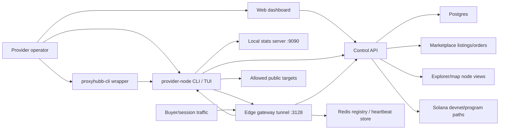
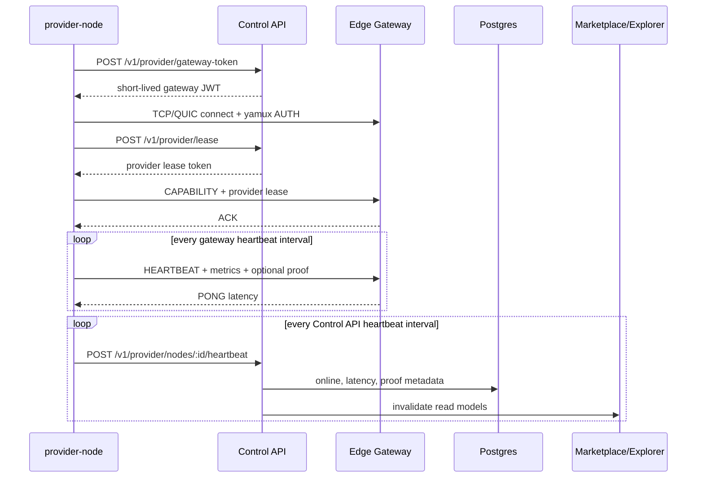
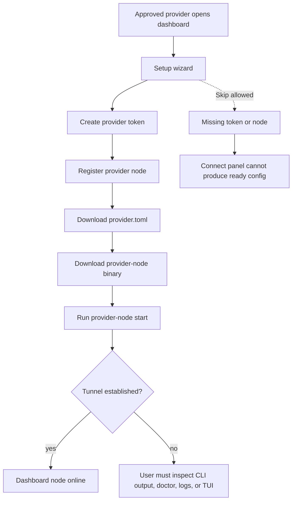
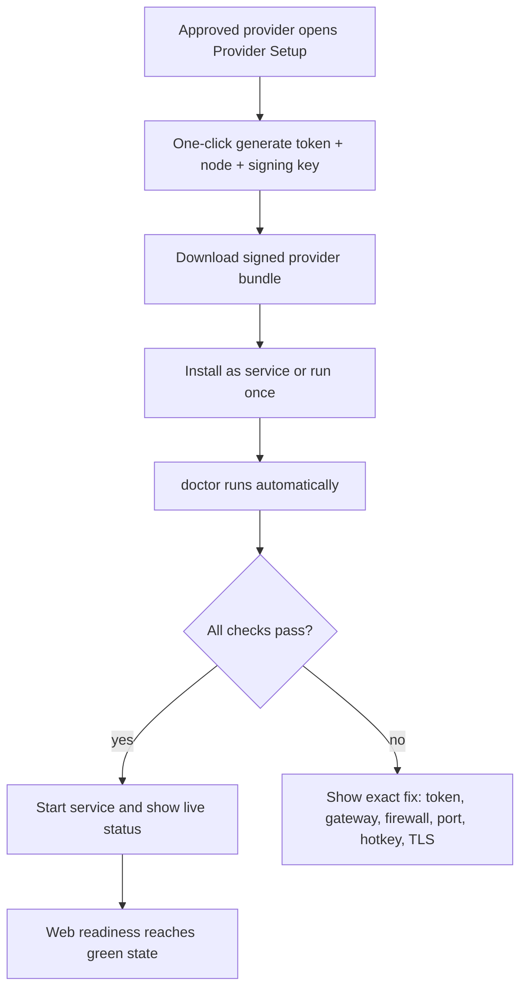

# ProxyHubb Provider Node System Deep Dive Audit

Date: 2026-07-03

## Executive Summary

The provider node system is real and fairly advanced: it has a Rust daemon, a wrapper CLI, a local TUI, Control API node/token/lease/heartbeat routes, dashboard setup pages, CLI binary distribution, provider listings, gateway tunnel admission, and proof-aware heartbeat metadata.

The main risk is not a missing core. The main risk is product coherence. A non-technical provider can currently see too many paths:

- Web setup wizard creates tokens and nodes.
- Dashboard node connect panel generates `provider.toml`.
- `provider-node register` creates a node and config.
- `proxyhubb-cli join` creates another config path.
- Docker/bootstrap scripts create signed dev nodes.
- CLI page documents both production and dev commands.

That flexibility is useful for engineers, but it is confusing for first-time providers. The next phase should make one beginner-safe path the golden path, while keeping the advanced paths available behind "manual" or "developer" modes.

Highest priority fixes:

1. Add a single provider readiness contract used by web, CLI, and TUI.
2. Make provider signing key/hotkey generation part of the default setup flow.
3. Harden proxy target validation against DNS rebinding/private resolved IPs.
4. Ship proper service installation/auto-start flows for Windows, Linux, and macOS.
5. Improve stuck/offline recovery UX across dashboard, `doctor`, `watch`, and TUI.

## Scope Reviewed

Provider daemon and CLI:

- `services/provider-node/src/main.rs`
- `services/provider-node/src/config.rs`
- `services/provider-node/src/ip.rs`
- `services/provider-node/src/tunnel/client.rs`
- `services/provider-node/src/tunnel/heartbeat.rs`
- `services/provider-node/src/proxy/handler.rs`
- `services/provider-node/src/doctor.rs`
- `services/provider-node/src/status.rs`
- `services/provider-node/src/operator.rs`
- `services/provider-node/src/watch.rs`
- `services/provider-node/src/install.rs`
- `services/provider-node/src/tui/dashboard.rs`
- `services/provider-node/Cargo.toml`

Wrapper CLI:

- `cli/src/main.rs`
- `cli/provider.toml.example`

Control API:

- `services/control-api/internal/api/provider_nodes.go`
- `services/control-api/internal/api/provider_token.go`
- `services/control-api/internal/api/provider_lease.go`
- `services/control-api/internal/api/cli_distribution.go`
- `services/control-api/internal/models/features.go`
- `services/control-api/internal/models/provider_token.go`

Web provider UX:

- `apps/web/src/app/dashboard/provider/setup/page.tsx`
- `apps/web/src/app/dashboard/provider/nodes/page.tsx`
- `apps/web/src/app/dashboard/provider/cli/page.tsx`
- `apps/web/src/components/provider/ProviderNodeConnectPanel.tsx`
- `apps/web/src/lib/provider-config.ts`

Operational docs and scripts:

- `docs/PROVIDER_NODE_OPERATIONS.md`
- `docs/adr/0006-provider-operator-ux.md`
- `rebuild-cli.ps1`
- `scripts/build-cli-dist.sh`
- `scripts/bootstrap-provider-dev.ps1`
- `scripts/provider-docker-e2e.sh`
- `scripts/verify-provider-phase1.ps1`

## Architecture Overview



### Runtime Tunnel and Heartbeat Flow



### Beginner Onboarding Flow Today



### Recommended Beginner Flow



## Provider Node Structure

```text
services/provider-node/
  src/
    main.rs                command entrypoint: register/start/stop/status/doctor/dashboard/watch
    config.rs              TOML config, gateway, TLS, ports, metrics, transport
    ip.rs                  public IP detection, token validation, node registration, lease, heartbeat
    tunnel/
      client.rs            gateway AUTH, CAPABILITY, TLS/yamux/QUIC path
      heartbeat.rs         gateway heartbeat and Control API heartbeat
      mux.rs               parallel yamux lanes
      quic.rs              optional QUIC transport
    proxy/
      handler.rs           CONNECT handling, allowed ports, blocked hosts, traffic bridge
    stats.rs               local stats collector and HTTP stats endpoint
    proofs.rs              provider heartbeat signing
    doctor.rs              pre-flight checks
    status.rs              local and Control API status
    operator.rs            aggregate snapshot for TUI/watch
    watch.rs               headless refresh loop
    tui/
      dashboard.rs         ratatui dashboard
      theme.rs             terminal styling
    install.rs             install hints and path discovery
    paths.rs               canonical config/state/log paths
```

## Command Surface

| Command | Current role | Audit note |
|---|---|---|
| `provider-node register` | Validates API key, detects public IP, creates node, writes config | Useful but overlaps web setup and `proxyhubb-cli join` |
| `provider-node start` | Starts metrics server, connects tunnel, sends heartbeats | Core production path |
| `provider-node stop` | Stops process via SIGTERM/taskkill and clears PID | Good baseline, but service manager integration is missing |
| `provider-node status` | Shows PID, local metrics, Control API node state | Should become the canonical machine-readable readiness source |
| `provider-node config validate` | Offline TOML/config/schema checks with remediation output | Use before `start`; keeps beginner mistakes out of runtime |
| `provider-node doctor` | Live pre-flight checks for config, auth, gateway, transport, signing key, PID | Strong feature; should power web troubleshooting copy |
| `provider-node dashboard` | Local ratatui operator dashboard | Useful for technical users, but should not be the beginner default |
| `provider-node watch` | Refreshing terminal status | Good headless/SSH fallback |
| `provider-node install` | Prints paths and manual service hints | Needs real install/service subcommands |
| `proxyhubb-cli join` | Onboarding wrapper that writes config | Good beginner helper, but duplicates register/connect-panel logic |

## Data Model Summary

Core table: `provider_nodes`

Important fields:

- Identity: `id`, `user_id`, `gateway_node_id`, `hotkey`
- Network: `ip_address`, `country`, `city`, `region`, `isp`, `connection_type`, `port`
- Runtime: `status`, `is_healthy`, `last_seen_at`, `active_connections`, `latency_ms`
- Quality: `uptime_percent`, `quality_score`, `success_rate`, `tier`, `tier_score`
- Economics: `wallet_address`, `base_price_per_gb`, `staked_amount_sol`
- Proof metadata: `latest_heartbeat_hash`, `latest_heartbeat_signature`, `latest_heartbeat_signer`, `latest_heartbeat_verified`, `latest_heartbeat_verification_error`

Related tables:

- `provider_tokens`
- `provider_node_registrations`
- `proxy_listings`
- `nodes` legacy mirror
- `explorer_nodes`
- `uptime_checks`
- `usage_records`
- `cli_downloads`

## Major Findings

### P0: Beginner Onboarding Is Split Across Too Many Paths

Current state:

- Web setup wizard can create a token and node.
- Web connect panel can generate `provider.toml`.
- CLI page still encourages `provider-node register`.
- `proxyhubb-cli join` writes a config directly.
- Dev scripts create local configs.

Why this matters:

Non-technical providers need one obvious path. Today, a provider can skip token/node steps, download a config without an API key, run the wrong command, or create duplicate nodes.

Fix:

- Make web setup the golden path for non-technical providers.
- Remove skip buttons for required token/node steps or move them behind "manual setup".
- Add a single "Provider readiness" API response that says:
  - account approved
  - token exists
  - node exists
  - config downloaded
  - heartbeat received
  - proof verified
  - payout wallet linked
  - listing active
- Have CLI/TUI/web all show the same next action.

### P0: Signing Key and Hotkey Are Not First-Class in Setup

Current state:

- `provider-node` supports `provider_signing_key`.
- Heartbeats can include provider proofs.
- Control API stores proof verification metadata.
- Production proof enforcement exists conceptually.
- The web setup config generator does not create or explain a signing key by default.

Why this matters:

In stricter environments, the node can fail trust checks even if the tunnel connects. The operator will not know why unless they inspect `doctor` or heartbeat proof metadata.

Fix:

- Add `provider-node keygen` to generate an Ed25519 provider keypair.
- Add `provider-node register --generate-signing-key`.
- Add web copy/download config support for `provider_signing_key`.
- Show heartbeat proof state on provider node cards.
- Add an obvious "Fix signing key" action when proof verification fails.

### P0: Proxy Target Validation Needs DNS Rebinding Protection

Current state:

- `proxy/handler.rs` rejects loopback/private/link-local IP literals.
- Hostnames are allowed without resolving and checking their resolved IPs.
- A hostname can resolve to a private/internal address after validation.

Why this matters:

Provider nodes are exit nodes. They must not be tricked into connecting to local/private metadata services or LAN addresses.

Fix:

- Resolve hostnames before dialing.
- Reject resolved loopback/private/link-local/multicast/unspecified addresses.
- Re-check after resolution and before each connection.
- Add connect timeout and per-target policy errors.
- Add tests for:
  - `localhost`
  - `127.0.0.1`
  - `10.0.0.1`
  - `192.168.1.1`
  - `169.254.169.254`
  - hostname resolving to private IP
  - IPv6 ULA/link-local

### P0: No First-Class Service Install and Auto-Start Flow

Current state:

- `provider-node install` prints paths and service hints.
- Docs recommend NSSM or `sc.exe` manually on Windows.
- Linux/macOS service setup is manual.

Why this matters:

For non-technical providers, "run a terminal forever" is not acceptable. A bandwidth node should survive reboot, sleep/wake, and accidental terminal closure.

Fix:

- Add:
  - `provider-node service install`
  - `provider-node service uninstall`
  - `provider-node service start`
  - `provider-node service stop`
  - `provider-node service status`
- Windows: generate `sc.exe` or NSSM instructions and validate paths.
- Linux: write a user-level systemd unit.
- macOS: write a LaunchAgent plist.
- Web setup should offer "Install as background service" as the recommended path.

### P1: Provider Readiness and Recovery UX Is Fragmented

Current state:

- Web nodes page shows online/offline metrics.
- `doctor` shows config/auth/gateway/signing/PID checks.
- TUI shows status, earnings, runtime, logs.
- Control API has heartbeat proof metadata.

Missing:

- No single readiness score.
- No shared remediation messages.
- No "last successful step" or "blocked at gateway/auth/heartbeat/proof" state.

Fix:

- Add `GET /v1/provider/readiness`.
- Add `provider-node doctor --json` schema stability tests.
- Web should render the same readiness checks as doctor.
- Node cards should show:
  - local tunnel connected
  - Control API heartbeat last seen
  - gateway heartbeat last seen
  - proof verified
  - payout wallet linked
  - listing active

### P1: `provider-node register`, Web Connect, and `proxyhubb-cli join` Duplicate Config Logic

Current state:

- `provider-node register` writes a full `Config`.
- `proxyhubb-cli join` writes a narrower `ProviderConfig`.
- Web `buildProviderToml` writes a third template.

Risk:

Config fields can drift. New features like signing keys, `gateway_addrs`, QUIC, or service install may land in one path but not the others.

Fix:

- Define a versioned provider config schema.
- Generate config templates from the same source in backend or shared test fixtures.
- Add contract tests that compare:
  - web-generated TOML
  - `provider-node register` TOML
  - `proxyhubb-cli join` TOML
- Add `config_version = 1`.

### P1: CLI Distribution Shows `provider-node`, But Wrapper CLI Is a Sidecar

Current state:

- `SeedCLIDownloads` skips `provider-cli-*`.
- `rebuild-cli.ps1` builds both `provider-node-*` and `provider-cli-*`.
- CLI page documents `proxyhubb-cli`, but dashboard downloads are daemon-focused.

Risk:

Beginners may not get the wrapper CLI even though the docs mention it.

Fix:

- Decide product stance:
  - Recommended: ship one provider bundle zip per platform containing both binaries.
  - Web download should say "Provider Bundle" instead of only "CLI".
- Include:
  - `provider-node`
  - `proxyhubb-cli`
  - checksum file
  - example config
  - install script

### P1: Gateway Failover Exists But Is Not Fully Productized

Current state:

- `start` builds a deduplicated gateway list and rotates after failures.
- Config supports `gateway_addrs`.
- TUI runtime state tracks active gateway.

Gaps:

- Web connect panel only generates one `gateway_addr`.
- Doctor lists gateways but does not actively test each gateway connection.
- CLI page template does not explain multiple gateways.

Fix:

- Add `gateway_addrs` to connect metadata.
- Add `doctor` checks for every gateway:
  - DNS resolution
  - TCP/UDP reachability
  - TLS name validity
  - selected transport compatibility
- TUI should show current gateway and next fallback clearly.

### P1: Manual Heartbeat Button Can Mislead Operators

Current state:

- Web nodes page has a "Send heartbeat" action.
- Real heartbeats should come from the running provider node.

Risk:

Users may click heartbeat and think their node is working even when the tunnel is not connected.

Fix:

- Rename action to "Check status" or remove it from normal users.
- If kept, label it "manual API heartbeat test" and separate it from live tunnel health.
- Prefer showing last heartbeat source:
  - Control API heartbeat
  - gateway heartbeat
  - local stats

### P1: Token Storage and Rotation Need a Safer UX

Current state:

- Provider token is returned once.
- Web stores token in `sessionStorage` to generate config.
- Config stores `api_key` in plaintext.
- Tokens default to 30 days and cap at 90 days.

Good:

- Backend stores hashed tokens.
- Raw token is only returned once.

Gaps:

- No guided rotation flow for running nodes.
- No "token expires soon" provider warning.
- No local secret store/keychain integration.

Fix:

- Add dashboard warnings 7 days before token expiry.
- Add `provider-node token rotate` workflow.
- Add `doctor` check for token expiry if API returns it.
- Long term: use OS keychain or encrypted local secret file.

### P1: Provider Listings Are Auto-Published With Placeholder Defaults

Current state:

- Node creation auto-publishes a marketplace listing unless proof enforcement blocks it.
- Default price and bandwidth are hardcoded.

Risk:

New providers can appear in marketplace with inaccurate price/bandwidth before they understand their node.

Fix:

- Make "publish listing" an explicit setup step.
- Use measured bandwidth from first successful runtime heartbeat.
- Show a marketplace readiness checklist before publish.
- Auto-create a draft listing, not a live listing.

### P2: TUI Is Useful But Too Dense for Beginners

Current state:

- TUI has overview/network/nodes/earnings/logs tabs.
- It polls local status quickly, remote status every 10 seconds, doctor every 15 seconds.

Issues:

- It is valuable for technical operators but too much for first run.
- It can duplicate the web dashboard if expanded further.
- It should prioritize "next action" over dashboards.

Fix:

- Add a first-run mode: `provider-node dashboard --simple`.
- Default TUI first screen:
  - connected or not
  - why not
  - next command/fix
  - last log error
- Keep advanced tabs for power users.

### P2: Error Messages Should Be Mapped to Human Fixes

Examples:

- Gateway token invalid -> "Create a new provider token in Dashboard > Provider > Tokens."
- Gateway refused auth -> "Check JWT_SECRET alignment between Control API and Gateway."
- Provider lease unavailable -> "Control API provider lease signing is not configured."
- Missing signing key -> "Run provider-node keygen or download a new config from setup."
- Metrics unavailable -> "The daemon is not running or metrics_port is blocked."

Fix:

- Add an error classifier in CLI.
- Add `remediation_code` to doctor checks.
- Web should link each remediation code to the exact screen/action.

### P2: Config Path Documentation Is Mostly Correct But Still Easy To Misuse

Current state:

- `paths.rs` uses `dirs::config_dir()/proxyhubb/provider.toml`, falling back to `~/.proxyhubb/provider.toml`.
- State/log/PID are under `~/.proxyhubb`.
- Web uses `%USERPROFILE%\.proxyhubb\provider.toml` for Windows in one helper, while CLI page mentions `%APPDATA%\proxyhubb\provider.toml`.

Fix:

- Make backend return OS-specific config hints, or make the web show both:
  - Windows config: `%APPDATA%\proxyhubb\provider.toml`
  - Windows state/log: `%USERPROFILE%\.proxyhubb\`
- Add `provider-node paths --json`.
- Web should generate copyable commands using the selected OS.

### P2: Observability Is Good Locally But Weak Across the Full Path

Current state:

- Local stats endpoint exists.
- Control API node heartbeat exists.
- Gateway heartbeat registry exists.
- TUI tail log exists.

Missing:

- Correlation ID tying one provider session across provider-node, gateway, Control API, and marketplace order.
- Provider-facing event timeline.
- "last failed connection reason" persisted in Control API.

Fix:

- Generate `provider_run_id` at daemon start.
- Include it in gateway handshake, heartbeat, API heartbeat, and logs.
- Add provider dashboard timeline:
  - config generated
  - node started
  - gateway auth ok
  - lease ok
  - heartbeat ok
  - listing active
  - sessions served

### P2: Network Transport Story Needs Clear Product Defaults

Current state:

- TCP/yamux is default.
- QUIC is optional via feature flag and `PROVIDER_TRANSPORT=quic`.
- Dev scripts mention QUIC for provider overlay.

Risk:

Operators may run a binary without QUIC support against a QUIC gateway.

Fix:

- Web connect metadata should include required transport.
- `provider-node doctor` should fail early when gateway requires QUIC and binary lacks feature.
- Distribution should label binaries:
  - "standard TCP"
  - "TCP + QUIC"
- Prefer shipping QUIC-enabled production binaries if stable.

## UX Audit

### Non-Technical Provider Journey

What works:

- The web setup wizard exists.
- Tokens can be created in the dashboard.
- The connect panel can download `provider.toml`.
- Node cards show online/offline counts.
- CLI page has platform downloads and copyable commands.

What does not work yet:

- Too many command choices.
- Required steps can be skipped.
- The provider has to understand config files.
- No background service installer.
- Signing/proof requirements are hidden.
- "Online" does not explain gateway vs Control API vs marketplace readiness.
- Error messages are not consistently tied to recovery actions.

Recommended beginner UX:

1. Provider clicks "Start setup".
2. System creates token, node, and signing key.
3. User downloads a platform bundle.
4. Bundle installer writes config and installs service.
5. App waits for heartbeat and proof.
6. Dashboard turns green only when the node is routable.
7. Marketplace listing remains draft until readiness is green.

### Web Improvements

Fix:

- Remove required-step skip buttons from setup wizard.
- Add readiness checklist to provider dashboard home.
- Add proof status to node cards.
- Replace "Send heartbeat" with "Run connection check".
- Add OS-specific command tabs:
  - Windows PowerShell
  - macOS Terminal
  - Linux systemd
- Add copy/download "Provider Bundle" instead of raw binary only.

Improve:

- Add "What is happening now?" timeline during setup.
- Add "I already have a node" manual mode.
- Add "Regenerate config" safely without exposing old token.
- Add "Rotate token" guided flow.
- Add "Install service" instructions generated from actual binary/config paths.

Enhance:

- Live connect status via SSE/WebSocket.
- Dashboard can ingest `provider-node status --json` output for support.
- One-click support bundle export with redacted config, doctor JSON, log tail, runtime state.

### CLI Improvements

Fix:

- Add `provider-node keygen`.
- Add `provider-node service ...`.
- Add `provider-node doctor --explain`.
- Add DNS/private-IP resolved-target blocking.
- Add config schema/version validation.

Improve:

- Make `register` ask for node name when not supplied instead of `rust-node-<ip>`.
- Add `--node-name`, `--country`, `--city`, `--isp` to `register`.
- Add `provider-node config validate`.
- Add `provider-node repair` for stale PID, bad config path, missing metrics port, token expired.

Enhance:

- Add self-update or version check.
- Add `provider-node bundle support`.
- Add structured JSON logs option documented for services.

### TUI Improvements

Fix:

- First screen should emphasize current blocker and next fix.
- If terminal is too small, fall back gracefully to watch mode.
- Show proof verification state prominently.

Improve:

- Add service state.
- Add token expiry.
- Add gateway failover health.
- Add last Control API heartbeat time and last gateway heartbeat time separately.

Enhance:

- Add a beginner "simple mode".
- Add copyable command hints in logs/help.
- Add a QR/link to open the provider dashboard node page.

## Recommended Execution Order

### Phase 1: Make Setup Reliable For Beginners

1. Build `GET /v1/provider/readiness`.
2. Remove/soft-hide setup skip buttons.
3. Add proof/hotkey state to web node cards.
4. Add `provider-node keygen` and generated signing key support in web config.
5. Add `provider-node config validate`. (Done: offline config validation with remediation output.)

### Phase 2: Harden The Runtime

1. Add DNS resolution and private-IP blocking before dialing targets.
2. Add connection timeout and safer error handling in proxy target dial.
3. Add gateway failover checks to `doctor`.
4. Add config contract tests across web/CLI/wrapper.
5. Add provider run ID to logs and heartbeats.

### Phase 3: Make It Always-On

1. Add service install/uninstall/start/stop/status commands.
2. Add OS-specific install paths and service docs in web.
3. Add provider bundle downloads.
4. Add auto-start verification in doctor.
5. Add token expiry and rotation workflow.

### Phase 4: Improve Marketplace Trust

1. Make auto-listed nodes draft until readiness is green.
2. Use measured bandwidth/latency before publish.
3. Add listing readiness UI.
4. Show heartbeat proof and geo reliability signals in marketplace/map.
5. Add provider support bundle export.

## Remove, Fix, Improve, Enhance

### Remove Or Hide

- Beginner-facing skip buttons for required setup steps.
- Manual heartbeat button as a normal node action.
- Duplicate "register here or join there" instructions from the default CLI page.
- Any stale docs that say TUI is out of scope without mentioning the amendment.

### Fix

- DNS/private-IP target validation.
- Signing key/hotkey setup gap.
- Config template drift across web, `provider-node register`, and `proxyhubb-cli join`.
- OS-specific config path mismatch in web copy.
- Gateway failover visibility and checks.
- Service installation gap.

### Improve

- Provider readiness state.
- Error remediations.
- Token expiry/rotation UX.
- Node card health details.
- CLI/TUI first-run experience.
- Provider listing draft/publish flow.

### Enhance

- Provider bundle downloads.
- Self-update/version check.
- Support bundle export.
- Provider event timeline.
- Web-driven live setup verification.
- QUIC transport productization.

## Acceptance Criteria For A Production-Ready Provider Experience

A non-technical provider should be able to:

1. Open the dashboard after approval.
2. Click one setup button.
3. Download one platform bundle.
4. Run one installer or one command.
5. See "online and routable" in the web dashboard.
6. Reboot their machine and stay online.
7. Understand exact fixes if anything fails.
8. Rotate tokens before expiry.
9. Publish or pause their marketplace listing intentionally.
10. Export a support bundle without leaking secrets.

## Immediate Next Fix

The best next engineering fix is provider readiness unification:

- Add `GET /v1/provider/readiness`.
- Add a shared readiness schema that includes token, node, config, daemon, gateway, heartbeat, proof, payout wallet, and listing state.
- Update web provider setup/nodes pages to render that checklist.
- Update `provider-node doctor --json` to emit matching remediation codes.

This should come before deeper TUI polish because it makes the CLI, TUI, and web speak the same language and directly improves the non-technical provider experience.
