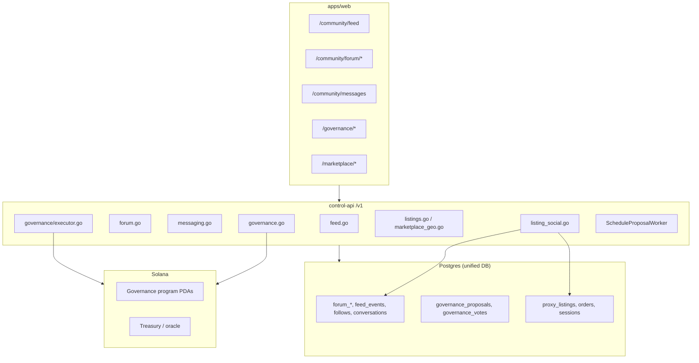
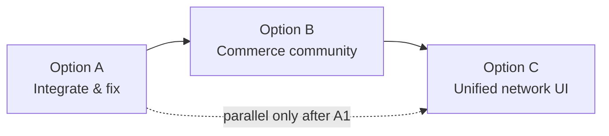

# ProxyHubb — Community & Governance System Analysis

**Report date:** 2026-06-03  
**Scope:** Community surfaces (feed, forum, messaging, social graph), governance (proposals, voting, treasury execution), and their integration with the marketplace / product catalog.  
**Audience:** Product, engineering, and planning — for review and next-step decisions.

**Companion docs:** [PROJECT_STATE.md](../PROJECT_STATE.md), [SYSTEM_ANALYSIS_REPORT.md](../SYSTEM_ANALYSIS_REPORT.md), [SYSTEM_ARCHITECTURE_AND_PRODUCT_DEEP_DIVE.md](../SYSTEM_ARCHITECTURE_AND_PRODUCT_DEEP_DIVE.md), [IMPROVEMENTS_AND_ROADMAP.md](./IMPROVEMENTS_AND_ROADMAP.md).

---

## Executive summary

ProxyHubb treats **community** and **governance** as a parallel product layer on top of the same `control-api` stack that powers the decentralized proxy marketplace. The backend is relatively rich (forum CRUD, feed events, listing-scoped social context, on-chain governance hooks, proposal executor worker). The **web client and API contracts are not fully aligned** with that backend, and **governance UX is largely disconnected from the chain-authoritative vote flow** the API implements.

**Overall assessment**

| Area | Maturity | Summary |
|------|----------|---------|
| **Forum** | Medium | Full REST API, auto-seeded categories, reports table; weak moderation ops and stale E2E paths |
| **Activity feed** | Medium | Event pipeline exists for orders, milestones, forum threads; no `new_listing` emission on publish; type/schema drift in web clients |
| **Messaging** | Medium | Conversations + reactions; polling-only UI; listing-linked DMs partially wired |
| **Listing ↔ social** | Low–medium | `listing_social.go` is a strong integration point; only lightly used in marketplace UI |
| **Governance (off-chain DB)** | Medium | Models, worker, executor for treasury/params/slash/upgrade |
| **Governance (on-chain)** | Medium (env-dependent) | Create/vote/finalize wired to Solana program + oracle; **web does not use build/relay vote APIs** |
| **Marketplace architecture** | High (core) | Hexagonal `MarketplaceService` + geo map; social/governance not part of domain core |

**Strategic takeaway:** Ship in three layers — **fix and integrate first (A)**, **deepen catalog trust (B)**, then **unify the product surface (C)**. Near-term work must not block map-buy, provider proofs, or settlement; Option C is a **sequenced UX/IA program** built on APIs hardened in A and B, not a big-bang rewrite on day one.

**Adopted strategy (2026-06-03):** **Option A + B + C**

| Option | Role in roadmap |
|--------|-----------------|
| **A** | Foundation — contracts, feed events, social on listings, governance E2E |
| **B** | Commerce community — Q&A, follow, governance templates tied to catalog |
| **C** | Unified network surface — map + feed + chat + proposals as one experience |

**North star:** Decentralized proxy marketplace with **trust**, **light DAO participation**, and a **single differentiated home** for discovery and network activity.

---

## 1. Current architecture

### 1.1 High-level placement



Historically, social data lived in a separate DB (`db.Social()`). That indirection remains in code, but **`Social()` now returns the main `DB` connection** (`services/control-api/internal/db/social.go`), so migrations and transactions are unified.

### 1.2 Route registration (control-api)

From `main.go`:

| Surface | Registration | Auth |
|---------|--------------|------|
| Listing social | `RegisterListingSocialRoutes(v1)` | Mixed (social context can be optional-auth) |
| Feed / discover / trending | `RegisterFeedRoutes(v1)` | Feed requires auth; discover/trending more open |
| Forum read | `RegisterForumPublicRoutes(v1)` | Public |
| Forum write | `RegisterForumProtectedRoutes(protected)` | JWT |
| Governance | `RegisterGovernanceRoutes(protected)` | JWT + wallet linkage for mutations |
| Messaging | `RegisterMessagingRoutes(protected)` | JWT |

### 1.3 Web navigation

Sidebar groups (`apps/web/src/lib/navigation/nav.ts`):

- **Community:** Feed, Forum, Messages, Leaderboard (explorer)
- **Governance:** Proposals, Create proposal, Treasury

Policies (`policies.ts`): most community routes are **public** for browse; forum create, messages, and governance create require authentication.

**Legacy redirect:** `/dashboard/feed` → `/community/feed` (`dashboard/feed/page.tsx`), labeled “Feed (legacy)” in routes metadata.

### 1.4 Dual governance paths

1. **DAO proposals** (`governance_proposals`): IPFS description, optional forum thread, on-chain mirror, periodic worker closes/expired and executes passed proposals.
2. **Operator multi-sig** (`internal/gov/governor.go`): In-memory 2-of-3 for large treasury withdrawals (`TREASURY_MULTISIG_ADMIN_IDS`), separate from token-holder voting.

These serve different roles but are not clearly distinguished in the product UI.

---

## 2. Community system — detailed review

### 2.1 Activity feed

**Backend** (`internal/api/feed.go`, `internal/models/feed.go`):

- Authenticated users see events from **followed** actors.
- Users with no follows see a **public** subset: `new_listing`, `badge_earned`, `milestone`, `new_sale` (not `new_review` or `new_thread` in the anonymous query, though those event types exist).
- Page 1 can be served from Redis list `public:feed` via `PublishFeedEvent`.

**Event producers today**

| Event type | Emitted from |
|------------|----------------|
| `new_sale` | `orders.go` |
| `milestone` | `usage_milestones.go` worker |
| `new_thread` | `forum.go` (create thread) |
| `new_review` | `reviews.go`, `usage_reviews.go` |
| `badge_earned` | `badges.go` |
| `node_online` | `provider_nodes.go` |
| `listing_inquiry` | `listing_social.go` (custom type string) |
| **`new_listing`** | **Not found in listing create/publish paths** |

**Frontend**

- Primary UI: `apps/web/src/app/community/feed/page.tsx` via `social-api.ts` `getFeed()`.
- Alternate types in `lib/services/feed.ts` (`governance_proposal`, `whale_alert`, etc.) **do not match** backend `FeedEventType` constants — risk of broken icons/labels if that module is used.
- `subscribeToFeed()` is a **stub** (10s interval, no-op body); real-time is not implemented despite WebSocket infrastructure elsewhere.

**Issues**

- Catalog launches do not appear on the public feed → weak marketplace ↔ community loop.
- Feed type definitions duplicated across `social-api`, `services/feed`, and backend models.
- Public feed cache uses hardcoded `total: 100` when served from Redis.

### 2.2 Forum

**Backend** (`internal/api/forum.go`):

- Categories auto-seeded on first request (General, Support, Feature Requests, Provider Showcase, Buying & Selling, Announcements).
- Threads, posts, votes, search, recent/popular/unanswered, reports (`forum_reports` migration `000008`).
- Creating a thread publishes `new_thread` to the feed.

**Frontend**

- Lives under `/community/forum/*` (recent, popular, unanswered, my-posts, new, category, thread).
- `ForumSubNav`, virtualized thread list component exist.

**Issues**

- **E2E tests target `/forum`**, not `/community/forum` (`apps/web/e2e/social/forum.spec.ts`) — likely failing or testing the wrong route unless a rewrite exists elsewhere.
- **Moderation:** `forum_reports` table and report endpoints exist; no documented admin queue UI in web (ties to `dashboardAdmin` but not verified as forum-specific).
- Forum category **“Buying & Selling”** overlaps marketplace listings without deep links to `listing_id` on threads.
- Governance discussions: proposals auto-create threads in a **Governance** category (`governance.go`), but proposal detail UI **discussion tab is not wired** to `thread_id`.

### 2.3 Messaging

**Backend** (`internal/api/messaging.go`):

- Conversations (optionally linked to listing), messages, read receipts, edit/delete, reactions, search.

**Frontend**

- `/community/messages` with `ProtectedRoute`; uses polling, not WS hub (WS exists for explorer/other features).

**Listing integration**

- `POST /listings/:id/inquire` and listing-scoped conversation start in `listing_social.go`.
- `ListingCardEnhanced` + `QuickMessageModal` consume `/v1/listings/:id/social` for online status and DM affordance — **good pattern**, not universal across map/detail views.

### 2.4 Social graph & notifications

- Follows drive personalized feed (`models.Follow`).
- Notifications and preferences tables from migration `000006_social_features.up.sql` (categories: social, business, community, system).
- `PeopleYouMayKnow`, circles, provider showcases, speed tests — **adjacent** community features with uneven UI coverage.

### 2.5 Community testing program

`community-testing/Program_Guide.md` describes a **DevNet beta** focused on escrow, disputes, jury, and multi-sig — aligned with wallet/marketplace, not forum/governance UX. Useful for ops rewards but **not integrated** with in-app community metrics or governance participation tracking.

---

## 3. Governance system — detailed review

### 3.1 Data model

`internal/models/governance.go`:

- Proposal types: `general`, `treasury`, `parameter`, `slash`, `upgrade`.
- Status: `active`, `passed`, `rejected`, `executed`.
- Vote choices: `yes`, `no`, `abstain` (model allows abstain; on-chain path is yes/no oriented).
- Cached `yes_votes` / `no_votes`; optional `thread_id` to forum.
- `execution_data` JSON for automated executor.

### 3.2 API behavior (chain-authoritative mutations)

**Create proposal** (`createProposal`):

- Requires `governance_execution` ready (oracle + program).
- Binds: `title`, `description`, **`duration_days`** (1–14) — not `type` or `execution_data` in the HTTP binding struct.
- Uploads description to IPFS; creates on-chain proposal; mirrors to DB as **`ProposalTypeGeneral`** always.
- Auto-creates forum thread in Governance category.

**Vote** — three endpoints:

| Endpoint | Purpose |
|----------|---------|
| `POST .../vote/build` | Returns unsigned Solana tx + voting power |
| `POST .../vote/relay` | Relays signed tx |
| `POST .../vote` | Mirrors DB after **finalized** on-chain tx; verifies vote PDA |

Vote message format: `vote:{proposalUUID}:{choice}`. Signature must be **base58 Ed25519** (`verifyVoteSignature`).

**Execute** (`POST .../execute`): Manual/automated trigger; worker also runs every 5 minutes (`ScheduleProposalWorker`).

### 3.3 Proposal executor

`internal/governance/executor.go`:

- **Treasury:** Creates DB record, sends SOL via oracle (non-SOL currencies rejected — Ethereum relayer decommissioned).
- **Parameter / slash / upgrade:** Parsed and logged; effectiveness varies by type (general proposals have **no** automatic execution).
- Quorum logic uses `yes_votes + no_votes` vs `proposal.Quorum` (default 100 — likely **mis-scaled** if interpreted as token-weight units vs percentage).

### 3.4 Web governance UI

Pages: `/governance`, `/governance/create`, `/governance/[id]`.

**Critical contract mismatches**

| Topic | Backend | Web (`lib/services/governance.ts`, pages) |
|-------|---------|---------------------------------------------|
| Create body | `duration_days` required | Sends `type`, `execution_data` — **missing duration_days** |
| Proposal type on create | Always `general` in DB | UI offers `parameter_change` etc. — **ignored** |
| Vote signature | Base58 | `Buffer.toString('hex')` — **invalid for verifier** |
| Vote flow | Requires `on_chain_tx_sig` | Only calls legacy `castVote` — **no build/relay** |
| Vote counts JSON | `yes_votes`, `no_votes` | Expects `votes_for`, `votes_against`, `votes_abstain` — charts show empty |
| Voting power UI | On-chain PHB / stake logic | Hardcoded **“0 VP”** on list page |
| Abstain | Supported in API types | UI offers abstain — **unclear on-chain support** |

**Result:** In production-like configs with governance execution enabled, **create and vote flows from the web app are expected to fail or appear broken** until clients are aligned with the chain-authoritative API.

### 3.5 Treasury page vs governance

Public `/treasury` (transparency) complements governance treasury proposals. Multi-sig governor (`internal/gov`) is an **operator** tool, not surfaced as end-user governance — consider documenting for admins only.

---

## 4. Marketplace integration

### 4.1 Current integration points

| Mechanism | Role |
|-----------|------|
| `GET /listings/:id/social` | Provider presence, ratings, session counts, follow state |
| `POST /listings/:id/inquire` | Buyer inquiry → feed event |
| `GET/POST /listings/:id/qa` | Listing Q&A |
| Provider relationships API | Refill offers, buyer–provider history |
| Reviews + usage reviews | Feed events, reputation |
| Orders | `new_sale` feed events |
| Forum category “marketplace” | Discussion only — no listing entity link |

### 4.2 Marketplace architecture (catalog)

Core commerce path is **separate** from community:

- **Hexagonal core:** `internal/core/services/marketplace_service.go` + `MarketplaceRepository`.
- **HTTP:** `listings.go`, `marketplace_geo.go` (`GET /v1/marketplace/map`), orders, matching, escrow.
- **Web:** unified map (`ProxyMapCanvas`), buy-from-map E2E, provider proof signing on create.

Community/governance **do not** participate in listing state machines, pricing, or escrow — by design today.

### 4.3 Gaps vs product goals

If goals include **discovery, trust, and participation** around the catalog:

- No feed entry when listings go live → providers invisible socially.
- Map/detail pages inconsistently show social context (only enhanced card path).
- Governance cannot change marketplace parameters through UI-created typed proposals (create API ignores type/`execution_data`).
- Leaderboard under Community nav is **explorer** data (nodes/providers), not forum/governance participation.

---

## 5. Issues currently affecting the system

### 5.1 Critical (user-visible breakage)

1. **Governance create from web** — API requires `duration_days`; client does not send it → validation failure.
2. **Governance vote from web** — Wrong signature encoding; missing on-chain tx pipeline → votes fail or never mirror.
3. **Vote tally display** — JSON field names mismatch → UI shows zero votes even when DB/on-chain has data.

### 5.2 High (integrity, ops, or test debt)

4. **Dual authority modes** — List/detail proposals use DB headers; mutations use chain mode — confusion when oracle down (503 on create) while list still works.
5. **Proposal create ignores** `type` and `execution_data` from clients — treasury/parameter upgrades cannot be proposed via UI as intended.
6. **E2E forum paths** — `/forum` vs `/community/forum` drift.
7. **No E2E for governance or feed** — Regressions likely undetected.
8. **Quorum default (100)** — May be wrong unit; needs product definition (tokens vs count vs percent).

### 5.3 Medium (product quality)

9. **Feed missing `new_listing`** — Weak marketplace–community loop.
10. **Feed type drift** across TS modules.
11. **Real-time feed/messaging** — Stub polling only.
12. **Forum ↔ listing ↔ proposal** — Thread links not surfaced in UI.
13. **Moderation reports** — Backend only; no operator workflow documented in app.
14. **Community testing guide** — Out of band (Discord); not tied to in-app badges/leaderboard.

### 5.4 Low (cleanup / consistency)

15. **Legacy `dashboard/feed` redirect** — Fine, but adds navigation confusion.
16. **`legacy-social-api.ts` barrel** — Re-exports multiple services; naming implies deprecation without completion.
17. **In-memory multi-sig governor** — Lost on process restart; dev defaults `admin-1..3`.
18. **Governance stats** — `GetGovernanceStats` uses `db.DB` while proposals live on `db.Social()` (same connection today, fragile if split again).

---

## 6. Areas that require work

### 6.1 Must-fix for governance to function end-to-end

- [ ] Align **create proposal** request/response between web and API (`duration_days`, `type`, `execution_data`, on-chain metadata in UI).
- [ ] Implement **vote UX**: build → wallet sign → relay → `castVote` with `on_chain_tx_sig` (or deprecate `castVote` in favor of relay-only mirror).
- [ ] Fix **signature encoding** (base58) and **vote message** format to match backend.
- [ ] Map API fields `yes_votes`/`no_votes` to UI or add JSON aliases server-side.
- [ ] Surface **governance execution capability** banner when oracle/program not ready (partially exists as 503).

### 6.2 Community ↔ catalog integration

- [ ] Emit `FeedEventNewListing` (and optionally `listing_update`) from listing publish/update.
- [ ] Standardize **listing social strip** on map pin panel, listing detail, and provider profile.
- [ ] Link forum threads to `listing_id` / `proposal_id` where relevant; deep link from marketplace.
- [ ] Wire proposal **discussion tab** to `proposal.thread_id` (forum thread view).

### 6.3 Quality, safety, and ops

- [ ] Admin moderation UI for `forum_reports` (or integrate with existing admin dashboard).
- [ ] Fix and extend Playwright coverage (`/community/forum`, governance happy path on devnet).
- [ ] Document quorum, voting power (PHB), and abstain rules in user-facing copy.
- [ ] Clarify **multi-sig governor** vs **token governance** for operators.

### 6.4 Real-time and scale (optional but planned in comments)

- [ ] Use existing WS hub for feed/message updates or adopt Supabase realtime consistently.
- [ ] Fix feed cache total count; include `new_review` in public feed if desired.

---

## 7. Aspects that could be improved

### 7.1 Product UX

- **Single “Network activity” narrative** — Merge explorer leaderboard, feed, and provider milestones so Community nav feels cohesive.
- **Role-aware community** — Providers see buyer inquiries and Q&A; buyers see followed providers and active listing discussions.
- **Governance discoverability** — Show active proposals on marketplace/treasury when they affect fees or listing rules.
- **Voting power transparency** — Replace static “0 VP” with wallet-linked stake/PHB balance and delegation (if applicable).

### 7.2 Architecture

- **Domain events** — Publish `ListingPublished`, `OrderCompleted`, `ProposalClosed` on internal bus (NATS already used for sessions) so feed, notifications, and indexers subscribe without scattered `PublishFeedEvent` calls.
- **Unified social module in web** — One `community` API module with shared types; retire duplicate `services/feed.ts` event union.
- **Governance read model** — Periodic job merges on-chain PDAs into read-optimized view; web reads single shape.
- **Catalog-governance bridge** — Parameter proposals that map to well-known keys (`platform_fee_bps`, `min_listing_price`, `provider_enforce_mode`) with schema validation.

### 7.3 Security and abuse

- Rate limits on forum post/create (if not already on router).
- Spam scoring for marketplace category and listing inquiries.
- Signed vote messages already good; extend to forum post attribution for providers.

---

## 8. Elements to remove or add

### 8.1 Consider removing or consolidating

| Item | Rationale |
|------|-----------|
| Duplicate feed type definitions in `lib/services/feed.ts` | Conflicts with `social-api` / backend; causes UI bugs |
| `/forum` E2E paths (or add redirects from `/forum` → `/community/forum`) | Stale routes |
| Create proposal fields in UI that API ignores (`type` without server support) | Misleading until API accepts them |
| Dev-only multi-sig defaults (`admin-1..3`) in production paths | Enforce env-only |
| “Abstain” in UI | Until on-chain + tally support is explicit |
| Separate `db.Social()` indirection | Optional refactor: use `db.DB` directly to reduce confusion |

### 8.2 Consider adding

| Item | Rationale |
|------|-----------|
| **Listing-bound forum threads** | Trust/discussion per catalog item |
| **Governance templates** | Treasury transfer, fee change, enforce mode — validated `execution_data` |
| **Proposal ↔ catalog impact preview** | Before voting, show affected listings/fees |
| **Community reputation score** | Combine reviews, proofs, uptime — feeds explorer leaderboard |
| **In-app beta program tasks** | Bridge `community-testing/Program_Guide.md` to tracked badges |
| **Notification fan-out** | `community` channel for replies, votes, proposal results |
| **Governance + treasury audit trail UI** | Link `treasury_transactions.proposal_id` to proposal detail |
| **Public read-only governance API** | Optional: proposals list without auth for transparency pages |
| **Feed WS channel** | Real-time social proof on marketplace map |

---

## 9. Strategic options

### Option A — Upgrade existing architecture (Phase 1–2 foundation)

**Keep** marketplace hexagon + map-first commerce. **Invest** in contract alignment, event emission, and UI integration described in §6. **Required before** B and C scale.

| Pros | Cons |
|------|------|
| Lowest risk; reuses working API | Does not fix conceptual split overnight |
| Matches current engineering momentum (D1–D4, map buy) | Still two mental models (commerce vs community) |
| Fast time-to-value | |

**Best when:** ProxyHubb’s north star remains **proxy marketplace + decentralization**, with community/governance as **trust and policy layers**.

### Option B — Additive “commerce community” layer (Phase 2–3)

Same as A, plus explicit **product primitives** (can ship incrementally on existing routes):

- Listing Q&A as first-class tab on every listing
- Provider **follow** from map → personalized feed
- **Governance parameters** that reference catalog config keys
- Optional **provider showcase** tied to listings (tables already exist in `000006`)

**Best when:** Growth depends on **provider discovery and buyer trust**, not DAO participation alone.

### Option C — Redesign marketplace + community as one surface (Phase 4+)

Unified app metaphor: **map + feed + chat + proposals** on one canvas; listings as cards in a social timeline; governance framed as **network upgrades** rather than a separate “DAO corner.”

| Pros | Cons |
|------|------|
| Differentiated UX; one mental model for buyers and providers | Large rewrite of web IA and some API aggregation |
| Strong story for “decentralized marketplace” | Risk to proven map-buy and provider flows if migrated too fast |
| Natural home for B features (Q&A, follow, live activity on map) | Needs design system + performance budget for combined surface |

**Best when:** Positioning requires a **consumer-social** network experience and the team accepts **multi-quarter** delivery — **after** A/B stabilize contracts and catalog loops.

#### Option C — target experience

```text
┌─────────────────────────────────────────────────────────────┐
│  Network (primary) — map canvas + activity rail              │
│  ┌──────────────────────┬──────────────────────────────────┐ │
│  │ ProxyMapCanvas       │ Live feed: listings, sales,      │ │
│  │ (buy, filter, pin)   │ milestones, proposals, threads   │ │
│  └──────────────────────┴──────────────────────────────────┘ │
│  Selected pin → listing detail drawer (buy, Q&A, DM, reviews) │
└─────────────────────────────────────────────────────────────┘
         │                    │                    │
         ▼                    ▼                    ▼
   Commerce              Conversation         Governance
   (checkout unchanged)   (slide-over / tab)   (“upgrades” panel)
```

**User-facing principles**

- **One entry:** `/network` or evolved `/marketplace/map` as default authenticated home (not three silos in the sidebar).
- **Context preserved:** Selecting a listing never navigates away from the map unless the user opens full checkout.
- **Activity is proof:** Feed items deep-link to map bbox + listing pin, forum thread, or proposal — not orphan pages.
- **Governance is visible but light:** Active proposals appear in the activity rail; full vote flow in drawer/modal, not only `/governance`.

#### Option C — technical pillars (incremental, not big-bang)

| Pillar | Description | Depends on |
|--------|-------------|------------|
| **C1 — Shell layout** | Shared `NetworkShell`: map + right rail + bottom sheet on mobile | A2 feed on map |
| **C2 — Unified activity API** | `GET /v1/network/activity` aggregating feed events, forum highlights, active proposals | Domain events (A/B) |
| **C3 — Drawer commerce** | Buy-from-map modal/drawer unchanged internally; same escrow/session APIs | D4 settlement |
| **C4 — Navigation merge** | Collapse Community + Governance nav into Network; keep deep routes for SEO/bookmarks | C1 shipped |
| **C5 — Real-time rail** | WS or SSE for activity rail (reuse explorer WS patterns) | Optional |
| **C6 — Route sunset** | Redirects: `/community/feed` → network#activity; `/governance` → network#governance | C4 + metrics |

**Guardrails (do not break)**

- `ProxyMapCanvas`, map-buy E2E, provider proof signing on create, and `GET /v1/marketplace/map` contract stay canonical until C3 is signed off.
- Provider dashboard (`/dashboard/provider/*`) remains role-specific; Option C targets **buyer-facing discovery**, not operator tooling.
- On-chain governance authority model unchanged — only presentation moves.

#### Option C — migration path

1. **Parallel build:** New `/network` (or `/marketplace/network`) behind feature flag `NEXT_PUBLIC_UNIFIED_NETWORK`.
2. **Dual nav:** Sidebar shows both legacy Community/Governance and “Network (beta)” until parity checklist passes.
3. **Parity checklist:** Map buy, listing social, Q&A, DM, proposal list/vote, feed deep links — all pass on unified surface.
4. **Cutover:** Default landing for `buyer` / `both` roles → network; legacy routes redirect.
5. **Measure:** Session-to-purchase rate, time-on-map, governance participation vs baseline.

**Estimated effort (order of magnitude):** 8–14 weeks web-heavy after Phase 1–2 complete; +2–4 weeks for `network/activity` BFF if not piggybacking on feed.

### Option D — Governance-only hardening (minimal community)

Fix on-chain vote/create, treasury execution transparency; keep forum/feed as best-effort.

**Best when:** Near-term goal is **credible DAO + treasury** for token holders, not community growth. **Not selected** for the current program (A covers governance fixes).

### Adopted combination — how A, B, and C fit together



| Phase | Options | Deliverable |
|-------|---------|-------------|
| 1 | **A** | Governance + feed/listing integration works reliably |
| 2 | **A + B** | Trust primitives on every listing; catalog events in feed |
| 3 | **B** | Q&A, follow, governance templates, beta tasks |
| 4 | **C** | Unified network surface; legacy community nav redirected |

**Rule:** Do not start **C1 shell** until Phase 1 governance E2E is green on devnet. **B** features should be built **drawer-compatible** (listing detail as overlay) so C is mostly composition, not rework.

---

## 10. Recommended next steps (planning sequence)

### Phase 1 — Restore trust in governance (2–4 weeks)

1. Fix web create/vote flows and field mapping.
2. Add governance E2E on devnet (create → build → sign → relay → mirror).
3. Display execution capability and link to treasury audit records.
4. Product copy for quorum and voting power.

### Phase 2 — Marketplace ↔ community loop (2–3 weeks)

1. Emit listing feed events; show on `/community/feed` and optionally map sidebar.
2. Roll `listing_social` context to all listing surfaces.
3. Proposal discussion tab → forum thread.
4. Fix forum E2E paths.

### Phase 3 — Commerce community (Option B) (3–5 weeks)

1. Listing Q&A tab on detail + map drawer (`GET/POST /listings/:id/qa`).
2. Follow provider from map/listing → personalized feed.
3. Governance proposal templates with validated `execution_data` (fee, quorum, treasury).
4. In-app beta tasks aligned with `community-testing/Program_Guide.md`.
5. Proposal impact preview (affected fees/listings) before vote.

### Phase 4 — Unified network surface (Option C) (8–14 weeks, after Phase 1 green)

1. **C1:** `NetworkShell` — map + activity rail; feature flag `NEXT_PUBLIC_UNIFIED_NETWORK`.
2. **C2:** `GET /v1/network/activity` (or extend feed with `include=proposals,forum`).
3. **C3:** Listing drawer: buy + social + Q&A + DM (reuse B components).
4. **C4:** Governance in rail + vote drawer (chain flow from Phase 1).
5. **C5:** Real-time activity (optional WS).
6. **C6:** Nav merge, redirects, parity E2E (`e2e/network-unified.spec.ts`).
7. Cutover default home for buyers; keep provider dashboard separate.

### Phase 5 — Ops and growth (ongoing)

1. Moderation queue for reports.
2. Domain event bus for social notifications (feeds C2).
3. Metrics: purchase conversion, governance participation, network DAU.

---

## 11. Key reference map

| Concern | Location |
|---------|----------|
| Forum API | `services/control-api/internal/api/forum.go` |
| Feed API | `services/control-api/internal/api/feed.go` |
| Listing social | `services/control-api/internal/api/listing_social.go` |
| Messaging | `services/control-api/internal/api/messaging.go` |
| Governance API | `services/control-api/internal/api/governance.go` |
| Governance executor / worker | `services/control-api/internal/governance/executor.go` |
| On-chain governance client | `services/control-api/internal/solana/governance.go` |
| Models | `internal/models/governance.go`, `forum.go`, `feed.go` |
| Web forum | `apps/web/src/app/community/forum/` |
| Web feed | `apps/web/src/app/community/feed/page.tsx` |
| Web governance | `apps/web/src/app/governance/` |
| Web governance client | `apps/web/src/lib/services/governance.ts`, `lib/api/governance.ts` |
| Nav | `apps/web/src/lib/navigation/nav.ts`, `policies.ts` |
| Marketplace core | `internal/core/services/marketplace_service.go` |
| Social migrations | `migrations/000006_social_features.up.sql`, `000008_forum_reports.up.sql` |
| Beta program doc | `community-testing/Program_Guide.md` |

---

## 12. Conclusion

ProxyHubb’s **community and governance backend is substantially built** but behaves like a **parallel stack** to the marketplace: events, types, and routes are not fully connected to catalog lifecycle or to the web’s governance UX. The **most urgent problem** is not missing features but **broken client–server governance contracts** and **missing feed hooks for new listings**.

**Adopted plan (2026-06-03):** **Option A + B + C** — decentralized proxy marketplace with trust, light DAO participation, and a unified network home.

| Priority | Action |
|----------|--------|
| **P0** | Phase 1 (Option A): governance create/vote/tally fixes + devnet E2E |
| **P1** | Phase 2 (Option A): listing feed events + `listing_social` everywhere |
| **P2** | Phase 3 (Option B): Q&A, follow, templates, beta tasks — **drawer-ready** |
| **P3** | Phase 4 (Option C): unified network UI behind feature flag → cutover |

Do not market DAO voting or unified network beta until **Phase 1** is green. Option C ships only after B primitives exist so the unified surface is composition, not a second product build.

This report should be reviewed alongside [IMPROVEMENTS_AND_ROADMAP.md](./IMPROVEMENTS_AND_ROADMAP.md) and [PROJECT_STATE.md](../PROJECT_STATE.md) when scheduling the next engineering slice.

---

*Generated from repository analysis on 2026-06-03. Re-run after major changes to governance API or community routes.*
