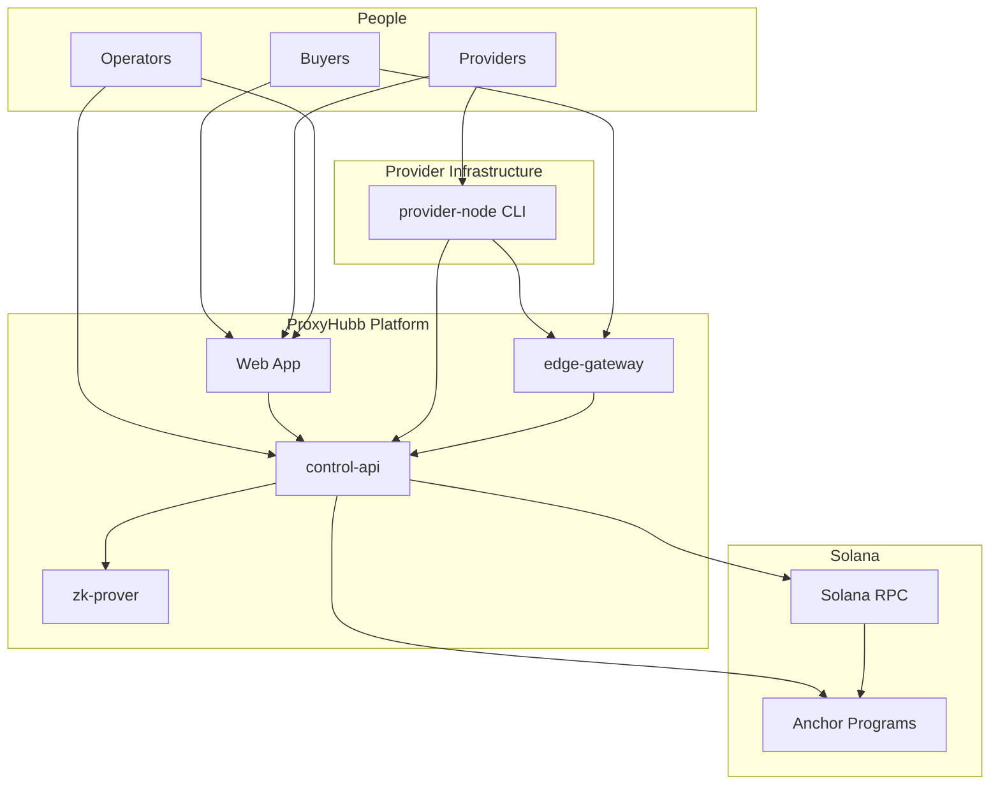
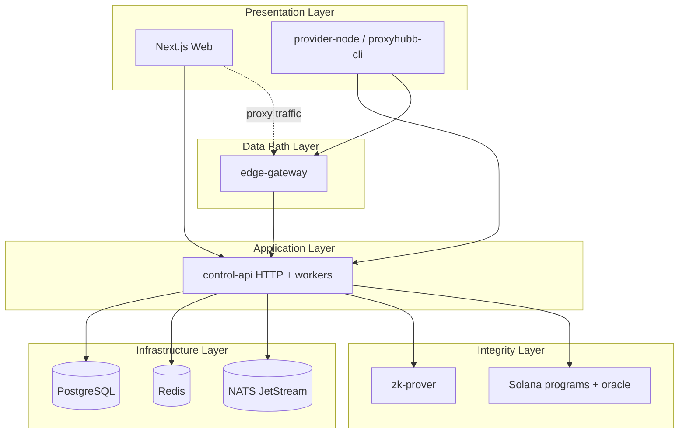
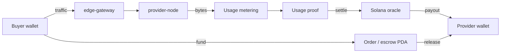
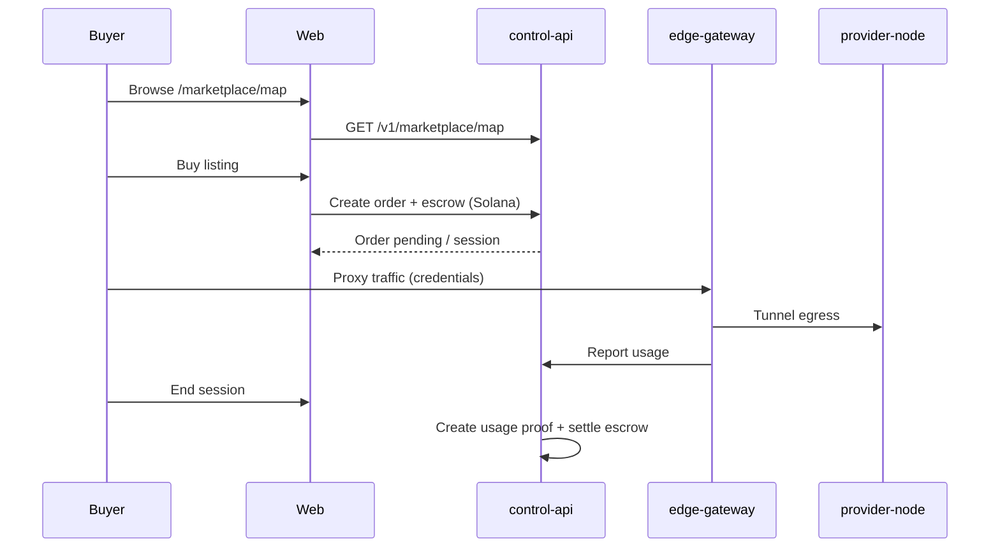

# ProxyHubb — Comprehensive System Analysis Report

**Document version:** 1.0  
**Report date:** 2026-06-03  
**Repository:** `proxyhubb` monorepo  
**Branding:** ProxyHubb (codebase) / ProxyHub (UI and parts of API)  
**Audience:** Engineering, product, operations, and stakeholders reviewing architecture, features, and readiness  

**Companion documents:**

| Document | Focus |
|----------|--------|
| [../SYSTEM_ARCHITECTURE_AND_PRODUCT_DEEP_DIVE.md](../SYSTEM_ARCHITECTURE_AND_PRODUCT_DEEP_DIVE.md) | Product-oriented architecture entry point |
| [../SYSTEM_ANALYSIS_REPORT.md](../SYSTEM_ANALYSIS_REPORT.md) | API route index, migrations, env matrix |
| [../PROJECT_STATE.md](../PROJECT_STATE.md) | Canonical live progress record |
| [DECENTRALIZATION_STATUS_REPORT.md](./DECENTRALIZATION_STATUS_REPORT.md) | D1–D4 layer snapshot |
| [IMPROVEMENTS_AND_ROADMAP.md](./IMPROVEMENTS_AND_ROADMAP.md) | Achievements and remaining work |
| [../openapi.yaml](../openapi.yaml) | Authoritative HTTP contract for `/v1` |

---

## Table of contents

1. [Executive summary](#1-executive-summary)
2. [Vision and strategic objectives](#2-vision-and-strategic-objectives)
3. [Monorepo structure](#3-monorepo-structure)
4. [Architecture overview](#4-architecture-overview)
5. [Deployment and networking topology](#5-deployment-and-networking-topology)
6. [Control plane vs data plane](#6-control-plane-vs-data-plane)
7. [Subsystem deep dives](#7-subsystem-deep-dives)
8. [Features catalog](#8-features-catalog)
9. [Ecosystem, roles, and economics](#9-ecosystem-roles-and-economics)
10. [End-to-end workflows](#10-end-to-end-workflows)
11. [Decentralization foundation (D1–D4)](#11-decentralization-foundation-d1d4)
12. [Pros and cons](#12-pros-and-cons)
13. [Fixed and improved (recent)](#13-fixed-and-improved-recent)
14. [Areas needing improvement](#14-areas-needing-improvement)
15. [Testing readiness](#15-testing-readiness)
16. [Recommendations](#16-recommendations)

---

## 1. Executive summary

ProxyHubb is a **decentralized residential and datacenter proxy marketplace**. The platform connects:

- **Buyers** who pay for metered proxy bandwidth via Solana-backed wallets, marketplace listings, or direct session intents.
- **Providers** (sellers) who run software on their machines and tunnel traffic through a shared **edge gateway**.
- **Operators** who run the control plane, treasury, Solana oracle, optional ZK settlement pipeline, and observability stack.

The system is implemented as a **monorepo**:

| Component | Technology | Role |
|-----------|------------|------|
| `apps/web` | Next.js 16 | Product UI: marketplace, explorer, wallet, forum, governance |
| `services/control-api` | Go (Gin, GORM) | System of record: auth, billing, registry, workers |
| `services/edge-gateway` | Rust | Data plane: proxy termination, provider tunnels, admission |
| `services/provider-node` | Rust CLI | Provider runtime on provider-owned hosts |
| `services/zk-prover` | Rust (Halo2) | Optional batch usage proofs |
| `services/solana-programs` | Anchor | Escrow, registry, reputation (scaffold) |

**Maturity snapshot (June 2026):** **8.0 / 10** overall. Core paths exist end-to-end (wallet auth → session/order → gateway routing → usage metering → usage proof → settlement). Decentralization wiring across D1–D4 is implemented; **staging and devnet validation** with real secrets and funded wallets remains the primary operational gap.

---

## 2. Vision and strategic objectives

### 2.1 Product vision

Build an **AI-native, trust-minimized proxy network** where:

- Bandwidth supply is **decentralized** (anyone can run a provider node).
- Demand is **discoverable** (marketplace map, smart matching, subscriptions).
- Value flow is **transparent** (explorer, usage proofs, on-chain settlement where enabled).
- Operators retain **safety rails** (KYC hooks, rate limits, treasury reconciliation, withdrawal controls).

### 2.2 Strategic objectives

| Objective | How the codebase supports it | Maturity |
|-----------|------------------------------|----------|
| Marketplace liquidity | Listings, orders, geo map, reviews, tiers | Strong |
| Reliable proxy delivery | Session intents, edge routing, provider leases | Core path works |
| Fair provider compensation | Earnings, batch payouts, self-claim API | Backend strong |
| Buyer trust and metering | Usage records, wallet ledger, trustless proofs | Ledger + proofs wired |
| Decentralization narrative | Explorer, escrow, ZK batches, signed proofs | Foundation complete; staging validation open |
| Operational safety | Redis limits, circuit breakers, anomaly/GDPR workers | Improving |
| Developer access | OpenAPI, SDKs, agent APIs | Present |

### 2.3 Explicit non-goals (today)

- **EVM relayer payouts** — decommissioned; Solana oracle only.
- **Fiat wallet (Paystack)** — removed; SOL-only.
- **Supabase runtime auth** — legacy naming; JWT is self-hosted.
- **Default admin API** — `/v1/admin/*` returns 410 unless `ADMIN_API_ENABLED=true`.

---

## 3. Monorepo structure

```text
proxyhubb/
├── apps/web/                    # Next.js dashboard, marketplace, explorer
├── services/
│   ├── control-api/             # Go/Gin — system of record + background workers
│   ├── edge-gateway/            # Rust — proxy + Yamux provider tunnels
│   ├── provider-node/           # Rust CLI — provider runtime (off compose by default)
│   ├── zk-prover/               # Rust — Halo2 batch proofs
│   ├── solana-programs/         # Anchor escrow / registry
│   └── admin-cli/               # Admin tooling
├── migrations/                  # Authoritative SQL (000001+)
├── proto/                       # gateway.proto
├── sdks/                        # Client SDKs
├── cli/                         # proxyhubb-cli wrapper
├── infra/                       # K8s, Prometheus, Grafana
├── scripts/                     # Bootstrap, soak, E2E helpers
└── docs/                        # Canonical documentation + reports
```

---

## 4. Architecture overview

### 4.1 Context diagram (C4 Level 1)



### 4.2 Layered logical architecture



### 4.3 Responsibility split

| Layer | Owns | Does not own |
|-------|------|----------------|
| **Web** | UX, wallet connect, API clients | Metering, routing, payouts |
| **control-api** | Users, wallets, sessions, billing, registry, gateway callbacks | Raw TCP proxy bytes |
| **edge-gateway** | Connection auth, routing, local metering, tunnels | Long-term financial ledger |
| **provider-node** | Tunnel client, stats, signed heartbeats | Marketplace listings |
| **zk-prover** | Proof generation | Business rules |
| **Solana** | Escrow PDAs, on-chain registry (where used) | Session geo targeting |

---

## 5. Deployment and networking topology

### 5.1 Default local stack (`docker-compose.dev.yml`)

| Service | Typical host port | Role |
|---------|-------------------|------|
| **web** | 3000 or 4011 (`dev:e2e`) | Next.js UI |
| **control-api** | 18080 → 8080 | REST + WebSocket + workers |
| **edge-gateway** | 18090 / 8090 | Data plane proxy + management |
| **postgres** | 5433 → 5432 | Primary database |
| **redis** | 6380 → 6379 | Cache, limits, gateway state |
| **nats** | 4223, 8223 | Event bus (optional) |
| **zk-prover** | 8095 | ZK proofs |
| **prometheus** | 9090 | Metrics |
| **grafana** | 3001 | Dashboards |

**Not in default compose:** `provider-node` runs on the provider's machine against `API_BASE_URL` and `PROVIDER_TUNNEL_PUBLIC_ADDR`.

### 5.2 Networking system (edge and provider transport)

The **networking subsystem** spans buyer ingress, edge multiplexer, and provider tunnels:

| Capability | Implementation | Status |
|------------|----------------|--------|
| HTTP/2 and WebSocket proxy | `edge-gateway/src/proxy/` | Production-oriented |
| SOCKS5 ingress (P6) | `edge-gateway/src/ingress/socks5.rs` | Initial |
| HTTP/3 ingress (P6) | `edge-gateway/src/ingress/h3.rs` | Initial |
| Yamux provider transport (P4) | `provider_transport/quic.rs`, multiplexer | Signed off |
| Tunnel tier split (P3b) | ADR 0002 | Done |
| Multipod directory + admission (P2–P3) | Registry, circuit breakers | Done |
| Signed tunnel heartbeats | `PROXYHUB_REQUIRE_SIGNED_HEARTBEATS` | Configurable |
| OTEL + JA3/JA4 (P5) | Observability module | Done |
| Transport soak | `P4_TRANSPORT_SOAK_RUNBOOK.md` | Operational |

**Buyer path:** Browser or app → edge-gateway (auth via session intent / credentials) → provider tunnel → egress from provider IP.

**Provider path:** `provider-node` maintains Yamux session to edge → heartbeats and stats to control-api → registry updates `provider_nodes`.

---

## 6. Control plane vs data plane

| Plane | Services | Traffic |
|-------|----------|---------|
| **Control** | control-api, web (API calls), workers | JSON REST, WebSocket, background jobs |
| **Data** | edge-gateway, provider-node tunnels | Proxy bytes (HTTP/SOCKS), Yamux frames |

The control-api provisions credentials and session state in Redis; the edge-gateway validates and meters live connections, then reports usage back for ledger and settlement.

---

## 7. Subsystem deep dives

### 7.1 API system (`services/control-api`)

**Stack:** Go, Gin, GORM, JWT auth, background workers in `main.go`.

**Authoritative contract:** [docs/openapi.yaml](../openapi.yaml). Legacy Swagger 2.0 under `services/control-api/docs/` is **non-authoritative**.

**Major API domains:**

| Domain | Examples | Purpose |
|--------|----------|---------|
| Auth | `/v1/auth/wallet/challenge`, `/v1/auth/wallet/verify` | Wallet-first login |
| Marketplace | `/v1/marketplace/listings`, `/v1/marketplace/map`, orders | Discovery and purchase |
| Sessions | `/v1/sessions/intent`, `/v1/sessions` | Proxy credentials and lifecycle |
| Provider | `/v1/provider/nodes`, heartbeats, listings sign | Provider ops and proofs |
| Gateway | Register, heartbeat, reconnect | Edge ↔ control sync |
| Wallet | `/v1/wallet/*` | SOL ledger, deposit, withdraw, transfer |
| Trustless | `/v1/trustless/*` | Usage proofs and signing |
| Explorer | `/v1/explorer/*` | Public metrics, blocks, decentralization status |
| System | `/v1/system/provider-proof-policy` | Enforce/observe policy |

**Background workers (representative):** escrow listener, explorer indexer, billing/settlement, ZK settlement, provisioning, registry sync, tier evaluator, heartbeat monitor, anomaly detector, GDPR worker, marketplace watcher, treasury watchtower.

**Web integration:** Next.js rewrites `/v1/*` to control-api; public vs authenticated client split; route policy enforced via `validate:routes`.

---

### 7.2 Database system

**Primary store:** PostgreSQL 15/16 via GORM.

**Authoritative migrations:** `migrations/` (repo root). Supplemental copies may exist under `services/control-api/migrations/`.

**Canonical node registry (D2):**

- **`provider_nodes`** — source of truth for provider identity and runtime (region, ISP, health, latency, bytes, `quality_score`, `gateway_node_id`, hotkey, proof fields).
- **`nodes`** — compatibility mirror linked by `provider_node_id` during transition (migration `000092_provider_nodes_runtime_merge`).

**Redis:** Session credentials, rate limits, circuit breaker state, gateway provisioning, leader election fallback, enforce-soak counters.

**NATS JetStream:** Telemetry and event consumers (optional in dev).

**Key entities:** `users`, `wallets`, `wallet_transactions`, `listings`, `orders`, `sessions`, `usage_records`, `usage_proofs`, `provider_nodes`, `provider_earnings`, `explorer_*` tables.

**Explorer sync:** `internal/indexer/node_sync.go` reads `provider_nodes` for public node map data.

---

### 7.3 Wallet system

**Model:** SOL-only **custodial ledger** (internal balances) with on-chain deposit verification and oracle-backed withdrawals/payouts.

**Phases (complete except 4.6):**

| Phase | Focus | Status |
|-------|--------|--------|
| 1 | Security lockdown (secrets, KYC webhook, idempotency) | Complete |
| 2 | Test coverage (transfer, withdraw, deposit) | Substantial |
| 3 | Fiat removal, reconciliation, anomaly | Complete |
| 4 | Treasury hot/cold, multisig, transparency, provider claim | Complete (streams deferred) |

**Buyer wallet flow:**

1. Connect Solana wallet → challenge/sign → JWT.
2. Deposit SOL (verified against treasury address).
3. Pay for sessions/listings (ledger debit or escrow).
4. Withdraw with cooldowns and limits.

**Provider earnings:**

- Metered bytes credited to `provider_earnings`.
- Batch SOL payouts via oracle or **self-claim** (`provider_claim.go`, dashboard panel).

**Docs:** [WALLET_STATUS.md](../WALLET_STATUS.md), [WALLET_PRODUCTION_CLOSURE.md](../WALLET_PRODUCTION_CLOSURE.md), [MANUAL_DEVNET_SESSION.md](../MANUAL_DEVNET_SESSION.md).

---

### 7.4 Blockchain system (Solana + ZK)

**Solana programs (Anchor):** Escrow for buyer orders/sessions; optional registry and reputation scaffolding.

**Control-api integration:**

- Escrow listener watches deposits and PDAs.
- Oracle worker batches provider payouts.
- Settlement on session end when usage proof is anchored (`usage.go`, `session.go`, `orders.go`).

**ZK layer (`services/zk-prover`):** Halo2 batch digests for usage settlement integrity when `FULL_DECENTRALIZATION` and ZK path enabled.

**Trustless usage proofs (D4):**

- Message format: `PROXYHUB_USAGE_PROOF:v1` (canonical bytes from API).
- Buyer/provider Ed25519 signatures; optional on-chain anchor.
- Web signs via `trustless.ts` and dashboard at `/dashboard/trustless`.

**Live devnet testing:** Opt-in Playwright spec `marketplace-map-buy.devnet.spec.ts` with test wallet adapter (disposable funded keypair only).

---

### 7.5 Web application (`apps/web`)

**Stack:** Next.js 16, React 19, Tailwind, Solana wallet adapter, TanStack Query, Leaflet + react-globe.gl for maps.

**Major surfaces:**

| Area | Routes (examples) | Notes |
|------|-------------------|--------|
| Marketplace | `/marketplace`, `/marketplace/map`, `/marketplace/[id]` | Unified `ProxyMapCanvas`, buy modal |
| Provider | `/marketplace/create`, `/marketplace/manage` | Signed listing offers |
| Explorer | `/explorer`, `/explorer/map` | Public chain-style views |
| Wallet | `/dashboard/wallet`, treasury | SOL-only |
| Trustless | `/dashboard/trustless` | Proof signing |
| Social | Forum, feed, messaging | Community features |
| Governance | Proposals, voting | On-chain-linked where configured |

**Quality gates:** `npm run validate:routes`, `typecheck`, Playwright E2E (`test:e2e:map`, optional devnet buy).

**Local dev:** `npm run dev` or `npm run dev:e2e` on port **4011**.

---

### 7.6 Decentralization system (whole)

Decentralization is staged in four layers. See [Section 11](#11-decentralization-foundation-d1d4) for detail.

**Summary:** Identity (signed proofs) → Registry (`provider_nodes`) → Edge enforcement (signed heartbeats, flags) → Settlement (usage proofs + escrow). **Foundation implemented; staging proof is the gap.**

---

## 8. Features catalog

### 8.1 Marketplace and discovery

- Geo-aware marketplace map (`GET /v1/marketplace/map`) with bbox, filters, listings + optional nodes.
- Shared map component (`ProxyMapCanvas`) on marketplace and explorer.
- Deep link `?listing=<uuid>` on marketplace map.
- Listings with pricing, bandwidth, SLA badges, reviews, provider tiers.
- Smart matching and order flow.
- Buy-from-map UI with escrow-backed orders (mocked E2E + live devnet harness).

### 8.2 Proxy sessions and delivery

- Session intents with geo/ISP targeting, rotation, bandwidth caps.
- Instant sessions and marketplace orders.
- Credential issuance via Redis; gateway URL for buyers.
- Usage metering from edge → control-api → ledger.

### 8.3 Provider operations

- Node registration and gateway linking.
- Provider CLI token and connect instructions (`GET /v1/provider/nodes/:id/connect`).
- Signed heartbeats and listing offers (observe/enforce).
- Docker bootstrap: `bootstrap-provider-docker.ps1`, `verify-provider-proofs-docker.ps1`.
- Enforce soak monitor: `soak-enforce-monitor.ps1`.
- Earnings tracking and self-claim.

### 8.4 Wallet and treasury

- SOL deposits (on-chain verify), P2P transfer, withdrawals.
- Spending limits, cooldowns, whitelist.
- Hot/cold treasury, multisig for large withdrawals.
- Public treasury page (`/treasury`, API transparency).
- Provider claim panel.

### 8.5 Trust, compliance, and security

- KYC webhook hooks (IP + HMAC + timestamp).
- MFA, API keys, user security settings.
- Trustless usage proofs with dual signatures.
- Disputes and anomaly detection workers.
- GDPR deletion worker.

### 8.6 Explorer and transparency

- Public metrics, blocks, transactions, nodes.
- Decentralization status endpoints.
- Solscan/deep links for wallet UI.
- Bandwidth and network health views (with documented metric semantics in `EXPLORER_REFRESH_STRATEGY.md`).

### 8.7 Community and governance

- Social feed, forum, messaging, friends, notifications.
- Governance proposals and voting (on-chain-linked where configured).

### 8.8 Developer and agent access

- OpenAPI contract, SDKs under `sdks/`.
- Agent APIs for automation.
- Session streaming endpoints (where enabled).

### 8.9 Edge gateway (infrastructure feature set)

- Multipod routing and admission control.
- Provider transport soak and sign-offs (P0–P6).
- Observability (OTEL, Prometheus metrics on host **9092** typical).

---

## 9. Ecosystem, roles, and economics

### 9.1 Role definitions

| Role | Who | Primary interface | Value |
|------|-----|-------------------|--------|
| **Buyer** | End user or business consuming proxies | Web app, proxy client | Reliable, metered egress IPs |
| **Provider (seller)** | Bandwidth supplier | Web + `provider-node` CLI | Monetize idle residential/datacenter bandwidth |
| **Operator** | Platform team | Docker/K8s, Grafana, scripts | Uptime, treasury, policy enforcement |
| **Validator (narrative)** | Solana network + optional reputation program | RPC, on-chain programs | Settlement finality; future reputation (scaffold) |

There is no separate “validator” job in the sense of a dedicated ProxyHub role today; **operators** enforce policy off-chain, and **Solana validators** secure on-chain settlement.

### 9.2 How buyers benefit

- **Geo and ISP diversity** from a distributed provider pool vs single-vendor datacenter lists.
- **Metered pricing** tied to actual usage (GB caps, session limits).
- **Verifiable usage** via usage proofs and optional on-chain receipts (trust-minimized billing narrative).
- **Discovery** via map, filters, reviews, and tiers.
- **Wallet-native** funding on Solana without fiat rails in current product.

### 9.3 How providers (sellers) profit

1. Register node and pass proof verification (heartbeat + listing signatures under enforce).
2. Receive session leases when buyers match listing or intent criteria.
3. Serve traffic through edge tunnel; bytes counted upstream.
4. Accumulate **provider earnings** in the ledger.
5. **Claim** SOL via self-claim API or receive **batch oracle payouts**.

**Unit economics (conceptual):** Provider sets listing price per GB (or package); platform may take fees via treasury/marketplace rules; net revenue flows after metering and settlement.

### 9.4 Platform operator economics

- Marketplace and session fees (configuration-dependent).
- Treasury hot/cold management and reconciliation.
- Cost of running control-api, edge cluster, RPC, and observability.

### 9.5 Ecosystem diagram (value flow)



---

## 10. End-to-end workflows

### 10.1 Buyer: marketplace map purchase



### 10.2 Buyer: session intent (non-marketplace)

1. Authenticate via wallet JWT.
2. `POST /v1/sessions/intent` with geo, bandwidth, duration.
3. control-api provisions Redis credentials and returns gateway endpoint.
4. Buyer configures proxy client → edge-gateway validates session.
5. Usage debited from wallet ledger; proof created on termination if escrow-backed.

### 10.3 Provider: onboard and earn

1. Register account; optional KYC.
2. `POST` gateway register / provider node create → `provider_nodes.id`.
3. Bootstrap signing keys (`bootstrap-provider-docker.ps1`).
4. Run `provider-node` with token and tunnel address.
5. Signed heartbeats → `latest_heartbeat_verified`.
6. Create signed listing (`sign-provider-listing.ps1` or web with wallet/dev sign).
7. Receive orders/sessions → traffic → earnings → claim or batch payout.

### 10.4 Operator: enforce mode rollout

See [STAGING_ENFORCE_RUNBOOK.md](../STAGING_ENFORCE_RUNBOOK.md):

1. Start edge + provider profile compose.
2. `soak-enforce-monitor.ps1` — policy + heartbeat verification.
3. `post-signed-listing-docker.ps1` — listing `listing_offer_verified`.
4. SQL checks on `provider_nodes` and `explorer_nodes` linkage.
5. D4 SQL checks on `usage_proofs` after session end.

---

## 11. Decentralization foundation (D1–D4)

| Layer | Name | Status | Rating |
|-------|------|--------|--------|
| **D1** | Provider cryptographic identity | Implemented; enforce proven in Docker | 9/10 |
| **D2** | Node registry unification | `provider_nodes` canonical; `nodes` mirror | 8/10 |
| **D3** | Edge and control-plane flags | P1–P6 sign-offs, `FULL_DECENTRALIZATION` | 8/10 |
| **D4** | Trustless usage and settlement | Wired; staging validation needed | 7/10 |

**D1 highlights:** `PROVIDER_SIGNATURE_MODE=observe|enforce`, Ed25519 `PROXYHUB_*` envelopes, signed heartbeats and listing offers, E2E proof badges on map.

**D2 highlights:** `reconcileProviderNodeRegistry`, migration `000092`, gateway returns `provider_nodes.id`, explorer sync from `provider_nodes`.

**D3 highlights:** Signed tunnel heartbeats flag, decentralization explorer API, edge phase documentation and soak runbooks.

**D4 highlights:** `ensureUsageProofForSessionSettlement`, `anchorUsageProofAndSettle`, web trustless signing aligned to backend messages, live devnet map-buy harness.

**Not done:** Production HSM for provider keys; full on-chain reputation; complete removal of legacy `nodes` readers.

---

## 12. Pros and cons

### 12.1 Strengths (pros)

| Area | Benefit |
|------|---------|
| **Architecture** | Clear control vs data plane split; mature Rust edge and Go control-api |
| **Decentralization** | End-to-end staged foundation (D1–D4) with Docker-verified proofs |
| **Marketplace** | Unified geo map, buy-from-map E2E, deep links |
| **Wallet** | SOL-only hardening, treasury transparency, provider claim |
| **Settlement** | Usage proofs + escrow path wired; ZK optional |
| **Operations** | Bootstrap scripts, soak monitor, staging runbook, Grafana dashboards |
| **Testing** | Route validation, mocked map E2E, CI wallet and edge tests |
| **Documentation** | Canonical index (`docs/README.md`), saved reports, OpenAPI |

### 12.2 Weaknesses (cons)

| Area | Risk |
|------|------|
| **Staging gap** | Live devnet settlement and enforce-from-web need manual secrets |
| **Registry transition** | Dual `nodes` / `provider_nodes` increases cognitive load |
| **Uncommitted diff** | Large working-tree changes across web, API, edge not yet in one release |
| **Hybrid explorer** | Some views DB-backed vs fully on-chain |
| **Provider keys** | No production HSM / rotation story |
| **Ops complexity** | Multipod edge, soak, port conflicts (e.g. Prometheus 9090) |
| **Deferred features** | Pay streams, fiat rails, active admin API |
| **Dependencies** | npm audit, React peer warnings, middleware deprecations |

---

## 13. Fixed and improved (recent)

| Change | Impact |
|--------|--------|
| D4 settlement wiring | Session end creates usage proof and routes escrow settlement |
| Registry merge (`000092`) | `provider_nodes` canonical with runtime fields |
| Navigation policy parity | `nav.ts` derives from `policies.ts`; `validate:routes` |
| Unified marketplace map | `ProxyMapCanvas`, `GET /v1/marketplace/map` |
| Map buy E2E (mock + devnet harness) | Regression guard for purchase flow |
| Buy modal UX fix | Credentials screen visible after purchase |
| Trustless signing alignment | Backend message + base58 Ed25519 on web |
| Provider proofs in Docker | Enforce soak + signed listing scripts |
| Documentation consolidation | Removed stale deep-dives; `PROJECT_STATE`, runbooks, this report |
| Playwright artifacts gitignored | Cleaner repo; CI runs map E2E |
| Edge P1 baseline trim | Reduced noise in tracked baseline files |

---

## 14. Areas needing improvement

### 14.1 P0 — Operations and validation

- [ ] Staging enforce with production-like secrets alignment
- [ ] Live devnet map-buy with disposable funded wallet
- [ ] D4 on-chain settlement proof with oracle/program config
- [ ] Web listing create under enforce with `PROXYHUB_PROVIDER_SIGNING_KEY` on control-api

### 14.2 P1 — Product hardening

- [ ] Complete `ProxyMapPoint` contract in all code paths
- [ ] Provider-only page guards (beyond nav badges)
- [ ] Single `NAV_SECTIONS` registry to prevent desktop/mobile drift
- [ ] Legacy `nodes` read-path removal after compatibility window

### 14.3 P2 — Architecture and production

- [ ] Production provider key management (HSM, rotation runbook)
- [ ] On-chain reputation program activation
- [ ] Commit/split large feature branch by subsystem
- [ ] OpenAPI coverage for all public routes; retire legacy Swagger tree
- [ ] Full multipod production soak sign-off

---

## 15. Testing readiness

| Level | Readiness | What to run |
|-------|-----------|-------------|
| **Automated (CI / local)** | High | `validate:routes`, `typecheck`, `test:e2e:map`, Go tests with `TEST_DATABASE_URL`, `cargo test` edge |
| **Docker integration** | High | `bootstrap-provider-docker`, `verify-provider-proofs`, `soak-enforce-monitor` |
| **Full decentralization E2E** | Medium | Devnet env vars + `test:e2e:map-buy:devnet` + D4 SQL checks |
| **Production release** | Not yet | Staging sign-off + feature branch merge + prod keys |

Canonical checklist: [STAGING_ENFORCE_RUNBOOK.md](../STAGING_ENFORCE_RUNBOOK.md).

---

## 16. Recommendations

1. Execute the full **staging enforce runbook** before marketing decentralization features.
2. **Commit or split** the outstanding web/control-api/edge diff into reviewable PRs.
3. Run **one explicit pass** for web listing creation under `PROVIDER_SIGNATURE_MODE=enforce`.
4. Plan **legacy `nodes` deprecation** with a single release note and SQL verification.
5. Keep **saved reports** (`docs/reports/`) updated when D4 staging or registry transition completes.

---

## Document history

| Date | Version | Notes |
|------|---------|-------|
| 2026-06-03 | 1.0 | Initial comprehensive report synthesized from architecture deep-dives and project state |

---

*This report is a saved walkthrough artifact. For the living status record, prefer [PROJECT_STATE.md](../PROJECT_STATE.md).*
