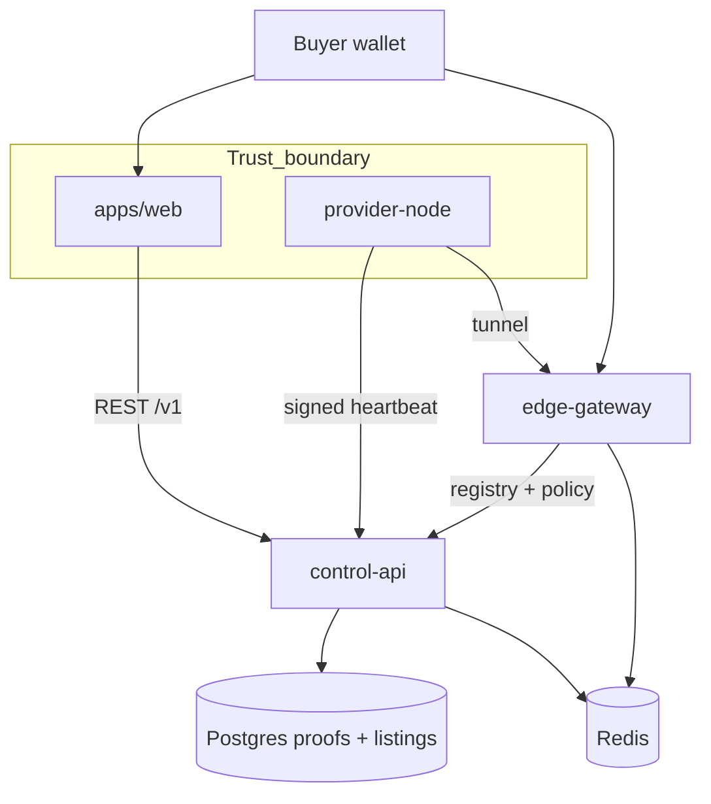

# ProxyHubb decentralization status report

**Report date:** 2026-06-02  
**Scope:** Provider identity, registry, edge enforcement, settlement proofs, and operational verification  
**Overall decentralization maturity:** **~8.1 / 10** (provider identity and runtime registry are strong; live settlement now wired with staged ops validation)

This report is a saved snapshot for review sessions. The living summary remains in [../PROJECT_STATE.md](../PROJECT_STATE.md).

---

## Executive summary

ProxyHubb is building a **decentralized residential proxy marketplace**: providers run `provider-node` and tunnel through `edge-gateway`; buyers use Solana-funded sessions; **control-api** enforces policy and stores verified proofs in Postgres.

As of this report, the team has achieved **production-like provider proof enforcement in Docker** (signed heartbeats + signed listing offers), a **provider_nodes-first registry merge path**, and **unified marketplace map** discovery with both fast mocked and guarded live-devnet buy tests.

The largest remaining decentralization gap is now operational validation of D4 on staging with oracle/program secrets, not missing application wiring.

---

## Layer model

| Layer | Name | Purpose | Status |
|-------|------|---------|--------|
| **D1** | Provider cryptographic identity | Ed25519 proofs on heartbeats and listing offers | **Implemented** (observe + enforce) |
| **D2** | Node registry unification | Runtime/product identity on `provider_nodes` | **Merged path implemented** (legacy `nodes` mirror retained for compatibility) |
| **D3** | Edge & control-plane enforcement | Gateway admission, signed heartbeats, multipod, OTEL | **Advanced** (P1–P6 largely signed off) |
| **D4** | Trustless usage & settlement | Usage proofs, escrow, on-chain settlement in buyer UX | **Wired** (requires staging oracle/devnet validation) |

---

## D1 — Provider cryptographic identity

### Implemented

| Item | Evidence |
|------|----------|
| Proof envelope (`PROXYHUB_*`) | `services/control-api/internal/proofs/` |
| Signed provider heartbeats | `provider-node`, `POST /v1/provider/nodes/:id/heartbeat` |
| Signed listing offers | `listings.go`, web `listing-offer.ts`, CLI `provider_sign_listing` |
| `PROVIDER_SIGNATURE_MODE=observe\|enforce` | `provider_proofs.go` |
| Hotkey on `provider_nodes` | Bootstrap + DB columns `latest_heartbeat_*`, `listing_offer_*` |
| Docker bootstrap + verify | `scripts/bootstrap-provider-docker.ps1`, `verify-provider-proofs-docker.ps1` |
| Enforce soak monitor | `scripts/soak-enforce-monitor.ps1` |
| Dev server listing sign (create UX) | `POST /v1/provider/listings/sign-offer`, policy `dev_server_signing` |
| Web create: wallet or dev sign | `apps/web/src/app/marketplace/create/page.tsx` |
| Map proof badges E2E | `apps/web/e2e/marketplace-map-proof.spec.ts` |
| Map buy-from-map E2E (mocked purchase) | `apps/web/e2e/marketplace-map-buy.spec.ts` |

### Verified in your environment (2026-06-02)

- `PROVIDER_SIGNATURE_MODE=enforce`, `PROXYHUB_REQUIRE_SIGNED_HEARTBEATS=true`
- Heartbeat proofs: `Verified: true`, signer `GXdz7cj6JK4qvQzgrwkBPJUkgcFMW68jQwonMQqAzrkF`
- Signed listing via `post-signed-listing-docker.ps1`: `listing_offer_verified = t`
- Stack healthy: control-api, edge-gateway, provider-node

### Not done

- Production HSM / hardware wallet signing for providers
- Formal key rotation runbook beyond bootstrap resync
- Mandatory enforce in all non-dev deployments (still operator choice via env)

---

## D2 — Node registry unification

### Implemented

| Item | Where |
|------|--------|
| Canonical model documented | [../NODE_REGISTRY.md](../NODE_REGISTRY.md) |
| `reconcileProviderNodeRegistry` | `provider_registry.go` |
| Provider create / heartbeat | `provider_nodes.go` |
| Gateway register / reconnect / heartbeat | `gateway.go` (`provider_nodes.id` returned as canonical ID) |
| Marketplace geo linkage | `marketplace_geo.go` |
| Runtime schema migration | `migrations/000092_provider_nodes_runtime_merge.*.sql` |

### Compatibility window

- Legacy `nodes` rows are still mirrored and linked via `provider_node_id` for older readers during rollout.
- `explorer_nodes.node_id` now syncs from `provider_nodes.id` through `NodeSync`.

---

## D3 — Edge and control-plane decentralization

### Implemented

| Item | Where |
|------|--------|
| Edge gateway P1–P6 sign-off | `services/edge-gateway/docs/P*_SIGNOFF.md` |
| P3 multipod + tunnel tier split | ADR 0002 |
| P4 multi-yamux provider transport | ADR 0003 |
| P5 OTEL, JA3/JA4, buyer TLS options | [P5_OTEL.md](../../services/edge-gateway/docs/P5_OTEL.md) |
| P6 HTTP/3 + SOCKS5 (initial) | `REMAINING_PHASES.md` |
| `FULL_DECENTRALIZATION` gate | `control-api/internal/decentralization` |
| Explorer decentralization APIs | `/v1/explorer/decentralization/*` |
| Optional signed tunnel heartbeats | `PROXYHUB_REQUIRE_SIGNED_HEARTBEATS` on edge |

### Operational note

- Host gateway port may be **18090→8090** when `EDGE_GATEWAY_PORT=18090` in `.env` (not 8090 on host).
- Gateway metrics often mapped **9092→9090** to avoid Prometheus port clashes.

---

## D4 — Trustless usage and settlement

### Implemented (backend / services)

| Item | Where |
|------|--------|
| `UsageProof` model + dual signatures | `models/usage_proof.go`, `trustless.go` |
| ZK prover service | `services/zk-prover/` |
| Solana escrow / billing workers | `solana/`, `billing/` |
| Provider self-claim earnings (wallet track) | [../WALLET_STATUS.md](../WALLET_STATUS.md) |
| Order/session finalization creates `UsageProof` | `orders.go`, `session.go`, `usage.go` |
| Canonical proof signing in web | `trustless.ts`, `dashboard/trustless/page.tsx` |

### Still requires staging validation

- Live devnet map buy requires funded test wallet, linked buyer/seller wallets, oracle key, and deployed program ID.
- On-chain reputation program mostly scaffold (`programs/reputation/`)

---

## Architecture diagram

---

## Risk register (decentralization-focused)

| Risk | Severity | Mitigation |
|------|----------|------------|
| Enforce mode without aligned hotkey/signing key | High | Bootstrap + verify scripts; soak monitor |
| Legacy registry mirror drift | Medium | `provider_nodes` canonical writes + `nodes.provider_node_id` compatibility link |
| Buyer path bypasses proof verification UI | Medium | Map proof badges; enforce policy API |
| Settlement operational secrets missing in staging | High | Run `STAGING_ENFORCE_RUNBOOK.md` devnet preflight |
| Large uncommitted diff / release hygiene | Medium | Split commits by subsystem |

---

## Recommended next steps (decentralization)

1. **Staging:** Keep enforce + signed heartbeats; alert on `latest_heartbeat_verified = false`.
2. **D4 staging:** Run a live escrow purchase, terminate session, verify proof + settlement SQL.
3. **Registry:** Monitor compatibility mirror; remove legacy `nodes` reads in a later cleanup release.
4. **E2E:** Run `npm run test:e2e:map-buy:devnet` with disposable funded devnet wallet.

---

## Related documents

| Document | Purpose |
|----------|---------|
| [../PROJECT_STATE.md](../PROJECT_STATE.md) | Canonical project + decentralization summary |
| [IMPROVEMENTS_AND_ROADMAP.md](./IMPROVEMENTS_AND_ROADMAP.md) | Achievements and remaining work |
| [../PROVIDER_PROOFS_DOCKER.md](../PROVIDER_PROOFS_DOCKER.md) | Docker provider proof operations |
| [../NODE_REGISTRY.md](../NODE_REGISTRY.md) | Registry linking rules |
| [IMPROVEMENTS_AND_ROADMAP.md](./IMPROVEMENTS_AND_ROADMAP.md) | Remaining product cleanup |

---

*Regenerate or bump the report date when a decentralization phase closes (e.g. D4 buyer flow, registry merge).*
