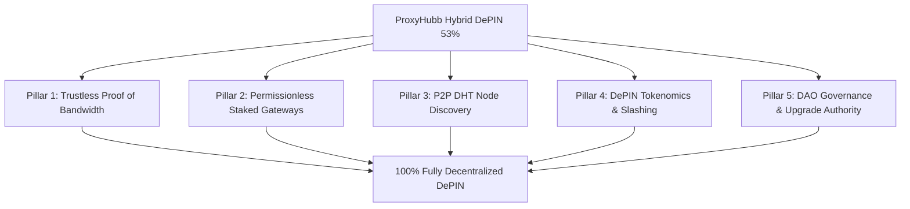

# ProxyHubb: DePIN Readiness & Decentralization Analysis Report

**Date:** 2026-09-01  
**Project:** ProxyHubb (`samuel-1-avson/ProxySocialHub`)  
**Network Status:** Live on Solana Devnet (GCP Phase A Testnet)  
**Target:** DePIN Maturity Evaluation & Full Decentralization Roadmap  

---

## Executive Summary

**ProxyHubb is currently an "Early-Stage Hybrid DePIN" (~53% DePIN Complete).**

It successfully delivers the hardest physical infrastructure and financial settlement primitives: **real residential hardware nodes** establishing outbound Yamux/QUIC tunnels across global residential ISPs, settling payments via **non-custodial Solana Anchor escrow PDAs**, and authenticating via **Sign-In with Solana (SIWS)**.

However, the **coordination, discovery, and metering validation** layers currently operate in a hybrid model where the platform's Control API and Edge Gateway act as the authoritative oracle and router.

```
┌──────────────────────────────────────────────────────────────────────────────────────────────────┐
│                                   THE DePIN MATURITY SPECTRUM                                    │
│                                                                                                  │
│   Centralized Proxy      Hybrid DePIN (ProxyHubb Today)             Fully Decentralized DePIN    │
│   (BrightData/Oxylabs)   (Physical Nodes + Solana Escrow)           (Trustless PoBW + P2P Mesh)  │
│  ◄───────────────────────────────▲───────────────────────────────────────────────►              │
│                                  │                                                               │
│                              Current: 53%                                   Goal: 100%           │
└──────────────────────────────────────────────────────────────────────────────────────────────────┘
```

---

## 1. DePIN Readiness Scorecard

| DePIN Pillar | Score | Current State | What's Missing for 100% DePIN |
|---|:---:|---|---|
| **1. Physical Infrastructure (Hardware Supply)** | **85%** | Decentralized residential/datacenter nodes running the Rust daemon across global ISPs. | Direct P2P mesh / WebRTC fallback without mandatory edge gateways. |
| **2. Financial Settlement & Escrow** | **75%** | Non-custodial Solana Anchor escrow PDAs, rent returns, SPL token support, fuzzed arithmetic. | Automatic trustless trigger (currently triggered by Control API oracle). |
| **3. Identity & Authentication** | **70%** | Sign-In with Solana (SIWS), Ed25519 wallet challenge-response. | Decentralized capability delegation (DIDs / ERC-4337-like session keys). |
| **4. Proof of Bandwidth (PoBW) & Metering** | **35%** | Gateway-authoritative WAL (Write-Ahead Log) flushed via oracle. ZK/Groth16 scaffolding exists in code. | Cryptographic mutual receipts / ZK session proofs on-chain. |
| **5. Data Routing & Gateway Plane** | **40%** | High-performance Rust edge gateway, but mostly platform-operated. Operator bundle schema prepared in DB. | Open, permissionless, staked Gateway Operator network with slashing. |
| **6. Discovery, Catalog & Matching** | **25%** | Centralized PostgreSQL database indexing listings, health, and dynamic pricing. | Decentralized Kademlia DHT or on-chain provider registry with gossip. |
| **7. Governance & Upgrade Authority** | **45%** | On-chain governance and dispute jury accounts in Anchor contract; dual-key admin handoff. | Transferring upgrade authority to a DAO (SPL Governance / Realms). |
| **Overall DePIN Index** | **~53%** | **Functional Hybrid DePIN** | **Path to Full Decentralization outlined below** |

---

## 2. What Is Already Decentralized vs. What Is Centralized

```
┌─────────────────────────────────────────────────────────────────────────────────────────────┐
│                                    CURRENT SYSTEM TOPOLOGY                                  │
└─────────────────────────────────────────────────────────────────────────────────────────────┘

       DECENTRALIZED LAYER                              CENTRALIZED / HYBRID LAYER
 ┌───────────────────────────────┐                  ┌─────────────────────────────────┐
 │ 1. Physical Node Fleet        │                  │ 1. Catalog & Marketplace Index  │
 │    - Distributed home/ISP     │                  │    - PostgreSQL listing DB      │
 │      bandwidth contributors   │                  │    - Centralized pricing engine │
 ├───────────────────────────────┤                  ├─────────────────────────────────┤
 │ 2. Solana Smart Contracts     │                  │ 2. Bandwidth Metering & Oracle  │
 │    - Program ID: AZGhGfv...   │                  │    - Edge gateway measures WAL  │
 │    - Escrow PDAs & Rent Claws │                  │    - Control API oracle submits │
 ├───────────────────────────────┤                  ├─────────────────────────────────┤
 │ 3. Wallet Identity            │                  │ 3. Gateway Ingress Routing      │
 │    - SIWS Ed25519 signatures  │                  │    - Platform-hosted proxy edge │
 │    - Non-custodial balances   │                  │    - Centralized session mint   │
 └───────────────────────────────┘                  └─────────────────────────────────┘
```

### What makes ProxyHubb already a legitimate DePIN project:
1. **Real Physical Hardware Supply:** Providers run real daemons (`services/provider-node`) on physical machines, establishing outbound Yamux/QUIC tunnels that penetrate NAT/CGNAT.
2. **On-Chain Financial Invariants:** Funds are not held in a custodial database balance; buyers lock SOL/USDC directly into Anchor PDAs (`services/solana-programs/proxyhub/programs/proxyhub/src/lib.rs`), and sellers are paid from the PDA upon completion.
3. **Decentralization Feature Flags Already Engineered:** In `services/control-api/internal/decentralization/mode.go`, the system already includes foundational flags:
   - `ProviderRegistryGateMode`: Gating node selection against on-chain ProviderRegistry PDAs.
   - `ListingCommitmentMode`: Anchoring offer hashes on-chain.
   - `ZKOnchainGroth16Enabled`: Verifying Groth16 ZK batch proofs on-chain.
   - `SessionCapabilityMode`: Ed25519 capability tokens allowing edge gateways to admit buyers without contacting the central database.

---

## 3. Roadmap to 100% Full DePIN & Full Decentralization



---

### Pillar 1: Trustless Proof of Bandwidth (PoBW) & Mutual Session Receipts

#### Current Problem:
Currently, the Edge Gateway counts bytes transferred and the Control API's oracle wallet signs the settlement transaction. If the platform is compromised or dishonest, it could misreport bandwidth.

#### The DePIN Solution:
1. **Mutual Signed Micro-Receipts (State Channels):**
   - For every 10 MB transferred (or every $N$ HTTP CONNECT requests), the buyer and provider nodes exchange cryptographically signed receipts:
     $$\text{Receipt}_k = \text{Sign}_{Buyer}(\text{SessionID}, \text{Bytes}, \text{Timestamp}) \iff \text{Sign}_{Provider}(\text{SessionID}, \text{Bytes}, \text{Timestamp})$$
   - Either party can submit the latest mutually signed receipt to the Solana escrow program to settle funds without trusting an intermediary oracle.
2. **On-Chain Groth16 ZK Rollups:**
   - Activate the already implemented `groth16_batch.rs` verifier. Aggregate 1,000s of session receipts into a single ZK proof submitted to Solana, minimizing L1 transaction fees.

---

### Pillar 2: Permissionless, Staked Gateway Operator Network

#### Current Problem:
The Edge Gateway is hosted and operated primarily by the platform team. If the gateway goes down, proxy traffic stalls.

#### The DePIN Solution:
1. **Bonded Gateway Operators:**
   - Anyone can register as a Gateway Operator by staking SOL/Tokens into the `GatewayRegistry` PDA.
   - Gateways earn a protocol routing fee (e.g., 2–5% of the metered session cost).
2. **Slashing & Quality Enforcement:**
   - If a gateway injects advertisements, tampers with TLS packets, or drops connections, providers and buyers can submit cryptographic fraud proofs to slash the gateway’s stake.
3. **Decentralized Session Minting:**
   - Activate `SessionCapabilityMode=enforce` with `OperatorCapabilityMintEnabled=true` from `mode.go`, allowing independent operators to mint and admit sessions without calling `api.proxyhubb.com`.

---

### Pillar 3: Decentralized Node Discovery & P2P DHT (Replacing PostgreSQL)

#### Current Problem:
Buyers discover nodes via `GET https://api.proxyhubb.com/v1/marketplace/map`, querying a PostgreSQL table. If the database goes offline, buyers cannot find proxy nodes.

#### The DePIN Solution:
1. **libp2p Kademlia DHT Overlay:**
   - Provider nodes join a decentralized peer-to-peer DHT (using Rust `libp2p` or `iroh`).
   - Nodes announce their available regions, IP types, and bandwidth capacity directly to the DHT using signed record advertisements.
2. **Direct P2P WebRTC / QUIC NAT Traversal:**
   - In addition to gateway reverse-tunnels, enable direct peer-to-peer STUN/TURN/ICE hole punching so buyers can connect directly to residential nodes without routing through an edge gateway.

---

### Pillar 4: DePIN Tokenomics, Staking & Anti-Sybil Defense

#### Current Problem:
Settlement is purely in SOL/USDC without native crypto-economic penalties for malicious providers (e.g., nodes hosting honeypots or spam bots).

#### The DePIN Solution:
1. **Node Staking (Proof of Commitment):**
   - Providers stake tokens to activate listings. Honest serving earns bandwidth yield + network incentive emissions.
2. **Automated Slashing:**
   - Sybil nodes that fake geolocations, throttle speeds, or fail health probes lose a portion of their staked deposit to the protocol treasury and the reporting verifier.
3. **Work-Token Model:**
   - Service routing probability is proportional to $( \text{Stake} \times \text{Quality Score} )$, incentivizing high-bandwidth, high-uptime residential providers.

---

### Pillar 5: DAO Governance & Sovereign Smart Contracts

#### Current Problem:
Contract upgrades and parameter changes (like `platform_fee_bps` or `price_validity_seconds`) are managed via an admin keypair.

#### The DePIN Solution:
1. **SPL Governance / Realms Integration:**
   - Hand over the Solana Program Upgrade Authority to a DAO Multisig or token-weighted governance contract.
2. **On-Chain Dispute Juries:**
   - Expand the existing `Dispute` account and jury voting mechanism in `lib.rs` so token holders or randomly selected validator jurors resolve session disputes instead of platform administrators.

---

## 4. Prioritized Execution Matrix

| Phase | Milestone | Effort | DePIN Gain |
|---|---|:---:|:---:|
| **Phase 1** *(Next Sprint)* | **Enable Mutual Signed Session Receipts**<br>*(Buyer + Provider co-signed settlement)* | Medium | **+15% (68%)** |
| **Phase 2** | **Permissionless Staked Gateway Operators**<br>*(Open ingress plane + fee sharing)* | Medium-High | **+12% (80%)** |
| **Phase 3** | **libp2p DHT / On-chain Discovery & P2P**<br>*(Eliminate PostgreSQL catalog dependency)* | High | **+10% (90%)** |
| **Phase 4** | **Native DePIN Staking & Slashing Engine** | Medium | **+5% (95%)** |
| **Phase 5** | **Hand Over Upgrade Authority to DAO/Realms** | Low-Medium | **+5% (100%)** |

---

## Conclusion

ProxyHubb has already achieved the **hardest technical prerequisite of a DePIN**: a functional, high-performance distributed networking stack connecting real physical nodes with Solana smart contracts. 

The transition from the current **53% Hybrid DePIN** to a **100% Fully Decentralized DePIN** is clear and well-mapped: replace the centralized oracle with **mutual signed bandwidth receipts**, open the edge gateway to **staked third-party operators**, and shift catalog discovery to a **P2P DHT**.
