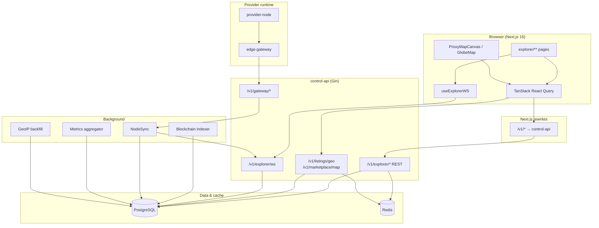
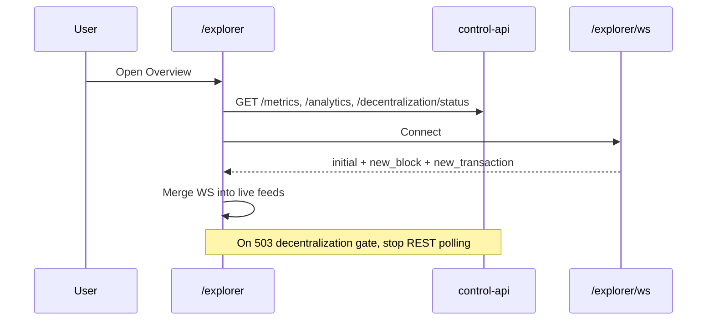
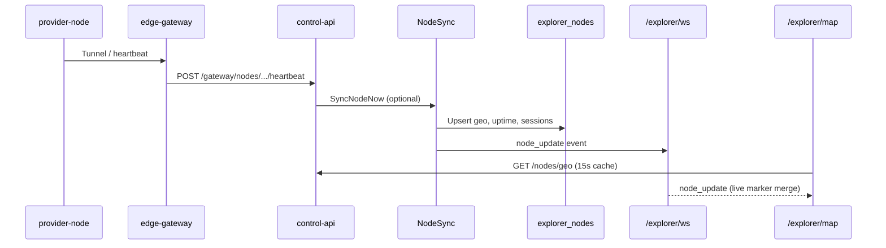
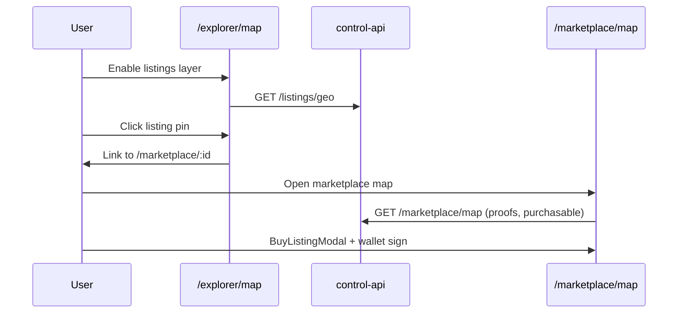
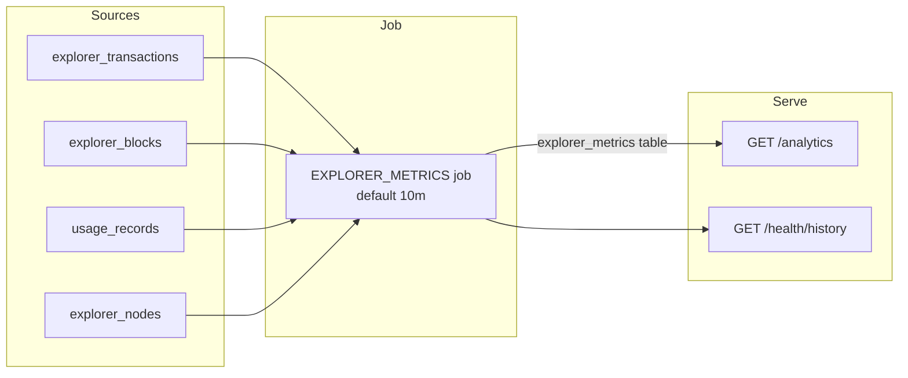

# ProxyHubb Explorer System — Comprehensive Analysis Report

**Document version:** 1.0  
**Report date:** 2026-06-03  
**Repository:** `proxyhubb`  
**Scope:** End-to-end Explorer (frontend, control-api, data pipelines, map, marketplace overlap)  
**Audience:** Engineering, product, and stakeholders reviewing Explorer quality and roadmap  

**Related docs:**

| Document | Focus |
|----------|--------|
| [../EXPLORER_IMPLEMENTATION_PLAN.md](../EXPLORER_IMPLEMENTATION_PLAN.md) | Phased remediation (P0–P4) |
| [../EXPLORER_REFRESH_STRATEGY.md](../EXPLORER_REFRESH_STRATEGY.md) | WS vs REST vs metrics job semantics |
| [../EXPLORER_VERIFICATION.md](../EXPLORER_VERIFICATION.md) | Release checklist |
| [../PROJECT_STATE.md](../PROJECT_STATE.md) | Live project status |
| [COMPREHENSIVE_SYSTEM_ANALYSIS_REPORT.md](./COMPREHENSIVE_SYSTEM_ANALYSIS_REPORT.md) | Whole-platform analysis |

---

## Table of contents

1. [Executive summary](#1-executive-summary)
2. [Explorer role inside ProxyHubb](#2-explorer-role-inside-proxyhubb)
3. [Features and functionalities](#3-features-and-functionalities)
4. [Architecture](#4-architecture)
5. [Structure and navigation design](#5-structure-and-navigation-design)
6. [System workflows](#6-system-workflows)
7. [Map subsystem (2D / 3D)](#7-map-subsystem-2d--3d)
8. [Integration with marketplace and proxy runtime](#8-integration-with-marketplace-and-proxy-runtime)
9. [Pros and cons](#9-pros-and-cons)
10. [Weaknesses, gaps, and risks](#10-weaknesses-gaps-and-risks)
11. [Recommended fixes and enhancements](#11-recommended-fixes-and-enhancements)
12. [Prioritized improvement backlog](#12-prioritized-improvement-backlog)
13. [Appendix](#13-appendix)

---

## 1. Executive summary

The **ProxyHubb Explorer** is a **public, read-mostly** product surface in the Next.js web app (`apps/web`) backed by **control-api** (`services/control-api`). It combines:

- A **chain-style explorer** (blocks, transactions, wallets, contracts) indexed from Solana.
- **Network telemetry** (provider nodes, validators, sessions, bandwidth, health, leaderboards).
- A **geo map** (2D Leaflet + 3D globe) with optional marketplace listing overlays.
- **Decentralization trust UI** (multi-writer quorum, writer health, trust badge).

Access is **unauthenticated by design**: all `/explorer/*` routes use navigation policy `public`, and middleware skips JWT checks for those paths. Purchase flows are **not** embedded in the Explorer map; users are linked to `/marketplace/*` where wallet auth and `BuyListingModal` live.

**Maturity (subjective):** **7.5 / 10** — broad feature coverage and a credible architecture, with known gaps around metrics truthfulness, dead UI modules under `explorer/map/`, nav inconsistency, feature-flagged sessions/earnings, and split map/buy experiences between Explorer and Marketplace maps.

---

## 2. Explorer role inside ProxyHubb

```text
┌─────────────────────────────────────────────────────────────────┐
│                     ProxyHubb product (apps/web)                 │
├──────────────┬──────────────┬──────────────┬────────────────────┤
│  Marketplace │   Explorer   │    Wallet    │  Trustless / etc.  │
│  (commerce)  │ (transparency│  (payments)  │  (usage proofs)    │
│              │  + telemetry)│              │                    │
└──────┬───────┴──────┬───────┴──────┬───────┴─────────┬──────────┘
       │              │              │                 │
       └──────────────┴──────────────┴─────────────────┘
                              │
                    control-api /v1/*
                              │
       ┌──────────────────────┼──────────────────────┐
       │                      │                      │
  PostgreSQL              Redis cache          edge-gateway
  (explorer_*,            (short TTL)          (node heartbeats
   listings, nodes)                             → NodeSync)
```

| Concern | Explorer | Marketplace map | edge-gateway |
|---------|----------|-----------------|--------------|
| Primary goal | Transparency, ops visibility, trust | Discovery + purchase | Proxy traffic |
| Auth | Public read | Browse public; buy needs wallet | Gateway secret |
| Node geography | `explorer_nodes` via NodeSync | Join listings + nodes + proofs | Registers `nodes` |
| Real-time | WebSocket `/v1/explorer/ws` | Polling + cache invalidation | Heartbeats |

The Explorer supports the product narrative (“decentralized network you can inspect”) without sitting on the **data plane** proxy path.

---

## 3. Features and functionalities

### 3.1 Global shell (`/explorer/*`)

| Feature | Description |
|---------|-------------|
| Shared layout | Sticky sub-nav (13 tabs), breadcrumbs, error boundaries, desktop sidebar + mobile tab bar |
| Trust badge | `ExplorerTrustBadge` from `GET /v1/explorer/decentralization/status` |
| Public access | No login; optional JWT ignored for reads |
| Search routing | `buildExplorerSearchPath()` auto-detects block / tx / wallet / node / contract |

### 3.2 Overview — `/explorer`

| Feature | Data source |
|---------|-------------|
| KPI cards | `GET /v1/explorer/metrics`, analytics sparklines |
| Live transactions & blocks | REST + WebSocket (`new_transaction`, `new_block`) |
| Decentralization panel | `/decentralization/status`, `/decentralization/writers` |
| Full-decentralization gate | On 503, UI pauses polling (honest degradation) |
| Global search bar | Client routing to detail pages |

### 3.3 Blocks — `/explorer/blocks`, `/explorer/blocks/[number]`

| Feature | Notes |
|---------|-------|
| Paginated block list | Filters chain; excludes orphaned blocks in API |
| Block detail | By number or hash; related transactions |
| Search integration | Block number from unified search |

### 3.4 Transactions — `/explorer/transactions`, `/explorer/transactions/[hash]`

| Feature | Notes |
|---------|-------|
| List with filters | Type, status, chain |
| CSV export | Client-side export on list page |
| Detail view | DB first; Solana RPC fallback on API |
| Orphan handling | Public lists exclude `is_orphaned` |

### 3.5 Nodes — `/explorer/nodes`, `/explorer/nodes/[id]`, `/explorer/nodes/compare`

| Feature | Notes |
|---------|-------|
| Server search | `?q=` → `GET /v1/explorer/nodes?q=` |
| Client sort | Uptime, bandwidth, sessions, heartbeat |
| Type filter | Validator vs proxy |
| Compare (up to 3) | `/explorer/nodes/compare?ids=a,b,c` |
| Pagination | 20 per page |
| Privacy | Public DTO strips provider IDs, IP, internal usernames |

### 3.6 Wallets — `/explorer/wallets`, `/explorer/wallets/[address]`

| Feature | Notes |
|---------|-------|
| Address lookup form | Validates format |
| Balances & activity | `GET /v1/explorer/wallets/:address` |
| Transaction history | Paginated wallet txs |

### 3.7 Contracts — `/explorer/contracts`, `/explorer/contracts/[address]`

| Feature | Notes |
|---------|-------|
| Registry list | Indexed programs |
| Detail | ABI / source when available |

### 3.8 Sessions — `/explorer/sessions`

| Feature | Notes |
|---------|-------|
| Active/historical proxy sessions | **API returns 404 unless** `EXPLORER_PUBLIC_SESSIONS_ENABLED=true` |
| CSV export | When enabled |

### 3.9 Earnings — `/explorer/earnings`

| Feature | Notes |
|---------|-------|
| Provider earnings leaderboard + charts | **API returns 404 unless** `EXPLORER_PUBLIC_EARNINGS_ENABLED=true` |

### 3.10 Analytics — `/explorer/analytics`

| Feature | Notes |
|---------|-------|
| Time-series charts | Periods: `1h`, `24h`, `7d`, `30d` |
| Embedded leaderboard snippet | Shared with leaderboard page |
| Metrics unavailable banner | When `explorer_metrics` job has no rows |

### 3.11 Health — `/explorer/health`

| Feature | Notes |
|---------|-------|
| Network health snapshot | Solana RPC + DB signals |
| Historical health | `GET /v1/explorer/health/history` (metrics job dependent) |

### 3.12 Leaderboard — `/explorer/leaderboard`

| Feature | Notes |
|---------|-------|
| Categories | Uptime, bandwidth, sessions |
| Period selector | Tied to API `GET /v1/explorer/leaderboard` |

### 3.13 Search — `/explorer/search`

| Feature | Notes |
|---------|-------|
| Auto-detect query kind | Tx signature, wallet, block, node id, contract |
| Manual type override | User can force kind |
| Inline fetch | Direct API calls per kind |
| Suggestions | Recent txs/blocks when idle |

### 3.14 Node map — `/explorer/map`

| Feature | Notes |
|---------|-------|
| 2D map (default) | `ProxyMapCanvas` (Leaflet + supercluster) |
| 3D globe toggle | `GlobeMap` (react-globe.gl / Three.js) |
| Node markers | `GET /v1/explorer/nodes/geo` (active/validator filters) |
| Listing overlay (2D only) | `GET /v1/listings/geo` |
| Live updates | WebSocket `node_update` (250ms batch merge) |
| Heatmap | Session density hex layer |
| Filters | Region, validators-only, active-only, text search |
| Buy on map | **Link-out only** → `/marketplace/:id` or `/marketplace/map` |
| Coordinate fallback | Country/region centroids when lat/lon ≈ 0 |

### 3.15 Related surfaces (outside `/explorer`)

| Route | Relationship |
|-------|----------------|
| `/marketplace/map` | Full buy flow, bbox filter, listing-offer proofs, `BuyListingModal` |
| `/leaderboards` | Reuses `getNodes()` from explorer service |
| `/dashboard/trustless` | Usage proofs (not part of Explorer UI) |

---

## 4. Architecture

### 4.1 Logical layers



### 4.2 Frontend architecture

| Layer | Technology | Responsibility |
|-------|------------|----------------|
| Routing | Next.js App Router | File-based routes under `app/explorer/` |
| Data fetching | React Query | Per-page queries, `refetchInterval` 10–60s |
| Live data | Custom WebSocket hook | Merge into local state on dashboard/map |
| Styling | Tailwind + shared glass/card components | Consistent with rest of app |
| Charts | Recharts | Analytics, health, earnings, overview |
| 2D map | Leaflet (imperative), supercluster | Clustering, heatmap, listing pins |
| 3D map | react-globe.gl, Three.js | Globe layers, hex bins, auto-rotate |
| State | Mostly local `useState` | No global explorer store (by design) |
| Errors | `explorer-errors.ts` + `ExplorerErrorState` | Typed API failures, decentralization gate |

**Key client module:** `apps/web/src/lib/services/explorer.ts` — mirrors all `/v1/explorer/*` endpoints with `API_BASE_URL = ''` (relative).

### 4.3 Backend architecture

| Component | Path | Role |
|-----------|------|------|
| Explorer REST | `internal/api/explorer.go` | Handlers, rate limits, Redis cache, public DTO redaction |
| Explorer WS | `internal/api/explorer_ws.go` | Hub, topics, client limits, origin check |
| Marketplace geo | `internal/api/marketplace_geo.go` | Listing pins, unified map, bbox, proof fields |
| Cache invalidation | `internal/api/marketplace_cache.go` | Clears geo/map keys on listing/node changes |
| Node sync | `internal/indexer/node_sync.go` | `provider_nodes` → `explorer_nodes`, GeoIP, WS notify |
| Gateway | `internal/api/gateway.go` | edge-gateway register/heartbeat → immediate sync |
| Models | `internal/models/explorer.go` | Blocks, txs, nodes, metrics, attestations |
| Workers | `main.go` registration | Indexer, NodeSync, metrics, GeoIP (env-gated) |

### 4.4 Authentication and authorization

| Surface | Requirement |
|---------|-------------|
| All `/v1/explorer/*` GET | Optional auth; reads work without JWT |
| `/v1/explorer/ws` | Public; production origin check via `APP_URL` |
| `/v1/listings/geo`, `/marketplace/map` | Public |
| `/v1/gateway/*` | `X-Gateway-Auth` (edge-gateway only) |
| `/v1/provider/*` | JWT (feeds data indirectly) |

Middleware (`apps/web/src/middleware.ts`) resolves policy via `getRoutePolicyForPathname`; explorer keys are all `public` in `policies.ts`.

### 4.5 Caching strategy

| Key pattern | TTL | Endpoint |
|-------------|-----|----------|
| `explorer:metrics:{chain}` | 30s | `/metrics` |
| `explorer:nodes:geo:...` | **15s** | `/nodes/geo` |
| `explorer:analytics:*` | 2m | `/analytics` |
| `explorer:leaderboard:*` | 2m | `/leaderboard` |
| `marketplace:geo:*` | 30s | `/listings/geo` |
| `marketplace:map:*` | 30s | `/marketplace/map` |

**Implication:** Map REST positions can lag live WS updates by up to 15–30s; WS is authoritative for marker color/session hints when connected.

### 4.6 Rate limiting (representative)

| Route group | Limit |
|-------------|-------|
| Explorer REST (default) | 120 req/min per IP |
| `/nodes/geo` | 20 req/min |
| Marketplace geo/map | 30 req/min |
| WebSocket | Max 500 clients, 15 per IP |

---

## 5. Structure and navigation design

### 5.1 Route tree

```text
/explorer                          Overview (dashboard HUD)
/explorer/blocks                   Block list
/explorer/blocks/[number]          Block detail
/explorer/nodes                    Node registry
/explorer/nodes/[id]               Node detail
/explorer/nodes/compare            Side-by-side compare
/explorer/transactions             Transaction list
/explorer/transactions/[hash]      Transaction detail
/explorer/wallets                  Wallet lookup
/explorer/wallets/[address]        Wallet detail
/explorer/contracts                Contract list
/explorer/contracts/[address]      Contract detail
/explorer/sessions                 Sessions (env-gated API)
/explorer/earnings                 Earnings (env-gated API)
/explorer/analytics                Analytics charts
/explorer/health                   Network health
/explorer/leaderboard              Leaderboard
/explorer/search                   Unified search
/explorer/map                      Node map (2D/3D)
```

### 5.2 Navigation inconsistency (design debt)

Two navigation sources exist:

| Source | Items | Missing from other |
|--------|-------|-------------------|
| **Layout tabs** (`explorer/layout.tsx`) | 13 tabs including Leaderboard, Sessions, Earnings | — |
| **Sidebar** (`nav.ts` Explorer section) | 10 items | Leaderboard, Sessions, Earnings |

Users on desktop sidebar may not discover Sessions, Earnings, or Leaderboard without using the horizontal tab bar. **Recommendation:** align sidebar and tabs (see §11).

### 5.3 Component structure

```text
apps/web/src/app/explorer/
├── layout.tsx              # Shell + 13 tabs
├── page.tsx                # Overview
├── blocks/                 # List + [number]
├── nodes/                  # List + [id] + compare
├── transactions/             # List + [hash]
├── wallets/                # Form + [address]
├── contracts/              # List + [address]
├── sessions/               # Session feed
├── earnings/               # Earnings
├── analytics/              # Charts
├── health/                 # Health
├── leaderboard/            # Rankings
├── search/                 # Unified search
└── map/
    ├── page.tsx            # Production map orchestrator
    ├── GlobeMap.tsx        # Production 3D
    ├── LeafletMap.tsx      # Re-export ProxyMapCanvas
    ├── filters/            # Demo / unused in production route
    ├── panel/              # Demo / unused
    ├── globe/              # Legacy globe variants
    ├── examples/           # Storybook-style demos
    └── ...                 # effects, controls, a11y utilities

apps/web/src/components/explorer/
├── ExplorerTrustBadge.tsx
├── ExplorerErrorState.tsx
└── MetricsUnavailableBanner.tsx

apps/web/src/components/map/
├── ProxyMapCanvas.tsx      # Shared 2D engine (explorer + marketplace)
└── types.ts
```

---

## 6. System workflows

### 6.1 Public user browses overview



### 6.2 Node appears on map (provider → UI)



### 6.3 User discovers listing from Explorer map (buy path)



Explorer map is **discovery**; marketplace map is **conversion**.

### 6.4 Search workflow

```mermaid
flowchart TD
  Q[User query] --> D{buildExplorerSearchPath}
  D -->|block number| B[/explorer/blocks/n]
  D -->|tx sig| T[/explorer/transactions/hash]
  D -->|wallet| W[/explorer/wallets/addr]
  D -->|node id| N[/explorer/nodes/id]
  D -->|contract| C[/explorer/contracts/addr]
  D -->|ambiguous nodes| NL[/explorer/nodes?q=]
```

### 6.5 Metrics and analytics truth path



If the job is disabled or empty, UI must show **MetricsUnavailableBanner** or 503 — not fabricated zeros (principle in `EXPLORER_IMPLEMENTATION_PLAN.md`).

---

## 7. Map subsystem (2D / 3D)

### 7.1 Dual-engine design

| Engine | File | Stack | Used when |
|--------|------|-------|-----------|
| 2D | `ProxyMapCanvas.tsx` | Leaflet, CARTO dark tiles, supercluster | `mapMode === 'map'` |
| 3D | `GlobeMap.tsx` | react-globe.gl, Three.js | `mapMode === 'globe'` |

Shared concerns: node coloring (active / validator / offline / selected), WS merge buffer, heatmap from session counts, country centroid fallback (`@/lib/geo/country-coords`).

### 7.2 Data sources on map page

| Layer | API | Refresh |
|-------|-----|---------|
| Nodes | `GET /v1/explorer/nodes/geo` | React Query 60s + WS |
| Listings | `GET /v1/listings/geo` | When layer enabled (2D only) |
| Live | `WS node_update` | 250ms batch |

**Not used on Explorer map:** `GET /v1/marketplace/map` (richer proofs, bbox, purchasable flags) — that powers `/marketplace/map` only.

### 7.3 Unused map UI inventory

Under `app/explorer/map/` there is substantial UI (filters, panels, legacy globes, examples) **not mounted** by production `map/page.tsx`. This increases maintenance cost and confuses contributors.

---

## 8. Integration with marketplace and proxy runtime

| Integration point | Mechanism |
|-------------------|-----------|
| Node registry | `provider_nodes` → NodeSync → `explorer_nodes` |
| Gateway SLA | `nodes` table joined in marketplace geo SQL |
| Listing geo | `proxy_listings` + provider/gateway/explorer linkage |
| Geo provenance | `geo_source`: gps, gateway, explorer, provider, country_centroid |
| Listing offer proofs | On marketplace map points, not explorer listing overlay |
| SLA badges | `sla_source: 'explorer'` in `ListingSlaBadge` when telemetry from explorer index |
| Proxy sessions | `GET /explorer/sessions` (optional public flag) |
| Usage proofs | `/dashboard/trustless` — separate from Explorer |
| edge-gateway | No Explorer HTTP routes; supplies heartbeats only |

---

## 9. Pros and cons

### 9.1 Pros

| Area | Benefit |
|------|---------|
| **Coverage** | Full explorer metaphor: chain data + network ops + map + search in one product area |
| **Public transparency** | No login friction; supports marketing and provider trust |
| **Security posture** | Public DTO redaction, optional sessions/earnings, rate limits, WS caps |
| **Live experience** | WebSocket for blocks, txs, and node updates on dashboard/map |
| **Map quality** | Dual 2D/3D engines, clustering, heatmap, listing overlay |
| **Decentralization story** | Quorum status, writers panel, trust badge, full-mode gate with honest UI pause |
| **Caching** | Redis TTLs reduce DB load on hot endpoints |
| **Separation of concerns** | Explorer read path isolated from proxy data plane |
| **Documentation** | Implementation plan, refresh strategy, verification checklist exist |
| **Test hooks** | Go tests for explorer API, WS, decentralization, public DTOs |

### 9.2 Cons

| Area | Drawback |
|------|----------|
| **Split map experiences** | Explorer map vs marketplace map feature parity gap (buy, proofs, bbox) |
| **Dead code** | Large `explorer/map/*` subtree unused in production |
| **Nav drift** | Sidebar vs layout tabs mismatch |
| **Metrics dependency** | Analytics/health depend on background job; easy to show empty or misleading charts if misconfigured |
| **Geo accuracy** | Centroid fallbacks and GeoIP backfill (45 nodes/min) → imprecise pins |
| **REST/WS duplication risk** | Overview can poll same classes WS already pushes if not careful |
| **Feature flags** | Sessions/earnings tabs visible in UI while API 404 by default |
| **Solana-only chain** | Explorer indexed for Solana; multi-chain not supported |
| **External CDN deps** | Globe textures from unpkg; map tiles from CARTO — offline/CDN failure affects map |
| **No E2E suite dedicated to Explorer** | Route policy spec exists; deep explorer flows less covered than marketplace map e2e |

---

## 10. Weaknesses, gaps, and risks

### 10.1 Correctness and data truth

| ID | Issue | Impact |
|----|-------|--------|
| W1 | Decentralization gate threshold mismatch documented in implementation plan (`MinWritersRequired >= 3` vs default `EXPLORER_MIN_WRITERS=2`) | Unexpected 503 in full-decentralization mode |
| W2 | `explorer_metrics` aggregation job may be off or empty in dev | Flat or empty analytics/health charts |
| W3 | TPS and bandwidth labels require careful reading (`transactions_per_second` is 24h average; cumulative vs period bandwidth) | User misinterpretation |
| W4 | Orphan blocks/txs must stay filtered in all list endpoints | Reorg confusion if leaked |

### 10.2 Security and privacy

| ID | Issue | Impact |
|----|-------|--------|
| W5 | Public explorer is intentionally open — sessions/earnings expose operational data when flags enabled | Needs operator discipline |
| W6 | WebSocket origin check only when `APP_URL` set | Misconfiguration could allow cross-origin WS in prod |
| W7 | Historical concern: wallet `linked_user_id` in public responses (tracked in P0 plan) | Deanonymization if not redacted |

### 10.3 UX and product

| ID | Issue | Impact |
|----|-------|--------|
| W8 | Explorer map cannot complete purchase in-place | Extra clicks; lower conversion |
| W9 | Listing pins on explorer map lack proof/SLA richness of `/marketplace/map` | Weaker trust signals on discovery map |
| W10 | Sidebar missing 3 explorer tabs | Discoverability |
| W11 | Unused map components (filters, panels, demos) | Developer confusion, bundle noise if imported accidentally |
| W12 | 3D mode hides listings layer | Inconsistent discovery on globe view |

### 10.4 Architecture and operations

| ID | Issue | Impact |
|----|-------|--------|
| W13 | NodeSync default ~1 min + 15s geo cache | Stale map vs WS |
| W14 | GeoIP backfill rate-limited (ip-api.com) | Slow coordinate enrichment |
| W15 | Two geo APIs (`/nodes/geo` vs `/marketplace/map`) | Client complexity, cache invalidation coupling |
| W16 | No explorer-specific OpenAPI section in user-facing docs (relies on code + internal reports) | Integrator friction |
| W17 | edge-gateway failure degrades node freshness | Empty or inactive markers |

### 10.5 Testing and quality

| ID | Issue | Impact |
|----|-------|--------|
| W18 | Limited Playwright coverage for full explorer journeys | Regressions in search, compare, gate handling |
| W19 | Map examples not in CI | Bitrot in `explorer/map/examples` |
| W20 | Contract page historically used raw fetch (verification doc flagged) | Inconsistent error handling |

---

## 11. Recommended fixes and enhancements

### 11.1 Must fix (P0 — trust and security)

Aligned with `docs/EXPLORER_IMPLEMENTATION_PLAN.md` Phase 0:

1. **Align decentralization gate** with `EXPLORER_MIN_WRITERS` (remove hardcoded `>= 3` or document required minimum 3).
2. **Ship or gate `explorer_metrics` job** — no fake zero charts; use `MetricsUnavailableBanner` or 503 until data exists.
3. **Complete public DTO redaction** — wallet links, RPC endpoints on writers, provider PII in node/tx lists.
4. **WebSocket policy parity** — same decentralization gate behavior as HTTP; message size limits tested under load.
5. **Exclude orphaned chain rows** from all public list endpoints consistently.

### 11.2 Should fix (P1 — UX cohesion)

1. **Unify navigation** — add Leaderboard, Sessions, Earnings to `nav.ts` Explorer section (or remove from tabs if intentionally hidden).
2. **Sessions/Earnings tabs** — hide in UI when env flags false, or show explanatory empty state linking to operator docs.
3. **Explorer map buy path** — optional embed `BuyListingModal` on listing pin click (feature flag), or prominent CTA copy explaining marketplace map.
4. **Use `/marketplace/map` data on explorer listing layer** when proofs required — or show proof badge on pins via shared component.
5. **Delete or wire unused map modules** — either mount `FilterPanel` / `NodeDetailsPanel` in production or move demos to Storybook and delete dead tree.

### 11.3 Enhancements (P2 — quality and scale)

1. **Consolidate map API** — prefer single `GET /marketplace/map?include_nodes=true` for explorer+listings to one cache key and consistent `geo_source` / proof fields.
2. **BBox on explorer map** — reuse `onBoundsChange` from `ProxyMapCanvas` (already used on marketplace map) for regional listing density.
3. **Reduce REST/WS duplication** on overview per `EXPLORER_REFRESH_STRATEGY.md`.
4. **Self-host or fallback** globe textures and map tiles for air-gapped deploys.
5. **OpenAPI** — document `/v1/explorer/*` and WS protocol in `docs/openapi.yaml`.
6. **E2E** — extend Playwright: overview gate, search routing, node compare, map layer toggle, decentralization badge.

### 11.4 Longer term (P3+)

1. Multi-chain explorer (explicit non-goal today; requires indexer redesign).
2. Mobile-optimized map controls and tab bar overlap fixes.
3. Deep linking from on-chain programs to marketplace listings.
4. Unified “network status” page merging health + decentralization + gateway circuit state.

---

## 12. Prioritized improvement backlog

| Priority | Item | Effort | Outcome |
|----------|------|--------|---------|
| P0 | Decentralization gate vs `EXPLORER_MIN_WRITERS` | S | Predictable full-mode behavior |
| P0 | Metrics job + honest empty states | M | Trustworthy analytics/health |
| P0 | Public DTO redaction audit | S | Privacy compliance |
| P1 | Nav alignment (sidebar ↔ tabs) | S | Discoverability |
| P1 | Hide or implement sessions/earnings tabs | S | No 404 surprises |
| P1 | Prune or integrate dead map UI | M | Lower maintenance |
| P1 | Listing proof badges on explorer map | M | Trust parity with marketplace |
| P2 | Single unified map endpoint for clients | L | Simpler architecture |
| P2 | Explorer map in-place buy (optional) | L | Conversion |
| P2 | Explorer E2E suite | M | Regression safety |
| P3 | Self-hosted map/globe assets | M | Deploy resilience |

**Effort key:** S = ≤0.5 day, M = 1–3 days, L = 3+ days.

---

## 13. Appendix

### 13.1 API endpoint matrix (Explorer client)

| Client function | HTTP | Explorer page(s) |
|-----------------|------|------------------|
| `getExplorerMetrics` | `GET /v1/explorer/metrics` | Overview, Health |
| `getRecentTransactions` | `GET /v1/explorer/transactions` | Overview, Transactions, Search |
| `getTransactionDetails` | `GET /v1/explorer/transactions/:hash` | Tx detail, Search |
| `getBlocks` / `getBlockDetail` | `GET /v1/explorer/blocks` | Blocks, Search |
| `getNodes` | `GET /v1/explorer/nodes` | Nodes, Leaderboard, Overview |
| `getNodeDetail` | `GET /v1/explorer/nodes/:id` | Node detail, Compare, Search |
| `getNodeGeo` | `GET /v1/explorer/nodes/geo` | Map |
| `getWalletDetails` / `getWalletTransactions` | `/wallets/:addr` | Wallets |
| `getContracts` / `getContractDetails` | `/contracts` | Contracts |
| `getNetworkHealth` | `/network/health` | Overview, Health |
| `getHealthHistory` | `/health/history` | Health |
| `getAnalytics` | `/analytics` | Overview, Analytics |
| `getLeaderboard` | `/leaderboard` | Leaderboard, Analytics |
| `getExplorerSessions` | `/sessions` | Sessions |
| `getProviderEarnings` | `/earnings` | Earnings |
| `getExplorerDecentralizationStatus` | `/decentralization/status` | Overview, TrustBadge |
| `getExplorerDecentralizationWriters` | `/decentralization/writers` | Overview |
| `getMarketplaceGeo` | `GET /v1/listings/geo` | Map (listings layer) |

WebSocket: `useExplorerWS` → `/v1/explorer/ws` — message types: `initial`, `new_transaction`, `new_block`, `node_update`.

### 13.2 Critical file index

| Path | Purpose |
|------|---------|
| `apps/web/src/app/explorer/layout.tsx` | Explorer shell, 13 tabs |
| `apps/web/src/app/explorer/page.tsx` | Overview dashboard |
| `apps/web/src/app/explorer/map/page.tsx` | Map orchestration |
| `apps/web/src/app/explorer/map/GlobeMap.tsx` | 3D globe |
| `apps/web/src/components/map/ProxyMapCanvas.tsx` | 2D map engine |
| `apps/web/src/lib/services/explorer.ts` | REST client |
| `apps/web/src/lib/services/explorer-errors.ts` | Error taxonomy |
| `apps/web/src/lib/hooks/useExplorerWS.ts` | WebSocket client |
| `apps/web/src/lib/explorer-search.ts` | Search routing |
| `apps/web/src/lib/navigation/policies.ts` | Public route policies |
| `apps/web/src/middleware.ts` | Auth gate |
| `apps/web/src/app/marketplace/map/page.tsx` | Full buy-on-map |
| `services/control-api/internal/api/explorer.go` | Explorer REST |
| `services/control-api/internal/api/explorer_ws.go` | Explorer WebSocket |
| `services/control-api/internal/api/marketplace_geo.go` | Map/geo SQL |
| `services/control-api/internal/indexer/node_sync.go` | Node projection |
| `config/docker/control-api-explorer.env` | Docker explorer env defaults |

### 13.3 Environment variables (operator reference)

| Variable | Default | Effect |
|----------|---------|--------|
| `EXPLORER_INDEXER_ENABLED` | env-specific | Blockchain indexer |
| `EXPLORER_METRICS_ENABLED` | on in dev | Metrics aggregation job |
| `EXPLORER_METRICS_INTERVAL` | 10m | Job cadence |
| `EXPLORER_PUBLIC_SESSIONS_ENABLED` | **false** | `/sessions` 404 if false |
| `EXPLORER_PUBLIC_EARNINGS_ENABLED` | **false** | `/earnings` 404 if false |
| `FULL_DECENTRALIZATION` | false | Gates most explorer routes |
| `EXPLORER_MIN_WRITERS` | 2 | Quorum threshold |
| `GEOIP_ENABLED` | true | GeoIP backfill worker |
| `NODE_SYNC_INTERVAL_MINUTES` | 1 | NodeSync cadence |
| `EXPLORER_WS_MAX_CLIENTS` | 500 | WS capacity |
| `EXPLORER_WS_MAX_PER_IP` | 15 | WS per-IP limit |

---

## Sign-off

| Role | Name | Date | Notes |
|------|------|------|-------|
| Author | AI analysis (codebase review) | 2026-06-03 | Based on `apps/web` + `services/control-api` |
| Reviewer | | | |
| Product | | | |

---

*End of report.*
