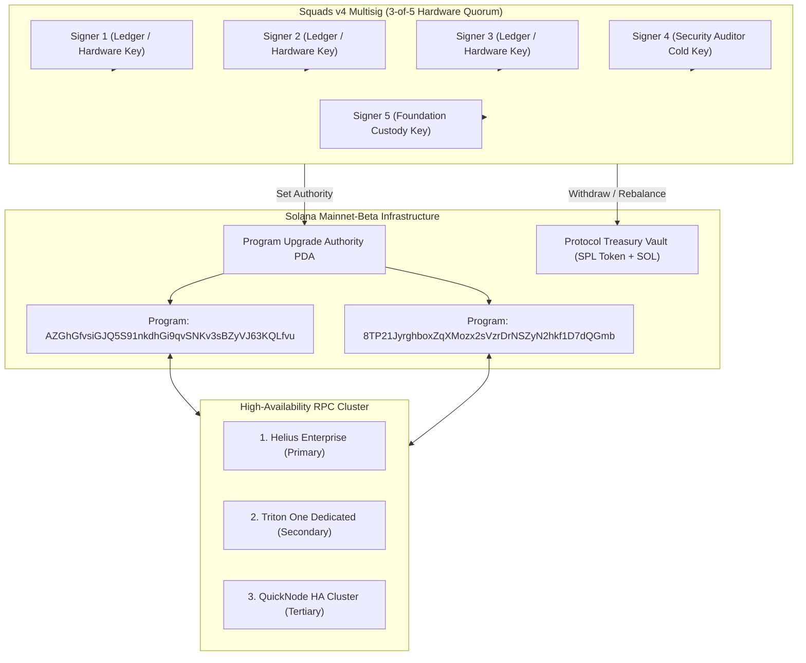

# ProxyHubb Protocol: Mainnet Launch & Multisig Governance Runbook

**Document Classification**: Operational Runbook / Security Standard  
**Target Network**: Solana Mainnet-Beta  
**Smart Contract Program IDs**:  
- Core Protocol & Marketplace: `AZGhGfvsiGJQ5S91nkdhGi9qvSNKv3sBZyVJ63KQLfvu`  
- Session Channels & Escrow: `8TP21JyrghboxZqXMozx2sVzrDrNSZyN2hkf1D7dQGmb`  

---

## 1. Mainnet Architecture Overview



---

## 2. Squads v4 Multisig Deployment & Authority Handover

### Step 1: Initialize Squads v4 Multisig Account
1. Deploy a Squads v4 Multisig instance on Solana Mainnet with:
   - **Threshold**: 3
   - **Total Members**: 5
   - **Execution Timelock**: 48 Hours for program upgrades and parameter updates.
2. Verify all 5 signer addresses correspond to offline hardware wallets (Ledger/YubiKey) distributed across distinct operational regions.

### Step 2: Transfer Smart Contract Upgrade Authority
Execute the upgrade authority handover using the deployer keypair:
```bash
# 1. Transfer Core Program Upgrade Authority to Squads Multisig Vault PDA
solana program set-upgrade-authority \
  AZGhGfvsiGJQ5S91nkdhGi9qvSNKv3sBZyVJ63KQLfvu \
  --new-upgrade-authority <SQUADS_VAULT_PDA_ADDRESS> \
  --keypair deployer-keypair.json \
  --url https://mainnet.helius-rpc.com/?api-key=<KEY>

# 2. Transfer Session Channel Program Upgrade Authority
solana program set-upgrade-authority \
  8TP21JyrghboxZqXMozx2sVzrDrNSZyN2hkf1D7dQGmb \
  --new-upgrade-authority <SQUADS_VAULT_PDA_ADDRESS> \
  --keypair deployer-keypair.json \
  --url https://mainnet.helius-rpc.com/?api-key=<KEY>
```

### Step 3: Verify Authority on Chain
```bash
solana program show AZGhGfvsiGJQ5S91nkdhGi9qvSNKv3sBZyVJ63KQLfvu
solana program show 8TP21JyrghboxZqXMozx2sVzrDrNSZyN2hkf1D7dQGmb
```
*Expected Output*: `Authority: <SQUADS_VAULT_PDA_ADDRESS>` (No longer the deployer hot wallet).

---

## 3. Production RPC High-Availability Cluster

The backend Control API (`services/control-api`) and Edge Gateways (`services/edge-gateway`) maintain an active connection pool across 3 independent RPC providers:

| Priority | Provider | SLA | Use Case |
| :---: | :--- | :---: | :--- |
| **1 (Primary)** | Helius Enterprise | 99.99% | Real-time state channel settlements & priority fees |
| **2 (Secondary)** | Triton One Dedicated | 99.95% | Automatic failover during Solana network congestion |
| **3 (Tertiary)** | QuickNode Dedicated | 99.95% | Epoch Proof-of-Bandwidth mining reward emissions |

---

## 4. Key Custody & Cloud KMS Architecture

Oracle settlements and operator signing keys are isolated via **GCP Cloud KMS** hardware security modules:

1. **Envelope Encryption**: Control API holds only ephemeral data keys; the Master Key never leaves Google Cloud KMS HSM (FIPS 140-2 Level 3 certified).
2. **HKDF Salt Isolation**: Different cryptographic contexts (escrow settlement vs node heartbeats) derive unique keys via HKDF-SHA256 with distinct salt contexts.
3. **Key Rotation Schedule**: Automatic 90-day cryptographic key rotation in Google Cloud KMS with backward-compatible signature verification.

---

## 5. Protocol Invariant & Slashing Guardrails

| Invariant Parameter | Mainnet Invariant Bound | Governance Rule |
| :--- | :--- | :--- |
| **Protocol Marketplace Fee** | Hardcapped at **500 bps (5.0%)** | Cannot exceed 500 bps even with DAO vote |
| **Minimum Gateway Stake** | **10 SOL** | Required to register an active edge gateway |
| **Slashing Timelock** | **72 Hours (259,200s)** | Operator may submit counter-proofs before slashing executes |
| **Escrow State Channels** | $\sum P_{seller} + R_{buyer} \equiv A_{deposit}$ | Zero-leak math verified by automated tests |

---

## 6. Incident Response & Circuit Breakers

If abnormal latency or an exploit attempt is detected:
1. **Emergency Pause**: The Squads Multisig or designated Security Sentinel PDA can trigger `set_emergency_pause(true)` to freeze new escrow deposits while allowing existing buyers to settle or withdraw.
2. **Post-Mortem & Timelock**: Fixes are committed to GitHub, audited, compiled deterministically via `.github/workflows/anchor-verify.yml`, and submitted for 3-of-5 Squads approval with a 48-hour timelock.
