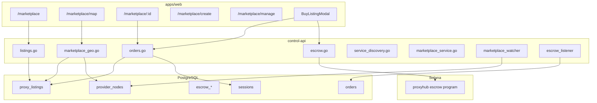
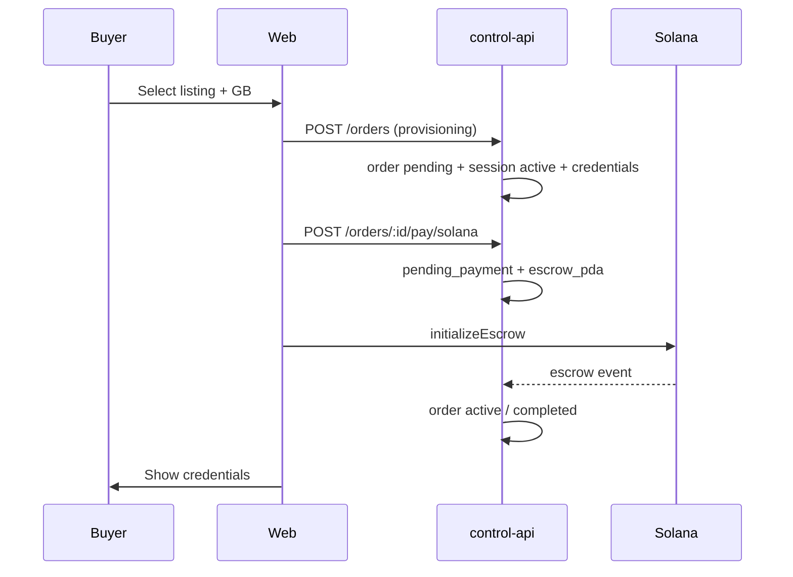
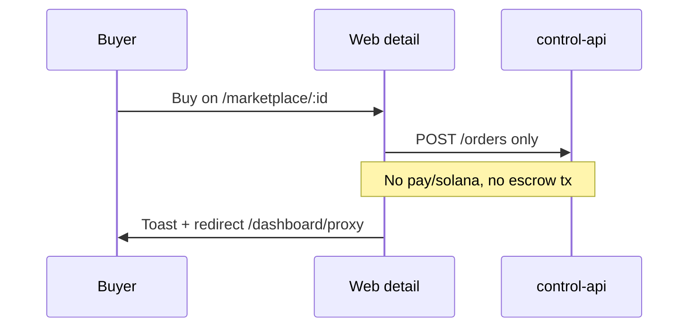
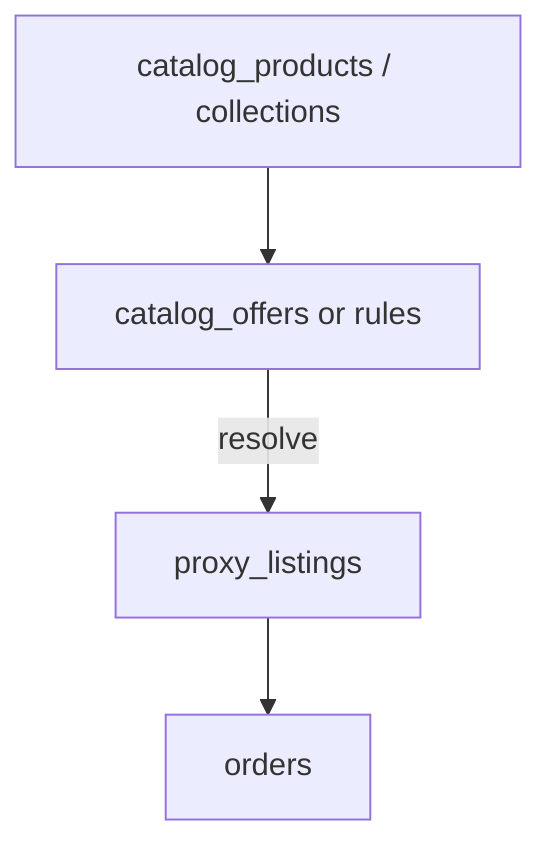

# ProxyHubb Marketplace System — Comprehensive Analysis

**Document version:** 1.0  
**Report date:** 2026-06-03  
**Scope:** Bandwidth marketplace (`proxy_listings`, orders, escrow, discovery UI) and adjacent surfaces (agents, service discovery, subscriptions)  
**Audience:** Product, engineering, and architecture planning for next-phase marketplace work  

**Companion documents:**

| Document | Focus |
|----------|--------|
| [PROJECT_STATE.md](../PROJECT_STATE.md) | Canonical live progress (D1–D4, map buy E2E) |
| [COMPREHENSIVE_SYSTEM_ANALYSIS_REPORT.md](./COMPREHENSIVE_SYSTEM_ANALYSIS_REPORT.md) | Whole-platform architecture and features |
| [IMPROVEMENTS_AND_ROADMAP.md](./IMPROVEMENTS_AND_ROADMAP.md) | Recent wins and cross-cutting backlog |
| [openapi.yaml](../openapi.yaml) | HTTP contract for `/v1` |

---

## Table of contents

1. [Executive summary](#1-executive-summary)
2. [What “marketplace” means in ProxyHubb](#2-what-marketplace-means-in-proxyhubb)
3. [Current architecture](#3-current-architecture)
4. [Product catalog and commercial model](#4-product-catalog-and-commercial-model)
5. [End-to-end flows](#5-end-to-end-flows)
6. [Issues currently affecting the system](#6-issues-currently-affecting-the-system)
7. [Areas that require work](#7-areas-that-require-work)
8. [Aspects that could be improved](#8-aspects-that-could-be-improved)
9. [Elements to remove](#9-elements-to-remove)
10. [Elements to add](#10-elements-to-add)
11. [Strategic directions](#11-strategic-directions)
12. [Recommended phased plan](#12-recommended-phased-plan)
13. [Verification and success metrics](#13-verification-and-success-metrics)
14. [Key file index](#14-key-file-index)

---

## 1. Executive summary

ProxyHubb’s marketplace is a **decentralized bandwidth catalog**: sellers publish **`proxy_listings`** tied to **`provider_nodes`**; buyers discover via grid, full-text search, and a **unified geo map**; purchases flow through **`orders`**, **Solana escrow**, and **proxy sessions** on the edge gateway. **Phase 0 (commerce safety)** and **Phase 1 (core marketplace UX)** from [§12](#12-recommended-phased-plan) are implemented; remaining work is discovery consolidation, moderation, and optional catalog architecture ([§12 Phase 2+](#phase-2--catalog--discovery-4-8-weeks)).

There is **no separate SKU/product-catalog service**. Listings *are* the catalog. **`subscription_plans`** govern seller limits and SaaS features, not buyer-facing product SKUs. A second “marketplace” (**AI agents** under `/marketplace/agents`) shares navigation but not data model.

**Resolved in Phase 0–1 (2026-06):**

1. **Unified buy path** — grid, map, and listing detail use **`BuyListingModal`** (escrow + credential polling); detail no longer calls `createOrder` alone.
2. **Session gating** — sessions start **`disabled`**; credentials via **`GET /v1/orders/:id/credentials`** after escrow confirms ([MARKETPLACE_CREDENTIAL_GATING.md](../MARKETPLACE_CREDENTIAL_GATING.md)).
3. **Wallet pre-check** — `createOrder` uses USD→SOL conversion consistent with escrow pay.
4. **Listing limits** — enforced on **`POST /v1/listings`** per subscription tier.
5. **Frontend client drift** — provider analytics use `@/lib/api/marketplace`; legacy `market.ts` is deprecated (no remaining imports).

**Still open (Phase 2+):**

- **Overlapping discovery APIs** (`/v1/listings` vs `/v1/services`) and deeper **`marketplace_service`** consolidation.
- **Facets, collections, moderation MVP**, and optional buyer subscription SKUs.

For planning, three viable strategies are outlined in [§11](#11-strategic-directions): **incremental hardening** (recommended near term), **architecture upgrade** (unified commerce domain + catalog layer), or **full redesign** (only if product scope changes materially).

---

## 2. What “marketplace” means in ProxyHubb

| Surface | Primary entities | Buyer intent |
|---------|------------------|--------------|
| **Bandwidth marketplace** | `proxy_listings`, `orders`, `escrow_*`, `sessions` | Buy metered proxy capacity from a seller |
| **Geo map** | Same listings + `provider_nodes` telemetry | Discover by location/SLA; buy from pin |
| **Service discovery** | Queries listings/nodes with filters | Programmatic / alternate discovery |
| **Agent marketplace** | `market_agents`, `agent_instances` | Rent AI agents (orthogonal product) |
| **Subscriptions** | `subscription_plans`, `user_subscriptions` | Seller tier limits, platform SaaS (not listing SKUs) |
| **Provider storefront** | `/providers/[id]` + seller’s listings | Social/trust layer on catalog |

**Explicit non-goals in current code:** fiat checkout (removed), EVM marketplace relayer (decommissioned), default admin marketplace moderation API (admin route redirects).

---

## 3. Current architecture

### 3.1 Layered view



### 3.2 Backend structure

| Concern | Location | Notes |
|---------|----------|-------|
| HTTP handlers | `services/control-api/internal/api/listings.go`, `orders.go`, `escrow.go`, `marketplace_geo.go`, `listing_social.go`, `matching.go` | Mix of legacy handlers and newer domain service |
| Domain + ports | `internal/core/domain/marketplace.go`, `internal/core/ports/marketplace.go` | Hexagonal slice for listings |
| Repository | `internal/db/marketplace_repository.go` | Persistence for domain listings |
| Service | `internal/core/services/marketplace_service.go` | Browse/publish/save; not all paths use it yet |
| Models | `internal/models/listing.go`, `order.go`, `escrow.go` | GORM models |
| Workers | `internal/worker/marketplace_watcher.go`, `escrow_listener.go` | NATS heartbeats → map cache; chain → order status |
| Schema | `migrations/000003b_core_marketplace_tables.up.sql` + `000036`, `000087`, `000091`, `000090` | FTS, `provider_node_id`, proofs, saved listings |

**Schema authority:** numbered SQL migrations (not Prisma). GORM AutoMigrate is disabled in production paths.

### 3.3 Frontend structure

| Concern | Location |
|---------|----------|
| API module (canonical) | `apps/web/src/lib/api/marketplace.ts` |
| Buy flow (full) | `apps/web/src/components/BuyListingModal.tsx` |
| Buy flow (thin) | `apps/web/src/app/marketplace/[id]/page.tsx` |
| Browse | `apps/web/src/app/marketplace/page.tsx` |
| Map | `apps/web/src/app/marketplace/map/page.tsx` + `ProxyMapCanvas` |
| Sell | `apps/web/src/app/marketplace/create/page.tsx`, `manage/page.tsx` |
| Proofs | `apps/web/src/lib/proofs/listing-offer.ts` |
| E2E | `apps/web/e2e/marketplace-map-buy*.spec.ts`, `marketplace-map-proof.spec.ts` |

**State:** mostly local React state; TanStack Query on map/manage/agents; `useListings` / `useOrders` hooks exist but browse/detail do not use them.

### 3.4 Discovery and telemetry

- **Full-text search** on listings (`000036_listing_fulltext_search`).
- **Unified map endpoint:** `GET /v1/marketplace/map` (bbox, filters, SLA from gateway/explorer/provider).
- **Marketplace watcher** updates Redis discovery cache from provider heartbeats (NATS).
- **Pricing engine** (`internal/api/pricing_engine.go`) can adjust displayed fair price when serving listings.

---

## 4. Product catalog and commercial model

### 4.1 Catalog today = listings

There is **no** central product catalog table (no SKUs, variants, or platform-curated packages). Commercial attributes live on each row in **`proxy_listings`**:

- Unit economics: `price_per_gb`, `min_purchase_gb`, `bulk_discounts`
- Capacity: `available_bandwidth_gb`, `max_concurrency`
- Geo/commercial metadata: `country`, `isp`, `proxy_type`, `protocol`
- Trust: `quality_score`, proofs (`listing_offer_verified`), link to `provider_node_id`
- Lifecycle: `status` (`active`, `paused`, `sold_out`, …)

**Implication:** “Catalog integration” means **how listings relate to nodes, plans, packages, and discovery**—not wiring to an external PIM.

### 4.2 Subscriptions (seller-side catalog policy)

`subscription_plans` defines **`listing_limit`**, bandwidth caps, and feature flags. `CheckSubscriptionLimits(userID, "listings")` exists in `subscriptions.go` but is **not invoked** from `createListing` (only `teams` limit uses the helper). Sellers can exceed plan limits until this is wired.

### 4.3 Packages and circles

- **Bulk discounts** are JSON on the listing (`bulk_discounts`).
- **Circles** can pool bandwidth (`circle_id` on listing) — a form of grouped supply, not a buyer catalog.

### 4.4 Agents (separate catalog)

`market_agents` / `/v1/agents` is a **different product** with rent/execute flows. UI lives under `/marketplace/agents` which confuses IA and analytics.

---

## 5. End-to-end flows

### 5.1 Intended flow (map / grid + `BuyListingModal`)



### 5.2 Alternate flow (listing detail page — problematic)



### 5.3 Seller flow

1. Provider registers node (`provider_nodes`) with signed heartbeats (D1).
2. **`/marketplace/create`** — form + optional signed listing offer (wallet or dev signing).
3. Listing stored; proof verified under `PROVIDER_SIGNATURE_MODE=enforce` when configured.
4. **`/marketplace/manage`** — list and delete only (no edit/pause in UI).

### 5.4 Settlement (D4)

Session completion → usage proof → escrow settlement (wired per PROJECT_STATE; staging validation still open).

---

## 6. Issues currently affecting the system

Issues are grouped by severity. Each item includes **impact** and **primary evidence**.

### 6.1 P0 — Correctness, trust, and revenue

| # | Issue | Impact | Evidence |
|---|--------|--------|----------|
| P0-1 | **Dual purchase implementations** | Buyers on detail page may get sessions without completing escrow; inconsistent with map/modal; undermines trust-minimized narrative | `[id]/page.tsx` calls `createOrder` only; `BuyListingModal.tsx` uses provisioning + `initiateSmartContractPayment` + `initializeEscrow` |
| P0-2 | **Active session before payment** | Proxy credentials issued while order is `pending`; potential usage without locked funds if gateway does not gate on order/escrow state | `orders.go` `createOrder`: comment says pending until escrow, but `session.Status = SessionActive` in same transaction |
| P0-3 | **SOL balance check uses listing USD math** | False rejections or false approvals at order creation | `wallet.BalanceSOL < requestedTotalPrice` where `requestedTotalPrice = price_per_gb * bandwidth_gb` (typically USD semantics in UI) |
| P0-4 | **Detail page pricing UX** | Misleading unit display (SOL vs USD) vs modal | Detail treats purchase as SOL success message; modal shows `estimatedCostUSD` |
| P0-5 | **Order status contract drift** | Client logic may mis-handle lifecycle (refunds, retries, UI badges) | TS `Order.status` emphasizes `pending`/`paid`; API has `pending_payment`, `disputed`, etc. (`models/order.go`, `marketplace.ts`) |

### 6.2 P1 — Product completeness and policy

| # | Issue | Impact | Evidence |
|---|--------|--------|----------|
| P1-1 | **`listing_limit` not enforced on create** | Subscription plans ineffective for seller caps | `CheckSubscriptionLimits` exists; `createListing` does not call it |
| P1-2 | **No buyer order history UI** | Support burden; buyers cannot track purchases | `getOrders` in API; no marketplace orders page |
| P1-3 | **No saved-listings UI** | `saveListing` only on detail; `marketplaceKeys.saved` unused | API + detail handler only |
| P1-4 | **Seller cannot edit/pause listings in UI** | Stale inventory, manual DB/API fixes | `manage/page.tsx` delete-only; API supports status updates |
| P1-5 | **Browse filter/sort mismatch** | Sort params may not match API (`newest` vs `price`/`rating`/…) | Browse page vs `ListingFilters` in `marketplace.ts` |
| P1-6 | **Service discovery duplication** | Two mental models for “find proxy”; cache keys and filters differ | `service_discovery.go` vs `listings` + `marketplace_geo` |
| P1-7 | **Agents under marketplace nav** | User confusion; metrics blend unrelated products | `/marketplace/agents` vs `proxy_listings` |
| P1-8 | **Legacy API clients** | Divergent order/payment behavior if imported | `lib/services/market.ts`, `lib/social-api.ts` vs `marketplace.ts` |
| P1-9 | **Marketing vs product mismatch** | Trust/compliance risk | Landing copy references removed fiat (e.g. MoMo) while wallet is SOL-only (`000088`) |
| P1-10 | **No marketplace admin/moderation** | Fraudulent listings, disputes need ops SQL | `ROUTES.dashboardAdmin` redirects away |

### 6.3 P2 — Architecture and maintainability

| # | Issue | Impact | Evidence |
|---|--------|--------|----------|
| P2-1 | **Partial hexagonal adoption** | Some listing paths bypass `marketplace_service` | Handlers in `listings.go` vs domain service |
| P2-2 | **Field naming drift** | Map pins vs detail may show inconsistent node linkage | `provider_node_id` (API) vs `node_id` (frontend `Listing`) |
| P2-3 | **Decommissioned relayer artifacts** | Confusion for contributors | `services/relayer/`, Ethereum bindings |
| P2-4 | **`PaymentMethod` still allows `"fiat"` in model** | Dead enum value | `order.go` comment vs migration `000088` |
| P2-5 | **ZK reputation verify stub on client** | Smart match may show false confidence | `verifyReputationProof` in marketplace API module |
| P2-6 | **OpenAPI / handler drift risk** | Integrators hit undocumented behavior | Large handler surface; periodic audit needed |

### 6.4 Operational / staging (marketplace-adjacent)

| # | Issue | Notes |
|---|--------|-------|
| OP-1 | Live devnet map-buy requires secrets + funded wallet | Harness exists; not default CI |
| OP-2 | Enforce-mode listing create in Docker | UI + `PROXYHUB_PROVIDER_SIGNING_KEY` alignment still on checklist ([IMPROVEMENTS_AND_ROADMAP.md](./IMPROVEMENTS_AND_ROADMAP.md)) |
| OP-3 | D4 settlement proof on staging | Session → proof → oracle path needs sign-off |

---

## 7. Areas that require work

These are **necessary** for a coherent marketplace, independent of strategic direction.

### 7.1 Commerce integrity (must-do)

1. **Single canonical purchase pipeline** — all UI entry points call the same orchestration (order → escrow → credential reveal policy).
2. **Gate session/credential issuance** — align with `pending_payment` → `active` only after escrow listener confirms (or explicit feature-flagged mock for E2E).
3. **Fix wallet pre-check** — either convert `TotalPrice` to SOL via price oracle (as `pay/solana` does) or compare against USD ledger field if one exists.
4. **Align TypeScript order types** with backend enum set.

### 7.2 Seller lifecycle

1. Wire **`CheckSubscriptionLimits(..., "listings")`** into `createListing` (and optionally re-activate on un-delete).
2. **Edit listing** (price, bandwidth, pause, status) in manage UI + API.
3. **Inventory sync** — decrement `available_bandwidth_gb` on purchase; handle sold_out transitions.

### 7.3 Buyer lifecycle

1. **Orders page** — list, filter, cancel, link to session/credentials, escrow status.
2. **Saved listings** collection page.
3. **Dispute entry** from order detail (escrow APIs exist).

### 7.4 Discovery consolidation

1. Decide **canonical discovery API** for external integrators (`/listings` + map vs `/services`).
2. Document filter/sort contract in OpenAPI; fix browse UI to match.
3. Complete **`ProxyMapPoint`** DTO cleanup across explorer and marketplace (per roadmap).

### 7.5 Testing

1. Extend E2E to **listing detail buy** (or remove buy button until fixed).
2. Integration test: **createOrder → pay/solana → escrow listener → active** (mocked chain).
3. Unit test: subscription limit enforcement on create.

---

## 8. Aspects that could be improved

Improvements that are valuable but not blocking basic correctness.

| Area | Improvement | Benefit |
|------|-------------|---------|
| **Data fetching** | Use TanStack Query (`useListings`, `useListing`, `useOrders`) on browse/detail | Consistent cache, fewer duplicate fetches |
| **Search UX** | Expose country, price range, min rating on browse (state exists partially) | Better conversion on large catalogs |
| **Featured / tiers** | Surface `getFeaturedListings`, seller tiers on browse | Merchandising |
| **Social proof** | Expand Q&A, inquiries, reviews on detail (APIs in `listing_social.go`) | Trust |
| **Smart match** | Backend-verify ZK proofs; clearer CTA into buy modal | Differentiation |
| **Pricing** | Show fair-price engine output, bulk discount calculator in modal | Transparency |
| **Map** | Single mental model: explorer defers buy to marketplace map (partially done) | Less navigation friction |
| **Provider storefront** | Stronger link from listing → provider profile → other listings | Seller discovery |
| **Performance** | Listing list caching (`marketplace_cache.go`); CDN for static seller avatars | Scale |
| **i18n / currency display** | Explicit USD list price + SOL settlement estimate | Clarity |
| **Observability** | Marketplace funnel metrics (view → save → order → escrow confirm) | Product analytics |
| **Hexagonal completion** | Route all listing mutations through `marketplace_service` | Testability |

---

## 9. Elements to remove

| Item | Rationale | Action |
|------|-----------|--------|
| **Listing detail direct `createOrder` buy** | Bypasses escrow; duplicate logic | Remove button or delegate to `BuyListingModal` |
| **`lib/services/market.ts` duplicate client** | Drift risk | Deprecate; migrate imports to `marketplace.ts` |
| **Unused `ListingCard` on browse page** | Dead import | Delete import or component usage |
| **Share button stub on detail** | No-op harms trust | Remove or implement |
| **Ethereum relayer service** | Decommissioned | Archive or delete from default builds; keep docs note |
| **Fiat payment method enum / copy** | Product is SOL-only | Remove from models and marketing pages |
| **“CREATE AGENT” dead button** | Broken UX on agents page | Wire route or hide |
| **Admin nav entry that redirects** | False promise of moderation | Hide until admin marketplace tools exist |

---

## 10. Elements to add

### 10.1 Near-term (supports upgrade path)

| Addition | Description |
|----------|-------------|
| **`PurchaseOrchestrator` (web + API)** | One service/function: validate listing → create order → escrow → credentials policy |
| **Buyer orders & escrow status UI** | Surface `GET /orders`, escrow GET, cancel |
| **Saved listings page** | `GET /saved` consumer |
| **Listing edit / pause** | PATCH listing status and commercial fields |
| **Subscription enforcement** | Call `CheckSubscriptionLimits` on create |
| **Catalog facets API** | `GET /catalog/facets` — countries, ISPs, price histogram (can be SQL view over listings) |
| **Webhook/event bus for orders** | Internal events for analytics (not payment webhooks; KYC only today) |

### 10.2 Medium-term (catalog + platform goals)

| Addition | Description |
|----------|-------------|
| **`catalog_products` + `catalog_offers`** | Optional layer: platform-defined packages (e.g. “5 GB US residential”) mapping to 1..n listings or auto-match rules |
| **Curated collections** | Featured, “verified providers”, geo bundles — merchandising without changing listing schema |
| **Listing versioning** | Price change history for disputes |
| **Moderation queue** | Admin review for new listings under enforce |
| **Reputation binding** | Tie `listing_offer_verified` + seller tier to search ranking (partially present) |
| **Quote API** | `POST /quotes` — price in USD + SOL lamports before order commit |
| **B2B API keys** | Purchase via API with same escrow rules |

### 10.3 Long-term (only if product expands)

| Addition | Description |
|----------|-------------|
| **Secondary market / resale** | Transfer remaining GB on listing |
| **Subscription SKUs for buyers** | Monthly GB bundles separate from seller plans |
| **Cross-chain settlement** | Only if roadmap returns beyond Solana |

---

## 11. Strategic directions

Three paths for leadership review. They are **not mutually exclusive** if phased (harden → upgrade → selective redesign).

### Option A — Upgrade existing architecture (recommended default)

**Thesis:** Keep `proxy_listings` as catalog; fix commerce integrity; deepen integration with nodes, proofs, and subscriptions.

| Pros | Cons |
|------|------|
| Fastest time to trustworthy purchases | Does not solve merchandising at scale alone |
| Leverages D1–D4 investment | Technical debt in dual handlers remains until refactored |
| E2E and map work preserved | |

**Key moves:** canonical buy pipeline, session gating, subscription limits, orders UI, discovery API consolidation.

**Fit when:** Goal is production-ready marketplace on current vision (decentralized proxy bazaar).

---

### Option B — Add catalog layer without full redesign

**Thesis:** Introduce a thin **catalog projection** above listings for product goals (packages, featured sets, SEO landing pages, partner SKUs).



| Pros | Cons |
|------|------|
| Integrates with “product catalog” language stakeholders use | Extra sync rules listing ↔ offer |
| Enables merchandising without per-listing hacks | Requires migration + admin UI |
| Listings remain source of supply truth | |

**Fit when:** Marketing needs packages, tiers, and landing pages; supply stays provider-driven.

---

### Option C — Full marketplace architecture redesign

**Thesis:** Replace ad-hoc handlers with a **Marketplace bounded context**: Listing, Offer, Cart/Quote, Order, Fulfillment (Session), Settlement (Escrow), Discovery (read models).

| Pros | Cons |
|------|------|
| Clean long-term model | Highest cost; delays fixes if done “big bang” |
| Clear boundaries for agents vs bandwidth | Risky during active staging validation |
| Event-sourced order state machine | |

**Suggested only if:** simultaneous launch of buyer subscriptions, multi-asset checkout, or third-party seller API is required in one release.

**Mitigation:** Run **strangler fig** — new `OrderStateMachine` behind existing routes; migrate UI to orchestrator first (Option A), then extract services.

---

### Integration with overall product goals

| Platform goal | Marketplace alignment |
|---------------|----------------------|
| Decentralized supply | Keep `provider_node_id` + proofs on every offer |
| Trust / transparency | Escrow-first buy; usage proofs on completion |
| Discovery / AI | Smart match feeds into single buy modal; avoid second checkout |
| Seller monetization | Enforce plan limits; tiers on listing rank |
| Operator safety | Moderation queue + enforce mode on create |
| Developer ecosystem | One OpenAPI discovery surface; SDK examples for quote → order → pay |

---

## 12. Recommended phased plan

### Phase 0 — Stop the bleeding (1–2 weeks)

- [x] Route **all buys** through `BuyListingModal` (or shared hook); remove or disable detail-page `createOrder`.
- [x] Fix **BalanceSOL vs TotalPrice** check in `createOrder`.
- [x] Document **credential gating policy**; implement server-side session `disabled` until escrow confirms (edge gateway rejects non-`active` sessions — see `docs/MARKETPLACE_CREDENTIAL_GATING.md`).
- [x] Sync **Order TypeScript types** with backend.

### Phase 1 — Complete core marketplace (2–4 weeks)

- [x] Enforce **subscription listing limits** on create.
- [x] **Orders + saved listings** pages (`/marketplace/orders`, `/marketplace/saved`).
- [x] **Listing edit/pause** in manage UI (pause/activate; full edit form still optional).
- [x] Deprecate **`market.ts`** client (provider analytics + legacy barrel now use `@/lib/api/marketplace` / `sessions`).
- [x] E2E: detail + browse + map buy paths (`marketplace-listing-buy`, `marketplace-browse-buy`, `marketplace-map-buy`; shared `marketplace-purchase` stubs with credentials gating).
- [x] Browse **sort/filter** parity with API (country, min/max price, min rating, extended sort options).

### Phase 2 — Catalog & discovery (4–8 weeks)

**Execution scope:** [MARKETPLACE_PHASE2_SCOPE.md](../MARKETPLACE_PHASE2_SCOPE.md) (workstreams WS-A–E, ADRs, sprint order).

- [x] **WS-A:** Canonical **`/v1/listings`**; `/v1/services` → shared discovery wrapper + OpenAPI deprecation ([MARKETPLACE_DISCOVERY_API.md](../MARKETPLACE_DISCOVERY_API.md)).
- [x] **WS-B:** **`GET /v1/listings/facets`** + **collections** API; browse featured strip + facet chips.
- [x] **WS-C:** Moderation MVP — `pending_review` status + admin approve/reject ([MARKETPLACE_MODERATION.md](../MARKETPLACE_MODERATION.md)).
- [x] **WS-D:** Marketplace **funnel events** (view → save → order → escrow → credentials) — [MARKETPLACE_FUNNEL_METRICS.md](../MARKETPLACE_FUNNEL_METRICS.md).
- [x] **WS-E:** Listing **read paths** through `marketplace_service` (`getListing`, featured, search, saved, seller listings) — `internal/db/listing_read_repository.go`, `GetListingForViewer`.

### Phase 3 — Strategic (optional)

- [ ] Option B full catalog tables OR Option C state machine extraction.
- [ ] Buyer subscription SKUs if product requires.
- [ ] Split agents nav to **`/agents`** top-level (IA cleanup).

---

## 13. Verification and success metrics

### 13.1 Definition of done (commerce)

- Every buy path completes **escrow initialization** (or mock flag in CI only).
- No **active session** with live credentials unless order is `pending_payment` or `active` per documented policy.
- **Wallet checks** use consistent USD→SOL conversion.
- **Listing limits** enforced for free and paid plans.

### 13.2 Metrics to track

| Metric | Source |
|--------|--------|
| Listing views → saves → orders | API logs / product analytics |
| Escrow init success rate | Solana tx + `orders.status` transitions |
| Time to credentials | Order created → buyer sees creds |
| Dispute rate | `escrow_disputes` |
| Seller churn | Listings paused/deleted; active sellers |
| Map vs grid conversion | Route + UTM |

### 13.3 Test commands (from project docs)

```powershell
# Marketplace map E2E (mocked buy)
cd apps/web
npm run test:e2e:map

# Provider proofs (supply side)
cd ../..
.\scripts\verify-provider-proofs-docker.ps1

# Staging checklist
# See docs/STAGING_ENFORCE_RUNBOOK.md
```

---

## 14. Key file index

### Database

- `migrations/000003b_core_marketplace_tables.up.sql`
- `migrations/000036_listing_fulltext_search.up.sql`
- `migrations/000087_listing_provider_node_link.up.sql`
- `migrations/000091_provider_proofs.up.sql`
- `migrations/000003e_subscription_plans.up.sql`

### control-api

- `internal/api/listings.go`, `orders.go`, `escrow.go`, `marketplace_geo.go`, `service_discovery.go`, `subscriptions.go`
- `internal/core/services/marketplace_service.go`
- `internal/db/marketplace_repository.go`
- `internal/worker/marketplace_watcher.go`, `escrow_listener.go`
- `internal/models/listing.go`, `order.go`

### apps/web

- `src/lib/api/marketplace.ts`
- `src/components/BuyListingModal.tsx`
- `src/app/marketplace/**`
- `e2e/marketplace-map-buy.spec.ts`

---

## Document history

| Date | Version | Notes |
|------|---------|-------|
| 2026-06-03 | 1.0 | Initial marketplace-focused analysis for planning and architecture review |
| 2026-06-03 | 1.1 | Executive summary aligned with Phase 0–1 completion; browse/map/detail E2E suite green (`npm run test:e2e:map`, 8/8) |
| 2026-06-03 | 1.2 | Phase 2 WS-E complete — listing reads via `marketplace_service` + `listing_read_repository` |

---

*For living operational status, prefer [PROJECT_STATE.md](../PROJECT_STATE.md). For platform-wide context, see [COMPREHENSIVE_SYSTEM_ANALYSIS_REPORT.md](./COMPREHENSIVE_SYSTEM_ANALYSIS_REPORT.md).*
