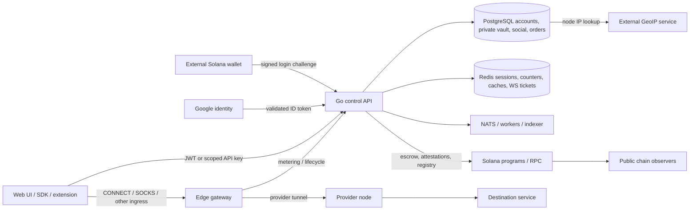

# Proxy Hub account, privacy, identity, and security audit

**Audit date:** 2026-11-03 (Africa/Accra).

**Audited revision:** `b5f47bfb501896884cab41917cbe66b12c900a6c` — `docs: correct program-source finding in mainnet scope (#120)`, committed 2026-11-01.

**State:** detached, isolated worktree; initially clean. This report is the only repository change authorized and made by this audit. No fixes, deployment, publication, push, or pull request were performed.

## 1. Executive assessment

Proxy Hub has meaningful security building blocks, but **the audited implementation does not provide the user-controlled anonymity and privacy model described in the brief**. It combines distributed proxy supply and on-chain settlement with centrally operated authentication, account/profile storage, discovery, messaging, session issuance, and operational infrastructure. Those distinctions should be explicit in the product.

The most urgent verified problems are:

1. **Public P2P signaling allows unauthenticated reads and writes of session rendezvous data**, including supplied ICE candidates, and permits unauthorized answer replacement.
2. **Full account models bypass the restricted public-profile DTO** in messaging, public forum/review responses, and other social responses. Encryption at rest does not prevent exposure: model hooks restore private fields before serialization.
3. **Ordinary account JWTs are disconnected from device-session revocation and account status.** A banned account can obtain a fresh token; the existing MFA-enabled flag does not introduce a login challenge.
4. **Blocking and “not accepting direct messages” are not consistently enforced.** A blocked sender can create a conversation directly.
5. **Map privacy is inconsistent across endpoints.** The newer map coarsens coordinates and omits several identifiers, but legacy geo and explorer responses expose more identity and location data. Separately, the shared map cache can expose seller-only draft catalog metadata to guests.
6. **Privacy choices are largely absent.** There is no enforced account-level choice for anonymous participation, discoverability, map exclusion, presence, activity publication, or analytics participation.

Seven temporary synthetic evidence tests reproduced the relevant insecure behaviors; 66 existing top-level Go tests passed in a focused regression run. These are local results, not evidence of exploitation or of the live deployment's configuration.

**Recommended decision:** treat privacy as an authorization policy shared by every read, write, cache, and realtime path. Approve the default policy and the unavoidable network/on-chain disclosures before implementation. Address the verified access-control and disclosure defects first; these do not require waiting for a complete decentralization redesign.

### Severity and evidence labels

- **High:** substantial identity disclosure, bypass of a promised security boundary, or a core privacy requirement that is currently unmet.
- **Medium:** narrower disclosure, lifecycle failure, misleading behavior, or an operational privacy gap.
- **Verified / reproduced:** observed using synthetic data against production handlers or production model/helper code.
- **Verified / source:** a concrete implementation path is established; no corresponding live exploit was attempted.
- **Design gap:** a requested product capability or trust guarantee is not implemented.
- **Deployment-dependent:** the risky code/default exists; public exposure or runtime activation was not established.

No critical-severity financial exploit or universal anonymity break is asserted.

## 2. Scope, revision drift, and limitations

### Scope

Reviewed the main web application, account/security settings, authentication and refresh flows, public and protected Go route registration, profile/social/messaging responses, marketplace and map projections, proxy credential issuance, provider location handling, GeoIP enrichment, usage/activity records, logging/tracing, deletion/export workers and migrations, the browser extension's proxy configuration, custody code, and selected Solana account structures and decentralization controls.

The method followed requests across UI → client adapter → middleware → handler/service → storage/model hooks → response/cache/WebSocket, rather than treating UI labels or existing reports as proof of enforcement. Existing project audit documents were used for orientation; findings below are grounded in the audited source and local verification.

### Isolated worktree differences

The primary checkout observed during the audit was on `codex/ui-layout-production` at `660f884e2298476a2844d3ce64086f9fc64ed619`, committed 2026-11-03. It is a different line of development: the merge base is `1848cb78a51c5e36b065f98c7a93a3ed5b8252f5`. A comparison against the audited revision showed **476 changed files, 95,906 insertions, and 16,762 deletions**. These are snapshot comparisons, not a claim that every change is relevant to this audit.

In particular, `AccountSettings.tsx`, `api/marketplace_geo.go`, `api/listings.go`, and `models/listing.go` differ. The compared P2P signaling, messaging, forum, reviews, wallet/Google login, auth refresh, user security, GDPR, public-profile DTO, and ordinary JWT middleware files were unchanged between those two revisions when checked. This is useful triage evidence, **not a re-audit of the primary checkout**.

Before implementing or closing findings, reproduce them on the intended implementation branch and reconcile the map/listing/settings changes. No files in the primary checkout or other worktrees were changed. No applicable `AGENTS.md` was found in the worktree or checked parent directories.

### Limits

- No live marketplace account, deployed database, private environment file, production log, provider household, or real wallet was inspected.
- No production network probing, packet capture, transaction submission, external user messaging, or load test was performed.
- Go handlers were tested locally with throwaway PostgreSQL, in-memory Redis where needed, synthetic identities, and test signing material. Google identity validation was stubbed in the existing test helper.
- No browser walkthrough or complete frontend build/typecheck was completed. Frontend/extension script attempts could not start because this worktree lacks TypeScript/esbuild dependencies.
- The Rust gateway/provider paths and Solana structures were inspected selectively. This is not a new formal cryptographic, smart-contract, dependency, or data-plane penetration audit.
- No assumption is made that repository programs match deployed bytecode, that optional federation modes are active, or that multiple gateways have independent administrators.
- Geolocation values are not proof of a home address. “Raw coordinates” below means stored values passed through without the public map's coarsening step.
- Legal compliance was not assessed. “GDPR” is the repository's endpoint/worker naming, not a compliance certification.

## 3. Architecture and data boundaries

### Implemented flow



The diagram separates logical trust boundaries; it does not assert a particular deployed service topology.

### Important observations and invariants

| Flow | Actual boundary and implication | Evidence |
|---|---|---|
| Wallet sign-in | Single-use challenge and Ed25519 verification precede centrally signed JWT issuance. A wallet login is pseudonymous to other users only to the extent that subsequent responses and public artifacts do not link it. | [auth.go:184](../../services/control-api/internal/api/auth.go#L184), [auth_refresh.go:64](../../services/control-api/internal/api/auth_refresh.go#L64) |
| Google sign-in | Identity is keyed by provider subject rather than email. A platform-held Solana wallet is created. The account is identity-linked and custodial. | [auth_google.go:110](../../services/control-api/internal/api/auth_google.go#L110), [custody.go:37](../../services/control-api/internal/custody/custody.go#L37) |
| Public versus authenticated API | Most `/v1` reads receive optional auth. Protected subgroups require an auth context. Individual public handlers still need their own privacy/visibility rules. | [main.go:564](../../services/control-api/main.go#L564), [main.go:623](../../services/control-api/main.go#L623) |
| Private profile vault | Email/tax fields are encrypted separately, then automatically restored by `User.AfterFind`. A restricted DTO is a disclosure boundary; a raw `User` relation crosses it. | [user.go:154](../../services/control-api/internal/models/user.go#L154), [profile_private.go:80](../../services/control-api/internal/models/profile_private.go#L80) |
| Purchase and credentials | The order credential handler checks buyer ownership and eligible order state before returning HMAC proxy credentials. The route is explicitly DB-authoritative. | [orders.go:623](../../services/control-api/internal/api/orders.go#L623), [orders.go:654](../../services/control-api/internal/api/orders.go#L654) |
| Proxy network | The gateway admits a buyer session and selects a provider. Operators necessarily handle network metadata; destinations see the provider's egress address. A buyer can send traffic to a destination they control and observe that address. | [edge main.rs:808](../../services/edge-gateway/src/main.rs#L808), [provider client.rs:90](../../services/provider-node/src/tunnel/client.rs#L90) |
| Metering | The reviewed gateway usage report sends username, byte counts, nonce, and signature. The API binds this to stored session/provider/user state. This path does not itself prove that full browsing histories are recorded. | [metering.rs:650](../../services/edge-gateway/src/metering.rs#L650), [usage.go:187](../../services/control-api/internal/api/usage.go#L187) |
| Chain settlement/identity | Program structures carry public wallet relationships, amounts/usage/timestamps, and KYC status. Hiding a field in the website cannot retract a chain publication. | [session lib.rs:41](../../services/solana-programs/proxyhub/programs/session/src/lib.rs#L41), [proxyhub lib.rs:705](../../services/solana-programs/proxyhub/programs/proxyhub/src/lib.rs#L705) |
| Decentralization mode | `FULL_DECENTRALIZATION` defaults off; marketplace repository and credential access still have central data dependencies. Multiple writers/operators and capability modes exist, but activation and independence were not verified. | [mode.go:10](../../services/control-api/internal/decentralization/mode.go#L10), [marketplace_service.go:9](../../services/control-api/internal/api/marketplace_service.go#L9), [ADR 0013](../adr/0013-federated-session-mint.md) |

The desired privacy invariant should be: **a user's selected audience and consent must govern the same object through direct fetches, lists, search, legacy routes, nested relations, cached responses, notifications, and live updates**. The current implementation has separate protections rather than that system-wide invariant.

### Controls worth preserving

- `ToPublicProfile` excludes email, tax ID, wallet address, ISP, and KYC status; self-profile KYC is distinct. [profile.go:87](../../services/control-api/internal/models/profile.go#L87)
- Auth cookies are HttpOnly and SameSite=Lax; the current web auth layer keeps new access tokens in memory and removes legacy browser-storage tokens. Cookie security still depends on request/environment handling. [auth_refresh.go:256](../../services/control-api/internal/api/auth_refresh.go#L256), [web auth.tsx:127](../../apps/web/src/lib/auth.tsx#L127)
- Refresh tokens are hashed and rotated, with sequential reuse detection. This should be retained while fixing session binding. [auth_refresh.go:139](../../services/control-api/internal/api/auth_refresh.go#L139)
- Provider-node and extension tokens have narrower route/device checks than normal account JWTs. [provider_token_scope.go:25](../../services/control-api/internal/middleware/provider_token_scope.go#L25), [extension_device.go:78](../../services/control-api/internal/middleware/extension_device.go#L78)
- Normal message retrieval checks conversation membership; deletion checks membership and sender ownership. The problems are policy coverage, serialization, and lifecycle behavior, not an assertion that all message IDs are freely readable. [messaging.go:226](../../services/control-api/internal/api/messaging.go#L226), [messaging.go:477](../../services/control-api/internal/api/messaging.go#L477)
- The newer marketplace map rejects unresolved coordinates, uses hubs/centroids, ignores requests for signer proofs, and omits raw seller IDs/ISP. [marketplace_geo.go:235](../../services/control-api/internal/api/marketplace_geo.go#L235), [marketplace_geo.go:742](../../services/control-api/internal/api/marketplace_geo.go#L742)
- The location picker resolves browser coordinates locally to a city; its save API stores country/city. This is a useful minimization pattern. [NodeLocationPicker.tsx:61](../../apps/web/src/components/provider/NodeLocationPicker.tsx#L61), [provider_node_location.go:31](../../services/control-api/internal/api/provider_node_location.go#L31)
- Explorer IP fields are excluded from direct model JSON, and public operational session feeds default off. [models/explorer.go:59](../../services/control-api/internal/models/explorer.go#L59), [explorer.go:1960](../../services/control-api/internal/api/explorer.go#L1960)
- Notification preferences support partial updates and explicit first-save opt-outs. Notification delivery preference must remain distinct from permission to contact someone. [notifications_api.go:158](../../services/control-api/internal/api/notifications_api.go#L158)

## 4. Current user privacy-control matrix

“Absent” means no persisted/enforced control was found in the reviewed account/settings/route paths; it does not mean every imaginable screen was exhaustively inspected.

| User choice | Current control/default | Actual enforcement | Assessment |
|---|---|---|---|
| Remain anonymous or pseudonymous | Profile fields can be edited; no anonymity mode. Wallet accounts initially use `user_<first eight wallet characters>`. | Public IDs, social data, proof signers, activity, and chain relationships remain linkable. | **Absent as a product policy**; A02, A07, A09, A12. |
| Be discoverable or hidden | Provider discovery and public profile lookup are available. | No account audience setting in `User`, `UserSettings`, or profile update request. | **Absent**; A07. |
| Appear on the map | City can be selected; listing/node lifecycle affects eligibility. | Map publication follows listing/node criteria. No independent account/node map consent. Node inclusion can expose eligible nodes without requiring a purchasable listing. | **Absent independent choice**; A07/A09. |
| Control location precision | Main map uses regional hubs/city/country centroids. | Legacy and explorer paths use different projections; stored-coordinate passthrough remains. | **Partial**; A09. |
| Make provider IP public inside the marketplace | Direct listing model has no provider-IP field; explorer IP is hidden. No explicit publication control. | P2P signaling can disclose submitted addresses; geo lookups disclose IP externally. Buyers can observe purchased egress through their own destinations. | **No general anonymity guarantee**; A01/A11/A13. |
| Keep browsing device IP private from other users | No privacy policy for remote profile images. | User-controlled avatar hosts can receive viewer requests. Proxy use may change which egress the host sees. | **Uncontrolled side channel**; A14. |
| Be identified and messaged | Listings default `allow_direct_message=true`. | Inquiry route checks the flag. General conversation creation/sending does not use it. No account contact-mode setting found, and no reviewed owner update path for that flag. | **Inconsistent**; A06. |
| Receive no direct messages | No account-wide “nobody” mode. | Can still be contacted through general conversation API, including after blocking. | **Unavailable**; A06. |
| Block a user | Block/unblock APIs exist. | Public-profile access with that viewer and follow creation check blocks; DM creation, activity, presence, and other surfaces do not consistently do so. Guest reads can still see public content. | **Partial; misleading if treated as privacy isolation**; A06/A08. |
| Hide online/last-seen state | Default `is_online=false`; presence update sets true/time. | Public profiles and presence route expose state; no audience or stale-expiry logic found on those paths. | **No user control**; A08. |
| Hide purchase/inquiry/social activity | Activity/feed publication exists. | User activity returns latest actor events without an event-audience filter; inquiries store intent/expected usage in feed metadata. | **Unavailable**; A08. |
| Decline optional analytics/tracking | Funnel calls run automatically. | “Public” fetch includes cookies; ingestion attaches user ID when present. No opt-out in reviewed flow. | **Unavailable**; A18. |
| Keep messages confidential | Membership checks; partial regex masking. | Plaintext content is stored; no E2E message encryption found; initial/inquiry messages bypass masking. | **Limited confidentiality**; A15/A18. |
| Delete a message | Soft-delete endpoint. | Content remains in normal message results and last-message previews. Client normalization drops deletion/edit metadata. | **Broken withdrawal of content**; A15. |
| Enable MFA | Setup/enable/disable/backup-code UI and APIs. | Login does not require the configured factor; setup can reset an enabled factor without verifying it first. | **Security promise not enforced**; A05. |
| Sign out a device / all devices | Device list and revoke APIs. | Individual revocation affects a separate session table; all-device revocation additionally revokes refresh families, but existing JWTs remain valid. | **Incomplete**; A03. |
| Control notification channels | Category in-app/email/push preferences. | Preferences are persisted and consulted by notification dispatch; raw message delivery is a separate event path. | **Useful but not contact consent**. |
| Export/delete account data | Export ZIP and signed deletion request; 30-day grace period. | Export is partial. Managed-wallet signing/foreign-key lifecycle prevents complete deletion through the reviewed flow. UI promises differ from scheduling behavior. | **Incomplete/broken for some accounts**; A16/A17. |

Sources for the missing policy fields: [user.go:44](../../services/control-api/internal/models/user.go#L44), [user_security.go:12](../../services/control-api/internal/models/user_security.go#L12), [profile.go:139](../../services/control-api/internal/models/profile.go#L139), and [AccountSettings.tsx:31](../../apps/web/src/modules/workspace/AccountSettings.tsx#L31). Specific enforcement paths follow.

## 5. Prioritized findings

### A01 — High — Public P2P signaling lacks authentication and object authorization

**Status:** verified, locally reproduced.

**Impact:** a caller with a session identifier can read submitted SDP/ICE data or alter rendezvous state. Callers can create arbitrary offers, overwrite offers/answers, and replace the provider hotkey. IP-bearing candidates become available outside the intended pair. Random session IDs reduce guessing; they are not authorization.

**Evidence:** [main.go:606](../../services/control-api/main.go#L606) registers signaling on optional-auth `v1`. [p2p_signaling.go:62](../../services/control-api/internal/api/p2p_signaling.go#L62), [p2p_signaling.go:108](../../services/control-api/internal/api/p2p_signaling.go#L108), and [p2p_signaling.go:148](../../services/control-api/internal/api/p2p_signaling.go#L148) do not check caller identity, purchase/session ownership, provider binding, or mutual consent. State is a process-wide map without expiry or a per-session candidate cap.

**Verification:** without auth, POST a synthetic offer with a documentation IP, POST an answer with a different synthetic provider identifier, then GET that session. All returned 200; the GET contained the candidate and replacement identifier. No real IP or wallet was used. Actual browser/P2P traffic using these routes was not established.

**Fix:** require a funded/eligible session and caller role bound to its buyer/provider, enforce each party's permitted state transitions, require explicit direct-network consent, minimize/expire candidates, and bound body size, candidate count, and session count. If unused, disable the routes until that policy exists. WebRTC IP-disclosure implications are described in [RFC 8828](https://www.rfc-editor.org/rfc/rfc8828.html).

### A02 — High — Raw account relations disclose fields excluded from public profiles

**Status:** verified; model serialization and direct conversation exposure locally reproduced. Public forum/review paths verified in source.

**Impact:** account participation can reveal email, wallet, KYC, tax ID when present, and other internal profile fields to counterparties or public readers. No private signing key or password exposure is asserted.

**Evidence:** [models/user.go:44](../../services/control-api/internal/models/user.go#L44) defines JSON-visible private fields; [user.go:154](../../services/control-api/internal/models/user.go#L154) and [profile_private.go:80](../../services/control-api/internal/models/profile_private.go#L80) restore vault data after reads. [models/messaging.go:22](../../services/control-api/internal/models/messaging.go#L22) embeds raw `*User`; [messaging.go:152](../../services/control-api/internal/api/messaging.go#L152) loads any recipient and [messaging.go:208](../../services/control-api/internal/api/messaging.go#L208) returns preloaded participants. Additional paths include [forum.go:126](../../services/control-api/internal/api/forum.go#L126), [reviews.go:216](../../services/control-api/internal/api/reviews.go#L216), [friends.go:295](../../services/control-api/internal/api/friends.go#L295), [feed.go:85](../../services/control-api/internal/api/feed.go#L85), and [notifications_api.go:52](../../services/control-api/internal/api/notifications_api.go#L52).

**Verification:** serializing a synthetic conversation relation emitted four private field names that `ToPublicProfile` omitted. Starting a conversation with a synthetic recipient returned that recipient's email. For a public-path check, seed a forum author/reviewer with synthetic private fields and compare the corresponding public JSON with `GET /v1/users/:id`.

**Fix:** use explicit public/counterparty DTOs on every relation and realtime payload; eliminate automatic private-data hydration for public reads. Add recursive forbidden-field response tests across forum, reviews, notifications, friends, feed, and messages. Do not rely on frontend field selection or encryption at rest.

### A03 — High — Device-session revocation does not invalidate actual account tokens

**Status:** verified; ordinary JWT acceptance without state lookup locally reproduced.

**Impact:** “sign out this device” can leave its real refresh token and JWT usable. All-device sign-out revokes refresh families but leaves already issued access JWTs usable until expiry; the default access TTL is 24 hours. The device list is not the authoritative list of authenticated capabilities.

**Evidence:** [user_security.go:375](../../services/control-api/internal/api/user_security.go#L375) revokes `UserSession`; [user_security.go:426](../../services/control-api/internal/api/user_security.go#L426) creates that record but discards the service-generated refresh token. Actual login uses `RefreshTokenFamily` in [auth_refresh.go:64](../../services/control-api/internal/api/auth_refresh.go#L64). [supabase.go:141](../../services/control-api/internal/middleware/supabase.go#L141) accepts ordinary JWT claims without consulting either session store. [user_security.go:409](../../services/control-api/internal/api/user_security.go#L409) revokes all refresh families, and [auth_refresh.go:302](../../services/control-api/internal/api/auth_refresh.go#L302) handles logout, but neither invalidates existing ordinary JWTs. TTL: [auth_refresh.go:40](../../services/control-api/internal/api/auth_refresh.go#L40).

**Verification:** a locally minted ordinary JWT passed the production optional-auth + require-auth middleware with no database available. On a disposable stack, retain a device's access/refresh pair, revoke that one listed device from another browser, and retry both tokens.

**Fix:** bind JWT, refresh family, and visible device to one session identifier; check active session/account version on authenticated requests and refresh. Revoke that session's refresh family and access capability, expire realtime connections, and shorten access TTL. Test both individual and global revocation.

### A04 — High — Banned/suspended status is not enforced at login, refresh, or ordinary auth

**Status:** verified; banned Google account login locally reproduced.

**Impact:** moderation status does not reliably prevent account reuse, continued social access, or issuance of new capabilities.

**Evidence:** [admin.go:144](../../services/control-api/internal/api/admin.go#L144) sets banned status and updates DB proxy-session status; [admin.go:555](../../services/control-api/internal/api/admin.go#L555) sets suspended status. Neither wallet login's issuance path ([auth.go:225](../../services/control-api/internal/api/auth.go#L225)) nor Google issuance ([auth_google.go:81](../../services/control-api/internal/api/auth_google.go#L81)) checks `User.IsActive`. Refresh loads the profile but does not check status ([auth_refresh.go:154](../../services/control-api/internal/api/auth_refresh.go#L154)). Ordinary JWT middleware likewise trusts claims. The `IsActive` helper's comment claims middleware rejection, but it is not called by these paths ([user.go:301](../../services/control-api/internal/models/user.go#L301)).

**Verification:** create a synthetic Google account, set status to banned, and repeat the stub-verified Google login. A new JWT was issued. Wallet login, refresh, and existing-token behavior are source-traced; data-plane termination after bans was not tested.

**Fix:** centralize status enforcement for login, refresh, JWT/API-key/provider credential admission, session minting, and live connections. On status changes, revoke actual sessions and reconcile gateway/Redis state. Define exactly which support/appeal/export actions remain available.

### A05 — High — MFA is a setup flag rather than a login boundary

**Status:** verified; login with MFA enabled and no OTP locally reproduced.

**Impact:** the security UI can create a false expectation of an additional factor. A stolen authenticated session can also initiate setup that clears an existing factor.

**Evidence:** login request structs and issuance paths do not implement an MFA challenge ([auth.go:73](../../services/control-api/internal/api/auth.go#L73), [auth_google.go:99](../../services/control-api/internal/api/auth_google.go#L99)). [user_security.go:107](../../services/control-api/internal/api/user_security.go#L107) replaces the seed and sets `TwoFactorEnabled=false` without first verifying an enabled factor. [user_security.go:249](../../services/control-api/internal/api/user_security.go#L249) replaces backup codes without factor verification. The seed is assigned directly to a database column; the reviewed `UserSettings` model has no encryption hook despite an “Encrypted” comment ([models/user_security.go:18](../../services/control-api/internal/models/user_security.go#L18)).

**Verification:** the banned-account fixture also had MFA enabled; the Google login returned a token without OTP. Setup-reset and storage behavior were inspected, not separately exercised. The current UI renders the OTP QR locally, so this audit does not claim that it sends the seed to Google Charts merely because the API returns a legacy QR URL.

**Fix:** issue only a short-lived pre-auth challenge until MFA completes; enforce step-up for factor reset, backup-code replacement, and sensitive account operations. Keep pending setup separate from the enabled factor. Encrypt seeds and add replay/rate-limit protections. Otherwise describe the feature's limited purpose accurately and remove unsupported security claims.

### A06 — High — Blocks and listing message restrictions can be bypassed

**Status:** verified; blocked conversation creation locally reproduced.

**Impact:** users cannot reliably stop unwanted contact. Listing-specific refusal does not prevent direct contact through the general API.

**Evidence:** [listing_social.go:188](../../services/control-api/internal/api/listing_social.go#L188) checks `AllowDirectMessage` for listing inquiries. [messaging.go:134](../../services/control-api/internal/api/messaging.go#L134) only checks recipient existence/self-contact before creating or reusing a conversation, and [messaging.go:287](../../services/control-api/internal/api/messaging.go#L287) only checks conversation membership before sending. Neither checks blocks/contact preference. Listing defaults are permissive ([models/listing.go:90](../../services/control-api/internal/models/listing.go#L90)); no reviewed listing update request persists a user-selected value.

**Verification:** recipient blocks sender; sender POSTs `/v1/conversations` with recipient UUID. Creation succeeded. To verify the listing bypass, set the fixture's listing flag false, confirm the inquiry route rejects it, and then use the general conversation route.

**Fix:** one contact policy must cover new/existing conversations, inquiry/offer routes, friend requests, edits, reactions, notification previews, and realtime delivery. Provide account contact modes such as nobody, approved contacts, and marketplace inquiries. Preserve necessary order-support channels under an explicit separate rule.

### A07 — High — Core anonymity, discoverability, and map-consent controls are absent

**Status:** design gap, verified in reviewed schemas and flows.

**Impact:** users cannot express the independent choices required by the brief. An account nickname or hidden ISP label does not implement anonymity.

**Evidence:** profile/account settings schemas cited in the matrix have no audience/contact/map/analytics policy. Wallet sign-up derives a public username from the first eight wallet characters ([auth.go:235](../../services/control-api/internal/api/auth.go#L235)). Discovery publishes provider profiles ([feed.go:102](../../services/control-api/internal/api/feed.go#L102)). The map selects eligible inventory without a privacy-consent predicate; eligible nodes may be included independently ([marketplace_geo.go:862](../../services/control-api/internal/api/marketplace_geo.go#L862), [marketplace_geo.go:940](../../services/control-api/internal/api/marketplace_geo.go#L940)).

**Verification:** trace an account from creation through profile editing/discovery and a node from onboarding through map eligibility. No reviewed control changes whether that identity/node may be publicly discoverable independently of lifecycle state.

**Fix:** introduce a versioned privacy policy with separate audiences for profile, map, presence, activity, and contact; make provider listing publication a clear consent step. Generate random aliases rather than wallet-derived usernames. Decide defaults and migration behavior before adding toggles. Keep private provider operation possible only if the discovery/routing model actually supports it.

### A08 — High — Activity and presence permit tracking beyond the profile boundary

**Status:** verified in source.

**Impact:** observers can correlate inquiries, social relationships, availability, and timing. Blocking does not provide consistent protection against these observations.

**Evidence:** [profile.go:578](../../services/control-api/internal/api/profile.go#L578) returns any actor's last 20 feed events with no viewer/block/event-audience check. Listing inquiries store actor/listing identity, stated intent, and expected GB ([listing_social.go:258](../../services/control-api/internal/api/listing_social.go#L258)). Presence returns a user's last-seen time publicly ([listing_social.go:670](../../services/control-api/internal/api/listing_social.go#L670)); public profiles also include it ([models/profile.go:108](../../services/control-api/internal/models/profile.go#L108)). `updatePresence` sets online true; the reviewed presence path has no expiry calculation.

**Verification:** seed an inquiry event containing synthetic intent/usage metadata; GET `/v1/users/:id/activity` as a guest and as a blocked viewer. Compare direct profile restrictions with activity/presence responses. The no-filter behavior is source-established; these requests were not separately run.

**Fix:** distinguish public announcements from operational/private events at creation and at every read. Make presence opt-in with coarse last-seen intervals and TTL-derived online status. Apply block/contact policies to each channel, and aggregate marketplace activity rather than publishing identifiable buyer actions by default.

### A09 — High — Legacy geo, listing proofs, and explorer projections defeat consistent map privacy

**Status:** verified; explorer coordinate passthrough locally reproduced.

**Impact:** map observers can join listing, seller, node, ISP, signer, and activity data across endpoints. Stored raw geolocation can be disclosed even when the main map uses a hub.

**Evidence:** [marketplace_geo.go:59](../../services/control-api/internal/api/marketplace_geo.go#L59) still registers deprecated public geo routes; [marketplace_geo.go:487](../../services/control-api/internal/api/marketplace_geo.go#L487) returns seller ID, raw node ID, ISP, offer/heartbeat signers, and activity. Unlike the main map, its loop does not discard `fallbackGeo=="unknown"`; [country_coords.go:53](../../services/control-api/internal/geo/country_coords.go#L53) returns input coordinates on that fallback. [explorer.go:1929](../../services/control-api/internal/api/explorer.go#L1929) passes stored latitude/longitude and ISP into public node summaries, used by list/detail handlers. [geoip/resolver.go:181](../../services/control-api/internal/geoip/resolver.go#L181) can write raw lookup coordinates. Public listing models also expose provider node IDs and signer fields ([models/listing.go:46](../../services/control-api/internal/models/listing.go#L46)).

**Verification:** the synthetic explorer summary preserved non-centroid input coordinates exactly. Seed unresolved-location coordinates and compare main-map, legacy-geo, and explorer JSON. The main map's SHA-derived node ID remains stable and joinable once the raw ID is known; it is pseudonymization, not unlinkability.

**Fix:** remove legacy responses or route them through a single safe projection; enforce precision at response time, including unknown locations. Separate private network identity from published proof identity, and define what proof verification necessarily reveals. Remove or aggregate per-node activity where it enables tracking. Deprecation headers do not enforce privacy.

### A10 — Medium — Shared map cache exposes owner-only draft catalog metadata

**Status:** verified, locally reproduced.

**Impact:** a guest can receive draft/archived product title, slug, media, and status after the owner primes the cache.

**Evidence:** [marketplace_geo.go:262](../../services/control-api/internal/api/marketplace_geo.go#L262) builds the cache key from query parameters, without viewer scope; [marketplace_geo.go:533](../../services/control-api/internal/api/marketplace_geo.go#L533) serves it before visibility evaluation. Catalog enrichment is viewer-dependent ([marketplace_geo.go:809](../../services/control-api/internal/api/marketplace_geo.go#L809), [catalog/enrich.go:66](../../services/control-api/internal/marketplace/catalog/enrich.go#L66)). The enriched response is cached for 30 seconds ([marketplace_geo.go:823](../../services/control-api/internal/api/marketplace_geo.go#L823)).

**Verification:** a synthetic active listing referenced a draft product. The owner requested `/marketplace/map?include_catalog=true`, then a guest requested the same URL. Both received the draft metadata via a local Redis cache.

**Fix:** cache only a viewer-independent public representation; enrich privately after cache lookup, or use correctly scoped private caches. Test owner → guest and guest → owner ordering. Also audit every cache whose builder accepts a viewer argument.

### A11 — High — Published buyer proxy configuration uses unencrypted proxy transport

**Status:** verified configuration path; exploitation/public deployment is deployment-dependent.

**Impact:** on an untrusted buyer-to-gateway network, exposed proxy credentials can be replayed within their validity. HTTPS to the ultimate destination does not protect the outer plaintext proxy authentication exchange.

**Evidence:** [orders.go:603](../../services/control-api/internal/api/orders.go#L603) publishes `protocol:"http"`; [extension proxy.ts:154](../../apps/extension/src/lib/proxy.ts#L154) sets Chrome's proxy scheme to `http`. [edge tls.rs:96](../../services/edge-gateway/src/tls.rs#L96) defaults buyer TLS off, and [edge main.rs:372](../../services/edge-gateway/src/main.rs#L372) supports a plaintext branch. HMAC authenticates a credential; it does not encrypt transport. HTTP Basic's properties are specified in [RFC 7617](https://www.rfc-editor.org/rfc/rfc7617.html); SOCKS username/password has the analogous limitation in [RFC 1929](https://www.rfc-editor.org/rfc/rfc1929.txt).

**Verification:** source trace from credential response through extension proxy configuration to gateway listener. No packet capture or live TLS probe was performed. Provider tunnel configuration defaults to TLS with verification; this finding should not be generalized to every network hop.

**Fix:** publish and enforce a TLS-capable buyer endpoint, propagate transport type consistently to clients, prohibit production downgrade, and test actual browser/SDK behavior. Bind/rotate short-lived credentials and support rapid revocation. Clearly disclose gateway/provider visibility and the provider-egress exposure inherent in the service.

### A12 — High — Public chain identity and KYC conflict with a blanket anonymity option

**Status:** verified design/data-publication risk; deployment use unverified.

**Impact:** publishing KYC status, wallet relationships, and session metadata creates durable identity linkage that a later UI setting or account deletion cannot reverse.

**Evidence:** [kyc.go:382](../../services/control-api/internal/api/kyc.go#L382) asynchronously writes wallet, trust tier, and KYC status on-chain when an oracle is configured. [proxyhub lib.rs:705](../../services/solana-programs/proxyhub/programs/proxyhub/src/lib.rs#L705) stores these values. [proxyhub lib.rs:734](../../services/solana-programs/proxyhub/programs/proxyhub/src/lib.rs#L734) stores session UUID and buyer/seller wallets; [session lib.rs:41](../../services/solana-programs/proxyhub/programs/session/src/lib.rs#L41) includes relationship/usage/timing fields. The website's restricted profile DTO does not alter that boundary. Solana's [getAccountInfo documentation](https://solana.com/docs/rpc/http/getaccountinfo) describes retrieval of account state.

**Verification:** trace KYC callback to attestation write and inspect account layouts. No real attestation, transaction history, or deployed program was queried.

**Fix:** decide whether KYC status belongs on a public chain at all; minimize irreversible publication, avoid personally identifying metadata, and consider narrowly scoped attestations/commitments with a carefully specified threat model. Disclose public-wallet correlation before sign-in/purchase/KYC. Separate “hide my profile” from “unlink my settlement history”; do not promise the latter with current structures.

### A13 — Medium — GeoIP enrichment sends provider addresses to a third party over HTTP

**Status:** verified in source; no real lookup performed.

**Impact:** the external service and intervening network can observe queried provider addresses; an active intermediary can influence geolocation results. Coarsening map pins afterward does not undo this disclosure.

**Evidence:** [geoip/resolver.go:55](../../services/control-api/internal/geoip/resolver.go#L55) uses `http://ip-api.com/json/<ip>`, caches results for process lifetime, and returns location/ISP. Call sites include [node_sync.go:230](../../services/control-api/internal/indexer/node_sync.go#L230), [gateway.go:354](../../services/control-api/internal/api/gateway.go#L354), and [node_geo.go:24](../../services/control-api/internal/api/node_geo.go#L24). [geoip_worker.go:13](../../services/control-api/internal/worker/geoip_worker.go#L13) enables its worker unless explicitly disabled, but disabling that worker alone does not gate all direct lookup calls.

**Verification:** inspect URL construction and callers; do not test using a real provider IP.

**Fix:** prefer an offline GeoIP database or a documented TLS service, a single global policy gate, minimized retention, and disclosed provider consent. Keep city-only manual location available. Treat GeoIP as approximate and unauthenticated evidence unless separately verified.

### A14 — Medium — User-controlled remote avatars can track viewers

**Status:** verified browser request path in source; no external tracking image used.

**Impact:** an account can set an avatar URL on a host it controls, then observe requests from people viewing that account in messaging and other raw-image surfaces. The host sees the network egress used for that request, which can be the viewer's normal public IP when not proxied.

**Evidence:** [profile.go:600](../../services/control-api/internal/api/profile.go#L600) accepts arbitrary HTTP/HTTPS avatar hosts. [community/messages/page.tsx:335](../../apps/web/src/app/community/messages/page.tsx#L335) uses the returned URL directly in an `img`. The browser, not the application server, makes that request. This is a tracking issue, not a claim of server-side request forgery.

**Verification:** in a controlled local browser test, use a synthetic avatar URL served by a local request recorder and load the conversation/profile; observe the image request. This browser test was not run during the audit.

**Fix:** host uploaded images on a controlled media origin, strip metadata, constrain allowed media, and avoid third-party avatar fetches by default. If introducing a server image proxy, independently secure its URL fetching against SSRF. Give users a clear external-media policy.

### A15 — Medium — Deleted messages remain readable; masking and message metadata are inconsistent

**Status:** verified; deleted content retrieval locally reproduced.

**Impact:** deleting a message does not withdraw its content from API readers or previews. Initial messages/inquiries can publish contact details that later sends silently mask.

**Evidence:** [messaging.go:494](../../services/control-api/internal/api/messaging.go#L494) changes only `is_deleted`. [messaging.go:245](../../services/control-api/internal/api/messaging.go#L245) returns messages without filtering/redacting deleted content; the last-message query also selects deleted rows ([messaging.go:74](../../services/control-api/internal/api/messaging.go#L74)). [social-messaging.ts:45](../../apps/web/src/lib/messaging/social-messaging.ts#L45) drops deletion/edit/reaction metadata. Initial conversation content is stored directly ([messaging.go:169](../../services/control-api/internal/api/messaging.go#L169)); later sends/edits use regex masking ([messaging.go:313](../../services/control-api/internal/api/messaging.go#L313)). Inquiry content is also direct ([listing_social.go:218](../../services/control-api/internal/api/listing_social.go#L218)).

**Verification:** create a synthetic message, delete it, then GET the conversation. Original content remained in JSON. Reusing `POST /conversations` also follows the unmasked branch. No claim is made that regex masking can provide anonymity or that sender deletion can erase a recipient's prior copy.

**Fix:** return content-free tombstones consistently in history, search, previews, notifications, and live updates; prevent edits from reviving deleted content. Preserve lifecycle metadata through adapters. Decide whether contact sharing is allowed, warned about, or prohibited, and enforce one understandable rule rather than silent path-dependent edits.

### A16 — Medium — Account deletion is incompatible with managed wallets and overpromises immediate removal

**Status:** verified functional defects in source; managed-wallet FK restriction also observed in test cleanup.

**Impact:** Google-managed wallet users cannot complete the reviewed deletion UX; even a scheduled account with an embedded wallet cannot pass the worker's final profile deletion. Meanwhile, the UI claims immediate irreversible node/credential removal that the scheduling handler does not perform.

**Evidence:** Google sign-up fills `WalletAddress` with the managed address ([auth_google.go:146](../../services/control-api/internal/api/auth_google.go#L146)). The UI requires a connected external wallet with that address and `signMessage` ([DeleteAccountPanel.tsx:71](../../apps/web/src/components/settings/DeleteAccountPanel.tsx#L71)); the backend requires its signature for any wallet-linked account ([gdpr.go:141](../../services/control-api/internal/api/gdpr.go#L141)). The handler only sets a 30-day date ([gdpr.go:153](../../services/control-api/internal/api/gdpr.go#L153)). The worker omits embedded-wallet closure before deleting the profile ([deletion_worker.go:120](../../services/control-api/internal/worker/deletion_worker.go#L120)), while [migration 000171:28](../../migrations/000171_google_identity_embedded_wallets.up.sql#L28) uses `ON DELETE RESTRICT`. UI wording promises irreversible removal ([DeleteAccountPanel.tsx:107](../../apps/web/src/components/settings/DeleteAccountPanel.tsx#L107)); wallet/Google login actually cancels the schedule.

**Verification:** trace a Google account's managed address through the UI/backend checks; inspect the worker against the migrated FK. Regression cleanup encountered the embedded-wallet restriction. Full purge, balance sweep, and restoration were not exercised.

**Fix:** define external-wallet and managed-wallet reauthentication separately; reconcile active orders, escrow, funds, and signing-key retention before closure. Do not replace RESTRICT with an indiscriminate cascade that can destroy access to funds. Provide schedule/status/cancel controls, revoke actual access when appropriate, and explain precisely what is removed now, later, or retained.

### A17 — Medium — Data export omits substantial account data and suppresses errors

**Status:** verified in source.

**Impact:** the archive cannot be relied on as a complete account record or as a way to understand stored tracking/identity data.

**Evidence:** [gdpr.go:29](../../services/control-api/internal/api/gdpr.go#L29) collects selected profile/order/listing/review/ledger data. Messages, social relationships, sessions, identity links, notifications/preferences, funnel events, and other account metadata are omitted. Audit logs are queried with `user_id` rather than the model's actor field and are not included in the output map anyway. Query/JSON/ZIP errors are mostly ignored. The archive readme calls it “all your data” ([gdpr.go:79](../../services/control-api/internal/api/gdpr.go#L79)).

**Verification:** seed one synthetic row in each reviewed account-data class, export, and compare with a declared inventory. The omission/error handling is source-established; a full export was not run.

**Fix:** define a versioned export inventory, include relevant private data while excluding usable bearer secrets/signing keys, check every query/write, identify intentional retention/exclusions, and stream or asynchronously generate bounded exports for large accounts.

### A18 — Medium — Tracking, logs, and security history lack a consistent privacy contract

**Status:** verified collection paths; retention/access outside the source tree is unverified.

**Impact:** users cannot distinguish required security/billing data from optional analytics. URL tokens can enter logs, and the security history does not reliably represent successful sign-ins.

**Evidence:** [marketplace-funnel.ts:23](../../apps/web/src/lib/analytics/marketplace-funnel.ts#L23) describes events as “no PII”, while [api/client.ts:89](../../apps/web/src/lib/api/client.ts#L89) includes cookies and [marketplace_funnel.go:69](../../services/control-api/internal/api/marketplace_funnel.go#L69) binds the authenticated user ID. The metadata guard is a small exact-key denylist, not a schema allowlist. Device sessions store IP, user agent, and fingerprint ([models/user_security.go:75](../../services/control-api/internal/models/user_security.go#L75)); tracing records IP/UA ([tracing.go:158](../../services/control-api/internal/middleware/tracing.go#L158)). The usage schema supports destination hosts ([models/usage.go:19](../../services/control-api/internal/models/usage.go#L19)), but the reviewed normal gateway report contains byte totals, not destinations: collection completeness is not asserted.

[ws-url.ts:103](../../apps/web/src/lib/ws-url.ts#L103) falls back to a full JWT in a query string. `gin.Default()` is active ([main.go:413](../../services/control-api/main.go#L413)); the pinned Gin v1.12.0 logger includes query strings by default ([dependency logger.go](https://github.com/gin-gonic/gin/blob/v1.12.0/logger.go#L275)). The repository's separate structured RequestLogger also logs queries but was not found installed in main. Successful wallet/Google login paths record a device session but do not call the successful-login audit writer; the settings UI filters audit records for sign-in activity.

**Verification:** traced event/cookie/user-ID association, pinned dependency logger behavior, JWT fallback, and successful login call sites. No production logs, tracing exporter configuration, or actual retention periods were inspected.

**Fix:** publish a data inventory and retention/access policy; make optional analytics independently controllable and schema-limited. Redact secret query parameters everywhere, remove full-JWT URL fallback, minimize IP/UA/fingerprint retention, and emit correct successful/failed login events with a bounded security-history view. Do not promise “no tracking” while these paths exist.

## 6. Functional bottlenecks and UX improvements

These are source-based engineering observations, not measured production performance claims.

| Observation | Evidence / consequence | Practical improvement |
|---|---|---|
| Inbox/history only fetch the first server page | [api/social.ts:170](../../apps/web/src/lib/api/social.ts#L170), [api/social.ts:179](../../apps/web/src/lib/api/social.ts#L179), [community/messages/page.tsx:52](../../apps/web/src/app/community/messages/page.tsx#L52). Backend defaults are 20 conversations and 50 messages; the UI/adapter exposes no older-page loading in this flow. | Cursor pagination, load older messages, stable chronological rendering, and visible history/search scope. |
| Message writes have weak delivery guarantees | [messaging.go:166](../../services/control-api/internal/api/messaging.go#L166), [messaging.go:323](../../services/control-api/internal/api/messaging.go#L323): several create/update/commit errors are ignored and sends have no idempotency key. | One checked transaction plus outbox; client-generated send ID, deduplication, acknowledged delivery state, and retry without duplicate sends. |
| Arbitrary post-send content length | Send/edit handlers use inline `binding:"required"`, while separate request models have a 2,000-character maximum. | Shared validated request type, useful size limits and UI counter, consistent limits on all message entry points. |
| Conversation preview batching is a good foundation | [messaging.go:74](../../services/control-api/internal/api/messaging.go#L74) batches previews and unread counts instead of one query per conversation. | Preserve batching while applying deletion/contact/DTO rules. |
| Public account loads can perform private-vault queries per user | `User.AfterFind` calls `LoadProfilePrivateDecrypt` even when the caller only needs public identity. | Dedicated public read models with no PII hydration; bounded list queries and query-count checks. |
| Large map queries and fixed caps | [marketplace_geo.go:715](../../services/control-api/internal/api/marketplace_geo.go#L715), [marketplace_geo.go:733](../../services/control-api/internal/api/marketplace_geo.go#L733): joined query, post-query coarsening/filtering, 5,000-row cap. | Materialized privacy-safe map read model, spatial aggregation/clustering, explicit truncation/cursor metadata, load profiling. |
| Bbox cache semantics differ from filtering | [marketplace_geo.go:278](../../services/control-api/internal/api/marketplace_geo.go#L278) quantizes bbox to a shared key; handler applies the caller's exact bbox before caching. Nearby bboxes can receive a response built for another extent. | Cache quantized superset tiles then filter per request, or key by exact bounds; test two extents sharing one cache key. |
| GeoIP backfill serializes remote calls | [geoip_worker.go:13](../../services/control-api/internal/worker/geoip_worker.go#L13), [geoip/resolver.go:158](../../services/control-api/internal/geoip/resolver.go#L158): up to 45 lookups with a five-second timeout, lifetime cache without a size/expiry policy. | Offline lookups, bounded work queue/cache, deduplicated refresh, explicit provenance/age. |
| Security settings exceed enforcement | `SessionTimeout` and allowed ranges exist, but ordinary auth does not evaluate that record. Session limit enforcement only revokes the disconnected device rows. | Make settings authoritative or remove unsupported controls; show current device and effective session expiry accurately. |
| Privacy labels overstate the mechanism | [privacy/metadata.go:17](../../services/control-api/internal/privacy/metadata.go#L17) changes country/ISP labels; its capability-proof helper returns a placeholder. It is not a location-anonymity proof. | Describe the actual minimization, consent, and residual linkage; separately verify any real cryptographic claim before presenting it. |

## 7. Phased improvement backlog and acceptance criteria

Estimates are sequencing suggestions, not commitments. Apply on the intended current branch after reconciling revision drift.

### Phase 0 — Contain verified exposure

**Priority:** immediate; independent of the final product-default decisions.

| Work item | Findings | Acceptance criteria |
|---|---|---|
| Disable or secure P2P signaling | A01 | Guests rejected; unrelated buyer/provider rejected; authorized pair can only mutate its own state; candidate/session limits and TTL enforced; no SDP/ICE in public responses/logs. |
| Replace raw social account relations | A02 | Recursive response assertions find no email/tax/KYC/wallet/verification secrets across public forum/reviews and counterparty messaging/friends/feed/notifications, including WebSockets. Self/admin DTOs are separately tested. |
| Bind and revoke real sessions; enforce status | A03/A04 | Revoke-one invalidates that device's access + refresh while keeping another device usable; revoke-all, ban, and suspension invalidate all intended capabilities and realtime connections; expiry/status checked at mint/refresh/admission. |
| Enforce contact and block rules centrally | A06 | Two-user tests cover both block directions, new and existing threads, inquiry/offer, friend request, reaction, notification, and live delivery. Necessary order-support exceptions are explicit. |
| Isolate public caches | A10 | Owner-primed draft metadata cannot be read by guests; guest-primed responses do not suppress authorized private data. Cache invalidation respects privacy changes. |
| Remove inconsistent geo/proof disclosure | A09 | All route aliases, explorer list/detail/geo/WS, listing proof views, and cached payloads satisfy one published precision/identity contract, including unknown-location fixtures. |

### Phase 1 — Make security and lifecycle controls truthful

| Work item | Findings | Acceptance criteria |
|---|---|---|
| Real MFA challenge and step-up | A05 | Enabled MFA prevents full token issuance until factor completion; setup/reset/regenerate cannot bypass enabled MFA; seeds encrypted; attempt/replay limits tested. |
| Tombstones and reliable messaging | A15, UX table | Deleted content absent from history/search/previews/new notifications; adapters preserve lifecycle state; send retries deduplicate; failures do not return false success; older history is accessible. |
| Managed-wallet account closure | A16 | Google and external-wallet users can request/cancel/inspect closure; funded/active states handled safely; synthetic purge completes under actual migrations without destroying recoverable funds; restriction reasons visible. |
| Complete, bounded exports | A17 | Seeded per-user inventory reconciles with archive; errors fail clearly; no signing keys/bearer credentials exported; large-account export remains bounded. |
| Transport and log hardening | A11/A18 | Clients connect using the published secure transport; production rejects downgrade; local packet test confirms outer credentials protected; tokens absent from API/proxy/WS logs. |
| Accurate security history | A18 | Every successful login creates a correct user-owned event; failed attempts and device activity are distinguished; device session reflects actual refresh family and activity. |

### Phase 2 — Implement user-controlled privacy as a product feature

Approve the policy first; implement a shared authorization service/schema rather than independent UI-only switches.

Suggested independent choices: profile audience, discoverability, map participation/precision, presence audience, public activity audience, contact mode, optional analytics, and explicit direct-network/IP disclosure consent. Anonymous participation should use random aliases and disclose the limits of public wallet settlement.

**Acceptance criteria:**

- A new account receives a clear explanation and a privacy-preserving baseline selected by product, not inferred from notification defaults.
- A “view as guest/contact/buyer” preview shows exactly what each audience receives.
- Privacy changes persist across devices and affect direct routes, aliases, nested data, search, cached responses, notifications, and live events.
- Private/non-map nodes cannot be located via legacy endpoints or stale read models.
- Existing users receive an explicit migration policy; new public disclosures never silently opt in existing private users.
- Optional analytics can be declined without disabling required billing/security accounting; categories and retention are visible.
- Third-party avatar/GeoIP requests follow a documented media/location policy.
- Automated two-user/guest tests verify the complete privacy matrix.

### Phase 3 — Minimize operator trust and prove deployment claims

| Work item | Acceptance criteria |
|---|---|
| Define the decentralization claim per subsystem | Public documentation distinguishes settlement, discovery, auth, moderation, gateways, custody, and metering. Runtime evidence identifies dependencies and actual authority modes; multiple process instances are not counted as independent organizations. |
| Decide public KYC/session publication | Data-minimization design reviewed before new chain writes; irreversible disclosures explained before consent; UI does not imply profile hiding erases chain history. |
| Complete strict-environment custody support or disable that onboarding path | At this revision `custody.DefaultKEK` rejects all strict environments and only a local KEK implementation exists ([kek.go:31](../../services/control-api/internal/custody/kek.go#L31)). Either production-capable key management and recovery are implemented/tested, or Google managed-wallet onboarding is accurately unavailable. Do not work around the guard by mislabeling a deployment as development. |
| Document and reduce remaining central dependencies | Recovery/failover drills cover API, database, Redis, signing authority, operator discovery, chain/RPC, and moderation. Users can identify whom they trust and which services see metadata. |
| Validate cryptographic and deployed artifacts | Match program source/IDL/deployed bytecode and authorities; test relevant capability/receipt/attestation paths. Avoid interpreting an unrelated proof or placeholder as anonymous routing or trustless physical metering. |
| Adopt retention and evidence controls | A table-level/log-level retention schedule, backup-expiry process, deletion evidence, operator access controls, and aggregate telemetry policy are exercised in a staging environment. |

## 8. Verification record

### Safe local environment

Used Docker's existing Go 1.26 and PostgreSQL 16 images. The repository was mounted read-only. A task-specific network and PostgreSQL container were created without published host ports. Test DSNs pointed only to that container; no existing database or private environment file was used. Go dependencies/caches were downloaded into task-specific Docker volumes. Synthetic evidence tests were stored outside the repository and copied into a disposable container source copy, leaving application/test files unchanged in Git.

### Existing Go regression checks

Command shape:

```text
go test -json -count=1 -p 2 ./internal/api ./internal/models ./internal/middleware ./internal/geo ./internal/crypto
  -run 'Test(ToPublicProfile|ScrubCounterparty|ScrubPublicSeller|TrendingSeller|SalesBuyer|MarketplaceGeo|DeprecatedMarketplaceGeo|GetMarketplaceMap|ParseBBox|WalletLogin_NewWallet|Refresh_|GoogleLogin|AllowedWebSocketOrigin|AuthTokenFromRequest|.*MapCoords|.*RegionalHub|.*Centroid|.*ProviderToken|.*APIKey|.*PublicDTO)'
```

| Package | Top-level tests passed | Final skips/failures |
|---|---:|---:|
| API | 34 | 0 |
| Models | 1 | 0 |
| Middleware | 11 | 0 |
| Geo | 20 | 0 |
| Crypto | 0 selected; package compiled | 0 |
| **Total** | **66** | **0** |

These tests validate selected existing behavior, not the absence of the findings above. An initial invocation used a database name without the harness-required “test” substring and skipped database tests; that run was discarded and rerun correctly. A cleanup FK error involving embedded wallets appeared in regression logs even though selected tests passed; it is consistent with A16 and is not evidence of successful deletion.

### Temporary synthetic evidence checks

All seven top-level checks passed in the final run. They deliberately assert the current insecure behavior; “passed” here means **reproduced**, not secure.

| Check | Result |
|---|---|
| Anonymous signaling offer/read/answer overwrite using documentation IPs | Reproduced A01 through production route handlers and optional-auth middleware. |
| Raw conversation relation versus public-profile serialization | Reproduced A02 using synthetic private fields. |
| Blocked sender starts conversation; response exposes recipient email; deleted content still returned | Reproduced A02/A06/A15 against migrated PostgreSQL and production handlers. |
| Ordinary JWT accepted with no account/session database lookup | Reproduced the middleware property underlying A03/A04. Actual revoke-one refresh survival is source-traced, not separately simulated. |
| Owner primes map cache with a draft catalog product, guest reads it | Reproduced A10 with migrated PostgreSQL and local in-memory Redis. |
| Public explorer summary preserves uncoarsened stored coordinates | Reproduced the projection property in A09; not evidence of any live household coordinates. |
| Banned Google account with MFA enabled obtains a new JWT without OTP | Reproduced A04/A05 using the repository's stubbed Google verifier. |

Harness-only issues corrected before the final run: router-group argument type and copying the auth-schema bootstrap into the disposable source tree. They were not application defects. No failing/skipped database evidence test is counted as a successful reproduction.

### Other checks and exclusions

- Reviewed pinned Gin v1.12.0 source from the downloaded module cache to verify that `gin.Default` installs the query-logging middleware.
- `node --test apps/web/scripts/map-evidence.test.mjs` could not execute because TypeScript is absent.
- Extension HMAC/verification/reliability scripts could not execute because esbuild is absent. No assertion about those scripts passing is made.
- Did not run the root `test:security` mock suite as security evidence: its header explicitly says it does not execute production Go/Rust/Anchor code.
- No dependency CVE scan, full Go suite, Rust suite, Anchor suite, browser E2E, production load test, third-party GeoIP query, or live chain verification was performed.
- Temporary containers/network and task-specific caches are removed after verification. Test artifacts remain outside Git for local traceability; they contain synthetic fixtures only.

## 9. Product and deployment decisions still required

1. **Who is anonymity intended to protect against?** Other users, counterparties, platform staff, gateway operators, destination sites, chain observers, or all of them require different designs. State residual trust explicitly.
2. **What are the defaults?** Recommended starting point: random alias, no public presence/activity, optional analytics off, explicit provider map publication, and contact restricted to a chosen audience. Decide whether visible marketplace selling requires a public profile or only an offer identity.
3. **What does “cannot be tracked” mean?** Separate public presence/activity, optional analytics, security/billing logs, remote media requests, network visibility, and public settlement correlation. A single toggle cannot truthfully cover them all.
4. **Who may contact whom?** Define nobody/contacts/inquiries modes, the effect of blocking existing conversations, and a narrow support/dispute channel for ongoing purchases.
5. **What does provider IP consent cover?** Distinguish public browsing disclosure, post-purchase observable egress, direct-P2P candidates, operator visibility, and third-party geolocation. Do not promise that an egress buyer can never learn the egress address.
6. **Should KYC status ever be published on-chain?** Decide before expanding attestation usage; deletion and profile masking cannot retract historical publications.
7. **What is the managed-wallet closure/recovery policy?** Define funds, escrow, signing-key custody, retained records, reauthentication, and recovery before enabling deletion.
8. **Which decentralization guarantees are actually deployed?** Need intended release revision, program IDs/bytecode/authorities, active mode flags, gateway organization independence, key-management design, and failover evidence. None was inferred from the README.
9. **What must be retained, by whom, and for how long?** Establish account/social/usage/security/analytics/backup policies and disclose mandatory versus optional collection.
10. **Which branch is the implementation target?** Reconcile this snapshot with the primary checkout, particularly map/listing/settings changes, then use the acceptance matrix to close findings with evidence.

The immediate implementation decision is to authorize the Phase 0 access-control/disclosure backlog on the intended branch, while separately approving the Phase 2 privacy defaults and the public on-chain identity policy.
