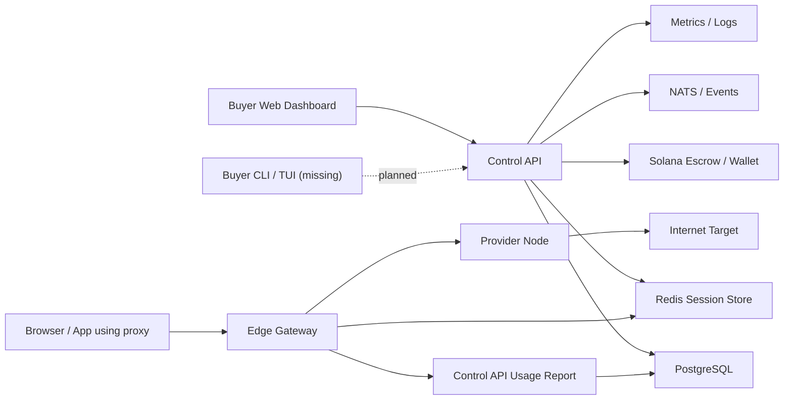
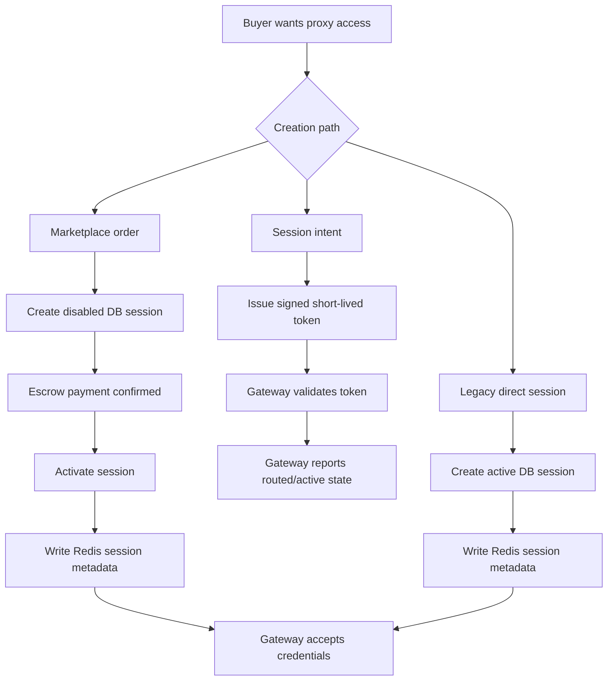
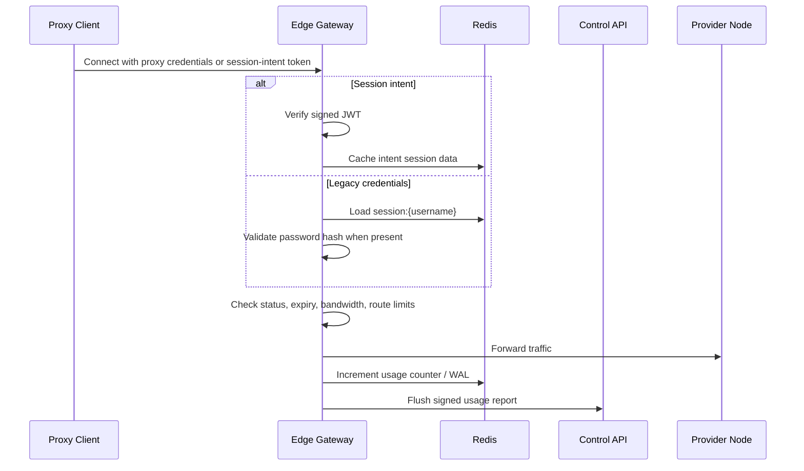
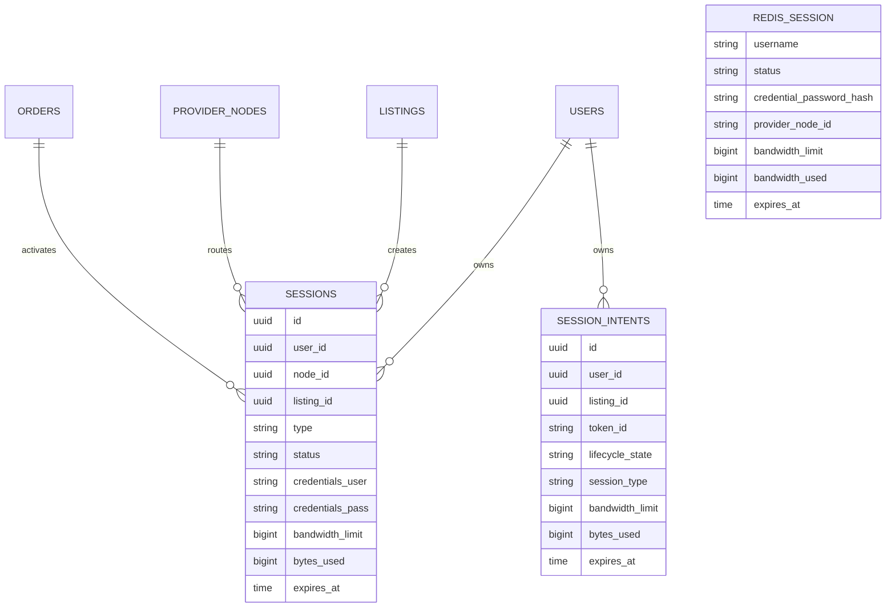
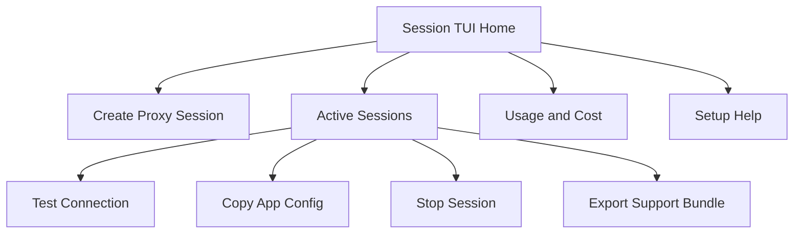
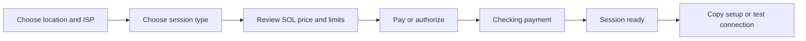

# ProxyHubb Session System Deep Dive Audit

Date: 2026-07-03

## Executive Summary

The ProxyHubb session system is functional, but it is carrying three overlapping generations of behavior:

- Legacy credential sessions created directly from `/v1/sessions`, `/v1/sessions/instant`, and `/v1/sessions/from-listing`.
- Marketplace escrow-backed sessions that start disabled and are activated after payment confirmation.
- New short-lived session intents that authorize gateway access through signed tokens.

The strongest foundation is the session-intent architecture. It separates buyer authorization from long-lived passwords, gives the gateway a compact signed contract, and supports policy controls such as geography, ISP, allowed domains, limits, and rotation. The main risk is that this newer path still coexists with older direct session flows, duplicated Redis contracts, and frontend types that do not match backend behavior.

The next engineering work should focus on unifying session activation and gateway authorization around one explicit contract. After that, the CLI, TUI, and web UX should be simplified so non-technical buyers can create, test, use, and recover proxy sessions without understanding internal terms like Redis, lifecycle ledgers, gateway edges, or legacy compatibility.

## Scope Reviewed

Primary areas reviewed:

- Control API session handlers:
  - `services/control-api/internal/api/session.go`
  - `services/control-api/internal/api/session_intent_state.go`
  - `services/control-api/internal/marketplace/session_activation.go`
- Session models and token contracts:
  - `services/control-api/internal/models/session.go`
  - `services/control-api/internal/models/session_intent.go`
  - `services/control-api/internal/sessionintent/token.go`
- Redis session state:
  - `services/control-api/internal/redis/redis.go`
- Edge gateway authorization and metering:
  - `services/edge-gateway/src/auth.rs`
  - `services/edge-gateway/src/main.rs`
  - `services/edge-gateway/src/ingress/socks5.rs`
  - `services/edge-gateway/src/ingress/h3.rs`
  - `services/edge-gateway/src/metering.rs`
- Web session UX:
  - `apps/web/src/lib/api/sessions.ts`
  - `apps/web/src/app/dashboard/proxy/page.tsx`
  - `apps/web/src/app/dashboard/sessions/page.tsx`
  - `apps/web/src/app/dashboard/usage/page.tsx`
  - `apps/web/src/components/sessions/StreamingSessionCard.tsx`
  - `apps/web/src/components/sessions/SessionLiveCard.tsx`
  - `apps/web/src/components/usage/UsageReviewModal.tsx`
  - `apps/web/src/components/usage/UsageProofCard.tsx`
- CLI and TUI surfaces:
  - `cli/src/main.rs`
  - `services/provider-node/src/tui/*`

## System Structure

The current system has these major parts:

- Buyer-facing web dashboard for creating proxy/session access, viewing sessions, copying examples, reviewing usage, and terminating sessions.
- Control API for session creation, intent issuance, marketplace activation, wallet/order linkage, usage reporting, and database state.
- PostgreSQL models for legacy sessions, session intents, orders, listings, provider nodes, usage proofs, reviews, and wallet state.
- Redis for gateway-readable session metadata and usage counters.
- Edge gateway for HTTP, SOCKS5, and H3 ingress, credential/session-intent validation, routing, rate limits, and usage metering.
- Provider nodes that receive traffic from gateway routing.
- Marketplace/order/escrow flow that should become the trusted path for paid buyer sessions.

## Architecture Diagram

## Session Flow Diagram

## Edge Gateway Authorization Flow

## Data Contract Map

## Key Findings

### Critical

1. Edge gateway treats `bandwidth_limit == 0` as exhausted.

   Backend and UX patterns imply `0` can mean unlimited, but gateway validation rejects sessions when `bandwidth_used >= bandwidth_limit`. For a zero limit, this becomes `0 >= 0`, so an unlimited session can be denied immediately.

   Fix: make the edge gateway treat `0` or omitted bandwidth as unlimited, and add contract tests covering legacy Redis sessions and session intents.

2. Legacy Redis credential sessions may authorize without password verification.

   The gateway validates a password only when `credential_password_hash` is present. Older or malformed Redis entries without a hash can authorize by username alone.

   Fix: require a password hash for credential sessions. Add a compatibility migration or explicit kill switch for old sessions that do not have hashed credentials.

3. Redis session writes can silently succeed when Redis is unavailable.

   `StoreSession` returns nil when the Redis client is nil. This can let the API create an active DB session while the gateway has no matching authorization state.

   Fix: fail closed for buyer-facing activation unless the session is explicitly marked `activation_pending` or `activation_failed` with durable retry.

4. Marketplace activation is not durable enough when Redis activation fails.

   Escrow-backed session activation writes Redis as the final gateway-facing state. If that fails, the order/payment may be confirmed but the buyer cannot use the session. The system needs durable activation events and retry state.

   Fix: add session activation/reconciliation records or status fields such as `activation_pending`, `activation_failed`, and `activation_synced`.

5. Multiple creation paths can bypass the safest payment/order contract.

   `/v1/sessions/from-listing`, `/v1/sessions/instant`, and direct `/v1/sessions` create active sessions independently of the newer escrow order flow. This increases reconciliation, billing, and UX risk.

   Fix: route paid buyer sessions through one marketplace/order/session activation contract, then keep session intents as the gateway access mechanism.

### High

6. Frontend session types do not match backend session types.

   The frontend declares session types as `rotating | sticky`, but the backend can create a raw `universal` session type. Frontend statuses also omit backend states like `disabled`.

   Fix: define a shared API contract or generated schema for session types, statuses, and response envelopes.

7. Session intent concurrency limits ignore active session intents.

   Intent creation checks active legacy sessions, but active/routed session intents can represent real gateway usage. Users can exceed intended concurrency through the newer path.

   Fix: count active/routed session intents and active legacy sessions together, or move concurrency enforcement to a unified session entitlement table.

8. Termination can partially succeed and still return an error.

   Termination marks a session terminated and deletes Redis before all proof/settlement work is guaranteed. If a later usage proof step fails, the API can return 500 even though the session is already shut down.

   Fix: split termination into explicit phases, persist proof failures, and return a clear state like `terminated_settlement_pending`.

9. User session reverse indexing in Redis is incomplete.

   `DeleteAllUserSessions` deletes only a reverse key and relies on TTL for actual session keys. If per-user revocation is needed, stale gateway sessions can remain valid until expiry.

   Fix: maintain `sessions:{userID}` membership in `StoreSession`, remove members on delete, and test revoke-all behavior.

10. Usage key naming is fragile.

   Some call sites treat usage keys as session ID based, while gateway-style keys are credential username based. This makes usage reconciliation harder to reason about.

   Fix: standardize on a stable gateway session key and include DB session ID as metadata, not as an interchangeable Redis key.

11. Session intent expiry is mostly read-driven.

   Expired authorized/routed intents are synced when status/list APIs are called. Without a background worker, expired records can remain visually active until read.

   Fix: add a periodic expiry job and metrics for expired-but-not-finalized intents.

12. Currency labels still leak USD/GHS concepts into a SOL-only experience.

   Session status and frontend types still include USD/GHS fields or labels. Since ProxyHubb is operating in Solana terms, user-visible session pricing should be SOL-first and avoid mixed currency labels unless an explicit fiat estimate is shown as secondary.

   Fix: update API response naming and frontend labels to SOL-only for user-facing session screens.

### Medium

13. Hardcoded production-looking endpoint appears in session creation.

   Some backend responses include `proxy.proxyhubb.com:3000`. Local/dev deployments and custom gateways need the configured gateway endpoint.

   Fix: return configured gateway endpoints from one API source of truth.

14. Sensitive session tokens and credentials are too visible in the web UI.

   The proxy page displays raw session intent tokens in copyable blocks. This is useful, but should default to redacted display with a deliberate reveal/copy action.

   Fix: show masked values by default and include expiry countdowns.

15. The web UX uses too much internal language.

   Terms like "Legacy Session Compatibility", "lifecycle ledger", "signal integrity", and "streaming session" make the system harder for non-technical buyers.

   Fix: use buyer-centered labels: "Proxy access", "Session", "Payment checking", "Ready to use", "Expired", "Stop session", and "Copy setup".

16. The connection tester is not clearly tied to the newly issued session.

   A buyer can create a token, then click test connection, but the test path is not obviously validating the exact new credentials/token.

   Fix: test the active token or credential set directly and show a plain result with remediation.

17. Session intent policy controls are not exposed in a beginner-friendly way.

   Backend supports geography, ISP, allow/deny domains, bandwidth, rotation, and price controls. The web flow currently exposes only a small subset.

   Fix: add a simple wizard with presets first and advanced controls second.

18. Provider node and marketplace trust signals are not carried into session creation clearly enough.

   Buyers need to know which provider, country, city, ISP, health, speed, price, and trust tier they are about to use.

   Fix: add a pre-confirmation summary and readiness check before creating paid access.

## CLI Audit

Current state:

- `proxyhubb-cli` is provider-focused.
- Commands include provider join, start, stop, status, doctor, dashboard, watch, install, and paths.
- There is no buyer/session CLI.

Missing buyer commands:

- `proxyhubb session create`
- `proxyhubb session list`
- `proxyhubb session status <id>`
- `proxyhubb session test <id>`
- `proxyhubb session terminate <id>`
- `proxyhubb session rotate-token <id>`
- `proxyhubb session copy-config --app curl|chrome|firefox|node|python`
- `proxyhubb session doctor`
- `proxyhubb session support-bundle`

Recommended CLI behavior:

- Use clear prompts for non-technical users.
- Hide tokens by default.
- Provide copy-ready commands and browser/app setup snippets.
- Run gateway reachability, token expiry, wallet/payment, and endpoint checks before saying the session is ready.
- Return machine-readable JSON with `--json` for automation.

## TUI Audit

Current state:

- Provider-node TUI exists for provider operators.
- There is no buyer-facing session TUI.

Recommended buyer TUI:

Recommended TUI screens:

- Home: current wallet state, active sessions, pending payments, gateway health.
- Create: location, ISP, rotation mode, bandwidth cap, duration, price summary.
- Active session detail: endpoint, masked username/token, expiry, usage, provider health.
- Test connection: DNS, gateway auth, route, provider reachability, target fetch.
- Recovery: payment pending, activation failed, token expired, provider unavailable.

## Web UX Audit

Current strengths:

- The dashboard already has a dedicated proxy page and sessions page.
- Session-intent creation works as a fast path.
- Copyable examples exist for curl and JavaScript.
- Usage proof and review components exist.
- Live session state cards exist.

Main UX problems:

- Too much internal language is visible.
- Session creation and marketplace buying are split conceptually.
- Buyers do not get a plain "ready/not ready" path.
- Payment pending and activation delayed states need clearer recovery UX.
- Tokens and credentials need safer reveal/copy treatment.
- SOL-only financial presentation is not fully enforced.
- CLI/TUI support for buyers is missing.

Recommended web flow:

Recommended beginner labels:

- "Create proxy session"
- "Choose country"
- "Choose city"
- "Choose ISP"
- "Rotates automatically" instead of "rotating stream"
- "Keeps the same IP" instead of "sticky core"
- "Payment checking" instead of "escrow reconciliation"
- "Ready to use" instead of "active lifecycle"
- "Stop session" instead of "terminate"

## Recommended Execution Order

1. Fix gateway authorization correctness.

   - Treat `bandwidth_limit == 0` as unlimited.
   - Require credential password hashes for legacy sessions.
   - Add tests for credential sessions and session intents.

2. Add durable session activation/reconciliation.

   - Persist activation attempts.
   - Add `activation_pending`, `activation_failed`, and `activation_synced` states.
   - Retry Redis activation after escrow/order confirmation.
   - Add operator visibility for stuck activations.

3. Unify paid buyer sessions behind the marketplace/order activation path.

   - Deprecate or guard direct active session creation from listings.
   - Keep session intents as the gateway-facing authorization layer.
   - Make direct sessions admin/dev-only if they remain.

4. Fix API/frontend contract drift.

   - Align session types, statuses, response envelopes, and SOL fields.
   - Remove user-facing USD/GHS labels from session screens.
   - Replace hardcoded gateway endpoints with configured gateway discovery.

5. Build buyer session CLI.

   - Add create/list/status/test/terminate/copy-config commands.
   - Add `--json` output.
   - Add beginner-friendly remediation for wallet, gateway, token, and provider issues.

6. Build buyer session TUI.

   - Add active sessions, create flow, setup snippets, live usage, and recovery screens.
   - Keep advanced details available but not first-screen language.

7. Improve web session creation UX.

   - Add a guided wizard.
   - Add provider readiness summary.
   - Add token redaction and expiry countdown.
   - Add a test that uses the actual issued token/credential.

8. Improve observability and support.

   - Add session activation metrics.
   - Add intent lifecycle metrics.
   - Add support bundle export with redacted config, latest doctor output, session state, and gateway test result.

9. Add contract and integration tests.

   - Web config to API request contract.
   - API session activation to Redis contract.
   - Edge gateway auth contract.
   - Usage metering and termination settlement contract.
   - Pending payment to activation recovery contract.

## Remove, Fix, Improve, Enhance

### Remove or Deprecate

- Public buyer access to legacy direct active-session creation.
- User-facing "legacy compatibility" wording.
- Mixed USD/GHS session labels in the SOL financial experience.
- Hardcoded gateway endpoints in API responses.
- Always-visible raw session tokens.

### Fix

- Gateway unlimited-bandwidth rejection.
- Missing password hash acceptance.
- Silent Redis activation success.
- Activation failure durability.
- Session type/status mismatch between backend and frontend.
- Concurrency checks that ignore active session intents.
- Partial termination failure state.
- Incomplete Redis user-session reverse index.

### Improve

- Payment pending and activation recovery UX.
- Session creation wizard.
- Provider trust/readiness summary.
- Connection testing tied to the actual issued session.
- SOL-only pricing display.
- Gateway endpoint discovery.

### Enhance

- Buyer CLI.
- Buyer TUI.
- Session support bundle.
- Admin/operator activation dashboard.
- Lifecycle and gateway metrics.
- Shared API schema or generated client types.

## Test Plan

Minimum test coverage before considering the session system stable:

- Unit tests:
  - Session intent signing and expiry.
  - Gateway validation for unlimited bandwidth.
  - Gateway rejection when credential hash is missing.
  - Redis session serialization/deserialization.
  - API response contract for session statuses and SOL fields.

- Integration tests:
  - Escrow/order payment confirmed to disabled session activation.
  - Redis activation failure to durable retry state.
  - Session intent creation to gateway authorization.
  - Usage metering flush to API usage proof.
  - Session termination with settlement failure.

- End-to-end tests:
  - Buyer creates a marketplace session and copies setup.
  - Buyer pays, sees "payment checking", then "ready to use".
  - Buyer tests the connection successfully.
  - Buyer sees token expiry and rotates/reissues.
  - Buyer terminates a session and sees final usage/settlement state.

## Final Recommendation

The best next fix is gateway authorization correctness, specifically the unlimited bandwidth bug and credential hash enforcement. Those are security and reliability issues at the point where real proxy traffic is accepted.

After that, implement durable activation/reconciliation for escrow-backed sessions. That will protect buyer trust when payment succeeds but Redis or gateway activation is delayed.

Once those two are done, the team should build the buyer session CLI/TUI and simplify the web flow around one plain promise: choose a provider, pay in SOL, get a tested proxy session, and recover clearly if anything is delayed.
