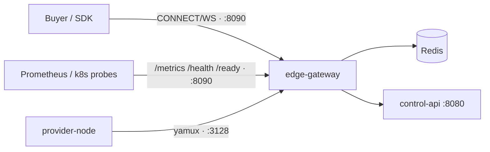

# Edge Gateway

The **data-plane entry point** for ProxyHubb. It terminates buyer proxy traffic,
authenticates sessions, enforces policy, selects provider nodes, bridges bytes over
**yamux** tunnels to `provider-node` agents, meters usage, and exposes metrics/health.

Implemented in **Rust** (Tokio + Hyper). For the full architecture analysis and the
forward-looking v2 plan, see:

- [`docs/EDGE_GATEWAY_DEEP_DIVE.md`](../../docs/EDGE_GATEWAY_DEEP_DIVE.md) — current-state analysis.
- [`docs/EDGE_GATEWAY_VNEXT_BLUEPRINT.md`](../../docs/EDGE_GATEWAY_VNEXT_BLUEPRINT.md) — vNext roadmap & implementation plan.
- [`docs/adr/0001-edge-gateway-scope-and-ports.md`](../../docs/adr/0001-edge-gateway-scope-and-ports.md) — port/scope decisions.

---

## Ports (canonical)

| Port | Env var | Listener | Who connects | Notes |
|-----:|---------|----------|--------------|-------|
| **8090** | `PORT` | Buyer proxy API | Buyers / SDK / browser | HTTP/1.1 + HTTP/2 `CONNECT`, WebSocket tunnel, **and** `/metrics`, `/health`, `/ready` |
| **3128** | `TUNNEL_PORT` | Provider tunnel | `provider-node` (outbound) | yamux; TLS-capable when `TLS_CERT_PATH`/`TLS_KEY_PATH` set |

> Buyers use **8090**. Providers connect outbound to **3128** (see `PROXYHUB_GATEWAY_ADDRS`
> in `provider-node`). A dedicated metrics port is a planned vNext (P5) enhancement; today
> `/metrics` is served on `8090`.



---

## HTTP endpoints (on `PORT` / 8090)

| Path | Method | Purpose |
|------|--------|---------|
| `/health` | GET | Liveness — process is up (`200` always while serving). |
| `/ready` | GET | Readiness — `200` when Redis answers `PING`; `503` otherwise. Reports healthy provider count. Set `READY_REQUIRE_PROVIDERS=true` to also require ≥1 provider. |
| `/metrics` | GET | Prometheus exposition. |
| `CONNECT host:port` | CONNECT | Buyer proxy tunnel (requires `Proxy-Authorization`). |
| `/debug/*`, `/api/v1/network/status` | GET | Debug/observability — only when `ENABLE_DEBUG_ROUTES=true` or a dev env. |

---

## Configuration

### Required (the process panics on startup if unset)

| Env | Purpose |
|-----|---------|
| `JWT_SECRET` | Validates provider tunnel JWTs. |
| `GATEWAY_SHARED_SECRET` | Auth for edge → control-api control-plane calls. |
| `SESSION_SECRET` | Signs/validates session-intent (v2) delegation tokens. |
| `PROVIDER_PRIVATE_KEY` | Ed25519 seed (hex) for signing metered usage batches. |

### Core (sane defaults shown)

| Env | Default | Purpose |
|-----|---------|---------|
| `HOST` | `0.0.0.0` | Bind address. |
| `PORT` | `8090` | Buyer proxy API + health/metrics/ready. |
| `TUNNEL_PORT` | `3128` | Provider yamux tunnel. |
| `REDIS_URL` | `redis://localhost:6379` | Sessions, sticky bindings, registry, WAL. |
| `CONTROL_API_URL` | `http://localhost:8080` | Control-API base URL. |
| `REGION` | _(unset)_ | Region tag for multi-region routing. |
| `SESSION_CACHE_SIZE` | `100000` | Max moka session cache entries. |
| `SESSION_CACHE_TTL_SECS` | `300` | Session cache TTL. |
| `READY_REQUIRE_PROVIDERS` | `false` | If `true`, `/ready` also requires ≥1 healthy provider. |
| `MAX_CONCURRENT_CONNECTIONS` | `8192` | Buyer TCP admission (`Semaphore`); excess accepts are dropped. |
| `SCORE_SNAPSHOT_REFRESH_MS` | `100` | Interval for debounced provider score snapshot rebuild. |

**P1 hot path:** On Linux, buyer `CONNECT` tunnels use `splice(2)` for the client→gateway leg when a raw TCP FD is available; the provider leg stays in userspace (yamux). Per-chunk bridge logs are `trace`; routing/auth noise is `debug` — use `RUST_LOG=edge_gateway=info` in production. Domain allow/block checks use suffix matching without per-rule `format!`; Redis keys are built with `String::with_capacity`.

### Timeouts & limits

| Env | Default | Purpose |
|-----|---------|---------|
| `PROXY_CONNECT_TIMEOUT_SECS` | `10` | Dial timeout to upstream provider. |
| `PROXY_IDLE_TIMEOUT_SECS` | `60` | Close a tunnel after this many idle seconds. |
| `RPC_REQUEST_TIMEOUT_SECS` | `15` | HTTP timeout for control-api/RPC calls. |
| `MAX_RPM_PER_SESSION` | _(unset)_ | Anomaly detector threshold (req/min). |

### Security & TLS

| Env | Purpose |
|-----|---------|
| `TLS_CERT_PATH` / `TLS_KEY_PATH` | Enables TLS on the provider tunnel (`3128`). |
| `TLS_CA_FILE`, `TLS_REQUIRE_CLIENT_CERT` | mTLS for provider tunnels. |
| `GEO_DENY_LIST` / `GEO_ALLOW_LIST` | ISO country codes to block / allow. |
| `GEOIP_DB_PATH` | MaxMind GeoLite2 DB path. |

### Settlement (off by default)

| Env | Default | Purpose |
|-----|---------|---------|
| `LEGACY_EDGE_ZK_SUBMISSION_ENABLED` | `false` | Deprecated edge-side Groth16/Solana path. Keep off — control-api batching is canonical. |
| `FULL_DECENTRALIZATION` | `false` | Skip legacy edge settlement entirely. |

---

## Build & run

```bash
# Type-check + tests
cargo check --tests
cargo test

# Lint (matches CI)
cargo fmt --check
cargo clippy --all-targets -- -D warnings

# Run locally (minimal env)
JWT_SECRET=dev GATEWAY_SHARED_SECRET=dev SESSION_SECRET=dev \
PROVIDER_PRIVATE_KEY=00..00 REDIS_URL=redis://localhost:6379 \
cargo run
```

### Build features

| Feature | Effect |
|---------|--------|
| _(default)_ | Core proxy data plane only (lean binary + `Dockerfile`). |
| `ml` | ONNX (`ort`) ML routing via dynamic load (CPU). |
| `ml-gpu` | `ml` + CUDA/TensorRT (`Dockerfile.ml`, NVIDIA base). |
| `legacy-zk` | arkworks Groth16 + Solana edge settlement (opt-in; control-api is canonical). |
| `blockchain` | gRPC blockchain stream client (compiled, not wired in `main`). |
| `pricing` | Price oracle/demand modules (compiled, not wired in `main`). |

See [ADR 0001](../../docs/adr/0001-edge-gateway-scope-and-ports.md). CI checks the default build
and `cargo check --features legacy-zk,blockchain,pricing,ml`. Port parity with K8s/compose is
tested by `deploy_manifests_use_canonical_ports`.

### P1 exit verification

After hot-path work (§5.1–§5.6), run benchmarks and parity checks:

```bash
./scripts/p1-bench.sh              # criterion: selection + snapshot + domain + redis keys
./scripts/p1-flamegraph.sh         # Linux: profile snapshot rebuild
./scripts/p1-load-smoke.sh         # health/metrics load (gateway must be up)
cargo test deploy_manifests_use_canonical_ports
```

Windows (PowerShell):

```powershell
.\scripts\p1-exit-verify.ps1       # parity tests + bench compile + criterion --test smoke
```

See [docs/P1_EXIT_CRITERIA.md](docs/P1_EXIT_CRITERIA.md). **P1 signed off:** [docs/P1_SIGNOFF.md](docs/P1_SIGNOFF.md).

### P2 admission & resilience

```powershell
.\scripts\p2-exit-verify.ps1          # unit tests
.\scripts\p2-compose-verify.ps1       # Docker stack + smoke + soak + chaos
```

See [docs/P2_ADMISSION_RESILIENCE.md](docs/P2_ADMISSION_RESILIENCE.md). **P2 signed off:** [docs/P2_SIGNOFF.md](docs/P2_SIGNOFF.md).

### P3 multi-pod (P3a)

```powershell
docker compose -f docker-compose.p3-multipod.yml up -d --build
.\scripts\p3-exit-verify.ps1
.\scripts\p3-multipod-smoke.ps1
.\scripts\p3-scale-benchmark.ps1
.\scripts\p3-pod-drain.ps1
```

**P3a signed off:** [docs/P3_SIGNOFF.md](docs/P3_SIGNOFF.md). **P3b signed off:** [docs/P3b_SIGNOFF.md](docs/P3b_SIGNOFF.md) — `.\scripts\p3-split-up.ps1`, `p3-split-smoke.ps1`.

### Docker

```bash
docker compose up edge-gateway        # PORT=8090, TUNNEL_PORT=3128 (Dockerfile, lean)
# GPU ML routing:
docker build -f Dockerfile.ml -t edge-gateway-ml .
```

The default image exposes `8090` (buyer API/health/metrics) and `3128` (provider tunnel) and
runs a `HEALTHCHECK` against `http://127.0.0.1:8090/health`.

---

## Buyer proxy endpoint (control-api)

Buyer `CONNECT` uses **8090** on the edge-gateway. control-api exposes
`EDGE_GATEWAY_BUYER_HOST` / `EDGE_GATEWAY_BUYER_PORT` (default `proxy.proxyhubb.com:8090`) in
session `proxy_credentials` — see `internal/api/gateway_endpoints.go`.

---

## Module map

See [`docs/EDGE_GATEWAY_DEEP_DIVE.md` §4](../../docs/EDGE_GATEWAY_DEEP_DIVE.md) for the full
module map (auth, routing, registry, pool, proxy, security, metering, tunnel, etc.).
