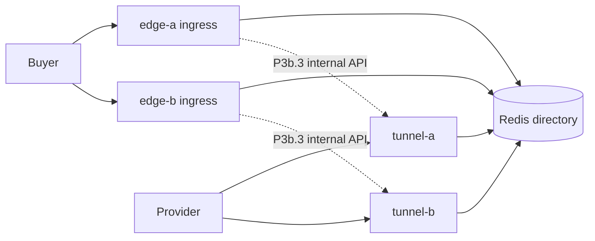

# P3b — Tunnel tier split

**Status:** Signed off — see [`P3b_SIGNOFF.md`](P3b_SIGNOFF.md).

**ADR:** [`docs/adr/0002-edge-gateway-p3b-tunnel-tier-split.md`](../../../docs/adr/0002-edge-gateway-p3b-tunnel-tier-split.md)

## Goal

Split **buyer ingress** (`edge-*`) from **provider tunnel** (`tunnel-gw-*`) while keeping a shared Redis provider directory (same as P3a).



## Environment (PR 1)

| Variable | Ingress (`edge-*`) | Tunnel (`tunnel-*`) |
|----------|--------------------|---------------------|
| `EDGE_MODE` | `split` | `split` |
| `EDGE_ROLE` | `ingress` | `tunnel` |
| `EDGE_POD_ID` | `edge-a` / `edge-b` | `tunnel-a` / `tunnel-b` |
| `TUNNEL_GW_ADDRS` | `tunnel-a@http://tunnel-a:8090,...` | _(optional)_ |
| `EDGE_PEER_URLS` | peer ingress URLs | _(unused in PR 1)_ |

Canonical ports unchanged ([ADR 0001](../../../docs/adr/0001-edge-gateway-scope-and-ports.md)): `PORT=8090`, `TUNNEL_PORT=3128`.

## Code hooks (PR 1)

- `EdgeMode::Split`, `EdgeRole::{All, Ingress, Tunnel}`
- `parse_tunnel_gw_urls()` / `Config::owner_forward_base_url()` (split → tunnel map, colocated → peer map)
- `Config::binds_tunnel_listener()` — false on split ingress
- `Config::serves_buyer_connect()` — false on split tunnel; public CONNECT/WS return **403** (internal forward still allowed for P3b.3)
- `EdgeMode::uses_multipod_directory()` — true for `colocated` and `split`

## Compose sketch

```powershell
cd services/edge-gateway
docker compose -f docker-compose.p3-split.yml up -d --build
```

Project name: **`edge-p3-split`**. See port matrix in ADR 0002.

```powershell
.\scripts\p3-split-up.ps1 -Build
.\scripts\p3-split-smoke.ps1
```

Provider nodes must use **tunnel** host ports (`23228` / `23229`); buyers use **ingress** (`28100` / `28101`).

## PR checklist

| PR | Scope |
|----|--------|
| **1** | ADR 0002, `EdgeMode::Split`, `EDGE_ROLE`, `TUNNEL_GW_ADDRS`, `docker-compose.p3-split.yml` |
| **2** | Reject buyer CONNECT/WebSocket on tunnel tier (`403`; internal forward exempt) |
| **3** | Ingress forwards via `TUNNEL_GW_ADDRS` (`owner_forward_base_url`) |
| **4** | `p3-split-smoke` scripts + sign-off |
| 5 | K8s split deployments (future) |
